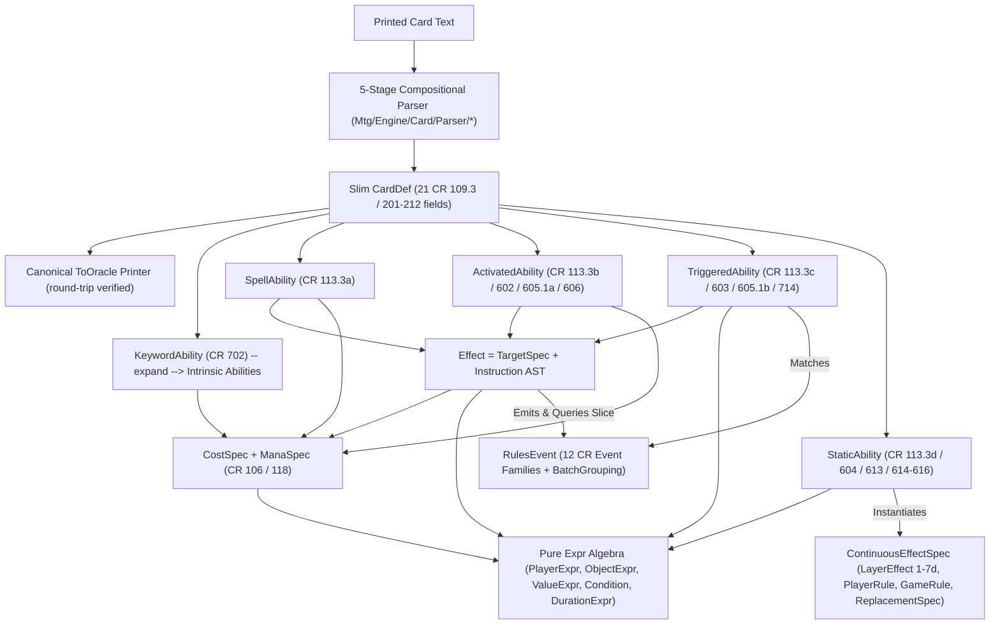
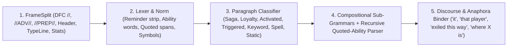

# Plan: Generalizing and Parameterizing `Mtg.Engine.Card` Ability Representations & Oracle Parsing

> **This document is a plan only.** It changes no engine code. It is written against `main` at `c826fb2` (merge of PR #673 on [`EVENT_ALIGNMENT_PLAN.md`](EVENT_ALIGNMENT_PLAN.md), post-Phase 51 execution) and checked against the *Magic: The Gathering* Comprehensive Rules **effective 25 September 2026** (`MagicCompRules 20260925.txt`, pinned in [`Rules.lean`](Mtg/Engine/Rules.lean#L1-L29) and [`README.md`](README.md)).

---

## 0. Scope, CR Citation Policy, Build Invariants, and Non-Goals

### 0.1 Comprehensive Rules Citation Policy (25 September 2026 Edition)

Every type, constructor, parser production, and evaluation rule in this plan is anchored to the **25 September 2026** Comprehensive Rules (`Rules.effectiveDate = "2026-09-25"`). Implementation PRs must use these rule numbers and fix stale pre-20260925 citations on code they touch (consistent with [`EVENT_ALIGNMENT_PLAN.md`](EVENT_ALIGNMENT_PLAN.md#L10-L32)):

| Domain | 25 September 2026 CR Sections | Architectural Role in This Plan |
| :--- | :--- | :--- |
| Object characteristics | **109.3**, **201–212** (incl. **202.2**, **204**, **205**, **207**, **208.1–3**, **209.1**, **210.1**, **211.1**, **212.1**) | Defines the exact 21 fields of [`CardDef`](Mtg/Engine/Card/CardDef.lean#L49-L387); separates rules text (**207**) from abilities (**113**). |
| Ability taxonomy & zones | **113.1a**, **113.2c**, **113.3a–d**, **113.6**, **113.7a** | Partition into **Spell** (113.3a), **Activated** (113.3b), **Triggered** (113.3c), and **Static** (113.3d) abilities; active-zone defaults and exceptions (113.6b–p). |
| Mana, costs, life, damage, draw, counters | **106**, **107.3–4**, **118**, **119**, **120**, **121**, **122** | Parameterizes `ManaSpec` / `ManaSpendRestriction` (106.6), compositional `CostSpec` (118.3, 118.7–9, 118.12), `CounterKind` / `CounterBag` (122.1, 122.1b, 122.6). |
| Targets & modes | **115**, **303.4a**, **601.2c–d**, **608.2b**, **700.2** | Compositional `TargetSpec` / `TargetSlot` (per-`"target"`-word arity, divisions, relational constraints) and unified `ModalSpec`. |
| Intrinsic basic-land mana | **305.6**, **613.1d**, **613.1f** | Synthesizes `{T}: Add {M}` dynamically in Layer 4 from evaluated basic land subtypes so Layer 6 ability-removal effects still apply afterward. |
| Zone-change identity & LKI | **400.7**, **400.7a–m**, **608.2h** | Connects `ObjectExpr` / `ValueExpr` look-back queries to [`EventObject`](Mtg/Engine/Game/Object.lean) snapshots and **400.7d** `CastEvent` history. |
| Casting, activating, mana & loyalty abilities | **601**, **602**, **605**, **606**, **733.1** | Unifies `SpellAbility`, `ActivatedAbility` (including **605.1a** activated mana abilities and **606** loyalty abilities), **601.2f** total-cost calculation, and **601.3** permissions/restrictions. |
| Triggered abilities | **603.1**, **603.2c/g**, **603.3b**, **603.4**, **603.6a**, **603.7**, **603.10a–f**, **603.12**, **605.1b** | Aligns `TriggerPattern` 1-to-1 with [`RulesEvent`](Mtg/Engine/Game/Event.lean#L1044-L1069), `BatchGrouping`, intervening `"if"`, structural look-back, delayed/reflexive triggers, and triggered mana abilities. |
| Static abilities, layers, text, replacement & prevention | **604.1–3**, **611.2–3**, **612**, **613.1–8**, **614**, **615**, **616** | Maps `StaticAbility` directly to CDAs (**604.3**), [`LayerEffect`](Mtg/Engine/Game/Event.lean#L386-L397) (Layers 1–7d), [`PlayerRule`](Mtg/Engine/Game/Event.lean#L401-L416), [`GameRule`](Mtg/Engine/Game/Event.lean#L420-L428), [`ReplacementSpec`](Mtg/Engine/Game/Event.lean#L225-L231), and [`PreventionSpec`](Mtg/Engine/Game/Event.lean#L249-L254). |
| Resolution & one-shot effects | **608**, **609**, **610.1–3**, **701** | Compositional `Instruction` AST with lexical `VarId` bindings backed by post-replacement `RulesEvent` slices (**614.6**) and single-effect banishing (**610.3**). |
| Keywords, copies, faces, Sagas, Adventures | **702** (incl. **702.21** Ward, **702.29** Cycling, **702.33** Kicker, **702.34** Flashback, **702.37** Morph, **702.51** Convoke, **702.61** Split second, **702.73** Changeling, **702.85** Cascade, **702.108** Prowess, **702.122** Crew, **702.126** Improvise, **702.131** Ascend, **702.164** Toxic, **702.176** Impending, **702.190** Sneak, **702.194** Teamwork), **707**, **708**, **712**, **714**, **715** | Parameterized `KeywordAbility` with pure `expand` (**702.1**); unified `SubFace` for Adventure (**715**) and Prepare spells; Saga chapters (**714.2**) as `TriggeredAbility`s. |

### 0.2 Lean 4, Lake, and Engine Invariants

Every phase in §5 must preserve six hard engineering invariants verified against the codebase:

1. **Lake Precompiled Plugin Hierarchy ([`lakefile.toml`](lakefile.toml#L20-L54))**:
   - `Mtg.Engine.Card` (`precompileModules = true`) must remain strictly acyclic below `Mtg.Engine.Game` (`precompileModules = true`); `Card` never imports `Game`, `GameObject`, `Status`, or `Pending`.
   - Move [`Turn.lean`](Mtg/Engine/Turn.lean#L1-L140) (which has **zero imports**: `Step`, `Phase`, `TurnRef`, `PhaseRef`, `StepAnchor`) from `Mtg.Engine.Game`'s globs into `Mtg.Engine.Card`'s globs. Because [`Zone.lean`](Mtg/Engine/Zone.lean#L11-L66) (`PlayerId`, `ObjectId`, `EffectId`, `BatchId`, `Zone`) is already in `Mtg.Engine.Card`'s globs, we can cleanly promote shared value-level CR enums (`ReplacementTier`, `SetOrAdd`, `TextChange`, `PermanentDesignation`, `ZoneVerb`, `LibraryPosition`, `PlayerDesignation`, `CostKind`) from [`Event.lean`](Mtg/Engine/Game/Event.lean) and [`Object.lean`](Mtg/Engine/Game/Object.lean) into `Mtg.Engine.Card` so `Card` and `Game` share **one** canonical type definition without parallel mirror enums.
   - Keep `Mtg.Engine.Catalog` **un-precompiled** ([`lakefile.toml`](lakefile.toml#L25-L34)) while `parseOracleCard!` executes at compiled native speed via the `Mtg.Engine.Card` shared plugin.
2. **Lean C Runtime Constructor Tag Budget (`ctorIdx ≤ 243` for field-bearing constructors)**:
   - Lean 4's C runtime stores an allocated constructor's **0-indexed declaration ordinal** (`ctorIdx`) in an 8-bit `m_tag` capped at `LeanMaxCtorTag = 243` (tags `244..255` are reserved for `LeanClosure`, `LeanArray`, etc.; only nullary unboxed constructors may appear at `ctorIdx ≥ 244`). Today [`Resolution.frc`](Mtg/Engine/Card/SpellResolution.lean#L3324-L3328) sits at **declaration ordinal `243` (`244`th constructor, zero headroom remaining)**, forcing all 120 subsequent constructors (`ctorIdx = 244..363`) to be nullary.
   - Every target AST `inductive` in §2 is stratified by CR domain so **no inductive exceeds 35 constructors**, permanently eliminating tag-limit ceilings and set-named overflow wrappers (`FraStatic`, `FraEvent`, `FrcEffect`, and the 9 `*Leftover` enums).
3. **Clang Optimization Time & Mutual/Nested Recursion Discipline ([`lakefile.toml`](lakefile.toml#L4-L8), [`Effect.lean`](Mtg/Engine/Card/Effect.lean#L94-L98))**:
   - Recursions over nested containers (`Array Instruction`, `Array ObjectPred`, `Array Condition`, `Option CardDef`) must use explicit `mutual` structural blocks or `Array.attach` / `List.attach` rather than implicit `List.map` well-founded splitters over giant flat enums, preventing multi-second Clang register-allocation stalls under `./scripts/ci-lake-build.sh` (`lake build --wfail`).
   - Mutual AST blocks (`Instruction`, `ActivatedAbility`, `TriggeredAbility`, `StaticAbility`, `TokenSpec`) must derive or define `BEq` and `Repr` **once** for the mutual tuple and project per-type instances (as in [`SpellResolution.lean`](Mtg/Engine/Card/SpellResolution.lean#L922-L926) and [`Event.lean`](Mtg/Engine/Game/Event.lean#L2353-L2361)).
   - Shrinking `CardDef` from 141 fields to 21 fields removes `set_option maxRecDepth 1024` ([`CardDef.lean`](Mtg/Engine/Card/CardDef.lean#L47)) and provides structural **`BEq CardDef`** (handling recursive `otherFace : Option CardDef` directly instead of comparing `reprStr`).
4. **Parser Throughput Barriers**:
   - Preserve `@[irreducible, noinline]` on parser entry points and catalog helpers, `Thunk`-cached token/verb dispatch tables, and linear `Array Char` text normalization ([`OracleNorm.lean`](Mtg/Engine/Card/OracleNorm.lean#L280-L317)).
5. **100% Catalog Authoring & Bidirectional Round-Trip Invariant**:
   - All **981** cards in [`supportedCatalogCards`](Mtg/Engine/Catalog/Supported.lean#L1-L30) (`13` core + `193` HOB + `117` HOC + `286` MSH + `285` FRA + `87` FRC) continue to be authored from printed Oracle text via `fromOracle`, with `modellingError? == none` and zero unparsed text fallbacks.
   - `parseOracleCard (renderFullOracle c) == .ok c` (upgraded from `reprStr` comparison to structural `BEq CardDef`) must hold across **all 981 catalog cards** (adding `realityFractureCommanderCards` to the round-trip `#guard` suite in [`ParseOracle.lean`](Mtg/Engine/Tests/ParseOracle.lean)) plus open-ended parameter-generalization `#guard`s and [`OracleRoundtrip.lean`](Mtg/OracleRoundtrip.lean).
6. **Zero Ruling or Demo Regression**:
   - All **1,057** Gatherer/Scryfall rulings in [`OracleData.lean`](Mtg/Engine/OracleData.lean#L3260) and all **10,700+** `#guard` assertions across `Card/Guards.lean`, `Engine/Tests/*`, `OracleRulings.lean`, `Demo/RenderTests.lean` (533 `#guard`s), and `Demo/Check0..9.lean` must pass at every phase boundary.

### 0.3 Non-Goals

Consistent with [`EVENT_ALIGNMENT_PLAN.md`](EVENT_ALIGNMENT_PLAN.md#L33-L53), unmodeled CR subsystems (infect/wither 120.3b/d, regeneration 701.19, battles as attack targets 508.1b, Initiative 726, Attractions/stickers, planeswalking 603.10g, disguise/manifest/cloak, active day/night transitions 731.2) are not implemented as new gameplay rules here, though the generalized AST leaves natural algebraic slots for each.

---

## 1. Diagnosis of Current Ability and Parser Representations

Across the **29 files (25,778 lines)** in `Mtg/Engine/Card/`, incremental set additions (`HOB`/`HOC` → `MSH` → `FRA` → `FRC`) produced six structural bottlenecks:

### 1.1 `CardDef` Field Proliferation (141 Fields) and Layer 3 / Layer 6 Bypasses

[`CardDef`](Mtg/Engine/Card/CardDef.lean#L49-L387) has **141 fields**. Only **18** describe CR 109.3 / 201–212 frame characteristics (plus `otherFace`), and **7** hold structured ability/sub-face containers (`spellEffect`, `spellModes`, `activatedAbilities`, `staticAbilities`, `triggeredAbilities`, `adventure`, `prepareFace`). The remaining **115+ fields** encode single-mechanic or single-card abilities directly on the card record:

| Ad-Hoc `CardDef` Field Bucket | Field Count | Representative Fields & Architectural Failure Mode |
| :--- | ---: | :--- |
| Printed `{T}: Add` mana fields | **21** | `tapAddMana`, `tapAddAnyColor`, `tapAddOneOf`, `tapAddManaForEach`, `tapAddRestricted` (parsed from raw English strings at runtime by [`restrictionOfText`](Mtg/Engine/Game/ManaAbilities.lean#L184-L210)), `tapPayLifeAddOneOf`, `filterMana`, `tapAddCommanderIdentity`, `tapAddOppCouldProduce` — competing with `ActivatedAbility`, `FraStatic.tapAdd*`, and CR 305.6 land subtypes. |
| Spell cost modifiers & cast rules | **19** | `costReductionIfTargetTapped`, `costReductionIfYouControl`, `costReductionEqualFlyingPower`, `flashIfYouControlSubtype`, `firstCreatureHasFlash`, `cantBeCountered`, `castOnlyIfGraveyardAtLeast` — competing with `StaticAbility` and `FraStatic`. |
| Additional/alternative costs & keyword params | **18** | `prowessInstances`, `cascade`, `kicker`, `giftTreasure`, `teamwork`, `flashback`, `flashbackDiscard`, `additionalCostSacrificeArtifactOrCreature`, `additionalCostBeholdOrPay`, `morph`, `impending`, `protectionFromColors`, `cycling`, `toxic` — split off from [`Keywords`](Mtg/Engine/Card/Keywords.lean#L11-L48). |
| Enters-tapped / enters-with / as-enters | **23** | 10 `entersTapped*` fields, 6 `entersWith*` fields, `asEntersChooseCreatureType`, `asEntersChooseOddEven`, `asEntersChooseColor`, `cloneOnEnter` — competing with `FraStatic.entersTappedChooseColor` and `StaticAbility.entersWithXPlusOne`. |
| Continuous, replacement & modal side-channels | **35** | `exileOppCreaturesInstead` (duplicating `FraStatic.exileOpponentsDyingCreatures` in [`exilesOppDeath?`](Mtg/Engine/Game/Movement.lean#L64-L70)), `tokenDoubling`, `opponentsCantGainLife`, `planeswalkersYouControlHave`, `fraTriggerModes` (single global modal array preventing two modal triggers on one card), `ward` (fourth representation of Ward). |

**Direct rules and tooling consequences**:
- **Layer 3 (CR 612) & Layer 6 (CR 613.1f) divergence**: In [`Casting.lean`](Mtg/Engine/Game/Casting.lean#L30-L38), `face.flashIfYouControlSubtype` reads `baseCard` without `evalLayer3` or `retainsPrintedAbilities`, `radagastFlash` checks `(g.baseCard o).firstCreatureHasFlash && g.retainsPrintedAbilities o` (missing Layer-6 granted copies), and `cosmicAwarenessFlash` checks `g.staticAbilities o`.
- **Dual-printer drift & equality blind spots**: [`structuredAbilityLines`](Mtg/Engine/Card/CardDef.lean#L709-L725) (used by `CardDef.abilitiesText` and `ToString CardDef`) renders only 16 field families, omitting 80+ `CardDef` ability fields (`ward`, `flashback`, `kicker`, `cascade`, `morph`, `impending`, `cycling`, `toxic`, `exileOppCreaturesInstead`, `tokenDoubling`, `opponentsCantGainLife`, `tapAddAnyColor`, `tapPayLifeAddOneOf`, `filterMana`, `entersTapped`, etc.) while [`renderFullOracle`](Mtg/Engine/Card/ParseOracle.lean#L2250-L2304) maintains a separate manual per-field printer; meanwhile `CardDef` lacks `BEq`, forcing [`oracleRoundtripDiff`](Mtg/Engine/Card/ParseOracle.lean#L2306-L2310) to compare `reprStr`.

### 1.2 Eight Overlapping Effect/Resolution Subsystems & Zero C-Tag Headroom

Although [`Effect`](Mtg/Engine/Card/Effect.lean#L21-L34) wraps `resolution : Resolution`, [`Resolution`](Mtg/Engine/Card/SpellResolution.lean#L1856-L3630) (**364 constructors**: 158 field-bearing + 206 nullary) is four separate instruction sets concatenated into one inductive, surrounded by four external effect enums:

1. **Trigger DSL region of `Resolution`** (`L1857–2901`, 67 ctors) — resolved by [`TriggeredAbilities.lean`](Mtg/Engine/Game/TriggeredAbilities.lean).
2. **Spell region of `Resolution`** (`L2902–3073`, 65 ctors) — resolved by [`EffectResolution.lean`](Mtg/Engine/Game/EffectResolution.lean).
3. **Activated region of `Resolution`** (`L3074–3222, 3330–3349`, 80 ctors) — partially bridged to spells via [`ofSpellStep` / `ofSpell`](Mtg/Engine/Card/Effect.lean#L327-L402) / `toSpell` (returning `.unrecognized` on unbridged constructors, requiring a 12-constructor allowlist in [`doesNothingAsSpell`](Mtg/Engine/Card/Effect.lean#L412-L431)).
4. **FRA / MSH region of `Resolution`** (`L3228–3325, 3350–3630`, 152 ctors, ~35 named directly after individual cards like `.overwriteTheMultiverse`, `.vraskasMercyDestroy`, `.identityEcho`) — resolved by [`FraResolve.lean`](Mtg/Engine/Game/FraResolve.lean), hitting **`| frc (e : FrcEffect)` at 0-indexed constructor ordinal `243` (`LeanMaxCtorTag = 243`)**.
5. **[`FrcEffect`](Mtg/Engine/Card/FrcEffect.lean#L34-L179)** (64 ctors, mostly card-named: `.pathToExile`, `.swords`, `.sunfall`, `.factOrFiction`, `.teferi`) — resolved by [`FrcResolve.lean`](Mtg/Engine/Game/FrcResolve.lean).
6. **[`SharedTrigger`](Mtg/Engine/Card/SharedTrigger.lean#L499-L1083)** (169 ctors) + **9 `*Leftover` enums** (`L18–275`, 91 ctors across `EnterLeftover`, `StepLeftover`, `DeathLeftover`, `ThisAttackLeftover`, `EnterOrAttackLeftover`, `WatchLeftover`, `YouAttackLeftover`, `CastLeftover`, `ResourceLeftover`) — lowered into `Resolution` by [`SharedTrigger.timing`](Mtg/Engine/Card/Trigger.lean#L262-L1067), yet simultaneously retained in `Effect.sharedTrigger` for `toNotation` and `OracleArgs`.
7. **[`ChapterResolution`](Mtg/Engine/Card/Chapter.lean#L23-L79)** (24 ctors) — lowered via `chapterTiming` and [`Chapters.lean`](Mtg/Engine/Game/Chapters.lean).
8. **[`PermanentAction`](Mtg/Engine/Card/PermanentAction.lean#L17-L62)** (21 ctors) — fixed-constant single-permanent actions with hardcoded EOT duration.

Tokens suffer the same three-way split across [`TokenKind`](Mtg/Engine/Card/Token.lean#L13-L76) (37 ctors), [`TriggerToken`](Mtg/Engine/Card/SpellResolution.lean#L1388-L1408) (9 ctors, passing `.treasure` as a dummy `TokenKind` in `Trigger.lean`), and [`FrcToken`](Mtg/Engine/Card/FrcEffect.lean#L15-L30) (15 ctors: `citizen`, `warrior`, `insect`, `myr`, `kobold`, `mite`, `shark`, `gingerbrute`, `angel`, `human`, `goblin`, `map`, `treasure`, `rogue`, `incubator`).

### 1.3 Impure, Trigger-Only Selector DSL and Bespoke Inter-Step State

[`SpellResolution.lean`](Mtg/Engine/Card/SpellResolution.lean#L274-L1795) introduced `PlayerSelector` (10 ctors), `ObjectSelector` (98 ctors), `NumberSelector` (36 ctors), `CostSelector` (4 ctors), and `ConditionSelector` (30 ctors), and [`Targeting.lean`](Mtg/Engine/Card/Targeting.lean#L44-L86) introduced `TargetFilter` (28 fields). However:
- **Scoped only to triggers**: Spells, activated abilities, static abilities, trigger *events*, and activation costs do not use the selector algebra.
- **~80% nullary one-card atoms & smuggled side effects**: 79/98 `ObjectSelector`, 30/36 `NumberSelector`, and 21/30 `ConditionSelector` constructors are nullary card-specific atoms (`.forestsExceptCause`, `.perFatGraveyard`, `.enrageGrantsCombat`), and some smuggle imperative side effects into selectors (e.g., `PlayerSelector.opponentHasYou` embeds *Palantír of Orthanc*'s mill-and-life-loss branch; `ObjectSelector.enteringVillain` embeds once-per-turn connive).
- **76 legacy `EffectTargetKind` constructors & `TargetFilter.noun` equality bug**: 76 of 80 [`EffectTargetKind`](Mtg/Engine/Card/Targeting.lean#L95-L263) constructors hardcode filters that `TargetFilter` already expresses; `TargetFilter` embeds `noun : String` inside derived `BEq`; and [`OracleArgs.takeKind`](Mtg/Engine/Card/OracleArgs.lean#L230-L248) only generalizes 13 hardcoded `EffectTargetKind` constructors, treating `.filtered TargetFilter` as opaque.
- **Bespoke inter-step registers**: Passing `"that card"` / `"that much"` / `"if you do"` across steps relies on **13 `Trigger*Note` enums** in `SpellResolution.lean`, **~35 per-card fields** on [`ContinuationFrame`](Mtg/Engine/Game/Event.lean#L1995-L2173) (`palantirChoiceReady`, `grimaImpulse*`, `humansTappedThisWay`, `removedHopeThisWay`, `thirstDiscardsLeft`, etc.), and **100+ card-specific constructors** across [`PostStep`](Mtg/Engine/Game/Event.lean#L1215-L1537) (208 ctors total) and [`FrcPostStep`](Mtg/Engine/Game/Event.lean#L1116-L1157) (31 ctors total).

### 1.4 Six-Layer Trigger Fragmentation & `TriggeredAbility.timing` Split-Brain

- **Dual event enums**: [`TriggerEvent`](Mtg/Engine/Card/TriggerEvent.lean#L114-L343) (113 ctors) + [`FraEvent`](Mtg/Engine/Card/TriggerEvent.lean#L35-L108) (35 ctors) largely duplicate [`SharedTriggerWhen`](Mtg/Engine/Card/SharedTrigger.lean#L280-L461) (90 ctors), instead of matching [`RulesEvent`](Mtg/Engine/Game/Event.lean#L1044-L1069) structurally.
- **Silent `.draw 0` split-brain**: In [`TriggeredAbility.timing`](Mtg/Engine/Card/TriggeredAbility.lean#L19-L22), `let t := (e.asTrigger?.getD (.draw 0)).timing` silently evaluates `ab.timing.resolution` to `.draw (.fixed 0)` whenever `e.sharedTrigger == none` (true for all `TriggeredAbility.fra`, `parseTriggerModes`, and `FrcParse` triggers!), forcing engine callers to inspect both `ab.effect.resolution` and `ab.resolution` — while [`faceModellingError?`](Mtg/Engine/Card/CardDef.lean#L844-L872) never validates `triggeredAbilities` or `fraTriggerModes` at all.
- **Manual batch loops in `matchTriggers`**: [`Core.matchTriggers`](Mtg/Engine/Game/Core.lean#L11721-L11968) hardcodes 13 bespoke `for` loops for `"one or more"` batch triggers before a massive per-event `TriggerEvent`/`FraEvent` dispatcher.

### 1.5 Static, Cost, and Keyword Fragmentation

- [`StaticAbility`](Mtg/Engine/Card/StaticAbility.lean#L207-L475) (112 ctors) + [`FraStatic`](Mtg/Engine/Card/StaticAbility.lean#L23-L125) (44 ctors) mix 9 distinct CR concepts (CDAs, Layer 1–7d continuous effects, cost modifiers, permissions, combat/casting restrictions, replacements/preventions, Ward/Extort/Boast keywords, mana abilities, and the `.printed String` unparsed fallback).
- Costs are split across [`ActivationCost`](Mtg/Engine/Card/ActivatedAbility.lean#L85-L129) (23 fields), [`FraCost`](Mtg/Engine/Card/ActivatedAbility.lean#L45-L69) (11 ctors), [`CostSelector`](Mtg/Engine/Card/SpellResolution.lean#L1111-L1153) (4 ctors), [`WardCost`](Mtg/Engine/Card/TriggerEvent.lean#L15-L31) (7 ctors), and `CardDef.additionalCost*`.
- Keywords are split across [`Keywords`](Mtg/Engine/Card/Keywords.lean#L11-L48) (22 `Bool` fields, including non-keyword `cantBeBlocked`, non-keyword supertype helper `storied`, and hardcoded `islandwalk`), [`KeywordCounters`](Mtg/Engine/Card/Keywords.lean#L156-L164) (covering only 8 of the 12 keyword counters already present in [`CounterKind`](Mtg/Engine/Card/Counter.lean#L14-L44), omitting `trample`, `indestructible`, `lifelink`, and `shadow`), `CardDef` fields (`ward`, `prowessInstances`, `cascade`, `kicker`, `flashback`, `morph`, `impending`, `protectionFromColors`, `cycling`, `toxic`), `StaticAbility` (`.instantSorcerySplitSecond`, `.improvise`, `.sneak`, `.boast`, `.extort`), and `ActivatedAbility` (`equipSubtype`, `equipWorthy`, `powerUp`, `exhaust`).

### 1.6 Three-Tier Oracle Parser Ceiling

The parser splits across:
1. **[`OracleCandidates.lean`](Mtg/Engine/Card/OracleCandidates.lean)** (~1,466 prototype entries, 1,871 lines) + **[`OracleArgs.lean`](Mtg/Engine/Card/OracleArgs.lean)** (1,905 lines): `OracleArgs` extracts/refills leaf scalar slots (`Nat`, `Int`, `CardSubtype`, `CardType`, `Supertype`, `CounterKind`, and 13 `EffectTargetKind` shapes) inside a **fixed whole-ability skeleton**. It cannot compose an existing trigger pattern with an existing intervening `"if"` and an existing effect sentence unless that exact product appears in `OracleCandidates`, nor can it recursively parse quoted granted abilities (`"..."`).
2. **`parseStructural` in [`ParseOracle.lean`](Mtg/Engine/Card/ParseOracle.lean#L654-L956)** (303 lines): hardcoded string matchers mutating `CardDef` fields.
3. **[`FrcParse.lean`](Mtg/Engine/Card/FrcParse.lean)** (396 lines): post-candidate prefix/substring matchers mapping Commander reprints onto card-named `FrcEffect` constructors.

---

## 2. Target Unified Ability Architecture (Aligned with `RulesEvent` & CR)



### 2.1 Layer 0: Shared CR Primitives in `Mtg.Engine.Card`

To align `Mtg.Engine.Card` directly with [`Event.lean`](Mtg/Engine/Game/Event.lean) and [`Object.lean`](Mtg/Engine/Game/Object.lean) while keeping `Card` independent of `Game`:
1. Move [`Turn.lean`](Mtg/Engine/Turn.lean#L1-L140) (`Step`, `Phase`, `TurnRef`, `PhaseRef`, `StepAnchor`) into `Mtg.Engine.Card`'s globs in [`lakefile.toml`](lakefile.toml#L20-L24).
2. Leverage [`Zone.lean`](Mtg/Engine/Zone.lean#L11-L66) (already in `Mtg.Engine.Card`'s globs, providing `PlayerId`, `ObjectId`, `EffectId`, `BatchId`, `Zone`) to promote value-level CR enums from [`Event.lean`](Mtg/Engine/Game/Event.lean) and [`Object.lean`](Mtg/Engine/Game/Object.lean) into `Mtg/Engine/Card/Primitives.lean`:
   - `ZoneKind` (owner-parametric counterpart of `Zone`: `.library`, `.hand`, `.battlefield`, `.graveyard`, `.stack`, `.exile`, `.command`, `.ante`, `.outside`),
   - [`ZoneVerb`](Mtg/Engine/Game/Event.lean#L820-L834) (`.cast`, `.draw`, `.discard`, `.mill`, `.sacrifice`, `.destroy`, `.exile`, `.counter`, `.resolve`, `.put`, `.returnToHand`, `.shuffleIntoLibrary`, `.playLand`),
   - [`LibraryPosition`](Mtg/Engine/Game/Event.lean#L837-L842) (`.top`, `.bottom`, `.fromTop`, `.shuffledIn`) + symbolic `LibraryPosSpec` (where `.fromTop` takes `ValueExpr`),
   - [`PermanentDesignation`](Mtg/Engine/Game/Event.lean#L749-L754) (`.ringBearer`, `.goaded`, `.prepared`, `.harnessed` — plus compositional `PermanentDesignationTag` without concrete `PlayerId` for ability syntax) & [`PlayerDesignation`](Mtg/Engine/Game/Event.lean#L862-L865) (`.citysBlessing`, `.enduringStory`),
   - [`CostKind`](Mtg/Engine/Game/Object.lean#L237-L260), [`ReplacementTier`](Mtg/Engine/Game/Event.lean#L121-L133), [`TextChange`](Mtg/Engine/Game/Event.lean#L358-L361), and [`SetOrAdd`](Mtg/Engine/Game/Event.lean#L340-L355) (cleaning out the 3 card-specific constructors `.addArtifactRemoveCreature`, `.removeCreature`, `.addConstruct55` in favor of compositional `{ set?, add, remove }` type/subtype/color modifiers).
3. Define a structural typeclass **`HasTextChange (α : Type)`** (`applyTextChanges : Array TextChange → α → α`) implemented compositionally across every AST node (`ObjectPred`, `TokenSpec`, `ManaSpendRestriction`, `KeywordAbility`, `Instruction`, `TriggerPattern`, `StaticAbility`), giving **universal CR 612 / Layer 3 text-change coverage** without ad-hoc per-constructor tables.
4. Unify [`TokenKind`](Mtg/Engine/Card/Token.lean#L13-L76), [`TriggerToken`](Mtg/Engine/Card/SpellResolution.lean#L1388-L1408), and [`FrcToken`](Mtg/Engine/Card/FrcEffect.lean#L15-L30) into a single parameterized **`TokenSpec`** (`Mtg/Engine/Card/Token.lean`):
   - `.predefined PredefinedToken` (CR 111.10a–s & set-predefined tokens: `.treasure`, `.food`, `.clue`, `.map`, `.vibranium`, `.incubator`, `.heartwood`, `.lotus`),
   - `.custom CustomTokenSpec` (`name?`, `supertypes`, `types`, `subtypes : Array CardSubtype`, `colors : ColorSet`, `power? : Option ValueExpr`, `toughness? : Option ValueExpr`, `loyalty? : Option ValueExpr`, `keywords : Array KeywordAbility`, `grantedAbilities : Array GrantedAbility`), or
   - `.copyOf (target : ObjectExpr) (mods : Array CopyModification)` (covering token copies with P/T overrides, added types/subtypes/keywords, or removed legendary supertype per CR 707.9).

### 2.2 Layer 1: Pure, Side-Effect-Free Expression Algebra (`Mtg/Engine/Card/Expr.lean`)

All selectors become **pure queries** evaluated over `(Game, EvalEnv)` (and `GameSnapshot` / `EventObject` for CR 603.10 / 608.2h LKI). Every card-specific side effect previously smuggled into selectors (`opponentHasYou`, `enteringVillain`) moves into `Instruction`.

```lean
/-- Lexical binding slot for an earlier step's post-replacement outcome (CR 608.2c / 614.6). -/
structure VarId where
  idx : Nat
deriving DecidableEq, Repr, Inhabited, BEq

inductive CmpOp where
  | eq | ne | lt | le | gt | ge
deriving DecidableEq, Repr, Inhabited, BEq

inductive ArithOp where
  | add | sub | mul | divFloor | max | min
deriving DecidableEq, Repr, Inhabited, BEq

inductive AggOp where
  | count | sum | max | min | countDistinct
deriving DecidableEq, Repr, Inhabited, BEq
```

- **`PlayerFilter` & `PlayerExpr` (11 constructors)**:
  - `.you`, `.activePlayer`, `.defendingPlayer`, `.monarch` (CR 725), `.target (slot : Nat)`, `.controllerOf (obj : ObjectExpr)`, `.ownerOf (obj : ObjectExpr)`, `.triggerPlayer (role : TriggerPlayerRole)` (actor, caster, damaged/attacked player), `.stepPlayers (v : VarId)`, `.matching (rel : PlayerRelation) (pred : PlayerPred)` (`you`, `opponent`, `teammate`, `anyPlayer` × predicates like `hasDesignation PlayerDesignation`, `isMonarch`, `graveyardCount`, `controls ObjectFilter`), `.chosenBy (chooser : PlayerExpr) (count : CountRange) (filter : PlayerFilter)`.
- **`ObjectPred`, `ObjectFilter`, & `ObjectExpr` (35 constructors on `ObjectPred`, 10 on `ObjectExpr`)**:
  - `ObjectPred`: boolean `.all (Array ObjectPred)`, `.any (Array ObjectPred)`, `.not ObjectPred`, plus atomic predicates over:
    - *Layer 1–7d characteristics (CR 109.3 / 613)*: `.hasType CardType`, `.hasSupertype Supertype` (with `"historic"` / `"storied"` desugaring to `.any #[...]` at parse/AST helpers with canonical `ToOracle` tags), `.hasSubtype SubtypeRef` (literal `CardSubtype` or `.chosenOnSource`), `.hasColor ColorRef` (literal `Color`, `.chosenOnSource`, `.commanderIdentity`), `.colorCount CmpOp Nat` (colorless = `= 0`, monocolored = `= 1`, multicolored = `≥ 2`), `.named NameRef` (literal or `.chosenOnSource`), `.hasKeyword KeywordTag`, `.stat StatKind CmpOp ValueExpr` (`power`, `toughness`, `manaValue`, `loyalty`, `defense`), `.statParity StatKind ParityRef` (odd/even or `.chosenOnSource`).
    - *Status & identity (CR 110.5 / 111 / 708)*: `.isToken Bool`, `.isFaceDown Bool`, `.isCopy Bool`, `.isCommander`, `.isPermanentCard`, `.tapped Bool`, `.phasedOut Bool`, `.combatRole CombatRolePred` (`attacking`, `attackingPlayer PlayerExpr`, `attackingAlone`, `blocking`, `blockingObject ObjectExpr`, `blocked`, `unblocked`), `.hasDesignation PermanentDesignationTag`, `.counterCount (Option CounterKind) CmpOp ValueExpr`.
    - *Relations*: `.sameAs ObjectRef`, `.otherThan ObjectRef` (replaces `another` / `exceptCause`), `.controlledBy PlayerFilter`, `.ownedBy PlayerFilter`, `.attachedTo ObjectExpr`, `.hasAttachment ObjectFilter`, `.targets ObjectOrPlayerExpr`, `.shares SharedCharacteristic ObjectExpr`.
    - *Event & cast history (via `Game.events` `RulesEvent` log & CR 400.7d)*: `.wasCast`, `.castFrom ZoneKind`, `.enteredThisTurn`, `.attackedThisTurn`, `.dealtDamageThisTurn (combatOnly : Bool) (recipient? : Option RecipientFilter)`.
  - `ObjectExpr`: `.this`, `.target (slot : Nat)`, `.attachedHost` (enchanted/equipped/fortified object), `.triggerSubject`, `.stepObjects (v : VarId)`, `.inZones (zones : ZoneSetSpec) (pred : ObjectPred)`, `.topOfLibrary (owner : PlayerExpr) (count : ValueExpr)`, `.extremum (dir : ExtremumDir) (metric : StatKind) (among : ObjectExpr)` (replaces `.leastPower`, etc.), `.union (Array ObjectExpr)`, `.diff ObjectExpr ObjectExpr`.
  - **Direct alignment with [`ObjectScope`](Mtg/Engine/Game/Event.lean#L328-L337)**: Static continuous effects (CR 611.3a) evaluate `ObjectFilter` dynamically on each layer pass; one-shot continuous effects with timed or `untilSourceLeaves` durations (CR 611.2c, matching `EffectDuration.isTimedResolvingDuration` at [`Event.lean`](Mtg/Engine/Game/Event.lean#L321-L325)) lock characteristic-modifying targets onto `.objects (Array ObjectId)` at resolution while binding rule/permission filters cleanly.
- **`ValueExpr` (12 constructors, replacing 36 `NumberSelector` constructors)**:
  - `.const Int`, `.chosenX`, `.objectStat StatKind ObjectExpr` (reads live Layer-7d stat or `EventObject` LKI per CR 608.2h), `.counterCount (Option CounterKind) ObjectExpr`, `.aggregate AggOp ObjectMetric ObjectExpr` (where `AggOp.countDistinct` on `.power` directly models *"number of different powers among creatures you control"* without a dedicated `CardDef` field), `.basicLandTypeCount ObjectExpr` (Domain), `.cardTypeCount ObjectExpr` (Delirium / Tarmogoyf), `.subtypeCount SubtypeCategory ObjectExpr` (e.g. number of planeswalker types among planeswalkers you control), `.playerMetric PlayerMetric PlayerExpr` (`life`, `handSize`, `librarySize`, `graveyardSize`, `landsPlayedThisTurn`, `spellsCastThisTurn`, `cardsDrawnThisTurn`, `lifeGainedThisTurn`, `lifeLostThisTurn`, `unspentMana`, `poisonCounters`, `opponentsCount`), `.manaSymbols (color? : Option Color) ObjectExpr` (devotion / Zemo), `.stepMetric StepMetric VarId` (`movedCount`, `createdCount`, `damageDealt`, `excessDamage`, `lifeChanged`, `countersChanged`, `sumPower`, `chosenNumber`), `.binary ArithOp ValueExpr ValueExpr`.
- **`Condition` (14 constructors, replacing `ConditionSelector`, `FraCondition`, `FraActivationCondition`, `SharedTriggerOpts` fields, and `CardDef` conditions)**:
  - `.cmp CmpOp ValueExpr ValueExpr`, `.exists ObjectExpr`, `.forAll ObjectExpr ObjectPred`, `.playerPred PlayerExpr PlayerPred`, `.castPred CastContextPred` (`wasKicked`, `giftPromised`, `impendingPaid`, `castFrom ZoneKind`, `manaSpentMatches ManaSpentPred` — backed by `CastEvent` per CR 400.7d), `.turnHistory EventHistoryPred` (`scriedThisTurn`, `surveilledThisTurn`, `eventOccurredThisTurn PlayerFilter EventPattern`, `eventOccurredLastTurn PlayerFilter EventPattern`), `.stepSucceeded VarId`, `.duringStep Step`, `.duringPhase Phase`, `.isYourTurn`, `.isNight`, `.all (Array Condition)`, `.any (Array Condition)`, `.not Condition`.
- **`DurationExpr` (11 constructors, 1-to-1 with [`EffectDuration`](Mtg/Engine/Game/Event.lean#L293-L317))**:
  - `.untilEndOfTurn`, `.untilEndOfCombat`, `.untilEndOfStepOrPhase StepOrPhase`, `.untilStepOrPhase StepOrPhase`, `.untilNextTurnOf PlayerExpr`, `.untilEndOfNextTurnOf PlayerExpr`, `.whileOnBattlefield ObjectExpr` (CR 611.2b / 702.26f), `.untilLeavesBattlefield ObjectExpr` (CR 611.2a / 702.26d), `.whileHasCounter ObjectExpr CounterKind`, `.whileInZone ObjectExpr ZoneKind`, `.indefinite`.

### 2.3 Layer 2: Unified `TargetSpec`, `CostSpec`, and `ManaSpec`

1. **`TargetSpec` & `TargetSlot` (`Mtg/Engine/Card/Targeting.lean`)**:
   - Replaces all 76 hardcoded [`EffectTargetKind`](Mtg/Engine/Card/Targeting.lean#L95-L263) constructors.
   - Each `"target"` word in Oracle text corresponds to **one `TargetSlot`** (CR 115.1):
     ```lean
     inductive TargetDomain where
       | object (zones : ZoneSetSpec) (pred : ObjectPred)
       | player (pred : PlayerPred)
       | anyTarget (pred : RecipientPred := .any) -- CR 115.4 creature, planeswalker, battle, or player
     deriving Repr, Inhabited, BEq

     structure TargetSlot where
       domain : TargetDomain
       count : CountRange := .exact 1 -- .exact n | .upTo n | .between lo hi | .anyNumber
       division? : Option (DivisionKind × ValueExpr) := none -- CR 601.2d damage / counters
       groupConstraint? : Option GroupTargetConstraint := none -- e.g. total mana value <= N, different controllers, distinct names
     deriving Repr, Inhabited, BEq
     ```
   - No `noun : String` is stored on `TargetSlot`; its Oracle phrase is rendered canonically by `TargetSlot.toOracle`, and AI target-scoring heuristics are computed structurally from `(TargetSlot, Instruction)`.

2. **`CostSpec` & `CostItem` (`Mtg/Engine/Card/Cost.lean`, CR 118)**:
   - Replaces [`ActivationCost`](Mtg/Engine/Card/ActivatedAbility.lean#L85-L129) (23 fields), [`FraCost`](Mtg/Engine/Card/ActivatedAbility.lean#L45-L69) (11 ctors), [`CostSelector`](Mtg/Engine/Card/SpellResolution.lean#L1111-L1153), [`WardCost`](Mtg/Engine/Card/TriggerEvent.lean#L15-L31), and all `CardDef.additionalCost*` fields.
   - `CostItem` (15 constructors, each mapping 1-to-1 to [`EventCause.costPayment`](Mtg/Engine/Game/Object.lean#L348) + [`CostKind`](Mtg/Engine/Game/Object.lean#L237-L260) + `RulesEvent`):
     - `.mana ManaCost`
     - `.loyalty LoyaltySymbol` (CR 606)
     - `.tapSelf` / `.untapSelf` (CR 701.26)
     - `.tapObjects (count : CostCountSpec) (filter : ObjectPred)` (covers `.count n`, `.anyNumber`, and `.totalPowerAtLeast n` for Crew CR 702.122 / Saddle)
     - `.payLife ValueExpr` (CR 119.4)
     - `.sacrifice (count : CostCountSpec) (what : SelfOrFilter)` (CR 701.21)
     - `.discard (count : CostCountSpec) (what : DiscardCostTarget)` (`.self`, `.hand`, `.random`, `.matching ObjectPred`, CR 701.9)
     - `.exile (count : CostCountSpec) (zones : ZoneSetSpec) (what : SelfOrFilter)` (including Zemo's total-mana-value constraint via `CostCountSpec.withTotalMvAtLeast` / Collect Evidence CR 701.59)
     - `.removeCounters (count : CostCountSpec) (kind? : Option CounterKind) (fromObj : SelfOrFilter)`
     - `.putCounters (count : ValueExpr) (kind : CounterKind) (onObj : SelfOrFilter)` (e.g. stun/poison counters)
     - `.returnToHand (count : CostCountSpec) (what : SelfOrFilter)` (Sneak CR 702.190a)
     - `.behold CardSubtype` (CR 701.4: reveal from hand or choose controlled permanent)
     - `.waterbend ValueExpr` (CR 701.67)
     - `.or (choices : Array CostSpec)` (CR 118.12: `"behold a Goblin or pay {2}"`, `"discard a card or pay {3}"`)
   - `CostSpec` optionally binds paid objects/amounts to a `VarId` so effects can read `"the sacrificed creature's power"` or `"the number of counters removed this way"` via `ValueExpr.stepMetric` / `ObjectExpr.stepObjects`.

3. **`ManaSpec` & `ManaSpendRestriction` (`Mtg/Engine/Card/ManaSpec.lean`, CR 106 / 605)**:
   - Promotes and generalizes [`ManaOutput`](Mtg/Engine/Game/ManaAbilities.lean#L15-L25) into `Mtg.Engine.Card`:
     ```lean
     inductive ManaPoolPalette where
       | explicit (types : Array ManaType)
       | anyColor
       | chosenColorOnSource
       | commanderColorIdentity (who : PlayerExpr)
       | colorsAmong (objs : ObjectExpr)
       | typesLandsCouldProduce (lands : ObjectExpr) -- CR 106.7 (Exotic Orchard / Reflecting Pool)
     deriving Repr, Inhabited, BEq

     inductive ManaSpec where
       | sequence (items : Array (ManaType × ValueExpr)) -- e.g. {R}{R}, or {G} for each Elf
       | oneOf (palette : ManaPoolPalette) (amount : ValueExpr) -- e.g. one mana of any color, or N mana of any one color
       | combination (palette : ManaPoolPalette) (amount : ValueExpr) -- e.g. 2 mana in any combination of colors
       | colorAmong (palette : ManaPoolPalette) -- Mox Amber / Arcane Signet (empty palette -> 0 mana)
     deriving Repr, Inhabited, BEq
     ```
   - `ManaSpendRestriction` replaces string-parsed `tapAddRestricted` and `FraManaUse` with compositional predicates (`onlyForSpells ObjectPred`, `onlyForAbilitiesOf ObjectPred`, `notFromZone ZoneKind`, `grantsSpellRider SpellRiderSpec` for `"can't be countered"` / haste / +1/+1 counter riders).

### 2.4 Layer 3: Unified One-Shot `Instruction` AST & Lexical `stepEnv` (`Mtg/Engine/Card/Instruction.lean`)

`Resolution` (364 ctors), `FrcEffect` (64 ctors), `SharedTrigger` (169 + 91 ctors), `ChapterResolution` (24 ctors), and `PermanentAction` (21 ctors) collapse into **one family-stratified `Instruction` inductive (18 top-level constructors: 10 `RulesEvent`-family action wrappers + 8 combinators, with ≤ 16 constructors in every sub-family enum)** aligned 1-to-1 with [`RulesEvent`](Mtg/Engine/Game/Event.lean#L1044-L1069):

| `RulesEvent` Family | `Instruction` Wrapper & Sub-Family Constructors | Replaces |
| :--- | :--- | :--- |
| `ZoneEvent.moved` | `.moveZone (objs : ObjectExpr) (dest : DestZoneSpec) (verb : ZoneVerb) (mods : MoveMods := {})` | Destroy, exile, sacrifice, bounce, reanimate, put onto battlefield (tapped / attacking / attached / with counters), put top/bottom/offset of library, discard, mill; includes CR 610.3 `.exileUntilLeaves` mode in `MoveMods`. |
| `ZoneEvent.created` | `.create (op : CreateOp)` — `.tokens (who : PlayerExpr) (count : ValueExpr) (spec : TokenSpec) (mods : EnterMods := {})`, `.emblem (who : PlayerExpr) (emblem : EmblemSpec)` | All token constructors across `Resolution`, `SharedTrigger`, `FrcEffect`, and planeswalker emblems. |
| `PermanentEvent` | `.permanent (op : PermanentOp)` — `.setTapped`, `.modifyCounters`, `.attach`, `.transform`, `.turnFaceUp`, `.phaseOut`, `.setDesignation` (7 ctors) | All tap/untap, +1/+1/stun/shield/lore/time counter ops, move/double counters, Equip/Aura attach, transform/incubate, phase out, goad, harness, prepare, ring-bearer. |
| `DamageEvent` | `.damage (op : DamageOp)` — `.deal (source : ObjectExpr) (to : RecipientExpr) (amount : ValueExpr) (flags : DamageFlags := {})`, `.fight (a b : ObjectExpr) (oneWay : Bool := false)` | All targeted, mass, divided, excess-tracked, and power-scaled damage & fight/bite effects. |
| `LifeEvent` | `.life (op : LifeOp)` — `.gain (who : PlayerExpr) (amount : ValueExpr)`, `.lose (who : PlayerExpr) (amount : ValueExpr)`, `.set (who : PlayerExpr) (amount : ValueExpr)` | All life gain/loss/drain/set/exchange effects. |
| `PlayerEvent` | `.player (op : PlayerOp)` (16 ctors) — `.drawCards`, `.scry`, `.surveil`, `.inspectLibrary`, `.searchLibrary`, `.reveal`, `.shuffle`, `.addMana`, `.proliferate`, `.temptWithRing`, `.explore`, `.amass`, `.connive`, `.empowerPlaneswalker`, `.setPlayerDesignation`, `.becomeMonarch` (CR 725) | `inspectLibrary` alone unifies **40+** `lookAtTop*`, `revealUntil*`, `millThenPut*`, `factOrFiction`, `riddlesInTheDark`, `proteus`, `jhoira`, and `dack` constructors via a declarative `(slice, chooser, partitions)` spec. |
| `TurnEvent` | `.turn (op : TurnOp)` — `.extraTurn`, `.extraPhase`, `.extraStep` (3 ctors) | Extra turns and extra combat phases/damage steps. |
| `StackObjectEvent` / `CastEvent` | `.stack (op : StackOp)` — `.counterStack`, `.copyStackObject`, `.mayCastOrPlay` (3 ctors) | Counterspells (incl. exile/bounce-on-counter), spell/ability copying, Cascade/impulse/graveyard mid-resolution casts. |
| `ContinuousEffectEvent` / `DelayedTriggerEvent` | `.installEffect (op : InstallEffectOp)` — `.applyContinuous`, `.applyRule`, `.applyReplacement`, `.createDelayedTrigger` (4 ctors) | All pumps, keyword/ability grants, base-P/T animations, control changes, copy effects, damage preventions, and EOT return/sacrifice delayed triggers (CR 603.7). |
| `TriggerQueueEvent` | `.queueReflexiveTrigger (whenDone : TriggeredAbility)` | `"When you do"` reflexive triggers (CR 603.12). |
| **Combinators (8)** | `.noop`, `.seq (Array Instruction)`, `.bind (v : VarId) (step : Instruction) (cont : Instruction)`, `.ifCond (c : Condition) (t : Instruction) (e : Instruction := .noop)`, `.optional (who : PlayerExpr) (cost? : Option CostSpec) (onYes : Instruction) (onNo : Instruction := .noop)`, `.unlessPays (payer : PlayerExpr) (cost : CostSpec) (ifUnpaid : Instruction)`, `.chooseModes (spec : ModalSpec)`, `.forEach (iter : ForEachSpec) (v : VarId) (body : Instruction)` | Composes multi-sentence spells, `"if you do"`, `"unless [player] pays"`, modal effects, and APNAP loops. |

> **Why `Instruction.bind` + `RulesEvent` Slices Retires 13 `Trigger*Note` Enums & ~35 `ContinuationFrame` Fields**:
> Every atomic action in `Mtg/Engine/Game/` appends `GameEvent.rules ...` to `Game.events` tagged with its [`EventCause`](Mtg/Engine/Game/Object.lean#L338-L355). When the unified interpreter executes `.bind v step cont`, it allocates/records the step's `EffectId` and `startIdx := g.events.size` before `step` and, once `step` (including any nested `Pending.chooseReplacement` pauses) finishes, filters `g.events[startIdx..]` to events whose [`EventCause.oneShotEffectId?`](Mtg/Engine/Game/Object.lean#L358-L361) (which unwraps `.replaced _ orig`) matches that step's `EffectId` (or cost-payment child), summarizing them into `StepOutcome` stored in `ContinuationFrame.stepEnv : Array (VarId × StepOutcome)`. Because `Game.events` records **post-replacement reality** while `oneShotEffectId?` isolates the step from unrelated state-based or concurrent events, `"destroy all creatures, then create X tokens where X is the number of creatures destroyed this way"` and `"exile target creature; its controller gains life equal to its power"` automatically obey **CR 608.2c / 614.6** without any card-specific `Note` or `PostStep`.

`Effect` then shrinks from 10 fields to:
```lean
structure Effect where
  targets : TargetSpec := {}
  body : Instruction := .noop
deriving Repr, Inhabited, BEq
```
Both `SpellCastKind` and `AbilityCastKind` become **computed pure functions** (`Effect.classifyForAgent : Effect → SpellCastKind`) inspecting `targets` and `body`, removing manual heuristic tags from card definitions.

### 2.5 Layer 4: CR 113.3 Four-Category Abilities, Parameterized `KeywordAbility`, and 21-Field `CardDef`

To support granted abilities (`"Creatures you control have '{T}: ...'"`, `"When you do, ..."` reflexive triggers, token abilities, emblems) cleanly in Lean 4 without well-founded recursion blowup, `Instruction`, `Effect`, `ActivatedAbility`, `TriggeredAbility`, `StaticAbility`, `ContinuousModification`, and `TokenSpec` are defined in a single stratified `mutual` block in `Mtg/Engine/Card/Ability.lean` with a single tuple `BEq` / `Repr` / `HasTextChange` instance (every inductive in the target AST has ≤ 35 constructors).

1. **`SpellAbility` (CR 113.3a)**:
   ```lean
   structure SpellAbility where
     effect : Effect
     additionalCosts : Array AdditionalCostSpec := #[] -- mandatory or optional (e.g. Gift, Behold-or-pay, Sacrifice)
     alternativeCosts : Array AlternativeCostSpec := #[] -- e.g. free if control commander
     castRestrictions : Array Condition := #[] -- CR 601.3 (e.g. cast only if 7+ cards in graveyard)
   deriving Repr, Inhabited, BEq
   ```
2. **`ActivatedAbility` (CR 113.3b / 602 / 605.1a / 606)**:
   ```lean
   structure ActivatedAbility where
     cost : CostSpec
     effect : Effect
     timing : ActivationTiming := .instant -- .instant | .sorcery (CR 602.5d)
     activeZones : Array ZoneKind := #[.battlefield] -- CR 113.6
     turnLimit? : Option Nat := none -- once each turn = some 1
     lifetimeLimit? : Option LifetimeLimit := none -- Exhaust / Power-up
     condition? : Option Condition := none -- "Activate only if..."
     tag? : Option ActivationMechanicTag := none -- .equip | .cycling | .boast | .powerUp | .exhaust | .crew
   deriving Repr, Inhabited, BEq
   ```
   - `ActivatedAbility.isLoyaltyAbility` checks `cost.hasLoyaltySymbol` (CR 606.1).
   - `ActivatedAbility.isManaAbility` checks `!ab.isLoyaltyAbility && ab.effect.targets.isEmpty && ab.effect.body.couldAddMana` (CR 605.1a).
3. **`TriggeredAbility` (CR 113.3c / 603 / 605.1b / 714.2)**:
   ```lean
   inductive BatchGrouping where
     | perOccurrence -- "Whenever a creature dies"
     | oncePerBatch -- "Whenever one or more creatures die" (CR 603.2c)
     | perPlayerInBatch -- "Whenever a player discards one or more cards"
     | perSourceInBatch -- "Whenever a creature deals combat damage to the monarch"
     | counterThreshold (kind : CounterKind) (chapters : Array Nat) (finalChapter? : Option Nat := none) -- CR 714.2 Saga / Plan
   deriving Repr, Inhabited, BEq

   structure TriggeredAbility where
     word : TriggerWord -- .when | .whenever | .at
     pattern : TriggerPattern -- 1-to-1 over ZoneEvent, PermanentEvent, DamageEvent, LifeEvent, PlayerEvent, TurnEvent, CastEvent, StackObjectEvent, CombatEvent
     grouping : BatchGrouping := .perOccurrence
     interveningIf? : Option Condition := none -- CR 603.4 (checked on trigger AND on resolution)
     activeZones : Array ZoneKind := #[.battlefield] -- CR 113.6
     limit : TriggerLimit := .unlimited -- .onceEachTurn | .optionalOnceEachTurn | .nthEachTurn Nat
     effect : Effect
   deriving Repr, Inhabited, BEq
   ```
   - `TriggerPattern.usesLookBack : Bool` is computed structurally from CR 603.10a–f (leaves-battlefield, dies, sacrificed, tapped/untapped, control change, combat damage).
   - `TriggeredAbility.isManaAbility` is computed structurally from CR 605.1b (`targets.isEmpty && pattern.triggersOnManaAbilityOrManaAdded && effect.body.couldAddMana`).
   - Saga final-chapter number (CR 714.2d / 704.5s SBA) is derived directly as the maximum chapter number across `triggeredAbilities` with `BatchGrouping.counterThreshold .lore ...` (respecting Layer 6 ability removal per CR 714.4).
4. **`StaticAbility` (CR 113.3d / 604 / 611.3 / 613 / 614–616)** — **6 stratified constructors** (zero `.printed String` escape hatch; zero `FraStatic`):
   ```lean
   inductive StaticAbility where
     | characteristicDefining (cda : CdaSpec) -- CR 604.3 (all zones: Layer 4/5/7a CDAs)
     | continuous (cond? : Option Condition) (scope : ObjectFilter) (mod : ContinuousModification) -- CR 611.3 / 613 Layers 1-7d
     | ruleModifying (cond? : Option Condition) (rule : RuleModification) -- PlayerRule, GameRule, PlayPermissionSpec, CombatRule, TriggerRule
     | costModifier (cond? : Option Condition) (appliesTo : CostTargetSpec) (mod : CostModification) -- CR 601.2f / 602.2b (self or other spells/abilities)
     | replacement (cond? : Option Condition) (spec : StaticReplacementSpec) -- CR 614 / 615 (entersTappedUnless, entersWithCounters, asEntersChoice, replaceEvent, preventDamage)
     | enchantRestriction (filter : TargetSlot) -- CR 303.4a
   deriving Repr, Inhabited, BEq
   ```
5. **`KeywordAbility` (`Mtg/Engine/Card/Keywords.lean`, CR 702)** — **`SimpleKeyword` (26 unit constructors) + `KeywordAbility` (16 constructors: `.simple SimpleKeyword` + 15 parameterized constructors)**, stored as `keywords : Array KeywordAbility` (retaining multiplicity for cumulative keywords like Prowess CR 702.108d, Cascade CR 702.85c, Toxic CR 702.164b, and Ward CR 702.21):
   - `SimpleKeyword` (26 unit constructors): `flying`, `firstStrike`, `doubleStrike`, `deathtouch`, `defender`, `flash`, `haste`, `indestructible`, `lifelink`, `menace`, `reach`, `trample`, `vigilance`, `shadow`, `changeling`, `splitSecond`, `convoke`, `improvise`, `ascend`, `daybound`, `nightbound`, `prowess`, `cascade`, `myriad`, `undying`, `extort`.
   - Parameterized `KeywordAbility` constructors (15): `hexproof (from? : Option QualityFilter)`, `ward (cost : CostSpec)`, `protection (from : ProtectionQuality)`, `landwalk (pred : ObjectPred)`, `toxic (n : Nat)`, `affinity (forWhat : ObjectFilter)`, `equip (filter : ObjectPred) (cost : CostSpec)`, `cycling (typeFilter? : Option ObjectPred) (cost : CostSpec)`, `kicker (cost : CostSpec)`, `flashback (cost : CostSpec)`, `morph (cost : CostSpec)`, `impending (counters : Nat) (cost : CostSpec)`, `sneak (cost : CostSpec)`, `crew (power : Nat)`, `teamwork (count : Nat)`.
   - Pure `KeywordAbility.expand : KeywordAbility → ExpandedKeyword` (CR 702.1) projects intrinsic triggered abilities (Prowess, Ward, Cascade, Myriad, Undying, Extort, Impending end-step), activated abilities (Equip, Cycling, Crew), static abilities (Changeling CDA, Impending noncreature while time counters remain, Split second, Protection, Landwalk, Affinity, Convoke, Improvise), and alternative/additional costs (Flashback, Morph, Impending, Sneak, Kicker, Teamwork).
   - Keyword counters (`CounterKind`, adding `.hexproof` if needed alongside existing 12 keyword counters) map 1-to-1 via `CounterKind.grantedKeyword? : CounterKind → Option KeywordAbility` across **all** keyword counters (CR 122.1b), retiring the partial 8-field `KeywordCounters` struct.
6. **Slim 21-Field `CardDef`, `PrintedStat`, and Unified `SubFace` (`Mtg/Engine/Card/CardDef.lean`)**:
   ```lean
   /-- Printed side of a P/T box (CR 208.1 / 208.2 / 208.2a). -/
   inductive PrintedStat where
     | fixed (n : Int)
     | star (addend : Int := 0) -- `star 0` prints `*`, `star k` prints `k+*`; evaluates to `addend` when `*` is undetermined (CR 208.2a)
   deriving DecidableEq, Repr, Inhabited, BEq

   inductive SubFaceKind where
     | adventure -- CR 715
     | prepare -- FRA Prepare spell
   deriving DecidableEq, Repr, Inhabited, BEq

   structure SubFace where
     kind : SubFaceKind
     name : String
     manaCost : ManaCost := ManaCost.empty
     colorIndicator : Option ColorSet := none
     supertypes : Array Supertype := #[]
     types : Array CardType := #[]
     subtypes : Array CardSubtype := #[]
     keywords : Array KeywordAbility := #[]
     spellAbility : Option SpellAbility := none
     staticAbilities : Array StaticAbility := #[]
   deriving Repr, Inhabited, BEq

   structure CardDef where
     name : String
     manaCost : ManaCost := ManaCost.empty
     colorIndicator : Option ColorSet := none -- CR 107.13 / 202.2 / 204.1
     supertypes : Array Supertype := #[]
     types : Array CardType := #[]
     subtypes : Array CardSubtype := #[]
     isToken : Bool := false
     power : Option PrintedStat := none -- CR 208.1-3
     toughness : Option PrintedStat := none -- CR 208.1-3
     loyalty : Option Int := none -- CR 209.1
     defense : Option Nat := none -- CR 210.1
     handModifier : Option Int := none -- CR 211.1
     lifeModifier : Option Int := none -- CR 212.1
     keywords : Array KeywordAbility := #[]
     spellAbility : Option SpellAbility := none
     activatedAbilities : Array ActivatedAbility := #[]
     triggeredAbilities : Array TriggeredAbility := #[]
     staticAbilities : Array StaticAbility := #[]
     otherFace : Option CardDef := none -- CR 712
     subFaces : Array SubFace := #[] -- CR 715 Adventure / Prepare
     deckLimitOverride : Option DeckLimit := none -- CR 100.2a ("any number of cards named...")
   ```
   With an explicit structural `BEq CardDef` and `Repr CardDef` over `otherFace : Option CardDef`, `CardDef` supports exact `==` equality without `maxRecDepth` overrides or `reprStr` formatting.

---

## 3. Compositional Oracle Parser and Bidirectional `ToOracle` Architecture

### 3.1 Why Compositional Clause Combinators Replace Prototype Enumeration

[`OracleCandidates.lean`](Mtg/Engine/Card/OracleCandidates.lean) (~1,466 prototypes) + [`OracleArgs.lean`](Mtg/Engine/Card/OracleArgs.lean) had to enumerate whole abilities because slot extraction could only substitute leaf scalars inside a fixed template. Replacing whole-line templates with **compositional sub-grammars** turns $M \text{ triggers} \times K \text{ conditions} \times N \text{ instructions}$ from $O(M \cdot K \cdot N)$ prototypes into $O(M + K + N)$ grammar rules, while **retaining** the two properties that made `OracleArgs` fast and reliable:
1. **$O(1)$ First-Token Dispatch Tables**: Instead of naive backtracking combinators, the parser operates over an indexed token array `Array OrbTok` with `Thunk`-built hash/trie dispatch tables keyed on leading keywords/verbs (`"destroy"`, `"exile"`, `"create"`, `"draw"`, `"put"`, `"target"`, `"choose"`, `"when"`, `"whenever"`, `"at"`, `"as"`, `"if"`, `"other"`, `"creatures"`, etc.).
2. **Compositional Round-Trip Verification (`ToOracle`)**: Every AST type implements `toOracle (ctx : PrintCtx) : String`. `renderFullOracle c` formats `c` purely through `ToOracle` (with zero cached `Effect.phrase`, `ActivatedAbility.printed`, or `SharedTriggerOpts.printed` strings), and [`ParseOracle.lean`](Mtg/Engine/Tests/ParseOracle.lean) verifies `parseOracleCard (renderFullOracle c) == .ok c` using structural `BEq CardDef` across all 981 catalog cards.

### 3.2 Five-Stage Parsing Pipeline (`Mtg/Engine/Card/Parser/`)



1. **Stage 1 — `FrameSplit.lean`**:
   - Splits `//` back faces (CR 712) and `//ADV//` / `//PREP//` sub-faces into `SubFace` records.
   - Parses name, `ManaCost` (`{W}`, `{2/W}`, `{W/U}`, `{X}`, `{C}`), `TypeLine` (5 supertypes, 15 card types, 545 `CardSubtype`s via existing [`TypeLine.lean`](Mtg/Engine/TypeLine.lean)), color indicator, `"Token"`, loyalty, defense, Vanguard hand/life, and P/T (`2/2`, `*/*`, `1+*`, `*+1` into `PrintedStat`).
2. **Stage 2 — `Lexer.lean` & `Norm.lean`**:
   - Preserves linear `Array Char` performance from [`OracleNorm.lean`](Mtg/Engine/Card/OracleNorm.lean#L280-L317): strips balanced reminder text `(...)` (CR 207.2a) and `{CHAOS}` headers (CR 207.4).
   - **Key upgrades over `OracleNorm`**:
     - Recognizes ability/mechanic prefixes (`Landfall —`, `Threshold —`, `Corrupted —`, `Boast —`, `Power-up —`, `Exhaust —`, `Teamwork —`, `Will of the council —`) as `OrbTok.label String` tokens before discarding flavor-only CR 207.2c ability words, so mechanic-carrying labels (`Power-up` / `Exhaust` / `Teamwork` / `Boast`) never lose structured context.
     - Lexes `"..."` substrings as **`OrbTok.quoted (Array OrbTok)`** *before* splitting on `:` or `.`, so granted abilities (`have "{T}: Add one mana of any color."`, `Planeswalkers you control have "[-7]: ..."`, token abilities, and emblems) are **recursively parsed** by Stages 3–5 into real `ActivatedAbility` / `TriggeredAbility` / `StaticAbility` ASTs.
     - Aliases self-references (`<FullCardName>`, `<LegendShortName>`, `"this <type>"`) to `OrbTok.selfRef`.
3. **Stage 3 — `ParagraphClass.lean`**:
   - Deterministic structural dispatch per paragraph:
     - Roman chapter prefix `I, II — <effect>` → `TriggeredAbility` (`BatchGrouping.counterThreshold .lore`).
     - Loyalty prefix `[+N]:` / `[0]:` / `[-N]:` / `[-X]:` → `ActivatedAbility` (`CostItem.loyalty`).
     - Unquoted top-level `:` → `ActivatedAbility` (`parseCostSpec` `:` `parseEffectAndRestrictions`), **including all `{T}: Add ...` mana abilities** (omitting redundant basic-land `{T}: Add {M}` reminder lines that CR 305.6 already grants from basic land subtypes).
     - Starts with `When` / `Whenever` / `At` (or `If <cond>, when/whenever ...`) → `TriggeredAbility`.
     - Comma/semicolon keyword list or standalone parameterized keyword line (`Ward ...`, `Equip ...`, `Cycling ...`, `Typecycling ...`, `Kicker ...`, `Flashback ...`, `Morph ...`, `Impending ...`, `Crew ...`, `Sneak ...`, `Affinity for ...`, `Protection from ...`, `Toxic N`) → `KeywordAbility`.
     - Instant / Sorcery / `SubFace` rules paragraph → `SpellAbility` (detaching `"As an additional cost..."`, `"This spell costs..."` → `StaticAbility.costModifier`, `"This spell can't be countered"` → `StaticAbility.ruleModifying`, modal bullets `•`, and instruction sequence).
     - Permanent non-activated/non-triggered paragraph → `StaticAbility` (`Enchant ...`, CDAs, `"As this enters..."`, `"This enters tapped..."`, `"If ... would ..., ... instead"`, continuous characteristic/rule/cost modifiers).
4. **Stage 4 — `SubGrammars.lean` (Shared Compositional Combinators)**:
   - `parseNounPhrase` → `(Quantifier, ObjectFilter | TargetSlot)`: parses `[up to N | any number of] [target] [other/another] [tapped/untapped] [attacking/blocking/unblocked] [face-down] [token/nontoken] [color/non-color] [supertype/non-supertype] [subtype/non-subtype] [type(s)] [you control / an opponent controls / in your graveyard] [with <kw/counter/stat bound>] [that <history clause>]`.
   - `parseValueExpr` + trailing `"where X is <ValueExpr>"` / `"for each <ObjectFilter>"` / `"equal to <ValueExpr>"` binder resolution.
   - `parseCondition` (`"if <Condition>"`, `"unless <Condition>"`, `"as long as <Condition>"`).
   - `parseCostSpec` & `parseManaSpec` (shared across activation costs, Ward, Kicker, Flashback, `"unless [player] pays"`, `"you may [pay cost]"`).
   - `parseTriggerClause` (composes subject `ObjectFilter` + event verb phrase + `"one or more"` batch flag + optional `"if <Condition>"`).
   - `parseInstructionSeq` (verb-dispatched atomic instructions + modal `•` bullets + sequential connectors `", then "` / `". Then "`).
5. **Stage 5 — `DiscourseBind.lean` (Cross-Sentence Anaphora & `Instruction.bind` Insertion)**:
   - Maintains a lightweight `DiscourseCtx` (`lastTargetSlot?`, `lastSubject?`, `lastActionVar?`, `boundX?`):
     - Resolves `"it"` / `"that creature"` / `"those creatures"` → `.target slot` or `.stepObjects var` or `.triggerSubject`.
     - Resolves `"its controller"` / `"its owner"` / `"that player"` → `.controllerOf ...` / `.ownerOf ...` / `.target slot`.
     - Resolves `"[cards/creatures/tokens] [exiled/milled/destroyed/created/sacrificed/discarded] this way"` and `"excess damage dealt this way"` → automatically wraps the antecedent step in `Instruction.bind v step ...` and emits `.stepObjects v` / `.stepMetric ... v`.
     - Folds two-sentence `"You may <action>. If you do, <consequence>.[ Otherwise, <alt>.]"` into `Instruction.optional`, and `"You may <action>. When you do, <reflexive>."` into `Instruction.optional` + `Instruction.queueReflexiveTrigger` (CR 603.12).

### 3.3 Coexistence Bridge During Migration

To keep all **981** catalog cards and **10,700+** `#guard`s green after every commit before Phase 11:
- Phases 2–10 run the new compositional sub-parsers first, falling back to `OracleCandidates` / `FrcParse` only for unmigrated shapes, while adding `#guard` equivalence checks on every migrated card cohort.
- In Phase 11, once 0 of the 981 catalog cards hit the fallback path, [`OracleCandidates.lean`](Mtg/Engine/Card/OracleCandidates.lean) (1,871 lines), [`OracleArgs.lean`](Mtg/Engine/Card/OracleArgs.lean) (1,905 lines), [`FrcParse.lean`](Mtg/Engine/Card/FrcParse.lean) (396 lines), and `parseStructural` are deleted completely.

---

## 4. Alignment with `Mtg/Engine/Game/` Evaluation, `Demo`, and `Agent`

1. **CR 613 Layers 1–7d, CR 305.6 Intrinsic Mana, & Text Changes ([`Core.lean`](Mtg/Engine/Game/Core.lean#L5392-L7275))**:
   - `evalLayer3` applies `HasTextChange.applyTextChanges` uniformly across `keywords`, `activatedAbilities`, `triggeredAbilities`, `staticAbilities`, and `spellAbility`.
   - `evalLayer4` computes final types/subtypes and synthesizes intrinsic CR 305.6 basic-land mana abilities (`{T}: Add {W/U/B/R/G}`) from evaluated basic land subtypes (`Plains`, `Island`, `Swamp`, `Mountain`, `Forest`) **before** Layer 6 runs, so adding a basic land subtype in Layer 4 grants `{T}: Add {M}` while Layer 6 ability-removing effects (e.g. *Dress Down* / *Witness Protection*, `AbilityRemoval.all`) properly remove those intrinsic mana abilities per CR 305.6 / 613.1f.
   - `evalLayer6` expands `keywords` (and keyword counters via `CounterKind.grantedKeyword?`) through `KeywordAbility.expand`, applies `LayerEffect.abilities` grants/removals in timestamp/dependency order (CR 613.7–8), and eliminates every `CardDef`-boolean bypass of `retainsPrintedAbilities`.
2. **Single `Instruction` Interpreter + `stepEnv` (`Mtg/Engine/Game/Interpreter.lean`)**:
   - Replaces the six separate resolvers ([`EffectResolution.lean`](Mtg/Engine/Game/EffectResolution.lean), [`TriggeredAbilities.lean`](Mtg/Engine/Game/TriggeredAbilities.lean), [`ResolutionEffects.lean`](Mtg/Engine/Game/ResolutionEffects.lean), [`FraResolve.lean`](Mtg/Engine/Game/FraResolve.lean), [`FrcResolve.lean`](Mtg/Engine/Game/FrcResolve.lean), and [`Chapters.lean`](Mtg/Engine/Game/Chapters.lean)) with **one** continuation-stack interpreter over `Array Instruction` + `stepEnv : Array (VarId × StepOutcome)`.
   - Retires ~35 card-specific fields on [`ContinuationFrame`](Mtg/Engine/Game/Event.lean#L1995-L2173) and 100+ card-specific constructors across [`PostStep`](Mtg/Engine/Game/Event.lean#L1215-L1537) / [`FrcPostStep`](Mtg/Engine/Game/Event.lean#L1116-L1157), keeping only generic continuation frames (instruction pointer, `stepEnv`, replacement pause resume, mid-resolution cast cleanup, and CR 608.2n/p finish).
3. **Pattern-Driven `matchTriggers` ([`Core.lean`](Mtg/Engine/Game/Core.lean#L11580-L12050))**:
   - Replaces the 13 hardcoded batch loops + `TriggerEvent`/`FraEvent` dispatch with a single pass evaluating each candidate `TriggeredAbility`'s `(pattern, grouping, interveningIf?, limit)` against `(pre, post, batch)`, consulting `pre` iff `pattern.usesLookBack` (CR 603.10a–f).
4. **Unified Mana, Cost, and Replacement Pipelines ([`ManaAbilities.lean`](Mtg/Engine/Game/ManaAbilities.lean), [`Casting.lean`](Mtg/Engine/Game/Casting.lean), [`Movement.lean`](Mtg/Engine/Game/Movement.lean))**:
   - `manaAbilityDefs` reads exclusively from Layer-6 `ActivatedAbility`s where `ab.isManaAbility` (including Layer-4 basic land abilities and Layer-6 granted abilities); [`Demo.lean`](Mtg/Demo.lean#L2148-L2462)'s exact mana-payment uniqueness solver evaluates `ManaSpec.allChoices` + `ManaSpendRestriction` directly with identical uniqueness guarantees.
   - CR 601.2f total-cost calculation applies alternative cost (or base mana cost) + additional costs / cost increases − cost reductions, then cost-setting floors (preserving CR 118.7 `{0}` minimum on reduced mana-requiring costs via `ManaCost.afterReduction`), folding `StaticAbility.costModifier` across the proposed spell and active permanents.
   - `replaceZoneMove` and damage/draw/counter/token replacement loops evaluate `StaticAbility.replacement` + active `ContinuousEffectSpec.replacement` uniformly.
5. **Renderer & Heuristic Agent ([`Render.lean`](Mtg/Demo/Render.lean), [`Agent.lean`](Mtg/Engine/Agent.lean))**:
   - `Render.lean` formats cards, stack abilities, and `Pending` prompts directly via `ToOracle` and `TargetSlot.toOracle` (preserving all 533 `#guard`s in [`RenderTests.lean`](Mtg/Demo/RenderTests.lean)).
   - `Agent.lean` queries structural classifiers (`Effect.classifyForAgent`, `ActivatedAbility.isEquip`, `ActivatedAbility.isCycling`) and searches `CostSpec` picks uniformly across Crew, Teamwork, tap, and sacrifice costs.

---

## 5. Phased Migration Roadmap (12 Build-Green Phases)

> **Build Gate**: Every phase must pass `./scripts/ci-lake-build.sh` (`lake build --wfail`), `lake exe mtg-demo`, and `lake exe oracle-roundtrip` with zero regressions across all 981 catalog cards and 1,057 rulings before merging.

| Phase | Scope & Deliverables | Types / Fields Retired |
| :--- | :--- | :--- |
| **Phase 1: Shared CR Primitives, `TokenSpec`, `ManaSpec` & `HasTextChange`** | Move [`Turn.lean`](Mtg/Engine/Turn.lean) into `Mtg.Engine.Card` globs in [`lakefile.toml`](lakefile.toml); promote `ZoneKind`, `ZoneVerb`, `LibraryPosition`, `PermanentDesignation`, `PlayerDesignation`, `CostKind`, `SetOrAdd` (cleaned of card-specific variants), `TextChange`, `ReplacementTier` to `Card/Primitives.lean`; introduce parameterized `TokenSpec`, `ManaSpec`, `ManaSpendRestriction`, and `HasTextChange`. | `TokenKind`, `TriggerToken`, `FrcToken`, `ManaOutput` duplication, `FraManaUse`, runtime `restrictionOfText`. |
| **Phase 2: Pure Expression Algebra & Sub-Grammar Parsers** | Add `Mtg/Engine/Card/Expr.lean` (`VarId`, `PlayerFilter`/`PlayerExpr`, `ObjectPred`/`ObjectFilter`/`ObjectExpr`, `ValueExpr`, `Condition`, `DurationExpr`), `ToOracle` instances, Stage-4 expression parsers (`parseNounPhrase`, `parseValueExpr`, `parseCondition`, `parseDuration`), and `Game/EvalExpr.lean` (live + `GameSnapshot`/`EventObject` LKI evaluator). | None yet (pure additive foundation + `#guard` unit/round-trip suite). |
| **Phase 3: Unified `TargetSpec` & Noun-Phrase Targeting** | Replace `EffectTargetKind` with `TargetSpec` / `TargetSlot` backed by `ObjectPred` and `PlayerPred`; remove `TargetFilter.noun` from `BEq`; wire compositional target parsing and `Render.lean` multi-slot prompts. | All 76 hardcoded `EffectTargetKind` constructors, `TargetFilter.noun`. |
| **Phase 4: Compositional `CostSpec` & Parameterized `KeywordAbility`** | Introduce `CostSpec` / `CostItem` (aligned with `EventCause.costPayment`) and `KeywordAbility` (`Array KeywordAbility` + pure `KeywordAbility.expand` + complete keyword-counter mapping); wire into Layer 6 (`Core.lean`), `Casting.lean`, and `ActivationCosts.lean`. | `Keywords` boolean struct, `KeywordCounters`, `ActivationCost`, `FraCost`, `CostSelector`, `WardCost`, `prowessInstances`, `cascade`, `ward` fields/statics, `CardDef.additionalCost*`. |
| **Phase 5: Unified `ActivatedAbility` & CR 605 Mana Abilities** | Migrate `ActivatedAbility` to `(CostSpec, Effect, ActivationTiming, activeZones, limits, Condition?)`; convert all 21 `CardDef.tapAdd*`/`filterMana` fields and 4 `FraStatic.tapAdd*` ctors into `ActivatedAbility`s using `ManaSpec`; synthesize CR 305.6 basic-land mana abilities in Layer 4; update `ManaAbilities.lean` and `Demo.lean`'s uniqueness solver. | All 21 `CardDef` mana fields, `TapAddForEach`, `FraActivationCondition`, 15 bespoke `onlyIf*`/`costReduction*` fields on `ActivatedAbility`, `FraStatic.tapAdd*`. |
| **Phase 6: Stratified `StaticAbility` (CR 604 / 613 / 614–616)** | Replace flat `StaticAbility` + `FraStatic` with the 6-constructor CR-stratified `StaticAbility` (`.characteristicDefining`, `.continuous`, `.ruleModifying`, `.costModifier`, `.replacement`, `.enchantRestriction`); migrate all ~65 static, cost-reduction, enters-tapped, enters-with, and as-enters fields off `CardDef`; align `Core.lean`, `Casting.lean`, and `Movement.lean`. | `FraStatic` (44 ctors), `StaticShape`, `StaticMeta`, `StaticAbility.printed`, ~65 `CardDef` static/cost/ETB/replacement fields. |
| **Phase 7: Unified `TriggerPattern` & Pattern-Driven `matchTriggers`** | Introduce `TriggerPattern` + `BatchGrouping` + `interveningIf? : Option Condition` (CR 603.4) + structural CR 603.10 look-back; represent Saga chapters (CR 714.2) as `TriggeredAbility`s; rewrite `Core.matchTriggers` to pattern evaluation; add full trigger validation to `modellingError?`. | `TriggerEvent` (113 ctors), `FraEvent` (35 ctors), `SharedTriggerWhen` (90 ctors), `SharedTriggerOpts`, `FraCondition`, `TriggerTiming`, `SagaDef` side-channel, `CardDef.fraTriggerModes`. |
| **Phase 8: Unified `Instruction` AST & `stepEnv` (Spells, Activated, Chapters, FRA/FRC)** | Introduce family-stratified `Instruction` (18 top-level ctors) + `ContinuationFrame.stepEnv` populated from `EventCause.oneShotEffectId?`-filtered post-replacement `RulesEvent` slices (CR 614.6); build `Game/Interpreter.lean`; migrate all spell, activated, `PermanentAction`, `ChapterResolution`, FRA, and `FrcEffect` resolutions (**dropping `Resolution` far below the 243 C-tag limit immediately**). | `FrcEffect` (64 ctors), `PermanentAction` (21 ctors), `ChapterResolution` (24 ctors), `ChapterSpell`, `SpellCastKind`/`AbilityCastKind` stored fields, `FraResolve.lean`, `FrcResolve.lean`, `Chapters.lean`. |
| **Phase 9: Trigger Effect Unification & Continuation Cleanup** | Migrate `SharedTrigger` (169 ctors), all 9 `*Leftover` enums (91 ctors), and remaining Trigger DSL steps into `Instruction`; route triggered resolution through `Game/Interpreter.lean`; collapse bespoke continuation state onto `stepEnv`. | `Resolution` (all 364 ctors), `SharedTrigger`, 9 `*Leftover` enums, `PlayerSelector`/`ObjectSelector`/`NumberSelector`/`ConditionSelector`, all 13 `Trigger*Note` enums, ~35 `ContinuationFrame` fields, `FrcPostStep`, 100+ bespoke `PostStep` ctors. |
| **Phase 10: Slim 21-Field `CardDef`, `PrintedStat` & `SubFace` Cutover** | Unify `AdventureFace` and `prepareFace` into `SubFace` and `power`/`powerStar` into `PrintedStat`; remove all remaining bespoke fields from `CardDef` (leaving exact 21 CR 109.3 / 201–212 fields); delete `set_option maxRecDepth 1024`; implement structural `BEq CardDef`; switch round-trip assertions from `reprStr` to `==`. | `AdventureFace`, 120 total legacy `CardDef` fields, `Effect.phrase`, `ActivatedAbility.printed`, `structuredAbilityLines` / `renderFullOracle` printer split. |
| **Phase 11: Full Compositional Parser Cutover & Prototype Retirement** | Complete Stage 1–5 parser (`FrameSplit`, `Lexer` with recursive quoted `"..."` parsing, `ParagraphClass`, `SubGrammars`, `DiscourseBind`); verify 0 fallback hits across all 981 catalog cards; delete legacy prototype tables and fallback matchers; add `realityFractureCommanderCards` + open-ended compositional tests to `Tests/ParseOracle.lean`. | `OracleCandidates.lean` (1,871 lines), `OracleArgs.lean` (1,905 lines), `FrcParse.lean` (396 lines), `OracleActivate.lean`, `ParseOracle.parseStructural`. |
| **Phase 12: Final Invariant Audit & CR 2026-09-25 Citation Sweep** | Enforce final structural invariants (below), sweep stale CR citations in touched files, benchmark `./scripts/ci-lake-build.sh` and `lake exe oracle-roundtrip`, and verify documentation in `README.md`. | Any remaining transitional adapters or dead helpers. |

### Final Check (Phase 12 Completion Criteria)

Mirrors the completion criteria of [`EVENT_ALIGNMENT_PLAN.md`](EVENT_ALIGNMENT_PLAN.md#L21040-L21082):
- [ ] **CR 113.3 & 109.3 Purity**: [`CardDef`](Mtg/Engine/Card/CardDef.lean) has ≤ 22 fields, provides structural `BEq, Repr, Inhabited` without `maxRecDepth` overrides, and stores abilities exclusively in `keywords`, `spellAbility`, `activatedAbilities`, `triggeredAbilities`, `staticAbilities`, `otherFace`, and `subFaces`.
- [ ] **Zero Set-Named or Card-Named AST Types/Constructors**: `rg "FraStatic|FraEvent|FraCost|FraCondition|FrcEffect|FrcToken|Leftover"` under `Mtg/Engine/` returns 0 matches; no AST constructor in `Mtg/Engine/Card/` is named after an individual card or character.
- [ ] **C-Runtime Tag Headroom**: Every `inductive` in `Mtg/Engine/Card/` has `< 40` constructors (`< 17%` of `LeanMaxCtorTag = 243`), excluding closed MTG vocabulary enums (`CardSubtype`, `CounterKind`).
- [ ] **Zero Raw-Text Escape Hatches**: No `.printed : String`, `Effect.phrase : String`, or `TargetFilter.noun : String` field exists anywhere in `Mtg/Engine/Card/`.
- [ ] **Universal Layer 3 & Layer 6 Participation**: Every ability on a permanent or spell transforms functorially under `HasTextChange` (`evalLayer3`), synthesizes CR 305.6 basic-land mana in Layer 4, and respects Layer-6 ability grants/removals (`evalLayer6` / `KeywordAbility.expand`).
- [ ] **100% Bidirectional Round-Trip & Ruling Coverage**: All 981 catalog cards satisfy `parseOracleCard (renderFullOracle c) == .ok c` via structural `BEq CardDef`, `lake exe oracle-roundtrip` passes (including novel cross-product combinations of triggers, conditions, targets, and instructions never printed in the catalog), and all 1,057 Oracle rulings + 10,700+ `#guard`s pass under `./scripts/ci-lake-build.sh`.
