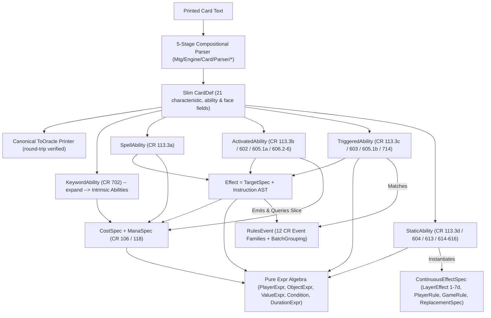
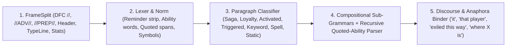

# Plan: Generalizing and Parameterizing `Mtg.Engine.Card` Ability Representations & Oracle Parsing

> **This document is a plan only.** It changes no engine code. It was originally authored against `main` at `c826fb2` (merge of PR #673 on [`EVENT_ALIGNMENT_PLAN.md`](EVENT_ALIGNMENT_PLAN.md), post-Phase 51 execution), updated against `main` at `66c7d0d` after **Phase 1 (PR #675)**, at `1a45335` after **Phase 2 (PR #677)**, at `0c25a40` after **Phase 3 (PR #679)**, and at `1fa8630` after **Phase 4 (PR #681)** were completed, and checked against the *Magic: The Gathering* Comprehensive Rules **effective 25 September 2026** (`MagicCompRules 20260925.txt`, pinned in [`Rules.lean`](Mtg/Engine/Rules.lean#L1-L29) and [`README.md`](README.md)).

---

## 0. Scope, CR Citation Policy, Build Invariants, and Non-Goals

### 0.1 Comprehensive Rules Citation Policy (25 September 2026 Edition)

Every type, constructor, parser production, and evaluation rule in this plan is anchored to the **25 September 2026** Comprehensive Rules (`Rules.effectiveDate = "2026-09-25"`). Implementation PRs must use these rule numbers and fix stale pre-20260925 citations on code they touch (consistent with [`EVENT_ALIGNMENT_PLAN.md`](EVENT_ALIGNMENT_PLAN.md#L10-L32)):

| Domain | 25 September 2026 CR Sections | Architectural Role in This Plan |
| :--- | :--- | :--- |
| Object characteristics & card faces | **100.2a**, **109.3**, **111.1**, **113.3**, **201–212** (incl. **202.2**, **204**, **205**, **207**, **208.1–3**, **209.1**, **210.1**, **211.1**, **212.1**), **702**, **712**, **715** | Defines the exact 21 fields of [`CardDef`](Mtg/Engine/Card/CardDef.lean#L47-L338) (12 CR 201–212 printed characteristics + `keywords` CR 702 + 4 CR 113.3a–d ability containers + 4 token/face/deck-limit fields: `isToken` CR 111.1, `otherFace` CR 712, `subFaces` CR 715, `deckLimitOverride` CR 100.2a); separates rules text (**207**) from abilities (**113**). |
| Ability taxonomy & zones | **113.1a**, **113.2c**, **113.3a–d**, **113.6**, **113.7a** | Partition into **Spell** (113.3a), **Activated** (113.3b), **Triggered** (113.3c), and **Static** (113.3d) abilities; active-zone defaults and exceptions (113.6b–p). |
| Mana, costs, life, damage, draw, counters | **106**, **107.3–4**, **118**, **119**, **120**, **121**, **122** | Parameterizes `ManaSpec` / `ManaSpendRestriction` (106.6), compositional `CostSpec` (118.3, 118.7–9, and 118.12 / 118.12a resolution-time costs), `CounterKind` / `CounterBag` (122.1, 122.1b, 122.6). |
| Targets & modes | **105.2c**, **115** (incl. **115.1**, **115.3–5**, **115.7a,d**), **201.2a**, **303.4a**, **601.2c–d**, **603.3d**, **608.2b**, **700.2**, **707.10c** | Compositional `TargetSpec` / `TargetSlot` (per-`"target"`-word arity, divisions, group/cross-slot constraints, CR 115.5 stack self-exclusion, and `forEach?` expansion) and unified `ModalSpec`. |
| Intrinsic basic-land mana & subtype setting | **305.6**, **305.7**, **613.1d**, **613.1f** | Grants `{T}: Add {M}` from basic land subtypes (**305.6**), implements Layer-4 basic-land set-vs-add ability stripping (**305.7** during **613.1d**), and lets Layer 6 (**613.1f**) remove abilities afterward. |
| Zone-change identity, owner zones & LKI | **400.3**, **400.7**, **400.7a–m**, **608.2h** | Enforces owner-zone moves for libraries/hands/graveyards (**400.3**); connects `ObjectExpr` / `ValueExpr` look-back queries to [`EventObject`](Mtg/Engine/Game/Object.lean) snapshots and **400.7d** `CastEvent` history. |
| Casting, activating, special actions, mana & loyalty | **116.2b**, **601**, **602**, **605.1a–b**, **606.2–6**, **733.1** | Unifies `SpellAbility`, `ActivatedAbility` (including all four **605.1a** activated mana-ability criteria and **606.2–6** loyalty abilities), **116.2b** Morph special actions, **601.2f** total-cost calculation, and **601.3** permissions/restrictions. |
| Triggered abilities | **511.2**, **603.1**, **603.2c/e/g**, **603.3b**, **603.4**, **603.6a**, **603.7**, **603.10a–f**, **603.12**, **605.1b**, **700.1** | Aligns `TriggerPattern` with [`RulesEvent`](Mtg/Engine/Game/Event.lean#L952-L977), `BatchGrouping` (**603.2c** per-occurrence vs **700.1** `"one or more"` single-event batching), intervening `"if"`, exact **603.10a–f** look-back, delayed/reflexive triggers, and triggered mana abilities. |
| Static abilities, layers, text, combat, replacement & prevention | **506.2**, **506.3a**, **506.5**, **508.4**, **509.1b**, **509.1h**, **604.1–3**, **611.2–3**, **612**, **613.1–8**, **614**, **615**, **616** | Maps `StaticAbility` directly to CDAs (**604.3**), [`LayerEffect`](Mtg/Engine/Game/Event.lean#L329-L345) (Layers 1–7d), [`PlayerRule`](Mtg/Engine/Game/Event.lean#L348-L364), [`GameRule`](Mtg/Engine/Game/Event.lean#L367-L376), [`ReplacementSpec`](Mtg/Engine/Game/Event.lean#L198-L205), and [`PreventionSpec`](Mtg/Engine/Game/Event.lean#L222-L228). |
| Resolution & one-shot effects | **608**, **609**, **610.1–3**, **701** (incl. **701.44a,c**) | Compositional `Instruction` AST with lexical `VarId` bindings backed by post-replacement `RulesEvent` slices (**614.6**) and single-effect banishing (**610.3**). |
| Keywords, tokens, copies, faces, Sagas, Adventures | **108.2**, **110.4a**, **111.5**, **111.6**, **111.10a–x**, **111.11**, **111.12**, **112.1**, **304.4**, **307.4**, **702** (incl. **702.11** Hexproof, **702.14** Landwalk, **702.21** Ward, **702.29** Cycling, **702.33** Kicker, **702.34** Flashback, **702.37** Morph, **702.51** Convoke, **702.61** Split second, **702.73** Changeling, **702.83** Exalted, **702.85** Cascade, **702.108a–b** Prowess, **702.122** Crew, **702.126** Improvise, **702.131** Ascend, **702.142** Boast, **702.147** Decayed, **702.164** Toxic, **702.174** Gift, **702.176** Impending, **702.177** Exhaust, **702.190** Sneak, **702.193** Power-up, **702.194** Teamwork), **707** (incl. **707.2**, **707.9d**), **708**, **712**, **714.2b/d**, **714.4**, **715** | Parameterized `KeywordAbility` with pure `expand` (**702.1**); CR **111.10a–x** `PredefinedToken`, CR **111.5 / 304.4 / 307.4** instant/sorcery token prohibition, CR **111.12** nonexistent-object / LKI copy rule, CR **108.2 / 110.4a / 111.6 / 112.1** `ObjectCategory` spell/card distinction; unified `SubFace` for Adventure (**715**) and Prepare spells; Saga chapters (**714.2b/d**) as `TriggeredAbility`s. |

### 0.2 Lean 4, Lake, and Engine Invariants

Every phase in §5 must preserve six hard engineering invariants verified against the codebase:

1. **Lake Precompiled Plugin Hierarchy ([`lakefile.toml`](lakefile.toml#L20-L57))**:
   - `Mtg.Engine.Card` (`precompileModules = true`) must remain strictly acyclic below `Mtg.Engine.Game` (`precompileModules = true`); `Card` never imports `Game`, `GameObject`, `Status`, or `Pending`.
   - Phase 1 moved [`Turn.lean`](Mtg/Engine/Turn.lean#L1-L172) (zero imports: `Step`, `Phase`, `TurnRef`, `PhaseRef`, `StepAnchor`, joined by `StepOrPhase` in Phase 2) into `Mtg.Engine.Card`'s globs (`lakefile.toml#L23`) alongside [`Zone.lean`](Mtg/Engine/Zone.lean#L11-L66), promoted shared value-level CR enums (`ZoneKind`, `ZoneVerb`, `LibraryPosition`, `PermanentDesignation`, `PermanentDesignationTag`, `PlayerDesignation`, `CostKind`, `ReplacementTier`, `SetOrAdd`, `TypeSetMod`, `ColorSetMod`, `TextChange`, `HasTextChange`) into [`Mtg/Engine/Card/Primitives.lean`](Mtg/Engine/Card/Primitives.lean), and promoted runtime mana types below [`Mtg/Engine/Mana.lean`](Mtg/Engine/Mana.lean).
   - **Layer-0 vs. Layer-1/2 import stratification (completed in Phase 2, PR #677; extended in Phase 3, PR #679, and Phase 4, PR #681)**: Layer-0 runtime/evaluated mana types (`ManaType`, `ManaOutput`, `ManaObjectPred`, `ManaAbilityPred`, `SpellRiderSpec`, `ManaSpend`, `ManaSpendRestriction`) live in [`Mtg/Engine/Card/ManaTypes.lean`](Mtg/Engine/Card/ManaTypes.lean) strictly below [`Mtg/Engine/Mana.lean`](Mtg/Engine/Mana.lean), while `Card/Text.lean` → `Card/Counter.lean` → [`Card/Expr.lean`](Mtg/Engine/Card/Expr.lean) → Layer-2 [`Card/ManaSpec.lean`](Mtg/Engine/Card/ManaSpec.lean) / [`Card/Cost.lean`](Mtg/Engine/Card/Cost.lean) / [`Card/Keywords.lean`](Mtg/Engine/Card/Keywords.lean) / [`Card/Token.lean`](Mtg/Engine/Card/Token.lean) / [`Card/Targeting.lean`](Mtg/Engine/Card/Targeting.lean) → [`Card/Parser/SubGrammars.lean`](Mtg/Engine/Card/Parser/SubGrammars.lean) and [`Card/KeywordExpand.lean`](Mtg/Engine/Card/KeywordExpand.lean) sit cleanly above `Mtg/Engine/Mana.lean`.
   - Keep `Mtg.Engine.Catalog` **un-precompiled** ([`lakefile.toml`](lakefile.toml#L25-L33)) while `parseOracleCard!` executes at compiled native speed via the `Mtg.Engine.Card` shared plugin.
2. **Lean C Runtime Constructor Tag Budget (`ctorIdx ≤ 243` for field-bearing constructors)**:
   - Lean 4's C runtime (`lean.h` in the pinned Lean 4.34.1 toolchain) stores an allocated constructor's **0-indexed declaration ordinal** (`ctorIdx`) in an 8-bit `m_tag` capped at `LeanMaxCtorTag = 243` (`lean_alloc_ctor` accepts `tag <= 243`; tags `244..255` are reserved for `LeanClosure`, `LeanArray`, etc., so only nullary unboxed constructors may appear at `ctorIdx ≥ 244`). Today [`Resolution`](Mtg/Engine/Card/SpellResolution.lean#L1786-L3547) has **364 constructors** (`ctorIdx = 0..363`: 158 field-bearing + 206 nullary), with [`Resolution.frc`](Mtg/Engine/Card/SpellResolution.lean#L3240) at **declaration ordinal `243` (the `244`th constructor)**, occupying the last `LeanMaxCtorTag` slot and leaving **zero** free field-bearing slots before all 120 ordinals `244..363` must be nullary (matching the boundary comment at `L3241–L3244`).
   - Every target AST `inductive` in §2 is stratified by CR domain so **no inductive exceeds 35 constructors**, permanently eliminating tag-limit ceilings and set-named overflow wrappers (`FraStatic`, `FraEvent`, `FrcEffect`, and the 9 `*Leftover` enums).
3. **Clang Optimization Time, CI Build Budget, & Mutual/Nested Recursion Discipline ([`lakefile.toml`](lakefile.toml#L4-L44), [`Effect.lean`](Mtg/Engine/Card/Effect.lean#L99-L101))**:
   - **15-minute CI budget discipline (established in Phase 1, PR #675)**: Package-level `moreLeancArgs = ["-O1", "-mllvm", "-regalloc=fast"]` keeps `Mtg.Engine.Card` (`parseOracleCard`) at `-O1`, while `Mtg.Engine.Game` overrides `moreLeancArgs = ["-O0"]` (`lakefile.toml#L41-L44`) so multi-megabyte generated C files (`Core.c`, `Event.c`, `Decisions.c`, `FraChoices.c`) compile ~10× faster on the serial CI critical path (~6–10 min total vs. >15 min timeout). Large structural `BEq` instances and hot pattern matchers must be chunked into `@[noinline]` helpers (as done for `BEq CardDef` via `cardDefBeq1..6` in [`Object.lean`](Mtg/Engine/Game/Object.lean#L17-L156), `matchesTrigger*` in [`Event.lean`](Mtg/Engine/Game/Event.lean#L3276-L3791), and `permanentsNamedLeaf` in [`TriggerArgs.lean`](Mtg/Engine/Game/TriggerArgs.lean#L61)), and hot event-log evaluators (`EvalExpr.lean`, `Interpreter.lean`, `matchTriggers`) must avoid quadratic re-scans of `Game.events` (following Phase 1's `InitialMaterializeIndex` and `Std.HashMap`-backed `HistGlobalState` in [`Core.lean`](Mtg/Engine/Game/Core.lean#L3171-L3353), [`Core.lean`](Mtg/Engine/Game/Core.lean#L7343-L8313)).
   - Recursions over nested containers (`Array Instruction`, `Array ObjectPred`, `Array Condition`, `Option CardDef`) must use explicit `mutual` structural blocks or `Array.attach` / `List.attach` rather than implicit `List.map` well-founded splitters over giant flat enums, preventing multi-second Clang register-allocation stalls under `./scripts/ci-lake-build.sh` (`lake build --wfail`).
   - Mutual AST blocks (`PlayerFilter`..`ValueExpr` in [`Expr.lean`](Mtg/Engine/Card/Expr.lean#L668-L692), `CostItem`..`CostSpec` in [`Cost.lean`](Mtg/Engine/Card/Cost.lean#L205-L208), and `Instruction`, `ActivatedAbility`, `TriggeredAbility`, `StaticAbility`, `TokenSpec` in later phases) must derive or define `BEq` and `Repr` **once** for the mutual tuple and project per-type instances (as in [`SpellResolution.lean`](Mtg/Engine/Card/SpellResolution.lean#L927-L930) and [`Event.lean`](Mtg/Engine/Game/Event.lean#L2270-L2276)).
   - Shrinking `CardDef` from 120 remaining fields (down from 141 after Phase 4 retired 22 legacy additional-cost/keyword fields and added 1 unified `additionalCosts` field) to 21 fields in Phase 10 removes `set_option maxRecDepth 1024` ([`CardDef.lean`](Mtg/Engine/Card/CardDef.lean#L45)) and moves structural **`BEq CardDef`** directly into `Mtg.Engine.Card.CardDef` (retiring the interim chunked `cardDefBeq1..6` instance in [`Object.lean`](Mtg/Engine/Game/Object.lean#L17-L156) and replacing `reprStr` comparisons in `ParseOracle.lean`).
4. **Parser Throughput Barriers**:
   - Preserve `@[irreducible, noinline]` on parser entry points and catalog helpers, `Thunk`-cached token/verb dispatch tables, and linear `Array Char` text normalization ([`OracleNorm.lean`](Mtg/Engine/Card/OracleNorm.lean#L279-L317)).
5. **100% Catalog Authoring & Bidirectional Round-Trip Invariant**:
   - All **981** cards in [`supportedCatalogCards`](Mtg/Engine/Catalog/Supported.lean#L1-L30) (`13` core + `193` HOB + `117` HOC + `286` MSH + `285` FRA + `87` FRC) continue to be authored from printed Oracle text via `fromOracle`, with `modellingError? == none` and zero unparsed text fallbacks.
   - `parseOracleCard (renderFullOracle c) == .ok c` (upgraded from `reprStr` comparison to structural `BEq CardDef` in Phase 10) must hold across **all 981 catalog cards** (adding `realityFractureCommanderCards` to the round-trip `#guard` suite in [`ParseOracle.lean`](Mtg/Engine/Tests/ParseOracle.lean)) plus open-ended parameter-generalization `#guard`s and [`OracleRoundtrip.lean`](Mtg/OracleRoundtrip.lean).
6. **Zero Ruling or Demo Regression**:
   - All **1,057** Gatherer/Scryfall rulings in [`OracleData.lean`](Mtg/Engine/OracleData.lean#L3264) and all **11,000+** `#guard` assertions across `Card/Guards.lean`, `Engine/Tests/*` (including `Tests/EvalExpr.lean`, `Tests/Targets.lean`, and `Tests/CostKeywords.lean`), `OracleRulings.lean`, `Demo/RenderTests.lean` (534 `#guard`s), and `Demo/Check0..9.lean` must pass at every phase boundary.

### 0.3 Non-Goals

Consistent with [`EVENT_ALIGNMENT_PLAN.md`](EVENT_ALIGNMENT_PLAN.md#L33-L53), unmodeled CR subsystems (infect/wither 120.3b/d, regeneration 701.19, battles as attack targets 508.1b, Initiative 726, Attractions/stickers, planeswalking 603.10g, disguise/manifest/cloak, active day/night transitions 731.2) are not implemented as new gameplay rules here, though the generalized AST leaves natural algebraic slots for each.

---

## 1. Diagnosis of Current Ability and Parser Representations

Across `Mtg/Engine/Card/` (**36 files, 34,469 lines** post-Phase 4; up from 34 files / 31,835 lines post-Phase 3, 34 files / 30,888 lines post-Phase 2, 31 files / 27,501 lines post-Phase 1, and 29 files / 25,778 lines originally, after adding [`Primitives.lean`](Mtg/Engine/Card/Primitives.lean), [`ManaTypes.lean`](Mtg/Engine/Card/ManaTypes.lean), [`ManaSpec.lean`](Mtg/Engine/Card/ManaSpec.lean), [`Expr.lean`](Mtg/Engine/Card/Expr.lean), [`Cost.lean`](Mtg/Engine/Card/Cost.lean), [`KeywordExpand.lean`](Mtg/Engine/Card/KeywordExpand.lean), and [`Parser/SubGrammars.lean`](Mtg/Engine/Card/Parser/SubGrammars.lean)), incremental set additions (`HOB`/`HOC` → `MSH` → `FRA` → `FRC`) produced six structural bottlenecks (with the token split and string-parsed mana restrictions retired in Phase 1, the pure expression algebra / Stage-4 expression sub-grammars established in Phase 2, legacy targeting retired onto unified `TargetSpec` / compositional target parsing in Phase 3, and fragmented costs/keywords retired onto compositional `CostSpec` / parameterized `KeywordAbility` in Phase 4):

### 1.1 `CardDef` Field Proliferation (120 Fields Remaining, Down from 141) and Layer 3 / Layer 6 Bypasses

[`CardDef`](Mtg/Engine/Card/CardDef.lean#L47-L338) currently has **120 fields** (down from 141 after Phase 4 retired 16 parameterized keyword fields onto `keywords : Array KeywordAbility` and collapsed 6 `additionalCost*` booleans into 1 unified `additionalCosts : Array AdditionalCostSpec` field): **14** CR 201–212 printed characteristic fields (`name` through `colorIndicator`) + **4** core non-characteristic header/face fields (`isToken` CR 111.1, `otherFace` CR 712, `anyNumberInDeck` CR 100.2a, `keywords` CR 702) = **18** core fields, plus **7** structured ability/sub-face containers (`spellEffect`, `spellModes`, `activatedAbilities`, `staticAbilities`, `triggeredAbilities`, `adventure`, `prepareFace`) = **25** fields. The remaining **95 fields** (`18 + 7 + 95 = 120`) encode single-mechanic, transitional, or single-card abilities directly on the card record:

| Ad-Hoc `CardDef` Field Bucket | Field Count | Exact Field Families & Architectural Failure Mode |
| :--- | ---: | :--- |
| Printed `{T}: Add` & mana-filter fields | **21** | `tapAddMana`, `tapAddAnyColor`, `tapAddOneOf`, `tapAddManaForEach`, `tapAddRestricted` (upgraded in Phase 1 from raw English strings + runtime `restrictionOfText` to parse-time [`ManaSpendRestriction`](Mtg/Engine/Card/ManaTypes.lean#L306-L318)), `tapPayLifeAddOneOf`, `tapAddCommanderIdentity`, `tapAddOppCouldProduce`, `tapAddYouCouldProduce`, `filterMana`, etc. — still competing with `ActivatedAbility`, `FraStatic` mana ctors, and CR 305.6 land subtypes until Phase 5. |
| Spell cost modifiers & cast rules | **21** | 13 `costReduction*` fields, `firstCreatureCostsLess`, `eminenceSphinxReduction`, `freeCastIfControlCommander`, `flashIfYouControlSubtype`, `firstCreatureHasFlash`, `cantBeCountered`, `castOnlyIfGraveyardAtLeast`, `castExiledWithSevenInGraveyard` — competing with `StaticAbility` and `FraStatic`. |
| Transitional additional-cost container *(22 legacy fields retired in Phase 4)* | **1** | `additionalCosts : Array AdditionalCostSpec` (Phase 4 retired all 6 `additionalCost*` booleans + `AdventureFace.additionalCostSacrificeCreature` and all 16 parameterized keyword fields — `prowessInstances`, `cascade`, `kicker`, `giftTreasure`, `teamwork`, `flashback`, `flashbackDiscard`, `ward`, `crew`, `affinityForSubtype`, `daybound`, `morph`, `impending`, `protectionFromColors`, `cycling`, `toxic` — onto [`KeywordAbility`](Mtg/Engine/Card/Keywords.lean#L328-L363); `additionalCosts` moves onto `SpellAbility.additionalCosts` in Phase 10). |
| Enters-tapped / enters-with / as-enters | **21** | 10 `entersTapped*` fields, 4 `entersWith*` fields (`entersWithHopePerCreature`, `entersWithPlusOneCounters`, `entersWithIndestructibleCounter`, `entersWithShield`), 5 `asEnters*` fields (`asEntersChooseCreatureType`, `asEntersChooseOddEven`, `asEntersChooseCardType`, `asEntersChooseMarduOrJeskai`, `asEntersMayCopyCreatureHasteUntilEot`), plus `entersPrepared` and `othersEnterWithPlusOneEqualToughness` — competing with `FraStatic.entersTappedChooseColor` and `StaticAbility.entersWithXPlusOne`. |
| Continuous, replacement, Saga, & modal side-channels | **31** | `exileOppCreaturesInstead` (duplicating `FraStatic.exileOpponentsDyingCreatures` in [`exilesOppDeath?`](Mtg/Engine/Game/Movement.lean#L64-L69)), `tokenDoubling`, `opponentsCantGainLife`, `planeswalkersYouControlHave`, `grantCreaturesTapAddAnyColor`, `grantLandsTapAnyColor`, `saga`, `fraTriggerModes` (single global modal array preventing two modal triggers on one card), `chooseOneOrBoth`, `chooseTwoIfYouControlSubtype`, `chooseBothIfTeamwork`, etc. |

**Direct rules and tooling consequences**:
- **Layer 3 (CR 612) & Layer 6 (CR 613.1f) divergence**: In [`Casting.lean`](Mtg/Engine/Game/Casting.lean#L18-L37), `cosmicAwarenessFlash` (`L18–23`) reads `g.staticAbilities o` for `.flashIfOpponentCastThisTurn`, whereas `timingAllowsCast` (`L27–37`) matches `face.flashIfYouControlSubtype` directly on the `face : CardDef` argument (consulting neither `evalLayer3` nor `retainsPrintedAbilities`) and `radagastFlash` (`L34–37`) checks `(g.baseCard o).firstCreatureHasFlash && g.retainsPrintedAbilities o` (missing Layer-6 granted copies).
- **Notation omissions & equality blind spots**: [`structuredAbilityLines`](Mtg/Engine/Card/CardDef.lean#L788-L804) renders only 16 field families (`CardDef.abilitiesText` / `ToString CardDef`), and [`renderFullOracle`](Mtg/Engine/Card/ParseOracle.lean#L2257-L2288) delegates rules-box reconstruction directly to `KeywordAbility.renderOracleLines c.keywords` + `cForAbilities.structuredAbilityLines`, leaving most of the remaining ad-hoc `CardDef` fields omitted from `structuredAbilityLines` invisible to both printers; meanwhile `Mtg.Engine.Card.CardDef` itself still lacks `BEq` (only [`Object.lean`](Mtg/Engine/Game/Object.lean#L17-L156) inside `Mtg.Engine.Game` defines a chunked `BEq CardDef`), forcing [`oracleRoundtripDiff`](Mtg/Engine/Card/ParseOracle.lean#L2303-L2307) to compare `reprStr` until Phase 10.

### 1.2 Eight Overlapping Effect/Resolution Subsystems & Exhausted C-Tag Budget

Although [`Effect`](Mtg/Engine/Card/Effect.lean#L21-L34) wraps `resolution : Resolution`, [`Resolution`](Mtg/Engine/Card/SpellResolution.lean#L1786-L3547) (**364 constructors**: 158 field-bearing + 206 nullary) is four separate instruction sets concatenated into one inductive (`67 + 65 + 80 + 152 = 364`), surrounded by four external effect enums:

1. **Trigger DSL region of `Resolution`** (`L1787–2816`, 67 ctors: 52 field-bearing + 15 nullary) — resolved by [`TriggeredAbilities.lean`](Mtg/Engine/Game/TriggeredAbilities.lean).
2. **Spell region of `Resolution`** (`L2819–2989`, 65 ctors) — resolved by [`EffectResolution.lean`](Mtg/Engine/Game/EffectResolution.lean).
3. **Activated region of `Resolution`** (`L2991–3138, 3246–3265`, 80 ctors) — partially bridged to spells via [`ofSpellStep` / `ofSpell` / `toSpellStep` / `toSpell`](Mtg/Engine/Card/Effect.lean#L332-L407) (returning `.unrecognized` on unbridged constructors, requiring **38** explicit `=> false` constructor arms from `shuffleSource` through `exileTop` in [`doesNothingAsSpell`](Mtg/Engine/Card/Effect.lean#L417-L436) before falling through to `isFra` / `toSpell`).
4. **FRA / MSH region of `Resolution`** (`L3144–3240, 3266–3546`, 152 ctors, ~35 named directly after individual cards like `.overwriteTheMultiverse`, `.vraskasMercyDestroy`, `.identityEcho`) — resolved by [`FraResolve.lean`](Mtg/Engine/Game/FraResolve.lean), placing **`| frc (e : FrcEffect)` at 0-indexed declaration ordinal `243` (`LeanMaxCtorTag = 243`, exhausting the last field-bearing tag slot)**.
5. **[`FrcEffect`](Mtg/Engine/Card/FrcEffect.lean#L15-L164)** (64 ctors, mostly card-named: `.pathToExile`, `.swords`, `.sunfall`, `.factOrFiction`, `.teferi`) — resolved by [`FrcResolve.lean`](Mtg/Engine/Game/FrcResolve.lean).
6. **[`SharedTrigger`](Mtg/Engine/Card/SharedTrigger.lean#L499-L1083)** (169 ctors) + **9 `*Leftover` enums** (`L18–275`, 91 ctors across `EnterLeftover`, `StepLeftover`, `DeathLeftover`, `ThisAttackLeftover`, `EnterOrAttackLeftover`, `WatchLeftover`, `YouAttackLeftover`, `CastLeftover`, `ResourceLeftover`) — lowered into `Resolution` by [`SharedTrigger.timing`](Mtg/Engine/Card/Trigger.lean#L256-L1057), yet simultaneously retained in `Effect.sharedTrigger` for `toNotation` and `OracleArgs`.
7. **[`ChapterResolution`](Mtg/Engine/Card/Chapter.lean#L23-L79)** (24 ctors) — lowered via `chapterTiming` and [`Chapters.lean`](Mtg/Engine/Game/Chapters.lean).
8. **[`PermanentAction`](Mtg/Engine/Card/PermanentAction.lean#L17-L62)** (21 ctors) — fixed-constant single-permanent actions with hardcoded EOT duration.

*(Resolved in Phases 1–4)* The former three-way token split across `TokenKind` (37 ctors), `TriggerToken` (9 ctors), and `FrcToken` (15 ctors) has been unified into [`TokenSpec`](Mtg/Engine/Card/Token.lean#L167-L174); Phase 2 retired `TokenStat` and `CopyTargetRef` onto `ValueExpr` and `ObjectExpr`; and Phase 4 migrated `CustomTokenSpec.keywords` and `CopyModification.addKeywords` from `Keywords` to `Array KeywordAbility`. Only `TokenAbilitySpec` (Phase 8) and `CopyTokenContext` (Phases 8–9) remain to be generalized.

### 1.3 Impure, Trigger-Only Selector DSL and Bespoke Inter-Step State

[`SpellResolution.lean`](Mtg/Engine/Card/SpellResolution.lean#L278-L1277) still retains `PlayerSelector` (10 ctors), `ObjectSelector` (98 ctors), `NumberSelector` (36 ctors), and `ConditionSelector` (30 ctors) (the former 4-ctor `CostSelector` was **retired in Phase 4** onto `CostSpec`). However:
- **Scoped only to triggers**: Spells, activated abilities, static abilities, and trigger *events* do not use the selector algebra.
- **~80% nullary one-card atoms & smuggled side effects**: 79/98 `ObjectSelector`, 30/36 `NumberSelector`, and 21/30 `ConditionSelector` constructors are nullary card-specific atoms (`.forestsExceptCause`, `.perFatGraveyard`, `.enrageGrantsCombat`), and some smuggle imperative side effects into selectors (e.g., `PlayerSelector.opponentHasYou` embeds *Palantír of Orthanc*'s mill-and-life-loss branch; `ObjectSelector.enteringVillain` embeds once-per-turn connive).
- **Bespoke inter-step registers**: Passing `"that card"` / `"that much"` / `"if you do"` across steps relies on **9 `Trigger*Note` inductives** in `SpellResolution.lean` (`TriggerDamageNote`, `TriggerTokenNote`, `TriggerExileNote`, `TriggerSacrificeNote`, `TriggerCastNote`, `TriggerReturnNote`, `TriggerPutNote`, `TriggerDestroyNote`, `TriggerMillNote`), **~35 per-card fields** on [`ContinuationFrame`](Mtg/Engine/Game/Event.lean#L1910-L2089) (`palantirChoiceReady`, `grimaImpulse*`, `humansTappedThisWay`, `removedHopeThisWay`, `thirstDiscardsLeft`, etc.), and **100+ card-specific constructors** across [`PostStep`](Mtg/Engine/Game/Event.lean#L1127-L1450) (208 ctors total) and [`FrcPostStep`](Mtg/Engine/Game/Event.lean#L1024-L1070) (33 ctors total, including Phase 1's CR 701.44 Explore post-steps).

*(Resolved in Phase 3)* The former 80-constructor `EffectTargetKind` enum (75 hardcoded filter kinds + `.none` + 4 legacy combinators), the 28-field `TargetFilter` struct (including its `noun : String` equality bug), `TargetZone`, `TargetController`, and `OracleArgs.takeKind`'s 13 hardcoded target shapes have all been **retired** (0 remaining matches across `Mtg/`) and replaced by unified [`TargetSpec`](Mtg/Engine/Card/Targeting.lean#L207-L210) / [`TargetSlot`](Mtg/Engine/Card/Targeting.lean#L147-L159) / [`TargetDomain`](Mtg/Engine/Card/Targeting.lean#L126-L132) backed by Layer-1 `ObjectPred` / `PlayerFilter` and compositional [`OracleArgs.takeTargetSpec`](Mtg/Engine/Card/OracleArgs.lean#L285-L291) / [`OracleArgs.fromNounPrefix`](Mtg/Engine/Card/OracleArgs.lean#L822-L823) (`Parser.parseTargetSpecPrefix`).

### 1.4 Six-Layer Trigger Fragmentation & `TriggeredAbility.timing` Split-Brain

- **Dual event enums**: [`TriggerEvent`](Mtg/Engine/Card/TriggerEvent.lean#L93-L323) (113 ctors) + [`FraEvent`](Mtg/Engine/Card/TriggerEvent.lean#L14-L88) (35 ctors) largely duplicate [`SharedTriggerWhen`](Mtg/Engine/Card/SharedTrigger.lean#L280-L461) (90 ctors), instead of matching [`RulesEvent`](Mtg/Engine/Game/Event.lean#L952-L977) structurally.
- **Silent `.draw 0` split-brain**: In [`TriggeredAbility.timing`](Mtg/Engine/Card/TriggeredAbility.lean#L19-L36), `let t := (e.asTrigger?.getD (.draw 0)).timing` silently evaluates `ab.timing.resolution` to `.draw (.fixed 0)` whenever `e.sharedTrigger == none` (true for all `TriggeredAbility.fra`, `parseTriggerModes`, and `FrcParse` triggers), forcing engine callers to inspect both `ab.effect.resolution` and `ab.resolution` — while [`faceModellingError?`](Mtg/Engine/Card/CardDef.lean#L925-L952) never validates `triggeredAbilities` or `fraTriggerModes` at all.
- **Manual batch loops in `matchTriggers`**: [`Core.matchTriggers`](Mtg/Engine/Game/Core.lean#L11827-L13904) hardcodes 13 bespoke `for` loops for `"one or more"` batch triggers (`L11968–L12214`) before a massive per-event `TriggerEvent`/`FraEvent` dispatcher (`L12215–L13904`).

### 1.5 Static, Cost, and Keyword Fragmentation

- [`StaticAbility`](Mtg/Engine/Card/StaticAbility.lean#L201-L464) (**109 ctors**, down from 112 after Phase 4 retired 4 ward statics and added CR 509.1b `.cantBeBlocked`) + [`FraStatic`](Mtg/Engine/Card/StaticAbility.lean#L23-L122) (**42 ctors**, down from 44 after Phase 4 retired 2 ward statics) still mix CDAs, Layer 1–7d continuous effects, cost modifiers, permissions, combat/casting restrictions, replacements/preventions, remaining Phase-6 transitional keyword statics (`.instantSorcerySplitSecond`, `.improvise`, `.sneak`, `.boast`, `.extort`), mana abilities, and the `.printed String` unparsed fallback.
- *(Resolved in Phase 4, PR #681)* Legacy cost and keyword fragmentation has been **retired** (0 remaining type/constructor matches for `KeywordCounters`, `ActivationCost`, `FraCost`, `CostSelector`, and `WardCost` across `Mtg/Engine/`):
  - Costs now unify on compositional [`CostSpec`](Mtg/Engine/Card/Cost.lean#L195-L197) / [`CostItem`](Mtg/Engine/Card/Cost.lean#L159-L190) (15 ctors), [`LoyaltySymbol`](Mtg/Engine/Card/Cost.lean#L27-L33), [`AdditionalCostSpec`](Mtg/Engine/Card/Cost.lean#L776-L781), and [`AlternativeCostSpec`](Mtg/Engine/Card/Cost.lean#L810-L819), retiring `ActivationCost` (23 fields), `FraCost` (11 ctors), `CostSelector` (4 ctors), `WardCost` (7 ctors), all 6 `CardDef.additionalCost*` booleans, and `AdventureFace.additionalCostSacrificeCreature`.
  - Keywords now unify on [`KeywordAbility`](Mtg/Engine/Card/Keywords.lean#L328-L363) (`SimpleKeyword` 29 unit ctors + 16 parameterized ctors) with pure [`KeywordAbility.expand`](Mtg/Engine/Card/KeywordExpand.lean#L230-L368) and all **15** CR 122.1b keyword counters via [`CounterKind.grantedKeyword?`](Mtg/Engine/Card/Keywords.lean#L393-L409) (adding `.decayed`, `.exalted`, and `.hexproof` to [`CounterKind`](Mtg/Engine/Card/Counter.lean#L17-L51)), retiring the `Keywords` 22-`Bool` struct (moving non-keyword CR 509.1b `"can't be blocked"` onto `StaticAbility.cantBeBlocked` + [`ContinuousEffectSpec.cantBeBlockedUntilEot`](Mtg/Engine/Game/Event.lean#L416-L417)), the partial 8-field `KeywordCounters` struct, the 6 ward static constructors, and all 16 parameterized keyword fields on `CardDef`.
  - Remaining Phase 5–6 keyword/activation transitions: `ActivatedAbility`'s 9 bespoke activation-condition/cost-reduction fields and 9 timing/zone/mechanic flags (`equipSubtype`, `equipWorthy`, `powerUp`, `exhaust`, migrated in Phase 5), plus `StaticAbility.instantSorcerySplitSecond` / `.improvise` / `.sneak` / `.boast` / `.extort` (migrated into stratified `StaticAbility` / `KeywordAbility` in Phase 6).

### 1.6 Three-Tier Oracle Parser Ceiling

The parser splits across:
1. **[`OracleCandidates.lean`](Mtg/Engine/Card/OracleCandidates.lean)** (**1,449** top-level prototype entries across `spellEffects` 605 + `staticAbilities` 155 + `triggeredAbilities` 454 + `activatedAbilities` 197 + `chapterEffects` 38; 1,863 lines, down 6 ward static prototypes in Phase 4) + **[`OracleArgs.lean`](Mtg/Engine/Card/OracleArgs.lean)** (1,869 lines): `OracleArgs` extracts/refills leaf scalar slots (`Nat`, `Int`, `CardSubtype`, `CardType`, `Supertype`, `CounterKind`, plus compositional [`takeTargetSpec`](Mtg/Engine/Card/OracleArgs.lean#L285-L291) / [`fromNounPrefix`](Mtg/Engine/Card/OracleArgs.lean#L822-L823) wired to `Parser.parseTargetSpecPrefix` in Phase 3) inside a **fixed whole-ability skeleton**. It still cannot compose an existing trigger pattern with an existing intervening `"if"` and an existing effect sentence unless that exact product appears in `OracleCandidates`, nor can it recursively parse quoted granted abilities (`"..."`).
2. **`parseStructural` in [`ParseOracle.lean`](Mtg/Engine/Card/ParseOracle.lean#L666-L950)** (285 lines): hardcoded string matchers mutating `CardDef` fields (in Phase 4, [`keywordLineAbilities`](Mtg/Engine/Card/ParseOracle.lean#L336-L343) was wired directly to [`Parser.parseKeywordLine`](Mtg/Engine/Card/Parser/SubGrammars.lean#L2616) and `parseStructural` delegates additional costs and parameterized keywords to [`Parser.parseAdditionalCostSpec`](Mtg/Engine/Card/Parser/SubGrammars.lean#L2404) / [`Parser.parseKeywordAbility`](Mtg/Engine/Card/Parser/SubGrammars.lean#L2446)).
3. **[`FrcParse.lean`](Mtg/Engine/Card/FrcParse.lean)** (396 lines): post-candidate prefix/substring matchers mapping Commander reprints onto card-named `FrcEffect` constructors.

---

## 2. Target Unified Ability Architecture (Aligned with `RulesEvent` & CR)



### 2.1 Layer 0: Shared CR Primitives in `Mtg.Engine.Card` *(Completed in Phase 1, PR #675)*

Phase 1 aligned `Mtg.Engine.Card` directly with [`Event.lean`](Mtg/Engine/Game/Event.lean) and [`Object.lean`](Mtg/Engine/Game/Object.lean) while keeping `Card` independent of `Game`:
1. Moved [`Turn.lean`](Mtg/Engine/Turn.lean#L1-L172) (`Step`, `Phase`, `TurnRef`, `PhaseRef`, `StepAnchor`; joined by [`StepOrPhase`](Mtg/Engine/Turn.lean#L140-L154) and `Phase.englishName` in Phase 2, removing the duplicate from `Game/Event.lean`) into `Mtg.Engine.Card`'s globs in [`lakefile.toml`](lakefile.toml#L20-L23).
2. Promoted shared value-level CR enums into [`Mtg/Engine/Card/Primitives.lean`](Mtg/Engine/Card/Primitives.lean) alongside [`Zone.lean`](Mtg/Engine/Zone.lean#L11-L66):
   - [`ZoneKind`](Mtg/Engine/Card/Primitives.lean#L19-L38) (+ `Zone.kind` / `ZoneKind.toZone`, owner-parametric counterpart of `Zone`: `.library`, `.hand`, `.battlefield`, `.graveyard`, `.stack`, `.exile`, `.command`, `.ante`, `.outside`),
   - [`ZoneVerb`](Mtg/Engine/Card/Primitives.lean#L97-L111) (`.cast`, `.draw`, `.discard`, `.mill`, `.sacrifice`, `.destroy`, `.exile`, `.counter`, `.resolve`, `.put`, `.returnToHand`, `.shuffleIntoLibrary`, `.playLand`),
   - [`LibraryPosition`](Mtg/Engine/Card/Primitives.lean#L114-L119) (`.top`, `.bottom`, `.fromTop`, `.shuffledIn`; symbolic [`LibraryPosSpec`](Mtg/Engine/Card/Expr.lean#L696-L701), where `.fromTop` takes `ValueExpr`, was introduced in Phase 2 alongside `Expr.lean`),
   - [`PermanentDesignationTag`](Mtg/Engine/Card/Primitives.lean#L123-L128) (parameter-free tag for ability syntax), [`PermanentDesignation`](Mtg/Engine/Card/Primitives.lean#L131-L136) (`.ringBearer`, `.goaded`, `.prepared`, `.harnessed`), & [`PlayerDesignation`](Mtg/Engine/Card/Primitives.lean#L146-L149) (`.citysBlessing`, `.enduringStory`),
   - [`CostKind`](Mtg/Engine/Card/Primitives.lean#L152-L175), [`ReplacementTier`](Mtg/Engine/Card/Primitives.lean#L179-L192), [`TextChange`](Mtg/Engine/Card/Primitives.lean#L305-L308), [`SetOrAdd`](Mtg/Engine/Card/Primitives.lean#L205-L214) (cleaned of all 3 card-specific variants `.addArtifactRemoveCreature`, `.removeCreature`, `.addConstruct55`), `CardSubtype.isCorrelatedWith` (CR 205.3d), and compositional Layer 4/5 modifiers [`TypeSetMod`](Mtg/Engine/Card/Primitives.lean#L230-L238) & [`ColorSetMod`](Mtg/Engine/Card/Primitives.lean#L285-L289).
3. Defined the structural typeclass **[`HasTextChange (α : Type)`](Mtg/Engine/Card/Primitives.lean#L313-L314)** (`applyTextChanges : Array TextChange → α → α`) across Layer-0 primitives, `ManaTypes` / `ManaSpec`, `Expr.lean` (added in Phase 2), `TokenSpec`, `Targeting.lean` (`TargetDomain`, `TargetSlot`, `TargetSpec`, `GroupTargetConstraint`, `RecipientPred`, `CrossSlotRelation`, `CrossSlotConstraint`, `EffectTargeting`, migrated in Phase 3), `Cost.lean` (`CostCountSpec`, `SelfOrFilter`, `DiscardCostTarget`, `CounterCostTarget`, `CostItem`, `CostSpec`, `AdditionalCostSpec`, `AlternativeCostSpec`), `Keywords.lean` (`QualityFilter`, `ProtectionQuality`, `KeywordAbility`), `KeywordExpand.lean` (`SpecialActionSpec`) (added in Phase 4), `Effect`, `Resolution`, `SharedTriggerWhen`, `ActivatedAbility`, `TriggeredAbility`, and `StaticAbility`, with `Core.lean`'s `TextChange.apply*` entry points delegating directly to `HasTextChange.applyTextChanges` (and expanding to every new AST node introduced in Phases 5–8).
4. Unified `TokenKind`, `TriggerToken`, and `FrcToken` into a single parameterized **[`TokenSpec`](Mtg/Engine/Card/Token.lean#L167-L174)** (`Mtg/Engine/Card/Token.lean`, evaluated by [`Game.resolveTokenPrinted?`](Mtg/Engine/Game/Tokens.lean#L1165-L1179) and [`Game.resolveCopyTokenCandidates`](Mtg/Engine/Game/Tokens.lean#L1118-L1156)):
   - `.predefined PredefinedToken` (**CR 111.10a–x** predefined tokens: `.treasure` 111.10a, `.food` 111.10b, `.clue` 111.10f, `.incubator` 111.10i with back face `"Phyrexian Token"`, `.map` 111.10s with full CR 701.44a/c & CR 400.3 Explore, `.junk` 111.10t, `.lander` 111.10u, `.mutagen` 111.10v, `.vibranium` 111.10w, `.heartwood` 111.10x),
   - `.custom CustomTokenSpec` (`name?`, `supertypes`, `types`, `subtypes : Array CardSubtype`, `colors : ColorSet`, `power? : Option ValueExpr`, `toughness? : Option ValueExpr`, `loyalty?`, `keywords : Array KeywordAbility`, `abilities`, `useCardNameShorthand : Bool` for **CR 111.11** Oracle-card-named tokens such as *Lotus* / *Gingerbrute* that are not in CR 111.10a–x), or
   - `.copyOf (ref : ObjectExpr) (mods : Array CopyModification)` (covering token copies with P/T overrides stripping P/T-setting CDAs per **CR 707.9d**, added types/subtypes/colors/keywords/abilities, or removed supertypes per **CR 707.9**). [`Game.resolveCopyTokenCandidates`](Mtg/Engine/Game/Tokens.lean#L1118-L1156) evaluates every legal copy candidate for `ref` while enforcing **CR 111.5 / 304.4 / 307.4** (dropping instant/sorcery copies and any copy whose characteristics after `CopyModification`s still include instant or sorcery, even alongside a permanent type) and **CR 111.12** (when `findObject?` misses, still printing a copy from `lastKnownBefore?` last-known information when present, and dropping a candidate only when both the live object and its LKI are missing). [`Game.resolveTokenPrinted?`](Mtg/Engine/Game/Tokens.lean#L1165-L1179) returns `some printed` when unique and `none` when 0 or multiple objects match; token-creation callers (`createKindTokens`, `makeFrcLoop`, `createAndMarkTokensAttacking`) create 0 tokens on 0 candidates and, when multiple objects tie (e.g. tied `ObjectExpr.extremum`, **CR 707.2 / 707.9**), pause on [`FraChoice.chooseTokenCopyObject`](Mtg/Engine/Game/Pending.lean#L615-L623) (resolved via [`Game.resolveCopyTokenForObject?`](Mtg/Engine/Game/Tokens.lean#L1105-L1111) in [`FraChoices.lean`](Mtg/Engine/Game/FraChoices.lean#L1916-L1937) and [`Leaving.lean`](Mtg/Engine/Game/Leaving.lean#L2359-L2390), routing attacking copies without a preset attack target through **CR 508.4** per-token `promptEnteringAttackItems`). [`Game.tokenPrinted?`](Mtg/Engine/Game/Tokens.lean#L1080-L1087) applies the instant/sorcery filter to static `.custom` specs and returns `none` for `.copyOf` or dynamic `ValueExpr` P/T specs requiring game state.
   - **Interim Phase 1 bridges**: `TokenStat` → `ValueExpr` and `CopyTargetRef` → `ObjectExpr` were **retired in Phase 2** (0 remaining matches), and `CustomTokenSpec.keywords` / `CopyModification.addKeywords` were **migrated from `Keywords` to `Array KeywordAbility` in Phase 4**; remaining bridges are `TokenAbilitySpec` (16 ctors, 13 parameterized) → mutual `GrantedAbility` (**Phase 8**) and [`CopyTokenContext`](Mtg/Engine/Game/Pending.lean#L14-L18) → unified `EvalEnv` (**Phases 8–9**, already bridged by `EvalEnv.ofCopyTokenContext`).

### 2.2 Layer 1: Pure, Side-Effect-Free Expression Algebra ([`Mtg/Engine/Card/Expr.lean`](Mtg/Engine/Card/Expr.lean)) *(Completed in Phase 2, PR #677; extended in Phase 3, PR #679, and Phase 4, PR #681)*

Phase 2 introduced [`Mtg/Engine/Card/Expr.lean`](Mtg/Engine/Card/Expr.lean) and its pure evaluator [`Mtg/Engine/Game/EvalExpr.lean`](Mtg/Engine/Game/EvalExpr.lean): all expressions are **pure queries** evaluated over `(Game, EvalEnv)` (`StepOutcome` at [`EvalExpr.lean#L23-L35`](Mtg/Engine/Game/EvalExpr.lean#L23-L35), `EvalEnv` at [`EvalExpr.lean#L39-L69`](Mtg/Engine/Game/EvalExpr.lean#L39-L69), plus `GameSnapshot` / `EventObject` for CR 603.10 / 608.2h LKI), with functorial `HasTextChange` instances, canonical `PrintCtx` / `ToOracle` printers ([`Expr.lean#L1150-L1166`](Mtg/Engine/Card/Expr.lean#L1150-L1166)), and single-tuple derived `BEq`/`Repr` projections for the 12-way mutual block ([`Expr.lean#L668-L692`](Mtg/Engine/Card/Expr.lean#L668-L692)). Every card-specific side effect previously smuggled into selectors (`opponentHasYou`, `enteringVillain`) will move into `Instruction` in Phases 8–9. Phase 2 also added symbolic [`LibraryPosSpec`](Mtg/Engine/Card/Expr.lean#L696-L701) (where `.fromTop` takes `ValueExpr`, complementing Layer-0 `LibraryPosition`) and generalized Phase 1's `TokenStat` / `CopyTargetRef` / `ManaAmount` / `ManaPaletteSource` onto `ValueExpr`, `ObjectExpr`, and `PlayerExpr`.

```lean
/-- Lexical binding slot for an earlier step's post-replacement outcome (CR 608.2c / 614.6). -/
structure VarId where
  idx : Nat
deriving DecidableEq, Repr, Inhabited, BEq

inductive CmpOp where
  | eq | ne | lt | le | gt | ge
deriving DecidableEq, Repr, Inhabited, BEq

inductive ArithOp where
  | add | sub | mul | divFloor | max | min
deriving DecidableEq, Repr, Inhabited, BEq

inductive AggOp where
  | count | sum | max | min | countDistinct
deriving DecidableEq, Repr, Inhabited, BEq
```

- **`PlayerFilter` & `PlayerExpr` (11 constructors, [`Expr.lean#L507-L538`](Mtg/Engine/Card/Expr.lean#L507-L538))**:
  - `.you`, `.activePlayer`, `.defendingPlayer`, `.monarch` (CR 725), `.target (slot : Nat)`, `.controllerOf (obj : ObjectExpr)`, `.ownerOf (obj : ObjectExpr)`, `.triggerPlayer (role : TriggerPlayerRole)` (`actor`, `caster`, `damagedPlayer`, `attackedPlayer`, `targetPlayer`, `controllerOfSubject`, `ownerOfSubject`), `.stepPlayers (v : VarId)`, `.matching (rel : PlayerRelation) (pred : PlayerPred)` (`you`, `opponent`, `teammate`, `anyPlayer` × 12-ctor `PlayerPred` at [`Expr.lean#L512-L524`](Mtg/Engine/Card/Expr.lean#L512-L524): `any`, `all`, `anyOf`, `not`, `hasDesignation`, `isMonarch`, `isActivePlayer`, `isDefendingPlayer`, `metric`, `controls`, plus Phase 3's `isSeat (idx : Nat)` for concrete expanded per-seat slots and `thatPlayer` for anaphoric `"that player"` references bound by `forEach?` / trigger actor without conflating with seat 0), `.chosenBy (chooser : PlayerExpr) (count : CountRange) (filter : PlayerFilter)`.
- **`ObjectPred`, `ObjectFilter`, & `ObjectExpr` (35 constructors on `ObjectPred`, 10 on `ObjectExpr`, [`Expr.lean#L575-L633`](Mtg/Engine/Card/Expr.lean#L575-L633))**:
  - `ObjectPred`: boolean `.all (Array ObjectPred)`, `.any (Array ObjectPred)`, `.not ObjectPred`, plus atomic predicates over:
    - *Layer 1–7d characteristics (CR 109.3 / 613)*: `.hasType CardType`, `.hasSupertype Supertype` (with `"historic"` / `"storied"` desugaring to `.any #[...]` at parse/AST helpers with canonical `ToOracle` rendering), `.hasSubtype SubtypeRef` (literal `CardSubtype` or `.chosenOnSource`), `.hasColor ColorRef` (literal `Color`, `.chosenOnSource`, `.commanderIdentity`), `.colorCount CmpOp Nat` (colorless = `= 0`, monocolored = `= 1`, multicolored = `≥ 2`), `.named NameRef` (literal or `.chosenOnSource`), `.hasKeyword KeywordTag` (35 ctors at [`Expr.lean#L291-L327`](Mtg/Engine/Card/Expr.lean#L291-L327), with 11 parameterized keywords grouped under `.param ParamKeywordTag` at [`Expr.lean#L259-L271`](Mtg/Engine/Card/Expr.lean#L259-L271)), `.stat StatKind CmpOp ValueExpr` (`power`, `toughness`, `manaValue`, `loyalty`, `defense`), `.statParity StatKind ParityRef` (odd/even or `.chosenOnSource`).
    - *Status & identity (CR 108.2 / 110.4a / 110.5 / 111 / 112.1 / 708)*: `.isToken Bool`, `.isFaceDown Bool`, `.isCopy Bool`, `.isCommander`, `.isKind ObjectCategory` (3 ctors at [`Expr.lean#L495-L502`](Mtg/Engine/Card/Expr.lean#L495-L502): `.card` excluding tokens/stack abilities/emblems/non-card copies per CR 108.2 / 111.6, `.permanentCard` per CR 110.4a / 111.6, and `.spell` excluding stack abilities per CR 112.1 — keeping `ObjectPred` at exactly 35 constructors), `.tapped Bool`, `.phasedOut Bool`, `.combatRole CombatRolePred` (`attacking`, `attackingPlayer PlayerExpr`, `attackingAlone`, `blocking`, `blockingObject ObjectExpr`, `blocked`, `unblocked`), `.hasDesignation PermanentDesignationTag`, `.counterCount (Option CounterKind) CmpOp ValueExpr`.
    - *Relations*: `.sameAs ObjectRef`, `.otherThan ObjectRef` (replaces `another` / `exceptCause`), `.controlledBy PlayerFilter`, `.ownedBy PlayerFilter`, `.attachedTo ObjectExpr`, `.hasAttachment ObjectFilter`, `.targets ObjectOrPlayerExpr`, `.shares SharedCharacteristic ObjectExpr`.
    - *Event & cast history (via `Game.events` `RulesEvent` log & CR 400.7d)*: `.wasCast`, `.castFrom ZoneKind`, `.enteredThisTurn`, `.attackedThisTurn`, `.dealtDamageThisTurn (combatOnly : Bool) (recipient? : Option RecipientFilter)`.
  - `ObjectExpr`: `.this`, `.target (slot : Nat)`, `.attachedHost` (enchanted/equipped/fortified object the source is attached to, resolved from `env.sourceId` via `resolveObjectView?` and `attachedTo` at [`EvalExpr.lean#L177-L187`](Mtg/Engine/Game/EvalExpr.lean#L177-L187)), `.triggerSubject`, `.stepObjects (v : VarId)`, `.inZones (zones : ZoneSetSpec) (pred : ObjectPred)`, `.topOfLibrary (owner : PlayerExpr) (count : ValueExpr)`, `.extremum (dir : ExtremumDir) (metric : StatKind) (among : ObjectExpr)` (replaces `.leastPower`, etc.), `.union (Array ObjectExpr)`, `.diff ObjectExpr ObjectExpr`.
  - **Direct alignment with [`ObjectScope`](Mtg/Engine/Game/Event.lean#L295-L304)**: Static continuous effects (CR 611.3a) evaluate `ObjectFilter` dynamically on each layer pass; one-shot continuous effects with timed or `untilSourceLeaves` durations (CR 611.2c, matching `EffectDuration.isTimedResolvingDuration` at [`Event.lean`](Mtg/Engine/Game/Event.lean#L288-L292)) lock characteristic-modifying targets onto `.objects (Array ObjectId)` at resolution while binding rule/permission filters cleanly.
- **`ValueExpr` (12 constructors, [`Expr.lean#L636-L648`](Mtg/Engine/Card/Expr.lean#L636-L648), replacing 36 `NumberSelector` constructors)**:
  - `.const Int`, `.chosenX`, `.objectStat StatKind ObjectExpr` (reads live Layer-7d stat or `EventObject` LKI per CR 608.2h), `.counterCount (Option CounterKind) ObjectExpr`, `.aggregate AggOp ObjectMetric ObjectExpr` (where `AggOp.countDistinct` on `.power` directly models *"number of different powers among creatures you control"* without a dedicated `CardDef` field), `.basicLandTypeCount ObjectExpr` (Domain), `.cardTypeCount ObjectExpr` (Delirium / Tarmogoyf), `.subtypeCount SubtypeCategory ObjectExpr` (e.g. number of planeswalker types among planeswalkers you control), `.playerMetric PlayerMetric PlayerExpr` (`life`, `handSize`, `librarySize`, `graveyardSize`, `landsPlayedThisTurn`, `spellsCastThisTurn`, `cardsDrawnThisTurn`, `lifeGainedThisTurn`, `lifeLostThisTurn`, `unspentMana`, `poisonCounters`, `opponentsCount`), `.manaSymbols (color? : Option Color) ObjectExpr` (devotion / Zemo), `.stepMetric StepMetric VarId` (`movedCount`, `createdCount`, `damageDealt`, `excessDamage`, `lifeChanged`, `countersChanged`, `sumPower`, `chosenNumber`), `.binary ArithOp ValueExpr ValueExpr`.
- **`Condition` (14 constructors, [`Expr.lean#L731-L746`](Mtg/Engine/Card/Expr.lean#L731-L746), replacing `ConditionSelector`, `FraCondition`, `FraActivationCondition`, `SharedTriggerOpts` fields, and `CardDef` conditions)**:
  - `.cmp CmpOp ValueExpr ValueExpr`, `.exists ObjectExpr`, `.forAll ObjectExpr ObjectPred`, `.playerPred PlayerExpr PlayerPred`, `.castPred CastContextPred` (7 ctors at [`Expr.lean#L476-L484`](Mtg/Engine/Card/Expr.lean#L476-L484): `wasKicked`, `giftPromised`, `impendingPaid`, `teamworkPaid`, `sneakPaid`, `castFrom ZoneKind`, `manaSpentMatches ManaSpentPred`, each parameterized by `obj : ObjectRef := .this` and backed by `CastEvent` per CR 400.7d), `.turnHistory EventHistoryPred` (`scriedThisTurn`, `surveilledThisTurn`, `eventOccurredThisTurn PlayerFilter EventPattern`, `eventOccurredLastTurn PlayerFilter EventPattern`), `.stepSucceeded VarId`, `.duringStep Step`, `.duringPhase Phase`, `.isYourTurn`, `.isNight`, `.all (Array Condition)`, `.any (Array Condition)`, `.not Condition`.
- **`DurationExpr` (11 constructors, [`Expr.lean#L750-L762`](Mtg/Engine/Card/Expr.lean#L750-L762), 1-to-1 with [`EffectDuration`](Mtg/Engine/Game/Event.lean#L260-L284))**:
  - `.untilEndOfTurn`, `.untilEndOfCombat`, `.untilEndOfStepOrPhase StepOrPhase`, `.untilStepOrPhase StepOrPhase`, `.untilNextTurnOf PlayerExpr`, `.untilEndOfNextTurnOf PlayerExpr`, `.whileOnBattlefield ObjectExpr` (CR 611.2b / 702.26f), `.untilLeavesBattlefield ObjectExpr` (CR 611.2a / 702.26d), `.whileHasCounter ObjectExpr CounterKind`, `.whileInZone ObjectExpr ZoneKind`, `.indefinite`.
- **CR-Hardened Pure Evaluation Semantics ([`Mtg/Engine/Game/EvalExpr.lean`](Mtg/Engine/Game/EvalExpr.lean))**:
  - [`resolveObjectView?`](Mtg/Engine/Game/EvalExpr.lean#L150) checks live `st.findObject?` first and falls back to `env.lkiOf?` / `lastKnownBefore?` only when the object is no longer in `boardState` (**CR 113.7a / 608.2h**).
  - [`viewStat?`](Mtg/Engine/Game/EvalExpr.lean#L333) restricts `.power`/`.toughness` strictly to creatures (`st.isCreature` / `eo.hasType .creature`, **CR 208.3**).
  - **Phase 4 keyword matching in `EvalExpr.lean`**: [`viewHasKeyword`](Mtg/Engine/Game/EvalExpr.lean#L363-L385) evaluates `KeywordAbility.hasTag (st.currentKeywords o) kw` directly (so **CR 702.4b / 702.7b** does not match Double Strike against `ObjectPred.hasKeyword .firstStrike`), keeping only the transitional Phase-6 static/activated fallbacks (`.instantSorcerySplitSecond`, `.improvise`, `.extort`, `wardCostsOn`, `protectionFromChosenCardType`, `isEquip`, `.sneak`).
  - [`lkiCombatWindow`](Mtg/Engine/Game/EvalExpr.lean#L537) returns `(windowTurn, combatStartIdx, atkEndIdx, blockEndIdx)` with distinct exclusive end bounds for [`lkiAttackingAlone`](Mtg/Engine/Game/EvalExpr.lean#L619) (**CR 506.5**) and [`lkiWasBlocked`](Mtg/Engine/Game/EvalExpr.lean#L676) (**CR 509.1h**):
    - On a battlefield leave or `removedFromCombat` anchor `eIdx`, `lkiAttackingAlone` scans `[combatStartIdx, batchStart)` (excluding the departure batch via `batchStartAt` so simultaneous co-attacker deaths remain in the attacker set), whereas `lkiWasBlocked` scans `[combatStartIdx, eIdx)` (stopping at `eIdx`, setting the flag only from `CombatEvent.becameBlocked` and clearing it on a later `removedFromCombat` for that object inside the window).
    - [`EvalEnv.eventIdx?`](Mtg/Engine/Game/EvalExpr.lean#L68) (populated by [`evalEventPatternOnTurn`](Mtg/Engine/Game/EvalExpr.lean#L1263) for `.eventOccurredThisTurn` / `.eventOccurredLastTurn`) acts as a direct anchor only when `events[eIdx]` is that object's battlefield leave, `removedFromCombat`, `attackersDeclared`, `becameAttacking`, or `.created`: for `attackersDeclared` / `becameAttacking`, `atkEndIdx = eIdx + 1` and `blockEndIdx = combatPhaseEndAfter`; for `.created`, `atkEndIdx` runs to the end of the creation batch and `blockEndIdx = combatPhaseEndAfter`; any other (or out-of-bounds) `eventIdx?` falls through to the no-anchor scan below.
    - Without a matching direct anchor, `lkiCombatWindow` sets `maxTurn` to `defaultTurn` (callers pass `st.turnNumber`, so normal LKI queries with `eventIdx? = none` include every turn `≤ st.turnNumber`) when `eventIdx?` is `none` or past `events.size`, or to `min defaultTurn events[eIdx].turn` when an in-bounds `eventIdx?` did not match as a direct anchor; scanning turns `≤ maxTurn` then yields one of three windows:
      1. *Attacking departure or `removedFromCombat` (`atkDepart = some (idx, departBatch)`)*: on the object's last attacking battlefield leave (`before.attacking`) or `removedFromCombat`, returns `(wTurn, combatPhaseStartIdxAtOrBefore events wTurn (idx + 1), batchStartAt ..., idx)` on `wTurn = events[idx].turn`.
      2. *Last combat event (`lastCombatIdx = some cIdx`)*: when neither exists, `cIdx` is the last of `attackersDeclared` (this id in `decls`), `becameAttacking`, `becameBlocked`, or `remainedUnblocked` (`blockersDeclared` and `damageAssigned` do not update it), returning `(wTurn, combatPhaseStartIdxAtOrBefore events wTurn (cIdx + 1), cIdx + 1, combatPhaseEndAfter events oid wTurn cIdx)` on `wTurn = events[cIdx].turn` (so `atkEndIdx = cIdx + 1` stops before later damage events and co-attacker removals after `cIdx`).
      3. *No matching event (`none`)*: returns `(maxTurn, combatPhaseStartIdxAtOrBefore events maxTurn events.size, events.size, events.size)`.
  - **Phase 3 targeting support in `EvalExpr.lean`**: [`evalPlayerPred`](Mtg/Engine/Game/EvalExpr.lean#L713-L757) resolves attacker-specific `.isDefendingPlayer` (inspecting `env.sourceId` and its `attachedTo` host before falling back to `st.defendingPlayers`/`st.defendingPlayer`), `.isSeat idx` (`p.idx == idx`), and `.thatPlayer` (matching `env.triggerPlayers` `.actor` when bound, else `true`); [`matchesPlayerFilter`](Mtg/Engine/Game/EvalExpr.lean#L760-L764) checks `st.stillInGame p`, `matchesPlayerRelation`, and `evalPlayerPred`; and [`evalCastPred`](Mtg/Engine/Game/EvalExpr.lean#L1218-L1260) additionally consults `g.proposedSpell` on `.wasKicked`, `.giftPromised`, and `.teamworkPaid` so conditional `TargetSlot.altDomainIf?` domains evaluate accurately during CR 601.2c announcement.

### 2.3 Layer 2: Unified `TargetSpec`, `CostSpec`, and `ManaSpec`

1. **`TargetSpec` & `TargetSlot` ([`Mtg/Engine/Card/Targeting.lean`](Mtg/Engine/Card/Targeting.lean)) *(Completed in Phase 3, PR #679)***:
   - Replaced all **80** `EffectTargetKind` constructors (75 hardcoded filter kinds + `.none` + 4 legacy combinators `.filtered`, `.multi`, `.pair`, `.instanceSlots`), `TargetFilter` (retiring `TargetFilter.noun : String`), `TargetZone`, and `TargetController` (0 remaining matches across `Mtg/`), building directly on Phase 2's [`ObjectPred`](Mtg/Engine/Card/Expr.lean#L575-L615) (including `.isKind .spell` / `.card` / `.permanentCard` so `"target spell"` excludes stack abilities and `"target creature card"` excludes tokens), [`PlayerFilter`](Mtg/Engine/Card/Expr.lean#L507-L509) / [`PlayerPred`](Mtg/Engine/Card/Expr.lean#L512-L524), [`CountRange`](Mtg/Engine/Card/Expr.lean#L207-L212), `ValueExpr`, `Condition`, and [`Parser.parseNounPhrase`](Mtg/Engine/Card/Parser/SubGrammars.lean#L614).
   - Each `"target"` word in Oracle text corresponds to **one `TargetSlot`** (CR 115.1); every targeting AST `inductive` in `Card/Targeting.lean` has ≤ 5 constructors (`TargetPreference` has 6):
     ```lean
     inductive DivisionKind where
       | damage | counters (kind : CounterKind)
     deriving DecidableEq, Repr, Inhabited, BEq

     inductive GroupTargetConstraint where
       | totalManaValueAtMost (cap : ValueExpr)
       | shareCharacteristic (char : SharedCharacteristic)
       | distinctControllers | distinctNames | distinctCardTypes
     deriving Repr, Inhabited, BEq

     inductive RecipientPred where
       | any | otherThan (ref : ObjectRef) | filtered (objPred : ObjectPred) (playerFilter : PlayerFilter)
     deriving Repr, Inhabited, BEq

     inductive TargetDomain where
       | object (zones : ZoneSetSpec) (pred : ObjectPred)
       | player (filter : PlayerFilter)
       | anyTarget (pred : RecipientPred := .any) -- CR 115.4 creature, planeswalker, battle, or player
       | stackAbility (controller : PlayerFilter := .you) (sourcePred : ObjectPred := .anyObject) -- CR 115.5
       | anyOf (domains : Array TargetDomain) -- multi-zone/type unions (e.g. spell or creature, permanent or player)
     deriving Repr, Inhabited, BEq

     structure TargetSlot where
       domain : TargetDomain
       count : CountRange := .exact 1
       division? : Option (DivisionKind × ValueExpr) := none -- CR 601.2d damage / counters
       groupConstraint? : Option GroupTargetConstraint := none -- CR 115.3 / 601.2c / 608.2b
       forEach? : Option PlayerFilter := none -- "for each opponent / player, ..." expanded into per-seat slots
       altDomainIf? : Option (Condition × TargetDomain) := none -- e.g. Teamwork target relaxation (CR 702.194)
     deriving Repr, Inhabited, BEq

     inductive CrossSlotRelation where
       | distinct | group (constraint : GroupTargetConstraint)
     deriving Repr, Inhabited, BEq

     structure CrossSlotConstraint where
       slots : Array Nat
       relation : CrossSlotRelation
     deriving Repr, Inhabited, BEq

     structure TargetSpec where
       slots : Array TargetSlot := #[]
       crossSlotConstraints : Array CrossSlotConstraint := #[]
     deriving Repr, Inhabited, BEq
     ```
   - **Zero stored `noun : String`, canonical `ToOracle`, functorial `HasTextChange`, & compositional parsing**: Oracle wording is rendered canonically by [`TargetSlot.renderOracle`](Mtg/Engine/Card/Targeting.lean#L462-L508) and [`ToOracle TargetSpec`](Mtg/Engine/Card/Targeting.lean#L518-L535); `HasTextChange` transforms every targeting node functorially; default AI preferences derive structurally via `TargetDomain.defaultPreference` / `TargetSpec.defaultPreference` (with `EffectTargeting.prefer` allowing per-effect overrides until Phase 8 computes preferences from `(TargetSpec, Instruction)`); and [`SubGrammars.lean`](Mtg/Engine/Card/Parser/SubGrammars.lean) provides [`parseTargetSlot`](Mtg/Engine/Card/Parser/SubGrammars.lean#L1785), [`parseTargetSpec`](Mtg/Engine/Card/Parser/SubGrammars.lean#L1882), and [`parseTargetSpecPrefix`](Mtg/Engine/Card/Parser/SubGrammars.lean#L1918) wired into [`OracleArgs.takeTargetSpec`](Mtg/Engine/Card/OracleArgs.lean#L285-L291) / [`OracleArgs.fromNounPrefix`](Mtg/Engine/Card/OracleArgs.lean#L822-L823).
   - **`EvalExpr`-backed legality, CR 115.5 self-exclusion, group constraints, & `forEach?` expansion**:
     - [`legalTargetsForDomain`](Mtg/Engine/Game/Targeting.lean#L167), [`legalTargetsForSlot`](Mtg/Engine/Game/Targeting.lean#L282), [`legalTargetsForSpec`](Mtg/Engine/Game/Targeting.lean#L491), [`effectHasEnoughTargets`](Mtg/Engine/Game/Targeting.lean#L538), [`targetsAllIllegalForSpec`](Mtg/Engine/Game/SpellResolution.lean#L17-L46), and all stack announcement / CR 707.10c copy-retargeting / resolution callers carry a separate `stackSelfId : Option ObjectId` alongside `sourceId` so spells, activated/triggered abilities, and copies on the stack cannot target themselves (**CR 115.5**) while keeping `sourceId` for `"another"` and protection (**CR 702.16b**).
     - [`satisfiesGroupConstraint`](Mtg/Engine/Game/Targeting.lean#L302-L362) enforces all five `GroupTargetConstraint`s (including **CR 105.2c** colorless exclusion for `.shareCharacteristic .color`, **CR 201.2a** face-down namelessness for `.distinctNames`, and bipartite matching for `.distinctCardTypes`), paired with backtracking [`findValidAssignment`](Mtg/Engine/Game/Targeting.lean#L368) / [`findValidTargetsForCount`](Mtg/Engine/Game/Targeting.lean#L406), single-slot lookahead in [`legalProposedTargets`](Mtg/Engine/Game/SpellTargets.lean#L355-L410), **CR 115.7d** [`validTargetArrayForEntry`](Mtg/Engine/Game/SpellTargets.lean#L595-L633), and **CR 608.2b** [`targetsAllIllegalForSpec`](Mtg/Engine/Game/SpellResolution.lean#L17-L46).
     - [`expandForEachSpec`](Mtg/Engine/Game/Targeting.lean#L433-L485) / [`expandEachOpponentEffect`](Mtg/Engine/Game/Targeting.lean#L526-L533) expand any `forEach?` slot (`"for each opponent"` and `"for each player"`) into one concrete per-seat `TargetSlot` per matching player via [`TargetDomain.substituteForEach`](Mtg/Engine/Card/Targeting.lean#L293) (preserving players present at announcement across mid-stack departures), stored in `ProposedSpell.targetSpecOverride` when needed; multi-slot prompts in [`Render.lean`](Mtg/Demo/Render.lean#L643-L659) format via `TargetSpec.announcedPosNoun`, and [`Agent.lean`](Mtg/Engine/Agent.lean) uses `findValidTargetsForCount` for constrained multi-target slots.

2. **`CostSpec` & `CostItem` ([`Mtg/Engine/Card/Cost.lean`](Mtg/Engine/Card/Cost.lean), CR 118) *(Completed in Phase 4, PR #681)***:
   - Replaced `ActivationCost` (23 fields), `FraCost` (11 ctors), `CostSelector` (4 ctors), `WardCost` (7 ctors), all 6 `CardDef.additionalCost*` booleans, and `AdventureFace.additionalCostSacrificeCreature` (0 remaining type/constructor matches across `Mtg/Engine/`).
   - [`CostItem`](Mtg/Engine/Card/Cost.lean#L159-L190) (15 constructors, paired with [`LoyaltySymbol`](Mtg/Engine/Card/Cost.lean#L27-L33) 5 ctors, [`CostCountSpec`](Mtg/Engine/Card/Cost.lean#L74-L88) 5 ctors, [`SelfOrFilter`](Mtg/Engine/Card/Cost.lean#L117-L120) 2 ctors, [`DiscardCostTarget`](Mtg/Engine/Card/Cost.lean#L128-L133) 4 ctors, [`CounterCostTarget`](Mtg/Engine/Card/Cost.lean#L143-L147) 3 ctors, [`CostSpec`](Mtg/Engine/Card/Cost.lean#L195-L197), [`AdditionalCostSpec`](Mtg/Engine/Card/Cost.lean#L776-L781), and [`AlternativeCostSpec`](Mtg/Engine/Card/Cost.lean#L810-L819); single-tuple mutual `BEq`/`Repr` at [`Cost.lean#L205-L208`](Mtg/Engine/Card/Cost.lean#L205-L208), functorial `HasTextChange`, and canonical `ToOracle` at [`Cost.lean#L492-L493`](Mtg/Engine/Card/Cost.lean#L492-L493) / [`#L804`](Mtg/Engine/Card/Cost.lean#L804)) lowers during cost payment into [`EventCause.costPayment`](Mtg/Engine/Game/Object.lean#L462) (`(kind : CostKind) (payer) (forObject)`) + `RulesEvent` (via [`CostItem.costKind?`](Mtg/Engine/Card/Cost.lean#L253)). `CostItem` (15 syntax constructors) is intentionally **not** 1-to-1 with [`CostKind`](Mtg/Engine/Card/Primitives.lean#L152-L175) (22 cause-classification constructors):
     - `.mana ManaCost` → `CostKind.mana`
     - `.loyalty LoyaltySymbol` (CR 606.2 / 606.4–6; [`CostSpec.netLoyaltyDelta`](Mtg/Engine/Card/Cost.lean#L562) combines all add/remove loyalty costs in the total cost into one net add or one net remove per CR 606.5 before [`Activation.lean`](Mtg/Engine/Game/Activation.lean#L96-L109) checks CR 606.3 / 606.6 and [`ActivationCosts.lean`](Mtg/Engine/Game/ActivationCosts.lean#L542-L561) pays via `payLoyaltyDelta` as a single counter event) → `CostKind.loyalty`
     - `.tapSelf` / `.untapSelf` (CR 701.26) → `CostKind.tap` / `CostKind.untap`
     - `.tapObjects (count : CostCountSpec) (filter : ObjectPred)` (covers `.count n`, `.anyNumber`, and `.totalPowerAtLeast n` for Crew CR 702.122 / Teamwork CR 702.194 / Saddle) → also `CostKind.tap`
     - `.payLife ValueExpr` (CR 119.4) → `CostKind.life`
     - `.sacrifice (count : CostCountSpec) (what : SelfOrFilter)` (CR 701.21) → `CostKind.sacrifice`
     - `.discard (count : CostCountSpec) (what : DiscardCostTarget)` (`.self`, `.hand`, `.random`, `.matching ObjectPred`, CR 701.9) → `CostKind.discard`
     - `.exile (count : CostCountSpec) (zones : ZoneSetSpec) (what : SelfOrFilter) (isCollectEvidence : Bool := false)` (covering `CostCountSpec.totalManaValueAtLeast` for Collect Evidence CR 701.59 and `CostCountSpec.totalManaSymbolsAtLeast` for Zemo) → `CostKind.collectEvidence` when `isCollectEvidence`, else `CostKind.exile`
     - `.removeCounters (count : CostCountSpec) (kind? : Option CounterKind) (fromObj : SelfOrFilter)` → `CostKind.removeCounters`
     - `.putCounters (count : ValueExpr) (kind : CounterKind) (target : CounterCostTarget := .self)` (`.self`, `.filter ObjectPred`, or `.payer` for stun/poison counters) → `CostKind.putCounters`
     - `.returnToHand (count : CostCountSpec) (what : SelfOrFilter)` (returns chosen permanent(s) to their **owner's** hand, e.g. Sneak CR 702.190a via `CostSpec.sneakFullCost`) → `CostKind.returnToHand`
     - `.behold CardSubtype` (CR 701.4: reveal from hand or choose controlled permanent) → `CostKind.behold`
     - `.waterbend ValueExpr` (CR 701.67) → `CostKind.waterbend`
     - `.or (choices : Array CostSpec)` (CR 118.8 / 601.2b choice combinator: `"behold a Goblin or pay {2}"`, `"discard a card or pay {3}"`; `costKind? = none` — the chosen branch emits its `CostKind`s)
     - Four keyword-specific `CostKind` constructors (`convoke` CR 702.51, `ward` CR 702.21, `teamwork` CR 702.194, `cycle` CR 702.29) are emitted by their respective `KeywordAbility` cost expansions / payment modifiers, while the remaining four (`delve` CR 702.66, `emerge` CR 702.119, `casualty` CR 702.153, `bargain` CR 702.166) are reserved `CostKind` tags in [`Primitives.lean`](Mtg/Engine/Card/Primitives.lean#L166-L169) with no catalog cards or `KeywordAbility` constructors today.
   - `CostSpec.bindVar? : Option VarId` is in place so Phase 8's unified interpreter can bind paid objects/amounts into `stepEnv` for `"the sacrificed creature's power"` / `"the number of counters removed this way"`. Compositional parsers [`parseCostItem`](Mtg/Engine/Card/Parser/SubGrammars.lean#L2192), [`parseCostSpec`](Mtg/Engine/Card/Parser/SubGrammars.lean#L2354), and [`parseAdditionalCostSpec`](Mtg/Engine/Card/Parser/SubGrammars.lean#L2404) are wired into `ParseOracle.lean`, and `Pending.payWard` ([`Pending.lean#L700`](Mtg/Engine/Game/Pending.lean#L700)) / [`costPicksOf`](Mtg/Engine/Game/Pending.lean#L262) / `ActivationCosts.lean` / `Casting.lean` / `Decisions.lean` / `SacrificeDiscard.lean` / `TriggeredAbilities.lean` execute `CostSpec` directly across mana, life, poison counters, sacrifice, discard, exile, tap, behold, `.or` choices, and multi-loyalty net deltas.

3. **`ManaSpec` & `ManaSpendRestriction` ([`Mtg/Engine/Card/ManaTypes.lean`](Mtg/Engine/Card/ManaTypes.lean), [`Mtg/Engine/Card/ManaSpec.lean`](Mtg/Engine/Card/ManaSpec.lean), CR 106 / 605 — Layer-0 foundation & expression generalization completed in Phases 1–2; `CardDef` mana-field migration & legacy flag retirement in Phase 5)**:
   - Phase 1 promoted `ManaType` and [`ManaOutput`](Mtg/Engine/Card/ManaTypes.lean#L43-L53) into `Mtg.Engine.Card`, migrated [`ManaPool`](Mtg/Engine/Mana.lean) to store `ManaUnit.restriction : Option ManaSpendRestriction` directly, retired `FraManaUse` and runtime `restrictionOfText`, and introduced `ManaSpec` / `ManaPoolPalette` over interim `ManaAmount` / `ManaPaletteSource`.
   - **Phase 2 (PR #677)** split the Layer-0 runtime/evaluated mana types (`ManaType`, `ManaOutput`, `ManaObjectPred`, `ManaAbilityPred`, `SpellRiderSpec`, `ManaSpend`, `ManaSpendRestriction`) into [`Mtg/Engine/Card/ManaTypes.lean`](Mtg/Engine/Card/ManaTypes.lean) below [`Mtg/Engine/Mana.lean`](Mtg/Engine/Mana.lean) (keeping `ManaPool.canPay` / `ManaPool.pay?` pure, `Game`-free, and acyclic below `Card/Expr.lean`), generalized [`ManaPoolPalette`](Mtg/Engine/Card/ManaSpec.lean#L20-L29) and [`ManaSpec`](Mtg/Engine/Card/ManaSpec.lean#L59-L68) in [`Mtg/Engine/Card/ManaSpec.lean`](Mtg/Engine/Card/ManaSpec.lean) above `Card/Expr.lean`, retired `ManaAmount` and `ManaPaletteSource`, added `EvalExpr.evalManaPalette` / `EvalExpr.evalManaSpec` in [`EvalExpr.lean#L1438-L1477`](Mtg/Engine/Game/EvalExpr.lean#L1438-L1477) (parameterized over a `landsCouldProduce` callback defaulting to `fun _ _ => #[]`), and wired the `Game.evalManaPalette` / `Game.evalManaSpec` wrappers in [`ManaAbilities.lean#L135-L141`](Mtg/Engine/Game/ManaAbilities.lean#L135-L141) passing `Game.landsCouldProduce` for CR 106.7:
     ```lean
     inductive ManaPoolPalette where
       | explicit (types : Array ManaType)
       | anyColor
       | chosenColorOnSource
       | commanderColorIdentity (who : PlayerExpr := .you)
       | colorsAmong (objs : ObjectExpr)
       | typesLandsCouldProduce (lands : ObjectExpr) -- CR 106.7 (Exotic Orchard / Reflecting Pool)
     deriving Repr, Inhabited, BEq

     inductive ManaSpec where
       | sequence (items : Array (ManaType × ValueExpr)) -- e.g. {R}{R}, or {G} for each Elf
       | oneOf (palette : ManaPoolPalette) (amount : ValueExpr := .const 1) -- e.g. one mana of any color, or N mana of any one color
       | combination (palette : ManaPoolPalette) (amount : ValueExpr := .const 1) -- e.g. 2 mana in any combination of colors
       | colorAmong (palette : ManaPoolPalette) -- Mox Amber / Arcane Signet (empty palette -> 0 mana)
     deriving Repr, Inhabited, BEq
     ```
   - [`ManaSpendRestriction`](Mtg/Engine/Card/ManaTypes.lean#L306-L318) (5 constructors: `onlyForSpells pred riders`, `onlyForAbilities pred`, `onlyForSpellsOrAbilities spellPred abPred riders`, `cantSpendOnSpells pred`, `notFromZone zone`, evaluated purely against `ManaSpend` via `ManaObjectPred` / `ManaAbilityPred`) already replaces string-parsed `tapAddRestricted` and `FraManaUse`, with `SpellRiderSpec` carrying `.cantBeCountered` (Phase 1) and extending to additional spell riders (haste, +1/+1 counter) while retiring the legacy boolean allow-flags in `allowsWithFlags` / `ManaPool.usable` / `ManaPool.add` in **Phase 5**.

### 2.4 Layer 3: Unified One-Shot `Instruction` AST & Lexical `stepEnv` (`Mtg/Engine/Card/Instruction.lean`)

`Resolution` (364 ctors), `FrcEffect` (64 ctors), `SharedTrigger` (169 + 91 ctors), `ChapterResolution` (24 ctors), and `PermanentAction` (21 ctors) collapse into **one family-stratified `Instruction` inductive (18 top-level constructors: 10 action wrappers + 8 combinators, with ≤ 16 constructors in every sub-family enum)** mapped explicitly onto the 12 constructors of [`RulesEvent`](Mtg/Engine/Game/Event.lean#L952-L977) (`zone` splits into `.moveZone` and `.create`, while SBA-only `ZoneEvent.ceasedToExist` at [`Event.lean`](Mtg/Engine/Game/Event.lean#L771) has no instruction; `cast` and `stackObject` share `.stack`; `continuousEffect` and `delayedTrigger` share `.installEffect`; `permanent`, `damage`, `life`, `player`, `turn`, and `triggerQueue` map to `.permanent`, `.damage`, `.life`, `.player`, `.turn`, and `.queueReflexiveTrigger`; and turn-based `combat` has no standalone wrapper because one-shot `"put onto the battlefield attacking"` and fight/bite live on `MoveMods` and `DamageOp.fight`):

| `RulesEvent` Family | `Instruction` Wrapper & Sub-Family Constructors | Replaces |
| :--- | :--- | :--- |
| `ZoneEvent.moved` | `.moveZone (objs : ObjectExpr) (dest : DestZoneSpec) (verb : ZoneVerb) (mods : MoveMods := {})` | Destroy, exile, sacrifice, bounce, reanimate, put onto battlefield (tapped / attacking / attached / with counters), put top/bottom/offset of library, discard, mill; includes CR 610.3 `.exileUntilLeaves` mode in `MoveMods`. |
| `ZoneEvent.created` | `.create (op : CreateOp)` — `.tokens (who : PlayerExpr) (count : ValueExpr) (spec : TokenSpec) (mods : EnterMods := {})`, `.emblem (who : PlayerExpr) (emblem : EmblemSpec)` (`ZoneEvent.ceasedToExist` is SBA-only, CR 704.5d–e) | All token constructors across `Resolution`, `SharedTrigger`, `FrcEffect`, and planeswalker emblems. |
| `PermanentEvent` | `.permanent (op : PermanentOp)` — `.setTapped`, `.modifyCounters`, `.attach`, `.transform`, `.turnFaceUp`, `.phaseOut`, `.setDesignation` (7 ctors) | All tap/untap, +1/+1/stun/shield/lore/time counter ops, move/double counters, Equip/Aura attach, transform/incubate, phase out, goad, harness, prepare, ring-bearer. |
| `DamageEvent` | `.damage (op : DamageOp)` — `.deal (source : ObjectExpr) (to : RecipientExpr) (amount : ValueExpr) (flags : DamageFlags := {})`, `.fight (a b : ObjectExpr) (oneWay : Bool := false)` | All targeted, mass, divided, excess-tracked, and power-scaled damage & fight/bite effects. |
| `LifeEvent` | `.life (op : LifeOp)` — `.gain (who : PlayerExpr) (amount : ValueExpr)`, `.lose (who : PlayerExpr) (amount : ValueExpr)`, `.set (who : PlayerExpr) (amount : ValueExpr)` | All life gain/loss/drain/set/exchange effects. |
| `PlayerEvent` | `.player (op : PlayerOp)` (16 ctors) — `.drawCards`, `.scry`, `.surveil`, `.inspectLibrary`, `.searchLibrary`, `.reveal`, `.shuffle`, `.addMana`, `.proliferate`, `.temptWithRing`, `.explore`, `.amass`, `.connive`, `.empowerPlaneswalker`, `.setPlayerDesignation`, `.becomeMonarch` (CR 725) | `inspectLibrary` alone unifies **40+** `lookAtTop*`, `revealUntil*`, `millThenPut*`, `factOrFiction`, `riddlesInTheDark`, `proteus`, `jhoira`, and `dack` constructors via a declarative `(slice, chooser, partitions)` spec; `.explore` preserves the CR 701.44a/c & CR 400.3 semantics and `FraChoice.exploreMayGraveyard` completed in Phase 1. |
| `TurnEvent` | `.turn (op : TurnOp)` — `.extraTurn`, `.extraPhase`, `.extraStep` (3 ctors) | Extra turns and extra combat phases/damage steps. |
| `StackObjectEvent` / `CastEvent` | `.stack (op : StackOp)` — `.counterStack`, `.copyStackObject`, `.mayCastOrPlay` (3 ctors) | Counterspells (incl. exile/bounce-on-counter), spell/ability copying, Cascade/impulse/graveyard mid-resolution casts. |
| `ContinuousEffectEvent` / `DelayedTriggerEvent` | `.installEffect (op : InstallEffectOp)` — `.applyContinuous`, `.applyRule`, `.applyReplacement`, `.createDelayedTrigger` (4 ctors) | All pumps, keyword/ability grants, base-P/T animations, control changes, copy effects, damage preventions, and EOT return/sacrifice delayed triggers (CR 603.7). |
| `TriggerQueueEvent` | `.queueReflexiveTrigger (whenDone : TriggeredAbility)` | `"When you do"` reflexive triggers (CR 603.12). |
| **Combinators (8)** | `.noop`, `.seq (Array Instruction)`, `.bind (v : VarId) (step : Instruction) (cont : Instruction)`, `.ifCond (c : Condition) (t : Instruction) (e : Instruction := .noop)`, `.optional (who : PlayerExpr) (cost? : Option CostSpec) (onYes : Instruction) (onNo : Instruction := .noop)`, `.unlessPays (payer : PlayerExpr) (cost : CostSpec) (ifUnpaid : Instruction)`, `.chooseModes (spec : ModalSpec)`, `.forEach (iter : ForEachSpec) (v : VarId) (body : Instruction)` | Composes multi-sentence spells, `"if you do"` / resolution-time optional costs (**CR 118.12**), `"unless [player] pays"` (**CR 118.12a**), modal effects, and APNAP loops. |

> **Why `Instruction.bind` + `RulesEvent` Slices Retires 9 `Trigger*Note` Inductives & ~35 `ContinuationFrame` Fields**:
> Every atomic action in `Mtg/Engine/Game/` appends `GameEvent.rules ...` to `Game.events` tagged with its [`EventCause`](Mtg/Engine/Game/Object.lean#L452-L469). When the unified interpreter executes `.bind v step cont`, it allocates/records the step's `EffectId` and `startIdx := g.events.size` before `step` and, once `step` (including any nested `Pending.chooseReplacement` pauses) finishes, filters `g.events[startIdx..]` to events whose [`EventCause.oneShotEffectId?`](Mtg/Engine/Game/Object.lean#L472-L475) (which unwraps `.replaced _ orig`) matches that step's `EffectId` (or cost-payment child), summarizing them into `StepOutcome` stored in `ContinuationFrame.stepEnv : Array (VarId × StepOutcome)`. Because `Game.events` records **post-replacement reality** while `oneShotEffectId?` isolates the step from unrelated state-based or concurrent events, `"destroy all creatures, then create X tokens where X is the number of creatures destroyed this way"` and `"exile target creature; its controller gains life equal to its power"` automatically obey **CR 608.2c / 614.6** without any card-specific `Note` or `PostStep`.

`Effect` then shrinks from 10 fields to:
```lean
structure Effect where
  targets : TargetSpec := {}
  body : Instruction := .noop
deriving Repr, Inhabited, BEq
```
Both `SpellCastKind` and `AbilityCastKind` become **computed pure functions** (`Effect.classifyForAgent : Effect → SpellCastKind`) inspecting `targets` and `body`, removing manual heuristic tags from card definitions.

### 2.5 Layer 4: CR 113.3 Four-Category Abilities, Parameterized `KeywordAbility`, and 21-Field `CardDef`

To support granted abilities (`"Creatures you control have '{T}: ...'"`, `"When you do, ..."` reflexive triggers, token abilities, emblems) cleanly in Lean 4 without well-founded recursion blowup, `Instruction`, `Effect`, `ActivatedAbility`, `TriggeredAbility`, `StaticAbility`, `ContinuousModification`, and `TokenSpec` are defined in a single stratified `mutual` block in `Mtg/Engine/Card/Ability.lean` with a single tuple `BEq` / `Repr` / `HasTextChange` instance (every inductive in the target AST has ≤ 35 constructors).

1. **`SpellAbility` (CR 113.3a)**:
   ```lean
   structure SpellAbility where
     effect : Effect
     additionalCosts : Array AdditionalCostSpec := #[] -- mandatory or optional (e.g. Gift, Behold-or-pay, Sacrifice)
     alternativeCosts : Array AlternativeCostSpec := #[] -- e.g. free if control commander
     castRestrictions : Array Condition := #[] -- CR 601.3 (e.g. cast only if 7+ cards in graveyard)
   deriving Repr, Inhabited, BEq
   ```
2. **`ActivatedAbility` (CR 113.3b / 602 / 605.1a / 606.2–6)**:
   ```lean
   structure ActivatedAbility where
     cost : CostSpec
     effect : Effect
     timing : ActivationTiming := .instant -- .instant | .sorcery (printed CR 602.5d / Equip CR 702.6a)
     activeZones : Array ZoneKind := #[.battlefield] -- CR 113.6
     turnLimit? : Option Nat := none -- per-ability turn limit (printed "once each turn" or Boast CR 702.142a = some 1)
     lifetimeLimit? : Option Nat := none -- per-ability lifetime limit (Exhaust CR 702.177a / Power-up CR 702.193a = some 1)
     condition? : Option Condition := none -- "Activate only if..." (incl. Boast's attacked-this-turn restriction, CR 702.142a)
     tag? : Option ActivationMechanicTag := none -- .equip | .cycling | .boast | .powerUp | .exhaust | .crew
   deriving Repr, Inhabited, BEq
   ```
   - [`ActivatedAbility.isLoyaltyAbility`](Mtg/Engine/Card/ActivatedAbility.lean#L119-L120) checks [`CostSpec.isLoyalty`](Mtg/Engine/Card/Cost.lean#L557) (**CR 606.2**; existing engine comments citing `209.2` are stale). When `ab.isLoyaltyAbility` holds, [`Activation.lean`](Mtg/Engine/Game/Activation.lean#L96-L109) enforces **CR 606.3** directly rather than encoding it as printed **CR 602.5d** `timing = .sorcery` or per-ability `turnLimit? = some 1`: a loyalty ability may be activated only when the controller has priority with an empty stack during a main phase of their turn (unless a continuous rule such as `mayActivateLoyaltyAtInstantSpeed` overrides it) and only if **no loyalty ability of that permanent** has been activated this turn. **CR 606.3** is the sole permanent-wide cap here — by contrast, **Boast** (**CR 702.142a**) restricts only the boast ability it precedes (`attackedThisTurn` on `condition?` plus per-ability `turnLimit? = some 1`, so a second boast ability on the same creature has its own once-per-turn cap), and **Power-up** (**CR 702.193a–b**) restricts each power-up ability individually (`"Activate this ability only once"` via per-ability `lifetimeLimit? = some 1`, same as **Exhaust** **CR 702.177a**, with `tag? = some .powerUp` carrying the entered-this-turn reduction by the permanent's mana cost per **CR 702.193a–b** and power-up modifiers such as *Wonder Man*'s extra activation and `powerUpsForbidden`, replacing per-object `boastUsedThisTurn` / `powerUpActivations` counters). For loyalty costs, **CR 606.4** defines each loyalty symbol's counter addition/removal cost (modifiable by other effects), **CR 606.5** combines every add or remove loyalty cost in the total cost into **one net add or one net remove** (implemented in Phase 4 via [`CostSpec.netLoyaltyDelta`](Mtg/Engine/Card/Cost.lean#L562) and [`payLoyaltyDelta`](Mtg/Engine/Game/ActivationCosts.lean#L542-L561), paid as a single counter event rather than per loyalty symbol, e.g. an extra `[+1]` on a `[-4]` ability removes three counters), and **CR 606.6** checks that net total first so a negative net loyalty cost (taking additional costs into account) cannot be activated without at least that many loyalty counters on the permanent.
   - `ActivatedAbility.isManaAbility` enforces **all four CR 605.1a criteria** (evaluated ignoring replacement effects other than self-replacement effects per CR 605.1a): `!ab.isLoyaltyAbility && ab.effect.targets.isEmpty && ab.effect.body.couldAddMana && !ab.cost.movesToOrFromLibrary && !ab.effect.body.movesToOrFromLibrary`.
3. **`TriggeredAbility` (CR 113.3c / 603 / 605.1b / 700.1 / 714.2b,d)**:
   ```lean
   inductive BatchGrouping where
     | perOccurrence -- "Whenever a creature dies" (CR 603.2c: triggers once per event occurrence)
     | oncePerBatch -- "Whenever one or more creatures die" (CR 700.1 defines the batch as one event; CR 603.2c fires once for it)
     | perPlayerInBatch -- "Whenever a player discards one or more cards" (CR 700.1 per-player event)
     | perSourceInBatch -- "Whenever a creature deals combat damage to a player"
     | counterThreshold (kind : CounterKind) (chapters : Array Nat) -- CR 714.2b Saga / Plan (`preCount < N && postCount >= N`)
   deriving Repr, Inhabited, BEq

   structure TriggeredAbility where
     word : TriggerWord -- .when | .whenever | .at
     pattern : TriggerPattern -- Matches ZoneEvent, PermanentEvent, DamageEvent, LifeEvent, PlayerEvent, TurnEvent, CastEvent, StackObjectEvent, CombatEvent
     grouping : BatchGrouping := .perOccurrence
     interveningIf? : Option Condition := none -- CR 603.4 (checked on trigger AND on resolution)
     activeZones : Array ZoneKind := #[.battlefield] -- CR 113.6
     limit : TriggerLimit := .unlimited -- .onceEachTurn | .optionalOnceEachTurn | .nthEachTurn Nat
     effect : Effect
   deriving Repr, Inhabited, BEq
   ```
   - `TriggerPattern.usesLookBack : Bool` is computed structurally from **exact CR 603.10a–f**:
     - **603.10a**: leaves the battlefield (including `"dies"`), is sacrificed, leaves a graveyard, or a public object is put into a hand or library;
     - **603.10b**: phases out;
     - **603.10c**: becomes unattached;
     - **603.10d**: a player loses control of an object, or an opponent gains control from a player;
     - **603.10e**: a spell is countered;
     - **603.10f**: a player loses the game (with **603.10g** planeswalking away in §0.3 non-goals).
     - Becoming tapped/untapped (**CR 603.2e**) and combat damage are **not** look-back triggers and evaluate `post`.
   - `TriggeredAbility.isManaAbility` is computed structurally from the **three CR 605.1b criteria**: `ab.effect.targets.isEmpty && ab.pattern.triggersOnActivatedManaAbilityOrManaAdded && ab.effect.body.couldAddMana` (unlike **CR 605.1a**, **CR 605.1b** has no library-movement exclusion, and **CR 605.1** classifies any ability meeting 605.1b as a mana ability regardless of other effects it generates).
   - `BatchGrouping.counterThreshold` implements **CR 714.2b**: when one or more counters of `kind` (`.lore` for Sagas, `.plan` for Plans) are put on the permanent, chapter `N` triggers iff the permanent had `< N` such counters immediately before the event and `≥ N` immediately after. A Saga's final chapter number (**CR 714.2d**) is the greatest chapter value among chapter abilities the Saga currently has (dynamically updating when Layer 6 grants or removes chapter abilities per **CR 613.1f**), and **CR 714.4 / 704.5s** sacrifices the Saga as a state-based action once its lore counters are at least that final chapter number and no chapter ability of that Saga is on the stack.
4. **`StaticAbility` (CR 113.3d / 604 / 611.3 / 613 / 614–616)** — **6 stratified constructors** (zero `.printed String` escape hatch; zero `FraStatic`):
   ```lean
   inductive StaticAbility where
     | characteristicDefining (cda : CdaSpec) -- CR 604.3 (all zones: Layer 4/5/7a CDAs)
     | continuous (cond? : Option Condition) (scope : ObjectFilter) (mod : ContinuousModification) -- CR 611.3 / 613 Layers 1-7d
     | ruleModifying (cond? : Option Condition) (rule : RuleModification) -- PlayerRule, GameRule, PlayPermissionSpec, CombatRule, TriggerRule
     | costModifier (cond? : Option Condition) (appliesTo : CostTargetSpec) (mod : CostModification) -- CR 601.2f / 602.2b (self or other spells/abilities)
     | replacement (cond? : Option Condition) (spec : StaticReplacementSpec) -- CR 614 / 615 (entersTappedUnless, entersWithCounters, asEntersChoice, replaceEvent, preventDamage)
     | enchantRestriction (filter : TargetSlot) -- CR 303.4a
   deriving Repr, Inhabited, BEq
   ```
5. **`KeywordAbility` ([`Mtg/Engine/Card/Keywords.lean`](Mtg/Engine/Card/Keywords.lean), [`Mtg/Engine/Card/KeywordExpand.lean`](Mtg/Engine/Card/KeywordExpand.lean), CR 702) *(Completed in Phase 4, PR #681)*** — **[`SimpleKeyword`](Mtg/Engine/Card/Keywords.lean#L24-L83) (29 unit constructors) + [`KeywordAbility`](Mtg/Engine/Card/Keywords.lean#L328-L363) (17 constructors: `.simple SimpleKeyword` + 16 parameterized constructors)**, stored as `keywords : Array KeywordAbility` (retaining multiplicity for cumulative keywords via [`KeywordAbility.isCumulative`](Mtg/Engine/Card/Keywords.lean#L442-L445) / `KeywordAbility.add` / `merge` for Prowess **CR 702.108b**, Cascade **CR 702.85**, Exalted **CR 702.83b**, Myriad **CR 702.116b**, Extort **CR 702.101b**, Toxic **CR 702.164b**, Affinity **CR 702.41b**, and Ward **CR 702.21b**):
   - [`SimpleKeyword`](Mtg/Engine/Card/Keywords.lean#L24-L83) (29 unit constructors): `flying`, `firstStrike`, `doubleStrike`, `deathtouch`, `decayed` (CR 702.147), `defender`, `exalted` (CR 702.83), `flash`, `haste`, `indestructible`, `lifelink`, `menace`, `reach`, `trample`, `vigilance`, `shadow`, `changeling`, `splitSecond`, `convoke`, `improvise`, `ascend`, `storied` (HOB keyword ability granting `PlayerDesignation.enduringStory`), `daybound`, `nightbound`, `prowess`, `cascade`, `myriad`, `undying`, `extort`.
   - Parameterized [`KeywordAbility`](Mtg/Engine/Card/Keywords.lean#L328-L363) constructors (16, with [`QualityFilter`](Mtg/Engine/Card/Keywords.lean#L245-L251) 5 ctors, [`ProtectionQuality`](Mtg/Engine/Card/Keywords.lean#L281-L290) 8 ctors, and [`GiftKind`](Mtg/Engine/Card/Keywords.lean#L207-L220) 6 ctors): `hexproof (from? : Option QualityFilter)`, `ward (cost : CostSpec)`, `protection (from : ProtectionQuality)`, `landwalk (pred : ObjectPred)` (covering `<land-subtype>walk` via `.hasSubtype (.literal sub)` and canonical `nonbasicLandwalk` / `legendaryLandwalk` / `snowLandwalk` at [`Keywords.lean#L428-L437`](Mtg/Engine/Card/Keywords.lean#L428-L437), CR 702.14, evaluated by [`Game.isLandwalkUnblockable`](Mtg/Engine/Game/Core.lean#L11289-L11294)), `toxic (n : Nat)`, `affinity (forWhat : ObjectFilter)`, `equip (filter : ObjectPred) (cost : CostSpec)`, `cycling (typeFilter? : Option ObjectPred) (cost : CostSpec)`, `kicker (cost : CostSpec)`, `gift (kind : GiftKind)` (CR 702.174 / 702.174d–i: `.food`, `.card`, `.tappedFish`, `.extraTurn`, `.treasure`, `.octopus`), `flashback (cost : CostSpec)`, `morph (cost : CostSpec)`, `impending (counters : Nat) (cost : CostSpec)`, `sneak (cost : CostSpec)`, `crew (power : Nat)`, `teamwork (count : Nat)`.
   - **Canonical `ToOracle`, functorial `HasTextChange`, & unified keyword parsing**: [`KeywordAbility.toOracleStr`](Mtg/Engine/Card/Keywords.lean#L459-L524) renders every variant canonically (including CR 702.6a implicit-`"you control"` elision for qualified `Equip`); [`KeywordAbility.ofSimpleName?`](Mtg/Engine/Card/Keywords.lean#L532-L547) parses all 29 simple keywords, bare `hexproof`, `nonbasic/legendary/snow landwalk`, and `<land-subtype>walk` (requiring `sub.kind == .land`); [`Parser.parseKeywordAbility`](Mtg/Engine/Card/Parser/SubGrammars.lean#L2446) delegates those inline forms directly to `ofSimpleName?` and handles all parameterized keywords (with qualified `Equip` round-trip); and [`ParseOracle.keywordLineAbilities`](Mtg/Engine/Card/ParseOracle.lean#L336-L343) delegates to [`Parser.parseKeywordLine`](Mtg/Engine/Card/Parser/SubGrammars.lean#L2616) (keeping Phase-6 transitional `improvise` / `extort` / `sneak` / `equip` / `cycling` routed downstream via `isKeywordLineEligible`).
   - Non-keyword `Keywords.cantBeBlocked` (`"~ can't be blocked"`, CR 509.1b) was removed from `KeywordAbility` in Phase 4 and migrated onto `StaticAbility.cantBeBlocked` + [`ContinuousEffectSpec.cantBeBlockedUntilEot`](Mtg/Engine/Game/Event.lean#L416-L417) (which moves into stratified `StaticAbility.ruleModifying` / `CombatRule` in Phase 6).
   - Pure [`KeywordAbility.expand : KeywordAbility → ExpandedKeyword`](Mtg/Engine/Card/KeywordExpand.lean#L230-L368) (**CR 702.1**, in [`Mtg/Engine/Card/KeywordExpand.lean`](Mtg/Engine/Card/KeywordExpand.lean), with [`ExpandedKeyword`](Mtg/Engine/Card/KeywordExpand.lean#L148-L156) carrying `activatedAbilities`, `triggeredSpecs : Array KeywordTriggerSpec`, `staticSpecs : Array KeywordStaticSpec`, `specialActions : Array SpecialActionSpec`, `additionalCosts`, `alternativeCosts`, and `spellInstructions : Array KeywordSpellInstruction` — lowering directly into Phases 6–8's unified `StaticAbility`, `TriggeredAbility`, and `Instruction` ASTs as those layers land) projects every multi-part keyword into its exact CR sub-abilities:
     - *Intrinsic `TriggeredAbility` specs (`KeywordTriggerSpec` / `KeywordTriggerKind`, [`KeywordExpand.lean#L95-L132`](Mtg/Engine/Card/KeywordExpand.lean#L95-L132))*: Prowess (**702.108a**), Exalted (**702.83a**), **Decayed's** attack trigger (`"When this creature attacks, sacrifice it at end of combat"`, **702.147a** — projected as an attack trigger setting up the **CR 603.7** delayed trigger that fires at end of combat per **CR 511.2**), Ward (**702.21a**, with directly modeled `TriggeredAbility.onWard`), Cascade (**702.85a**, with directly modeled `TriggeredAbility.onCastCascade`), Myriad (**702.116a**), Undying (**702.93a**, with CR 603.4 intervening-if on `interveningIf?`), Extort (**702.101a**), **Impending's** end-step trigger (`"At the beginning of your end step, if this permanent's impending cost was paid and it has a time counter on it, remove a time counter from it"`, **702.176a / 603.4**, placing the impending-paid and time-counter condition on `interveningIf?`), and **Gift's** permanent enters trigger (`"When this permanent enters, if its gift cost was paid, [effect]"`, **702.174b / 603.4**, also on `interveningIf?`).
     - *Intrinsic `ActivatedAbility`s*: Equip (**702.6a**, `.sorcery`), Cycling / Typecycling (**702.29a / 702.29e**, `activateFromHand = true`), and Crew (**702.122a**).
     - *Special actions ([`SpecialActionSpec`](Mtg/Engine/Card/KeywordExpand.lean#L44-L48), **CR 116.2b**)*: Morph's turn-face-up special action (**702.37e / 116.2b**: any time you have priority, reveal the printed morph `cost`, pay `cost`, and turn the face-down permanent face up — kept distinct from `ActivatedAbility` so Split second **702.61b** does not forbid it, matching [`Activation.lean`](Mtg/Engine/Game/Activation.lean#L162-L171)).
     - *Intrinsic static/replacement specs ([`KeywordStaticSpec`](Mtg/Engine/Card/KeywordExpand.lean#L56-L92), 13 ctors)*: Changeling Layer-4 CDA (**702.73a**); Decayed's `"can't block"` restriction (**702.147a**); evergreen combat/evasion/targeting/damage/cast-timing statics (`Flying`, `First strike`, `Double strike`, `Deathtouch`, `Defender`, `Flash`, `Haste`, `Hexproof`, `Indestructible`, `Lifelink`, `Menace`, `Protection` **702.16**, `Reach`, `Shadow`, `Split second` **702.61**, `Toxic` **702.164c**, `Trample`, `Vigilance`, `Landwalk` **702.14**, `Daybound`/`Nightbound` **702.145**); Affinity (**702.41a**), Convoke (**702.51a**), and Improvise (**702.126a**); permanent Ascend (**702.131b**) and Storied designation checks; **Flashback's** leave-the-stack exile replacement (**702.34a**); **Impending's** enters-with-`N`-time-counters replacement and Layer-4 noncreature static (**702.176a**, abilities 2 & 3); and **Sneak's** ETB modification (`"enters tapped and attacking the same player, planeswalker, or battle"` the returned creature was attacking, **702.190b / 506.2 / 506.3a**).
     - *Alternative & additional casting costs ([`AlternativeCostSpec`](Mtg/Engine/Card/Cost.lean#L810-L819) / [`AdditionalCostSpec`](Mtg/Engine/Card/Cost.lean#L776-L781))*: **Morph's** face-down alternative casting rule paying **`{3}`** (`faceDown := true`, **702.37a / 702.37c**, distinct from the turn-face-up special-action `cost` in **702.37e / 116.2b**), **Flashback's** graveyard alternative cost (**702.34a**), **Impending's** alternative cost (**702.176a**, ability 1), **Sneak's** declare-blockers-step instant-timing alternative cost paying `CostSpec.sneakFullCost cost` (**702.190a**), plus optional additional costs for Kicker (**702.33a**), Teamwork (**702.194a**), and Gift's opponent-choice promise (**702.174a / 601.2b**).
     - *Prepended spell-ability instructions ([`KeywordSpellInstruction`](Mtg/Engine/Card/KeywordExpand.lean#L136-L144), instants/sorceries)*: Gift's `"If this spell's gift cost was paid, [effect]"` resolving before the card's other spell abilities (**702.174b / 702.174j**), plus instant/sorcery Ascend (**702.131a**) and Storied designation instructions.
   - [`CounterKind`](Mtg/Engine/Card/Counter.lean#L17-L51) now includes `.decayed`, `.exalted`, and `.hexproof` alongside its existing 12 keyword counters (`flying`, `firstStrike`, `doubleStrike`, `deathtouch`, `haste`, `indestructible`, `lifelink`, `menace`, `reach`, `shadow`, `trample`, `vigilance`), and [`CounterKind.grantedKeyword?`](Mtg/Engine/Card/Keywords.lean#L393-L409) / [`CounterKind.keywordCounters`](Mtg/Engine/Card/Keywords.lean#L412-L415) (`#guard CounterKind.keywordCounters.size == 15`) cover **all 15 CR 122.1b keyword counters** in Layer 6 (`Core.evalLayer6Aux` at [`Core.lean#L6704-L6713`](Mtg/Engine/Game/Core.lean#L6704-L6713) / `Core.evalLayer6` & `Core.currentKeywords` at [`Core.lean#L7070-L7136`](Mtg/Engine/Game/Core.lean#L7070-L7136), plus exact `.firstStrike` vs `.doubleStrike` in [`TriggeredAbilities.keywordCounterSpecs`](Mtg/Engine/Game/TriggeredAbilities.lean#L1222)), retiring the partial 8-field `KeywordCounters` struct and verified by 19 runtime `#guard`s in [`Mtg/Engine/Tests/CostKeywords.lean`](Mtg/Engine/Tests/CostKeywords.lean).
6. **Slim 21-Field `CardDef`, `PrintedStat`, and Unified `SubFace` (`Mtg/Engine/Card/CardDef.lean`)**:
   ```lean
   /-- Printed side of a P/T box (CR 208.1 / 208.2 / 208.2a). -/
   inductive PrintedStat where
     | fixed (n : Int)
     | star (addend : Int := 0) -- `star 0` prints `*`, `star k` prints `k+*`; evaluates to `addend` when `*` is undetermined (CR 208.2a)
   deriving DecidableEq, Repr, Inhabited, BEq

   inductive SubFaceKind where
     | adventure -- CR 715
     | prepare -- FRA Prepare spell
   deriving DecidableEq, Repr, Inhabited, BEq

   structure SubFace where
     kind : SubFaceKind
     name : String
     manaCost : ManaCost := ManaCost.empty
     colorIndicator : Option ColorSet := none
     supertypes : Array Supertype := #[]
     types : Array CardType := #[]
     subtypes : Array CardSubtype := #[]
     keywords : Array KeywordAbility := #[]
     spellAbility : Option SpellAbility := none
     staticAbilities : Array StaticAbility := #[]
   deriving Repr, Inhabited, BEq

   structure CardDef where
     name : String
     manaCost : ManaCost := ManaCost.empty
     colorIndicator : Option ColorSet := none -- CR 107.13 / 202.2 / 204.1
     supertypes : Array Supertype := #[]
     types : Array CardType := #[]
     subtypes : Array CardSubtype := #[]
     isToken : Bool := false
     power : Option PrintedStat := none -- CR 208.1-3
     toughness : Option PrintedStat := none -- CR 208.1-3
     loyalty : Option Int := none -- CR 209.1
     defense : Option Nat := none -- CR 210.1
     handModifier : Option Int := none -- CR 211.1
     lifeModifier : Option Int := none -- CR 212.1
     keywords : Array KeywordAbility := #[]
     spellAbility : Option SpellAbility := none
     activatedAbilities : Array ActivatedAbility := #[]
     triggeredAbilities : Array TriggeredAbility := #[]
     staticAbilities : Array StaticAbility := #[]
     otherFace : Option CardDef := none -- CR 712
     subFaces : Array SubFace := #[] -- CR 715 Adventure / Prepare
     deckLimitOverride : Option DeckLimit := none -- CR 100.2a ("any number of cards named...")
   ```
   With an explicit structural `BEq CardDef` and `Repr CardDef` over `otherFace : Option CardDef`, `CardDef` supports exact `==` equality without `maxRecDepth` overrides or `reprStr` formatting.

---

## 3. Compositional Oracle Parser and Bidirectional `ToOracle` Architecture

### 3.1 Why Compositional Clause Combinators Replace Prototype Enumeration

[`OracleCandidates.lean`](Mtg/Engine/Card/OracleCandidates.lean) (**1,449** top-level prototypes) + [`OracleArgs.lean`](Mtg/Engine/Card/OracleArgs.lean) had to enumerate whole abilities because slot extraction could only substitute leaf scalars inside a fixed template. Replacing whole-line templates with **compositional sub-grammars** turns $M \text{ triggers} \times K \text{ conditions} \times N \text{ instructions}$ from $O(M \cdot K \cdot N)$ prototypes into $O(M + K + N)$ grammar rules, while **retaining** the two properties that made `OracleArgs` fast and reliable:
1. **$O(1)$ First-Token Dispatch Tables**: Instead of naive backtracking combinators, the parser operates over an indexed token array `Array OrbTok` with `Thunk`-built hash/trie dispatch tables keyed on leading keywords/verbs (`"destroy"`, `"exile"`, `"create"`, `"draw"`, `"put"`, `"target"`, `"choose"`, `"when"`, `"whenever"`, `"at"`, `"as"`, `"if"`, `"other"`, `"creatures"`, etc.).
2. **Compositional Round-Trip Verification (`ToOracle`)**: Every AST type implements `toOracle (ctx : PrintCtx) : String`. `renderFullOracle c` formats `c` purely through `ToOracle` (with zero cached `Effect.phrase`, `ActivatedAbility.printed`, or `SharedTriggerOpts.printed` strings), and [`ParseOracle.lean`](Mtg/Engine/Tests/ParseOracle.lean) verifies `parseOracleCard (renderFullOracle c) == .ok c` using structural `BEq CardDef` across all 981 catalog cards.

### 3.2 Five-Stage Parsing Pipeline (`Mtg/Engine/Card/Parser/`)



1. **Stage 1 — `FrameSplit.lean`**:
   - Splits `//` back faces (CR 712) and `//ADV//` / `//PREP//` sub-faces into `SubFace` records.
   - Parses name, `ManaCost` (`{W}`, `{2/W}`, `{W/U}`, `{X}`, `{C}`), `TypeLine` (5 supertypes, 15 card types, 545 `CardSubtype`s via existing [`TypeLine.lean`](Mtg/Engine/TypeLine.lean)), color indicator, `"Token"`, loyalty, defense, Vanguard hand/life, and P/T (`2/2`, `*/*`, `1+*`, `*+1` into `PrintedStat`).
2. **Stage 2 — `Lexer.lean` & `Norm.lean`**:
   - Preserves linear `Array Char` performance from [`OracleNorm.lean`](Mtg/Engine/Card/OracleNorm.lean#L279-L317): strips balanced reminder text `(...)` (CR 207.2a) and `{CHAOS}` headers (CR 207.4).
   - **Key upgrades over `OracleNorm`**:
     - Recognizes ability/mechanic prefixes (`Landfall —`, `Threshold —`, `Corrupted —`, `Boast —`, `Power-up —`, `Exhaust —`, `Teamwork —`, `Will of the council —`) as `OrbTok.label String` tokens before discarding flavor-only CR 207.2c ability words, so mechanic-carrying labels (`Power-up` / `Exhaust` / `Teamwork` / `Boast`) never lose structured context.
     - Lexes `"..."` substrings as **`OrbTok.quoted (Array OrbTok)`** *before* splitting on `:` or `.`, so granted abilities (`have "{T}: Add one mana of any color."`, `Planeswalkers you control have "[-7]: ..."`, token abilities, and emblems) are **recursively parsed** by Stages 3–5 into real `ActivatedAbility` / `TriggeredAbility` / `StaticAbility` ASTs.
     - Aliases self-references (`<FullCardName>`, `<LegendShortName>`, `"this <type>"`) to `OrbTok.selfRef`.
3. **Stage 3 — `ParagraphClass.lean`**:
   - Deterministic structural dispatch per paragraph:
     - Roman chapter prefix `I, II — <effect>` → `TriggeredAbility` (`BatchGrouping.counterThreshold .lore`).
     - Loyalty prefix `[+N]:` / `[0]:` / `[-N]:` / `[-X]:` → `ActivatedAbility` (`CostItem.loyalty`).
     - Unquoted top-level `:` → `ActivatedAbility` (`parseCostSpec` `:` `parseEffectAndRestrictions`), **including all `{T}: Add ...` mana abilities** (omitting redundant basic-land `{T}: Add {M}` reminder lines that CR 305.6 already grants from basic land subtypes).
     - Starts with `When` / `Whenever` / `At` (or `If <cond>, when/whenever ...`) → `TriggeredAbility`.
     - Comma/semicolon keyword list or standalone parameterized keyword line (`Ward ...`, `Equip ...`, `Cycling ...`, `Typecycling ...`, `Kicker ...`, `Gift a ...`, `Flashback ...`, `Morph ...`, `Impending ...`, `Crew ...`, `Sneak ...`, `Affinity for ...`, `Protection from ...`, `Toxic N`) → `KeywordAbility`.
     - Instant / Sorcery / `SubFace` rules paragraph → `SpellAbility` (detaching `"As an additional cost..."`, `"This spell costs..."` → `StaticAbility.costModifier`, `"This spell can't be countered"` → `StaticAbility.ruleModifying`, modal bullets `•`, and instruction sequence).
     - Permanent non-activated/non-triggered paragraph → `StaticAbility` (`Enchant ...`, CDAs, `"As this enters..."`, `"This enters tapped..."`, `"If ... would ..., ... instead"`, continuous characteristic/rule/cost modifiers).
4. **Stage 4 — [`SubGrammars.lean`](Mtg/Engine/Card/Parser/SubGrammars.lean) (Shared Compositional Combinators — expression sub-grammars completed in Phase 2; target sub-grammars completed in Phase 3; cost & keyword sub-grammars completed in Phase 4; mana/trigger/instruction sub-grammars in Phases 5–8)**:
   - `parseNounPhrase` → [`ParsedNounPhrase`](Mtg/Engine/Card/Parser/SubGrammars.lean#L60-L64) (`quantifier : NounQuantifier`, `isTarget : Bool`, `filter : ObjectFilter`): parses `[up to N | any number of] [target] [other/another] [tapped/untapped] [attacking/blocking/unblocked] [face-down] [token/nontoken] [color/non-color] [supertype/non-supertype] [subtype/non-subtype] [type(s) / spell / card / permanent card] [you control / an opponent controls / that player controls / in your graveyard / in that player's graveyard] [with <kw/counter/stat bound>] [that <history clause>]`, emitting `ObjectPred.isKind .spell` / `.card` / `.permanentCard` to preserve CR 108.2 / 110.4a / 111.6 / 112.1.
   - [`parseTargetSlot`](Mtg/Engine/Card/Parser/SubGrammars.lean#L1785) / [`parseTargetSpec`](Mtg/Engine/Card/Parser/SubGrammars.lean#L1882) / [`parseTargetSpecPrefix`](Mtg/Engine/Card/Parser/SubGrammars.lean#L1918) (completed in Phase 3 over `parseNounPhrase`, wired into [`OracleArgs.takeTargetSpec`](Mtg/Engine/Card/OracleArgs.lean#L285-L291) and [`OracleArgs.fromNounPrefix`](Mtg/Engine/Card/OracleArgs.lean#L822-L823)): lowers `"for each opponent/player, ..."` prefixes, trailing `GroupTargetConstraint` suffixes, CR 115.4 `"any target"` / `"any other target"`, stack abilities, multi-domain `"or"` unions, `"and"` / `"and a second"` cross-slot constraints, and `isTarget` noun phrases directly into `TargetSlot` / `TargetSpec`.
   - `parseValueExpr` + trailing `"where X is <ValueExpr>"` / `"for each <ObjectFilter>"` / `"equal to <ValueExpr>"` binder resolution (completed in Phase 2 over normalized token slices).
   - `parseCondition` (`"if <Condition>"`, `"unless <Condition>"`, `"as long as <Condition>"`, completed in Phase 2).
   - `parseDuration` (timed, turn-anchored, battlefield/counter/zone-anchored, and indefinite `DurationExpr` clauses, completed in Phase 2).
   - [`parseCostItem`](Mtg/Engine/Card/Parser/SubGrammars.lean#L2192) / [`parseCostSpec`](Mtg/Engine/Card/Parser/SubGrammars.lean#L2354) / [`parseAdditionalCostSpec`](Mtg/Engine/Card/Parser/SubGrammars.lean#L2404) & [`parseKeywordAbility`](Mtg/Engine/Card/Parser/SubGrammars.lean#L2446) / [`parseKeywordLine`](Mtg/Engine/Card/Parser/SubGrammars.lean#L2616) (completed in Phase 4, wired into [`ParseOracle.keywordLineAbilities`](Mtg/Engine/Card/ParseOracle.lean#L336-L343) and [`ParseOracle.parseStructural`](Mtg/Engine/Card/ParseOracle.lean#L666-L950); shared across activation costs, Ward, Kicker, Flashback, Morph, Impending, Equip, Cycling, additional costs, and keyword lines).
   - `parseManaSpec` (Phase 5; compositional `{T}: Add ...` mana-output and spend-restriction parser).
   - `parseTriggerClause` (Phase 7; composes subject `ObjectFilter` + event verb phrase + `"one or more"` batch flag + optional `"if <Condition>"`).
   - `parseInstructionSeq` (Phase 8; verb-dispatched atomic instructions + modal `•` bullets + sequential connectors `", then "` / `". Then "`).
5. **Stage 5 — `DiscourseBind.lean` (Cross-Sentence Anaphora & `Instruction.bind` Insertion)**:
   - Maintains a lightweight `DiscourseCtx` (`lastTargetSlot?`, `lastSubject?`, `lastActionVar?`, `boundX?`):
     - Resolves `"it"` / `"that creature"` / `"those creatures"` → `.target slot` or `.stepObjects var` or `.triggerSubject`.
     - Resolves `"its controller"` / `"its owner"` / `"that player"` → `.controllerOf ...` / `.ownerOf ...` / `.target slot`.
     - Resolves `"[cards/creatures/tokens] [exiled/milled/destroyed/created/sacrificed/discarded] this way"` and `"excess damage dealt this way"` → automatically wraps the antecedent step in `Instruction.bind v step ...` and emits `.stepObjects v` / `.stepMetric ... v`.
     - Folds two-sentence `"You may <action>. If you do, <consequence>.[ Otherwise, <alt>.]"` into `Instruction.optional`, and `"You may <action>. When you do, <reflexive>."` into `Instruction.optional` + `Instruction.queueReflexiveTrigger` (CR 603.12).

### 3.3 Coexistence Bridge During Migration

To keep all **981** catalog cards and **11,000+** `#guard`s green after every commit before Phase 11:
- Phases 5–10 run the new compositional sub-parsers first (building on Phase 2's Stage-4 expression parsers, Phase 3's compositional target parsers wired into `OracleArgs`, and Phase 4's cost/keyword parsers wired into `ParseOracle.keywordLineAbilities` / `parseStructural`), falling back to `OracleCandidates` / `FrcParse` only for unmigrated shapes, while adding `#guard` equivalence checks on every migrated card cohort.
- In Phase 11, once 0 of the 981 catalog cards hit the fallback path, [`OracleCandidates.lean`](Mtg/Engine/Card/OracleCandidates.lean) (1,863 lines), [`OracleArgs.lean`](Mtg/Engine/Card/OracleArgs.lean) (1,869 lines), [`FrcParse.lean`](Mtg/Engine/Card/FrcParse.lean) (396 lines), and `parseStructural` are deleted completely.

---

## 4. Alignment with `Mtg/Engine/Game/` Evaluation, `Demo`, and `Agent`

1. **CR 613 Layers 1–7d, CR 305.6 / 305.7 Basic-Land Mana & Subtype Setting, & Text Changes ([`Core.lean`](Mtg/Engine/Game/Core.lean#L5282-L7136))**:
   - `evalLayer3` (**CR 613.1c**) applies `HasTextChange.applyTextChanges` uniformly across `keywords`, `activatedAbilities`, `triggeredAbilities`, `staticAbilities`, and `spellAbility` (delegation from `Core.lean`'s `TextChange.apply*` entry points to `HasTextChange.applyTextChanges` was wired in Phase 1, expanded across Phase 2's `Expr.lean` / `ManaTypes.lean` / `ManaSpec.lean`, Phase 3's `Targeting.lean`, and Phase 4's `Cost.lean` / `Keywords.lean` / `KeywordExpand.lean`, and continues across Phases 5–8).
   - `evalLayer4` (**CR 613.1d**) applies type-changing effects and enforces **CR 305.6** + **CR 305.7** on lands:
     - When a Layer-4 effect **sets** a land's subtype to one or more basic land types (`Plains`, `Island`, `Swamp`, `Mountain`, `Forest`) without retaining prior types (**CR 305.7**, *Blood Moon* style), `evalLayer4` marks the object as stripping abilities generated from its rules text, from its previous land types, and from copiable effects affecting that land (while preserving abilities granted by other continuous effects), and attaches the new **CR 305.6** intrinsic `{T}: Add {M}` mana abilities.
     - When a Layer-4 effect **adds** a basic land type in addition to existing types (**CR 305.7**), rules-text abilities are retained alongside the added **CR 305.6** `{T}: Add {M}` mana ability.
   - `evalLayer6` (**CR 613.1f**, [`Core.lean#L6704-L6713`](Mtg/Engine/Game/Core.lean#L6704-L6713) / [`#L7070-L7136`](Mtg/Engine/Game/Core.lean#L7070-L7136)) starts from retained copiable/rules-text abilities + CR 305.6 basic-land mana abilities, evaluates `keywords` and all 15 CR 122.1b keyword counters via [`CounterKind.grantedKeyword?`](Mtg/Engine/Card/Keywords.lean#L393-L409) (wired in Phase 4, with `KeywordAbility.expand` projecting directly into unified abilities as Phases 5–8 land), and applies `LayerEffect.abilities` grants/removals (`AbilityRemoval.all`, e.g. *Dress Down* / *Witness Protection*) in timestamp/dependency order (**CR 613.7–8**), eliminating every `CardDef`-boolean bypass of `retainsPrintedAbilities`.
2. **Single `Instruction` Interpreter + `stepEnv` (`Mtg/Engine/Game/Interpreter.lean`)**:
   - Replaces the six separate resolvers ([`EffectResolution.lean`](Mtg/Engine/Game/EffectResolution.lean), [`TriggeredAbilities.lean`](Mtg/Engine/Game/TriggeredAbilities.lean), [`ResolutionEffects.lean`](Mtg/Engine/Game/ResolutionEffects.lean), [`FraResolve.lean`](Mtg/Engine/Game/FraResolve.lean), [`FrcResolve.lean`](Mtg/Engine/Game/FrcResolve.lean), and [`Chapters.lean`](Mtg/Engine/Game/Chapters.lean)) with **one** continuation-stack interpreter over `Array Instruction` + `stepEnv : Array (VarId × StepOutcome)` (reusing Phase 2's [`StepOutcome`](Mtg/Engine/Game/EvalExpr.lean#L23-L35) and [`EvalEnv`](Mtg/Engine/Game/EvalExpr.lean#L39-L69)).
   - Retires ~35 card-specific fields on [`ContinuationFrame`](Mtg/Engine/Game/Event.lean#L1910-L2089), [`CopyTokenContext`](Mtg/Engine/Game/Pending.lean#L14-L18), and 100+ card-specific constructors across [`PostStep`](Mtg/Engine/Game/Event.lean#L1127-L1450) / [`FrcPostStep`](Mtg/Engine/Game/Event.lean#L1024-L1070), keeping only generic continuation frames (instruction pointer, `stepEnv`, replacement pause resume, mid-resolution cast cleanup, and CR 608.2n/p finish).
3. **Pattern-Driven `matchTriggers` ([`Core.lean`](Mtg/Engine/Game/Core.lean#L11827-L13904))**:
   - Replaces both the 13 hardcoded `"one or more"` batch loops (`L11968–L12214`) and the per-event `TriggerEvent`/`FraEvent` dispatcher (`L12215–L13904`) with a single pass evaluating each candidate `TriggeredAbility`'s `(pattern, grouping, interveningIf?, limit)` against `(pre, post, batch)`, consulting `pre` iff `pattern.usesLookBack` (**CR 603.10a–f**).
4. **Unified Mana, Cost, and Replacement Pipelines ([`ManaAbilities.lean`](Mtg/Engine/Game/ManaAbilities.lean), [`Casting.lean`](Mtg/Engine/Game/Casting.lean), [`Movement.lean`](Mtg/Engine/Game/Movement.lean))**:
   - `manaAbilityDefs` reads exclusively from Layer-6 `ActivatedAbility`s where `ab.isManaAbility` (**CR 605.1a**, including CR 305.6 basic-land mana abilities and Layer-6 granted abilities), evaluating `ManaSpec` via Phase 2's [`Game.evalManaSpec`](Mtg/Engine/Game/ManaAbilities.lean#L135-L141); [`Demo.lean`](Mtg/Demo.lean#L2148-L2445)'s exact mana-payment uniqueness solver evaluates `ManaOutput.allChoices` + `ManaSpendRestriction` directly with identical uniqueness guarantees.
   - CR 601.2f total-cost calculation applies alternative cost (or base mana cost) + additional costs / cost increases − cost reductions, then cost-setting floors (preserving CR 118.7 `{0}` minimum on reduced mana-requiring costs via `ManaCost.afterReduction`), folding `StaticAbility.costModifier` across the proposed spell and active permanents.
   - `replaceZoneMove` and damage/draw/counter/token replacement loops evaluate `StaticAbility.replacement` + active `ContinuousEffectSpec.replacement` uniformly.
5. **Renderer & Heuristic Agent ([`Render.lean`](Mtg/Demo/Render.lean), [`Agent.lean`](Mtg/Engine/Agent.lean))**:
   - `Render.lean` formats cards, stack abilities, and `Pending` prompts directly via `ToOracle` and `TargetSpec.announcedPosNoun` / `TargetSlot.renderOracle` (multi-slot target prompts migrated in Phase 3; preserving all 534 `#guard`s in [`RenderTests.lean`](Mtg/Demo/RenderTests.lean)).
   - `Agent.lean` already uses `findValidTargetsForCount` for constrained multi-target slots (Phase 3) and searches `CostSpec` picks via `costPicksOf` (Phase 4), and will query structural classifiers (`Effect.classifyForAgent`, `ActivatedAbility.isEquip`, `ActivatedAbility.isCycling`) across Phases 5–8.

---

## 5. Phased Migration Roadmap (12 Build-Green Phases)

> **Build Gate**: Every phase must pass `./scripts/ci-lake-build.sh --wfail`, `lake exe oracle-roundtrip`, and all `mtg-demo --check --input examples/*.txt` suites with zero regressions across all 981 catalog cards and 1,057 rulings, staying comfortably within the 15-minute `Lean Action CI / build` timeout before merging.

| Phase | Scope & Deliverables | Types / Fields Retired |
| :--- | :--- | :--- |
| **Phase 1: Shared CR Primitives, `TokenSpec`, `ManaSpec` & `HasTextChange`** *(Completed — PR #675, `66c7d0d`)* | Moved [`Turn.lean`](Mtg/Engine/Turn.lean) into `Mtg.Engine.Card` globs in [`lakefile.toml`](lakefile.toml); promoted `ZoneKind`, `ZoneVerb`, `LibraryPosition`, `PermanentDesignation`, `PermanentDesignationTag`, `PlayerDesignation`, `CostKind`, `SetOrAdd` (cleaned of card-specific variants), `TypeSetMod`, `ColorSetMod`, `TextChange`, `ReplacementTier`, and `HasTextChange` to [`Card/Primitives.lean`](Mtg/Engine/Card/Primitives.lean); introduced parameterized [`TokenSpec`](Mtg/Engine/Card/Token.lean) (CR 111.10a–x `PredefinedToken` + CR 111.11 `.custom` + CR 707.9 `.copyOf` + CR 111.5 / 304.4 / 307.4 / 111.12 / 707.9d guards + CR 701.44a,c & CR 400.3 Explore + `CopyTokenContext`), [`Card/ManaSpec.lean`](Mtg/Engine/Card/ManaSpec.lean) (`ManaType`, `ManaOutput`, `ManaSpec`, `ManaSpendRestriction`, `ManaPool` migration), and CI build/runtime optimizations (`Mtg.Engine.Game` at `-O0`, chunked `BEq CardDef`, `InitialMaterializeIndex`, `HistGlobalState`). | `TokenKind`, `TriggerToken`, `FrcToken`, `ManaOutput` duplication, `FraManaUse`, runtime `restrictionOfText`, 3 card-specific `SetOrAdd` variants. |
| **Phase 2: Pure Expression Algebra & Sub-Grammar Parsers** *(Completed — PR #677, `1a45335`)* | Split Layer-0 runtime mana types (`ManaType`, `ManaOutput`, `ManaObjectPred`, `ManaAbilityPred`, `SpellRiderSpec`, `ManaSpend`, `ManaSpendRestriction`) into [`Card/ManaTypes.lean`](Mtg/Engine/Card/ManaTypes.lean) below [`Mtg/Engine/Mana.lean`](Mtg/Engine/Mana.lean); promoted `StepOrPhase` (and `Phase.englishName`) into [`Turn.lean`](Mtg/Engine/Turn.lean#L140-L154); added [`Card/Expr.lean`](Mtg/Engine/Card/Expr.lean) (`VarId`, `LibraryPosSpec`, `ObjectCategory`, `KeywordTag`/`ParamKeywordTag`, `CastContextPred`, 12-way mutual `PlayerFilter`..`ValueExpr` with single-tuple `BEq`/`Repr`, `Condition`, `DurationExpr`, functorial `HasTextChange`, `PrintCtx`/`ToOracle`; every `inductive` ≤ 35 ctors), Stage-4 expression parsers in [`Card/Parser/SubGrammars.lean`](Mtg/Engine/Card/Parser/SubGrammars.lean) (`parseNounPhrase`, `parseValueExpr`, `parseCondition`, `parseDuration`), [`Game/EvalExpr.lean`](Mtg/Engine/Game/EvalExpr.lean) (`StepOutcome`, `EvalEnv` incl. `eventIdx?`, CR 113.7a / 608.2h live-before-LKI `resolveObjectView?`, CR 208.3 creature-only P/T, CR 506.5 / 509.1h multi-combat & multi-turn LKI combat reconstruction, `EvalExpr.evalManaPalette`/`EvalExpr.evalManaSpec`), and the `Game.evalManaPalette`/`Game.evalManaSpec` CR 106.7 wrappers in [`Game/ManaAbilities.lean`](Mtg/Engine/Game/ManaAbilities.lean#L135-L141); generalized `CustomTokenSpec.power?`/`toughness?` (`TokenStat` → `ValueExpr`), `TokenSpec.copyOf` (`CopyTargetRef` → `ObjectExpr`, plus CR 707.2 / 707.9 / 508.4 `resolveCopyTokenCandidates` / `FraChoice.chooseTokenCopyObject` tie-choice & per-token attack-target prompting), and [`Card/ManaSpec.lean`](Mtg/Engine/Card/ManaSpec.lean) (`ManaAmount` → `ValueExpr`, `ManaPaletteSource` → `ObjectExpr`, `commanderColorIdentity` → `PlayerExpr`); added `#guard` suites in [`Card/Guards.lean`](Mtg/Engine/Card/Guards.lean) and [`Tests/EvalExpr.lean`](Mtg/Engine/Tests/EvalExpr.lean). | `TokenStat`, `CopyTargetRef`, `ManaAmount`, `ManaPaletteSource`, duplicate `StepOrPhase` in `Game/Event.lean`. |
| **Phase 3: Unified `TargetSpec` & Noun-Phrase Targeting** *(Completed — PR #679, `0c25a40`)* | Replaced legacy targeting types across all 63 Card/Game/Demo/Test modules with unified [`TargetSpec`](Mtg/Engine/Card/Targeting.lean#L207-L210) / [`TargetSlot`](Mtg/Engine/Card/Targeting.lean#L147-L159) / [`TargetDomain`](Mtg/Engine/Card/Targeting.lean#L126-L132) (`DivisionKind`, `GroupTargetConstraint`, `RecipientPred`, `CrossSlotRelation`, `CrossSlotConstraint`, `TargetPreference`, `EffectTargeting`; every targeting AST `inductive` ≤ 5 ctors, `TargetPreference` 6) backed by `ObjectPred` (incl. `.isKind .spell` / `.card` / `.permanentCard`), `PlayerFilter` (extended with `PlayerPred.isSeat` & `PlayerPred.thatPlayer` in [`Card/Expr.lean`](Mtg/Engine/Card/Expr.lean#L523-L524)), `CountRange`, `ValueExpr`, `Condition`, functorial `HasTextChange`, and canonical `ToOracle` (zero stored `noun : String`); added compositional [`parseTargetSlot`](Mtg/Engine/Card/Parser/SubGrammars.lean#L1785) / [`parseTargetSpec`](Mtg/Engine/Card/Parser/SubGrammars.lean#L1882) / [`parseTargetSpecPrefix`](Mtg/Engine/Card/Parser/SubGrammars.lean#L1918) wired into [`OracleArgs.takeTargetSpec`](Mtg/Engine/Card/OracleArgs.lean#L285-L291) and [`OracleArgs.fromNounPrefix`](Mtg/Engine/Card/OracleArgs.lean#L822-L823); rewrote [`Game/Targeting.lean`](Mtg/Engine/Game/Targeting.lean) and [`Game/SpellTargets.lean`](Mtg/Engine/Game/SpellTargets.lean) over `EvalExpr` with separate CR 115.5 `stackSelfId` vs. `sourceId` across announcement, CR 707.10c copy retargeting, and resolution, all 5 `GroupTargetConstraint`s (CR 105.2c / 201.2a / bipartite distinct card types), backtracking `findValidAssignment` / `findValidTargetsForCount`, single-slot lookahead, CR 115.7d `validTargetArrayForEntry`, CR 608.2b `targetsAllIllegalForSpec`, and generalized `expandForEachSpec` (`"for each opponent"` and `"for each player"`) + `ProposedSpell.targetSpecOverride`; updated [`Render.lean`](Mtg/Demo/Render.lean#L643-L659) multi-slot prompts (`TargetSpec.announcedPosNoun`), [`Agent.lean`](Mtg/Engine/Agent.lean), and `#guard` suites in [`Card/Guards.lean`](Mtg/Engine/Card/Guards.lean), [`Tests/Targets.lean`](Mtg/Engine/Tests/Targets.lean), and [`Demo/RenderTests.lean`](Mtg/Demo/RenderTests.lean). | All 80 `EffectTargetKind` constructors (75 hardcoded filter kinds + `.none` + 4 combinators), `TargetFilter` (incl. `TargetFilter.noun`), `TargetZone`, `TargetController`, `OracleArgs.takeKind`. |
| **Phase 4: Compositional `CostSpec` & Parameterized `KeywordAbility`** *(Completed — PR #681, `1fa8630`)* | Introduced [`Card/Cost.lean`](Mtg/Engine/Card/Cost.lean) (`CostSpec`, 15-ctor `CostItem`, `LoyaltySymbol`, `CostCountSpec`, `SelfOrFilter`, `DiscardCostTarget`, `CounterCostTarget`, `AdditionalCostSpec`, `AlternativeCostSpec`, single-tuple mutual `BEq`/`Repr`, functorial `HasTextChange`, `ToOracle`, `CostItem.costKind?`, CR 606.5 `CostSpec.netLoyaltyDelta`), [`Card/Keywords.lean`](Mtg/Engine/Card/Keywords.lean) (29-ctor `SimpleKeyword`, 17-ctor `KeywordAbility`, `QualityFilter`, `ProtectionQuality`, `GiftKind`, `HasTextChange`, `ToOracle` with CR 702.6a qualified-`Equip` implicit-`"you control"` elision, canonical `nonbasic`/`legendary`/`snow` landwalk + `sub.kind == .land` guard, all 15 CR 122.1b keyword counters via `CounterKind.grantedKeyword?` after adding `.decayed`/`.exalted`/`.hexproof` to [`Card/Counter.lean`](Mtg/Engine/Card/Counter.lean#L17-L51)), and pure CR 702.1 [`Card/KeywordExpand.lean`](Mtg/Engine/Card/KeywordExpand.lean) (`KeywordAbility.expand`, `ExpandedKeyword`, `SpecialActionSpec`, `KeywordStaticSpec`, `KeywordTriggerSpec`, `KeywordSpellInstruction`); added compositional Stage-4 parsers [`parseCostItem`](Mtg/Engine/Card/Parser/SubGrammars.lean#L2192)/[`parseCostSpec`](Mtg/Engine/Card/Parser/SubGrammars.lean#L2354)/[`parseAdditionalCostSpec`](Mtg/Engine/Card/Parser/SubGrammars.lean#L2404) and [`parseKeywordAbility`](Mtg/Engine/Card/Parser/SubGrammars.lean#L2446)/[`parseKeywordLine`](Mtg/Engine/Card/Parser/SubGrammars.lean#L2616) wired into [`ParseOracle.keywordLineAbilities`](Mtg/Engine/Card/ParseOracle.lean#L336-L343) (`isKeywordLineEligible` keeping Phase-6 transitional `improvise`/`extort`/`sneak`/`equip`/`cycling` routed downstream) and `parseStructural`; migrated CR 509.1b `"can't be blocked"` off `Keywords` onto `StaticAbility.cantBeBlocked` + [`ContinuousEffectSpec.cantBeBlockedUntilEot`](Mtg/Engine/Game/Event.lean#L416-L417); migrated `CustomTokenSpec.keywords` / `CopyModification.addKeywords` to `Array KeywordAbility`; wired `CostSpec` and `KeywordAbility` across Layer 3/6 (`Core.lean`), `EvalExpr.viewHasKeyword` (CR 702.4b/702.7b exact `.firstStrike` vs `.doubleStrike`), `Activation.lean` / `ActivationCosts.lean` (CR 606.5/606.6 `payLoyaltyDelta`), `Pending.lean` (`payWard`, `costPicksOf`), `Casting.lean`, `Decisions.lean`, `SacrificeDiscard.lean`, and `TriggeredAbilities.lean`; added `#guard` suites in [`Card/Guards.lean`](Mtg/Engine/Card/Guards.lean), [`Tests/ParseOracle.lean`](Mtg/Engine/Tests/ParseOracle.lean), and [`Tests/CostKeywords.lean`](Mtg/Engine/Tests/CostKeywords.lean) (19 runtime `#guard`s). | `Keywords` 22-`Bool` struct, `KeywordCounters` 8-field struct, `ActivationCost` (23 fields), `FraCost` (11 ctors), `CostSelector` (4 ctors), `WardCost` (7 ctors), 6 ward static ctors (4 `StaticAbility` + 2 `FraStatic`), 6 `CardDef.additionalCost*` booleans + `AdventureFace.additionalCostSacrificeCreature` (collapsed to `additionalCosts : Array AdditionalCostSpec`), 16 parameterized keyword fields on `CardDef` (`prowessInstances`, `cascade`, `kicker`, `giftTreasure`, `teamwork`, `flashback`, `flashbackDiscard`, `ward`, `crew`, `affinityForSubtype`, `daybound`, `morph`, `impending`, `protectionFromColors`, `cycling`, `toxic`). |
| **Phase 5: Unified `ActivatedAbility` & CR 605.1a / 305.6–7 Mana Abilities** | Migrate `ActivatedAbility` to `(CostSpec, Effect, ActivationTiming, activeZones, limits, Condition?)`; convert all 21 `CardDef` mana fields (`tapAddMana` .. `filterMana`) and all 4 `FraStatic` mana-ability constructors (`tapAddChosenColor`, `tapAddColorlessNotFromHand`, `tapAddAnyColorPlaneswalkerOnly`, `tapSacrificeAddThreeOfOneColor`) into `ActivatedAbility`s using `ManaSpec`; add compositional `parseManaSpec`; extend `SpellRiderSpec` for additional mana riders; retire legacy boolean allow-flags in `ManaSpendRestriction.allowsWithFlags` / `ManaPool.usable` / `ManaPool.add`; implement CR 305.6 intrinsic basic-land mana + CR 305.7 subtype-setting ability removal in Layer 4; update `ManaAbilities.lean` and `Demo.lean`'s uniqueness solver. | All 21 `CardDef` mana fields, `TapAddForEach`, `FraActivationCondition` (`fraCondition`), all 9 bespoke activation-condition / cost-reduction fields on `ActivatedAbility` (`onlyIf*`, `costReduction*`, `costLessPerPlusOneOnTarget`) + 9 bespoke timing/zone/mechanic flags, 4 `FraStatic` mana ctors, legacy `ManaPool` / `allowsWithFlags` restriction booleans. |
| **Phase 6: Stratified `StaticAbility` (CR 604 / 613 / 614–616)** | Replace flat `StaticAbility` + `FraStatic` with the 6-constructor CR-stratified `StaticAbility` (`.characteristicDefining`, `.continuous`, `.ruleModifying`, `.costModifier`, `.replacement`, `.enchantRestriction`), lowering `StaticAbility.cantBeBlocked` into `RuleModification` and migrating remaining Phase-6 transitional keyword statics (`.instantSorcerySplitSecond`, `.improvise`, `.extort`, `.sneak`, `.boast`) onto `KeywordAbility` / `ActivatedAbility` + `KeywordExpand`; migrate all ~65 static, cost-reduction, enters-tapped, enters-with, and as-enters fields off `CardDef`; align `Core.lean`, `Casting.lean`, and `Movement.lean`. | `FraStatic` (remaining 38 ctors), `StaticShape`, `StaticMeta`, `StaticAbility.printed`, ~65 `CardDef` static/cost/ETB/replacement fields. |
| **Phase 7: Unified `TriggerPattern` & Pattern-Driven `matchTriggers`** | Introduce `TriggerPattern` + `BatchGrouping` (CR 603.2c / 700.1 / 714.2b) + `interveningIf? : Option Condition` (CR 603.4) + structural CR 603.10a–f look-back; represent Saga chapters (CR 714.2b/d) as `TriggeredAbility`s; rewrite `Core.matchTriggers` (`L11827–L13904`) to pattern evaluation; add full trigger validation to `modellingError?`. | `TriggerEvent` (113 ctors), `FraEvent` (35 ctors), `SharedTriggerWhen` (90 ctors), `SharedTriggerOpts`, `FraCondition`, `TriggerTiming`, `SagaDef` side-channel, `CardDef.fraTriggerModes`. |
| **Phase 8: Unified `Instruction` AST & `stepEnv` (Spells, Activated, Chapters, FRA/FRC)** | Introduce family-stratified `Instruction` (18 top-level ctors) + `ContinuationFrame.stepEnv` (reusing Phase 2's `StepOutcome`) populated from `EventCause.oneShotEffectId?`-filtered post-replacement `RulesEvent` slices (CR 614.6); build `Game/Interpreter.lean`; generalize `CustomTokenSpec.abilities` and `CopyModification.addAbilities` from `TokenAbilitySpec` to mutual `GrantedAbility`; migrate all spell, activated, `PermanentAction`, `ChapterResolution`, FRA, and `FrcEffect` resolutions (preserving Phase 1's CR 701.44a/c & CR 400.3 Explore semantics; **dropping `Resolution` far below `LeanMaxCtorTag = 243` immediately**). | `FrcEffect` (64 ctors), `TokenAbilitySpec` (16 ctors), `PermanentAction` (21 ctors), `ChapterResolution` (24 ctors), `ChapterSpell`, `SpellCastKind`/`AbilityCastKind` stored fields, `FraResolve.lean`, `FrcResolve.lean`, `Chapters.lean`. |
| **Phase 9: Trigger Effect Unification & Continuation Cleanup** | Migrate `SharedTrigger` (169 ctors), all 9 `*Leftover` enums (91 ctors), and remaining Trigger DSL steps into `Instruction`; route triggered resolution through `Game/Interpreter.lean`; collapse bespoke continuation state onto `stepEnv` and subsume `CopyTokenContext` into `EvalEnv` (retaining generic copy-tie prompting from Phase 2's `FraChoice.chooseTokenCopyObject`). | `Resolution` (all 364 ctors), `SharedTrigger`, 9 `*Leftover` enums, `PlayerSelector`/`ObjectSelector`/`NumberSelector`/`ConditionSelector`, all 9 `Trigger*Note` inductives, ~35 `ContinuationFrame` fields, `CopyTokenContext`, `FrcPostStep` (33 ctors), 100+ bespoke `PostStep` ctors. |
| **Phase 10: Slim 21-Field `CardDef`, `PrintedStat` & `SubFace` Cutover** | Unify `AdventureFace` and `prepareFace` into `SubFace` and `power`/`powerStar` + `toughness`/`toughnessStar` into `PrintedStat`; move transitional `CardDef.additionalCosts` onto `SpellAbility.additionalCosts` and remove all remaining bespoke fields from `CardDef` (leaving the exact 21 fields: 12 CR 201–212 characteristics, `keywords` CR 702, 4 CR 113.3a–d ability containers, and 4 CR 100.2a / 111.1 / 712 / 715 fields); delete `set_option maxRecDepth 1024`; move structural `BEq CardDef` into `Card/CardDef.lean`; switch round-trip assertions from `reprStr` to `==`. | `AdventureFace`, 102 remaining legacy/transitional `CardDef` fields (`120 - 102 + 3 = 21` with `spellAbility`, `subFaces`, `deckLimitOverride`; 123 total legacy fields retired across Phases 4–10 from the original 141), interim chunked `cardDefBeq1..6` in `Game/Object.lean`, `Effect.phrase`, `ActivatedAbility.printed`, `structuredAbilityLines` / `renderFullOracle` printer split. |
| **Phase 11: Full Compositional Parser Cutover & Prototype Retirement** | Complete Stage 1–5 parser (`FrameSplit`, `Lexer` with recursive quoted `"..."` parsing, `ParagraphClass`, `SubGrammars`, `DiscourseBind`); verify 0 fallback hits across all 981 catalog cards; delete legacy prototype tables and fallback matchers; add `realityFractureCommanderCards` + open-ended compositional tests to `Tests/ParseOracle.lean`. | `OracleCandidates.lean` (1,863 lines), `OracleArgs.lean` (1,869 lines), `FrcParse.lean` (396 lines), `OracleActivate.lean`, `ParseOracle.parseStructural`. |
| **Phase 12: Final Invariant Audit & CR 2026-09-25 Citation Sweep** | Enforce final structural invariants (below), sweep stale CR citations in touched files, benchmark `./scripts/ci-lake-build.sh` and `lake exe oracle-roundtrip` (evaluating whether `Mtg.Engine.Game` can return from `-O0` to `-O1` once legacy matchers are retired), and verify documentation in `README.md`. | Any remaining transitional adapters or dead helpers. |

### Final Check (Phase 12 Completion Criteria)

Mirrors the completion criteria of [`EVENT_ALIGNMENT_PLAN.md`](EVENT_ALIGNMENT_PLAN.md#L21040-L21082):
- [ ] **CR 113.3 & 109.3 Purity**: [`CardDef`](Mtg/Engine/Card/CardDef.lean) has ≤ 22 fields, provides structural `BEq, Repr, Inhabited` without `maxRecDepth` overrides (with `Game/Object.lean`'s interim `cardDefBeq1..6` retired), and stores abilities exclusively in `keywords`, `spellAbility`, `activatedAbilities`, `triggeredAbilities`, `staticAbilities`, `otherFace`, and `subFaces`.
- [ ] **Zero Set-Named, Card-Named, or Legacy/Bridge AST Types/Constructors**: `rg '\b(FraStatic|FraEvent|FraCost|FraCondition|FrcEffect|FrcToken|TokenStat|CopyTargetRef|ManaAmount|ManaPaletteSource|TokenAbilitySpec|CopyTokenContext|EffectTargetKind|TargetFilter|TargetZone|TargetController|KeywordCounters|ActivationCost|CostSelector|WardCost)\b|Leftover'` under `Mtg/Engine/` returns 0 matches; no AST constructor in `Mtg/Engine/Card/` is named after an individual card or character.
- [ ] **C-Runtime Tag Headroom**: Every `inductive` in `Mtg/Engine/Card/` has `< 40` constructors (`< 17%` of `LeanMaxCtorTag = 243`), excluding closed MTG vocabulary enums (`CardSubtype`, `CounterKind`).
- [ ] **Zero Raw-Text Escape Hatches**: No `.printed : String`, `Effect.phrase : String`, or `TargetFilter.noun : String` field exists anywhere in `Mtg/Engine/Card/` (`TargetFilter.noun` retired in Phase 3).
- [ ] **Universal Layer 3, Layer 4 (CR 305.6 / 305.7), & Layer 6 Participation**: Every ability on a permanent or spell transforms functorially under `HasTextChange` (`evalLayer3`), applies CR 305.6 basic-land mana synthesis and CR 305.7 subtype-setting ability removal in Layer 4, and respects Layer-6 ability grants/removals (`evalLayer6` / `KeywordAbility.expand`).
- [ ] **100% Bidirectional Round-Trip, Ruling Coverage, & CI Build Budget**: All 981 catalog cards satisfy `parseOracleCard (renderFullOracle c) == .ok c` via structural `BEq CardDef`, `lake exe oracle-roundtrip` passes (including novel cross-product combinations of triggers, conditions, targets, and instructions never printed in the catalog), and all 1,057 Oracle rulings + 11,000+ `#guard`s + all 9 `examples/*.txt` demo checks pass under `./scripts/ci-lake-build.sh --wfail` well within the 15-minute CI timeout.
