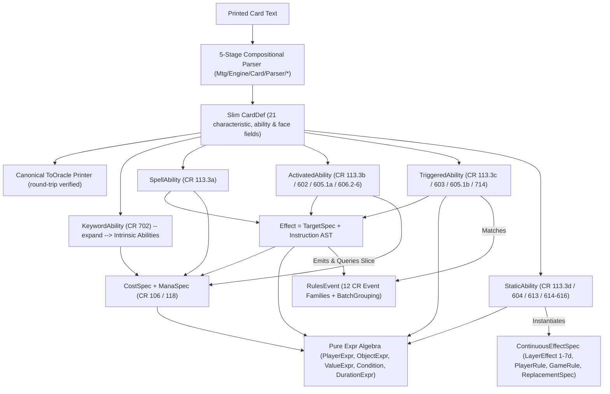
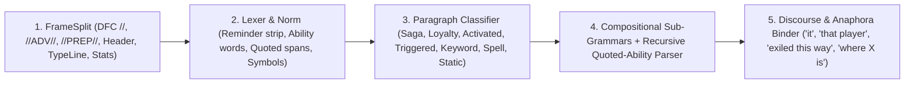

# Plan: Generalizing and Parameterizing `Mtg.Engine.Card` Ability Representations & Oracle Parsing

> **This document is a plan only.** It changes no engine code. It was originally authored against `main` at `c826fb2` (merge of PR #673 on [`EVENT_ALIGNMENT_PLAN.md`](EVENT_ALIGNMENT_PLAN.md), post-Phase 51 execution), updated against `main` at `66c7d0d` after **Phase 1 (PR #675)**, at `1a45335` after **Phase 2 (PR #677)**, at `0c25a40` after **Phase 3 (PR #679)**, at `1fa8630` after **Phase 4 (PR #681)**, at `0da84f4` after **Phase 5 (PR #683)**, at `560ac9c` after **Phase 6 (PR #685)**, at `06a1199` after **Phase 7 (PR #687)**, at `bb6bfe6` after **Phase 8 (PR #689)**, and after **Phase 9**, and checked against the *Magic: The Gathering* Comprehensive Rules **effective 25 September 2026** (`MagicCompRules 20260925.txt`, pinned in [`Rules.lean`](Mtg/Engine/Rules.lean#L1-L29) and [`README.md`](README.md)).

---

## 0. Scope, CR Citation Policy, Build Invariants, and Non-Goals

### 0.1 Comprehensive Rules Citation Policy (25 September 2026 Edition)

Every type, constructor, parser production, and evaluation rule in this plan is anchored to the **25 September 2026** Comprehensive Rules (`Rules.effectiveDate = "2026-09-25"`). Implementation PRs must use these rule numbers and fix stale pre-20260925 citations on code they touch (consistent with [`EVENT_ALIGNMENT_PLAN.md`](EVENT_ALIGNMENT_PLAN.md#L10-L31)):

| Domain | 25 September 2026 CR Sections | Architectural Role in This Plan |
| :--- | :--- | :--- |
| Object characteristics & card faces | **100.2a**, **109.3**, **111.1**, **113.3**, **201–212** (incl. **202.2**, **204**, **205**, **207**, **208.1–3**, **209.1**, **210.1**, **211.1**, **212.1**), **702**, **712**, **715** | Defines the exact 21 fields of [`CardDef`](Mtg/Engine/Card/CardDef.lean#L28-L93) (12 CR 201–212 printed characteristics + `keywords` CR 702 + 4 CR 113.3a–d ability containers + 4 token/face/deck-limit fields: `isToken` CR 111.1, `otherFace` CR 712, `subFaces` CR 715, `deckLimitOverride` CR 100.2a); separates rules text (**207**) from abilities (**113**). |
| Ability taxonomy & zones | **113.1a**, **113.2c**, **113.3a–d**, **113.6**, **113.7a** | Partition into **Spell** (113.3a), **Activated** (113.3b), **Triggered** (113.3c), and **Static** (113.3d) abilities; active-zone defaults and exceptions (113.6b–p). |
| Mana, costs, life, damage, draw, counters | **106**, **107.3–4**, **118**, **119**, **120**, **121**, **122** | Parameterizes `ManaSpec` / `ManaProductionSpec` / `ManaSpendRestriction` (106.6), compositional `CostSpec` (118.3, 118.7–9, and 118.12 / 118.12a resolution-time costs), `CounterKind` / `CounterBag` (122.1, 122.1b, 122.6). |
| Targets & modes | **105.2c**, **115** (incl. **115.1**, **115.3–5**, **115.7a,d**), **201.2a**, **303.4a**, **601.2c–d**, **603.3d**, **608.2b**, **700.2**, **707.10c** | Compositional `TargetSpec` / `TargetSlot` (per-`"target"`-word arity, divisions, group/cross-slot constraints, CR 115.5 stack self-exclusion, and `forEach?` expansion) and unified `ModalSpec`. |
| Intrinsic basic-land mana & subtype setting | **305.6**, **305.7**, **613.1d**, **613.1f** | Grants `{T}: Add {M}` from basic land subtypes (**305.6**), implements Layer-4 basic-land set-vs-add ability stripping (**305.7** during **613.1d**), and lets Layer 6 (**613.1f**) grant/remove abilities afterward. |
| Zone-change identity, owner zones & LKI | **400.3**, **400.7**, **400.7a–m**, **608.2h** | Enforces owner-zone moves for libraries/hands/graveyards (**400.3**); connects `ObjectExpr` / `ValueExpr` look-back queries to [`EventObject`](Mtg/Engine/Game/Object.lean) snapshots and **400.7d** `CastEvent` history. |
| Casting, activating, special actions, mana & loyalty | **116.2b**, **601**, **602**, **605.1a–b**, **606.2–6**, **733.1** | Unifies `SpellAbility`, `ActivatedAbility` (including all four **605.1a** activated mana-ability criteria and **606.2–6** loyalty abilities), **116.2b** Morph special actions, **601.2f** total-cost calculation, and **601.3** permissions/restrictions. |
| Triggered abilities | **511.2**, **603.1**, **603.2c/e/g**, **603.3b**, **603.4**, **603.6a**, **603.7**, **603.10a–f**, **603.12**, **605.1b**, **700.1** | Aligns `TriggerPattern` with [`RulesEvent`](Mtg/Engine/Game/Event.lean#L898), `BatchGrouping` (**603.2c** per-occurrence vs **700.1** `"one or more"` single-event batching), intervening `"if"`, exact **603.10a–f** look-back, delayed/reflexive triggers, and triggered mana abilities. |
| Static abilities, layers, text, combat, replacement & prevention | **506.2**, **506.3a**, **506.5**, **508.4**, **509.1b**, **509.1h**, **604.1–3**, **611.2–3**, **612**, **613.1–8**, **614**, **615**, **616** | Maps `StaticAbility` directly to CDAs (**604.3**), [`LayerEffect`](Mtg/Engine/Game/Event.lean#L329-L345) (Layers 1–7d), [`PlayerRule`](Mtg/Engine/Game/Event.lean#L348-L364), [`GameRule`](Mtg/Engine/Game/Event.lean#L367-L376), [`ReplacementSpec`](Mtg/Engine/Game/Event.lean#L198-L205), and [`PreventionSpec`](Mtg/Engine/Game/Event.lean#L222-L228). |
| Resolution & one-shot effects | **608**, **609**, **610.1–3**, **701** (incl. **701.44a,c**) | Compositional `Instruction` AST with lexical `VarId` bindings backed by post-replacement `RulesEvent` slices (**614.6**) and single-effect banishing (**610.3**). |
| Keywords, tokens, copies, faces, Sagas, Adventures | **108.2**, **110.4a**, **111.5**, **111.6**, **111.10a–x**, **111.11**, **111.12**, **112.1**, **304.4**, **307.4**, **702** (incl. **702.11** Hexproof, **702.14** Landwalk, **702.21** Ward, **702.29** Cycling, **702.33** Kicker, **702.34** Flashback, **702.37** Morph, **702.51** Convoke, **702.61** Split second, **702.73** Changeling, **702.83** Exalted, **702.85** Cascade, **702.108a–b** Prowess, **702.122** Crew, **702.126** Improvise, **702.131** Ascend, **702.142** Boast, **702.147** Decayed, **702.164** Toxic, **702.174** Gift, **702.176** Impending, **702.177** Exhaust, **702.190** Sneak, **702.193** Power-up, **702.194** Teamwork), **707** (incl. **707.2**, **707.9d**), **708**, **712**, **714.2b/d**, **714.4**, **715** | Parameterized `KeywordAbility` with pure `expand` (**702.1**); CR **111.10a–x** `PredefinedToken`, CR **111.5 / 304.4 / 307.4** instant/sorcery token prohibition, CR **111.12** nonexistent-object / LKI copy rule, CR **108.2 / 110.4a / 111.6 / 112.1** `ObjectCategory` spell/card distinction; unified `SubFace` for Adventure (**715**) and Prepare spells; Saga chapters (**714.2b/d**) as `TriggeredAbility`s. |

### 0.2 Lean 4, Lake, and Engine Invariants

Every phase in §5 must preserve six hard engineering invariants verified against the codebase:

1. **Lake Precompiled Plugin Hierarchy ([`lakefile.toml`](lakefile.toml#L20-L57))**:
   - `Mtg.Engine.Card` (`precompileModules = true`) must remain strictly acyclic below `Mtg.Engine.Game` (`precompileModules = true`); `Card` never imports `Game`, `GameObject`, `Status`, or `Pending`.
   - Phase 1 moved [`Turn.lean`](Mtg/Engine/Turn.lean#L1-L172) (zero imports: `Step`, `Phase`, `TurnRef`, `PhaseRef`, `StepAnchor`, joined by `StepOrPhase` in Phase 2) into `Mtg.Engine.Card`'s globs (`lakefile.toml#L23`) alongside [`Zone.lean`](Mtg/Engine/Zone.lean#L11-L66), promoted shared value-level CR enums (`ZoneKind`, `ZoneVerb`, `LibraryPosition`, `PermanentDesignation`, `PermanentDesignationTag`, `PlayerDesignation`, `CostKind`, `ReplacementTier`, `SetOrAdd`, `TypeSetMod`, `ColorSetMod`, `TextChange`, `HasTextChange`, plus Phase 6's `pluralSubtype` / `joinedSubtypes`) into [`Mtg/Engine/Card/Primitives.lean`](Mtg/Engine/Card/Primitives.lean), and promoted runtime mana types below [`Mtg/Engine/Mana.lean`](Mtg/Engine/Mana.lean).
   - **Layer-0 vs. Layer-1/2/3 import stratification (completed in Phase 2, PR #677; extended across Phases 3–9)**: Layer-0 runtime/evaluated mana types (`ManaType`, `ManaOutput`, `ManaObjectPred`, `ManaAbilityPred`, `SpellRiderSpec`, `ManaSpend`, `ManaSpendRestriction`) live in [`Mtg/Engine/Card/ManaTypes.lean`](Mtg/Engine/Card/ManaTypes.lean) strictly below [`Mtg/Engine/Mana.lean`](Mtg/Engine/Mana.lean), while `Card/Text.lean` → `Card/Counter.lean` → [`Card/Expr.lean`](Mtg/Engine/Card/Expr.lean) → Layer-2 [`Card/ManaSpec.lean`](Mtg/Engine/Card/ManaSpec.lean) / [`Card/Cost.lean`](Mtg/Engine/Card/Cost.lean) / [`Card/Keywords.lean`](Mtg/Engine/Card/Keywords.lean) / [`Card/Targeting.lean`](Mtg/Engine/Card/Targeting.lean) / [`Card/TriggerPattern.lean`](Mtg/Engine/Card/TriggerPattern.lean) → unified mutual [`Card/Ability.lean`](Mtg/Engine/Card/Ability.lean) (`Instruction`, `Effect`, `ActivatedAbility`, `TriggeredAbility`, `StaticAbility`, `ContinuousModification`, `TokenSpec`, `GrantedAbility`, `ModalSpec`, `DelayedTriggerSpec`) → [`Card/Token.lean`](Mtg/Engine/Card/Token.lean) / [`Card/Effect.lean`](Mtg/Engine/Card/Effect.lean) / [`Card/ActivatedAbility.lean`](Mtg/Engine/Card/ActivatedAbility.lean) / [`Card/StaticAbility.lean`](Mtg/Engine/Card/StaticAbility.lean) / [`Card/Trigger.lean`](Mtg/Engine/Card/Trigger.lean) / [`Card/TriggeredAbility.lean`](Mtg/Engine/Card/TriggeredAbility.lean) / [`Card/TriggerEffects.lean`](Mtg/Engine/Card/TriggerEffects.lean) / [`Card/KeywordExpand.lean`](Mtg/Engine/Card/KeywordExpand.lean) / [`Card/Parser/SubGrammars.lean`](Mtg/Engine/Card/Parser/SubGrammars.lean) sit cleanly above `Mtg/Engine/Mana.lean`.
   - Keep `Mtg.Engine.Catalog` **un-precompiled** ([`lakefile.toml`](lakefile.toml#L25-L33)) while `parseOracleCard!` executes at compiled native speed via the `Mtg.Engine.Card` shared plugin.
2. **Lean C Runtime Constructor Tag Budget (`ctorIdx ≤ 243` for field-bearing constructors)**:
   - Lean 4's C runtime (`lean.h` in the pinned Lean 4.34.1 toolchain) stores an allocated constructor's **0-indexed declaration ordinal** (`ctorIdx`) in an 8-bit `m_tag` capped at `LeanMaxCtorTag = 243` (`lean_alloc_ctor` accepts `tag <= 243`; tags `244..255` are reserved for `LeanClosure`, `LeanArray`, etc., so only nullary unboxed constructors may appear at `ctorIdx ≥ 244`). Phase 8 (PR #689) shrank `Resolution` from 364 → 70 trigger-only constructors, and **Phase 9 retired `Resolution`, `SharedTrigger`, all 9 `*Leftover` enums, and the legacy selector DSL completely** (shrinking [`SpellResolution.lean`](Mtg/Engine/Card/SpellResolution.lean#L1-L38) to 11-ctor `SpellCastKind`).
   - Every target AST `inductive` in `Mtg/Engine/Card/` (excluding closed vocabulary enums `CardSubtype`, `CounterKind`) now stays **`< 40` constructors** (`ObjectPred` has 39 constructors; every inductive in [`Ability.lean`](Mtg/Engine/Card/Ability.lean) stays `≤ 20` constructors — `StaticReplacementSpec` 20, `Instruction` 18, `ContinuousModification` 17, `PlayerOp` 16, `StaticCombatRule` 16, `StaticAbility` 6; [`TriggerPattern.lean`](Mtg/Engine/Card/TriggerPattern.lean) stays `≤ 27` constructors; all other target AST inductives are `≤ 35`), permanently eliminating tag-limit ceilings and set-named overflow wrappers (`FraStatic` retired in Phase 6; `FraEvent` retired in Phase 7; `FrcEffect` retired in Phase 8; `Resolution`, `SharedTrigger`, and all 9 `*Leftover` enums retired in Phase 9).
3. **Clang Optimization Time, CI Build Budget, & Mutual/Nested Recursion Discipline ([`lakefile.toml`](lakefile.toml#L4-L44), [`Ability.lean`](Mtg/Engine/Card/Ability.lean#L1137-L1354))**:
   - **15-minute CI budget discipline (established in Phase 1, PR #675)**: Package-level `moreLeancArgs = ["-O1", "-mllvm", "-regalloc=fast"]` keeps `Mtg.Engine.Card` (`parseOracleCard`) at `-O1`, while `Mtg.Engine.Game` overrides `moreLeancArgs = ["-O0"]` (`lakefile.toml#L41-L44`) so multi-megabyte generated C files (`Core.c`, `Event.c`, `Decisions.c`, `FraChoices.c`) compile ~10× faster on the serial CI critical path (~6–13 min total vs. >15 min timeout). Large structural `BEq` instances and hot pattern matchers must be chunked into `@[noinline]` helpers (as done for `BEq CardDef` via `cardDefBeq1..2` in [`Object.lean`](Mtg/Engine/Game/Object.lean#L16-L52) and `matchesPattern*` / `matchesTriggerPattern` in [`Event.lean`](Mtg/Engine/Game/Event.lean)), and hot event-log evaluators (`EvalExpr.lean`, `Interpreter.lean`, `matchTriggers`) must avoid quadratic re-scans of `Game.events` (following Phase 1's `InitialMaterializeIndex` and `Std.HashMap`-backed `HistGlobalState` in [`Core.lean`](Mtg/Engine/Game/Core.lean)).
   - Recursions over nested containers (`Array Instruction`, `Array ObjectPred`, `Array Condition`, `Option CardDef`) must use explicit `mutual` structural blocks or `Array.attach` / `List.attach` rather than implicit `List.map` well-founded splitters over giant flat enums, preventing multi-second Clang register-allocation stalls under `./scripts/ci-lake-build.sh` (`lake build --wfail`).
   - Mutual AST blocks (`PlayerFilter`..`ValueExpr` in [`Expr.lean`](Mtg/Engine/Card/Expr.lean#L694-L718), `CostItem`..`CostSpec` in [`Cost.lean`](Mtg/Engine/Card/Cost.lean#L205-L208), and `GrantedAbility`..`StaticAbility` in [`Ability.lean`](Mtg/Engine/Card/Ability.lean#L1368-L1400)) derive or define `BEq` and `Repr` **once** for the mutual tuple and project per-type instances (as in [`SpellResolution.lean`](Mtg/Engine/Card/SpellResolution.lean#L829-L832) and [`Event.lean`](Mtg/Engine/Game/Event.lean#L2339-L2345)).
   - Shrinking `CardDef` from **26** remaining fields (down from 141 after Phase 4 retired 22 legacy additional-cost/keyword fields + added 1 unified `additionalCosts` field, Phase 5 retired all 21 printed mana fields, Phase 6 retired all **66** static/cost/ETB/replacement fields, Phase 7 retired `saga`, `fraTriggerModes`, and `commanderIdentityScryCreature`, and Phase 8 retired all **4** spell-modal/empower side-channels `chooseOneOrBoth`, `chooseTwoIfYouControlSubtype`, `chooseBothIfTeamwork`, and `empowerJace` + `AdventureFace.empowerJace`) to 21 fields in Phase 10 removes `set_option maxRecDepth 1024` ([`CardDef.lean`](Mtg/Engine/Card/CardDef.lean#L26)) and moves structural **`BEq CardDef`** directly into `Mtg.Engine.Card.CardDef` (retiring the interim chunked `cardDefBeq1..2` instance in [`Object.lean`](Mtg/Engine/Game/Object.lean#L16-L52) and replacing `reprStr` comparisons in `ParseOracle.lean`).
4. **Parser Throughput Barriers**:
   - Preserve `@[irreducible, noinline]` on parser entry points and catalog helpers, `Thunk`-cached token/verb dispatch tables, and linear `Array Char` text normalization ([`OracleNorm.lean`](Mtg/Engine/Card/OracleNorm.lean#L279-L317)).
5. **100% Catalog Authoring & Bidirectional Round-Trip Invariant**:
   - All **981** cards in [`supportedCatalogCards`](Mtg/Engine/Catalog/Supported.lean#L1-L30) (`13` core + `193` HOB + `117` HOC + `286` MSH + `285` FRA + `87` FRC) continue to be authored from printed Oracle text via `fromOracle`, with `modellingError? == none` and zero unparsed text fallbacks.
   - `parseOracleCard (renderFullOracle c) == .ok c` (upgraded from `reprStr` comparison to structural `BEq CardDef` in Phase 10) must hold across **all 981 catalog cards** (adding `realityFractureCommanderCards` to the round-trip `#guard` suite in [`ParseOracle.lean`](Mtg/Engine/Tests/ParseOracle.lean)) plus open-ended parameter-generalization `#guard`s and [`OracleRoundtrip.lean`](Mtg/OracleRoundtrip.lean).
6. **Zero Ruling or Demo Regression**:
   - All **1,057** Gatherer/Scryfall rulings in [`OracleData.lean`](Mtg/Engine/OracleData.lean#L3264) and all **11,000+** `#guard` assertions across `Card/Guards.lean`, `Engine/Tests/*` (including `Tests/EvalExpr.lean`, `Tests/Targets.lean`, `Tests/CostKeywords.lean`, `Tests/ActivatedMana.lean`, `Tests/StaticAbilities.lean`, `Tests/TriggeredAbilities.lean`, and Phase 8's [`Tests/Interpreter.lean`](Mtg/Engine/Tests/Interpreter.lean)), `OracleRulings.lean`, `Demo/RenderTests.lean` (534 `#guard`s), and `Demo/Check0..9.lean` must pass at every phase boundary.

### 0.3 Non-Goals

Consistent with [`EVENT_ALIGNMENT_PLAN.md`](EVENT_ALIGNMENT_PLAN.md#L33-L52), unmodeled CR subsystems (infect/wither 120.3b/d, regeneration 701.19, battles as attack targets 508.1b, Initiative 726, Attractions/stickers, planeswalking 603.10g, disguise/manifest/cloak, active day/night transitions 731.2) are not implemented as new gameplay rules here, though the generalized AST leaves natural algebraic slots for each.

---

## 1. Diagnosis of Current Ability and Parser Representations

Across `Mtg/Engine/Card/` (**32 files, 36,433 lines** post-Phase 9; down 1 file and 4,300 lines from 33 files / 40,733 lines post-Phase 8 after deleting `SharedTrigger.lean`, shrinking `SpellResolution.lean` to 38-line `SpellCastKind`, and introducing unified [`TriggerEffects.lean`](Mtg/Engine/Card/TriggerEffects.lean), compared with 35 files / 38,885 lines post-Phase 7, 36 files / 37,690 lines post-Phase 6, 36 files / 35,869 lines post-Phase 5, 36 files / 34,469 lines post-Phase 4, 34 files / 31,835 lines post-Phase 3, 34 files / 30,888 lines post-Phase 2, 31 files / 27,501 lines post-Phase 1, and 29 files / 25,778 lines originally), incremental set additions (`HOB`/`HOC` → `MSH` → `FRA` → `FRC`) produced six structural bottlenecks (with the token split and string-parsed mana restrictions retired in Phase 1, the pure expression algebra / Stage-4 expression sub-grammars established in Phase 2, legacy targeting retired onto unified `TargetSpec` / compositional target parsing in Phase 3, fragmented costs/keywords retired onto compositional `CostSpec` / parameterized `KeywordAbility` in Phase 4, all 21 `CardDef` mana fields / 4 `FraStatic` mana constructors / bespoke `ActivatedAbility` flags retired onto unified `ActivatedAbility` + `ManaProductionSpec` + CR 305.6–7 / 605.1a in Phase 5, all 66 `CardDef` static/cost/ETB/replacement fields, `FraStatic`, `StaticShape`, `StaticMeta`, and `StaticAbility.printed` retired onto CR-stratified 6-constructor `StaticAbility` + Stage-4 static parsers + Layer 3–7d static evaluation in Phase 6, `TriggerEvent`, `FraEvent`, `SharedTriggerWhen`, `SharedTriggerOpts`, `FraCondition`, `TriggerTiming`, `SagaDef`, `SagaChapter`, and 3 trigger/Saga `CardDef` side-channels retired onto unified `TriggerPattern` / `TriggeredAbility` + pattern-driven `Core.matchTriggers` + Stage-4 trigger parsers + full trigger validation in Phase 7, spell/activated/chapter/FRA/FRC resolutions retired onto unified `Instruction` + `Game/Interpreter.lean` in Phase 8, and the remaining trigger DSL — `Resolution`, `SharedTrigger`, all 9 `*Leftover` enums, the 4 legacy selector inductives, all 9 `Trigger*Note` inductives, `CopyTokenContext`, `FrcPostStep`, 100 legacy `PostStep` ctors, 62 legacy `ContinuationFrame` fields, `SharedTrigger.lean`, `ResolutionCompat.lean`, and `TriggerArgs.lean` — retired onto `Instruction` + `Game/Interpreter.lean` + `InterpCont` + `stepEnv` + `StoredEvalEnv` in Phase 9):

### 1.1 `CardDef` Field Proliferation (26 Fields Remaining, Down from 141) and Remaining Side-Channels

[`CardDef`](Mtg/Engine/Card/CardDef.lean#L28-L93) currently has **26 fields** (down from 141 after Phase 4 retired 16 parameterized keyword fields + 6 `additionalCost*` booleans while adding 1 `additionalCosts` field, Phase 5 retired all 21 printed `{T}: Add` & mana-filter fields, Phase 6 retired all **66** static, cost-modifier, ETB, and replacement fields, Phase 7 retired `saga`, `fraTriggerModes`, and `commanderIdentityScryCreature`, and Phase 8 retired all **4** spell-modal/empower side-channels `chooseOneOrBoth`, `chooseTwoIfYouControlSubtype`, `chooseBothIfTeamwork`, and `empowerJace` + `AdventureFace.empowerJace`): **14** CR 201–212 printed characteristic fields (`name` through `colorIndicator`) + **4** core non-characteristic header/face fields (`isToken` CR 111.1, `otherFace` CR 712, `anyNumberInDeck` CR 100.2a, `keywords` CR 702) = **18** core fields, plus **7** structured ability/sub-face containers (`spellEffect`, `spellModes`, `activatedAbilities`, `staticAbilities`, `triggeredAbilities`, `adventure`, `prepareFace`) = **25** fields. Only **1** transitional ad-hoc field remains (`additionalCosts`, retiring onto `SpellAbility` in Phase 10; `18 + 7 + 1 = 26`):

| Ad-Hoc `CardDef` Field Bucket | Field Count | Exact Field Families & Architectural Failure Mode |
| :--- | ---: | :--- |
| Printed `{T}: Add` & mana-filter fields *(all 21 retired in Phase 5)* | **0** | All 21 fields (`tapAddMana`, `tapAddAnyColor`, `tapAddOneOf`, `tapAddManaForEach`, `tapAddRestricted`, `tapPayLifeAddOneOf`, `tapAddCommanderIdentity`, `tapAddOppCouldProduce`, `tapAddYouCouldProduce`, `filterMana`, etc.) retired in Phase 5 (PR #683) onto `ActivatedAbility` with [`ManaProductionSpec`](Mtg/Engine/Card/ManaSpec.lean#L226-L238) and CR 305.6 intrinsic basic-land mana synthesis. |
| Spell cost modifiers & cast rules *(all 21 retired in Phase 6)* | **0** | All 21 fields (13 `costReduction*` fields, `firstCreatureCostsLess`, `eminenceSphinxReduction`, `freeCastIfControlCommander`, `flashIfYouControlSubtype`, `firstCreatureHasFlash`, `cantBeCountered`, `castOnlyIfGraveyardAtLeast`, `castExiledWithSevenInGraveyard`) retired in Phase 6 (PR #685) onto stratified [`StaticAbility`](Mtg/Engine/Card/Ability.lean#L1342) (`.costModifier` / `.ruleModifying`). |
| Transitional additional-cost container *(22 legacy fields retired in Phase 4)* | **1** | `additionalCosts : Array AdditionalCostSpec` (Phase 4 retired all 6 `additionalCost*` booleans + `AdventureFace.additionalCostSacrificeCreature` and all 16 parameterized keyword fields — `prowessInstances`, `cascade`, `kicker`, `giftTreasure`, `teamwork`, `flashback`, `flashbackDiscard`, `ward`, `crew`, `affinityForSubtype`, `daybound`, `morph`, `impending`, `protectionFromColors`, `cycling`, `toxic` — onto [`KeywordAbility`](Mtg/Engine/Card/Keywords.lean#L330-L365); `additionalCosts` moves onto `SpellAbility.additionalCosts` in Phase 10). |
| Enters-tapped / enters-with / as-enters *(all 21 retired in Phase 6)* | **0** | All 21 fields (10 `entersTapped*` fields, 4 `entersWith*` fields, 5 `asEnters*` fields, `entersPrepared`, and `othersEnterWithPlusOneEqualToughness`) retired in Phase 6 (PR #685) onto `StaticAbility.replacement` ([`StaticReplacementSpec`](Mtg/Engine/Card/Ability.lean#L1181)). |
| Continuous, replacement, Saga, & modal side-channels *(24 retired in Phase 6; 3 retired in Phase 7; final 4 retired in Phase 8)* | **0** | All 24 static, continuous, and replacement fields retired in Phase 6 (PR #685); all 3 trigger/Saga side-channels (`saga`, `fraTriggerModes`, `commanderIdentityScryCreature`) retired in Phase 7 (PR #687); and all 4 spell-modal/empower side-channels (`chooseOneOrBoth`, `chooseTwoIfYouControlSubtype`, `chooseBothIfTeamwork`, `empowerJace` + `AdventureFace.empowerJace`) retired in Phase 8 (PR #689) onto `Instruction.chooseModes` ([`ModalSpec`](Mtg/Engine/Card/Ability.lean#L1236)) and `Instruction.player (.empowerPlaneswalker ...)` (with smart constructor `Instruction.empowerJace`). Only transitional `CardDef.spellModes` remains as a fallback until Phase 10 moves spell abilities into `SpellAbility`. |

**Direct rules and tooling consequences**:
- **Layer 3 (CR 612) & Layer 6 (CR 613.1f) static, trigger, & effect alignment *(Resolved across Phases 6–9)***: [`Casting.lean`](Mtg/Engine/Game/Casting.lean#L18-L77), [`Costs.lean`](Mtg/Engine/Game/Costs.lean#L101-L277), [`Movement.lean`](Mtg/Engine/Game/Movement.lean#L64-L70), [`Damage.lean`](Mtg/Engine/Game/Damage.lean#L101), [`Tokens.lean`](Mtg/Engine/Game/Tokens.lean#L269), and [`Core.lean`](Mtg/Engine/Game/Core.lean) read evaluated `g.staticAbilities o` and `g.triggeredAbilities o`, and Phases 8–9 wired functorial `HasTextChange` across the entire 16-type [`Ability.lean`](Mtg/Engine/Card/Ability.lean#L1648) mutual block (`Instruction`, `Effect`, `ModalSpec`, `DelayedTriggerSpec`, `ActivatedAbility`, `TriggeredAbility`, `StaticAbility`, `ContinuousModification`, `StaticReplacementSpec`, `TokenSpec`, `CustomTokenSpec`, `CopyModification`, `GrantedAbility`, `EmblemSpec`, `CreateOp`, `InstallEffectOp`), with all triggered abilities now resolving directly on `Instruction`.
- **Remaining notation & equality cleanup (Phase 10)**: [`structuredAbilityLines`](Mtg/Engine/Card/CardDef.lean) renders structured ability lines (`CardDef.abilitiesText` / `ToString CardDef`) and [`renderFullOracle`](Mtg/Engine/Card/ParseOracle.lean#L2149) delegates rules-box reconstruction directly to `KeywordAbility.renderOracleLines c.keywords` + `cForAbilities.structuredAbilityLines` with zero modal/empower side-channels outside `spellEffect`/`activatedAbilities`/`staticAbilities`/`triggeredAbilities`; meanwhile `Mtg.Engine.Card.CardDef` still lacks `BEq` (only [`Object.lean`](Mtg/Engine/Game/Object.lean#L16-L52) inside `Mtg.Engine.Game` defines the interim chunked `cardDefBeq1..2` instance), forcing [`oracleRoundtripDiff`](Mtg/Engine/Card/ParseOracle.lean#L2195) to compare `reprStr` until Phase 10.

### 1.2 Eight Overlapping Effect/Resolution Subsystems & Exhausted C-Tag Budget *(Resolved across Phases 8–9)*

Phases 8 and 9 collapsed **all eight** overlapping effect/resolution subsystems onto the single 18-constructor [`Instruction`](Mtg/Engine/Card/Ability.lean#L1257) AST executed by [`Game/Interpreter.lean`](Mtg/Engine/Game/Interpreter.lean):
- **Phase 8 (PR #689)** retired spell, activated, chapter, FRA, and FRC resolutions (`FrcEffect`, `PermanentAction`, `ChapterResolution`, `ChapterSpell`, `TokenAbilitySpec`, `EffectResolution.lean`, `FraResolve.lean`, `FrcResolve.lean`, `Chapters.lean`), shrinking `Resolution` from `364 → 70` trigger-only constructors.
- **Phase 9** retired the final trigger DSL completely — deleting `Resolution` (remaining 70 ctors, leaving [`SpellResolution.lean`](Mtg/Engine/Card/SpellResolution.lean#L1-L38) as 11-ctor `SpellCastKind`), `SharedTrigger` (164 ctors, deleting `SharedTrigger.lean`), all 9 `*Leftover` enums (91 ctors), `Effect.resolution?` / `Effect.legacyTokens` / `Effect.sharedTrigger`, `TriggerResolution`, `ResolutionCompat.lean`, `TriggerArgs.lean`, `FraNext` / `fraNextToEffect`, `Game.applyWorldsWithinWorlds`, `Interpreter.runLegacyResolution` / `runUnifiedSteps` / `runUnifiedAbilitySteps`, `PendingReplacement.continueUnified` / `continueUnifiedAbility`, and `FrcPostStep` (33 ctors) — routing all triggered ability execution in [`TriggeredAbilities.lean`](Mtg/Engine/Game/TriggeredAbilities.lean) (shrunk to 229 lines) directly through [`Game/Interpreter.lean`](Mtg/Engine/Game/Interpreter.lean) via [`Card/TriggerEffects.lean`](Mtg/Engine/Card/TriggerEffects.lean).
- *(Resolved across Phases 1–9)* The former three-way token split (`TokenKind` / `TriggerToken` / `FrcToken`), `TokenStat`, `CopyTargetRef`, `TokenAbilitySpec`, `Keywords` token fields, and `CopyTokenContext` have all been unified onto mutual `TokenSpec` / `CustomTokenSpec` / `GrantedAbility` and [`StoredEvalEnv := EvalEnvOf Unit`](Mtg/Engine/Game/Pending.lean#L18-L56) (retaining Phase 2's generic `FraChoice.chooseTokenCopyObject` tie-prompting).

### 1.3 Impure, Trigger-Only Selector DSL and Bespoke Inter-Step State *(Resolved across Phases 3, 4, 8, & 9)*

- *(Resolved in Phase 3)* The former 80-constructor `EffectTargetKind` enum, 28-field `TargetFilter` struct (incl. `noun : String`), `TargetZone`, `TargetController`, and `OracleArgs.takeKind` were retired onto unified [`TargetSpec`](Mtg/Engine/Card/Targeting.lean#L207-L210) / [`TargetSlot`](Mtg/Engine/Card/Targeting.lean#L147-L159) / [`TargetDomain`](Mtg/Engine/Card/Targeting.lean#L126-L132) backed by `ObjectPred` / `PlayerFilter`.
- *(Resolved in Phase 4)* `CostSelector` was retired onto compositional `CostSpec`.
- *(Resolved across Phases 8–9)* `PlayerSelector` (10 ctors), `ObjectSelector` (98 ctors), `NumberSelector` (36 ctors), `ConditionSelector` (30 ctors), and all **9 `Trigger*Note` inductives** have been **retired** (0 matches across `Mtg/Engine/`); all spell, activated, chapter, and triggered resolution evaluates pure [`Expr.lean`](Mtg/Engine/Card/Expr.lean) queries via [`EvalExpr.lean`](Mtg/Engine/Game/EvalExpr.lean) and lexical [`ContinuationFrame.stepEnv`](Mtg/Engine/Game/Event.lean#L1753) + [`ContinuationFrame.interpWait?`](Mtg/Engine/Game/Event.lean#L1756) + 29-ctor [`InterpCont`](Mtg/Engine/Game/Event.lean#L1254-L1327), shrinking [`ContinuationFrame`](Mtg/Engine/Game/Event.lean#L1683-L1756) from **93 → 31 fields** (`-62` retired) and [`PostStep`](Mtg/Engine/Game/Event.lean#L978-L1142) from **208 → 108 constructors** (`-100` retired) while retiring `FrcPostStep` (33 → 0) completely.

### 1.4 Six-Layer Trigger Fragmentation & `TriggeredAbility.timing` Split-Brain *(Resolved in Phases 7 & 9)*

Phase 7 retired all legacy trigger-event, condition, timing, and Saga side-channel fragmentation (0 remaining matches for `TriggerEvent`, `FraEvent`, `SharedTriggerWhen`, `SharedTriggerOpts`, `FraCondition`, `TriggerTiming`, `SagaDef`, `SagaChapter`, `CardDef.saga`, `CardDef.fraTriggerModes`, `CardDef.commanderIdentityScryCreature`, `EventObject.commanderIdentityScryCreature`, `fraConditionHolds`, `fraInterveningHolds`, and `matchingTriggers` across `Mtg/`; deleted `Mtg/Engine/Card/TriggerEvent.lean` and `Mtg/Engine/Card/Saga.lean`), and Phase 9 retired the remaining trigger-effect wrappers (`SharedTrigger` and all 9 `*Leftover` enums):
- **Unified `TriggerPattern` AST**: Replaced `TriggerEvent` (113 ctors), `FraEvent` (35 ctors), and `SharedTriggerWhen` (90 ctors) with the 27-constructor [`TriggerPattern`](Mtg/Engine/Card/TriggerPattern.lean#L252-L326) plus 10 supporting inductives (`≤ 27` ctors each, zero card-/set-named constructors) aligned with [`RulesEvent`](Mtg/Engine/Game/Event.lean#L898), paired with `BatchGrouping` (CR 603.2c / 700.1 / 714.2b), `TriggerLimit`, `TriggerWord`, CR 603.4 `interveningIf? : Option Condition`, structural CR 603.10a–f [`usesLookBack`](Mtg/Engine/Card/TriggerPattern.lean#L345-L359), and CR 605.1b [`TriggeredAbility.isManaAbility`](Mtg/Engine/Card/Trigger.lean).
- **Eliminated `TriggeredAbility.timing` split-brain & added full validation**: [`TriggeredAbility`](Mtg/Engine/Card/Ability.lean#L1311) stores `effect : Effect` directly on unified `Instruction` (with Phase 8 folding per-trigger `TriggeredAbility.modes` into `Instruction.chooseModes` via `ModalSpec` and Phase 9 retiring `SharedTrigger` / 9 `*Leftover` enums onto `TriggerEffects.lean`), while [`CardDef.faceModellingError?`](Mtg/Engine/Card/CardDef.lean) validates every triggered ability's `activeZones`, modal arity, and resolution via [`Effect.doesNothingAsTrigger`](Mtg/Engine/Card/Effect.lean).
- **Pattern-driven `Core.matchTriggers`**: Replaced all 13 hardcoded batch `for` loops and the monolithic `TriggerEvent`/`FraEvent` dispatcher with pattern-driven two-pass [`Core.matchTriggers`](Mtg/Engine/Game/Core.lean#L14195) consulting `pre` iff `atomicPat.usesLookBack` via [`TriggerPattern.flattenDisjuncts`](Mtg/Engine/Card/TriggerPattern.lean#L396-L400) and sharing `TriggerDedupState` across passes.

### 1.5 Static, Cost, Keyword, and Activated Fragmentation *(Resolved across Phases 4–8)*

- *(Resolved in Phase 4, PR #681)* Legacy cost and keyword fragmentation has been **retired** (0 remaining type/constructor matches for `KeywordCounters`, `ActivationCost`, `FraCost`, `CostSelector`, and `WardCost` across `Mtg/Engine/`):
  - Costs now unify on compositional [`CostSpec`](Mtg/Engine/Card/Cost.lean#L195-L197) / [`CostItem`](Mtg/Engine/Card/Cost.lean#L159-L190) (15 ctors), [`LoyaltySymbol`](Mtg/Engine/Card/Cost.lean#L27-L33), [`AdditionalCostSpec`](Mtg/Engine/Card/Cost.lean#L776-L781), and [`AlternativeCostSpec`](Mtg/Engine/Card/Cost.lean#L810-L819), retiring `ActivationCost` (23 fields), `FraCost` (11 ctors), `CostSelector` (4 ctors), `WardCost` (7 ctors), all 6 `CardDef.additionalCost*` booleans, and `AdventureFace.additionalCostSacrificeCreature`.
  - Keywords now unify on [`KeywordAbility`](Mtg/Engine/Card/Keywords.lean#L330-L365) (`SimpleKeyword` 29 unit ctors + 16 parameterized ctors) with pure [`KeywordAbility.expand`](Mtg/Engine/Card/KeywordExpand.lean#L181-L336) and all **15** CR 122.1b keyword counters via [`CounterKind.grantedKeyword?`](Mtg/Engine/Card/Keywords.lean#L395-L411) (adding `.decayed`, `.exalted`, and `.hexproof` to [`CounterKind`](Mtg/Engine/Card/Counter.lean#L17-L51)), retiring the `Keywords` 22-`Bool` struct (moving non-keyword CR 509.1b `"can't be blocked"` onto `StaticAbility.cantBeBlocked` + [`ContinuousEffectSpec.cantBeBlockedUntilEot`](Mtg/Engine/Game/Event.lean#L416-L417)), the partial 8-field `KeywordCounters` struct, the 6 ward static constructors, and all 16 parameterized keyword fields on `CardDef`.
- *(Resolved in Phase 5, PR #683)* Legacy mana-ability and activation-flag fragmentation has been **retired** (0 remaining matches for `TapAddForEach`, `FraActivationCondition`, the 21 `CardDef` mana fields, the 4 `FraStatic` mana constructors, and `ManaSpendRestriction.allowsWithFlags` across `Mtg/Engine/`):
  - [`ActivatedAbility`](Mtg/Engine/Card/Ability.lean#L1297) now unifies stack activated abilities, CR 605.1a mana abilities (via `PlayerOp.addMana` on `Instruction` after Phase 8 retired `ActivatedAbility.mana?`), CR 606.2 loyalty abilities, and CR 305.6 intrinsic basic-land mana abilities using [`ActivationTiming`](Mtg/Engine/Card/Ability.lean#L33-L41), `activeZones`, per-ability `turnLimit?` / `lifetimeLimit?`, declarative `condition? : Option Condition`, declarative [`ActivationCostReduction`](Mtg/Engine/Card/Ability.lean#L71-L74), and [`ActivationMechanicTag`](Mtg/Engine/Card/Ability.lean#L46-L59), retiring all 9 bespoke activation-condition/cost-reduction fields and 9 bespoke timing/zone/mechanic flags on `ActivatedAbility`.
- *(Resolved in Phase 6, PR #685)* Legacy flat static-ability fragmentation has been **retired** (0 remaining matches for `FraStatic`, `StaticShape`, `StaticMeta`, and `StaticAbility.printed` across `Mtg/Engine/`; all 66 static/cost/ETB/replacement fields removed from `CardDef`, and the transitional inductive `StaticAbility` constructors `.instantSorcerySplitSecond` / `.improvise` / `.extort` / `.sneak` / `.boast` removed):
  - [`StaticAbility`](Mtg/Engine/Card/Ability.lean#L1342) uses **6 CR-stratified constructors** backed by domain-stratified types (every inductive `≤ 20` constructors, zero card-/set-named constructors, functorial `HasTextChange`, canonical `ToOracle`).
- *(Resolved in Phase 8, PR #689)* Retired `ActivatedAbility.mana?` and `ActivatedAbility.otherModes` (folded into `Instruction.player (.addMana ...)` and `Instruction.chooseModes`), `TriggeredAbility.modes` (folded into `Instruction.chooseModes`), `Effect.spellCastKind` / `abilityCastKind` stored fields (computed purely via [`Effect.classifyForAgent`](Mtg/Engine/Card/Effect.lean#L782) / [`Effect.classifyAbilityForAgent`](Mtg/Engine/Card/Effect.lean#L892)), and `ExpandedKeyword`'s transitional `KeywordStaticSpec` / `KeywordTriggerSpec` / `KeywordTriggerKind` / `KeywordSpellInstruction` wrappers (now directly emitting `StaticAbility` / `TriggeredAbility` / `Instruction` via [`KeywordExpand.lean`](Mtg/Engine/Card/KeywordExpand.lean#L55-L63)). Only `ActivatedAbility.printed` / `Effect.phrase` (Phase 10) and `Equip` / `Cycling` line routing in `isKeywordLineEligible` (Phase 11) remain.

### 1.6 Three-Tier Oracle Parser Ceiling

The parser splits across:
1. **[`OracleCandidates.lean`](Mtg/Engine/Card/OracleCandidates.lean)** (1,976 lines) + **[`OracleArgs.lean`](Mtg/Engine/Card/OracleArgs.lean)** (2,072 lines): `OracleArgs` extracts/refills leaf scalar slots inside whole-ability templates; Phase 8 (PR #689) added compositional [`Parser.parseInstructionSeq`](Mtg/Engine/Card/Parser/SubGrammars.lean#L4451) / [`Parser.parseInstructionEffect`](Mtg/Engine/Card/Parser/SubGrammars.lean#L4519) in Stage 4 for open-ended multi-sentence instruction parsing, with full quoted-ability and prototype cutover scheduled for Phase 11.
2. **`parseStructural` in [`ParseOracle.lean`](Mtg/Engine/Card/ParseOracle.lean#L738-L821)** (84 lines, down from 214 lines pre-Phase 6 and 285 lines pre-Phase 5): remaining string matchers for `"sacrifice this land" ... "create X Treasure tokens"`, Saga reminder text, `anyNumberInDeck`, Path of Ancestry's `onManaSpentCastCommanderTypeScry`, and Equip/counter-sacrifice activated abilities (delegating keywords/costs in Phase 4, mana abilities in Phase 5, statics in Phase 6, triggers in Phase 7, and modal headers / `"Empower Jace"` folding onto `Instruction` in Phase 8).
3. **[`FrcParse.lean`](Mtg/Engine/Card/FrcParse.lean)** (654 lines): post-candidate prefix/substring matchers lowered **directly onto unified `Instruction`** (zero `FrcEffect` constructors remaining; retired completely in Phase 11).

---

## 2. Target Unified Ability Architecture (Aligned with `RulesEvent` & CR)



### 2.1 Layer 0: Shared CR Primitives in `Mtg.Engine.Card` *(Completed in Phase 1, PR #675)*

Phase 1 aligned `Mtg.Engine.Card` directly with [`Event.lean`](Mtg/Engine/Game/Event.lean) and [`Object.lean`](Mtg/Engine/Game/Object.lean) while keeping `Card` independent of `Game`:
1. Moved [`Turn.lean`](Mtg/Engine/Turn.lean#L1-L172) (`Step`, `Phase`, `TurnRef`, `PhaseRef`, `StepAnchor`; joined by [`StepOrPhase`](Mtg/Engine/Turn.lean#L140-L154) and `Phase.englishName` in Phase 2, removing the duplicate from `Game/Event.lean`) into `Mtg.Engine.Card`'s globs in [`lakefile.toml`](lakefile.toml#L20-L23).
2. Promoted shared value-level CR enums into [`Mtg/Engine/Card/Primitives.lean`](Mtg/Engine/Card/Primitives.lean) alongside [`Zone.lean`](Mtg/Engine/Zone.lean#L11-L66):
   - [`ZoneKind`](Mtg/Engine/Card/Primitives.lean#L19-L38) (+ `Zone.kind` / `ZoneKind.toZone`, owner-parametric counterpart of `Zone`: `.library`, `.hand`, `.battlefield`, `.graveyard`, `.stack`, `.exile`, `.command`, `.ante`, `.outside`),
   - [`ZoneVerb`](Mtg/Engine/Card/Primitives.lean#L97-L111) (`.cast`, `.draw`, `.discard`, `.mill`, `.sacrifice`, `.destroy`, `.exile`, `.counter`, `.resolve`, `.put`, `.returnToHand`, `.shuffleIntoLibrary`, `.playLand`),
   - [`LibraryPosition`](Mtg/Engine/Card/Primitives.lean#L114-L119) (`.top`, `.bottom`, `.fromTop`, `.shuffledIn`; symbolic [`LibraryPosSpec`](Mtg/Engine/Card/Expr.lean#L722-L727), where `.fromTop` takes `ValueExpr`, was introduced in Phase 2 alongside `Expr.lean`),
   - [`PermanentDesignationTag`](Mtg/Engine/Card/Primitives.lean#L123-L128) (parameter-free tag for ability syntax), [`PermanentDesignation`](Mtg/Engine/Card/Primitives.lean#L131-L136) (`.ringBearer`, `.goaded`, `.prepared`, `.harnessed`), & [`PlayerDesignation`](Mtg/Engine/Card/Primitives.lean#L146-L149) (`.citysBlessing`, `.enduringStory`),
   - [`CostKind`](Mtg/Engine/Card/Primitives.lean#L152-L175), [`ReplacementTier`](Mtg/Engine/Card/Primitives.lean#L179-L192), [`TextChange`](Mtg/Engine/Card/Primitives.lean#L325-L328), [`SetOrAdd`](Mtg/Engine/Card/Primitives.lean#L205-L214) (cleaned of all 3 card-specific variants `.addArtifactRemoveCreature`, `.removeCreature`, `.addConstruct55`), `CardSubtype.isCorrelatedWith` (CR 205.3d), Phase 5's [`CardSubtype.basicLandManaColor?`](Mtg/Engine/Card/Primitives.lean#L230-L236) & [`CardSubtype.isBasicLandType`](Mtg/Engine/Card/Primitives.lean#L239-L240) (CR 305.6–7), Phase 6's [`pluralSubtype`](Mtg/Engine/Card/Primitives.lean#L402-L403) & [`joinedSubtypes`](Mtg/Engine/Card/Primitives.lean#L412-L413), and compositional Layer 4/5 modifiers [`TypeSetMod`](Mtg/Engine/Card/Primitives.lean#L243-L251) (with CR 305.7 / 205.3m land-only subtype replacement in `TypeSetMod.apply` at [`Primitives.lean#L262-L300`](Mtg/Engine/Card/Primitives.lean#L262-L300)) & [`ColorSetMod`](Mtg/Engine/Card/Primitives.lean#L305-L309).
3. Defined the structural typeclass **[`HasTextChange (α : Type)`](Mtg/Engine/Card/Primitives.lean#L333-L334)** (`applyTextChanges : Array TextChange → α → α`) across Layer-0 primitives, `ManaTypes` / `ManaSpec` (`ManaProductionSpec` added in Phase 5), `Expr.lean` (added in Phase 2, extended in Phases 6–8), `Targeting.lean` (`TargetDomain`, `TargetSlot`, `TargetSpec`, `GroupTargetConstraint`, `RecipientPred`, `CrossSlotRelation`, `CrossSlotConstraint`, `EffectTargeting`, migrated in Phase 3), `Cost.lean` (`CostCountSpec`, `SelfOrFilter`, `DiscardCostTarget`, `CounterCostTarget`, `CostItem`, `CostSpec`, `AdditionalCostSpec`, `AlternativeCostSpec`), `Keywords.lean` (`QualityFilter`, `ProtectionQuality`, `KeywordAbility`), `KeywordExpand.lean` (`SpecialActionSpec`), `TriggerPattern.lean`, and the unified 16-type [`Ability.lean`](Mtg/Engine/Card/Ability.lean#L1404-L1612) mutual block (`Instruction`, `Effect`, `ModalSpec`, `DelayedTriggerSpec`, `ActivatedAbility`, `TriggeredAbility`, `StaticAbility`, `ContinuousModification`, `StaticReplacementSpec`, `TokenSpec`, `CustomTokenSpec`, `CopyModification`, `GrantedAbility`, `EmblemSpec`, `CreateOp`, `InstallEffectOp`, migrated in Phase 8, PR #689), plus legacy trigger `Resolution` and `SharedTrigger`, with `Core.lean`'s `TextChange.apply*` entry points delegating directly to `HasTextChange.applyTextChanges`.
4. Unified `TokenKind`, `TriggerToken`, and `FrcToken` into a single parameterized **[`TokenSpec`](Mtg/Engine/Card/Ability.lean#L1154-L1157)** (helpers in [`Mtg/Engine/Card/Token.lean`](Mtg/Engine/Card/Token.lean), evaluated by [`Game.resolveTokenPrinted?`](Mtg/Engine/Game/Tokens.lean) and [`Game.resolveCopyTokenCandidates`](Mtg/Engine/Game/Tokens.lean)):
   - `.predefined PredefinedToken` (**CR 111.10a–x** predefined tokens: `.treasure` 111.10a, `.food` 111.10b, `.clue` 111.10f, `.incubator` 111.10i with back face `"Phyrexian Token"`, `.map` 111.10s with full CR 701.44a/c & CR 400.3 Explore, `.junk` 111.10t, `.lander` 111.10u, `.mutagen` 111.10v, `.vibranium` 111.10w, `.heartwood` 111.10x),
   - `.custom CustomTokenSpec` (`name?`, `supertypes`, `types`, `subtypes : Array CardSubtype`, `colors : ColorSet`, `power? : Option ValueExpr`, `toughness? : Option ValueExpr`, `loyalty?`, `keywords : Array KeywordAbility`, `abilities : Array GrantedAbility`, `useCardNameShorthand : Bool` for **CR 111.11** Oracle-card-named tokens such as *Lotus* / *Gingerbrute* that are not in CR 111.10a–x), or
   - `.copyOf (ref : ObjectExpr) (mods : Array CopyModification)` (covering token copies with P/T overrides stripping P/T-setting CDAs per **CR 707.9d**, added types/subtypes/colors/keywords/abilities, or removed supertypes per **CR 707.9**). [`Game.resolveCopyTokenCandidates`](Mtg/Engine/Game/Tokens.lean) evaluates every legal copy candidate for `ref` while enforcing **CR 111.5 / 304.4 / 307.4** and **CR 111.12**, and pauses on [`FraChoice.chooseTokenCopyObject`](Mtg/Engine/Game/Pending.lean) on ties (**CR 707.2 / 707.9**, routing attacking copies without a preset attack target through **CR 508.4** per-token `promptEnteringAttackItems`).
   - **Retired Phase 1–8 bridges**: `TokenStat` → `ValueExpr` and `CopyTargetRef` → `ObjectExpr` retired in Phase 2; `CustomTokenSpec.keywords` / `CopyModification.addKeywords` migrated to `Array KeywordAbility` in Phase 4; `TokenAbilitySpec` (16 ctors) retired in Phase 8 (PR #689) onto mutual [`GrantedAbility`](Mtg/Engine/Card/Ability.lean#L1122-L1126) (`.keyword`, `.activated`, `.triggered`, `.static`). Only [`CopyTokenContext`](Mtg/Engine/Game/Pending.lean#L14-L18) remains to be subsumed into `EvalEnv` in Phase 9 (already bridged by `EvalEnv.ofCopyTokenContext`).

### 2.2 Layer 1: Pure, Side-Effect-Free Expression Algebra ([`Mtg/Engine/Card/Expr.lean`](Mtg/Engine/Card/Expr.lean)) *(Completed in Phase 2, PR #677; extended in Phase 3, PR #679, Phase 4, PR #681, Phase 5, PR #683, Phase 6, PR #685, Phase 7, PR #687, and Phase 8, PR #689)*

Phase 2 introduced [`Mtg/Engine/Card/Expr.lean`](Mtg/Engine/Card/Expr.lean) and its pure evaluator [`Mtg/Engine/Game/EvalExpr.lean`](Mtg/Engine/Game/EvalExpr.lean): all expressions are **pure queries** evaluated over `(Game, EvalEnv)` (`StepOutcome` — relocated in Phase 8 to [`Object.lean#L62-L77`](Mtg/Engine/Game/Object.lean#L62-L77) with 14 fields including `chosenSubtype?`/`chosenParity?`/`chosenKeywords` so `ContinuationFrame.stepEnv` stays acyclic below `EvalExpr` — `EvalEnv` at [`EvalExpr.lean#L22-L58`](Mtg/Engine/Game/EvalExpr.lean#L22-L58), plus `GameSnapshot` / `EventObject` for CR 603.10 / 608.2h LKI), with functorial `HasTextChange` instances, canonical `PrintCtx` / `ToOracle` printers ([`Expr.lean#L1907-L1922`](Mtg/Engine/Card/Expr.lean#L1907-L1922), [`#L2039-L2067`](Mtg/Engine/Card/Expr.lean#L2039-L2067)), and single-tuple derived `BEq`/`Repr` projections for the 12-way mutual block ([`Expr.lean#L694-L718`](Mtg/Engine/Card/Expr.lean#L694-L718)). Every card-specific side effect previously smuggled into trigger-only selectors (`opponentHasYou`, `enteringVillain`) will move into `Instruction` in Phase 9. Phase 2 also added symbolic [`LibraryPosSpec`](Mtg/Engine/Card/Expr.lean#L722-L727) (where `.fromTop` takes `ValueExpr`, complementing Layer-0 `LibraryPosition`) and generalized Phase 1's `TokenStat` / `CopyTargetRef` / `ManaAmount` / `ManaPaletteSource` onto `ValueExpr`, `ObjectExpr`, and `PlayerExpr`; Phase 5 added `minCount : Nat := 1` on `EventPattern.attackedWith`, `Condition.andAll` / `Condition.andOpt`, `ValueExpr.mentionsTarget` / `Condition.mentionsTarget`, and activation evaluators [`evalActivationCondition`](Mtg/Engine/Game/EvalExpr.lean#L1770) / [`evalActivationCostReductions`](Mtg/Engine/Game/EvalExpr.lean#L1781); Phase 6 added `PlayerMetric.one`, `RecipientFilter.playerOrObject`, `thisTurnOnly : Bool := true` on `ObjectPred.dealtDamageThisTurn`, `ObjectPred.wasDealtDamageThisTurn`, `ObjectPred.receivedCounterThisTurn`, and `ValueExpr.maxControlled`; Phase 7 added [`ManaSpentPred.fromSource`](Mtg/Engine/Card/Expr.lean#L469-L476) (Path of Ancestry), `minCount : Nat := 1` on `EventPattern.permanentDied` ([`Expr.lean#L731-L746`](Mtg/Engine/Card/Expr.lean#L731-L746)), and [`Condition.thisMatches` / `Condition.triggerSubjectMatches`](Mtg/Engine/Card/Expr.lean#L972-L977); and Phase 8 (PR #689) added `PlayerMetric.cardsDiscardedThisTurn` / `cardsMilledThisTurn` / `otherSpellsManaValueThisTurn`, `TriggerPlayerRole.giftOpponent`, `SubtypeRef.fromStep` / `ParityRef.fromStep`, `PlayerPred.matchesExpr`, `ObjectPred.putIntoGraveyardFromBattlefieldThisTurn` / `chosenAnchorIs`, `ObjectExpr.allTargets` / `linkedExile` / `costPaidObjects` / `filter`, `ValueExpr.eventAmount` / `colorCountAmong`, `EventHistoryPred.firstResolutionThisTurn` / `optionalOnceUnusedThisTurn`, and `EvalEnv.ofInterpCtx`.

```lean
/-- Lexical binding slot for an earlier step's post-replacement outcome (CR 608.2c / 614.6). -/
structure VarId where
  idx : Nat
deriving DecidableEq, Repr, Inhabited, BEq

inductive CmpOp where
  | eq | ne | lt | le | gt | ge
deriving DecidableEq, Repr, Inhabited, BEq

inductive ArithOp where
  | add | sub | mul | divFloor | max | min
deriving DecidableEq, Repr, Inhabited, BEq

inductive AggOp where
  | count | sum | max | min | countDistinct
deriving DecidableEq, Repr, Inhabited, BEq
```

- **`PlayerFilter` & `PlayerExpr` (11 constructors, [`Expr.lean#L518-L550`](Mtg/Engine/Card/Expr.lean#L518-L550))**:
  - `.you`, `.activePlayer`, `.defendingPlayer`, `.monarch` (CR 725), `.target (slot : Nat)`, `.controllerOf (obj : ObjectExpr)`, `.ownerOf (obj : ObjectExpr)`, `.triggerPlayer (role : TriggerPlayerRole)` (`actor`, `caster`, `damagedPlayer`, `attackedPlayer`, `targetPlayer`, `controllerOfSubject`, `ownerOfSubject`, `giftOpponent`), `.stepPlayers (v : VarId)`, `.matching (rel : PlayerRelation) (pred : PlayerPred)` (`you`, `opponent`, `teammate`, `anyPlayer` × 13-ctor `PlayerPred` at [`Expr.lean#L523-L536`](Mtg/Engine/Card/Expr.lean#L523-L536): `any`, `all`, `anyOf`, `not`, `hasDesignation`, `isMonarch`, `isActivePlayer`, `isDefendingPlayer`, `metric`, `controls`, Phase 3's `isSeat (idx : Nat)` for concrete expanded per-seat slots and `thatPlayer` for anaphoric `"that player"` references bound by `forEach?` / trigger actor without conflating with seat 0, plus Phase 8's `matchesExpr (who : PlayerExpr)`), `.chosenBy (chooser : PlayerExpr) (count : CountRange) (filter : PlayerFilter)`.
- **`ObjectPred`, `ObjectFilter`, & `ObjectExpr` (39 constructors on `ObjectPred`, 14 on `ObjectExpr`, [`Expr.lean#L589-L656`](Mtg/Engine/Card/Expr.lean#L589-L656))**:
  - `ObjectPred`: boolean `.all (Array ObjectPred)`, `.any (Array ObjectPred)`, `.not ObjectPred`, plus atomic predicates over:
    - *Layer 1–7d characteristics (CR 109.3 / 613)*: `.hasType CardType`, `.hasSupertype Supertype` (with `"historic"` / `"storied"` desugaring to `.any #[...]` at parse/AST helpers with canonical `ToOracle` rendering), `.hasSubtype SubtypeRef` (literal `CardSubtype`, `.chosenOnSource`, or `.fromStep VarId`), `.hasColor ColorRef` (literal `Color`, `.chosenOnSource`, `.commanderIdentity`), `.colorCount CmpOp Nat` (colorless = `= 0`, monocolored = `= 1`, multicolored = `≥ 2`), `.named NameRef` (literal or `.chosenOnSource`), `.hasKeyword KeywordTag` (35 ctors at [`Expr.lean#L301-L337`](Mtg/Engine/Card/Expr.lean#L301-L337), with 11 parameterized keywords grouped under `.param ParamKeywordTag` at [`Expr.lean#L269-L281`](Mtg/Engine/Card/Expr.lean#L269-L281)), `.stat StatKind CmpOp ValueExpr` (`power`, `toughness`, `manaValue`, `loyalty`, `defense`), `.statParity StatKind ParityRef` (odd/even, `.chosenOnSource`, or `.fromStep VarId`).
    - *Status & identity (CR 108.2 / 110.4a / 110.5 / 111 / 112.1 / 708)*: `.isToken Bool`, `.isFaceDown Bool`, `.isCopy Bool`, `.isCommander`, `.isKind ObjectCategory` (3 ctors at [`Expr.lean#L506-L513`](Mtg/Engine/Card/Expr.lean#L506-L513): `.card` excluding tokens/stack abilities/emblems/non-card copies per CR 108.2 / 111.6, `.permanentCard` per CR 110.4a / 111.6, and `.spell` excluding stack abilities per CR 112.1), `.tapped Bool`, `.phasedOut Bool`, `.combatRole CombatRolePred` (`attacking`, `attackingPlayer PlayerExpr`, `attackingAlone`, `blocking`, `blockingObject ObjectExpr`, `blocked`, `unblocked`), `.hasDesignation PermanentDesignationTag`, `.counterCount (Option CounterKind) CmpOp ValueExpr`, `.chosenAnchorIs (anchor : String)`.
    - *Relations*: `.sameAs ObjectRef`, `.otherThan ObjectRef` (replaces `another` / `exceptCause`), `.controlledBy PlayerFilter`, `.ownedBy PlayerFilter`, `.attachedTo ObjectExpr`, `.hasAttachment ObjectFilter`, `.targets ObjectOrPlayerExpr`, `.shares SharedCharacteristic ObjectExpr`.
    - *Event & cast history (via `Game.events` `RulesEvent` log & CR 400.7d)*: `.wasCast`, `.castFrom ZoneKind`, `.enteredThisTurn`, `.attackedThisTurn`, `.dealtDamageThisTurn (combatOnly : Bool) (recipient? : Option RecipientFilter) (thisTurnOnly : Bool := true)`, `.wasDealtDamageThisTurn`, `.receivedCounterThisTurn (kind? : Option CounterKind) (byPlayer? : Option PlayerFilter)`, `.putIntoGraveyardFromBattlefieldThisTurn` (with `RecipientFilter` having 4 constructors at [`Expr.lean#L570-L574`](Mtg/Engine/Card/Expr.lean#L570-L574): `player`, `object`, `playerOrObject`, `any`).
  - `ObjectExpr`: `.this`, `.target (slot : Nat)`, `.allTargets`, `.attachedHost` (enchanted/equipped/fortified object the source is attached to, resolved from `env.sourceId` via `resolveObjectView?` and `attachedTo` at [`EvalExpr.lean#L184-L194`](Mtg/Engine/Game/EvalExpr.lean#L184-L194)), `.triggerSubject`, `.stepObjects (v : VarId)`, `.linkedExile (source : ObjectExpr)`, `.costPaidObjects`, `.inZones (zones : ZoneSetSpec) (pred : ObjectPred)`, `.topOfLibrary (owner : PlayerExpr) (count : ValueExpr)`, `.extremum (dir : ExtremumDir) (metric : StatKind) (among : ObjectExpr)` (replaces `.leastPower`, etc.), `.filter (objs : ObjectExpr) (pred : ObjectPred)`, `.union (Array ObjectExpr)`, `.diff ObjectExpr ObjectExpr`.
  - **Direct alignment with [`ObjectScope`](Mtg/Engine/Game/Event.lean#L295-L304)**: Static continuous effects (CR 611.3a) evaluate `ObjectFilter` dynamically on each layer pass; one-shot continuous effects with timed or `untilSourceLeaves` durations (CR 611.2c, matching `EffectDuration.isTimedResolvingDuration` at [`Event.lean`](Mtg/Engine/Game/Event.lean#L288-L292)) lock characteristic-modifying targets onto `.objects (Array ObjectId)` at resolution while binding rule/permission filters cleanly.
- **`ValueExpr` (15 constructors, [`Expr.lean#L659-L674`](Mtg/Engine/Card/Expr.lean#L659-L674), replacing 36 `NumberSelector` constructors)**:
  - `.const Int`, `.chosenX`, `.eventAmount`, `.objectStat StatKind ObjectExpr` (reads live Layer-7d stat or `EventObject` LKI per CR 608.2h), `.counterCount (Option CounterKind) ObjectExpr`, `.aggregate AggOp ObjectMetric ObjectExpr` (where `AggOp.countDistinct` on `.power` directly models *"number of different powers among creatures you control"* without a dedicated `CardDef` field), `.basicLandTypeCount ObjectExpr` (Domain), `.cardTypeCount ObjectExpr` (Delirium / Tarmogoyf), `.subtypeCount SubtypeCategory ObjectExpr` (e.g. number of planeswalker types among planeswalkers you control), `.colorCountAmong ObjectExpr`, `.playerMetric PlayerMetric PlayerExpr` (16 ctors at [`Expr.lean#L160-L177`](Mtg/Engine/Card/Expr.lean#L160-L177): `one`, `life`, `handSize`, `librarySize`, `graveyardSize`, `landsPlayedThisTurn`, `spellsCastThisTurn`, `cardsDrawnThisTurn`, `cardsDiscardedThisTurn`, `cardsMilledThisTurn`, `otherSpellsManaValueThisTurn`, `lifeGainedThisTurn`, `lifeLostThisTurn`, `unspentMana`, `poisonCounters`, `opponentsCount`), `.maxControlled PlayerFilter ObjectPred` (greatest number of matching permanents controlled by a matching player), `.manaSymbols (color? : Option Color) ObjectExpr` (devotion / Zemo), `.stepMetric StepMetric VarId` (`movedCount`, `createdCount`, `damageDealt`, `excessDamage`, `lifeChanged`, `countersChanged`, `sumPower`, `chosenNumber`), `.binary ArithOp ValueExpr ValueExpr`.
- **`Condition` (14 constructors, [`Expr.lean#L759-L774`](Mtg/Engine/Card/Expr.lean#L759-L774), replacing `ConditionSelector`, `FraCondition`, `FraActivationCondition`, `SharedTriggerOpts` fields, and `CardDef` conditions)**:
  - `.cmp CmpOp ValueExpr ValueExpr`, `.exists ObjectExpr`, `.forAll ObjectExpr ObjectPred`, `.playerPred PlayerExpr PlayerPred`, `.castPred CastContextPred` (7 ctors at [`Expr.lean#L487-L495`](Mtg/Engine/Card/Expr.lean#L487-L495): `wasKicked`, `giftPromised`, `impendingPaid`, `teamworkPaid`, `sneakPaid`, `castFrom ZoneKind`, `manaSpentMatches ManaSpentPred`, each parameterized by `obj : ObjectRef := .this` and backed by `CastEvent` per CR 400.7d), `.turnHistory EventHistoryPred` (`scriedThisTurn`, `surveilledThisTurn`, `eventOccurredThisTurn PlayerFilter EventPattern`, `eventOccurredLastTurn PlayerFilter EventPattern`, `firstResolutionThisTurn`, `optionalOnceUnusedThisTurn`), `.stepSucceeded VarId`, `.duringStep Step`, `.duringPhase Phase`, `.isYourTurn`, `.isNight`, `.all (Array Condition)`, `.any (Array Condition)`, `.not Condition`.
- **`DurationExpr` (11 constructors, [`Expr.lean#L778-L790`](Mtg/Engine/Card/Expr.lean#L778-L790), 1-to-1 with [`EffectDuration`](Mtg/Engine/Game/Event.lean#L260-L284))**:
  - `.untilEndOfTurn`, `.untilEndOfCombat`, `.untilEndOfStepOrPhase StepOrPhase`, `.untilStepOrPhase StepOrPhase`, `.untilNextTurnOf PlayerExpr`, `.untilEndOfNextTurnOf PlayerExpr`, `.whileOnBattlefield ObjectExpr` (CR 611.2b / 702.26f), `.untilLeavesBattlefield ObjectExpr` (CR 611.2a / 702.26d), `.whileHasCounter ObjectExpr CounterKind`, `.whileInZone ObjectExpr ZoneKind`, `.indefinite`.
- **CR-Hardened Pure Evaluation Semantics ([`Mtg/Engine/Game/EvalExpr.lean`](Mtg/Engine/Game/EvalExpr.lean))**:
  - [`resolveObjectView?`](Mtg/Engine/Game/EvalExpr.lean#L157) checks live `st.findObject?` first and falls back to `env.lkiOf?` / `lastKnownBefore?` only when the object is no longer in `boardState` (**CR 113.7a / 608.2h**).
  - [`viewStat?`](Mtg/Engine/Game/EvalExpr.lean#L394) restricts `.power`/`.toughness` strictly to creatures (`st.isCreature` / `eo.hasType .creature`, **CR 208.3**).
  - **Phase 4–6 keyword matching in `EvalExpr.lean`**: [`viewHasKeyword`](Mtg/Engine/Game/EvalExpr.lean#L424-L459) evaluates `KeywordAbility.hasTag (st.currentKeywords o) kw` directly (so **CR 702.4b / 702.7b** does not match Double Strike against `ObjectPred.hasKeyword .firstStrike`); after Phase 6 retired `.instantSorcerySplitSecond`, `.improvise`, `.extort`, and `.sneak` from `StaticAbility`, only `wardCostsOn`, `protection` from `.chosenCardType` (`.continuous` granting `.protection .chosenCardType`), and `isEquip` remain as non-`currentKeywords` fallbacks (plus `eo.changeling` / `eo.toxic` on LKI snapshots).
  - [`lkiCombatWindow`](Mtg/Engine/Game/EvalExpr.lean#L630) returns `(windowTurn, combatStartIdx, atkEndIdx, blockEndIdx)` with distinct exclusive end bounds for [`lkiAttackingAlone`](Mtg/Engine/Game/EvalExpr.lean#L712) (**CR 506.5**) and [`lkiWasBlocked`](Mtg/Engine/Game/EvalExpr.lean#L769) (**CR 509.1h**):
    - On a battlefield leave or `removedFromCombat` anchor `eIdx`, `lkiAttackingAlone` scans `[combatStartIdx, batchStart)` (excluding the departure batch via `batchStartAt` so simultaneous co-attacker deaths remain in the attacker set), whereas `lkiWasBlocked` scans `[combatStartIdx, eIdx)` (stopping at `eIdx`, setting the flag only from `CombatEvent.becameBlocked` and clearing it on a later `removedFromCombat` for that object inside the window).
    - [`EvalEnv.eventIdx?`](Mtg/Engine/Game/EvalExpr.lean#L57) (populated by [`evalEventPatternOnTurn`](Mtg/Engine/Game/EvalExpr.lean#L1514) for `.eventOccurredThisTurn` / `.eventOccurredLastTurn`) acts as a direct anchor only when `events[eIdx]` is that object's battlefield leave, `removedFromCombat`, `attackersDeclared`, `becameAttacking`, or `.created`: for `attackersDeclared` / `becameAttacking`, `atkEndIdx = eIdx + 1` and `blockEndIdx = combatPhaseEndAfter`; for `.created`, `atkEndIdx` runs to the end of the creation batch and `blockEndIdx = combatPhaseEndAfter`; any other (or out-of-bounds) `eventIdx?` falls through to the no-anchor scan below.
    - Without a matching direct anchor, `lkiCombatWindow` sets `maxTurn` to `defaultTurn` (callers pass `st.turnNumber`, so normal LKI queries with `eventIdx? = none` include every turn `≤ st.turnNumber`) when `eventIdx?` is `none` or past `events.size`, or to `min defaultTurn events[eIdx].turn` when an in-bounds `eventIdx?` did not match as a direct anchor; scanning turns `≤ maxTurn` then yields one of three windows:
      1. *Attacking departure or `removedFromCombat` (`atkDepart = some (idx, departBatch)`)*: on the object's last attacking battlefield leave (`before.attacking`) or `removedFromCombat`, returns `(wTurn, combatPhaseStartIdxAtOrBefore events wTurn (idx + 1), batchStartAt ..., idx)` on `wTurn = events[idx].turn`.
      2. *Last combat event (`lastCombatIdx = some cIdx`)*: when neither exists, `cIdx` is the last of `attackersDeclared` (this id in `decls`), `becameAttacking`, `becameBlocked`, or `remainedUnblocked` (`blockersDeclared` and `damageAssigned` do not update it), returning `(wTurn, combatPhaseStartIdxAtOrBefore events wTurn (cIdx + 1), cIdx + 1, combatPhaseEndAfter events oid wTurn cIdx)` on `wTurn = events[cIdx].turn` (so `atkEndIdx = cIdx + 1` stops before later damage events and co-attacker removals after `cIdx`).
      3. *No matching event (`none`)*: returns `(maxTurn, combatPhaseStartIdxAtOrBefore events maxTurn events.size, events.size, events.size)`.
  - **Phase 3 targeting support in `EvalExpr.lean`**: [`evalPlayerPred`](Mtg/Engine/Game/EvalExpr.lean#L806-L851) resolves attacker-specific `.isDefendingPlayer` (inspecting `env.sourceId` and its `attachedTo` host before falling back to `st.defendingPlayers`/`st.defendingPlayer`), `.isSeat idx` (`p.idx == idx`), and `.thatPlayer` (matching `env.triggerPlayers` `.actor` when bound, else `true`); [`matchesPlayerFilter`](Mtg/Engine/Game/EvalExpr.lean#L854-L858) checks `st.stillInGame p`, `matchesPlayerRelation`, and `evalPlayerPred`; and [`evalCastPred`](Mtg/Engine/Game/EvalExpr.lean#L1465-L1511) additionally consults `g.proposedSpell` on `.wasKicked`, `.giftPromised`, and `.teamworkPaid` so conditional `TargetSlot.altDomainIf?` domains evaluate accurately during CR 601.2c announcement.

### 2.3 Layer 2: Unified `TargetSpec`, `CostSpec`, and `ManaSpec`

1. **`TargetSpec` & `TargetSlot` ([`Mtg/Engine/Card/Targeting.lean`](Mtg/Engine/Card/Targeting.lean)) *(Completed in Phase 3, PR #679)***:
   - Replaced all **80** `EffectTargetKind` constructors (75 hardcoded filter kinds + `.none` + 4 legacy combinators `.filtered`, `.multi`, `.pair`, `.instanceSlots`), `TargetFilter` (retiring `TargetFilter.noun : String`), `TargetZone`, and `TargetController` (0 remaining matches across `Mtg/`), building directly on Phase 2's [`ObjectPred`](Mtg/Engine/Card/Expr.lean#L589-L634) (including `.isKind .spell` / `.card` / `.permanentCard` so `"target spell"` excludes stack abilities and `"target creature card"` excludes tokens), [`PlayerFilter`](Mtg/Engine/Card/Expr.lean#L518-L520) / [`PlayerPred`](Mtg/Engine/Card/Expr.lean#L523-L536), [`CountRange`](Mtg/Engine/Card/Expr.lean#L212-L217), `ValueExpr`, `Condition`, and [`Parser.parseNounPhrase`](Mtg/Engine/Card/Parser/SubGrammars.lean#L616).
   - Each `"target"` word in Oracle text corresponds to **one `TargetSlot`** (CR 115.1); every targeting AST `inductive` in `Card/Targeting.lean` has ≤ 5 constructors (`TargetPreference` has 6):
     ```lean
     inductive DivisionKind where
       | damage | counters (kind : CounterKind)
     deriving DecidableEq, Repr, Inhabited, BEq

     inductive GroupTargetConstraint where
       | totalManaValueAtMost (cap : ValueExpr)
       | shareCharacteristic (char : SharedCharacteristic)
       | distinctControllers | distinctNames | distinctCardTypes
     deriving Repr, Inhabited, BEq

     inductive RecipientPred where
       | any | otherThan (ref : ObjectRef) | filtered (objPred : ObjectPred) (playerFilter : PlayerFilter)
     deriving Repr, Inhabited, BEq

     inductive TargetDomain where
       | object (zones : ZoneSetSpec) (pred : ObjectPred)
       | player (filter : PlayerFilter)
       | anyTarget (pred : RecipientPred := .any) -- CR 115.4 creature, planeswalker, battle, or player
       | stackAbility (controller : PlayerFilter := .you) (sourcePred : ObjectPred := .anyObject) -- CR 115.5
       | anyOf (domains : Array TargetDomain) -- multi-zone/type unions (e.g. spell or creature, permanent or player)
     deriving Repr, Inhabited, BEq

     structure TargetSlot where
       domain : TargetDomain
       count : CountRange := .exact 1
       division? : Option (DivisionKind × ValueExpr) := none -- CR 601.2d damage / counters
       groupConstraint? : Option GroupTargetConstraint := none -- CR 115.3 / 601.2c / 608.2b
       forEach? : Option PlayerFilter := none -- "for each opponent / player, ..." expanded into per-seat slots
       altDomainIf? : Option (Condition × TargetDomain) := none -- e.g. Teamwork target relaxation (CR 702.194)
     deriving Repr, Inhabited, BEq

     inductive CrossSlotRelation where
       | distinct | group (constraint : GroupTargetConstraint)
     deriving Repr, Inhabited, BEq

     structure CrossSlotConstraint where
       slots : Array Nat
       relation : CrossSlotRelation
     deriving Repr, Inhabited, BEq

     structure TargetSpec where
       slots : Array TargetSlot := #[]
       crossSlotConstraints : Array CrossSlotConstraint := #[]
     deriving Repr, Inhabited, BEq
     ```
   - **Zero stored `noun : String`, canonical `ToOracle`, functorial `HasTextChange`, & compositional parsing**: Oracle wording is rendered canonically by [`TargetSlot.renderOracle`](Mtg/Engine/Card/Targeting.lean#L462-L508) and [`ToOracle TargetSpec`](Mtg/Engine/Card/Targeting.lean#L518-L535); `HasTextChange` transforms every targeting node functorially; default AI preferences derive structurally via `TargetDomain.defaultPreference` / `TargetSpec.defaultPreference` (with `EffectTargeting.prefer` retained as a per-effect override until Phase 9/10 finishes retiring legacy trigger `Resolution` payloads and computes preferences directly from `(TargetSpec, Instruction)`); and [`SubGrammars.lean`](Mtg/Engine/Card/Parser/SubGrammars.lean) provides [`parseTargetSlot`](Mtg/Engine/Card/Parser/SubGrammars.lean#L1816), [`parseTargetSpec`](Mtg/Engine/Card/Parser/SubGrammars.lean#L1913), and [`parseTargetSpecPrefix`](Mtg/Engine/Card/Parser/SubGrammars.lean#L1949) wired into [`OracleArgs.takeTargetSpec`](Mtg/Engine/Card/OracleArgs.lean#L285-L291) / [`OracleArgs.fromNounPrefix`](Mtg/Engine/Card/OracleArgs.lean#L1076).
   - **`EvalExpr`-backed legality, CR 115.5 self-exclusion, group constraints, & `forEach?` expansion**:
     - [`legalTargetsForDomain`](Mtg/Engine/Game/Targeting.lean#L167), [`legalTargetsForSlot`](Mtg/Engine/Game/Targeting.lean#L282), [`legalTargetsForSpec`](Mtg/Engine/Game/Targeting.lean#L491), [`effectHasEnoughTargets`](Mtg/Engine/Game/Targeting.lean#L538), [`targetsAllIllegalForSpec`](Mtg/Engine/Game/SpellResolution.lean#L17-L46), and all stack announcement / CR 707.10c copy-retargeting / resolution callers carry a separate `stackSelfId : Option ObjectId` alongside `sourceId` so spells, activated/triggered abilities, and copies on the stack cannot target themselves (**CR 115.5**) while keeping `sourceId` for `"another"` and protection (**CR 702.16b**).
     - [`satisfiesGroupConstraint`](Mtg/Engine/Game/Targeting.lean#L302-L362) enforces all five `GroupTargetConstraint`s (including **CR 105.2c** colorless exclusion for `.shareCharacteristic .color`, **CR 201.2a** face-down namelessness for `.distinctNames`, and bipartite matching for `.distinctCardTypes`), paired with backtracking [`findValidAssignment`](Mtg/Engine/Game/Targeting.lean#L368) / [`findValidTargetsForCount`](Mtg/Engine/Game/Targeting.lean#L406), single-slot lookahead in [`legalProposedTargets`](Mtg/Engine/Game/SpellTargets.lean#L351-L406), **CR 115.7d** [`validTargetArrayForEntry`](Mtg/Engine/Game/SpellTargets.lean#L591-L629), and **CR 608.2b** [`targetsAllIllegalForSpec`](Mtg/Engine/Game/SpellResolution.lean#L17-L46).
     - [`expandForEachSpec`](Mtg/Engine/Game/Targeting.lean#L433-L485) / [`expandEachOpponentEffect`](Mtg/Engine/Game/Targeting.lean#L526-L533) expand any `forEach?` slot (`"for each opponent"` and `"for each player"`) into one concrete per-seat `TargetSlot` per matching player via [`TargetDomain.substituteForEach`](Mtg/Engine/Card/Targeting.lean#L293) (preserving players present at announcement across mid-stack departures), stored in `ProposedSpell.targetSpecOverride` when needed; multi-slot prompts in [`Render.lean`](Mtg/Demo/Render.lean#L643-L659) format via `TargetSpec.announcedPosNoun`, and [`Agent.lean`](Mtg/Engine/Agent.lean) uses `findValidTargetsForCount` for constrained multi-target slots.

2. **`CostSpec` & `CostItem` ([`Mtg/Engine/Card/Cost.lean`](Mtg/Engine/Card/Cost.lean), CR 118) *(Completed in Phase 4, PR #681)***:
   - Replaced `ActivationCost` (23 fields), `FraCost` (11 ctors), `CostSelector` (4 ctors), `WardCost` (7 ctors), all 6 `CardDef.additionalCost*` booleans, and `AdventureFace.additionalCostSacrificeCreature` (0 remaining type/constructor matches across `Mtg/Engine/`).
   - [`CostItem`](Mtg/Engine/Card/Cost.lean#L159-L190) (15 constructors, paired with [`LoyaltySymbol`](Mtg/Engine/Card/Cost.lean#L27-L33) 5 ctors, [`CostCountSpec`](Mtg/Engine/Card/Cost.lean#L74-L88) 5 ctors, [`SelfOrFilter`](Mtg/Engine/Card/Cost.lean#L117-L120) 2 ctors, [`DiscardCostTarget`](Mtg/Engine/Card/Cost.lean#L128-L133) 4 ctors, [`CounterCostTarget`](Mtg/Engine/Card/Cost.lean#L143-L147) 3 ctors, [`CostSpec`](Mtg/Engine/Card/Cost.lean#L195-L197), [`AdditionalCostSpec`](Mtg/Engine/Card/Cost.lean#L776-L781), and [`AlternativeCostSpec`](Mtg/Engine/Card/Cost.lean#L810-L819); single-tuple mutual `BEq`/`Repr` at [`Cost.lean#L205-L208`](Mtg/Engine/Card/Cost.lean#L205-L208), functorial `HasTextChange`, and canonical `ToOracle` at [`Cost.lean#L492-L493`](Mtg/Engine/Card/Cost.lean#L492-L493) / [`#L804`](Mtg/Engine/Card/Cost.lean#L804)) lowers during cost payment into [`EventCause.costPayment`](Mtg/Engine/Game/Object.lean#L378) (`(kind : CostKind) (payer) (forObject)`) + `RulesEvent` (via [`CostItem.costKind?`](Mtg/Engine/Card/Cost.lean#L253)). `CostItem` (15 syntax constructors) is intentionally **not** 1-to-1 with [`CostKind`](Mtg/Engine/Card/Primitives.lean#L152-L175) (22 cause-classification constructors):
     - `.mana ManaCost` → `CostKind.mana`
     - `.loyalty LoyaltySymbol` (CR 606.2 / 606.4–6; [`CostSpec.netLoyaltyDelta`](Mtg/Engine/Card/Cost.lean#L562) combines all add/remove loyalty costs in the total cost into one net add or one net remove per CR 606.5 before [`Activation.lean`](Mtg/Engine/Game/Activation.lean#L129-L142) checks CR 606.3 / 606.6 and [`ActivationCosts.lean`](Mtg/Engine/Game/ActivationCosts.lean#L543-L561) pays via `payLoyaltyDelta` as a single counter event) → `CostKind.loyalty`
     - `.tapSelf` / `.untapSelf` (CR 701.26) → `CostKind.tap` / `CostKind.untap`
     - `.tapObjects (count : CostCountSpec) (filter : ObjectPred)` (covers `.count n`, `.anyNumber`, and `.totalPowerAtLeast n` for Crew CR 702.122 / Teamwork CR 702.194 / Saddle) → also `CostKind.tap`
     - `.payLife ValueExpr` (CR 119.4) → `CostKind.life`
     - `.sacrifice (count : CostCountSpec) (what : SelfOrFilter)` (CR 701.21) → `CostKind.sacrifice`
     - `.discard (count : CostCountSpec) (what : DiscardCostTarget)` (`.self`, `.hand`, `.random`, `.matching ObjectPred`, CR 701.9) → `CostKind.discard`
     - `.exile (count : CostCountSpec) (zones : ZoneSetSpec) (what : SelfOrFilter) (isCollectEvidence : Bool := false)` (covering `CostCountSpec.totalManaValueAtLeast` for Collect Evidence CR 701.59 and `CostCountSpec.totalManaSymbolsAtLeast` for Zemo) → `CostKind.collectEvidence` when `isCollectEvidence`, else `CostKind.exile`
     - `.removeCounters (count : CostCountSpec) (kind? : Option CounterKind) (fromObj : SelfOrFilter)` → `CostKind.removeCounters`
     - `.putCounters (count : ValueExpr) (kind : CounterKind) (target : CounterCostTarget := .self)` (`.self`, `.filter ObjectPred`, or `.payer` for stun/poison counters) → `CostKind.putCounters`
     - `.returnToHand (count : CostCountSpec) (what : SelfOrFilter)` (returns chosen permanent(s) to their **owner's** hand, e.g. Sneak CR 702.190a via `CostSpec.sneakFullCost`) → `CostKind.returnToHand`
     - `.behold CardSubtype` (CR 701.4: reveal from hand or choose controlled permanent) → `CostKind.behold`
     - `.waterbend ValueExpr` (CR 701.67) → `CostKind.waterbend`
     - `.or (choices : Array CostSpec)` (CR 118.8 / 601.2b choice combinator: `"behold a Goblin or pay {2}"`, `"discard a card or pay {3}"`; `costKind? = none` — the chosen branch emits its `CostKind`s)
     - Four keyword-specific `CostKind` constructors (`convoke` CR 702.51, `ward` CR 702.21, `teamwork` CR 702.194, `cycle` CR 702.29) are emitted by their respective `KeywordAbility` cost expansions / payment modifiers, while the remaining four (`delve` CR 702.66, `emerge` CR 702.119, `casualty` CR 702.153, `bargain` CR 702.166) are reserved `CostKind` tags in [`Primitives.lean`](Mtg/Engine/Card/Primitives.lean#L166-L169) with no catalog cards or `KeywordAbility` constructors today.
   - Phase 8 wired cost-paid references (`"the sacrificed creature's power"` / exiled cost objects) through `ObjectExpr.costPaidObjects` + `EvalEnv.costPaidObjects` (with `EvalEnv.eventAmount` fallback from `lastKnownPower`), while `CostSpec.bindVar? : Option VarId` remains in place for full cost-to-`stepEnv` binding in Phase 9 once legacy cost hooks retire. Compositional parsers [`parseCostItem`](Mtg/Engine/Card/Parser/SubGrammars.lean#L2224), [`parseCostSpec`](Mtg/Engine/Card/Parser/SubGrammars.lean#L2386), and [`parseAdditionalCostSpec`](Mtg/Engine/Card/Parser/SubGrammars.lean#L2436) are wired into `ParseOracle.lean`, and `Pending.payWard` ([`Pending.lean#L685`](Mtg/Engine/Game/Pending.lean#L685)) / [`costPicksOf`](Mtg/Engine/Game/Pending.lean#L247) / `ActivationCosts.lean` / `Casting.lean` / `Decisions.lean` / `SacrificeDiscard.lean` / `TriggeredAbilities.lean` execute `CostSpec` directly across mana, life, poison counters, sacrifice, discard, exile, tap, behold, `.or` choices, and multi-loyalty net deltas.

3. **`ManaSpec`, `ManaProductionSpec`, `SpellRiderSpec`, & `ManaSpendRestriction` ([`Mtg/Engine/Card/ManaTypes.lean`](Mtg/Engine/Card/ManaTypes.lean), [`Mtg/Engine/Card/ManaSpec.lean`](Mtg/Engine/Card/ManaSpec.lean), CR 106 / 605) *(Completed across Phases 1, 2, & 5 — PRs #675, #677, #683)***:
   - Phase 1 promoted `ManaType` and [`ManaOutput`](Mtg/Engine/Card/ManaTypes.lean#L43-L53) into `Mtg.Engine.Card`, migrated [`ManaPool`](Mtg/Engine/Mana.lean) to store `ManaUnit.restriction : Option ManaSpendRestriction` directly, retired `FraManaUse` and runtime `restrictionOfText`, and introduced `ManaSpec` / `ManaPoolPalette` over interim `ManaAmount` / `ManaPaletteSource`.
   - **Phase 2 (PR #677)** split Layer-0 runtime/evaluated mana types (`ManaType`, `ManaOutput`, `ManaObjectPred`, `ManaAbilityPred`, `SpellRiderSpec`, `ManaSpend`, `ManaSpendRestriction`) into [`Mtg/Engine/Card/ManaTypes.lean`](Mtg/Engine/Card/ManaTypes.lean) below [`Mtg/Engine/Mana.lean`](Mtg/Engine/Mana.lean) (keeping `ManaPool.canPay` / `ManaPool.pay?` pure, `Game`-free, and acyclic below `Card/Expr.lean`), generalized [`ManaPoolPalette`](Mtg/Engine/Card/ManaSpec.lean#L20-L29) and [`ManaSpec`](Mtg/Engine/Card/ManaSpec.lean#L77-L88) in [`Mtg/Engine/Card/ManaSpec.lean`](Mtg/Engine/Card/ManaSpec.lean) above `Card/Expr.lean`, retired `ManaAmount` and `ManaPaletteSource`, added `EvalExpr.evalManaPalette` / `EvalExpr.evalManaSpec` in [`EvalExpr.lean#L1728-L1767`](Mtg/Engine/Game/EvalExpr.lean#L1728-L1767) (parameterized over a `landsCouldProduce` callback defaulting to `fun _ _ => #[]`), and wired the `Game.evalManaPalette` / `Game.evalManaSpec` wrappers in [`ManaAbilities.lean#L230-L236`](Mtg/Engine/Game/ManaAbilities.lean#L230-L236) passing `Game.landsCouldProduce` for CR 106.7.
   - **Phase 5 (PR #683)** added `includeColorless : Bool := false` on `ManaSpec.colorAmong` / `ManaOutput.colorAmong` (distinguishing CR 106.7 *Reflecting Pool* `"any type"` from *Exotic Orchard* `"any color"`), introduced [`ManaProductionSpec`](Mtg/Engine/Card/ManaSpec.lean#L226-L238) (`spec`, `restriction`, `riders`, `damageYou`, `chooseColorPrefix`, `filterPairFormat`, plus [`toOracleSentence`](Mtg/Engine/Card/ManaSpec.lean#L251-L288) round-tripping all `chooseColorPrefix` `ValueExpr` forms and Shadowmoor/Eventide `filterPairFormat` lines), extended [`SpellRiderSpec`](Mtg/Engine/Card/ManaTypes.lean#L152-L158) to 3 constructors (`.cantBeCountered`, `.gainsHaste`, `.entersWithPlusOneCounters (n : Nat := 1)`), added `ManaUnit.riders : Array SpellRiderSpec` in [`Mana.lean#L328`](Mtg/Engine/Mana.lean#L328), and retired legacy `ManaSpendRestriction.allowsWithFlags` and legacy boolean allow-flags on [`ManaPool.usable`](Mtg/Engine/Mana.lean#L434) / [`ManaPool.add`](Mtg/Engine/Mana.lean#L474):
     ```lean
     inductive ManaPoolPalette where
       | explicit (types : Array ManaType)
       | anyColor
       | chosenColorOnSource
       | commanderColorIdentity (who : PlayerExpr := .you)
       | colorsAmong (objs : ObjectExpr)
       | typesLandsCouldProduce (lands : ObjectExpr) -- CR 106.7 (Exotic Orchard / Reflecting Pool)
     deriving Repr, Inhabited, BEq

     inductive ManaSpec where
       | sequence (items : Array (ManaType × ValueExpr)) -- e.g. {R}{R}, or {G} for each Elf
       | oneOf (palette : ManaPoolPalette) (amount : ValueExpr := .const 1) -- e.g. one mana of any color, or N mana of any one color
       | combination (palette : ManaPoolPalette) (amount : ValueExpr := .const 1) -- e.g. 2 mana in any combination of colors
       | colorAmong (palette : ManaPoolPalette) (includeColorless : Bool := false) -- Mox Amber / Exotic Orchard (`false`) vs. Reflecting Pool (`true`)
     deriving Repr, Inhabited, BEq
     ```
   - [`ManaSpendRestriction`](Mtg/Engine/Card/ManaTypes.lean#L373-L384) (5 constructors: `onlyForSpells pred riders`, `onlyForAbilities pred`, `onlyForSpellsOrAbilities spellPred abPred riders`, `cantSpendOnSpells pred`, `notFromZone zone`, evaluated purely against `ManaSpend` via [`ManaObjectPred`](Mtg/Engine/Card/ManaTypes.lean#L185-L192) / [`ManaAbilityPred`](Mtg/Engine/Card/ManaTypes.lean#L344-L346)) and [`SpellRiderSpec`](Mtg/Engine/Card/ManaTypes.lean#L152-L158) replace all legacy string-parsed and boolean-flag mana restrictions.

### 2.4 Layer 3: Unified One-Shot `Instruction` AST & Lexical `stepEnv` ([`Mtg/Engine/Card/Ability.lean`](Mtg/Engine/Card/Ability.lean#L1235-L1256)) *(Completed in Phase 8, PR #689, for Spells, Activated, Chapters, FRA/FRC; Trigger DSL Retires in Phase 9)*

`FrcEffect` (64 ctors), `ChapterResolution` (24 ctors), `PermanentAction` (21 ctors), and 294 spell/activated/FRA constructors of `Resolution` collapsed in Phase 8 (PR #689) into **one family-stratified [`Instruction`](Mtg/Engine/Card/Ability.lean#L1235-L1256) inductive (18 top-level constructors: 10 action wrappers + 8 combinators, with ≤ 16 constructors in every sub-family enum)** mapped explicitly onto the 12 constructors of [`RulesEvent`](Mtg/Engine/Game/Event.lean#L956-L981) (`zone` splits into `.moveZone` and `.create`, while SBA-only `ZoneEvent.ceasedToExist` has no instruction; `cast` and `stackObject` share `.stack`; `continuousEffect` and `delayedTrigger` share `.installEffect`; `permanent`, `damage`, `life`, `player`, `turn`, and `triggerQueue` map to `.permanent`, `.damage`, `.life`, `.player`, `.turn`, and `.queueReflexiveTrigger`; and turn-based `combat` has no standalone wrapper because one-shot `"put onto the battlefield attacking"` and fight/bite live on `MoveMods` and `DamageOp.fight`), with `SharedTrigger` and the remaining 70 trigger-only `Resolution` constructors migrating in Phase 9:

| `RulesEvent` Family | `Instruction` Wrapper & Sub-Family Constructors | Replaces |
| :--- | :--- | :--- |
| `ZoneEvent.moved` | `.moveZone (objs : ObjectExpr) (dest : DestZoneSpec) (verb : ZoneVerb) (mods : MoveMods := {})` | Destroy, exile, sacrifice, bounce, reanimate, put onto battlefield (tapped / attacking / attached / with counters), put top/bottom/offset of library, discard, mill; includes CR 610.3 `.exileUntilLeaves` mode in `MoveMods`. |
| `ZoneEvent.created` | `.create (op : CreateOp)` — `.tokens (who : PlayerExpr) (count : ValueExpr) (spec : TokenSpec) (mods : EnterMods := {})`, `.emblem (who : PlayerExpr) (emblem : EmblemSpec)` (`ZoneEvent.ceasedToExist` is SBA-only, CR 704.5d–e) | All token constructors across spells, activated, chapters, FRA/FRC, and planeswalker emblems. |
| `PermanentEvent` | `.permanent (op : PermanentOp)` — `.setTapped`, `.modifyCounters`, `.attach`, `.transform`, `.turnFaceUp`, `.phaseOut`, `.setDesignation` (7 ctors) | All tap/untap, +1/+1/stun/shield/lore/time counter ops, move/double counters, Equip/Aura attach, transform/incubate, phase out, goad, harness, prepare, ring-bearer. |
| `DamageEvent` | `.damage (op : DamageOp)` — `.deal (source : ObjectExpr) (to : RecipientExpr) (amount : ValueExpr) (flags : DamageFlags := {})`, `.fight (a b : ObjectExpr) (oneWay : Bool := false)` | All targeted, mass, divided, excess-tracked, and power-scaled damage & fight/bite effects. |
| `LifeEvent` | `.life (op : LifeOp)` — `.gain (who : PlayerExpr) (amount : ValueExpr)`, `.lose (who : PlayerExpr) (amount : ValueExpr)`, `.set (who : PlayerExpr) (amount : ValueExpr)` | All life gain/loss/drain/set/exchange effects. |
| `PlayerEvent` | `.player (op : PlayerOp)` (16 ctors) — `.drawCards`, `.scry`, `.surveil`, `.inspectLibrary`, `.searchLibrary`, `.reveal`, `.shuffle`, `.addMana`, `.proliferate`, `.temptWithRing`, `.explore`, `.amass`, `.connive`, `.empowerPlaneswalker`, `.setStatus`, `.choose` | `inspectLibrary` alone unifies **40+** `lookAtTop*`, `revealUntil*`, `millThenPut*`, `factOrFiction`, `riddlesInTheDark`, `proteus`, `jhoira`, and `dack` constructors via a declarative `(slice, chooser, partitions)` spec; `.explore` preserves the CR 701.44a/c & CR 400.3 semantics and `FraChoice.exploreMayGraveyard` completed in Phase 1; `.setStatus` covers both `PlayerDesignation` and `.monarch` (CR 725). |
| `TurnEvent` | `.turn (op : TurnOp)` — `.extraTurn`, `.extraPhase`, `.extraStep` (3 ctors) | Extra turns and extra combat phases/damage steps. |
| `StackObjectEvent` / `CastEvent` | `.stack (op : StackOp)` — `.counterStack`, `.copyStackObject`, `.mayCastOrPlay` (3 ctors) | Counterspells (incl. exile/bounce-on-counter), spell/ability copying, Cascade/impulse/graveyard mid-resolution casts. |
| `ContinuousEffectEvent` / `DelayedTriggerEvent` | `.installEffect (op : InstallEffectOp)` — `.applyContinuous`, `.applyRule`, `.applyReplacement`, `.createDelayedTrigger` (4 ctors) | All pumps, keyword/ability grants, base-P/T animations, control changes, copy effects, damage preventions, and EOT return/sacrifice delayed triggers (CR 603.7). |
| `TriggerQueueEvent` | `.queueReflexiveTrigger (whenDone : TriggeredAbility)` | `"When you do"` reflexive triggers (CR 603.12). |
| **Combinators (8)** | `.noop`, `.seq (Array Instruction)`, `.bind (v : VarId) (step : Instruction) (cont : Instruction)`, `.ifCond (c : Condition) (t : Instruction) (e : Instruction := .noop)`, `.optional (who : PlayerExpr) (cost? : Option CostSpec) (onYes : Instruction) (onNo : Instruction := .noop)`, `.unlessPays (payer : PlayerExpr) (cost : CostSpec) (ifUnpaid : Instruction)`, `.chooseModes (spec : ModalSpec)`, `.forEach (iter : ForEachSpec) (v : VarId) (body : Instruction)` | Composes multi-sentence spells, `"if you do"` / resolution-time optional costs (**CR 118.12**), `"unless [player] pays"` (**CR 118.12a**), modal effects (incl. `"Choose one or both"`, `"If you control a <Subtype>, you may choose two instead"`, and Teamwork modal upgrades via `ModalSpec.altCountIf?`), and APNAP loops. |

> **Why `Instruction.bind` + `RulesEvent` Slices Retires 9 `Trigger*Note` Inductives & ~35 `ContinuationFrame` Fields**:
> Every atomic action in `Mtg/Engine/Game/` appends `GameEvent.rules ...` to `Game.events` tagged with its [`EventCause`](Mtg/Engine/Game/Object.lean#L368-L385). When [`Game/Interpreter.lean`](Mtg/Engine/Game/Interpreter.lean) executes `.bind v step cont`, it allocates/records the step's `EffectId` and `startIdx := g.events.size` before `step` and, once `step` (including any nested `Pending.chooseReplacement` pauses) finishes, filters `g.events[startIdx..]` to events whose [`EventCause.oneShotEffectId?`](Mtg/Engine/Game/Object.lean#L388-L391) (which unwraps `.replaced _ orig`) matches that step's `EffectId` (or cost-payment child), summarizing them into `StepOutcome` stored in [`ContinuationFrame.stepEnv`](Mtg/Engine/Game/Event.lean#L2151) (`Array (VarId × StepOutcome)`). Because `Game.events` records **post-replacement reality** while `oneShotEffectId?` isolates the step from unrelated state-based or concurrent events, `"destroy all creatures, then create X tokens where X is the number of creatures destroyed this way"` and `"exile target creature; its controller gains life equal to its power"` automatically obey **CR 608.2c / 614.6** without card-specific `Note` or `PostStep` fields.

[`Effect`](Mtg/Engine/Card/Ability.lean#L1261-L1276) carries `targeting : EffectTargeting` + `body : Instruction` (with transitional Phase-9 trigger-DSL fields `resolution? : Option Resolution`, `legacyTokens : Array TokenSpec`, and `sharedTrigger : Option SharedTrigger` retiring in Phase 9, and transitional targeting-compatibility / formatting fields `allowsZeroTargets`, `maxTargets`, `dividedDamage`, `preferAsDefaultMode`, and `phrase : String` retiring in Phase 10, leaving the target 2-field `Effect` `{ targets : TargetSpec, body : Instruction }`). Both `SpellCastKind` and `AbilityCastKind` are now **computed pure functions** ([`Effect.classifyForAgent`](Mtg/Engine/Card/Effect.lean#L860) and [`Effect.classifyAbilityForAgent`](Mtg/Engine/Card/Effect.lean#L970)) inspecting `targeting.spec` and `body`, retiring the stored `spellCastKind` and `abilityCastKind` fields in Phase 8.

### 2.5 Layer 4: CR 113.3 Four-Category Abilities, Parameterized `KeywordAbility`, and 21-Field `CardDef`

To support granted abilities (`"Creatures you control have '{T}: ...'"`, `"When you do, ..."` reflexive triggers, token abilities, emblems) cleanly in Lean 4 without well-founded recursion blowup, `GrantedAbility`, `CustomTokenSpec`, `CopyModification`, `TokenSpec`, `StaticReplacementSpec`, `EmblemSpec`, `CreateOp`, `DelayedTriggerSpec`, `ModalSpec`, `InstallEffectOp`, `Instruction`, `Effect`, `ActivatedAbility`, `TriggeredAbility`, `ContinuousModification`, and `StaticAbility` were unified in **Phase 8 (PR #689)** into a single stratified 16-type `mutual` block in [`Mtg/Engine/Card/Ability.lean`](Mtg/Engine/Card/Ability.lean#L1118-L1334) with single-tuple `BEq` / `Repr` projections ([`#L1368-L1400`](Mtg/Engine/Card/Ability.lean#L1368-L1400)) and mutual functorial `HasTextChange` ([`#L1404-L1612`](Mtg/Engine/Card/Ability.lean#L1404-L1612)) — every inductive in `Ability.lean` stays `≤ 20` constructors; `ObjectPred` has 39; [`TriggerPattern.lean`](Mtg/Engine/Card/TriggerPattern.lean) stays `≤ 27`; every target AST inductive stays `< 40`.

1. **`SpellAbility` (CR 113.3a, Phase 10)**:
   ```lean
   structure SpellAbility where
     effect : Effect
     additionalCosts : Array AdditionalCostSpec := #[] -- mandatory or optional (e.g. Gift, Behold-or-pay, Sacrifice)
     alternativeCosts : Array AlternativeCostSpec := #[] -- e.g. free if control commander
     castRestrictions : Array Condition := #[] -- CR 601.3 (e.g. cast only if 7+ cards in graveyard)
   deriving Repr, Inhabited, BEq
   ```
2. **`ActivatedAbility` ([`Mtg/Engine/Card/Ability.lean#L1281-L1291`](Mtg/Engine/Card/Ability.lean#L1281-L1291), helpers in [`Mtg/Engine/Card/ActivatedAbility.lean`](Mtg/Engine/Card/ActivatedAbility.lean), CR 113.3b / 602 / 605.1a / 606.2–6) *(Unified in Phase 5, PR #683; `mana?` / `otherModes` retired into `Instruction` in Phase 8, PR #689; `printed` retires in Phase 10)***:
   - `ActivatedAbility` stores `cost`, transitional `printed` (retires in Phase 10), `effect : Effect` (carrying `PlayerOp.addMana` for mana abilities and `Instruction.chooseModes` for modal activated abilities — retiring both `mana?` and `otherModes` in Phase 8), `timing`, `activeZones`, `turnLimit?`, `lifetimeLimit?`, `condition?`, `costReductions`, and `tag?` (including [`ActivatedAbility.isCycling`](Mtg/Engine/Card/ActivatedAbility.lean#L179)).
   - [`ActivatedAbility.isLoyaltyAbility`](Mtg/Engine/Card/ActivatedAbility.lean) enforces **CR 606.2–6** (permanent-wide once-per-turn cap via **CR 606.3** and net loyalty delta via **CR 606.5** `CostSpec.netLoyaltyDelta` / `payLoyaltyDelta`), while per-ability turn/lifetime caps (`Boast`, `Exhaust`, `Power-up`) track `(object, abilityIdx)` via `abilityActivationsThisTurn` / `abilityActivationsSinceEntered`.
   - [`ActivatedAbility.isManaAbility`](Mtg/Engine/Card/ActivatedAbility.lean) (delegated by [`Timing.isManaActivation`](Mtg/Engine/Game/Timing.lean)) enforces **all four CR 605.1a criteria** across every mode of `ab.effect` (`!ab.isLoyaltyAbility && !modes.any (fun m => !m.targetSpec.isEmpty) && ab.couldAddMana && !ab.cost.movesToOrFromLibrary && !modes.any (fun m => m.movesToOrFromLibrary)`), inspecting `Instruction` directly (`PlayerOp.addMana`, library moves on `Instruction.movesToOrFromLibrary`).
3. **`TriggeredAbility` ([`Mtg/Engine/Card/Ability.lean#L1295-L1302`](Mtg/Engine/Card/Ability.lean#L1295-L1302), [`Mtg/Engine/Card/TriggerPattern.lean`](Mtg/Engine/Card/TriggerPattern.lean), [`Mtg/Engine/Card/Trigger.lean`](Mtg/Engine/Card/Trigger.lean), [`Mtg/Engine/Card/TriggeredAbility.lean`](Mtg/Engine/Card/TriggeredAbility.lean), CR 113.3c / 603 / 605.1b / 700.1 / 714.2b,d) *(Completed in Phase 7, PR #687; `modes` retired into `Instruction.chooseModes` in Phase 8, PR #689)***:
   - `TriggeredAbility` stores `word`, `pattern` (27-ctor `TriggerPattern`), `grouping` (5-ctor `BatchGrouping`, incl. `.counterThreshold` for CR 714.2b Saga/Plan chapters), `interveningIf? : Option Condition` (CR 603.4), `activeZones`, `limit`, and `effect : Effect` (with Phase 8 retiring the transitional `TriggeredAbility.modes` field onto `Instruction.chooseModes` via [`TriggeredAbility.modalSpec?`](Mtg/Engine/Card/Trigger.lean#L141) / [`modeEffects`](Mtg/Engine/Card/Trigger.lean#L145) / [`mkModal`](Mtg/Engine/Card/Trigger.lean#L155)).
   - [`TriggerPattern.usesLookBack`](Mtg/Engine/Card/TriggerPattern.lean#L345-L359) implements **exact CR 603.10a–f** (distributing outer CR 603.2 `.whenCond` over `.or` via `flattenDisjuncts`); [`TriggeredAbility.isManaAbility`](Mtg/Engine/Card/Trigger.lean#L249-L253) enforces all **three CR 605.1b criteria** across `ab.modeEffects`; and `BatchGrouping.counterThreshold` drives dynamic Layer-6 CR 714.2b/d/714.4 Saga chapter triggers and final-chapter SBA sacrifice (`Game.finalChapterNumber` / `Game.sagaChapterPending`).
4. **`StaticAbility` ([`Mtg/Engine/Card/Ability.lean#L1326-L1332`](Mtg/Engine/Card/Ability.lean#L1326-L1332), helpers in [`Mtg/Engine/Card/StaticAbility.lean`](Mtg/Engine/Card/StaticAbility.lean), CR 113.3d / 303.4a / 601.2f / 602.2b / 604 / 611.3 / 613 / 614–616) *(Completed in Phase 6, PR #685; moved into `Ability.lean` mutual block in Phase 8, PR #689)*** — **6 stratified constructors** (`.characteristicDefining`, `.continuous`, `.ruleModifying`, `.costModifier`, `.replacement`, `.enchantRestriction`; zero `.printed String`, `FraStatic`, `StaticShape`, or `StaticMeta`; every supporting inductive `≤ 20` constructors, with `ContinuousModification` extended cleanly for mutual granted abilities via `GrantedAbility`).
5. **`KeywordAbility` ([`Mtg/Engine/Card/Keywords.lean`](Mtg/Engine/Card/Keywords.lean), [`Mtg/Engine/Card/KeywordExpand.lean`](Mtg/Engine/Card/KeywordExpand.lean), CR 702) *(Completed in Phase 4, PR #681; lowered directly into unified `Ability.lean` types in Phase 8, PR #689)*** — **[`SimpleKeyword`](Mtg/Engine/Card/Keywords.lean#L24-L83) (29 unit constructors) + [`KeywordAbility`](Mtg/Engine/Card/Keywords.lean#L330-L365) (17 constructors: `.simple SimpleKeyword` + 16 parameterized constructors)**, stored as `keywords : Array KeywordAbility` with multiplicity for cumulative keywords (`Prowess`, `Cascade`, `Exalted`, `Myriad`, `Extort`, `Toxic`, `Affinity`, `Ward`), canonical `ToOracle`, functorial `HasTextChange`, and all **15** CR 122.1b keyword counters (`CounterKind.grantedKeyword?`).
   - Pure [`KeywordAbility.expand : KeywordAbility → ExpandedKeyword`](Mtg/Engine/Card/KeywordExpand.lean#L181-L336) (**CR 702.1**) now lowers directly into Phase 8's unified `Ability.lean` ASTs (`ExpandedKeyword` at [`KeywordExpand.lean#L55-L63`](Mtg/Engine/Card/KeywordExpand.lean#L55-L63) holds `activatedAbilities : Array ActivatedAbility`, `triggeredAbilities : Array TriggeredAbility`, `staticAbilities : Array StaticAbility`, `specialActions : Array SpecialActionSpec` for CR 116.2b Morph, `additionalCosts`, `alternativeCosts`, and `spellInstructions : Array Instruction` — **retiring `KeywordStaticSpec`, `KeywordTriggerSpec`, `KeywordTriggerKind`, and `KeywordSpellInstruction` in Phase 8**).
6. **Slim 21-Field `CardDef`, `PrintedStat`, and Unified `SubFace` (`Mtg/Engine/Card/CardDef.lean`)**:
   ```lean
   /-- Printed side of a P/T box (CR 208.1 / 208.2 / 208.2a). -/
   inductive PrintedStat where
     | fixed (n : Int)
     | star (addend : Int := 0) -- `star 0` prints `*`, `star k` prints `k+*`; evaluates to `addend` when `*` is undetermined (CR 208.2a)
   deriving DecidableEq, Repr, Inhabited, BEq

   inductive SubFaceKind where
     | adventure -- CR 715
     | prepare -- FRA Prepare spell
   deriving DecidableEq, Repr, Inhabited, BEq

   structure SubFace where
     kind : SubFaceKind
     name : String
     manaCost : ManaCost := ManaCost.empty
     colorIndicator : Option ColorSet := none
     supertypes : Array Supertype := #[]
     types : Array CardType := #[]
     subtypes : Array CardSubtype := #[]
     keywords : Array KeywordAbility := #[]
     spellAbility : Option SpellAbility := none
     staticAbilities : Array StaticAbility := #[]
   deriving Repr, Inhabited, BEq

   structure CardDef where
     name : String
     manaCost : ManaCost := ManaCost.empty
     colorIndicator : Option ColorSet := none -- CR 107.13 / 202.2 / 204.1
     supertypes : Array Supertype := #[]
     types : Array CardType := #[]
     subtypes : Array CardSubtype := #[]
     isToken : Bool := false
     power : Option PrintedStat := none -- CR 208.1-3
     toughness : Option PrintedStat := none -- CR 208.1-3
     loyalty : Option Int := none -- CR 209.1
     defense : Option Nat := none -- CR 210.1
     handModifier : Option Int := none -- CR 211.1
     lifeModifier : Option Int := none -- CR 212.1
     keywords : Array KeywordAbility := #[]
     spellAbility : Option SpellAbility := none
     activatedAbilities : Array ActivatedAbility := #[]
     triggeredAbilities : Array TriggeredAbility := #[]
     staticAbilities : Array StaticAbility := #[]
     otherFace : Option CardDef := none -- CR 712
     subFaces : Array SubFace := #[] -- CR 715 Adventure / Prepare
     deckLimitOverride : Option DeckLimit := none -- CR 100.2a ("any number of cards named...")
   ```
   With an explicit structural `BEq CardDef` and `Repr CardDef` over `otherFace : Option CardDef`, `CardDef` supports exact `==` equality without `maxRecDepth` overrides or `reprStr` formatting.

---

## 3. Compositional Oracle Parser and Bidirectional `ToOracle` Architecture

### 3.1 Why Compositional Clause Combinators Replace Prototype Enumeration

[`OracleCandidates.lean`](Mtg/Engine/Card/OracleCandidates.lean) (**1,429** top-level prototypes, down from 1,433 in Phase 7 / 1,435 in Phase 6 / 1,449 in Phase 5) + [`OracleArgs.lean`](Mtg/Engine/Card/OracleArgs.lean) had to enumerate whole abilities because slot extraction could only substitute leaf scalars inside a fixed template. Replacing whole-line templates with **compositional sub-grammars** turns $M \text{ triggers} \times K \text{ conditions} \times N \text{ instructions}$ from $O(M \cdot K \cdot N)$ prototypes into $O(M + K + N)$ grammar rules, while **retaining** the two properties that made `OracleArgs` fast and reliable:
1. **$O(1)$ First-Token Dispatch Tables**: Instead of naive backtracking combinators, the parser operates over an indexed token array `Array OrbTok` with `Thunk`-built hash/trie dispatch tables keyed on leading keywords/verbs (`"destroy"`, `"exile"`, `"create"`, `"draw"`, `"put"`, `"target"`, `"choose"`, `"when"`, `"whenever"`, `"at"`, `"as"`, `"if"`, `"other"`, `"creatures"`, etc.).
2. **Compositional Round-Trip Verification (`ToOracle`)**: Every AST type implements `toOracle (ctx : PrintCtx) : String`. `renderFullOracle c` formats `c` purely through `ToOracle` (with zero cached `Effect.phrase` or `ActivatedAbility.printed` strings; `StaticAbility.printed` retired in Phase 6 and `SharedTriggerOpts.printed` retired in Phase 7), and [`ParseOracle.lean`](Mtg/Engine/Tests/ParseOracle.lean) verifies `parseOracleCard (renderFullOracle c) == .ok c` using structural `BEq CardDef` across all 981 catalog cards.

### 3.2 Five-Stage Parsing Pipeline (`Mtg/Engine/Card/Parser/`)



1. **Stage 1 — `FrameSplit.lean`**:
   - Splits `//` back faces (CR 712) and `//ADV//` / `//PREP//` sub-faces into `SubFace` records.
   - Parses name, `ManaCost` (`{W}`, `{2/W}`, `{W/U}`, `{X}`, `{C}`), `TypeLine` (5 supertypes, 15 card types, 545 `CardSubtype`s via existing [`TypeLine.lean`](Mtg/Engine/TypeLine.lean)), color indicator, `"Token"`, loyalty, defense, Vanguard hand/life, and P/T (`2/2`, `*/*`, `1+*`, `*+1` into `PrintedStat`).
2. **Stage 2 — `Lexer.lean` & `Norm.lean`**:
   - Preserves linear `Array Char` performance from [`OracleNorm.lean`](Mtg/Engine/Card/OracleNorm.lean#L279-L317): strips balanced reminder text `(...)` (CR 207.2a) and `{CHAOS}` headers (CR 207.4).
   - **Key upgrades over `OracleNorm`**:
     - Recognizes ability/mechanic prefixes (`Landfall —`, `Threshold —`, `Corrupted —`, `Boast —`, `Power-up —`, `Exhaust —`, `Teamwork —`, `Will of the council —`) as `OrbTok.label String` tokens before discarding flavor-only CR 207.2c ability words, so mechanic-carrying labels (`Power-up` / `Exhaust` / `Teamwork` / `Boast`) never lose structured context.
     - Lexes `"..."` substrings as **`OrbTok.quoted (Array OrbTok)`** *before* splitting on `:` or `.`, so granted abilities (`have "{T}: Add one mana of any color."`, `Planeswalkers you control have "[-7]: ..."`, token abilities, and emblems) are **recursively parsed** by Stages 3–5 into real `ActivatedAbility` / `TriggeredAbility` / `StaticAbility` ASTs.
     - Aliases self-references (`<FullCardName>`, `<LegendShortName>`, `"this <type>"`) to `OrbTok.selfRef`.
3. **Stage 3 — `ParagraphClass.lean`**:
   - Deterministic structural dispatch per paragraph:
     - Roman chapter prefix `I, II — <effect>` → `TriggeredAbility` (`BatchGrouping.counterThreshold .lore`).
     - Loyalty prefix `[+N]:` / `[0]:` / `[-N]:` / `[-X]:` → `ActivatedAbility` (`CostItem.loyalty`).
     - Unquoted top-level `:` → `ActivatedAbility` (`parseCostSpec` `:` `parseEffectAndRestrictions`), **including all `{T}: Add ...` mana abilities** (omitting redundant basic-land `{T}: Add {M}` reminder lines that CR 305.6 already grants from basic land subtypes).
     - Starts with `When` / `Whenever` / `At` (or `If <cond>, when/whenever ...`) → `TriggeredAbility`.
     - Comma/semicolon keyword list or standalone parameterized keyword line (`Ward ...`, `Equip ...`, `Cycling ...`, `Typecycling ...`, `Kicker ...`, `Gift a ...`, `Flashback ...`, `Morph ...`, `Impending ...`, `Crew ...`, `Sneak ...`, `Affinity for ...`, `Protection from ...`, `Toxic N`) → `KeywordAbility`.
     - Instant / Sorcery / `SubFace` rules paragraph → `SpellAbility` (detaching `"As an additional cost..."`, `"This spell costs..."` → `StaticAbility.costModifier`, `"This spell can't be countered"` → `StaticAbility.ruleModifying`, modal bullets `•`, and instruction sequence).
     - Permanent non-activated/non-triggered paragraph → `StaticAbility` (`Enchant ...`, CDAs, `"As this enters..."`, `"This enters tapped..."`, `"If ... would ..., ... instead"`, continuous characteristic/rule/cost modifiers).
4. **Stage 4 — [`SubGrammars.lean`](Mtg/Engine/Card/Parser/SubGrammars.lean) (Shared Compositional Combinators — expression sub-grammars completed in Phase 2; target sub-grammars completed in Phase 3; cost & keyword sub-grammars completed in Phase 4; mana sub-grammars completed in Phase 5; static sub-grammars completed in Phase 6; trigger sub-grammars completed in Phase 7; instruction sub-grammars completed in Phase 8)**:
   - [`parseNounPhrase`](Mtg/Engine/Card/Parser/SubGrammars.lean#L616) → [`ParsedNounPhrase`](Mtg/Engine/Card/Parser/SubGrammars.lean#L62-L66) (`quantifier : NounQuantifier`, `isTarget : Bool`, `filter : ObjectFilter`): parses `[up to N | any number of] [target] [other/another] [tapped/untapped] [attacking/blocking/unblocked] [face-down] [token/nontoken] [color/non-color] [supertype/non-supertype] [subtype/non-subtype] [type(s) / spell / card / permanent card] [you control / your opponents control / an opponent controls / the defending player controls / that player controls / in your graveyard / in that player's graveyard] [with <kw/counter/stat bound>] [that <history clause>]`, emitting `ObjectPred.isKind .spell` / `.card` / `.permanentCard` to preserve CR 108.2 / 110.4a / 111.6 / 112.1.
   - [`parseTargetSlot`](Mtg/Engine/Card/Parser/SubGrammars.lean#L1816) / [`parseTargetSpec`](Mtg/Engine/Card/Parser/SubGrammars.lean#L1913) / [`parseTargetSpecPrefix`](Mtg/Engine/Card/Parser/SubGrammars.lean#L1949) (completed in Phase 3 over `parseNounPhrase`, wired into [`OracleArgs.takeTargetSpec`](Mtg/Engine/Card/OracleArgs.lean#L285-L291) and [`OracleArgs.fromNounPrefix`](Mtg/Engine/Card/OracleArgs.lean#L1076)): lowers `"for each opponent/player, ..."` prefixes, trailing `GroupTargetConstraint` suffixes, CR 115.4 `"any target"` / `"any other target"`, stack abilities, multi-domain `"or"` unions, `"and"` / `"and a second"` cross-slot constraints, and `isTarget` noun phrases directly into `TargetSlot` / `TargetSpec`.
   - `parseValueExpr` + trailing `"where X is <ValueExpr>"` / `"for each <ObjectFilter>"` / `"equal to <ValueExpr>"` binder resolution (completed in Phase 2 over normalized token slices).
   - `parseCondition` (`"if <Condition>"`, `"unless <Condition>"`, `"as long as <Condition>"`, completed in Phase 2).
   - `parseDuration` (timed, turn-anchored, battlefield/counter/zone-anchored, and indefinite `DurationExpr` clauses, completed in Phase 2).
   - [`parseCostItem`](Mtg/Engine/Card/Parser/SubGrammars.lean#L2224) / [`parseCostSpec`](Mtg/Engine/Card/Parser/SubGrammars.lean#L2386) / [`parseAdditionalCostSpec`](Mtg/Engine/Card/Parser/SubGrammars.lean#L2436) & [`parseKeywordAbility`](Mtg/Engine/Card/Parser/SubGrammars.lean#L2478) / [`parseKeywordLine`](Mtg/Engine/Card/Parser/SubGrammars.lean#L2648) (completed in Phase 4, wired into [`ParseOracle.keywordLineAbilities`](Mtg/Engine/Card/ParseOracle.lean#L334-L341) and [`ParseOracle.parseStructural`](Mtg/Engine/Card/ParseOracle.lean#L738-L821); shared across activation costs, Ward, Kicker, Flashback, Morph, Impending, Equip, Cycling, additional costs, and keyword lines).
   - [`parseManaSpec`](Mtg/Engine/Card/Parser/SubGrammars.lean#L2869) / [`parseManaProductionSpec`](Mtg/Engine/Card/Parser/SubGrammars.lean#L2925) / [`parseManaAbilityLine`](Mtg/Engine/Card/Parser/SubGrammars.lean#L3003) (completed in Phase 5, wired into [`ParseOracle.parseStructural`](Mtg/Engine/Card/ParseOracle.lean#L738-L821); compositional `{T}: Add ...` mana-output, palette, `chooseColorPrefix`, `SpellRiderSpec`, `ManaSpendRestriction`, activation timing/condition, and filter-mana parser).
   - [`parseStaticAbilityLine`](Mtg/Engine/Card/Parser/SubGrammars.lean#L3235) / [`parseNovelStaticAbilityLine`](Mtg/Engine/Card/Parser/SubGrammars.lean#L3487) (completed in Phase 6, wired into [`ParseOracle.parseStructural`](Mtg/Engine/Card/ParseOracle.lean#L738-L821) and post-candidate static fallback in `ParseOracle.lean`; compositional parser for Aura `Enchant` restrictions, spell cost modifiers, cast/play/player/combat/trigger/game rules, ETB/as-enters/token/death/counter/draw/damage replacements, CDAs, and novel conditional lord buffs / anthems / CDAs).
   - [`parseTriggerClauses`](Mtg/Engine/Card/Parser/SubGrammars.lean#L3943) / [`parseTriggerClause`](Mtg/Engine/Card/Parser/SubGrammars.lean#L4037) / [`parseNovelTriggeredAbilityLines`](Mtg/Engine/Card/Parser/SubGrammars.lean#L4045) / [`parseNovelTriggeredAbilityLine`](Mtg/Engine/Card/Parser/SubGrammars.lean#L4064) (completed in Phase 7, emitting [`ParsedTriggerHeader`](Mtg/Engine/Card/Parser/SubGrammars.lean#L3613-L3621) and wired into modal trigger headers and post-candidate novel trigger fallback in `ParseOracle.lean`).
   - [`parseInstructionSeq`](Mtg/Engine/Card/Parser/SubGrammars.lean#L4451) / [`parseInstructionEffect`](Mtg/Engine/Card/Parser/SubGrammars.lean#L4519) (completed in Phase 8, PR #689; verb-dispatched compositional parser for multi-sentence atomic instructions, target extraction, `", then "` / `". "` sequencing, and modal `ModalSpec` headers including `"Choose one or both"`, teamwork, and `"If you control a/an <Subtype>, you may choose two instead"`).
5. **Stage 5 — `DiscourseBind.lean` (Cross-Sentence Anaphora & `Instruction.bind` Insertion)**:
   - Maintains a lightweight `DiscourseCtx` (`lastTargetSlot?`, `lastSubject?`, `lastActionVar?`, `boundX?`):
     - Resolves `"it"` / `"that creature"` / `"those creatures"` → `.target slot` or `.stepObjects var` or `.triggerSubject`.
     - Resolves `"its controller"` / `"its owner"` / `"that player"` → `.controllerOf ...` / `.ownerOf ...` / `.target slot`.
     - Resolves `"[cards/creatures/tokens] [exiled/milled/destroyed/created/sacrificed/discarded] this way"` and `"excess damage dealt this way"` → automatically wraps the antecedent step in `Instruction.bind v step ...` and emits `.stepObjects v` / `.stepMetric ... v`.
     - Folds two-sentence `"You may <action>. If you do, <consequence>.[ Otherwise, <alt>.]"` into `Instruction.optional`, and `"You may <action>. When you do, <reflexive>."` into `Instruction.optional` + `Instruction.queueReflexiveTrigger` (CR 603.12).

### 3.3 Coexistence Bridge During Migration

To keep all **981** catalog cards and **11,000+** `#guard`s green after every commit before Phase 11:
- Phases 8–10 run the new compositional sub-parsers first (building on Phase 2's Stage-4 expression parsers, Phase 3's compositional target parsers wired into `OracleArgs`, Phase 4's cost/keyword parsers wired into `ParseOracle.keywordLineAbilities` / `parseStructural`, Phase 5's compositional mana-ability parser wired into `parseStructural`, Phase 6's compositional static parsers `parseStaticAbilityLine` / `parseNovelStaticAbilityLine`, Phase 7's compositional trigger parsers `parseTriggerClauses` / `parseNovelTriggeredAbilityLines`, and Phase 8's compositional instruction parsers `parseInstructionSeq` / `parseInstructionEffect`), falling back to `OracleCandidates` / `FrcParse` (already lowered onto unified `Instruction` in Phase 8) only for unmigrated shapes, while adding `#guard` equivalence checks on every migrated card cohort.
- In Phase 11, once 0 of the 981 catalog cards hit the fallback path, [`OracleCandidates.lean`](Mtg/Engine/Card/OracleCandidates.lean) (1,976 lines), [`OracleArgs.lean`](Mtg/Engine/Card/OracleArgs.lean) (2,072 lines), [`FrcParse.lean`](Mtg/Engine/Card/FrcParse.lean) (654 lines), and `parseStructural` are deleted completely.

---

## 4. Alignment with `Mtg/Engine/Game/` Evaluation, `Demo`, and `Agent`

1. **CR 613 Layers 1–7d, CR 305.6 / 305.7 Basic-Land Mana & Subtype Setting, & Text Changes ([`Core.lean`](Mtg/Engine/Game/Core.lean#L4960))**:
   - [`evalLayer3`](Mtg/Engine/Game/Core.lean#L4960) (**CR 613.1c**) applies `HasTextChange.applyTextChanges` uniformly across `keywords`, `activatedAbilities`, `triggeredAbilities`, `staticAbilities`, and `spellEffect` — expanded across Phases 8–9 over the entire 16-type [`Ability.lean`](Mtg/Engine/Card/Ability.lean#L1648) mutual block (`Instruction`, `Effect`, `ModalSpec`, `DelayedTriggerSpec`, `ActivatedAbility`, `TriggeredAbility`, `StaticAbility`, `ContinuousModification`, `StaticReplacementSpec`, `TokenSpec`, `CustomTokenSpec`, `CopyModification`, `GrantedAbility`, `EmblemSpec`, `CreateOp`, `InstallEffectOp`), now including all triggered abilities.
   - [`evalLayer4Full`](Mtg/Engine/Game/Core.lean) / [`evalLayer4`](Mtg/Engine/Game/Core.lean) (**CR 613.1d**, **CR 305.6** + **CR 305.7** — *completed in Phase 5, PR #683; static type-change evaluation unified onto stratified `StaticAbility` in Phase 6, PR #685*) applies type-changing effects and tracks `Layer4Result.strippedRulesTextByBasicLandSet` in timestamp order.
   - [`evalLayer6`](Mtg/Engine/Game/Core.lean#L8005) / [`evalLayer6Aux`](Mtg/Engine/Game/Core.lean#L7622) (**CR 613.1f**) starts from retained copiable/rules-text abilities (honoring `strippedRulesTextByBasicLandSet`) + synthesized CR 305.6 basic-land mana abilities (`ActivatedAbility.intrinsicBasicLandMana`), evaluates `keywords` (with `KeywordAbility.expand` emitting unified `Ability.lean` types) and all 15 CR 122.1b keyword counters (`CounterKind.grantedKeyword?`), applies `StaticAbility.continuous` + `LayerEffect.abilities` grants/removals in CR 613.7 / 613.8 order, and drives dynamic CR 714.2d Saga final-chapter checks via [`Game.finalChapterNumber`](Mtg/Engine/Game/Core.lean#L9478).
   - **Layer 7a–7d & Post-Layer-7 Static Evaluation *(Completed in Phase 6, PR #685)***: Cycle-guarded Layer 7 evaluation splits continuous P/T bonuses into Pass 1 (independent statics) and Pass 2 (P/T-dependent statics in CR 613.8 dependency + CR 613.7 timestamp order), and post-Layer-7 callers use `evalStaticCondFull` / `matchesStaticScopeFull`.
2. **Single `Instruction` Interpreter + `stepEnv` ([`Mtg/Engine/Game/Interpreter.lean`](Mtg/Engine/Game/Interpreter.lean)) *(Completed across Phases 8–9 for Spells, Activated, Chapters, FRA/FRC, and Triggered Abilities)***:
   - Replaced `EffectResolution.lean`, `FraResolve.lean`, `FrcResolve.lean`, `Chapters.lean` (deleted in Phase 8) and `ResolutionCompat.lean`, `TriggerArgs.lean`, `SharedTrigger.lean` (deleted in Phase 9) with **one** resumable continuation-stack interpreter ([`Game.resumeInterpreter`](Mtg/Engine/Game/Interpreter.lean#L3111) / [`Game.runInstruction`](Mtg/Engine/Game/Interpreter.lean#L4629) / [`Game.applyUnified`](Mtg/Engine/Game/Interpreter.lean#L4671) / [`Game.applyUnifiedAbility`](Mtg/Engine/Game/Interpreter.lean#L4826)) over `Instruction`, 29-ctor [`InterpCont`](Mtg/Engine/Game/Event.lean#L1254-L1327), [`InterpState`](Mtg/Engine/Game/Event.lean#L1331-L1334), [`ContinuationFrame.stepEnv`](Mtg/Engine/Game/Event.lean#L1753) (`Array (VarId × StepOutcome)` populated from `EventCause.oneShotEffectId?`-filtered post-replacement `RulesEvent` slices per CR 614.6, plus `CostSpec.bindVar?` cost-paid bindings, CR 608.2h live-before-LKI controller lookup, and CR 700.1 multi-subject `triggerSubjectIds` propagation across `InterpCtx` and `EvalEnv`), [`ContinuationFrame.interpWait?`](Mtg/Engine/Game/Event.lean#L1756), [`PendingReplacement.continueInterpreter`](Mtg/Engine/Game/Event.lean#L1674), and `AfterRandom.continueInterpreter`.
   - Phase 9 routed [`TriggeredAbilities.applyTriggeredAbility`](Mtg/Engine/Game/TriggeredAbilities.lean#L190) (shrunk to 229 lines) directly through `Game/Interpreter.lean`, retired `Resolution` (remaining 70 ctors), `SharedTrigger` (164 ctors), all 9 `*Leftover` enums (91 ctors), the 4 legacy selector inductives, all 9 `Trigger*Note` inductives, `FraNext`/`fraNextToEffect`, `Game.applyWorldsWithinWorlds`, `FrcPostStep` (33 ctors), 100 legacy `PostStep` ctors (`208 → 108`), 62 legacy `ContinuationFrame` fields (`93 → 31`), and `CopyTokenContext` (subsumed into [`StoredEvalEnv := EvalEnvOf Unit`](Mtg/Engine/Game/Pending.lean#L18-L56)).
3. **Pattern-Driven `matchTriggers` ([`Core.lean`](Mtg/Engine/Game/Core.lean#L14195)) *(Completed in Phase 7, PR #687)***:
   - Replaced both the 13 hardcoded `"one or more"` batch loops and the per-event `TriggerEvent`/`FraEvent` dispatcher (`matchingTriggers`) with a pattern-driven two-pass matcher ([`Core.matchTriggers`](Mtg/Engine/Game/Core.lean#L14195), invoked by [`Core.closeBatch`](Mtg/Engine/Game/Core.lean#L14357)): Pass A evaluates look-back disjuncts (`pat.usesLookBack == true`, **CR 603.10a–f**) against `pre`, and Pass B evaluates non-look-back disjuncts against `post`, gated in $O(1)$ by `BatchEventMask` and splitting compound `.or` patterns via [`TriggerPattern.flattenDisjuncts`](Mtg/Engine/Card/TriggerPattern.lean#L396).
   - Evaluates all 5 `BatchGrouping` modes with cross-pass `TriggerDedupState`; CR 603.2 `"while"` conditions and CR 603.4 `interveningIf?` are checked at trigger time via `Core.triggerConditionHolds`, while resolution-time rechecks in [`ResolutionEffects.triggerInterveningHolds`](Mtg/Engine/Game/ResolutionEffects.lean#L1137) evaluate only `interveningIf?` via `Core.evalTriggerCond`.
4. **Unified Mana, Cost, and Replacement Pipelines ([`ManaAbilities.lean`](Mtg/Engine/Game/ManaAbilities.lean), [`LandsAndMana.lean`](Mtg/Engine/Game/LandsAndMana.lean), [`Costs.lean`](Mtg/Engine/Game/Costs.lean), [`Casting.lean`](Mtg/Engine/Game/Casting.lean), [`Movement.lean`](Mtg/Engine/Game/Movement.lean), [`Damage.lean`](Mtg/Engine/Game/Damage.lean), [`Tokens.lean`](Mtg/Engine/Game/Tokens.lean))**:
   - *(Completed in Phase 5, PR #683; updated in Phase 8, PR #689, to read `PlayerOp.addMana` directly from `ActivatedAbility.effect.body`)* `manaAbilityDefs` / `manaAbilityDefOfActivated` read exclusively from Layer-6 `ActivatedAbility`s where `ab.isManaAbility` (**CR 605.1a**), evaluating `ManaSpec` via `Game.evalManaSpec` / `Game.evalManaPalette`, and [`Demo.lean`](Mtg/Demo.lean)'s exact mana-payment uniqueness solver evaluates `ManaOutput.allChoices` + `ManaSpendRestriction` + all 3 `SpellRiderSpec` riders directly.
   - *(Completed in Phase 6, PR #685)* CR 601.2f total-cost calculation in [`Costs.lean`](Mtg/Engine/Game/Costs.lean) and replacement/prevention pipelines across [`Movement.lean`](Mtg/Engine/Game/Movement.lean), [`Core.lean`](Mtg/Engine/Game/Core.lean), [`Tokens.lean`](Mtg/Engine/Game/Tokens.lean), and [`Damage.lean`](Mtg/Engine/Game/Damage.lean) evaluate `StaticAbility.costModifier` / `StaticAbility.replacement` + active `ContinuousEffectSpec.replacement` uniformly.
5. **Renderer & Heuristic Agent ([`Render.lean`](Mtg/Demo/Render.lean), [`Agent.lean`](Mtg/Engine/Agent.lean))**:
   - `Render.lean` formats cards, stack abilities, and `Pending` prompts directly via `ToOracle` and `TargetSpec.announcedPosNoun` / `TargetSlot.renderOracle` (multi-slot target prompts migrated in Phase 3; preserving all 534 `#guard`s in [`RenderTests.lean`](Mtg/Demo/RenderTests.lean)).
   - `Agent.lean` uses `findValidTargetsForCount` for constrained multi-target slots (Phase 3), searches `CostSpec` picks via `costPicksOf` (Phase 4), queries `ActivatedAbility.isEquip` (Phase 5), and classifies spells/modes/abilities purely via `CardDef.hasCastKind` / `hasModeCastKind` → [`Effect.classifyForAgent`](Mtg/Engine/Card/Effect.lean#L782) and [`Effect.classifyAbilityForAgent`](Mtg/Engine/Card/Effect.lean#L892) (Phase 8, PR #689, alongside [`ActivatedAbility.isCycling`](Mtg/Engine/Card/ActivatedAbility.lean#L179)).

---

## 5. Phased Migration Roadmap (12 Build-Green Phases)

> **Build Gate**: Every phase must pass `./scripts/ci-lake-build.sh --wfail`, `lake exe oracle-roundtrip`, and all `mtg-demo --check --input examples/*.txt` suites with zero regressions across all 981 catalog cards and 1,057 rulings, staying comfortably within the 15-minute `Lean Action CI / build` timeout before merging.

| Phase | Scope & Deliverables | Types / Fields Retired |
| :--- | :--- | :--- |
| **Phase 1: Shared CR Primitives, `TokenSpec`, `ManaSpec` & `HasTextChange`** *(Completed — PR #675, `66c7d0d`)* | Moved [`Turn.lean`](Mtg/Engine/Turn.lean) into `Mtg.Engine.Card` globs in [`lakefile.toml`](lakefile.toml); promoted `ZoneKind`, `ZoneVerb`, `LibraryPosition`, `PermanentDesignation`, `PermanentDesignationTag`, `PlayerDesignation`, `CostKind`, `SetOrAdd` (cleaned of card-specific variants), `TypeSetMod`, `ColorSetMod`, `TextChange`, `ReplacementTier`, and `HasTextChange` to [`Card/Primitives.lean`](Mtg/Engine/Card/Primitives.lean); introduced parameterized [`TokenSpec`](Mtg/Engine/Card/Token.lean) (CR 111.10a–x `PredefinedToken` + CR 111.11 `.custom` + CR 707.9 `.copyOf` + CR 111.5 / 304.4 / 307.4 / 111.12 / 707.9d guards + CR 701.44a,c & CR 400.3 Explore + `CopyTokenContext`), [`Card/ManaSpec.lean`](Mtg/Engine/Card/ManaSpec.lean) (`ManaType`, `ManaOutput`, `ManaSpec`, `ManaSpendRestriction`, `ManaPool` migration), and CI build/runtime optimizations (`Mtg.Engine.Game` at `-O0`, chunked `BEq CardDef`, `InitialMaterializeIndex`, `HistGlobalState`). | `TokenKind`, `TriggerToken`, `FrcToken`, `ManaOutput` duplication, `FraManaUse`, runtime `restrictionOfText`, 3 card-specific `SetOrAdd` variants. |
| **Phase 2: Pure Expression Algebra & Sub-Grammar Parsers** *(Completed — PR #677, `1a45335`)* | Split Layer-0 runtime mana types (`ManaType`, `ManaOutput`, `ManaObjectPred`, `ManaAbilityPred`, `SpellRiderSpec`, `ManaSpend`, `ManaSpendRestriction`) into [`Card/ManaTypes.lean`](Mtg/Engine/Card/ManaTypes.lean) below [`Mtg/Engine/Mana.lean`](Mtg/Engine/Mana.lean); promoted `StepOrPhase` (and `Phase.englishName`) into [`Turn.lean`](Mtg/Engine/Turn.lean#L140-L154); added [`Card/Expr.lean`](Mtg/Engine/Card/Expr.lean) (`VarId`, `LibraryPosSpec`, `ObjectCategory`, `KeywordTag`/`ParamKeywordTag`, `CastContextPred`, 12-way mutual `PlayerFilter`..`ValueExpr` with single-tuple `BEq`/`Repr`, `Condition`, `DurationExpr`, functorial `HasTextChange`, `PrintCtx`/`ToOracle`), Stage-4 expression parsers in [`Card/Parser/SubGrammars.lean`](Mtg/Engine/Card/Parser/SubGrammars.lean) (`parseNounPhrase`, `parseValueExpr`, `parseCondition`, `parseDuration`), [`Game/EvalExpr.lean`](Mtg/Engine/Game/EvalExpr.lean) (`StepOutcome`, `EvalEnv` incl. `eventIdx?`, CR 113.7a / 608.2h live-before-LKI `resolveObjectView?`, CR 208.3 creature-only P/T, CR 506.5 / 509.1h multi-combat & multi-turn LKI combat reconstruction, `EvalExpr.evalManaPalette`/`EvalExpr.evalManaSpec`), and the `Game.evalManaPalette`/`Game.evalManaSpec` CR 106.7 wrappers in [`Game/ManaAbilities.lean`](Mtg/Engine/Game/ManaAbilities.lean#L230-L236); generalized `CustomTokenSpec.power?`/`toughness?` (`TokenStat` → `ValueExpr`), `TokenSpec.copyOf` (`CopyTargetRef` → `ObjectExpr`, plus CR 707.2 / 707.9 / 508.4 `resolveCopyTokenCandidates` / `FraChoice.chooseTokenCopyObject` tie-choice & per-token attack-target prompting), and [`Card/ManaSpec.lean`](Mtg/Engine/Card/ManaSpec.lean) (`ManaAmount` → `ValueExpr`, `ManaPaletteSource` → `ObjectExpr`, `commanderColorIdentity` → `PlayerExpr`); added `#guard` suites in [`Card/Guards.lean`](Mtg/Engine/Card/Guards.lean) and [`Tests/EvalExpr.lean`](Mtg/Engine/Tests/EvalExpr.lean). | `TokenStat`, `CopyTargetRef`, `ManaAmount`, `ManaPaletteSource`, duplicate `StepOrPhase` in `Game/Event.lean`. |
| **Phase 3: Unified `TargetSpec` & Noun-Phrase Targeting** *(Completed — PR #679, `0c25a40`)* | Replaced legacy targeting types across all 63 Card/Game/Demo/Test modules with unified [`TargetSpec`](Mtg/Engine/Card/Targeting.lean#L207-L210) / [`TargetSlot`](Mtg/Engine/Card/Targeting.lean#L147-L159) / [`TargetDomain`](Mtg/Engine/Card/Targeting.lean#L126-L132) (`DivisionKind`, `GroupTargetConstraint`, `RecipientPred`, `CrossSlotRelation`, `CrossSlotConstraint`, `TargetPreference`, `EffectTargeting`; every targeting AST `inductive` ≤ 5 ctors, `TargetPreference` 6) backed by `ObjectPred` (incl. `.isKind .spell` / `.card` / `.permanentCard`), `PlayerFilter` (extended with `PlayerPred.isSeat` & `PlayerPred.thatPlayer` in [`Card/Expr.lean`](Mtg/Engine/Card/Expr.lean#L534-L535)), `CountRange`, `ValueExpr`, `Condition`, functorial `HasTextChange`, and canonical `ToOracle` (zero stored `noun : String`); added compositional [`parseTargetSlot`](Mtg/Engine/Card/Parser/SubGrammars.lean#L1816) / [`parseTargetSpec`](Mtg/Engine/Card/Parser/SubGrammars.lean#L1913) / [`parseTargetSpecPrefix`](Mtg/Engine/Card/Parser/SubGrammars.lean#L1949) wired into [`OracleArgs.takeTargetSpec`](Mtg/Engine/Card/OracleArgs.lean#L285-L291) and [`OracleArgs.fromNounPrefix`](Mtg/Engine/Card/OracleArgs.lean#L1076); rewrote [`Game/Targeting.lean`](Mtg/Engine/Game/Targeting.lean) and [`Game/SpellTargets.lean`](Mtg/Engine/Game/SpellTargets.lean) over `EvalExpr` with separate CR 115.5 `stackSelfId` vs. `sourceId` across announcement, CR 707.10c copy retargeting, and resolution, all 5 `GroupTargetConstraint`s (CR 105.2c / 201.2a / bipartite distinct card types), backtracking `findValidAssignment` / `findValidTargetsForCount`, single-slot lookahead, CR 115.7d `validTargetArrayForEntry`, CR 608.2b `targetsAllIllegalForSpec`, and generalized `expandForEachSpec` (`"for each opponent"` and `"for each player"`) + `ProposedSpell.targetSpecOverride`; updated [`Render.lean`](Mtg/Demo/Render.lean#L643-L659) multi-slot prompts (`TargetSpec.announcedPosNoun`), [`Agent.lean`](Mtg/Engine/Agent.lean), and `#guard` suites in [`Card/Guards.lean`](Mtg/Engine/Card/Guards.lean), [`Tests/Targets.lean`](Mtg/Engine/Tests/Targets.lean), and [`Demo/RenderTests.lean`](Mtg/Demo/RenderTests.lean). | All 80 `EffectTargetKind` constructors (75 hardcoded filter kinds + `.none` + 4 combinators), `TargetFilter` (incl. `TargetFilter.noun`), `TargetZone`, `TargetController`, `OracleArgs.takeKind`. |
| **Phase 4: Compositional `CostSpec` & Parameterized `KeywordAbility`** *(Completed — PR #681, `1fa8630`)* | Introduced [`Card/Cost.lean`](Mtg/Engine/Card/Cost.lean) (`CostSpec`, 15-ctor `CostItem`, `LoyaltySymbol`, `CostCountSpec`, `SelfOrFilter`, `DiscardCostTarget`, `CounterCostTarget`, `AdditionalCostSpec`, `AlternativeCostSpec`, single-tuple mutual `BEq`/`Repr`, functorial `HasTextChange`, `ToOracle`, `CostItem.costKind?`, CR 606.5 `CostSpec.netLoyaltyDelta`), [`Card/Keywords.lean`](Mtg/Engine/Card/Keywords.lean) (29-ctor `SimpleKeyword`, 17-ctor `KeywordAbility`, `QualityFilter`, `ProtectionQuality`, `GiftKind`, `HasTextChange`, `ToOracle` with CR 702.6a qualified-`Equip` implicit-`"you control"` elision, canonical `nonbasic`/`legendary`/`snow` landwalk + `sub.kind == .land` guard, all 15 CR 122.1b keyword counters via `CounterKind.grantedKeyword?` after adding `.decayed`/`.exalted`/`.hexproof` to [`Card/Counter.lean`](Mtg/Engine/Card/Counter.lean#L17-L51)), and pure CR 702.1 [`Card/KeywordExpand.lean`](Mtg/Engine/Card/KeywordExpand.lean) (`KeywordAbility.expand`, `ExpandedKeyword`, `SpecialActionSpec`, `KeywordStaticSpec`, `KeywordTriggerSpec`, `KeywordTriggerKind`, `KeywordSpellInstruction`); added compositional Stage-4 parsers [`parseCostItem`](Mtg/Engine/Card/Parser/SubGrammars.lean#L2224)/[`parseCostSpec`](Mtg/Engine/Card/Parser/SubGrammars.lean#L2386)/[`parseAdditionalCostSpec`](Mtg/Engine/Card/Parser/SubGrammars.lean#L2436) and [`parseKeywordAbility`](Mtg/Engine/Card/Parser/SubGrammars.lean#L2478)/[`parseKeywordLine`](Mtg/Engine/Card/Parser/SubGrammars.lean#L2648) wired into [`ParseOracle.keywordLineAbilities`](Mtg/Engine/Card/ParseOracle.lean#L334-L341) (`isKeywordLineEligible` initially keeping `improvise`/`extort`/`sneak`/`equip`/`cycling` routed downstream, narrowed to `equip`/`cycling` in Phase 6) and `parseStructural`; migrated CR 509.1b `"can't be blocked"` off `Keywords` onto `StaticAbility.cantBeBlocked` + [`ContinuousEffectSpec.cantBeBlockedUntilEot`](Mtg/Engine/Game/Event.lean#L416-L417); migrated `CustomTokenSpec.keywords` / `CopyModification.addKeywords` to `Array KeywordAbility`; wired `CostSpec` and `KeywordAbility` across Layer 3/6 (`Core.lean`), `EvalExpr.viewHasKeyword` (CR 702.4b/702.7b exact `.firstStrike` vs `.doubleStrike`), `Activation.lean` / `ActivationCosts.lean` (CR 606.5/606.6 `payLoyaltyDelta`), `Pending.lean` (`payWard`, `costPicksOf`), `Casting.lean`, `Decisions.lean`, `SacrificeDiscard.lean`, and `TriggeredAbilities.lean`; added `#guard` suites in [`Card/Guards.lean`](Mtg/Engine/Card/Guards.lean), [`Tests/ParseOracle.lean`](Mtg/Engine/Tests/ParseOracle.lean), and [`Tests/CostKeywords.lean`](Mtg/Engine/Tests/CostKeywords.lean) (19 runtime `#guard`s). | `Keywords` 22-`Bool` struct, `KeywordCounters` 8-field struct, `ActivationCost` (23 fields), `FraCost` (11 ctors), `CostSelector` (4 ctors), `WardCost` (7 ctors), 6 ward static ctors (4 `StaticAbility` + 2 `FraStatic`), 6 `CardDef.additionalCost*` booleans + `AdventureFace.additionalCostSacrificeCreature` (collapsed to `additionalCosts : Array AdditionalCostSpec`), 16 parameterized keyword fields on `CardDef` (`prowessInstances`, `cascade`, `kicker`, `giftTreasure`, `teamwork`, `flashback`, `flashbackDiscard`, `ward`, `crew`, `affinityForSubtype`, `daybound`, `morph`, `impending`, `protectionFromColors`, `cycling`, `toxic`). |
| **Phase 5: Unified `ActivatedAbility` & CR 605.1a / 305.6–7 Mana Abilities** *(Completed — PR #683, `0da84f4`)* | Unified [`ActivatedAbility`](Mtg/Engine/Card/Ability.lean#L1297) with [`ActivationTiming`](Mtg/Engine/Card/Ability.lean#L33-L41), [`ActivationMechanicTag`](Mtg/Engine/Card/Ability.lean#L46-L59), [`ActivationCostReduction`](Mtg/Engine/Card/Ability.lean#L71-L74) (moved into `Card/Ability.lean` in Phase 8), `activeZones`, per-ability `turnLimit?`/`lifetimeLimit?`, `condition? : Option Condition`, and [`ManaProductionSpec`](Mtg/Engine/Card/ManaSpec.lean#L226-L238) (`toOracleSentence` `#L251-L288`, `chooseColorPrefix` round-trip, functorial `HasTextChange`); implemented CR 605.1a [`ActivatedAbility.isManaAbility`](Mtg/Engine/Card/ActivatedAbility.lean#L226-L232) across all modes and [`ActivatedAbility.intrinsicBasicLandMana`](Mtg/Engine/Card/ActivatedAbility.lean#L254-L256); extended `ManaSpec.colorAmong` / `ManaOutput.colorAmong` with `includeColorless` and [`SpellRiderSpec`](Mtg/Engine/Card/ManaTypes.lean#L152-L158) to 3 ctors, storing `riders : Array SpellRiderSpec` at [`ManaUnit.riders`](Mtg/Engine/Mana.lean#L328); retired legacy `ManaSpendRestriction.allowsWithFlags` and `ManaPool.usable`/`add` allow-flags; converted all 21 `CardDef` mana fields and 4 `FraStatic` mana ctors into `ActivatedAbility`s + CR 305.6 basic-land synthesis; added Stage-4 [`parseManaSpec`](Mtg/Engine/Card/Parser/SubGrammars.lean#L2869)/[`parseManaProductionSpec`](Mtg/Engine/Card/Parser/SubGrammars.lean#L2925)/[`parseManaAbilityLine`](Mtg/Engine/Card/Parser/SubGrammars.lean#L3003) wired into `parseStructural`; added [`EvalExpr.evalActivationCondition`](Mtg/Engine/Game/EvalExpr.lean#L1770)/[`evalActivationCostReductions`](Mtg/Engine/Game/EvalExpr.lean#L1781); implemented CR 305.6–7 in `Core.evalLayer4Full` + `evalLayer6Aux` and per-ability limit queries; unified [`ManaAbilities.lean`](Mtg/Engine/Game/ManaAbilities.lean), [`LandsAndMana.lean`](Mtg/Engine/Game/LandsAndMana.lean), [`Timing.isManaActivation`](Mtg/Engine/Game/Timing.lean), and [`Demo.lean`](Mtg/Demo.lean)'s uniqueness solver; added `#guard` suites in [`Card/Guards.lean`](Mtg/Engine/Card/Guards.lean), [`Tests/ParseOracle.lean`](Mtg/Engine/Tests/ParseOracle.lean), and [`Tests/ActivatedMana.lean`](Mtg/Engine/Tests/ActivatedMana.lean) (26 runtime `#guard`s). | All 21 `CardDef` mana fields (`tapAddMana` .. `filterMana`), `TapAddForEach`, `FraActivationCondition` (`fraCondition`), all 9 bespoke activation-condition / cost-reduction fields on `ActivatedAbility` (`onlyIf*`, `costReduction*`, `costLessPerPlusOneOnTarget`) + 9 bespoke timing/zone/mechanic flags (`onlyAsSorcery`, `onlyDuringYourTurn`, `onceEachTurn`, `activateFromGraveyard`, `activateFromHand`, `exhaust`, `powerUp`, `equipSubtype`, `equipWorthy`), 4 `FraStatic` mana ctors (`tapAddChosenColor`, `tapAddColorlessNotFromHand`, `tapAddAnyColorPlaneswalkerOnly`, `tapSacrificeAddThreeOfOneColor`), legacy `ManaPool.usable`/`add` & `ManaSpendRestriction.allowsWithFlags` restriction booleans. |
| **Phase 6: Stratified `StaticAbility` (CR 604 / 613 / 614–616)** *(Completed — PR #685, `560ac9c`)* | Replaced flat `StaticAbility` (109 ctors) + `FraStatic` (38 ctors) with the 6-constructor CR-stratified `StaticAbility` and 13 domain-stratified supporting inductives (every inductive `≤ 18` ctors, zero card-/set-named ctors, functorial `HasTextChange`, canonical `ToOracle`); lowered `StaticAbility.cantBeBlocked` and `StaticAbility.instantSorcerySplitSecond` into smart constructors and migrated `.improvise`/`.extort`/`.sneak` onto `KeywordAbility` and `.boast` onto `ActivatedAbility.zemoBoastAbility`; retired all **66** static, cost-modifier, ETB, and replacement fields from `CardDef` (shrinking `CardDef` from 99 → 33 fields and `Object.lean`'s `cardDefBeq1..6` → `cardDefBeq1..2`); added Stage-4 `parseStaticAbilityLine` / `parseNovelStaticAbilityLine`; implemented exhaustive Layer 1–5 static evaluators, three-valued Layer-6 keyword pre-filtering, two-pass cycle-guarded Layer-7 evaluation, and post-Layer-7 `*Full` evaluators; aligned `Costs.lean`, `Casting.lean`, `Movement.lean`, `Damage.lean`, `Tokens.lean`, `Combat.lean`, and `EvalExpr.viewHasKeyword`; added `#guard` suites in [`Card/Guards.lean`](Mtg/Engine/Card/Guards.lean), [`Tests/ParseOracle.lean`](Mtg/Engine/Tests/ParseOracle.lean), and [`Tests/StaticAbilities.lean`](Mtg/Engine/Tests/StaticAbilities.lean) (37 runtime `#guard`s). | `FraStatic` (remaining 38 ctors), `StaticShape`, `StaticMeta`, `StaticAbility.printed`, transitional inductive `StaticAbility` keyword constructors (`.instantSorcerySplitSecond` — retained as a smart constructor `def`, `.improvise`, `.extort`, `.sneak`, `.boast`), `CardDef.asEntersSpecialLines`, and **66** `CardDef` static/cost/ETB/replacement fields (`99 → 33` fields; 21 spell cost/cast + 21 enters-tapped/enters-with/as-enters + 24 continuous/replacement/rule fields). |
| **Phase 7: Unified `TriggerPattern` & Pattern-Driven `matchTriggers`** *(Completed — PR #687, `06a1199`)* | Introduced [`Card/TriggerPattern.lean`](Mtg/Engine/Card/TriggerPattern.lean) (27-ctor `TriggerPattern`, 5-ctor `BatchGrouping`, 4-ctor `TriggerLimit`, 7-ctor `PlayerActionTrigger`, and 7 small helper enums ≤ 4 ctors — every inductive ≤ 27 ctors, 0 card-/set-named ctors, structural CR 603.10a–f `usesLookBack`, `flattenDisjuncts`, functorial `HasTextChange`, canonical `ToOracle`); unified `TriggeredAbility` with CR 605.1b `isManaAbility`, CR 714.2b/d `chapterNumbers?`/`finalChapterNumberOf`, functorial `HasTextChange`, and canonical `ToOracle`; unified Saga chapters as `.counterThreshold .lore` `TriggeredAbility`s (`CardDef.hasSagaChapters`, dynamic Layer-6 `Game.finalChapterNumber`, `Triggers.addLoreAfterDrawStep`, `StateBasedActions.lean`); added Stage-4 `parseTriggerClauses`/`parseTriggerClause`/`parseNovelTriggeredAbilityLines`; rewrote `Core.matchTriggers` into a two-pass `BatchEventMask`-gated pattern matcher with cross-pass `TriggerDedupState` and unified `CardDef.faceModellingError?` trigger validation; added `#guard` suites in [`Card/Guards.lean`](Mtg/Engine/Card/Guards.lean), [`Tests/ParseOracle.lean`](Mtg/Engine/Tests/ParseOracle.lean), and [`Tests/TriggeredAbilities.lean`](Mtg/Engine/Tests/TriggeredAbilities.lean) (20 runtime `#guard`s across 10 sections). | `TriggerEvent` (113 ctors), `FraEvent` (35 ctors), `SharedTriggerWhen` (90 ctors), `SharedTriggerOpts` (incl. `SharedTriggerOpts.printed`), `FraCondition`, `TriggerTiming`, `SagaDef`, `SagaChapter`, `CardDef.saga`, `CardDef.fraTriggerModes`, `CardDef.commanderIdentityScryCreature`, `EventObject.commanderIdentityScryCreature`, `fraConditionHolds`, `fraInterveningHolds`, `matchingTriggers`, `TriggerEvent.lean`, `Saga.lean` (`CardDef` shrunk `33 → 30` fields). |
| **Phase 8: Unified `Instruction` AST & `stepEnv` (Spells, Activated, Chapters, FRA/FRC)** *(Completed — PR #689, `bb6bfe6`)* | Introduced unified 16-type mutual [`Card/Ability.lean`](Mtg/Engine/Card/Ability.lean#L1137-L1354) (every inductive `≤ 20` constructors — 18-ctor [`Instruction`](Mtg/Engine/Card/Ability.lean#L1257), 16-ctor `PlayerOp`, 7-ctor `PermanentOp`, 4-ctor `InstallEffectOp`, 3-ctor `TurnOp`/`StackOp`, 2-ctor `CreateOp`/`DamageOp`, 3-ctor `LifeOp`, 4-ctor `GrantedAbility`, `DelayedTriggerSpec`, `ModalSpec`, `Effect`, `ActivatedAbility`, `TriggeredAbility`, `StaticAbility`, `ContinuousModification`, `TokenSpec` — with single-tuple `BEq`/`Repr` and functorial `HasTextChange`, zero card-/set-named constructors); relocated `StepOutcome` to [`Game/Object.lean#L62-L77`](Mtg/Engine/Game/Object.lean#L62-L77) (14 fields) and extended [`Card/Expr.lean`](Mtg/Engine/Card/Expr.lean) (`ObjectPred` 39, `ObjectExpr` 14, `ValueExpr` 15, `PlayerPred` 13, `PlayerMetric` 16, `TriggerPlayerRole.giftOpponent`, `SubtypeRef`/`ParityRef.fromStep`, `EventHistoryPred` additions) + `EvalEnv.ofInterpCtx`; lowered [`Card/KeywordExpand.lean`](Mtg/Engine/Card/KeywordExpand.lean#L55-L63) directly into unified `StaticAbility`/`TriggeredAbility`/`Instruction` and migrated `CustomTokenSpec.abilities`/`CopyModification.addAbilities` onto `GrantedAbility`; folded `TriggeredAbility.modes`, `ActivatedAbility.otherModes`, `ActivatedAbility.mana?`, and all 4 `CardDef` spell-modal/empower side-channels (`chooseOneOrBoth`, `chooseTwoIfYouControlSubtype`, `chooseBothIfTeamwork`, `empowerJace` + `AdventureFace.empowerJace`) into `Instruction.chooseModes` (`ModalSpec`), `PlayerOp.addMana`, and `PlayerOp.empowerPlaneswalker`; replaced stored `spellCastKind`/`abilityCastKind` with pure [`Effect.classifyForAgent`](Mtg/Engine/Card/Effect.lean#L782) / [`Effect.classifyAbilityForAgent`](Mtg/Engine/Card/Effect.lean#L892) and added [`ActivatedAbility.isCycling`](Mtg/Engine/Card/ActivatedAbility.lean#L179); lowered [`Card/FrcParse.lean`](Mtg/Engine/Card/FrcParse.lean), [`Card/SpellEffects.lean`](Mtg/Engine/Card/SpellEffects.lean), and [`Card/ChapterEffects.lean`](Mtg/Engine/Card/ChapterEffects.lean) directly onto `Instruction` and added Stage-4 compositional [`Parser.parseInstructionSeq`](Mtg/Engine/Card/Parser/SubGrammars.lean#L4451) / [`parseInstructionEffect`](Mtg/Engine/Card/Parser/SubGrammars.lean#L4519); added `InterpCont` / `InterpState` / `ContinuationFrame.stepEnv` / `ContinuationFrame.interpWait?` / `PendingReplacement.continueInterpreter` + [`Game/Interpreter.lean`](Mtg/Engine/Game/Interpreter.lean) (`runInstruction`, `applyUnified`, `applyUnifiedAbility`, CR 614.6 `oneShotEffectId?`-filtered `StepOutcome` binding, CR 608.2h live-before-LKI controller lookup, CR 700.1 multi-subject `triggerSubjectIds` propagation, CR 701.44a/c & CR 400.3 Explore preservation) and transitional `Game/ResolutionCompat.lean`; **shrank `Resolution` from 364 → 70 trigger-only constructors** and **`SharedTrigger` from 169 → 164** (adding transitional `Effect.legacyTokens` for Phase 9); added `#guard` suites in [`Card/Guards.lean`](Mtg/Engine/Card/Guards.lean), [`Tests/ParseOracle.lean`](Mtg/Engine/Tests/ParseOracle.lean), and [`Tests/Interpreter.lean`](Mtg/Engine/Tests/Interpreter.lean) (10 runtime `#guard`s across 9 sections). | `FrcEffect` (64 ctors), `TokenAbilitySpec` (16 ctors), `PermanentAction` (21 ctors), `ChapterResolution` (24 ctors), `ChapterSpell`, `spellCastKind`/`abilityCastKind` stored fields, `TriggeredAbility.modes`, `ActivatedAbility.otherModes`, `ActivatedAbility.mana?`, 5 `SharedTrigger` ctors (`.onPermanent`, `.onSource`, `.chapter`, `.onEnchanted`, `.attachThen`), `KeywordStaticSpec`, `KeywordTriggerSpec`, `KeywordTriggerKind`, `KeywordSpellInstruction`, `CardDef` modal/empower fields (`chooseOneOrBoth`, `chooseTwoIfYouControlSubtype`, `chooseBothIfTeamwork`, `empowerJace` + `AdventureFace.empowerJace`), 294 spell/activated/FRA `Resolution` ctors (`364 → 70`), and 7 deleted files (`FrcEffect.lean`, `PermanentAction.lean`, `Chapter.lean`, `EffectResolution.lean`, `FraResolve.lean`, `FrcResolve.lean`, `Chapters.lean`; `CardDef` shrunk `30 → 26` fields). |
| **Phase 9: Trigger Effect Unification & Continuation Cleanup** *(Completed)* | Lowered all `SharedTrigger` (164 ctors), all 9 `*Leftover` enums (91 ctors), and the remaining 70 trigger-only `Resolution` constructors into unified `Instruction` builders in [`Card/TriggerEffects.lean`](Mtg/Engine/Card/TriggerEffects.lean) (1,881 lines; every `Card/` inductive `< 40` ctors, 0 card-/set-named AST constructors; `Mtg/Engine/Card/` shrunk `40,733 → 36,433` lines across 32 files); routed [`TriggeredAbilities.applyTriggeredAbility`](Mtg/Engine/Game/TriggeredAbilities.lean#L190) (shrunk to 229 lines) directly through [`Game/Interpreter.lean`](Mtg/Engine/Game/Interpreter.lean) with 29-ctor [`InterpCont`](Mtg/Engine/Game/Event.lean#L1254-L1327), replacing all `ResolutionCompat` helpers, `Game.applyWorldsWithinWorlds`, `FraNext` / `fraNextToEffect`, and `.finishPostStep`/`.finishFrcPostStep` interpreter chains; wired `CostSpec.bindVar?` cost-paid bindings into `stepEnv` via [`ActivationCosts.lean`](Mtg/Engine/Game/ActivationCosts.lean) and `Interpreter.lean`; collapsed **62** legacy `ContinuationFrame` fields (`93 → 31`), **100** legacy `PostStep` constructors (`208 → 108`), and all **33** `FrcPostStep` constructors onto `stepEnv` / `interpWait?` / `InterpCont`; subsumed `CopyTokenContext` into [`StoredEvalEnv := EvalEnvOf Unit`](Mtg/Engine/Game/Pending.lean#L18-L56) (retaining `FraChoice.chooseTokenCopyObject` tie-prompting); fixed CR 102.2 / 508.4c / 810.7 2HG `.defendingPlayer` guard in `EvalExpr.lean`, CR 616.1 sequential multi-object counter replacement pauses and divided-damage replacement loops, CR 603.12 / 608.2h reflexive target-bound freezing, and CR 111.8 `linkedExile` token-retention guard in `Interpreter.lean`, CR 603.3c / 700.2 stack-placement modal announcement on `onEnterTapOrUntapNonland`, and CR 800.4f leaving-player decline-branch resumption & `.restorePending` `.unlessPays` flushing in `Leaving.lean`/`Decisions.lean`; expanded [`Tests/Interpreter.lean`](Mtg/Engine/Tests/Interpreter.lean) to 12 runtime `#guard`s (incl. trigger unification & `CostSpec.bindVar?`). | `Resolution` (remaining 70 ctors; `SpellResolution.lean` shrunk to 38-line `SpellCastKind`), `SharedTrigger` (164 ctors), 9 `*Leftover` enums (91 ctors), `Effect.resolution?`, `Effect.legacyTokens`, `Effect.sharedTrigger`, `PlayerSelector`/`ObjectSelector`/`NumberSelector`/`ConditionSelector`, all 9 `Trigger*Note` inductives, `TriggerResolution`, `Interpreter.runLegacyResolution`/`runUnifiedSteps`/`runUnifiedAbilitySteps`, `PendingReplacement.continueUnified`/`continueUnifiedAbility`/`finishFrcPostStep`, `FraNext`/`fraNextToEffect`/`fraAfterLook`, `applyWorldsWithinWorlds`, **62** legacy `ContinuationFrame` fields (`93 → 31`), `CopyTokenContext`, `FrcPostStep` (33 ctors), **100** legacy `PostStep` ctors (`208 → 108`), and 3 deleted files (`SharedTrigger.lean`, `ResolutionCompat.lean`, `TriggerArgs.lean`). |
| **Phase 10: Slim 21-Field `CardDef`, `PrintedStat` & `SubFace` Cutover** | Unify `AdventureFace` and `prepareFace` into `SubFace` and `power`/`powerStar` + `toughness`/`toughnessStar` into `PrintedStat`; move transitional `CardDef.additionalCosts` onto `SpellAbility.additionalCosts` and remove all remaining bespoke fields from `CardDef` (leaving the exact 21 fields: 12 CR 201–212 characteristics, `keywords` CR 702, 4 CR 113.3a–d ability containers, and 4 CR 100.2a / 111.1 / 712 / 715 fields); compute targeting preferences from `(TargetSpec, Instruction)` and slim `Effect` to `{ targets : TargetSpec, body : Instruction }`; delete `set_option maxRecDepth 1024`; move structural `BEq CardDef` into `Card/CardDef.lean`; switch round-trip assertions from `reprStr` to `==`. | `AdventureFace`, 10 remaining legacy/transitional `CardDef` fields (`26 - 10 + 5 = 21` with `power`/`toughness` `PrintedStat`, `spellAbility`, `subFaces`, `deckLimitOverride`), interim chunked `cardDefBeq1..2` in `Game/Object.lean`, `EffectTargeting.prefer`, `Effect.allowsZeroTargets`/`maxTargets`/`dividedDamage`/`preferAsDefaultMode`/`phrase`, `ActivatedAbility.printed`, `structuredAbilityLines` / `renderFullOracle` printer split. |
| **Phase 11: Full Compositional Parser Cutover & Prototype Retirement** | Complete Stage 1–5 parser (`FrameSplit`, `Lexer` with recursive quoted `"..."` parsing, `ParagraphClass`, `SubGrammars`, `DiscourseBind`); verify 0 fallback hits across all 981 catalog cards; delete legacy prototype tables and fallback matchers; add `realityFractureCommanderCards` + open-ended compositional tests to `Tests/ParseOracle.lean`. | `OracleCandidates.lean` (1,976 lines), `OracleArgs.lean` (2,072 lines), `FrcParse.lean` (654 lines), `OracleActivate.lean`, `ParseOracle.parseStructural`. |
| **Phase 12: Final Invariant Audit & CR 2026-09-25 Citation Sweep** | Enforce final structural invariants (below), sweep stale CR citations in touched files, benchmark `./scripts/ci-lake-build.sh` and `lake exe oracle-roundtrip` (evaluating whether `Mtg.Engine.Game` can return from `-O0` to `-O1` once legacy matchers are retired), and verify documentation in `README.md`. | Any remaining transitional adapters or dead helpers. |

### Final Check (Phase 12 Completion Criteria)

Mirrors the completion criteria of [`EVENT_ALIGNMENT_PLAN.md`](EVENT_ALIGNMENT_PLAN.md#L21011-L21082):
- [ ] **CR 113.3 & 109.3 Purity**: [`CardDef`](Mtg/Engine/Card/CardDef.lean) has ≤ 22 fields, provides structural `BEq, Repr, Inhabited` without `maxRecDepth` overrides (with `Game/Object.lean`'s interim `cardDefBeq1..2` retired), and stores abilities exclusively in `keywords`, `spellAbility`, `activatedAbilities`, `triggeredAbilities`, `staticAbilities`, `otherFace`, and `subFaces`.
- [ ] **Zero Set-Named, Card-Named, or Legacy/Bridge AST Types/Constructors**: `rg '\b(FraStatic|StaticShape|StaticMeta|TriggerEvent|FraEvent|SharedTriggerWhen|SharedTriggerOpts|SharedTrigger|PlayerSelector|ObjectSelector|NumberSelector|ConditionSelector|FraCost|FraCondition|TriggerTiming|SagaDef|SagaChapter|FraActivationCondition|FrcEffect|FrcToken|FrcPostStep|TokenStat|CopyTargetRef|ManaAmount|ManaPaletteSource|TapAddForEach|TokenAbilitySpec|PermanentAction|ChapterResolution|ChapterSpell|KeywordStaticSpec|KeywordTriggerSpec|KeywordTriggerKind|KeywordSpellInstruction|CopyTokenContext|EffectTargetKind|TargetFilter|TargetZone|TargetController|KeywordCounters|ActivationCost|CostSelector|WardCost|legacyTokens)\b|Leftover'` under `Mtg/Engine/` returns 0 matches; no AST constructor in `Mtg/Engine/Card/` is named after an individual card or character.
- [ ] **C-Runtime Tag Headroom**: Every `inductive` in `Mtg/Engine/Card/` has `< 40` constructors (`< 17%` of `LeanMaxCtorTag = 243`), excluding closed MTG vocabulary enums (`CardSubtype`, `CounterKind`).
- [ ] **Zero Raw-Text Escape Hatches**: No `.printed : String`, `Effect.phrase : String`, or `TargetFilter.noun : String` field exists anywhere in `Mtg/Engine/Card/` (`TargetFilter.noun` retired in Phase 3; `StaticAbility.printed` retired in Phase 6; `SharedTriggerOpts.printed` retired in Phase 7).
- [ ] **Universal Layer 3, Layer 4 (CR 305.6 / 305.7), & Layer 6 Participation**: Every ability on a permanent or spell transforms functorially under `HasTextChange` (`evalLayer3`), applies CR 305.6 basic-land mana synthesis and CR 305.7 subtype-setting ability removal in Layer 4, and respects Layer-6 ability grants/removals (`evalLayer6` / `KeywordAbility.expand`).
- [ ] **100% Bidirectional Round-Trip, Ruling Coverage, & CI Build Budget**: All 981 catalog cards satisfy `parseOracleCard (renderFullOracle c) == .ok c` via structural `BEq CardDef`, `lake exe oracle-roundtrip` passes (including novel cross-product combinations of triggers, conditions, targets, and instructions never printed in the catalog), and all 1,057 Oracle rulings + 11,000+ `#guard`s + all 9 `examples/*.txt` demo checks pass under `./scripts/ci-lake-build.sh --wfail` well within the 15-minute CI timeout.
