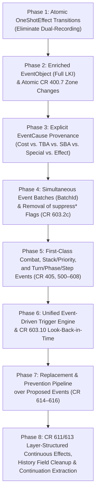

# Plan: Aligning `Mtg.Engine` Events with the *Magic: The Gathering* Comprehensive Rules

## Context & Objective

Recent refactorings on the `history` branch (up through commit `47f7225`, PR #561) established an event-sourcing foundation in [`Mtg/Engine/Game/Event.lean`](Mtg/Engine/Game/Event.lean) and [`Mtg/Engine/Game/Core.lean`](Mtg/Engine/Game/Core.lean):

1. Every state change goes through `Game.change` / `Game.changes`, appending a `GameEvent` to `Game.events` and applying it in isolation via `Game.applyChange`.
2. Turn-scoped and lifetime-scoped queries (cards drawn, life gained/lost, lands played, spells cast, creatures that died, mana spent, etc.) increasingly read directly from `Game.events` instead of ad-hoc counters on `Player` or `Game`.
3. One-shot effects (`OneShotEffect`, CR 610) and continuous effects (`ContinuousEffect`, CR 611) are assigned unique `EffectId`s.

However, the current `GameEvent` / `GameChange` representation still reflects an intermediate stage of migration: **semantic CR events, low-level struct-field setters, and mid-resolution continuation state all coexist inside `GameChange`**, causing dual-recording, split sources of truth, and mismatches with the abstractions defined by the *Magic: The Gathering* Comprehensive Rules (CR, effective 25 September 2026).

This document analyses the current event architecture against the Comprehensive Rules and lays out a concrete, incremental plan to align the engine's event model with CR abstractions.

---

## 1. Diagnosis of the Current Event Architecture

### 1.1 Four Conflated Levels of Abstraction in `GameChange`

In [`Mtg/Engine/Game/Event.lean`](Mtg/Engine/Game/Event.lean), `GameEvent` wraps a turn number (`turn : Nat`) and a `change : GameChange`. Currently, `GameChange` mixes four distinct layers of abstraction:

| Layer | Examples in `GameChange` | Behavior in `Game.applyChange` (`Core.lean`) |
| :--- | :--- | :--- |
| **1. Passive CR Event Markers** | `.cast`, `.attacked`, `.stepped`, `.activated`, `.spentMana`, `.playedLand`, `.effectApplied id (eff : OneShotEffect)` | **No-op on game state** (`=> g`, or for `.effectApplied` only bumps `nextEffectId`). They exist purely as log entries for `Game.events` queries and partial trigger matching. |
| **2. Continuous Effect Lifecycle Events (CR 611)** | `.effectCreated`, `.effectExpired`, `.effectUpdated` | Mutate `Game.activeEffects` via `installEffect` / `uninstallEffect` / `refreshEffectSlot?`, **and** simultaneously copy state into ad-hoc fields on `Status`, `GameObject`, `Player`, and `Game`. |
| **3. Low-Level Struct Field Mutators** | `.players`, `.player`, `.objects`, `.setObject`, `.pushObject`, `.object`, `.status`, `.stack`, `.stackEntry`, `.proposed`, `.changeProposed` | Directly overwrite individual fields of `Game`, `Player`, `GameObject`, `Status`, `StackEntry`, and `ProposedSpell`. |
| **4. Mid-Resolution Engine Continuations & Scratchpads** | `.palantirAfterScry`, `.grimaImpulseVictim`, `.humansTappedThisWay`, `.permanentsDestroyedThisWay`, `.unlessPaysInstead`, `.mayOnAccept`, `.suppressOthersDie`, `.chooseModesRest`, etc. (~65 constructors) | Mutate temporary state-machine registers on `Game` used to pause/resume effect resolution across player prompts. Not CR events at all. |

### 1.2 The "Dual-Recording / Split-Brain" Anti-Pattern

Because `OneShotEffect` (`.effectApplied`) and the top-level semantic events (`.cast`, `.attacked`, `.stepped`, `.activated`, `.spentMana`, `.playedLand`) do **not** perform state transitions in `Game.applyChange`, every game action must emit **both** a series of low-level struct mutators **and** a separate semantic `GameEvent`:

- **Tapping / Untapping (`Mtg/Engine/Game/Status.lean`)**:
  `becomeTapped` emits `g.changeStatuses o.id #[.tapped true, .becameTappedThisTurn true]` to mutate the object, and then separately calls `g.record (GameEvent.tapped g.turn (EventObject.ofGameObject o) duringTeamwork)`.
- **Drawing Cards (`Mtg/Engine/Game/Library.lean`)**:
  `drawOneCard` emits `.player p (.library rest)`, `replaceObject` (allocating a new `ObjectId` and setting `.zone := .hand p`), `.player p (.pushHand newId)`, and then separately calls `g.record (GameEvent.drew g.turn p newId firstOfDrawStep)`.
- **Gaining / Losing Life (`Mtg/Engine/Game/Allocation.lean` & `Damage.lean`)**:
  `gainLife` and `loseLife` emit `.player p (.setLife ...)` to change the life total and separately call `g.record (GameEvent.life ...)`.
- **Adding / Removing Counters (`Mtg/Engine/Game/Status.lean` vs. `Entering.lean` & `Damage.lean`)**:
  `addCounters` emits `g.changeStatus o.id (.plusOnePlusOne ...)` and separately records `GameEvent.counters`. However, `enterWithPlusOnes` in [`Mtg/Engine/Game/Entering.lean`](Mtg/Engine/Game/Entering.lean) mutates `.plusOnePlusOne` directly **without** recording `GameEvent.counters` (even though CR 122.6 states that counters put on an object as it enters count as putting counters on it for replacement effects and some state queries). Similarly, damage to a planeswalker in [`Mtg/Engine/Game/Damage.lean`](Mtg/Engine/Game/Damage.lean) mutates `.loyaltyCounters` directly without recording a counter-removal event (CR 120.3c).
- **Zone Changes (`Mtg/Engine/Game/Movement.lean`)**:
  `Game.move` emits 7–10 low-level changes (`recordLastKnownStatus`, `stripLibrary`, `stripHand`, `nextObjectId`, `recordMovedTo`, `timestamp`, `replaceObject`, `pushGraveyard`) and then records `GameEvent.moved` with `(EventObject.ofGameObject o).withObjectId newId`. Overwriting `id` with `newId` inside `EventObject` loses the pre-move `ObjectId`, breaking the CR 400.7 distinction between the object in its previous zone (`fromId`, with Last Known Information) and the new object it becomes in its destination zone (`toId`).

### 1.3 Misclassification of CR Concepts Inside `OneShotEffect`

In the Comprehensive Rules, **One-Shot Effects (CR 610)** are specifically the result of resolving instructions of spells and abilities (e.g., *"Target player draws two cards"*, *"Destroy all creatures"*). Currently, `OneShotEffect` in [`Mtg/Engine/Game/Event.lean`](Mtg/Engine/Game/Event.lean) is used as a catch-all bucket for almost all atomic game occurrences, conflating six distinct CR categories:

1. **One-Shot Effects (CR 610)**: Effects produced by resolving spells or abilities.
2. **Keyword Actions (CR 701)**: Atomic verb actions defined by the rules (Tap/Untap 701.26, Destroy 701.7, Discard 701.9, Sacrifice 701.21, Create 701.7, Attach 701.3, Scry 701.22, Surveil 701.25, Mill 701.17, Fight 701.14, Proliferate 701.34, Connive 701.50, Goad 701.15, Transform 701.27, Amass 701.47).
3. **Turn-Based Actions (CR 703)**: Game-driven actions at step/phase boundaries that do not use the stack and are **not** effects of spells or abilities:
   - Phasing in and untapping permanents during the untap step (CR 502.1, 502.3, 703.4a–b).
   - Drawing a card during the draw step (CR 504.1, 703.4c).
   - Putting a lore counter on each Saga at the beginning of precombat main phase (CR 714.2b, 703.4d).
   - Declaring attackers (CR 508.1, 703.4f) and blockers (CR 509.1, 703.4g).
   - Assigning and dealing combat damage (CR 510.1–2, 703.4h–j).
   - Discarding down to maximum hand size in cleanup (CR 514.1, 703.4m).
   - Removing marked damage from permanents and ending *"until end of turn"* / *"this turn"* effects in cleanup (CR 514.2, 703.4n).
   - Emptying mana pools at the end of each step and phase (CR 500.4, 703.4p).
4. **State-Based Actions (CR 704)**: Automatic rule checks performed whenever a player would receive priority (CR 704.3):
   - Player losing the game due to $\le 0$ life (704.5a), drawing from an empty library (704.5b), or $\ge 10$ poison counters (704.5c).
   - Non-battlefield tokens ceasing to exist (704.5d) and non-stack/non-battlefield copies ceasing to exist (704.5e).
   - Creature put into graveyard for $\le 0$ toughness (704.5f), destroyed by lethal damage (704.5g), or destroyed by deathtouch damage (704.5h).
   - Planeswalker put into graveyard for $0$ loyalty (704.5i).
   - Legend rule (704.5j).
   - Unattaching illegal/unattached Auras and Equipment (704.5m–n).
   - $+1/+1$ and $-1/-1$ counter annihilation (704.5q).
   - Sacrificing a Saga with $\ge$ final chapter lore counters once its chapter abilities have left the stack (704.5s).
5. **Special Actions (CR 116)**: Actions a player may take when they have priority that do not use the stack:
   - Playing a land (CR 116.2a, 305).
   - Turning a face-down creature face up via Morph/Disguise (CR 116.2b, 702.37e).
6. **Paying Costs (CR 118, 601.2h, 602.2b)**:
   - Tapping a permanent, sacrificing a permanent, discarding a card, paying life, removing counters, exiling cards, or beholding a card **to pay a cost** is fundamentally distinct in the CR from performing the same action as an **effect** of a resolving spell or ability. Many replacement effects and triggers explicitly care whether an event was caused by a cost vs. an effect (e.g., *"If an effect would put one or more counters..."*, *"Whenever a spell or ability an opponent controls causes you to discard a card..."*).

### 1.4 Incomplete & Ad-Hoc Representation of Other CR Subsystems

- **Simultaneous / Batch Events (CR 603.2c, 608.2f, 704.3)**:
  Abilities with *"Whenever one or more [objects] [verb]..."* (e.g., *"Whenever one or more other creatures die"*, *"Whenever one or more creature cards are put into your graveyard from anywhere"*, *"Whenever you create one or more creature tokens"*, *"Whenever one or more creatures deal combat damage to you"*, *"Whenever a player discards one or more cards"*) fire **once per simultaneous batch**, not once per individual object. Currently, the engine relies on imperative suppression flags on `Game` (`suppressOthersDie`, `suppressCreatureCardsToGy`, `pendingCreatureTokenCreators`, and `waitingTriggers.any` deduplication) instead of representing simultaneous atomic events as a single batch or grouping them by their shared `EffectId` / instruction step.
- **Replacement and Prevention Effects (CR 614, 615, 616)**:
  In CR 614–616, replacement and prevention effects watch for a **proposed event** (`WouldEvent`), transform it into a modified event (or prevent it), and record which replacement effects have already been applied to that event chain so no effect applies more than once to the same event (CR 614.5). Currently, `ReplacementWatch` in [`Event.lean`](Mtg/Engine/Game/Event.lean) is a small 11-case enum used only for inspection, while actual replacement logic is hardcoded procedurally inside `Game.move`, `Game.draw`, `Game.markDamageOn`, `Game.createToken`, `Game.addPlusOnePlusOneTo`, and `Game.beginStep`.
- **Trigger Matching & Last Known Information (CR 603.2, 603.6, 603.10, 608.2c)**:
  `GameEvent.matchesTrigger` in [`Event.lean`](Mtg/Engine/Game/Event.lean) handles only a subset of `TriggerEvent`s. Most battlefield triggers in [`Movement.lean`](Mtg/Engine/Game/Movement.lean), [`Entering.lean`](Mtg/Engine/Game/Entering.lean), [`Combat.lean`](Mtg/Engine/Game/Combat.lean), and [`Damage.lean`](Mtg/Engine/Game/Damage.lean) still manually iterate over `g.battlefield` at the call site. Furthermore, `EventObject` only snapshots printed types, subtypes, supertypes, keywords, and static abilities—omitting **computed** characteristics at the moment of the event (current colors, mana value, power, toughness, all counters, tapped/attacking/blocking status, `attachedTo`, attached Auras/Equipment, and `wasCast`).
- **Continuous Effects & Layer System (CR 611 & 613)**:
  `ContinuousEffect` in [`Event.lean`](Mtg/Engine/Game/Event.lean) has ~50 card-specific constructors (`auraConstruct55`, `ironFistTapUntilEot`, `onlyFoodArtifact`, `windcragMardu`, `pendingLokiCopy`, etc.) that write directly into cached fields on `Status`, `GameObject`, `Player`, and `Game` when `installEffect` runs, and restore them when `uninstallEffect` runs. This bypasses a unified CR 613 layer evaluation pipeline (Layers 1–7) and mixes continuous effects modifying object characteristics (CR 613.1) with continuous effects modifying game rules or players (CR 611.2c).
- **Residual Duplicated History on `Status`, `GameObject`, and `Player`**:
  Although PRs #557–#561 migrated many turn counters to `Game.events`, numerous fields on `Status` and `GameObject` still cache historical facts that are already (or should be) in `Game.events`:
  - `Status`: `becameTappedThisTurn`, `gotPlusOneThisTurn`, `dealtDamageThisTurn`, `dealtCombatDamage`, `combatDamageToPlayers`, `declaredAsAttackerThisTurn`, `activationsThisTurn`, `abilitiesActivatedThisTurn`, `loyaltyActivatedThisTurn`, `firedOnceEachTurn`, `optionalOnceUsed`, `boastUsedThisTurn`, `powerUpUsed`, `powerUpActivations`, `exhaustUsed`, `manaSpentToCast`, `allianceModesChosen`, `modesChosenThisTurn`.
  - `GameObject`: `castFromGraveyard`, `castFromHand`, `wasCast`, `kicked`, `teamworkPaid`, `sneakPaid`, `treasureManaSpent`, `movedToGraveyardThisTurn` (on `Game`), `movedToHandThisTurn` (on `Game`).

---

## 2. Target Architecture: CR-Aligned Event Taxonomy

### 2.1 Core Architectural Principles

1. **Atomic State Transitions (`applyEvent` *is* the Mutation)**:
   Every CR game event must be **self-contained and authoritative**: applying the event in `Game.applyChange` performs the exact state transition on `Game` (`players`, `objects`, `stack`, `activeEffects`, etc.). Low-level field setters (`.status (.tapped true)`, `.player p (.setLife n)`) are eliminated in favor of the semantic CR event itself performing the update.
2. **Explicit Causal Provenance (`EventCause`)**:
   Every atomic game event carries an `EventCause` recording *why* and *by what authority* it happened:
   - **Turn-Based Action (CR 703)**
   - **State-Based Action (CR 704)**
   - **Special Action (CR 116)**
   - **Cost Payment (CR 118, 601.2h, 602.2b)**
   - **One-Shot Effect of a Resolving Spell/Ability (CR 610)** (linked to `EffectId`, `sourceId`, and `controller`)
   - **Replacement / Prevention Effect (CR 614, 615)** (linked to the replacing `EffectId` and the original `EventCause`)
   - **Game Setup / Multiplayer Rule (CR 103, 800.4)**
3. **Separation of Instructions (`OneShotEffect`, CR 610) from Atomic Game Events**:
   In the CR, a resolving spell or ability executes a sequence of instructions (**one-shot effects**, CR 610, or **creating continuous effects**, CR 611). Executing one instruction (`EffectId`) may produce zero, one, or multiple **simultaneous atomic events** (e.g., *"Destroy all creatures"* produces $N$ simultaneous `ZoneChange` events sharing the same `EffectId` and `batchId`; *"Deal 3 damage to target creature and 3 damage to target player"* produces two simultaneous `DamageDealt` events in one batch).
4. **Complete Last-Known Information (`EventObject`, CR 608.2c & 603.10)**:
   Whenever an object participates in an event, `EventObject` captures its **effective, layer-evaluated characteristics and status** at that exact instant (including both pre-change and post-change `ObjectId`s for zone changes).
5. **Separation of Engine Continuation State from Game History**:
   Mid-resolution continuation registers (`palantirAfterScry`, `grimaImpulse*`, `chooseModesRest`, `mayOnAccept`, `unlessPaysInstead`, etc.) are moved into a structured `ResolutionState` / `ContinuationFrame` stack on `Game` updated by a single `.continuation` change (or managed as part of pending choice state), keeping `GameEvent` clean of card-specific state-machine plumbing.

---

### 2.2 Proposed Lean 4 Event Type Hierarchy

Below is the target CR-aligned event taxonomy for [`Mtg/Engine/Game/Event.lean`](Mtg/Engine/Game/Event.lean):

```lean
/-- Unique identifier for a simultaneous batch of atomic events (CR 603.2c / 608.2f). -/
structure BatchId where
  raw : Nat
deriving DecidableEq, Repr, Inhabited, BEq

/-- CR authority/provenance explaining why an event occurred. -/
inductive EventCause where
  /-- Game setup (CR 103) or multiplayer player-leaving rules (CR 800.4). -/
  | gameRule
  /-- Turn-based action at the beginning/end of a step or phase (CR 703). -/
  | turnBased (action : TurnBasedActionKind)
  /-- State-based action performed before priority (CR 704). -/
  | stateBased (sba : StateBasedActionKind)
  /-- Special action taken by a player with priority (CR 116). -/
  | specialAction (player : PlayerId) (kind : SpecialActionKind)
  /-- Paying a cost to cast a spell, activate an ability, or take an action (CR 118 / 601.2h). -/
  | costPayment (player : PlayerId) (source : Option ObjectId) (effectId : EffectId) (kind : CostKind)
  /-- A one-shot effect from a resolving spell or ability instruction (CR 610). -/
  | oneShotEffect (effectId : EffectId) (source : Option ObjectId) (controller : Option PlayerId)
  /-- Modified by a replacement or prevention effect (CR 614 / 615). -/
  | replaced (replacementId : EffectId) (source : Option ObjectId) (original : EventCause)
deriving Repr, Inhabited, BEq
```

#### 2.2.1 Complete Last-Known Information Snapshot (`EventObject`, CR 109.3 / 608.2c)

```lean
/-- Complete snapshot of an object's effective characteristics and status at the
moment an event occurs (CR 109.3, 603.10, 608.2c). -/
structure EventObject where
  id : ObjectId
  owner : PlayerId
  controller : Option PlayerId
  zone : Zone
  name : String
  printed : CardDef
  supertypes : Array Supertype
  types : Array CardType
  subtypes : Array CardSubtype
  colors : ColorSet
  manaValue : Nat
  power : Option Int
  toughness : Option Int
  loyalty : Option Nat
  keywords : Keywords
  staticAbilities : Array StaticAbility
  status : Status
  isToken : Bool
  isCopy : Bool
  wasCast : Bool
  attachedTo : Option ObjectId
  attachments : Array ObjectId
deriving Repr, Inhabited, BEq
```

#### 2.2.2 Structured CR Domain Events

1. **Turn, Phase, and Step Events (CR 500–514)**:
   ```lean
   inductive TurnEvent where
     | turnBegan (player : PlayerId) (turnNumber : Nat) (isExtraTurn : Bool)
     | phaseBegan (phase : Phase)
     | stepBegan (step : Step)
     | manaPoolsEmptied (players : Array (PlayerId × ManaPool)) -- CR 500.4
     | stepEnded (step : Step)
     | phaseEnded (phase : Phase)
     | turnEnded (player : PlayerId) (turnNumber : Nat)
     | extraTurnCreated (player : PlayerId) (cause : EventCause) -- CR 500.7
     | extraCombatPhaseCreated (afterStep : Step) (cause : EventCause) -- CR 500.8
   ```

2. **Priority, Casting, Activating, Triggering, and Stack Events (CR 117, 405, 601–608)**:
   ```lean
   inductive StackEvent where
     | priorityPassed (player : PlayerId) -- CR 117.3d
     | spellProposed (player : PlayerId) (cardId : ObjectId) (fromZone : Zone)
         (way : CastWay) -- CR 601.2a (hand, flashback, adventure, sneak, prepare, etc.)
     | abilityProposed (player : PlayerId) (sourceId : ObjectId) (abilityIdx : Nat)
         (isLoyalty : Bool) (isMana : Bool) -- CR 602.2a / 605 / 606
     | choicesMade (modes : Array Nat) (chosenX : Option Nat)
         (additionalCosts : Array AdditionalCostChoice) -- CR 601.2b
     | targetsChosen (targets : Array Target) (divisions : Array Nat) -- CR 601.2c–d
     | costLocked (totalMana : ManaCost) -- CR 601.2f
     | spellCast (spell : EventObject) (caster : PlayerId) (fromZone : Zone)
         (targets : Array Target) (manaSpent : ManaSpendSummary) -- CR 601.2i
     | abilityActivated (abilityObj : EventObject) (source : EventObject)
         (activator : PlayerId) (isLoyalty : Bool) (isMana : Bool)
         (loyaltyDelta : Option Int) (targets : Array Target) -- CR 602.2b / 605.3b / 606.4
     | abilityTriggered (source : EventObject) (controller : PlayerId)
         (ability : TriggeredAbility) (triggeringBatch : BatchId) -- CR 603.2
     | triggerPutOnStack (stackObj : EventObject) (source : EventObject)
         (controller : PlayerId) (targets : Array Target) -- CR 603.3
     | stackObjectCopied (originalId : ObjectId) (copy : EventObject)
         (controller : PlayerId) (cause : EventCause) -- CR 707.10
     | stackObjectCountered (stackObj : EventObject) (newIdInGyOrExile : Option ObjectId)
         (cause : EventCause) -- CR 701.6
     | stackObjectResolved (stackObj : EventObject) (effectId : EffectId) -- CR 608.2n
     | stackObjectFizzled (stackObj : EventObject) (newId : Option ObjectId) -- CR 608.2b
   ```

3. **Zone-Change & Object-Creation Events (CR 400.7, 111, 701.7, 701.9, 701.17, 701.21)**:
   ```lean
   /-- Specific CR verb that caused or characterizes a zone transition. -/
   inductive ZoneChangeKind where
     | normalMove
     | draw (firstOfDrawStep : Bool) -- CR 121
     | discard -- CR 701.9
     | mill -- CR 701.17
     | sacrifice -- CR 701.21
     | destroy (byRegenerationReplaced : Bool := false) -- CR 701.7
     | exile (linkedTo : Option ObjectId := none) -- CR 406 / 610.3
     | putOntoBattlefield (wasCast : Bool) -- CR 110 / 608.3
     | castToStack -- CR 601.2a
     | returnToHand
     | putIntoLibrary (position : LibraryPosition)
     | ceaseToExist -- CR 704.5d–e
   deriving Repr, Inhabited, BEq

   inductive ZoneEvent where
     /-- Atomic zone transition (CR 400.7): `preObject` has the old `ObjectId`
     and LKI in `fromZone`; `postObject` has the newly allocated `ObjectId` and
     initial state (including enters-with counters/tapped/controller) in `toZone`. -/
     | moved (preObject : EventObject) (postObject : EventObject)
         (fromZone : Zone) (toZone : Zone) (kind : ZoneChangeKind)
         (actor : Option PlayerId) (cause : EventCause)
     /-- Token or copy created directly in a zone (CR 111 / 701.7 / 707). -/
     | created (object : EventObject) (controller : PlayerId) (cause : EventCause)
   ```

4. **Permanent Status, Counter, and Attachment Events (CR 110.5, 122, 301.5, 303.4, 701.3, 701.26, 701.27, 702.26)**:
   ```lean
   inductive PermanentEvent where
     | tapped (object : EventObject) (cause : EventCause) -- CR 701.26a
     | untapped (object : EventObject) (cause : EventCause) -- CR 701.26b
     | phasedOut (object : EventObject) (indirect : Bool) (cause : EventCause) -- CR 702.26
     | phasedIn (object : EventObject) (indirect : Bool) -- CR 502.1 / 702.26
     | transformed (object : EventObject) (cause : EventCause) -- CR 701.27
     | turnedFaceUp (object : EventObject) (cause : EventCause) -- CR 702.37e
     | turnedFaceDown (object : EventObject) (cause : EventCause)
     | countersAdded (target : CounterRecipient) (kind : CounterKind)
         (amount : Nat) (actor : Option PlayerId) (cause : EventCause) -- CR 122.1
     | countersRemoved (target : CounterRecipient) (kind : CounterKind)
         (amount : Nat) (actor : Option PlayerId) (cause : EventCause)
     | countersAnnihilated (object : EventObject) (pairs : Nat) -- CR 704.5q
     | attached (attachment : EventObject) (targetId : ObjectId)
         (previousTargetId : Option ObjectId) (cause : EventCause) -- CR 701.3a
     | unattached (attachment : EventObject) (fromTargetId : ObjectId)
         (cause : EventCause) -- CR 701.3b
   ```

5. **Combat Events (CR 506–511)**:
   ```lean
   structure AttackerDeclaration where
     attacker : EventObject
     defendingPlayer : PlayerId
     targetPlaneswalker : Option ObjectId := none
   deriving Repr, Inhabited, BEq

   structure BlockerDeclaration where
     blocker : EventObject
     attackerId : ObjectId
   deriving Repr, Inhabited, BEq

   inductive CombatEvent where
     /-- Simultaneous declaration of all attackers (CR 508.1). -/
     | attackersDeclared (attackingPlayer : PlayerId)
         (declarations : Array AttackerDeclaration)
     /-- Simultaneous declaration of all blockers (CR 509.1). -/
     | blockersDeclared (defendingPlayer : PlayerId)
         (declarations : Array BlockerDeclaration)
     /-- An attacking creature becomes blocked by one or more blockers (CR 509.1h). -/
     | attackerBecameBlocked (attacker : EventObject) (blockers : Array EventObject)
     /-- An attacking creature is unblocked (CR 509.1h). -/
     | attackerBecameUnblocked (attacker : EventObject)
     /-- Combat damage assignment locked in (CR 510.1). -/
     | combatDamageAssigned (assignments : Array CreatureCombatAssignment)
     /-- A permanent is removed from combat (CR 506.4). -/
     | removedFromCombat (object : EventObject) (cause : EventCause)
   ```

6. **Damage and Life Events (CR 119, 120)**:
   ```lean
   inductive DamageRecipient where
     | permanent (object : EventObject)
     | player (playerId : PlayerId)
   deriving Repr, Inhabited, BEq

   structure DamagePacket where
     source : EventObject
     recipient : DamageRecipient
     amount : Nat
     isCombat : Bool
     hasLifelink : Bool
     hasDeathtouch : Bool
     hasToxic : Nat := 0
   deriving Repr, Inhabited, BEq

   inductive DamageAndLifeEvent where
     /-- Simultaneous packet(s) of damage dealt (CR 120.2 / 510.2). Applies
     marked damage (CR 120.3e), loyalty loss (CR 120.3c), life loss (CR 120.3a),
     lifelink (CR 120.3f), and toxic poison counters (CR 120.3g). -/
     | damageDealt (packets : Array DamagePacket) (cause : EventCause)
     /-- Damage prevented by a prevention effect (CR 615). -/
     | damagePrevented (source : EventObject) (recipient : DamageRecipient)
         (amount : Nat) (cause : EventCause)
     /-- Marked damage cleared from permanents in cleanup (CR 514.2). -/
     | markedDamageCleared (objectIds : Array ObjectId)
     /-- Player gains life (CR 119.3). -/
     | lifeGained (player : PlayerId) (amount : Nat) (cause : EventCause)
     /-- Player loses life (CR 119.3 / 119.4 / 120.3a). -/
     | lifeLost (player : PlayerId) (amount : Nat) (fromDamage : Bool) (cause : EventCause)
   ```

7. **Player, Mana, Library, and Designation Events (CR 106, 116.2a, 701, 722, 725, 800.4)**:
   ```lean
   inductive PlayerAndKeywordEvent where
     | landPlayed (player : PlayerId) (preObject : EventObject) (postObject : EventObject) -- CR 116.2a / 305
     | manaAdded (player : PlayerId) (mana : ManaPool) (cause : EventCause) -- CR 106.4
     | manaSpent (player : PlayerId) (mana : ManaPool) (forObject : ObjectId)
         (treasureSpent : Bool) (elfOnlySpent : Bool) (uncounterableGranted : Bool) -- CR 106.12
     | scried (player : PlayerId) (top : Array ObjectId) (bottom : Array ObjectId)
         (cause : EventCause) -- CR 701.22
     | surveilled (player : PlayerId) (top : Array ObjectId) (graveyard : Array ObjectId)
         (cause : EventCause) -- CR 701.25
     | lookedAtCards (player : PlayerId) (cardIds : Array ObjectId) (cause : EventCause)
     | revealedCards (player : PlayerId) (cardIds : Array ObjectId) (cause : EventCause) -- CR 701.16
     | searchedLibrary (player : PlayerId) (libraryOwner : PlayerId)
         (found : Array ObjectId) (cause : EventCause) -- CR 701.23
     | shuffledLibrary (libraryOwner : PlayerId) (newOrder : Array ObjectId)
         (cause : EventCause) -- CR 701.24
     | proliferated (player : PlayerId) (permanents : Array ObjectId)
         (players : Array PlayerId) (cause : EventCause) -- CR 701.34
     | ringTempted (player : PlayerId) (newBearer : Option ObjectId)
         (newStage : Nat) (cause : EventCause) -- CR 701.54
     | monarchChanged (newMonarch : PlayerId) (oldMonarch : Option PlayerId)
         (cause : EventCause) -- CR 722
     | designationGained (player : PlayerId) (designation : PlayerDesignation)
         (cause : EventCause) -- City's Blessing (CR 702.131), Enduring Story, Beheld
     | playerLost (player : PlayerId) (reason : LossReason) (cause : EventCause) -- CR 104.3
     | playerLeftGame (player : PlayerId) -- CR 800.4a
     | gameEnded (result : GameResult) -- CR 104.1 / 104.4
   ```

8. **Continuous Effect Lifecycle Events (CR 611 & 613)**:
   ```lean
   inductive ContinuousEffectEvent where
     | created (id : EffectId) (spec : ContinuousEffectSpec)
     | updated (id : EffectId) (spec : ContinuousEffectSpec)
     | expired (id : EffectId)
   ```

---

## 3. Deep-Dive Alignment by Comprehensive Rules Subsystem

### 3.1 Zone Changes & Object Identity (CR 400.7, 603.6, 614.12)

**CR Requirement**:
- **CR 400.7**: *"An object that moves from one zone to another becomes a new object with no memory of, or relation to, its previous existence."* (With the 400.7a–m exceptions allowing abilities to track the new object across specific transitions.)
- **CR 614.12**: Replacement effects that modify *how* a permanent enters the battlefield (entering tapped, entering with counters, choosing a color/name/copy target, changing controller) apply **as** the object enters, before the permanent is on the battlefield and before any triggered abilities check the entering permanent's characteristics.

**Current Gap**:
- `Game.move` in [`Mtg/Engine/Game/Movement.lean`](Mtg/Engine/Game/Movement.lean) emits multiple partial mutations (`stripLibrary`, `nextObjectId`, `timestamp`, `replaceObject`, `pushGraveyard`), then calls `enterWithPlusOnes` / `becomeTapped` *after* the object is already in `.battlefield`, and finally records `GameEvent.moved` with `(EventObject.ofGameObject o).withObjectId newId`—erasing the old `ObjectId` from the event's `EventObject`.

**Target Alignment**:
1. **Atomic `ZoneEvent.moved`**:
   - Captures `preObject : EventObject` (with the old `ObjectId`, old `Zone`, and full LKI including counters, power/toughness, attachments, and controller before leaving) **and** `postObject : EventObject` (with the newly allocated `ObjectId`, new `Zone`, new timestamp, and all CR 614.12 enters-with modifications already applied).
2. **`applyChange` Performs the Entire Zone Transition**:
   - In `Game.applyChange`, handling `ZoneEvent.moved` atomically:
     1. Strips `preObject.id` from the source zone (`library`, `hand`, `graveyard`, or `stack`).
     2. Updates `nextObjectId` and `timestamp` from `postObject`.
     3. Replaces the entry in `g.objects` with `postObject.toGameObject`.
     4. Appends `postObject.id` to the destination zone (`hand`, `graveyard`, `library` at `position`, or `stack`).
     5. If `postObject.status` has initial counters (e.g., loyalty CR 306.5b, lore CR 714.2a, enters-with $+1/+1$ CR 122.6), emits/bundles the accompanying `countersAdded` events in the same `BatchId` so *"Whenever you put one or more counters..."* (CR 122.6) and replacement effects work uniformly without special cases.
3. **Eliminate `Game.lastKnownStatuses`, `Game.movedToGraveyardThisTurn`, and `Game.movedToHandThisTurn`**:
   - Every zone-change query (`wasMovedToGraveyardThisTurn`, `wasMovedToHandThisTurn`, LKI counter/power lookup for leaves-the-battlefield triggers) reads `preObject` and `postObject` directly from `ZoneEvent.moved` in `Game.events`.

---

### 3.2 One-Shot Effects (CR 610), Keyword Actions (CR 701), and Simultaneous Batches (CR 603.2c)

**CR Requirement**:
- **CR 608.2c / 610.1**: A resolving spell or ability follows its instructions in order. Each verb instruction is a one-shot effect (assigned an `EffectId`).
- **CR 603.2c**: An ability triggers once for each occurrence of its trigger event. When a single instruction or turn-based/state-based action causes multiple atomic events simultaneously (e.g., *"Destroy all creatures"*, combat damage dealt simultaneously by all attackers/blockers, SBAs destroying multiple creatures at once, milling $N$ cards, creating $N$ tokens), abilities worded *"Whenever one or more..."* trigger **once** for the simultaneous batch, whereas abilities worded *"Whenever a..."* trigger **once per matching atomic event** in the batch.

**Current Gap**:
- `OneShotEffect` is recorded per individual object (`GameEvent.moved`, `GameEvent.created`, `GameEvent.counters`), and batch triggers are hacked via `suppressOthersDie`, `suppressCreatureCardsToGy`, and `pendingCreatureTokenCreators` on `Game`.

**Target Alignment**:
1. **Batching via `BatchId` / Simultaneous Event Group**:
   - Introduce `GameEventBatch` (or attach `batchId : BatchId` and `cause : EventCause` to every `GameEvent`).
   - All atomic events that occur simultaneously (e.g., all creatures destroyed by a single SBA pass CR 704.3, all combat damage packets in a combat damage step CR 510.2, all tokens created by a single `createTokens` instruction, all cards moved by a single `mill N` or `discard N` instruction) share the same `BatchId`.
2. **Uniform Batch vs. Individual Trigger Evaluation**:
   - After a simultaneous batch of events is applied, the trigger engine evaluates the batch `evs : Array GameEvent`:
     - **Individual triggers** (*"Whenever a creature dies"*, *"Whenever you draw a card"*): match against each `ev ∈ evs`.
     - **Batch triggers** (*"Whenever one or more other creatures die"*, *"Whenever one or more creature cards are put into your graveyard from anywhere"*, *"Whenever you create one or more creature tokens"*, *"Whenever one or more opponents are dealt noncombat damage"*, *"Whenever a player discards one or more cards"*): evaluate a predicate over the entire slice `evs` sharing the `BatchId`, firing at most once per batch.
3. **Remove Imperative Suppression Flags**:
   - Delete `suppressOthersDie`, `suppressCreatureCardsToGy`, `pendingCreatureTokenCreators`, and related `GameChange` constructors once batch trigger evaluation is in place.

---

### 3.3 Continuous Effects, Duration, and the Layer System (CR 611 & 613)

**CR Requirement**:
- **CR 611.2 / 611.3**: Continuous effects are generated either by the resolution of a spell or ability (CR 611.2, locking in their affected set of objects at creation unless they modify rules/players or say *"creatures you control"* without targeting, CR 611.2c) or by static abilities on permanents/emblems/command-zone objects (CR 611.3).
- **CR 611.2a–b**: Each resolution-generated continuous effect has a **Duration** (`untilEndOfTurn`, `thisTurn`, `untilNextTurnOf (p : PlayerId)`, `untilEndOfCombat`, `whileSourceOnBattlefield (src : ObjectId)`, `whileAttached (src : ObjectId)`, `indefinite`).
- **CR 613.1**: Characteristics of objects are determined by applying continuous effects in 7 layers (and sublayers 7a–7d) in timestamp order (CR 613.7) with dependency ordering (CR 613.8):
  - **Layer 1**: Copy effects (CR 613.1a / 707).
  - **Layer 2**: Control-changing effects (CR 613.1b).
  - **Layer 3**: Text-changing effects (CR 613.1c).
  - **Layer 4**: Type-, supertype-, and subtype-changing effects (CR 613.1d).
  - **Layer 5**: Color-changing effects (CR 613.1e).
  - **Layer 6**: Ability-adding, keyword-granting, and ability-removing effects (CR 613.1f).
  - **Layer 7a**: Characteristic-defining abilities (CDAs) setting P/T (CR 613.4a).
  - **Layer 7b**: Effects setting base P/T to a specific number or value (CR 613.4b).
  - **Layer 7c**: Effects and counters ($+1/+1$, $-1/-1$) modifying P/T without setting (CR 613.4c).
  - **Layer 7d**: Effects switching power and toughness (CR 613.4d).

**Current Gap**:
- `ContinuousEffect` in [`Event.lean`](Mtg/Engine/Game/Event.lean) has ~50 bespoke constructors (`auraConstruct55`, `onlyFoodArtifact`, `windcragMardu`, `ironFistTapUntilEot`, etc.) and `installEffect`/`uninstallEffect` in [`Core.lean`](Mtg/Engine/Game/Core.lean) imperatively mutate cached fields on `Status` (`pumpPower`, `pumpToughness`, `basePowerUntilEot`, `untilEotKeywords`, `additionalCreatureUntilEot`, `onlyFoodArtifact`, `notACreature`), `GameObject` (`copyRestore`, `copyUntilEot`, `controlChanged`), `Player` (`cantCastSpellsThisTurn`, `lifeCantChange`), and `Game` (`creaturesWithoutFlyingCantBlock`, `combatDamagePreventedThisTurn`).

**Target Alignment**:
1. **Replace Card-Specific `ContinuousEffect` Constructors with Structured CR 611/613 Specifications**:
   ```lean
   inductive EffectDuration where
     | untilEndOfTurn -- Expires in cleanup step (CR 514.2)
     | untilEndOfCombat -- Expires at end of combat phase
     | untilYourNextTurn (player : PlayerId) -- Expires as `player`'s next turn begins (CR 611.2b)
     | untilEndOfNextTurn (player : PlayerId) (turnsRemaining : Nat)
     | whileSourceOnBattlefield (sourceId : ObjectId)
     | whileSourceHasCounters (sourceId : ObjectId) (kind : CounterKind)
     | indefinite
   deriving Repr, Inhabited, BEq

   inductive EffectTargetScope where
     | lockedObjects (ids : Array ObjectId) -- CR 611.2c default for object characteristics
     | dynamicFilter (filter : ObjectFilter) -- CR 611.2c for non-characteristic or static rules
     | players (ids : Array PlayerId)
     | gameRules
   deriving Repr, Inhabited, BEq

   inductive LayerModification where
     | layer1Copy (printed : CardDef) (addTypes : Array CardType) (addSubtypes : Array CardSubtype) (addAbilities : Array TriggeredAbility)
     | layer2Control (newController : PlayerId)
     | layer4Type (mode : TypeModMode) (types : Array CardType) (subtypes : Array CardSubtype) (supertypes : Array Supertype)
     | layer5Color (mode : ColorModMode) (colors : ColorSet)
     | layer6Abilities (grantKeywords : Keywords) (removeKeywords : Keywords)
         (grantTriggered : Array TriggeredAbility) (grantActivated : Array ActivatedAbility)
         (grantStatic : Array StaticAbility) (loseAllAbilities : Bool)
     | layer7bSetPt (power : Int) (toughness : Int)
     | layer7cModifyPt (powerDelta : Int) (toughnessDelta : Int)
     | playerRule (rule : PlayerContinuousRule) -- e.g. cantCastSpells, lifeCantChange, protectionFromEverything, spellCostReduction, playPermission
     | combatOrGameRule (rule : GameContinuousRule) -- e.g. creaturesWithoutFlyingCantBlock, preventAllCombatDamage, legendRuleDisabled
   deriving Repr, Inhabited, BEq
   ```
2. **Derive Characteristics from `Game.activeEffects` Instead of Mirroring into `Status` / `Player` / `Game`**:
   - `installEffect` / `uninstallEffect` only insert/update/remove entries in `Game.activeEffects` (keyed by `EffectId` and ordered by `timestamp`).
   - `Game.objectTypes`, `Game.objectSubtypes`, `Game.objectColors`, `Game.objectKeywords`, `Game.power`, `Game.toughness`, `Game.controllerOf`, and rule queries (`Game.canCastSpells`, `Game.lifeCanChange`, `Game.canBlock`) evaluate `Game.activeEffects` + static abilities in CR 613 layer order.
   - Remove the ~35 mirrored fields from `Status`, `GameObject`, `Player`, and `Game`.
3. **Uniform Expiration Events**:
   - At each step/phase/turn boundary and after zone changes, a single pass over `Game.activeEffects` emits `ContinuousEffectEvent.expired id` for every effect whose `EffectDuration` condition is met.

---

### 3.4 Replacement and Prevention Effects as Event Transformers (CR 614–616)

**CR Requirement**:
- **CR 614.1 / 615.1**: Replacement and prevention effects watch for an event that **would** happen and completely or partially replace it with a different event before the original event occurs.
- **CR 614.5**: A replacement or prevention effect can become applicable to an event only once (tracked per event chain).
- **CR 614.6**: If an event is replaced, it never happens; the modified event happens instead and may itself trigger abilities or be modified by other replacement effects that have not yet applied to it.
- **CR 616.1**: When multiple replacement/prevention effects would modify an event, the **affected player** (or controller/owner of the affected object) chooses which one to apply first (with self-replacement effects CR 614.15 applying first, then control-changing CR 616.1b, then copy CR 616.1c).

**Current Gap**:
- Replacement effects are scattered as `if/else` checks across `move` (exile-instead-of-dying, commander zone choice), `draw` (abundance/replacement), `markDamageOn` / `dealDamageToPlayer` (prevention shields, protection, Saga prevention), `createToken` (token doublers/additions), `addPlusOnePlusOneTo` (Hardened Scales / counter modifiers), and `beginStep .untap` (stun counters CR 122.1d).

**Target Alignment**:
1. **Define a `ProposedAtomicEvent` Pipeline**:
   - Before an atomic event (`ZoneEvent.moved`, `ZoneEvent.created`, `PermanentEvent.untapped`, `PermanentEvent.countersAdded`, `DamageAndLifeEvent.damageDealt`, `DamageAndLifeEvent.lifeGained`, `ZoneChangeKind.draw`) is committed via `Game.change`, pass it through `Game.applyReplacements`:
     ```lean
     structure ProposedEvent where
       event : AtomicEvent
       appliedReplacements : Array EffectId := #[] -- CR 614.5 loop prevention
     ```
2. **Replacement Inspection & Transformation**:
   - Collect all active replacement/prevention effects from `Game.activeEffects`, battlefield static abilities, and self-replacement rules (e.g., stun counters on untap CR 122.1d, planeswalker entering with loyalty CR 306.5b, Saga entering with lore CR 714.2a, enters-tapped / enters-with-counters CR 614.12) whose `EffectId` is not in `appliedReplacements`.
   - Order by CR 616.1 (self-replacement $\to$ control $\to$ copy $\to$ other; prompt affected player if multiple non-trivial choices exist).
   - Transform `ProposedEvent` into zero, one, or more modified `ProposedEvent`s with `cause := .replaced replacementId src originalCause` and `appliedReplacements.push replacementId`, repeating until a fixed point is reached, then commit the resulting atomic events via `Game.change`.

---

### 3.5 Triggered Abilities, Look-Back-in-Time, and LKI (CR 603)

**CR Requirement**:
- **CR 603.2**: Whenever a game event or simultaneous batch of events matches a triggered ability's trigger condition, that ability triggers automatically (recording `StackEvent.abilityTriggered`).
- **CR 603.3**: Triggered abilities wait to be put on the stack until the next time a player would receive priority, then are placed in APNAP order (`StackEvent.triggerPutOnStack`).
- **CR 603.10 / 603.10a (Look-Back-in-Time)**: Leaves-the-battlefield triggers (dies, leaves the battlefield, creature card leaves graveyard, sacrificing, discarding, cycling) look back in time to the game state **immediately prior** to the event (using `preObject` LKI of both the moving object and all permanents on the battlefield before the simultaneous batch moved) to determine what triggered. All other triggers (such as enters-the-battlefield, CR 603.6a) check the game state **immediately after** the event batch is applied (using `postObject`).

**Current Gap**:
- Trigger detection is split between `GameEvent.matchesTrigger` (`Event.lean`) and dozens of manual battlefield scans in `Movement.lean`, `Entering.lean`, `Leaving.lean`, `Combat.lean`, `Damage.lean`, and `Turns.lean`.
- Look-back-in-time for simultaneous board wipes (e.g., *"Destroy all creatures"* when a creature with *"Whenever another creature you control dies"* dies alongside other creatures) is currently approximated via `suppressOthersDie` and manual pre-move checks rather than a uniform pre-batch battlefield snapshot.

**Target Alignment**:
1. **Unify All Trigger Detection in `Event.matchesTriggerBatch`**:
   - Capture the pre-batch battlefield snapshot (`preBattlefield : Array EventObject`) before applying a simultaneous `GameEventBatch`, and the post-batch battlefield snapshot (`postBattlefield : Array EventObject`) after applying it.
   - For **look-back-in-time triggers** (CR 603.10a: `dying`, `leaving`, `oneOrMoreOtherCreaturesDie`, `creatureYouControlDies`, `enchantedDies`, `youSacrificeToken`, `playerDiscards`, `youDiscardThis`, `youCycle`, `creatureCardLeavesYourGy`): evaluate trigger sources from `preBattlefield` (and graveyard/hand pre-snapshots where applicable) against `ZoneEvent.moved` events in the batch.
   - For **post-event triggers** (CR 603.6a: `entering`, `landYouControlEnters`, `cast`, `attacked`, `damageDealt`, `countersAdded`, `lifeGained`, `lifeLost`, `stepBegan`): evaluate trigger sources from `postBattlefield` (plus graveyard/command-zone triggers) against the events in the batch.
2. **Eliminate Manual Trigger Queuing Across Action Modules**:
   - Remove ad-hoc `queueTrigger` loops scattered across `Movement.lean`, `Entering.lean`, `Leaving.lean`, `Combat.lean`, `Damage.lean`, `Status.lean`, and `Library.lean`; instead, `Game.commitBatch` automatically runs the unified trigger detector after applying a batch of events.

---

### 3.6 Turn Structure, Turn-Based Actions (CR 500–514, 703), and State-Based Actions (CR 704)

**CR Requirement**:
- **CR 500–514 & 703**: Every phase and step transition has a well-defined sequence:
  1. `TurnEvent.stepBegan step` (or `phaseBegan`).
  2. Perform **Turn-Based Actions (CR 703)** for that step (with `cause := .turnBased kind`), before any triggers are queued or priority is granted (CR 703.3):
     - `.untap`: phase in/out (703.4a), untap (703.4b). No player receives priority (502.4).
     - `.upkeep`: no TBA; queue beginning-of-upkeep triggers.
     - `.draw`: active player draws a card (703.4c, unless skipped by CR 103.8a), then queue beginning-of-draw-step triggers.
     - `.firstMain`: put lore counters on Sagas (703.4d / 714.2b), then queue beginning-of-main-phase triggers.
     - `.beginCombat`: queue beginning-of-combat triggers (507.1).
     - `.declareAttackers`: active player declares attackers as a TBA (508.1 / 703.4f), tapping non-vigilant attackers simultaneously and emitting `CombatEvent.attackersDeclared`.
     - `.declareBlockers`: defending player declares blockers as a TBA (509.1 / 703.4g), emitting `CombatEvent.blockersDeclared`, `attackerBecameBlocked`, and `attackerBecameUnblocked`.
     - `.firstStrikeDamage` / `.combatDamage`: assign (510.1 / 703.4h–i) and simultaneously deal combat damage (510.2 / 703.4j) as a single `DamageAndLifeEvent.damageDealt` batch with `isCombat := true`.
     - `.endCombat`: remove all creatures/planeswalkers from combat (511.3 / 703.4k) and expire `.untilEndOfCombat` effects.
     - `.endStep`: queue beginning-of-end-step triggers (513.1).
     - `.cleanup`: active player discards to `maxHandSize` (514.1 / 703.4m), then **simultaneously** remove all marked damage from permanents and end all `.untilEndOfTurn` / `"this turn"` effects (514.2 / 703.4n). Grant priority only if SBAs or triggered abilities are pending (514.3a).
  3. At the end of every step and phase, empty all players' mana pools (500.4 / 703.4p) via `TurnEvent.manaPoolsEmptied`.
- **CR 704 (State-Based Actions)**:
  - Checked in a loop before any player receives priority (704.3). All applicable SBAs in a single pass are performed **simultaneously as a single event batch** (`BatchId`) with `cause := .stateBased sbaKind`, then repeated until no SBAs apply, and only then are waiting triggers put on the stack (CR 704.3).

---

### 3.7 Casting Spells, Activating Abilities, and Paying Costs (CR 118, 601, 602, 605, 606)

**CR Requirement**:
- **CR 601.2a–i / 602.2a–b**: Casting a spell or activating an ability follows a strict 8-step proposal process:
  1. Propose and move card/ability to stack (`StackEvent.spellProposed` / `abilityProposed`).
  2. Choose modes, `{X}`, alternative/additional costs, hybrid/Phyrexian payments (`StackEvent.choicesMade`, 601.2b).
  3. Choose targets (`StackEvent.targetsChosen`, 601.2c) and divide damage/counters (601.2d).
  4. Check legality (601.2e) and lock in total cost (`StackEvent.costLocked`, 601.2f).
  5. Window for mana abilities (601.2g).
  6. Pay all costs in any order (601.2h) — emitting atomic events (`PermanentEvent.tapped`, `ZoneEvent.moved` with `.sacrifice`/`.discard`/`.exile`, `DamageAndLifeEvent.lifeLost`, `PermanentEvent.countersRemoved`, `PlayerAndKeywordEvent.manaSpent`) all tagged with `cause := .costPayment player (some spellId) costEffectId costKind`.
  7. Spell becomes cast (`StackEvent.spellCast`, 601.2i) or ability becomes activated (`StackEvent.abilityActivated`, 602.2b), triggering *"When you cast..."*, *"Whenever an opponent casts..."*, *"Whenever this becomes the target..."* (CR 601.2i), and *"Whenever you activate..."* abilities.

**Current Gap**:
- Proposal mutations use 20 low-level `ProposalChange` setters, cost payments emit ordinary effect events (indistinguishable from resolving spell effects except for ad-hoc flags like `duringTeamwork`), and `GameObject` stores 12 cast-metadata flags (`castFromGraveyard`, `castFromHand`, `wasCast`, `kicked`, `teamworkPaid`, `sneakPaid`, `treasureManaSpent`, `uncounterableThisCast`, `chosenX`, `giftPromisedTo`, `boastExiled`, `isPreparedSpell`) directly on the object struct instead of reading them from the `StackEvent.spellCast` / `abilityActivated` event for that `ObjectId`.

**Target Alignment**:
- Tag all cost-payment atomic events with `EventCause.costPayment`.
- Consolidate cast/activation metadata into the `StackEvent.spellCast` and `StackEvent.abilityActivated` events (and carry `wasCast` into `ZoneEvent.moved` when a resolving permanent spell moves from the stack to the battlefield per CR 400.7c), allowing removal of the redundant per-cast boolean flags from `GameObject`.

---

### 3.8 Complete Inventory of Duplicated State Fields to Migrate to `Game.events`

To complete the event-sourcing architecture started in PRs #557–#561, the following fields on `Status`, `GameObject`, `Player`, and `Game` should be derived from `Game.events` (or `Game.activeEffects`) and removed from the state structs:

#### On `Status` (`Mtg/Engine/Game/Status.lean`)
| Current Field on `Status` | Replacement Source in `Game.events` / `Game.activeEffects` |
| :--- | :--- |
| `becameTappedThisTurn : Bool` | `PermanentEvent.tapped` on current turn for `o.id` |
| `gotPlusOneThisTurn : Bool` | `PermanentEvent.countersAdded` (`.plusOnePlusOne`) on current turn for `o.id` |
| `dealtDamageThisTurn : Bool` | `DamageAndLifeEvent.damageDealt` on current turn where `source.id == o.id` or ` recipient == .permanent o.id` |
| `dealtCombatDamage : Bool` | `DamageAndLifeEvent.damageDealt` (`isCombat := true`) where `source.id == o.id` |
| `combatDamageToPlayers : Array PlayerId` | `DamageAndLifeEvent.damageDealt` (`isCombat := true`) on current turn where `source.id == o.id` and `recipient == .player p` |
| `declaredAsAttackerThisTurn : Bool` | `CombatEvent.attackersDeclared` on current turn containing `o.id` |
| `activationsThisTurn : Array Nat` | `StackEvent.abilityActivated` on current turn where `source.id == o.id` |
| `abilitiesActivatedThisTurn : Nat` | Count of `StackEvent.abilityActivated` on current turn where `source.id == o.id` |
| `loyaltyActivatedThisTurn : Bool` | `StackEvent.abilityActivated` (`isLoyalty := true`) on current turn where `source.id == o.id` |
| `firedOnceEachTurn : Array TriggerEvent` | `StackEvent.abilityTriggered` on current turn where `source.id == o.id` |
| `optionalOnceUsed : Array TriggerEvent` | `OneShotEffect` / trigger resolution events on current turn for `o.id` |
| `boastUsedThisTurn : Bool` | `StackEvent.abilityActivated` (boast) on current turn where `source.id == o.id` |
| `powerUpUsed : Bool` / `powerUpActivations` | `StackEvent.abilityActivated` (power-up) on current turn where `source.id == o.id` |
| `exhaustUsed : Bool` | `StackEvent.abilityActivated` (exhaust) across all turns where `source.id == o.id` |
| `allianceModesChosen` / `modesChosenThisTurn` | `StackEvent.choicesMade` / mode-choice events on current turn for `o.id` |
| `chosenModes : Array Nat` | Mode-choice events across all turns for `o.id` |
| `manaSpentToCast : Nat` | `StackEvent.spellCast` (`manaSpent`) for the spell that became `o.id` |
| `impendingPaid : Bool` | `StackEvent.spellCast` (`way == .impending`) for the spell that became `o.id` |
| `pumpPower`, `pumpToughness`, `basePowerUntilEot`, `baseToughnessUntilEot`, `untilEotKeywords`, `lostIndestructibleUntilEot`, `additionalCreature`, `additionalCreatureUntilEot`, `additionalArtifactUntilEot`, `additionalSubtypes`, `replacedCreatureTypesUntilEot`, `grantedStaticAbilities`, `grantedTriggeredAbilities`, `animatedConstruct55`, `onlyFoodArtifact`, `returnedAsArtifact`, `notACreature`, `cantBeBlockedByPower2OrLessUntilEot` | Evaluated dynamically from `Game.activeEffects` via the CR 613 Layer System (Section 3.3) |

#### On `GameObject` (`Mtg/Engine/Game/Object.lean`)
| Current Field on `GameObject` | Replacement Source in `Game.events` / `Game.activeEffects` |
| :--- | :--- |
| `castFromGraveyard`, `castFromHand`, `kicked`, `teamworkPaid`, `sneakPaid`, `sneakAttackWhom`, `giftPromisedTo`, `isPreparedSpell`, `uncounterableThisCast`, `treasureManaSpent`, `chosenX`, `boastExiled` | Recorded on `StackEvent.spellProposed` / `StackEvent.spellCast` for `o.id` |
| `copyRestore`, `copyUntilEot`, `copyUntilNextTurn`, `copyUntilSourceLeaves` | Layer 1 `ContinuousEffectSpec` in `Game.activeEffects` (CR 613.1a / 707) |
| `controlChanged`, `controlUntilSourceLeaves` | Layer 2 `ContinuousEffectSpec` in `Game.activeEffects` (CR 613.1b) |
| `playPermission : Option PlayPermission` | Player/object `ContinuousEffectSpec` in `Game.activeEffects` with `EffectDuration` (CR 611.2a) |

#### On `Player` (`Mtg/Engine/Game/Player.lean`) and `Game` (`Mtg/Engine/Game/Core.lean`)
| Current Field | Replacement Source |
| :--- | :--- |
| `Player.cantCastSpellsThisTurn`, `lifeCantChange`, `protectionFromEverything`, `jaceLoyaltyAtInstantSpeed`, `legendRuleOffThisTurn`, `mountainExtraRedThisTurn`, `cantAttackJaces`, `typeSpellCostLessThisTurn`, `supertypeSpellCostLessThisTurn`, `nextSpellCantBeCountered`, `copyNextInstantSorceryThisTurn` | Player-scoped `ContinuousEffectSpec` in `Game.activeEffects` (CR 611.2c) |
| `Player.beheldQualities : Array CardSubtype` | `PlayerAndKeywordEvent.designationGained` / `beheld` events in `Game.events` |
| `Game.movedToGraveyardThisTurn`, `movedToHandThisTurn`, `lastKnownStatuses` | `ZoneEvent.moved` (`preObject` / `postObject`) in `Game.events` |
| `Game.creaturesWithoutFlyingCantBlock`, `combatDamagePreventedThisTurn`, `preventCombatDamageFromNonVillains`, `exileInsteadOfDyingThisTurn`, `tokensCreatedTappedThisTurn` | Game-rule / replacement `ContinuousEffectSpec` in `Game.activeEffects` |

---

## 4. Phased Implementation Roadmap

To keep every pull request small, reviewable, and verified by `lake build` and `#guard` tests in `Mtg/Engine/Tests/`, the alignment should be executed in **8 incremental phases**:



---

### Phase 1: Make `OneShotEffect` / Semantic Events Authoritative in `Game.applyChange` (Eliminate Dual-Recording)

**Goal**: Stop emitting low-level struct setters alongside passive `.effectApplied` events; make the semantic event itself mutate `Game` in `Game.applyChange`.

**Steps**:
1. **Tap / Untap (`CR 701.26`)**:
   - Update `Game.applyChange` for `OneShotEffect.tapped` and `OneShotEffect.untapped` to set `status.tapped := true/false` (and `becameTappedThisTurn := true` until Phase 8 removes it) on `object.id`.
   - Remove the redundant `g.changeStatuses o.id #[.tapped true, ...]` calls in `becomeTapped` / `untapObject` ([`Mtg/Engine/Game/Status.lean`](Mtg/Engine/Game/Status.lean)).
2. **Life Gain / Loss (`CR 119`) & Poison (`CR 122.1c`)**:
   - Update `Game.applyChange` for `OneShotEffect.life` to adjust `(g.player p).life` by `delta`, and `OneShotEffect.poisoned` to adjust `(g.player p).poison`.
   - Remove the separate `.player p (.setLife ...)` and `.player p (.setPoison ...)` calls in `gainLife`, `loseLife`, and `addPoison` ([`Mtg/Engine/Game/Allocation.lean`](Mtg/Engine/Game/Allocation.lean), [`Damage.lean`](Mtg/Engine/Game/Damage.lean)).
3. **Counters (`CR 122`)**:
   - Expand `CounterKind` to cover all counter types currently stored on `Status` (`plusOnePlusOne`, `minusOneMinusOne`, `loyalty`, `lore`, `stun`, `time`, `hope`, `plan`, `burden`, `fellowship`, `silver`, `supply`, `invulnerability`, `indestructible`, `flying`, `firstStrike`, `deathtouch`, `lifelink`, `menace`, `reach`, `trample`, `vigilance`, `hexproof`).
   - Add `OneShotEffect.countersRemoved` alongside `counters` (added), and make `Game.applyChange` directly update the target object's `Status` counters.
   - Route `enterWithPlusOnes` ([`Entering.lean`](Mtg/Engine/Game/Entering.lean)), planeswalker loyalty changes ([`Damage.lean`](Mtg/Engine/Game/Damage.lean), [`Actions.lean`](Mtg/Engine/Game/Actions.lean)), Saga lore counters ([`Turns.lean`](Mtg/Engine/Game/Turns.lean)), and $+1/+1$/$-1/-1$ SBA annihilation ([`StateBasedActions.lean`](Mtg/Engine/Game/StateBasedActions.lean)) through the unified counter events.
4. **Damage (`CR 120`) & Attachments (`CR 701.3`)**:
   - Make `OneShotEffect.damaged` apply marked damage (`status.damage`) or planeswalker loyalty removal in `applyChange`.
   - Make `OneShotEffect.attached` (and a new `unattached`) update `attachedTo` in `applyChange`.
5. **Token / Object Creation (`CR 111 / 701.7`)**:
   - Make `OneShotEffect.created` allocate and insert the new `GameObject` into `g.objects` in `applyChange` instead of emitting a separate `.pushObject` + `.nextObjectId` + `.timestamp`.

**Verification**:
- Run `lake build` and extend [`Mtg/Engine/Tests/Events.lean`](Mtg/Engine/Tests/Events.lean) with `#guard` tests verifying that `Game.applyChange` on each of `.tapped`, `.untapped`, `.life`, `.counters`, `.damaged`, `.attached`, and `.created` mutates `Game` directly in isolation.

---

### Phase 2: Enrich `EventObject` (Full LKI Snapshot) & Make Zone Changes Atomic (`CR 400.7`)

**Goal**: Preserve both pre-move and post-move object identities and full Last Known Information in a single atomic zone-change event.

**Steps**:
1. **Enrich `EventObject` ([`Mtg/Engine/Game/Event.lean`](Mtg/Engine/Game/Event.lean))**:
   - Add computed effective characteristics to `EventObject`: `owner`, `controller`, `zone`, `colors`, `manaValue`, `power`, `toughness`, `loyalty`, `status` (including all counters, `tapped`, `attacking`, `blocking`, `phasedOut`), `isToken`, `isCopy`, `wasCast`, `attachedTo`, and `attachments`.
   - Update `EventObject.ofGameObject (g : Game) (o : GameObject)` to snapshot effective (layer-evaluated) characteristics from `g`.
2. **Atomic `moved` Event (`CR 400.7`)**:
   - Update `moved` to carry both `preObject : EventObject` (with `fromId` and `fromZone`) and `postObject : EventObject` (with `toId`, `toZone`, new `timestamp`, and any enters-with status/counters).
   - Add `position : Option LibraryPosition` (top, bottom, index from top) for library moves.
   - Update `Game.applyChange` for `moved` to atomically remove `preObject.id` from `fromZone`, update `nextObjectId`/`timestamp`, replace the object in `g.objects` with `postObject`, and insert `postObject.id` into `toZone`.
3. **Consolidate `drawOneCard`, `sacrificeToGraveyard`, `discardCard`, `millCards`, and `Game.move`**:
   - Route all zone transitions through the atomic `moved` event (tagged with `ZoneChangeKind`: `.draw`, `.discard`, `.mill`, `.sacrifice`, `.destroy`, `.exile`, `.putOntoBattlefield`, `.returnToHand`, `.putIntoLibrary`, `.ceaseToExist`).
   - Remove `Game.lastKnownStatuses`, `Game.movedToGraveyardThisTurn`, and `Game.movedToHandThisTurn` from `Game`, replacing their readers with queries over `moved` events in `Game.events`.

**Verification**:
- Add `#guard` tests in [`Mtg/Engine/Tests/Events.lean`](Mtg/Engine/Tests/Events.lean) confirming that applying a single `moved` event in isolation updates `g.objects`, zone arrays (`hand`, `library`, `graveyard`, `stack`), `nextObjectId`, and `timestamp`, while preserving `preObject.id` and `preObject` LKI.

---

### Phase 3: Introduce `EventCause` & Distinguish Costs, TBAs, SBAs, Special Actions, and Effects (`CR 116, 118, 610, 703, 704`)

**Goal**: Stop conflating turn-based actions, state-based actions, special actions, and cost payments with resolving spell/ability effects (`OneShotEffect`, CR 610).

**Steps**:
1. **Define `EventCause` in [`Mtg/Engine/Game/Event.lean`](Mtg/Engine/Game/Event.lean)**:
   - Constructors: `.gameRule`, `.turnBased (kind : TurnBasedActionKind)`, `.stateBased (sba : StateBasedActionKind)`, `.specialAction (player : PlayerId) (kind : SpecialActionKind)`, `.costPayment (player : PlayerId) (source : Option ObjectId) (effectId : EffectId) (kind : CostKind)`, `.oneShotEffect (effectId : EffectId) (source : Option ObjectId) (controller : Option PlayerId)`, `.replaced (replacementId : EffectId) (source : Option ObjectId) (original : EventCause)`.
2. **Thread `EventCause` Through Action Entry Points**:
   - **Turn-Based Actions ([`Turns.lean`](Mtg/Engine/Game/Turns.lean), [`Phasing.lean`](Mtg/Engine/Game/Phasing.lean), [`Combat.lean`](Mtg/Engine/Game/Combat.lean))**: Tag untap-step phasing/untapping, draw-step card draw, precombat-main Saga lore counter, combat declarations/damage, cleanup discard, and cleanup damage/effect clearing with `.turnBased`.
   - **State-Based Actions ([`StateBasedActions.lean`](Mtg/Engine/Game/StateBasedActions.lean))**: Tag player loss, token/copy ceasing to exist, lethal/deathtouch/0-toughness destroy, 0-loyalty planeswalker graveyard move, legend-rule graveyard move, Aura/Equipment unattach, counter annihilation, and Saga sacrifice with `.stateBased`.
   - **Cost Payments ([`Casting.lean`](Mtg/Engine/Game/Casting.lean), [`ManaAbilities.lean`](Mtg/Engine/Game/ManaAbilities.lean), [`Actions.lean`](Mtg/Engine/Game/Actions.lean), [`SacrificeDiscard.lean`](Mtg/Engine/Game/SacrificeDiscard.lean))**: Tag mana spending, tapping (including convoke/teamwork), sacrificing, discarding, life payments, counter removals, exile costs, and behold costs during spell/ability payment with `.costPayment`.
   - **Special Actions ([`LandsAndMana.lean`](Mtg/Engine/Game/LandsAndMana.lean), [`Actions.lean`](Mtg/Engine/Game/Actions.lean))**: Tag playing a land and turning a morph creature face up with `.specialAction`.
   - **One-Shot Effects ([`EffectResolution.lean`](Mtg/Engine/Game/EffectResolution.lean), [`ResolutionEffects.lean`](Mtg/Engine/Game/ResolutionEffects.lean), [`TriggeredAbilities.lean`](Mtg/Engine/Game/TriggeredAbilities.lean))**: Tag instructions of resolving spells and abilities with `.oneShotEffect effectId sourceId controller`.

**Verification**:
- Add `#guard` tests verifying that events emitted during untap/draw/cleanup carry `.turnBased`, SBA events carry `.stateBased`, cost payments carry `.costPayment` (including teamwork/convoke taps without needing a special `duringTeamwork` boolean), and spell/ability resolutions carry `.oneShotEffect`.

---

### Phase 4: Simultaneous Event Batches (`BatchId`) & Removal of `suppress*` Flags (`CR 603.2c`)

**Goal**: Represent simultaneous atomic events as explicit batches so *"Whenever one or more..."* triggers work by CR 603.2c rules rather than imperative suppression flags.

**Steps**:
1. **Add `BatchId` to `GameEvent` (and `nextBatchId : Nat` to `Game`)**:
   - Provide `Game.withSimultaneousBatch (g : Game) (f : BatchId → Game → Game) : Game` so all atomic events emitted within one simultaneous instruction (e.g., `destroyAll`, `createTokens`, `mill N`, `discard N`, `dealCombatDamage`, `checkStateBasedActions`, `untapStep`) share a single `BatchId`.
2. **Migrate Batch Triggers to Inspect `BatchId` Groups**:
   - Convert `oneOrMoreOtherCreaturesDie`, `creatureCardsPutIntoYourGy`, `youCreateCreatureTokens`, `creaturesYouControlBecomeTapped`, `combatDamageToYou`, `opponentsDealtCombatDamageYourTurn`, `opponentsDealtNoncombatDamage`, `playerDiscards`, `youPutCountersOnGoblinOrcArmy`, and `youPutLoyaltyCounters` to evaluate once per `BatchId`.
3. **Remove Imperative Suppression Flags**:
   - Delete `suppressOthersDie`, `suppressCreatureCardsToGy`, `pendingCreatureTokenCreators`, and their `GameChange` constructors from [`Event.lean`](Mtg/Engine/Game/Event.lean) and [`Core.lean`](Mtg/Engine/Game/Core.lean).

**Verification**:
- Run all existing board-wipe, multi-token, multi-mill, and combat-damage tests in `Mtg/Engine/Tests/` and add new `#guard` tests in [`Mtg/Engine/Tests/Events.lean`](Mtg/Engine/Tests/Events.lean) verifying batch trigger multiplicity.

---

### Phase 5: First-Class Combat, Stack/Priority, and Turn/Phase/Step Events (`CR 405, 500–608`)

**Goal**: Replace raw status/stack/game-field mutators in combat, stack manipulation, and turn progression with self-contained CR events.

**Steps**:
1. **Turn / Phase / Step Events (`CR 500–514`)**:
   - Expand `.stepped` into `TurnEvent` (`turnBegan`, `phaseBegan`, `stepBegan`, `manaPoolsEmptied`, `stepEnded`, `phaseEnded`, `turnEnded`, `extraTurnCreated`, `extraCombatPhaseCreated`).
   - Make `Game.applyChange` for `TurnEvent` update `turn`, `activePlayer`, `phase`, `step`, `priority`, `extraTurns`, `extraCombatPhases`, and empty mana pools directly.
2. **Combat Events (`CR 506–511`)**:
   - Replace per-creature passive `.attacked` + raw `.status (.attacking true)` / `.status (.blocking ...)` with `CombatEvent`:
     - `attackersDeclared` (sets `attacking`, `attackingWho`, `attackingPlaneswalker` on all declared attackers in `applyChange`).
     - `blockersDeclared`, `attackerBecameBlocked`, `attackerBecameUnblocked` (sets `blocking`, `blockedBy`, `blocked` in `applyChange`).
     - `combatDamageAssigned` (sets `combatDamageAssignments` in `applyChange`).
     - `removedFromCombat` (clears combat status flags on one or all permanents in `applyChange`).
3. **Stack & Priority Events (`CR 117, 405, 601–608`)**:
   - Replace raw `.stack`, `.pushStack`, `.popStack`, `.stackEntry`, and `.proposed` mutators with `StackEvent` (`priorityPassed`, `spellProposed`, `abilityProposed`, `choicesMade`, `targetsChosen`, `costLocked`, `spellCast`, `abilityActivated`, `abilityTriggered`, `triggerPutOnStack`, `stackObjectCopied`, `stackObjectCountered`, `stackObjectResolved`, `stackObjectFizzled`).
   - Make each `StackEvent` perform the corresponding mutation on `g.proposed`, `g.stack`, `g.waitingTriggers`, and `g.priority` in `Game.applyChange`.

**Verification**:
- Ensure all combat, casting, modal, targeting, countering, copying, and turn-structure tests compile and pass with `#guard` assertions on the new `TurnEvent`, `CombatEvent`, and `StackEvent` streams.

---

### Phase 6: Unified Event-Driven Trigger Engine & Look-Back-in-Time (`CR 603.2, 603.6, 603.10`)

**Goal**: Route all triggered ability detection through a single event-batch matcher supporting CR 603.10 look-back-in-time, eliminating manual trigger scanning across action modules.

**Steps**:
1. **Complete `matchesTriggerBatch` in [`Mtg/Engine/Game/Event.lean`](Mtg/Engine/Game/Event.lean) (or `Triggers.lean`)**:
   - Given `(preSnapshot : GameSnapshot) (postGame : Game) (batch : Array GameEvent)`, determine all triggered abilities that fire from `batch`.
   - Use `preSnapshot` for CR 603.10a look-back-in-time triggers (dies, leaves battlefield, leaves graveyard, sacrifice, discard, cycle) and `postGame` for CR 603.6a post-event triggers (enters battlefield, cast, attack, block, damage dealt, counters added, life gained/lost, step began, keyword actions).
2. **Emit `StackEvent.abilityTriggered` When Abilities Trigger**:
   - Record every triggered ability firing as an explicit `StackEvent.abilityTriggered` event in `Game.events` (enabling `"triggers only once each turn"` to be read directly from `Game.events` without `Status.firedOnceEachTurn`).
3. **Remove Ad-Hoc Trigger Loops**:
   - Delete the manual `for b in g.battlefield do ... queueTrigger` loops from [`Movement.lean`](Mtg/Engine/Game/Movement.lean), [`Entering.lean`](Mtg/Engine/Game/Entering.lean), [`Leaving.lean`](Mtg/Engine/Game/Leaving.lean), [`Combat.lean`](Mtg/Engine/Game/Combat.lean), [`Damage.lean`](Mtg/Engine/Game/Damage.lean), [`Status.lean`](Mtg/Engine/Game/Status.lean), and [`Library.lean`](Mtg/Engine/Game/Library.lean).

**Verification**:
- Verify all trigger tests across the catalog (Hobbit Welcome Decks, Reality Fracture, Reality Fracture Commander) and add look-back-in-time tests for simultaneous board wipes and multi-leaves transitions.

---

### Phase 7: Replacement and Prevention Effect Pipeline over Proposed Events (`CR 614–616`)

**Goal**: Unify all replacement and prevention effects into a single CR 614–616 event-transformation pipeline before atomic events are committed.

**Steps**:
1. **Define `ProposedEvent` and `ReplacementRule` (`CR 614 / 615 / 616`)**:
   - Represent replacement and prevention effects (static abilities on permanents, active continuous replacement effects in `Game.activeEffects`, and self-replacement rules such as stun counters CR 122.1d, enters-tapped, enters-with-counters CR 614.12, exile-instead-of-dying CR 614.6, commander zone-change replacement CR 903.9b, token doublers/modifications, counter doublers/additions, and damage prevention shields CR 615) as transformers over `ProposedEvent`.
2. **Track Applied Replacements per Event (`CR 614.5`)**:
   - Maintain `appliedReplacements : Array EffectId` on `ProposedEvent` so no replacement effect can apply more than once to the same event chain.
3. **Order Applicable Replacements per `CR 616.1`**:
   - Apply self-replacement effects first (CR 614.15), then control-changing (CR 616.1b), then copy effects (CR 616.1c), then other applicable replacements (prompting the affected player/controller when multiple non-commuting replacements compete).
4. **Refactor Inline Replacement Checks**:
   - Remove the inline replacement branches from `Game.move`, `Game.draw`, `Game.markDamageOn`, `Game.dealDamageToPlayer`, `Game.createToken`, `Game.addPlusOnePlusOneTo`, and `Game.beginStep .untap`.

**Verification**:
- Add `#guard` tests for replacement chaining, CR 614.5 once-per-event termination, CR 614.6 replaced-event non-occurrence, and damage prevention shield depletion.

---

### Phase 8: CR 611/613 Layer-Structured Continuous Effects, History Field Cleanup, and Continuation State Extraction

**Goal**: Complete the alignment by evaluating continuous effects dynamically through the CR 613 layer system, removing all residual duplicated history fields from `Status`/`GameObject`/`Player`/`Game`, and separating mid-resolution continuation state from `GameEvent`.

**Steps**:
1. **Layer-Structured `ContinuousEffectSpec` (`CR 611 & 613`)**:
   - Refactor the ~50 card-specific `ContinuousEffect` constructors in [`Mtg/Engine/Game/Event.lean`](Mtg/Engine/Game/Event.lean) into the composable `ContinuousEffectSpec` (`layer : LayerModification`, `scope : EffectTargetScope`, `duration : EffectDuration`, `timestamp : Nat`).
   - Update `Game.objectTypes`, `Game.objectSubtypes`, `Game.objectColors`, `Game.objectKeywords`, `Game.objectAbilities`, `Game.power`, `Game.toughness`, and `Game.controllerOf` to evaluate `Game.activeEffects` + static abilities in CR 613 layer order (Layers 1, 2, 3, 4, 5, 6, 7a, 7b, 7c, 7d) and timestamp order (CR 613.7).
   - Remove the ~35 cached characteristic/rule fields from `Status`, `GameObject`, `Player`, and `Game` (listed in Section 3.8).
2. **Remove Residual Duplicated History Fields (`Section 3.8`)**:
   - Replace all remaining readers of `Status.becameTappedThisTurn`, `gotPlusOneThisTurn`, `dealtDamageThisTurn`, `dealtCombatDamage`, `combatDamageToPlayers`, `declaredAsAttackerThisTurn`, `activationsThisTurn`, `abilitiesActivatedThisTurn`, `loyaltyActivatedThisTurn`, `firedOnceEachTurn`, `optionalOnceUsed`, `boastUsedThisTurn`, `powerUpUsed`, `exhaustUsed`, `manaSpentToCast`, `impendingPaid`, and `GameObject` cast flags (`castFromGraveyard`, `castFromHand`, `kicked`, `teamworkPaid`, `sneakPaid`, `treasureManaSpent`, etc.) with queries over `Game.events`, then delete those fields and their `StatusChange`/`ObjectChange` constructors.
3. **Extract Mid-Resolution Continuation Registers from `GameChange`**:
   - Group the ~60 mid-resolution continuation fields on `Game` (`palantirAfterScry`, `grimaImpulse*`, `humansTappedThisWay`, `permanentsDestroyedThisWay`, `unlessPaysInstead`, `mayOnAccept`, `chooseModesRest`, etc.) into a dedicated `ResolutionContinuation` stack on `Game` so that `GameChange` contains only genuine CR game events and player choice prompts.

**Verification**:
- Full `lake build` and `lake exe mtg-demo` / `lake exe oracle-roundtrip` verification.
- Confirm that `GameChange` consists exclusively of CR-aligned domain events (`TurnEvent`, `StackEvent`, `ZoneEvent`, `PermanentEvent`, `CombatEvent`, `DamageAndLifeEvent`, `PlayerAndKeywordEvent`, `ContinuousEffectEvent`) plus pending player prompt state.
