# Plan: Aligning `Mtg.Engine` Events with the *Magic: The Gathering* Comprehensive Rules

> **This document is a plan only.** It changes no engine code. It was written
> against the `history` branch at `47f7225` (merge of PR #561) and the
> *Magic: The Gathering* Comprehensive Rules **effective 25 September 2026**
> (`MagicCompRules 20260925.txt`, the edition named in [`README.md`](README.md)).

## 0. Scope, citation policy, and non-goals

### 0.1 Citation policy

Every rule number in this document was checked against the 25 September 2026
CR text. Many comments in the engine still use **older rule numbers**. They are
stale and must not be copied during implementation; this plan is the citation
layer to use. Examples found on `history`:

| Where | Comment says | 25 September 2026 CR |
| :--- | :--- | :--- |
| `OneShotEffect.tapped` / `.untapped` ([`Event.lean`](Mtg/Engine/Game/Event.lean)) | 701.21 / 701.21b | Tap and untap are 701.26a / 701.26b (701.21 is Sacrifice) |
| `OneShotEffect.looked`, `Action.scry` | scry 701.20, surveil 701.42 | Scry is 701.22, surveil 701.25 (701.20 is Reveal) |
| `OneShotEffect.sacrificed` | 701.17 | Sacrifice is 701.21 (701.17 is Mill) |
| `OneShotEffect.created` | 701.6 | Create is 701.7 (701.6 is Counter) |
| `OneShotEffect.proliferated` | 701.27 | Proliferate is 701.34 (701.27 is Transform) |
| `Status.goaded` ([`Status.lean`](Mtg/Engine/Game/Status.lean)) | 701.38 | Goad is 701.15 (goaded is a designation, 701.15b) |
| Mill comments ([`ResolutionHelpers.lean`](Mtg/Engine/Game/ResolutionHelpers.lean), [`SpellResolution.lean`](Mtg/Engine/Game/SpellResolution.lean)) | 701.13 | Mill is 701.17 |
| Treasure token ([`Tokens.lean`](Mtg/Engine/Game/Tokens.lean)) | 701.42 | Treasure is 111.10a; 701.42 is not Treasure |
| `beginStep .untap` ([`Turns.lean`](Mtg/Engine/Game/Turns.lean)) | untap is 502.2 | 502.2 is the day/night check; untapping is 502.3 |
| `Game.isNight` ([`Core.lean`](Mtg/Engine/Game/Core.lean)) | 702.145 | 702.145 is daybound/nightbound; the day/night designation is 731 |
| `gainLife` / `loseLife` ([`Damage.lean`](Mtg/Engine/Game/Damage.lean)) | 118.2 / 118.3a / 118.9 | Life is CR 119 (118 is Costs) |

Each migration PR should fix the stale comments on the code it touches.

### 0.2 Non-goals (for this plan)

These CR features are not modeled by the engine today. The event types below
leave room for them (so adding them later does not need a new taxonomy), but the
phases do not implement them:

- **Battles as attack targets and defense counters** (508.1b, 120.3h, 704.5v–y).
  Battles exist as a card type and as targets ([`Targeting.lean`](Mtg/Engine/Game/Targeting.lean)),
  but cannot be attacked. `AttackTarget` and `DamageRecipient` include `.battle`
  anyway.
- **Infect and wither** (120.3b, 120.3d), **regeneration** (701.19). Not in the
  engine. The damage-result design in §2.6 and the replacement design in §3.4 cover them.
- **The Initiative** (726), **Attractions** (703.4g, 701.52), **Archenemy
  schemes** (703.4e), **stickers**, **planeswalking** (603.10g).
- **Disguise** (702.168), **manifest**, **cloak** (keyword). Morph (702.37) and
  face-down permanents (708) are modeled and in scope.
- **Day/night transitions** (502.2, 703.4b, 731.2). `Game.isNight` exists and
  daybound cards read it ([`Entering.lean`](Mtg/Engine/Game/Entering.lean)), but
  nothing changes it. The day/night check is listed in the turn-based-action
  order (§3.6) and gets a `TurnEvent` so it slots in when it is implemented.

---

## 1. Diagnosis of the current event architecture

### 1.1 What `GameChange` contains

`GameEvent` ([`Event.lean`](Mtg/Engine/Game/Event.lean)) is `{ turn : Nat, change : GameChange }`.
`Game.change` / `Game.changes` / `Game.record` ([`Core.lean`](Mtg/Engine/Game/Core.lean))
all go through `Game.applyEvent`, which appends the event to `Game.events` and
calls `Game.applyChange`.

`GameChange` has **187 constructors**:

| Group | Count | Constructors | Behavior in `Game.applyChange` |
| :--- | ---: | :--- | :--- |
| Semantic markers | 7 | `.cast`, `.attacked`, `.stepped`, `.activated`, `.spentMana`, `.playedLand`, `.effectApplied` | No-op. `.effectApplied` only bumps `nextEffectId` (and `applyEvent` assigns a fresh `EffectId`). |
| Continuous-effect lifecycle (CR 611) | 3 | `.effectCreated`, `.effectExpired`, `.effectUpdated` | `applyEffectCreated` / `applyEffectExpired` / `applyEffectUpdated`. Creation goes through `installEffect`, which uses `refreshEffectSlot?` for recomputed slots and otherwise mirrors the effect into flags on `Status`, `GameObject`, `Player`, or `Game`. |
| Struct mutators | 20 | `.player`, `.playerChanges`, `.players`, `.setPlayer`, `.object`, `.objectChanges`, `.objects`, `.setObject`, `.removeObject`, `.replaceObject`, `.stack`, `.pushStack`, `.popStack`, `.removeFromStack`, `.setStackEntryAt`, `.stackEntry`, `.stackEntryById`, `.proposedSpell`, `.proposal`, `.proposalChanges` | Overwrite parts of `Game` through `PlayerChange` (64 constructors), `ObjectChange` (54), `StatusChange` (140), `StackEntryChange` (12), and `ProposalChange` (25). |
| `Game` field setters | 157 | `.activePlayer`, `.step`, `.pending`, `.nextObjectId`, `.timestamp`, `.waitingTriggers`, `.lastKnownStatus`, `.movedTo`, … and the continuation registers `.palantirAfterScry`, `.grimaImpulse*`, `.humansTappedThisWay`, `.permanentsDestroyedThisWay`, `.mayOnAccept`, `.unlessPaysInstead`, `.chooseModesRest`, `.suppressOthersDie`, … | One field each. Most are mid-resolution continuation state (the "…ThisWay", "may…", "unlessPays…", "spellOr…", "pending…" families), not game events. |

`OneShotEffect` has 18 constructors and `ContinuousEffect` has 60.

The direction set by PRs #557–#561 is right: every change already goes
through one function, and many "this turn" questions are already answered from
`Game.events` (`loggedDraws`, `loggedEntered`, `loggedCastForImpending`, …).
What is left is that the log contains **two writes for most game actions** and
**no CR classification** of what happened.

### 1.2 Dual recording: the semantic event and the mutation are separate writes

Because the seven semantic markers are no-ops, every game action records a
marker and also emits the mutation that actually changes the state:

- **Tap** — `becomeTapped` ([`Triggers.lean`](Mtg/Engine/Game/Triggers.lean))
  emits `changeStatuses o.id #[.tapped true, .becameTappedThisTurn true]`, then
  records `GameEvent.tapped g.turnNumber (g.object! o.id).asEvent true during`,
  where the last argument is `duringControllersTurn`. Untap in the untap step
  ([`Turns.lean`](Mtg/Engine/Game/Turns.lean)) records `GameEvent.untapped` and
  writes `.tapped false` separately; a stun-counter replacement is recorded as
  `untapped … (replacedByStun := true)`, i.e. an untap that did not happen
  (614.6) is still logged as an untap.
- **Draw** — `drawOneCard` ([`Library.lean`](Mtg/Engine/Game/Library.lean))
  writes `.player p (.library rest)`, then calls `Game.move` (which does the zone
  change and records its own `moved` event with the **new** id), then records
  `GameEvent.drew g.turnNumber p top nth firstOfTheirDrawStep` with the
  **pre-move** id `top`. The constructor field is `firstOfOwnDrawStep`.
  **This is a latent bug:** after `move`, `top` no longer names the card in
  hand, so any query that joins "cards drawn" to the object in hand misses it.
  The `drew` and `moved` events must agree on the post-move id, and the
  `moved` event must also keep the pre-move id.
- **Life** — `gainLife` and `loseLife` ([`Damage.lean`](Mtg/Engine/Game/Damage.lean))
  call `setLife` (the mutator) and record `GameEvent.life` (the marker)
  separately. `dealDamageToPlayer` records `damagedPlayer`, then `setLife`, then
  `afterLifeLost`.
- **Counters** — `addCounters` ([`Pumps.lean`](Mtg/Engine/Game/Pumps.lean)) and
  `addPlusOnePlusOneTo` ([`Entering.lean`](Mtg/Engine/Game/Entering.lean)) write
  the status field and record `GameEvent.counters`. The **enters-with** family
  writes counters with **no** counter event at all: `enterWithLoyalty`,
  `enterWithPlusOnes`, `enterWithIndestructibleCounter`, `enterWithShield`,
  `enterWithXPlusOnes`, and `enterWithHope`, all called from `applyEntersWith`
  **after** the permanent is already on the battlefield. Those counters are
  replacement effects that apply *as* the permanent enters (614.1c, 614.12;
  306.5b for loyalty; 714.3a for a Saga's first lore counter), so today the
  permanent briefly exists on the battlefield with the wrong counters.
- **Planeswalker damage** — `markDamageOn` ([`Damage.lean`](Mtg/Engine/Game/Damage.lean))
  records `GameEvent.damaged` and then writes `.loyaltyCounters` directly, with no
  counter-removal event (120.3c).
- **Zone changes** — `Game.move` ([`Movement.lean`](Mtg/Engine/Game/Movement.lean))
  builds a proposed `moved` event, applies the inline replacements, then:
  `unattachFrom`, `removePreparedCopy`, `.recordLastKnownStatus`,
  `removeFromZoneList`, `allocId` (new `ObjectId`), `.recordMovedTo id newId`,
  `bumpTime`, `.replaceObject id fresh`, and `pushLibrary` / `pushHand` /
  `pushGraveyard`; it queues triggers; and finally records
  `happened.withObjectId newId`. `GameEvent.withObjectId` overwrites the
  `EventObject.id` inside the event, so **the log keeps only the new id** and
  loses the pre-move one. The `(oldId, newId)` association survives only in
  `Game.movedTo`, which keeps the last 64 entries.

### 1.3 `OneShotEffect` conflates six CR categories

A one-shot effect (CR 610) is something a resolving spell or ability does.
Today `OneShotEffect` is used for almost every atomic occurrence, regardless of
why it happened:

1. **One-shot effects** of resolving spells and abilities (610).
2. **Keyword actions** (701): attach 701.3, counter 701.6, create 701.7,
   destroy 701.8, discard 701.9, fight 701.14, goad 701.15, investigate 701.16,
   mill 701.17, regenerate 701.19, reveal 701.20, sacrifice 701.21, scry 701.22,
   search 701.23, shuffle 701.24, surveil 701.25, tap/untap 701.26,
   transform 701.27, proliferate 701.34, amass 701.47, connive 701.50,
   the Ring tempts you 701.54. Goaded is a designation (701.15b).
3. **Turn-based actions** (703.4), in this order:
   - 703.4a phasing (502.1)
   - 703.4b day/night check (502.2, 731.2) — not implemented, see §0.2
   - 703.4c untap (502.3); no priority in the untap step (502.4)
   - 703.4d draw (504.1), skipped on the first turn in two-player games (103.8a)
   - 703.4e Archenemy scheme (non-goal)
   - 703.4f Saga lore counters as the precombat main phase begins (714.3c)
   - 703.4g Attractions (non-goal)
   - 703.4h choose a defending player in some multiplayer games
   - 703.4i declare attackers (508.1)
   - 703.4j declare blockers (509.1)
   - 703.4k combat-damage assignment (510.1)
   - 703.4m combat damage is dealt simultaneously (510.2)
   - 703.4n cleanup discard to maximum hand size (514.1)
   - 703.4p cleanup: remove all marked damage and end "until end of turn" / "this turn" effects, simultaneously (514.2)
   - 703.4q mana pools empty as each step and phase ends (500.5)

   Not 703.4 letters but related: effects that last "until" a step or phase
   expire as it begins (500.4); "until end of step/phase" effects expire as it
   ends, before mana empties (500.5); "until end of combat" expires at the end
   of the combat phase (500.5a); creatures, planeswalkers, and battles are
   removed from combat as the end of combat step ends (511.3).
4. **State-based actions** (704.5): loss by life 704.5a, empty-library draw
   704.5b, poison 704.5c; tokens 704.5d and copies 704.5e cease to exist;
   0 toughness 704.5f; lethal damage 704.5g; deathtouch 704.5h; 0 loyalty
   704.5i; legend rule 704.5j; Aura 704.5m; Equipment/Fortification 704.5n;
   +1/+1 and −1/−1 annihilation 704.5q; Saga 704.5s. All applicable SBAs are
   performed simultaneously, then checked again (704.3).
5. **Special actions** (116): playing a land (116.2a, 305.1); turning a
   face-down permanent face up (116.2b — any face-down permanent, see 708;
   morph's own rule is 702.37e).
6. **Paying costs** (118, 601.2h, 602.2b): tapping, sacrificing, discarding,
   paying life, removing counters, exiling, or beholding *as a cost* is not an
   effect. Some abilities care about the difference.

### 1.4 Other gaps

- **Simultaneous events** (603.2c). "Whenever one or more …" triggers fire once
  per event even when the event has many occurrences. The engine approximates
  this with flags and deduplication: `suppressOthersDie`,
  `suppressCreatureCardsToGy`, `pendingCreatureTokenCreators`, and
  `waitingTriggers.any (…)` checks in `becomeTapped`, `Game.move`,
  `dealDamageToPlayer`, and `addPlusOnePlusOneTo`.
- **Replacement effects** (614–616). `ReplacementWatch`
  ([`Event.lean`](Mtg/Engine/Game/Event.lean)) has 11 cases. `GameEvent.watches`
  tests whether a proposed event is the kind a replacement watches; the
  replacements themselves are inline in `Game.move` (Head of the Hunt, Smite,
  finality counters 122.1h, flashback 702.34a, Bilbo), `drawOneCard`'s caller
  ([`Library.lean`](Mtg/Engine/Game/Library.lean)), `gainLife` and
  `markDamageOn` / `dealDamageFrom` / `dealDamageToPlayer`
  ([`Damage.lean`](Mtg/Engine/Game/Damage.lean)), `createToken`
  ([`Tokens.lean`](Mtg/Engine/Game/Tokens.lean), plus the batched token-creation
  loops in `ResolutionEffects.commitEnteringAttackItems` in
  [`ResolutionEffects.lean`](Mtg/Engine/Game/ResolutionEffects.lean) and
  `TriggeredAbilities.createAndMarkTokensAttacking` in
  [`TriggeredAbilities.lean`](Mtg/Engine/Game/TriggeredAbilities.lean)),
  `addPlusOnePlusOneTo`
  ([`Entering.lean`](Mtg/Engine/Game/Entering.lean)), `beginStep .untap`
  (stun, 122.1d), and [`Keywords.lean`](Mtg/Engine/Game/Keywords.lean) (with
  `Game.entersTapped` and `Game.sourceDamagePrevented` moved into
  [`Core.lean`](Mtg/Engine/Game/Core.lean) in Phase 6).
- **Trigger matching.** `GameEvent.matchesTrigger` decides *whether* an event
  matches, but the callers still scan `g.battlefield` themselves and build
  `WaitingTrigger`s with `waitingTriggersFor`, passing cause objects and
  last-known power/toughness. `Game.move` alone has more than a dozen of these
  loops.
- **`EventObject`** is `id`, `controller`, `owner`, `token`, `attacking`,
  `changeling`, `supertypes`, `types`, `subtypes`. It is built by
  `GameObject.asEvent`, which does not take a `Game`, so it cannot record
  layer-dependent values (colors, mana value, power, toughness, granted
  abilities). Keywords and static abilities are not snapshotted.
- **Continuous effects.** `ContinuousEffect` has 60 constructors, many
  card-specific (`auraConstruct55`, `ironFistTapUntilEot`, `onlyFoodArtifact`,
  `pendingLokiCopy`, …). `installEffect` / `uninstallEffect` mirror them into
  flags on `Status` (e.g. `pump : Int × Int`, `setBasePT`,
  `untilEotLosesIndestructible`, `notACreature`), `GameObject`
  (`flashbackUntilEot`, `uncounterableThisCast`, `fraEffectUntilTurnOf`),
  `Player` (`cantCastSpellsThisTurn`, `lifeLocked`, `lifeCantChange`, …), and
  `Game` (`creaturesWithoutFlyingCantBlock`, `powerUpsForbidden`). Readers then
  read the flags, not the effects.

---

## 2. Target architecture

### 2.1 Principles

1. **Single writer.** Each piece of game state has exactly one kind of event
   that writes it. A rules event either performs its state transition in
   `applyChange` or is a pure fact with no state of its own (e.g. "this spell
   became cast", "this damage was dealt"). It never does both with a
   separately recorded mutation of the same state.
2. **Two kinds of change, one journal.** Split `GameChange` into
   - `RulesEvent` — CR-level history: zone changes, taps, counters, damage,
     casting milestones, turn structure, continuous-effect lifecycle. Trigger
     matching, conditions, and "this turn" queries read **only** these.
   - `EngineChange` — engine state that is not CR history: the pending prompt,
     the in-progress proposal, the waiting-trigger queue, the priority holder,
     the continuation registers, the log text, the RNG.

   Both are still applied through `applyChange` and journaled in order, so
   replay stays exact; queries simply ignore `EngineChange`.
3. **A mandatory envelope.** Every rules event carries its `cause` and the
   `batch` it belongs to in the `GameEvent` wrapper, not per constructor, so no
   constructor can forget them.
4. **Ids are allocated by the event, advanced by `applyChange`.** The builder of
   an event that creates an object (zone change, token, copy) reads
   `g.nextObjectId` and the next timestamp *without writing them* and puts
   the new `ObjectId` and timestamp into the event. `applyChange` is the only
   writer: it installs the object and sets
   `nextObjectId := max nextObjectId (id + 1)` (and the same for `timestamp`),
   exactly like `applyEvent` already treats `nextEffectId`. Callers stop calling
   `allocId`, `bumpTime`, `replaceObject`, and `push*`. A shuffle event likewise
   carries the resulting library order; `applyChange` writes the library.
   (Resolving randomness, including `--norandom` input, stays outside the event.)
5. **Snapshots are characteristics plus status.** Characteristics are what
   109.3 lists (name, mana cost, color, types, rules text, abilities, power,
   toughness, loyalty, …). Tapped, attacking, controller, and what an Aura is
   attached to are **status**, not characteristics. Last known information for
   a resolving effect is 608.2h and 113.7a.
6. **Continuations are not events.** Mid-resolution state lives in a
   continuation frame stack (`EngineChange`), and the log records the *finished*
   action (e.g. one `scried` with both piles), not the prompt.

### 2.2 The envelope and causes

```lean
/-- One group of simultaneous rules events (603.2c, 608.2f, 704.3, 510.2). -/
structure BatchId where
  raw : Nat
deriving DecidableEq, Repr, Hashable, Inhabited, BEq

/-- A game rule that causes an event directly (103.5, 303.4h, 304.2, 307.2,
602.2b, 603.3, 608.3, 700.2b, 701.3d, 702.176, 715.3d, 733.1, 800.4a). -/
inductive GameRuleKind where
  | openingHandDraw | mulligan
  | instantOrSorceryFinishedResolving | permanentSpellResolved
  | adventureSpellResolved | abilityFinishedResolving
  | unattachOnHostLeave | playerLeftGame
  | stepAdvance | spellCast | abilityActivated | triggeredAbility
  | staticAbility | continuousEffect | leavingZone
  | impending | noLegalMode
deriving DecidableEq, Repr, Inhabited, BEq

/-- Why a rules event happened. -/
inductive EventCause where
  /-- A rule of the game (`GameRuleKind`). -/
  | gameRule (rule : GameRuleKind)
  /-- A turn-based action (703.4 / 500.4 / 500.5 / 511.3). -/
  | turnBased (action : TurnBasedAction)
  /-- A state-based action (704.5). -/
  | stateBased (sba : StateBasedAction)
  /-- A special action (116.2). -/
  | specialAction (kind : SpecialActionKind) (player : PlayerId)
  /-- Paying a cost (118 / 601.2h / 602.2b). Costs are not one-shot effects:
  when casting a spell or activating an ability, `forObject` is `some spellOrAbilityId`;
  for ward, unless-pays, or optional resolving costs without a proposed object, it may be `none`. -/
  | costPayment (kind : CostKind) (payer : PlayerId) (forObject : Option ObjectId := none)
  /-- A one-shot effect of a resolving spell or ability (610). -/
  | oneShotEffect (id : Option EffectId := none) (source : Option ObjectId := none)
      (controller : Option PlayerId := none)
  /-- The result of a replacement or prevention effect (614 / 615). -/
  | replaced (replacement : ReplacementId) (original : EventCause)
deriving DecidableEq, Repr, Inhabited, BEq

inductive TurnBasedAction where
  | phaseInOut | dayNightCheck | untapAll | drawStepDraw | sagaLoreOnMain
  | chooseDefendingPlayer | declareAttackers | declareBlockers
  | assignCombatDamage (firstStrike : Bool) | dealCombatDamage (firstStrike : Bool)
  | removeFromCombatAtEndOfCombat
  | cleanupDiscard | cleanupClear
  | emptyManaPools | expireAtStepBegin | expireAtStepEnd
deriving DecidableEq, Repr, Inhabited, BEq

inductive GameChange where
  | rules (e : RulesEvent)
  | engine (c : EngineChange)
deriving Repr, Inhabited, BEq

inductive GameEvent where
  | rules (turn : Nat) (e : RulesEvent) (cause : EventCause) (batch : BatchId := ⟨0⟩)
  | engine (turn : Nat) (c : EngineChange) (batch : BatchId := ⟨0⟩)
deriving Repr, Inhabited, BEq
```

Every `.rules` event carries a mandatory `EventCause` (the migration-only
`EventCause.unclassified` constructor was deleted in Phase 10, #588), while
`.engine` changes are cause-free (`GameEvent.cause?` returns `some cause` on
`.rules` and `none` on `.engine`).

### 2.3 Object snapshot

```lean
/-- An object as it was when the event happened: characteristics (109.3)
plus status. Layer-dependent values switched to the layer helpers in Phase 8
(#584) and completed full CR 613 Layer 1–7d alignment in Phase 9 (#586); moved
from `Event.lean` to `Object.lean` in Phase 11 (#590). -/
structure EventObject where
  -- identity (already present today; `none` only for proposed or unattributed events)
  id : Option ObjectId := none
  controller : Option PlayerId := none
  owner : PlayerId := ⟨0⟩
  -- characteristics (109.3)
  name : String := ""
  colors : ColorSet := {}
  manaValue : Nat := 0
  supertypes : Array Supertype := #[]
  types : Array CardType := #[]
  subtypes : Array CardSubtype := #[]
  power : Option Int := none
  toughness : Option Int := none
  loyalty : Option Nat := none
  keywords : Keywords := {}
  toxic : Nat := 0
  commanderIdentityScryCreature : Bool := false
  staticAbilities : Array StaticAbility := #[]
  -- status & designations (110.5 / 110.5a / 903.3; not characteristics, 109.3)
  zone : Zone := .battlefield
  tapped : Bool := false
  attacking : Bool := false
  blocking : Bool := false
  phasedOut : Bool := false
  faceDown : Bool := false
  transformed : Bool := false
  attachedTo : Option ObjectId := none
  counters : CounterBag := #[]
  token : Bool := false
  isCopy : Bool := false
  isCommander : Bool := false
  changeling : Bool := false
  chosenOdd : Option Bool := none
  chosenCreatureType : Option CardSubtype := none
  chosenColor : Option Color := none
  chosenName : Option String := none
  chosenCardType : Option CardType := none
  chosenAnchor : Option String := none
  -- arrival status and printed card carried so `applyZoneEvent` reconstructs
  -- the `GameObject` without a follow-up `setObject`, plus LKI `copiable`
  summoningSick : Bool := false
  attackingTarget : Option AttackTarget := none -- folded `Status.attackingWhom` and `Status.attackingPlaneswalker` in Phase 5
  printed : Option CardDef := none              -- preserves full printed card definition across `moved`/`created` (`toCardDef` / `applyZoneEvent`)
  copiable : Option CardDef := none             -- set by `Core.snapshot` (`some (g.copiableValues o)`) for LKI Layer 1 readers (707.2); not written back by `applyZoneEvent`
  adventurerCard : Option CardDef := none       -- re-added in Phase 10 (#588) so Adventure casts reconstruct `GameObject.adventurerCard` in `applyZoneEvent`
  chosenX : Option Nat := none                  -- stays on stack `GameObject` (107.3a) and `EventObject` (`after.chosenX.orElse existing.chosenX`); off-stack readers use `CastEvent.announced` in Phase 8
deriving Repr, Inhabited, BEq
```

`owner`, `controller`, `keywords`, and `toxic` already exist, and `id` is `Option ObjectId` (`Game.snapshot` populates `some o.id`—with `GameObject.asEvent` deleted in Phase 15, #598, and `Object.noSourceSentinelId : ObjectId := ⟨1000000000⟩` stripped to `none` on sourceless trigger/damage events—while `none` is used for proposed objects that do not have an id yet—`Game.entersTapped`, `Game.createToken`—and the `default` `EventObject` when damage has no source). In Phase 2 step 4, the builder becomes
`Game.snapshot (g : Game) (o : GameObject) : EventObject` (folding `Game.damageSourceEvent` into it), because power,
toughness, colors, and granted abilities depend on the game. To uphold the single-writer invariant (`applyZoneEvent` installing the exact arrival or created `GameObject` without a follow-up `EngineChange.setObject`), Phase 2 also carried arrival, card, cast, effect-mirror, and LKI fields on `EventObject`:
- `summoningSick`, `attackingTarget` (which replaced `attackingWhom : Option PlayerId` in Phase 5), `printed`, `copiable` (added in Phase 13, #594: `Core.snapshot` sets `some (g.copiableValues o)`—with `GameObject.asEvent` deleted in Phase 15, #598—so LKI readers such as `ModeledTriggers.copyEnteredArtifact` read Layer 1 copiable values under 707.2 via `eo.copiable.getD eo.toCardDef` without live state, while `applyZoneEvent` and `EventObject.toCardDef` read `printed` and never write `copiable` back onto `GameObject`), `adventurerCard` (deleted in Phase 5 when stack copies moved to `StackObjectEvent.copied`, then re-added in Phase 10, #588, so Adventure spells moving onto `.stack` reconstruct `GameObject.adventurerCard` inside `applyZoneEvent` without a post-move `ObjectChange`), and `chosenX` stay on `EventObject` (`chosenX` stays on the stack `GameObject` per 107.3a and is carried across `moved.after` via `after.chosenX.orElse existing.chosenX`, while `StackObjectEvent.copied` sets `chosenX` to `copy.chosenX.orElse (fun _ => orig.chosenX)` when `original` is in `.stack`—updated in Phase 15, #598, so it no longer chases `g.followMoved original` into non-stack zones—and `copy.chosenX` otherwise).
- The 9 copy-only stack fields (`kicked`, `teamworkPaid`, `sneakPaid`, `sneakAttackWhom`, `giftPromisedTo`, `adventurerCard`, `abilityEffect`, `triggeredAbility`, `sourceId`—carried in Phase 2 so `.created` stack copies round-tripped through `applyZoneEvent`) were deleted from `EventObject` in Phase 5 when stack copies migrated from `ZoneEvent.created` to `StackObjectEvent.copied`. In Phase 8 (#584), the cast-choice fields (`kicked`, `giftPromisedTo`, `teamworkPaid`, `sneakPaid`, `sneakAttackWhom`, `sneakAttackTarget`) and LKI fields (`lastKnownPower`, `lastKnownToughness`) were deleted from `GameObject` (with `lastKnownPower` and `lastKnownToughness` moved onto `StackEntry` in [`Stack.lean`](Mtg/Engine/Game/Stack.lean) and copied via `{ origE with objectId := newId, controller := controller }` when `original`'s `StackEntry` is still on `g.stack`, while cast choices are read from `CastEvent.announced` via `GameEvent.rootCopiedSpellId`), leaving `applyStackObjectEvent` to copy `chosenX`, `adventurerCard`, `abilityEffect`, `triggeredAbility`, `reflexiveResolution`, `sourceId`, `fraCauseId`, `fraCauseController`, `fraCausePower`, and `fraCauseStatus` on the stack `GameObject`.
- The 5 remaining transitional fields carried in Phase 2 (`returnedAsArtifact`, `onlyFoodArtifact`, `wasCast` as 400.7d cast metadata, `lastKnownPower`, and `lastKnownToughness`) were deleted from `EventObject` together with their `GameObject`/`Status` counterparts in Phase 8 step 4 (#584). In Phase 8, `Game.snapshot` (`Core.lean`) switched `colors`, `types`, `supertypes`, `power`, `toughness`, `staticAbilities`, and `keywords` to the layer helpers, while still patching only 7 hardcoded subtypes (`#[.hero, .villain, .goblin, .orc, .army, .elf, .merfolk]`) onto `g.currentSubtypes o` and inheriting `changeling` from `o.asEvent` (`o.printed.keywords.changeling`). In Phase 9 (#586), `Game.snapshot` switched to unified CR 613 Layer 1–7d queries across `controller` (`g.controllerOf o`, which returns `o.controller` off the battlefield), `name` (`g.name o`), `manaValue` (`g.objectManaValue o`), `colors`, `types`, `supertypes`, `subtypes` (`g.subtypes o`, including Layer 4 changeling creature-subtype expansion per 613.3 / 702.73a so `EventObject.hasSubtype` checks `o.subtypes.any (· == s)` directly), `changeling` (`curKw.changeling`), `isCopy` (`base.isCopy || g.hasActiveCopy o`), `loyalty` (`(g.baseCard o).loyalty.map Int.toNat`), `toxic` (`if g.retainsPrintedAbilities o then (g.baseCard o).toxic else 0`), `staticAbilities`, and `keywords`, and switched `matchTriggers`, `becomeTapped`, `addOneLoreRaw`, `dealDamageLoseIndestructibleExileTo`, `addPlusOnePlusOneTo`, `expireGoadedFor`, `beginStep`, `recordPutCounters`, and `recordRemoveCounters` from `o.asEvent` to `g.snapshot o` (with `Designations.lean` also switching to `g.snapshot` in Phase 10, #588; Phase 11, #590, moved `EventObject` and `GameObject.asEvent` to [`Object.lean`](Mtg/Engine/Game/Object.lean), migrated all 22 remaining production non-`snapshot` `GameObject.asEvent` call sites across `Mtg/Engine/Game/`, added `ProposedSpell.originalSnapshot : EventObject := {}` in [`Stack.lean`](Mtg/Engine/Game/Stack.lean) for pre-cost activation LKI, and replaced the stub `EventObject`s in `GameEvent.attached`, `GameEvent.control`, and `GameEvent.resolved`, leaving `Core.snapshot` as the sole production caller of `GameObject.asEvent` under `Mtg/Engine/Game/`; Phase 12, #592, added `commanderIdentityScryCreature := g.retainsPrintedAbilities o && bc.commanderIdentityScryCreature` to `EventObject` and `Core.snapshot` so `Core.ancestryManaSpentOn` evaluates Path of Ancestry's Layer 1/6 ability state across `ZoneEvent.moved.before` LKI; Phase 13, #594, added `isCommander` per 903.3, all six CR 614.12 as-enters `chosen*` fields, and `copiable` (`some (g.copiableValues o)`) to `EventObject` and `Core.snapshot` while retiring `GameEvent.control`; and Phase 15, #598, deleted `GameObject.asEvent` and `GameObject.printedOrUntilEot` from `Object.lean` so `Core.snapshot` constructs `EventObject` directly while centralizing `Object.noSourceSentinelId : ObjectId := ⟨1000000000⟩`).

### 2.4 Zone changes

```lean
/-- The verb that moved the object. Every zone change in the CR has one. -/
inductive ZoneVerb where
  | cast                            -- 601.2a
  | draw (nth : Nat) (firstOfOwnDrawStep : Bool := false)   -- 121.1
  | discard                         -- 701.9
  | mill                            -- 701.17
  | sacrifice                       -- 701.21
  | destroy                         -- 701.8
  | exile                           -- 406
  | counter                         -- 701.6 (spell leaves the stack)
  | resolve                         -- 608.2n / 608.3 (leaves the stack on resolution)
  | put                             -- "put … into/onto …" (incl. SBA graveyard moves, 704.5f/i/j/m/s)
  | returnToHand
  | shuffleIntoLibrary
  | playLand                        -- 116.2a
deriving DecidableEq, Repr, Inhabited, BEq

inductive ZoneEvent where
  /-- 400.7: `before` is the old object (old id, LKI); `after` is the new
  object in `toZone` with its new id, timestamp, and every enters-with
  modification already applied (614.1c / 614.12). `applyChange` performs the
  whole transition. `entersWith` is the counters it entered with; 122.6 counts
  them as "put on" it, and they are already on `after`. -/
  | moved (before after : EventObject) (fromZone toZone : Zone)
      (verb : ZoneVerb := .put) (actor : Option PlayerId := none)
      (entersWith : CounterBag := #[])
      (libraryPosition : Option LibraryPosition := none)
  /-- 111.1 / 701.7 / 707: a token or copy created directly in a zone. -/
  | created (object : EventObject) (controller : PlayerId)
  /-- 704.5d / 704.5e: a token or copy ceases to exist. It does not arrive in
  any zone, so this is not a `moved`. -/
  | ceasedToExist (object : EventObject)
```

- There is no `normalMove` bucket and no `destroy (byRegenerationReplaced)`
  flag. A destroy that regeneration replaces (701.19a) never happens (614.6);
  the replacement produces a different batch (remove damage, tap, remove from
  combat). The existing `untapped (replacedByStun := true)` pattern is retired
  the same way: a stun replacement is recorded as a counter removal, not as an
  untap.
- **Enters-with counters have one writer: the `moved` event.** "Whenever you put
  one or more counters …" queries read a projection that yields both standalone
  counter events and `moved.entersWith`, so nothing is applied twice and no
  second event is needed.
- **Spell → permanent link (400.7d).** An ability of a permanent can refer to
  how the spell that became it was cast. The query is
  `moved.before.id` (the spell, keyed by its cast events) → `moved.after.id`
  (the permanent). This replaces `Game.movedTo` and the copying of cast
  metadata onto the new object (`chosenX`, `wasCast`, …). 400.7c is a
  different exception (prevention effects on the spell's damage).
- **Non-token materialization vs `ZoneEvent.created` (Phase 11, #590).** Pregame
  deck and sideboard cards, CR 114 command-zone emblems and effect objects, CR
  602.2a proposed stack abilities (`Allocation.putStackAbility`), and test
  fixtures (`Fixture.insertObject` / `addPermanent`) materialize via
  `EngineChange.materializeObject (obj : GameObject) (libraryPosition : Option LibraryPosition := none)`
  (`Allocation.allocObject` in [`Allocation.lean`](Mtg/Engine/Game/Allocation.lean)),
  keeping `ZoneEvent.created` exclusively for CR 111.1 / 701.7 tokens and CR
  707.12 / preparation exile card copies and removing the `eo.printed.isSome`
  non-token carveouts on `.created` in `Core.applyZoneEvent` and
  `Core.hasSummoningSickness`.

### 2.5 Permanents, counters, and attachments

```lean
inductive PermanentEvent where
  | tapped (object : EventObject) (duringControllersTurn : Bool := false) -- 701.26a
  | untapped (object : EventObject)                                       -- 701.26b
  | phasedOut (object : EventObject) (indirectly : Bool := false)         -- 702.26b / 702.26g
  | phasedIn (object : EventObject) (indirectly : Bool := false)          -- 702.26c / 702.26g; cause is usually .turnBased .phaseInOut
  | transformed (object : EventObject) (nowBackFace : Bool)               -- 701.27a / 712.18
  | turnedFaceUp (object : EventObject)                                   -- 116.2b / 708.8 (special action or effect, by cause)
  | turnedFaceDown (object : EventObject)                                 -- 708.2
  | counters (target : CounterTarget) (kind : CounterKind) (delta : CounterDelta)
      (actor : Option PlayerId := none)                                   -- 122.1; delta is `put n` or `removed n`
  | attached (attachment : EventObject) (host : ObjectId)
      (previous : Option ObjectId := none)                                -- 701.3a / 303.4 / 301.5
  | unattached (attachment : EventObject) (fromHost : ObjectId)           -- 701.3d / 704.5n / 704.5p
  | designation (object : EventObject) (d : PermanentDesignation) (gained : Bool) -- goaded 701.15b, ring-bearer, …
```

`CounterTarget` is an object or a player, so poison counters (122.1f, stored on
`Player.poison`) and any non-poison `CounterKind` on a player (stored in
`Player.counters`) are counter events too. The +1/+1 / −1/−1 annihilation SBA (704.5q) is two
`counters … (removed n)` events with `cause := .stateBased .counterAnnihilation`.
`PermanentDesignation.goaded` carries `(byPlayer : PlayerId) (untilNextTurn : Bool := true)`,
covering both standard CR 701.15a goad and indefinite goad (e.g. Dack Fayden).
(`PermanentEvent.controlChanged` and `GameEvent.control`, which had zero
production emitters after Phase 9, #586, moved Layer 2 control changes to
`ContinuousEffectEvent`, were retired in Phase 13, #594; zero-emitter
`PermanentDesignation.commander`, pre-2020 `ReplacementKind.commanderToCommandZone`,
and `GameEvent.untapped`'s `replacedByStun` parameter were retired in Phase 14,
#596.)

**Counter storage.** The 23 counter fields on `Status` (`plusOnePlusOne`,
`minusOneMinusOne`, `loyaltyCounters`, `shield`, `finality`, `stun`, `hope`,
`charge`, `hone`, `shadow`, `plan`, `lore`, `story`, `time`, `influence`,
`burden`, `quest`, `invasion`, `poison`, `indestructibleCounters`,
`lifelinkCounters`, `trampleCounters`, `keywordCounters`) become one
`CounterBag` written only by counter events and `moved` (Phase 2 introduced
`CounterBag` on `EventObject.counters` and `ZoneEvent.moved.entersWith` with
`Status.toCounterBag` / `Status.withCounterBag` bridges that round-trip all 23
fields including `Status.poison`; Phase 8 step 4 (#584) replaced the 23 stored
`Status` fields with `counters : CounterBag := #[]` plus `@[inline]` projection
helpers `Status.counterCount`, `Status.plusOnePlusOne`,
`Status.loyaltyCounters`, `Status.keywordCounters`, etc., and added
`Player.counters : Array (CounterKind × Nat) := #[]` with `Player.counterCount`
for non-poison counters on players while keeping player poison on
`Player.poison`). Keyword counters (122.1b) stay in the bag; layer 6 reads them
as an input (613.1f). They are not a continuous-effect spec.

### 2.6 Damage and life

```lean
inductive DamageRecipient where
  | permanent (object : EventObject)
  | player (player : PlayerId)
  | battle (object : EventObject)     -- non-goal today, type ready (120.3h)

structure DamagePacket where
  source : EventObject      -- keywords (lifelink, deathtouch, infect, wither, toxic) are read from here
  recipient : DamageRecipient
  amount : Nat
  combat : Bool := false

inductive DamageEvent where
  /-- The fact that damage was dealt (120.2). Writes nothing itself. -/
  | dealt (packets : Array DamagePacket)
  /-- 120.3e: damage marked on a creature. -/
  | marked (object : ObjectId) (amount : Nat)
  /-- 514.2 / 703.4p. -/
  | markedCleared (objects : Array ObjectId)
  | prevented (source : EventObject) (recipient : DamageRecipient) (amount : Nat)   -- 615

inductive LifeEvent where
  | gained (player : PlayerId) (amount : Nat)                                       -- 119.3; lifelink 120.3f / 702.15b
  | lost (player : PlayerId) (amount : Nat)
      (fromDamage : Bool := false) (combat : Bool := false)                         -- 119.2 / 119.3 / 119.4 / 120.3a
```

One deal-damage instruction commits **one batch**: a `dealt` fact plus one
sibling event per result, each the only writer of its state (while a prevention
effect that prevents `> 0` damage records `DamageEvent.prevented` /
`GameEvent.damagePrevented`, wired in `Damage.lean` and `Combat.lean` in Phase
14, #596, per 615.1 / 615.6 / 615.13):

| Result | Rule | Sibling event |
| :--- | :--- | :--- |
| Life loss | 120.3a | `LifeEvent.lost (fromDamage := true)` |
| Poison (infect) | 120.3b | `counters (player) poison (put n)` |
| Loyalty loss | 120.3c | `counters (planeswalker) loyalty (removed n)` |
| −1/−1 counters (infect/wither) | 120.3d | `counters (creature) minusOne (put n)` |
| Marked damage | 120.3e | `DamageEvent.marked` |
| Lifelink | 120.3f | `LifeEvent.gained` |
| Toxic | 120.3g | `counters (player) poison (put n)` |
| Defense loss (battle) | 120.3h | `counters (battle) defense (removed n)` |

There are no `hasLifelink` / `hasDeathtouch` / `hasToxic` flags on the packet or
on `DamageEvent.marked`; they would duplicate the source snapshot and could
disagree with it. Under 704.5h, a creature is destroyed when its toughness is
greater than 0 and a `DamageEvent.dealt` packet committed since the last SBA
batch has that creature as `recipient` (`.permanent c`),
`source.keywords.deathtouch == true`, and `amount > 0` (120.8: 0 damage is not
dealt; packets aimed at a player, a battle, or another permanent do not count).
Reading from `dealt` rather than `DamageEvent.marked` also covers wither and
infect, which deal damage in the form of −1/−1 counters (120.3d) without
marking damage; keeping the `toughness > 0` guard on the SBA ensures that at
toughness 0 or less, 704.5f puts the creature into its owner's graveyard (which
regeneration cannot replace) instead of 704.5h destroying it.

### 2.7 Mana, keyword actions, and players

```lean
/-- Mana that was added or spent, not a whole pool. Each unit keeps where it
came from and how it may be spent (106.6), so "treasure mana was spent" or
"mana from an Elf ability" is read from the units, not from parallel flags. -/
structure ManaUnit where
  mana : ManaType
  source : Option ObjectId := none
  restriction : Option ManaRestriction := none

inductive PlayerEvent where
  | manaAdded (player : PlayerId) (units : Array ManaUnit)                    -- 106.4
  | manaSpent (player : PlayerId) (units : Array ManaUnit) (forObject : Option ObjectId)
  | manaEmptied (player : PlayerId) (units : Array ManaUnit := #[])
      (keptColorless : Bool := false)                                         -- 500.5 / 703.4q
  | scried (player : PlayerId) (top : Array ObjectId := #[])
      (bottom : Array ObjectId := #[]) (lookedAt : Nat := 0) (asked : Nat := 0) -- 701.22, recorded when finished
  | surveilled (player : PlayerId) (top : Array ObjectId := #[])
      (graveyard : Array ObjectId := #[]) (lookedAt : Nat := 0) (asked : Nat := 0) -- 701.25, recorded when finished
  | lookedAt (player : PlayerId) (cards : Array ObjectId)                     -- only for "look at", not scry/surveil
  | revealed (player : PlayerId) (cards : Array ObjectId)                     -- 701.20
  | searched (player : PlayerId) (libraryOwner : PlayerId) (found : Array ObjectId)  -- 701.23
  | shuffled (libraryOwner : PlayerId) (newOrder : Array ObjectId)            -- 701.24
  | proliferated (player : PlayerId) (permanents : Array ObjectId := #[])
      (players : Array PlayerId := #[])                                       -- 701.34
  | ringTempted (player : PlayerId) (bearer : Option ObjectId) (stage : Nat)  -- 701.54
  | beheld (player : PlayerId) (quality : CardSubtype)                        -- 701.4
  | sheHulkDealtDamage (player : PlayerId)                                    -- MSH 448 once-each-turn optional action
  | optionalOnceActed (player : PlayerId) (source : ObjectId)                 -- MSH 69 once-each-turn optional action
  | drawFromEmptyAttempted (player : PlayerId)                                -- 121.4 / 704.5b
  | becameMonarch (player : PlayerId) (previous : Option PlayerId := none)    -- 725
  | gainedDesignation (player : PlayerId) (d : PlayerDesignation)             -- city's blessing 702.131, enduringStory
  | lost (player : PlayerId) (reason : LossReason := .lifeZeroOrLess)         -- 104 / 704.5a–c
  | leftGame (player : PlayerId)                                              -- 800.4a, cause .gameRule .playerLeftGame
  | gameEnded (result : GameResult)
```

The individual scry/surveil choices stay in the continuation stack until the
player orders the piles; the log gets one `scried` / `surveilled` (carrying both
the actual `lookedAt` card count and the printed `asked` count, folding in the
former `OneShotEffect.looked`), so "whenever you scry" matches once. Phase 3
introduced `PlayerEvent` with `scried`, `surveilled`, `beheld`, `proliferated`,
`sheHulkDealtDamage`, `manaEmptied (player : PlayerId) (amount : Nat := 0) (keptColorless : Bool := false)`,
`lost (player : PlayerId)`, and `leftGame (player : PlayerId)`, and Phase 6
added `ringTempted (player : PlayerId) (bearer : Option ObjectId) (stage : Nat)`
(`GameEvent.ringTempted`, recorded in `CastExtras.temptWithTheRing` and matched
by `GameEvent.matchesTrigger` / `matchTriggers` for `.theRingTemptsYou` and
`.youChooseRingBearer`). Phase 8 step 4 (#584) added the remaining constructors
(`manaAdded`, `manaSpent` replacing top-level `RulesEvent.spentMana`—with
`forObject` widened to `Option ObjectId` in Phase 15, #598, so ward,
unless-pays, and optional resolving costs pass `none` instead of aliasing
`ObjectId ⟨0⟩`—`lookedAt`,
`revealed`, `searched`, `shuffled`, `optionalOnceActed`, `drawFromEmptyAttempted`,
`becameMonarch`, `gainedDesignation` with `PlayerDesignation` =
`citysBlessing | enduringStory`, and `gameEnded`), made `applyPlayerEvent` update
`theRingAbilities` and `ringBearerId` on `ringTempted` while converting
`Designations.setRingBearer` to record `PermanentEvent.designation _ .ringBearer _`,
upgraded `manaEmptied` from `amount : Nat` to `units : Array ManaUnit := #[]`
while preserving `keptColorless : Bool := false`, and added `LossReason` to
`lost`. Phase 10 (#588) completed `ManaPool` provenance in
[`Mana.lean`](Mtg/Engine/Mana.lean) (`units : Array ManaUnit := #[]`, preserving
per-unit `source` and normalized `restriction` across `addUnit`, `spendOneUnit?`
/ `payUnits?`, `toUnits`, and `applyPlayerEvent`'s `keptColorless := true`
`manaEmptied` conversion), migrated all 18 remaining `PlayerChange.addMana` sites
to `PlayerEvent.manaAdded` (`Game.addMana` / `Game.addManaUnits`) and deleted
`PlayerChange.addMana` and `PlayerChange.emptyManaPool`, wired runtime `lookedAt`,
`revealed`, `searched`, 0- or 1-card `shuffled` (701.24e), and `Core.closeBatch`
`gainedDesignation` emitters, and deleted `Status.ringBearer` in favor of
`Player.ringBearerId` and `Game.isRingBearer`.

### 2.8 Turn structure

```lean
inductive TurnEvent where
  | turnBegan (player : PlayerId) (extra : Bool)
  | phaseBegan (phase : Phase)
  | stepBegan (step : Step) (active : PlayerId := ⟨0⟩)
  | stepEnded (step : Step)
  | phaseEnded (phase : Phase)
  | turnEnded (player : PlayerId)
  | dayNightChanged (night : Bool)                                -- 731.2 (non-goal today)
  | extraTurnAdded (player : PlayerId) (after : TurnRef := .current) -- 500.7
  | extraPhaseAdded (phase : Phase) (afterPhase : PhaseRef := .current) -- 500.8 (extra combat is an extra phase after a phase)
  | extraStepAdded (step : Step) (anchor : StepAnchor)              -- 500.9
```

`Phase`, `Step.phase`, `TurnRef`, `PhaseRef`, and `StepAnchor` live in
[`Turn.lean`](Mtg/Engine/Turn.lean). `stepBegan` carries `active : PlayerId` so
`GameEvent.matchesTrigger` matches active-player vs opponent step triggers on
`.turn (.stepBegan step active)`. `applyTurnEvent`
([`Core.lean`](Mtg/Engine/Game/Core.lean)) updates `turnNumber`, `activePlayer`,
`isFirstTurn`, `extraTurns`, `additionalCombatPhases`, `step`, and `isNight`.
Mana emptying is `PlayerEvent.manaEmptied` with
`cause := .turnBased .emptyManaPools` at the end of each step and phase
(500.5 / 703.4q), after "until end of step/phase" effects expire.

### 2.9 Casting, activating, triggering, and the stack

Three different things, so three types:

```lean
/-- Milestones of one cast or activation (601.2 / 602.2), keyed by the
object on the stack. The in-progress proposal itself is engine state. -/
inductive CastEvent where
  | proposed (obj : ObjectId) (player : PlayerId) (fromZone : Zone) (way : CastWay)  -- 601.2a
  | announced (obj : ObjectId) (modes : Array Nat) (x : Option Nat)
      (costs : Array AdditionalCostChoice)                                         -- 601.2b
  | targeted (obj : ObjectId) (targets : Array Target) (division : Array Nat)      -- 601.2c–d
  | spellCast (spell : EventObject) (player : PlayerId) (fromZone : Zone)          -- 601.2i
  | abilityActivated (ability : ObjectId) (source : EventObject) (player : PlayerId)
      (kind : ActivationKind)                                                       -- 602.2b; mana abilities 605.3b

/-- Stack-entry and ability-metadata payload for `TriggerQueueEvent.putOnStack` (603.3 / 603.12). -/
structure StackTriggerSpec where
  triggeredAbility : Option TriggeredAbility := none
  abilityEffect : Option Effect := none
  reflexiveResolution : Option TriggeredAbility.TriggerResolution := none
  sourceId : Option ObjectId := none
  abilityName : Option String := none
  delayedTrigger : Option (DelayedTriggerKind × EventCause) := none
  lastKnownPower : Option Int := none
  lastKnownToughness : Option Int := none
  fraCauseId : Option ObjectId := none
  fraCauseController : Option PlayerId := none
  fraCausePower : Option Int := none
  fraCauseStatus : Option Status := none
deriving Repr, Inhabited, BEq

/-- 603.2 / 603.3 / 700.2: an ability triggered; later, it is put on the stack
(and any modal trigger records its chosen mode). -/
inductive TriggerQueueEvent where
  | triggered (source : EventObject) (controller : PlayerId) (ability : TriggeredAbility)
      (origin : BatchId)                                                            -- 603.2
  | putOnStack (stackObj : ObjectId) (source : EventObject) (controller : PlayerId)
      (spec : StackTriggerSpec := {})                                               -- 603.3
  | modeChosen (source : ObjectId) (mode : Nat) (lifetime : Bool := false)          -- 603.3c / 700.2

/-- Things that happen to an object already on the stack. -/
inductive StackObjectEvent where
  | copied (original : ObjectId) (copy : EventObject) (controller : PlayerId)       -- 707.10
  | resolved (obj : EventObject) (nth : Nat := 1)
      (sourceId : Option ObjectId := none)
      (ability : Option TriggeredAbility := none)                                   -- 608.2 (added in Phase 3; sourceId/ability in Phase 11)
  | removedOnResolution (obj : EventObject)                                         -- 608.2b, all targets illegal
```

Countering is a `ZoneEvent.moved` with `verb := .counter` (701.6). The proposal
under construction (`ProposedSpell`, paired since Phase 12, #592, with
`Game.proposalCheckpoint : Option ProposalCheckpoint` instead of
`ProposedSpell.handBefore` / `stackBefore` / `manaBefore`, extended in Phase 13,
#594, with `currentBatch` / `openBatch*` and `ProposalActionKind`
`EngineChange.beginProposalAction` / `endProposalAction`, extended in Phase
14, #596, with `ProposalKind.turnFaceUp`, `ProposedSpell.alternativeCost` /
`resolutionCast`, `CostKind.cycle`, and `PendingReplacement.endProposalAction`
deferring `EngineChange.endProposalAction` across `Pending.chooseReplacement`
cost and mana-ability pauses, and extended in Phase 15, #598, with
`ProposedSpell.teamworkCreatures : Array ObjectId := #[]` deferring CR 702.194a
teamwork taps from CR 601.2b to CR 601.2h plus
`Game.outerProposalCheckpoints : Array ProposalCheckpoint := #[]` preserving
enclosing checkpoints across nested `saveProposalCheckpoint` /
`restoreProposalCheckpoint` / `clearProposalCheckpoint` calls), the waiting-trigger queue
(`Game.waitingTriggers`), and the priority holder (including
`Game.pendingPriority : Option PlayerId` via `EngineChange.pendingPriority` in
Phase 15, #598, for CR 117.3c priority retention across intermediate SBA/trigger
prompts) are **engine state** updated by
`EngineChange`; only the milestones above go into the rules history. In Phase 5–15:
- In Phase 8 (#584), `AdditionalCostChoice` gained `.impending (timeCounters : Nat)`
  and `.sneak (returned : ObjectId) (attackTarget : Option AttackTarget := none)`,
  `ActivationKind` gained `(abilityIdx : Option Nat := none)` (plus
  `(exhaust : Bool := false)` on `.nonMana`), and `TriggerQueueEvent` gained
  `.modeChosen (source : ObjectId) (mode : Nat) (lifetime : Bool := false)`.
  With off-stack cast-metadata readers migrated to `CastEvent` log queries and
  those `GameObject` fields deleted, `applyCastEvent`
  ([`Core.lean`](Mtg/Engine/Game/Core.lean)) treats `.proposed` and `.spellCast`
  as no-ops, writes `chosenX` and impending time counters
  (`o.status.counters.set .time n`) onto the stack `GameObject` plus
  `StackEntry.chosenMode` / `extraModes` on `.announced`, writes
  `StackEntry.targets`, `dividedDamage`, and `targetsAnnounced := true` on
  `.targeted`, and (since Phase 11, #590; updated in Phase 14, #596, to resolve
  `abilityIdx` via `g.activatedAbilitiesOf` and `source.copiable` rather than
  `printed.activatedAbilities` alone) installs the stack ability `GameObject`
  and `StackEntry` (bumping `nextObjectId` / `timestamp` and zeroing
  `consecutivePasses`) on `.abilityActivated` (`ActivationKind.nonMana .. abilityIdx _`)
  whenever `!(g.objects.any (·.id == ability))` (`Activation.activateAbility`
  pre-materializes proposed activations at CR 602.2a via
  `Allocation.putStackAbility` → `EngineChange.materializeObject` +
  `EngineChange.pushStack`, while `ActivationCosts.markBoastUsed` passes the
  permanent's own already-live `o.id` so neither path double-installs).
- `WaitingTrigger` ([`Object.lean`](Mtg/Engine/Game/Object.lean), where
  `EventCause` was moved in Phase 5) carries `eventCause : Option EventCause := none`,
  (since Phase 8) `delayedTrigger : Option (DelayedTriggerKind × EventCause) := none`
  (mirrored on `StackEntry.delayedTrigger` in [`Stack.lean`](Mtg/Engine/Game/Stack.lean)),
  (since Phase 13, #594) `abilityEffect : Option Effect := none` and
  `reflexiveResolution : Option TriggeredAbility.TriggerResolution := none` for
  CR 603.12 reflexive triggers, and (since Phase 15, #598)
  `ordered : Bool := false` paired with candidate-index
  `Action.stackTriggers (order : Array Nat)` ([`Player.lean`](Mtg/Engine/Game/Player.lean))
  for CR 603.3b ordering of shared-source, delayed, and reflexive triggers,
  threaded through `putWaitingTrigger`,
  `putQueuedTrigger`, `putTriggerOrFizzle`, and `putTriggeredAbilityOnStack`
  ([`Triggers.lean`](Mtg/Engine/Game/Triggers.lean)) to record
  `TriggerQueueEvent.putOnStack` with default `cause := .gameRule .triggeredAbility`
  (carrying `StackTriggerSpec` since Phase 11, #590, so `Core.applyTriggerQueueEvent`
  materializes the triggered or reflexive stack `GameObject` and `StackEntry`
  directly when `!(g.objects.any (·.id == stackObj))` without calling
  `putStackAbility` or follow-up `ObjectChange` mutators).
  In Phase 6 step 3, `closeBatch` ([`Core.lean`](Mtg/Engine/Game/Core.lean))
  records `TriggerQueueEvent.triggered` (`GameEvent.triggered`, with default
  `cause := .gameRule .triggeredAbility`, `origin := batchId`, and
  `batch := batchId`) for each new `WaitingTrigger` copy produced by
  `matchTriggers` (where `matchTriggers` builds every waiting trigger with
  `checked := true` so `putWaitingTrigger` does not record a second
  `TriggerQueueEvent.triggered` when putting it on the stack; since Phase 12,
  #592, and Phase 13, #594, `closeBatch`, `Triggers.putWaitingTrigger`, and
  `Core.recordReflexiveTrigger`—called by CR 603.12 reflexive trigger queuing in
  `putReflexiveTrigger`, `queueFollowupReflexive`, and Head of the Hunt in
  `Movement.lean`—all record `TriggerQueueEvent.triggered` through
  `Core.recordTriggeredWithOrigin`, which unconditionally pushes and applies the
  event stamped with both payload `origin` and envelope `.withBatch origin` and
  advances `nextBatchId := max g.nextBatchId (origin.raw + 1)`, while the CR
  800.4d `.lost` / `.leftTheGame` controller filters live in `closeBatch`,
  `recordReflexiveTrigger`, `Core.enqueueWaitingTriggers`, and—since Phase 14,
  #596—`Triggers.putWaitingTrigger` and `Triggers.putTriggeredAbilityOnStack`,
  with all four event-recording sites stripping `Object.noSourceSentinelId`
  (`⟨1000000000⟩`, centralized in Phase 15, #598) to `EventObject.id := none`,
  and `extraTriggerCopies`
  guards `if !source.isOnBattlefield then 0` per 109.2 so cast triggers of stack
  spells are not doubled by battlefield static doublers; `putWaitingTrigger`
  still records `GameEvent.triggered` only when `!wt.checked` and only for the
  first copy via `loggedTriggeredThisTurn`—while removing the duplicate
  stack-placement `triggerConditionHolds` check in `Triggers.putQueuedTrigger`
  moves to Phase 16 step 2—and Phase 13, #594, deleted the
  legacy imperative helpers `queueTrigger`, `putMatchingSourceTriggers`,
  `putControlledTriggers`, and `flushWaitingTriggers` in `Triggers.lean` along
  with `EngineChange.pushWaitingTrigger`), while
  `Entering.finishSagaFinalChapter` ([`Entering.lean`](Mtg/Engine/Game/Entering.lean),
  moved from `Choices.lean` in Phase 10, #588)
  records `StackObjectEvent.resolved sagaSnap 0 sourceId ability` (`nth := 0`, with
  `cause := .gameRule .abilityFinishedResolving`) so `matchTriggers` matches
  `.finalSagaChapterResolves` without `GameEvent.resolutions`
  (`Game.loggedResolutions`, which counts `nth > 0`—optionally scoped to
  `(sourceId, ability)` since Phase 11, #590, where `.noteResolveThisTurn`
  computes `n := g.loggedResolutions controller sourceId ab? + 1`) counting it as
  a numbered resolution, while `Entering.finishOneResolution` checks
  `alreadyResolved` (`g.events.any` for a `StackObjectEvent.resolved` on
  `g.turnNumber` with `eo.id == some objId`, at any `nth`) so both
  `finishSagaFinalChapter` and the non-saga arm skip emitting a second
  `nth := 0` `resolved` event when that stack object id already recorded one.
- Stack copies (`copyStackSpell`, `copyStackAbility`, Way of the Cryomancer,
  Loki, `.copyCauseSpell`) migrated from `ZoneEvent.created` to
  `StackObjectEvent.copied` (with `applySingleRulesEventInBatch` assigning
  `copy.id := some ⟨g.nextObjectId⟩` when `copy.id.isNone`, and Phase 14, #596,
  clearing `isCommander := false` on stack-copy snapshots per 903.3 and guarding
  `(g.player controller).lost` in `FraResolve.lean` per 800.4d).
  After Phase 8 (#584; updated in Phase 15, #598, so `origObj?` no longer chases
  `g.followMoved original` into non-stack zones per 400.7 / 608.2h / 707.10),
  `applyStackObjectEvent` ([`Core.lean`](Mtg/Engine/Game/Core.lean))
  binds `origObj? := (g.objects.find? (·.id == original)).filter (·.zone == .stack)`
  and installs the copy `GameObject` in `.stack`—setting `chosenX` from
  `copy.chosenX.orElse (fun _ => orig.chosenX)` and copying `adventurerCard`,
  `abilityEffect`, `triggeredAbility`, `reflexiveResolution`, `sourceId`,
  `fraCauseId`, `fraCauseController`, `fraCausePower`, and `fraCauseStatus` from
  `orig` when `origObj?` is `some orig` (or setting `chosenX := copy.chosenX`
  and leaving those fields at fresh-object defaults when `origObj?` is `none`)—and
  pushes the copy's `StackEntry` (copying `targets`,
  `targetsAnnounced`, `chosenMode`, `extraModes`, `dividedDamage`,
  `skippedOptionalSlots`, `delayedTrigger`, `lastKnownPower`, and
  `lastKnownToughness` from `original`'s `StackEntry` when `original` is still
  on `g.stack`, or rebuilding `chosenMode`, `extraModes`, `targets`, and
  `dividedDamage` from `CastEvent.announced` and `CastEvent.targeted` with
  `targetsAnnounced := true` when `original` is no longer on `g.stack`) per
  707.10. `GameEvent.rootCopiedSpellId`
  ([`Event.lean`](Mtg/Engine/Game/Event.lean)) resolves copied spells back to
  their root cast for `wasKicked`, `giftPromisedTo?` (`giftPromised`),
  `teamwork`, `sneakAttackTarget?` (`Game.sneakPaid`, `Game.sneakAttackTarget?`,
  `Game.sneakAttackWhom?`), and `chosenXOf?` (while `GameEvent.boastExiledOf` /
  `Game.boastExiledOf` folds exile `ZoneEvent.moved` events with
  `cause := .costPayment .exile _ (some aid)` matching `abilityId`, without a
  copy-root walk), and in Phase 13 (#594), Way of the Cryomancer and Loki
  migrated from `PlayerRule.copyNextInstantSorcery` / `PlayerRule.pendingLokiCopy`
  and `Game.effectCreatedCause` (all three deleted) onto
  `DelayedTriggerKind.copyNextInstantSorceryThisTurn` and
  `.lokiCopyNextInstantSorceryThisTurn` carrying `DelayedTrigger.cause` directly
  through `matchTriggers` and `WaitingTrigger.delayedTrigger`. Card copies
  created in `.exile`—both the 707.12 cast-during-resolution copies (Saruman,
  Baron Zemo, Uldaros) and `createPreparedCopy`
  ([`Allocation.lean`](Mtg/Engine/Game/Allocation.lean), moved from
  `Movement.lean` in Phase 11, #590, alongside `preparedCopyOf?` and
  `ensurePreparedCopy` so both `Entering.applyEntersWith` and
  `Tokens.createOneToken` leave the preparation-spell copy in `.exile` with a
  play permission while the permanent or token stays prepared per ruling 742,
  not 707.12)—remain `ZoneEvent.created`.

### 2.10 Combat

```lean
inductive AttackTarget where
  | player (p : PlayerId)
  | planeswalker (pw : ObjectId)
  | battle (b : ObjectId)            -- non-goal today (508.1b)

inductive CombatEvent where
  /-- 508.1 / 703.4i: attackers declared. Only this matches "whenever … attacks" (508.3a). -/
  | attackersDeclared (player : PlayerId) (decls : Array (EventObject × AttackTarget))
  /-- 508.4: put onto the battlefield attacking, or made attacking by an effect.
  The creature is attacking but did not "attack". -/
  | becameAttacking (creature : EventObject) (target : AttackTarget)
  | blockersDeclared (player : PlayerId) (decls : Array (EventObject × ObjectId))  -- 509.1 / 703.4j
  | becameBlocked (attacker : EventObject) (blockers : Array ObjectId)             -- 509.1h
  | remainedUnblocked (attacker : EventObject)                                     -- 509.1h
  | damageAssigned (firstStrike : Bool) (forAttackers : Bool)
      (assignments : Array CreatureCombatAssignment)                               -- 510.1 / 510.4 / 703.4k
  | removedFromCombat (object : EventObject)                                       -- 506.4 / 511.3
```

`CombatEvent.becameAttacking` is the combat milestone for both halves of 508.4:
permanents put onto the battlefield attacking and permanents made attacking on
the battlefield by an effect. Phase 5 added `AttackTarget`
([`Status.lean`](Mtg/Engine/Game/Status.lean)), folded
`Status.attackingWhom : Option PlayerId`,
`Status.attackingPlaneswalker : Option ObjectId`, and
`EventObject.attackingWhom` into `attackingTarget : Option AttackTarget` (with
projection helpers `Status.attackingPlayer?`, `Status.attackingPlaneswalker?`,
`Game.defendingPlayerOfStatus`, and `Game.defendingPlayerOf`), added
`GameObject.sneakAttackTarget : Option AttackTarget` so Sneak (`Game.paySneak`
in [`Costs.lean`](Mtg/Engine/Game/Costs.lean) and `SpellResolution.resolveTop`,
which turns `sneakAttackTarget.orElse (fun _ => sneakWhom.map AttackTarget.player)`
into the battlefield arrival's `attackingTarget`) preserves a planeswalker or
battle `AttackTarget` alongside `sneakAttackWhom` (both fields were retired in
Phase 8 step 4 in favor of `AdditionalCostChoice.sneak` on `CastEvent.announced`,
alongside folding `ProposedTokenBatch.attackingWhom` and helper `attackingWhom`
parameters into `attackingTarget : Option AttackTarget`), and implemented the
pre-entry CR 508.4 / ruling 181 choice flow
(`EnteringAttackLog`, `EnteringAttackItem`, and
`FraChoice.chooseEnteringAttackTarget` in
[`Pending.lean`](Mtg/Engine/Game/Pending.lean),
`Game.legalEnteringAttackTargets` in [`Core.lean`](Mtg/Engine/Game/Core.lean),
and `enterModsAttackOptions`, `advanceFixedEnteringAttackItems`,
`commitEnteringAttackItems`, and `promptEnteringAttackItems` in
[`ResolutionEffects.lean`](Mtg/Engine/Game/ResolutionEffects.lean)): when
multiple legal attack targets exist (`options.size > 1`), each entering
permanent's controller chooses its `AttackTarget` *before* the token is created
or the card is moved onto the battlefield; once all choices are collected,
`commitEnteringAttackItems` creates the tokens or moves the cards in one
`withBatch cause` with `attacking := true` and `attackingTarget := some tgt` on
both the `ZoneEvent.created` / `ZoneEvent.moved` arrival object and
`CombatEvent.becameAttacking` (which keeps them from matching *"whenever …
attacks"* on `CombatEvent.attackersDeclared` per 508.3a).

First-strike and regular combat damage are separate combat damage steps
(510.4 / 702.7b), so they are separate `damageAssigned` events and separate
damage batches (`cause := .turnBased (.dealCombatDamage firstStrike)`). In the
first combat damage step, only attacking and blocking creatures with first
strike or double strike assign combat damage; in the second step, the remaining
attacking and blocking creatures that had neither first strike nor double
strike as the first combat damage step began, together with those that currently
have double strike, assign combat damage (510.4, 702.7b).

### 2.11 Continuous effects

```lean
inductive ContinuousEffectEvent where
  | created (id : EffectId) (spec : ContinuousEffectSpec)
  | expired (id : EffectId)
```

`effectUpdated` disappears once durations are data (§3.3). The spec itself is
described in §3.3.

### 2.12 Delayed triggered abilities

```lean
/-- Lifecycle events for CR 603.7 delayed triggered abilities (added in Phase 10, #588). -/
inductive DelayedTriggerEvent where
  | created (dt : DelayedTrigger)    -- 603.7
  | consumed (dt : DelayedTrigger)   -- 603.7b (fired one-shot delayed trigger)
  | expired (dt : DelayedTrigger)    -- 514.2 / 603.7b (end-of-turn duration ended)
```

`RulesEvent.delayedTrigger` is the twelfth `RulesEvent` family (added in Phase 10,
#588, replacing `EngineChange.delayedTriggers` and
`EngineChange.pushDelayedTrigger`). `DelayedTrigger`
([`Object.lean`](Mtg/Engine/Game/Object.lean)) carries an explicit `cause : EventCause`
with no `.unclassified` default; `Core.applyDelayedTriggerEvent` pushes `dt` onto
`g.delayedTriggers` on `.created` and removes the first matching `dt` entry on
`.consumed` or `.expired`.

---

## 3. Alignment by subsystem

### 3.1 Zone changes and object identity (400.7, 614.12)

1. `Game.move` computes the proposed event, applies replacements (§3.4), then
   builds the final `ZoneEvent.moved` with `before := g.snapshot old` and
   `after` = the new object (new id read from `g.nextObjectId`, new timestamp,
   counters/choices/controller from enters-with replacements) and commits it.
   `applyChange` removes `before.id` from `fromZone`, installs `after`, inserts
   it into `toZone` (at `libraryPosition` for libraries), and advances
   `nextObjectId` / `timestamp`.
2. `drawOneCard` stops writing `.player p (.library rest)` itself and records
   the draw as the zone event's verb (`.draw nth firstOfOwnDrawStep`), so the
   draw and the move are one event with both ids.
3. `applyEntersWith` stops writing counters after entry; its computations move
   into the builder of `after`. `afterPermanentEnters` then sees the correct
   state.
4. `Game.lastKnownStatus` (32 entries) and `Game.movedTo` (64 entries) are
   replaced by queries over `moved.before` / `moved.after`, which are never
   truncated.

### 3.2 One-shot effects and simultaneous batches (603.2c, 608.2f)

`Game` tracks `nextBatchId : Nat := 0` (`EngineChange.nextBatchId` was added in
Phase 4 and deleted in Phase 10, #588) and
`currentBatch : Option (BatchId × Option EventCause) := none` (`Core.lean`),
and exposes both explicit data commits and re-entrant batch scopes so a nested
call joins the enclosing batch instead of opening a second batch:

```lean
/-- Run `f` inside a simultaneous rules-event batch (CR 603.2c / 608.2c / 704.3).
If a batch is already active on `g`, `f` joins the enclosing batch; otherwise a
new `BatchId` is opened (advancing `nextBatchId` only if an event uses `batchId`
or the batch pauses, since Phase 12, #592) and batch-level triggers
(`evaluateBatchTriggers` in Phase 4; `matchTriggers pre post batch` in Phase 6,
§3.5) are evaluated once when `f` completes. (`withBatchExcept` and `withBatchM`
in `Core.lean` replaced `Pumps.openBatch` for `Except` `do` blocks in Phase 12,
#592.) -/
def Game.withBatchReturn {α : Type} (g : Game) (cause : Option EventCause := none)
    (f : Game → Game × α) : Game × α
def Game.withBatch (g : Game) (cause : Option EventCause := none) (f : Game → Game) : Game
def Game.withBatchExcept {ε α : Type} (g : Game) (cause : Option EventCause := none)
    (f : Game → Except ε (Game × α)) : Except ε (Game × α)
def Game.withBatchM {ε : Type} (g : Game) (cause : Option EventCause := none)
    (f : Game → Except ε Game) : Except ε Game

/-- Apply `events` (each paired with its `EventCause`) as one simultaneous batch
under a single `BatchId` and evaluate batch-level ("whenever one or more …")
triggers for the batch while keeping the existing per-event queues for
individual triggers (Phase 4); Phase 6 replaces those individual queues with
`matchTriggers pre post batch` (§3.5). -/
def Game.commitBatchWithCauses (g : Game) (events : Array (EventCause × RulesEvent)) : Game

/-- Commit a homogeneous-cause batch under one `BatchId`. When `cause` is a
one-shot effect, resolves `resolveOneShotCause` once before delegating to
`commitBatchWithCauses`, so all events in the batch share that one `EffectId`
(`applySingleRulesEventInBatch` and `replayEvent` advance `nextEffectId` when
the stamped event is recorded, since Phase 12, #592). -/
def Game.commitBatch (g : Game) (cause : EventCause) (events : Array RulesEvent) : Game
```

- In Phase 4, `commitBatchWithCauses` delegates to `withBatch none` to apply its
  `(EventCause × RulesEvent)` entries under one `BatchId` (`⟨g.nextBatchId⟩`),
  and `commitBatch` resolves `g.resolveOneShotCause cause` once (advancing
  `nextEffectId` directly in Phases 4–11, and leaving `nextEffectId` advancement
  to `applySingleRulesEventInBatch` / `replayEvent` since Phase 12, #592) before
  delegating to `commitBatchWithCauses` with events already stamped with that
  resolved cause. `withBatchReturn` / `withBatch` / `withBatchExcept` /
  `withBatchM` (`Core.lean`; replacing `Pumps.openBatch` in Phase 12, #592)
  store `(batchId, cause)` on `g.currentBatch` without resolving `cause` up
  front; as each `.rules` event is recorded, `applySingleRulesEventInBatch`
  resolves its cause via `resolveCauseInBatch` (`Core.lean`) and writes any
  newly minted one-shot cause back onto `currentBatch` so subsequent
  `.oneShotEffect none ..` events in the same batch reuse that `EffectId`
  (in Phases 4–9, `resolveCauseInBatch` also rewrote `.unclassified` events to an
  enclosing `.turnBased` / `.stateBased` / `.oneShotEffect` batch cause or
  upgraded `.unclassified` when `currentResolvingContext?` was `some`; Phase 10,
  #588, retired `.unclassified` and threads explicit causes or
  `resolveOptionalCause` before event construction). `resolvingBatchCause`
  returns `currentResolvingContext?.map (.oneShotEffect none ..)` for callers
  opening a batch in `TriggeredAbilities.lean`, `FraResolve.lean`,
  `FrcResolve.lean`, and `ResolutionEffects.lean` (while in `Damage.lean`,
  `markDamageOn`, `dealDamageToPermanent`, `dealDamageToPlayer`, `dealDamageFrom`'s
  `some src` branch—with `none` delegating to `markDamageOn`—`dealDamageToEachOpponent`,
  `fightCreatures`, `loseLifeEachOpponent`, `eachOpponentLosesYouGain`, and
  `drawThenLoseLife` replaced their manual `allocDelayedCause` pre-allocation by
  running inside `withBatch` with an inline `defaultCause` mapped from
  `currentResolvingContext?` to `.oneShotEffect none`: `cause.orElse` on the
  eight helpers that take `cause` and `currentResolvingContext?.map` directly on
  `drawThenLoseLife`, which has no `cause` parameter; `fightCreatures` and
  `drawThenLoseLife` always pass that `defaultCause`, whereas the other seven
  pass `none` under their helper-specific zero-amount / `preventsAllDamageTo` /
  empty-`livingOpponents` guards after any early-return prevention checks, so
  shield-counter removal still opens a batch). After Phase 10 (#588),
  `resolvingOneShotCause` returns `Option EventCause`: when `currentBatch` holds
  `some (_, some (.oneShotEffect bid bsrc bctrl))`, it returns
  `some (.oneShotEffect bid (bsrc.orElse (fun _ => source)) (bctrl.orElse (fun _ => some p)))`;
  when `currentBatch` holds another `some (_, some bc)`, it returns `some bc`;
  when `currentResolvingContext?` is `some (s, c)`, it returns
  `some (.oneShotEffect none (source.orElse (fun _ => s)) (c.orElse (fun _ => some p)))`
  (so `applySingleRulesEventInBatch` mints and shares the `EffectId` only if an
  event is actually recorded); and on a quiet board it returns `none` (paired with
  `resolvingOrRuleCause`, which falls back to a `defaultCause` such as
  `.gameRule .spellCast` without consuming an `EffectId`), while `createEffect` /
  `createEffects` with `cause := none` prefer an open `currentBatch`
  cause—reusing `.oneShotEffect (some bid) bsrc bctrl` directly, resolving
  `.oneShotEffect none bsrc bctrl` through `resolveCauseInBatch` (minting the
  `EffectId` and advancing `nextEffectId`), and reusing any other batch cause
  `bc`—only calling `allocDelayedCause` when there is no batch cause and
  `currentResolvingContext?` is `some`, and using the literal
  `.gameRule .continuousEffect` on a quiet board (whereas `expireEffectById` is
  the helper that calls `resolveOptionalCause` with
  `defaultCause := .gameRule .continuousEffect`). Delayed spell-copy effects
  (Way of the Cryomancer and Loki) migrated in Phase 13 (#594) onto
  `DelayedTrigger`s carrying `DelayedTrigger.cause` directly, deleting
  `Game.effectCreatedCause` (`Core.lean`).
  Meanwhile, each pass of `checkSBACounted` (`StateBasedActions.lean`) runs
  inside `withBatchReturn none` so heterogeneous `.stateBased` causes
  (`.lifeZeroOrLess`, `.drewFromEmpty`, `.tenPoison`, `.counterAnnihilation`,
  `.zeroOrLessToughness`, `.lethalDamage`, `.deathtouchDamage`, `.zeroLoyalty`,
  `.tokenOutsideBattlefield`, `.sagaFinalChapter`, `.illegalAura`,
  `.illegalEquipmentOrFortification`) share one `BatchId` per pass (704.3) while
  keeping their per-event `.stateBased` causes (the `.stateBased .legendRule`
  moves are recorded in `Decisions.lean` under a separate
  `withBatch (some (.stateBased .legendRule))` after `.chooseLegend`). When the
  outermost batch closes (or when
  `applyEvent` records a standalone `RulesEvent` with `g.currentBatch == none`),
  Phase 4 called `evaluateBatchTriggers preBattlefield batchEvents` (`Core.lean`)
  for the batch-level triggers while keeping the remaining per-event trigger
  queues for individual triggers; Phase 6 replaces `evaluateBatchTriggers` and
  those individual per-event queues with `closeBatch g pre batchId batchEvents`
  (`Core.lean`, calling the unified `matchTriggers pre g batchEvents` pass where
  `abbrev GameSnapshot := Game`, §3.5). In Phase 7 (refined for replay fidelity
  in Phase 12, #592), the outermost arm (`currentBatch` is `none`) of
  `withBatchReturn` (`Core.lean`) captures the pre-batch snapshot on `Game`
  (`openBatchObjects`, `openBatchPlayers`, `openBatchEffects`,
  `openBatchPending`, and—since Phase 15, #598—`openBatchStack`) alongside
  `startIdx := g.events.size` without bumping
  `nextBatchId` up front: if the batch body finishes without pausing on
  `Pending.chooseReplacement` or `g1.pendingReplacement.isSome` (the four
  post-entry `Pending.fraChoice` `keepOpen` arms—`.chooseColor`,
  `.entersCreatureType`, `.entersOddEven`, `.chooseCardName`—were retired in
  Phase 13, #594, when interactive as-enters choices moved into the pre-entry
  CR 614.12 / 616.1 replacement pipeline; keeping the enclosing SBA batch open
  across `Pending.chooseLegend` and restoring `stack := g.openBatchStack` in
  `Movement.preBatchBoardFor` move to Phase 16 step 3),
  `finishOpenBatchSync batchId startIdx` (`Core.lean`) reconstructs
  `pre : GameSnapshot` from those transient fields and `g.events[0:startIdx]`,
  clears `currentBatch := none` and `openBatch*` in memory without emitting extra
  engine events, and calls `closeBatch pre batchId batchEvents` when the filtered
  `.rules` slice for `batchId` is non-empty (`if batchEvents.isEmpty then g2 else g2.closeBatch pre batchId batchEvents`,
  so a batch that finishes with zero rules events neither advances `nextBatchId`
  nor runs `matchTriggers`); otherwise the paused batch state is journaled via
  `EngineChange.pauseBatch` (advancing `nextBatchId := max g.nextBatchId (batchId.raw + 1)`)
  and `PendingReplacement.closeBatch batchId startIdx` is appended via
  `chainPendingReplacement` so `finishOpenBatch` clears the paused state via
  `EngineChange.clearPausedBatch` and evaluates `closeBatch` once after all
  paused replacement and as-enters choices in the batch finish. Likewise, in Phase 7
  (expanded in Phase 15, #598, to capture start-of-pass SBA candidates in
  `SbaPassCandidates` across stages 0–7 so dependent SBAs run in subsequent CR
  704.3 passes and `checkSBA` / `Turns.beginStep .cleanup` iterate
  `checkSBACounted` + `leavePlayersWhoLost` to fixpoint)
  `checkSBACounted` (`StateBasedActions.lean`) runs player-loss checks
  (704.5a–c) and +1/+1 / -1/-1 counter annihilation (704.5q; evaluating
  704.5a–p and capturing `preBf` *before* 704.5q counter annihilation moves to
  Phase 16 step 3) inside the initial
  `withBatchReturn none` body ahead of `finishSbaSweep moves cands preBf stage`
  (`stage` 0–7: `0` = dying creatures followed by `EngineChange.sbaChecked`;
  `≤ 1` = 0-loyalty planeswalkers 704.5i unless Sanctum Lurker; `≤ 2` = the
  legend rule 704.5j—which pauses on `Pending.chooseLegend`, not a
  `PendingReplacement` step, so `keepLegend` resumes SBAs while integrating
  `.chooseLegend` into `withBatchReturn`'s single SBA batch moves to Phase 16
  step 3; `≤ 3` = tokens outside `.battlefield` 704.5d and non-stack spell/ability
  copies 704.5e; `≤ 4` = final-chapter Sagas 714.4 / 704.5s; `≤ 5` = illegal
  Auras put into their owner's graveyard 704.5m; `≤ 6` = illegal
  Equipment/Fortifications unattached 704.5n including CR 702.16d protection;
  `≤ 7` = attached creatures or unconfigured attachments unattached 704.5p). If a
  graveyard move in stage `s` pauses on `Pending.chooseReplacement`,
  `finishSbaSweep` chains `PendingReplacement.finishSbaSweep rem cands preBf s`
  for the remainder of that same stage `s` (which then continues through stages
  `> s` using the start-of-pass `cands` without re-evaluating earlier stages or
  sweeping newly stranded hosts until the next CR 704.3 pass), `withBatchReturn`
  appends `PendingReplacement.closeBatch batchId startIdx`, and `checkSBACounted`
  appends `PendingReplacement.checkSBA` (which resumes `Game.checkSBA`'s
  `checkSBACounted` + `leavePlayersWhoLost` fixpoint loop).
- An instruction such as "destroy all creatures", "create N tokens",
  "mill N", or "each player discards" runs inside one batch and commits under
  one `BatchId`.
- Combat damage is **two** commits when there is a first-strike step
  (510.4 / 702.7b): one per combat damage step (`dealAssignedCombatDamage` in
  `Combat.lean` wrapped in `withBatch (some (.turnBased (.dealCombatDamage fs)))`).
- SBAs (704.3) are a **loop of commits**: each pass performs every applicable
  SBA as one batch (`checkSBACounted` wrapped in `withBatchReturn none`), then
  checks again when `changed && !paused`.
- "Whenever one or more …" triggers evaluate once per batch; "whenever a …"
  triggers evaluate once per matching event in the batch (603.2c). The flags
  `suppressOthersDie`, `suppressCreatureCardsToGy`, and
  `pendingCreatureTokenCreators`, plus `putControlledTriggersOncePerBatch`,
  `dedupWaitingTriggers`, and the `waitingTriggers.any` deduplication, are
  deleted in Phase 4.

### 3.3 Continuous effects and layers (611, 613)

**Duration is data the expiry pass evaluates, with no counter to decrement:**

```lean
inductive EffectDuration where
  | untilEndOfTurn                        -- ends at 514.2 / 703.4p
  | untilEndOfCombat                      -- ends at end of combat phase (500.5a)
  | untilEndOfStepOrPhase (s : StepOrPhase) -- 500.5
  | untilStepOrPhase (s : StepOrPhase)    -- expires as it begins (500.4)
  | untilNextTurnOf (p : PlayerId)        -- expires as p's next turn begins (611.2a)
  | untilEndOfNextTurnOf (p : PlayerId)   -- ends in cleanup of p's first turn that began after creation
  | whileSourceOnBattlefield (src : ObjectId)  -- 611.2b / 702.26f
  | untilSourceLeaves (src : ObjectId)    -- 611.2a / 702.26d (stays active if src phases out)
  | whileSourceHasCounter (src : ObjectId) (k : CounterKind)
  | whileInZone (obj : ObjectId) (z : Zone)    -- e.g. play permissions while exiled
  | indefinite
```

"First turn of `p` that began after creation" is answered from the log
(`TurnEvent.turnBegan` after the `created` event). That replaces
`ContinuousEffect.control … (turnEndsLeft)`, `Status.controlTurnEndsLeft`, and
`PlayPermission.turnEndsRemaining`, and removes the need for `effectUpdated` as a
second writer. (Loki's delayed copy trigger was similarly carried on an
expiry/re-created `.pendingLokiCopy` effect in Phase 8 before migrating to
`DelayedTriggerKind.lokiCopyNextInstantSorceryThisTurn` + `lastKnownBefore?` LKI
in Phase 13, #594.)

**Scope is closed data, not a function**, because `GameEvent` derives `Repr`
and `BEq`:

```lean
inductive ObjectScope where
  | objects (ids : Array ObjectId)                 -- locked in at creation (611.2c)
  | creaturesControlledBy (p : PlayerId)           -- static-ability style (611.3)
  | creaturesWithout (k : Keywords)
  | permanentsOfSubtype (p : PlayerId) (s : CardSubtype)
  -- … extended like `StaticAbility`, never with a predicate
deriving DecidableEq, Repr, Inhabited, BEq
```

**Every layer is represented:**

```lean
inductive LayerEffect where
  | copy (values : CardDef)                                            -- 1, 613.1a / 707
  | control (p : PlayerId)                                             -- 2, 613.1b
  | text (change : TextChange)                                         -- 3, 613.1c / 612
  | types (mode : SetOrAdd) (types : Array CardType)
      (subtypes : Array CardSubtype) (supertypes : Array Supertype)    -- 4, 613.1d
  | colors (mode : SetOrAdd) (colors : ColorSet)                       -- 5, 613.1e
  | abilities (add : AbilitySet) (remove : AbilityRemoval)             -- 6, 613.1f
  | ptCda (cda : PtCda)                                                -- 7a–7c, 613.4a–c (`.cardsInHandPower` in 7b, `.pumpPerArtifact` in 7c)
  | ptSet (power toughness : Int)                                      -- 7b, 613.4b
  | ptModify (power toughness : Int)                                   -- 7c, 613.4c (counters are read from the bag)
  | ptSwitch                                                           -- 7d, 613.4d

inductive ContinuousEffectSpec where
  | layered (scope : ObjectScope) (e : LayerEffect) (d : EffectDuration)
  | playerRule (p : PlayerId) (r : PlayerRule) (d : EffectDuration)    -- 611.2c: can't cast, life can't change, cost reduction, …
  | gameRule (r : GameRule) (d : EffectDuration)                       -- creatures without flying can't block, power-ups forbidden, can't untap, …
  | replacement (r : ReplacementSpec) (d : EffectDuration := .untilEndOfTurn) -- 614 (e.g. exile if it would die)
  | prevention (r : PreventionSpec) (d : EffectDuration := .untilEndOfTurn)   -- 615
  | permission (p : Option PlayerId) (r : PlayPermissionSpec) (d : EffectDuration) -- `p` widened to `Option PlayerId` in Phase 15 (#598)
```

Timestamp order is 613.7, dependency order 613.8. **Goad is a designation**
(701.15b) with an "until your next turn" end, recorded as
`PermanentEvent.designation`, not a layer effect. **Keyword counters** are owned
by the counter bag and read by layer 6 (613.1f).

In Phase 8 (#584), [`Event.lean`](Mtg/Engine/Game/Event.lean) and
[`Core.lean`](Mtg/Engine/Game/Core.lean) replaced the 61 `ContinuousEffect`
constructors with `ContinuousEffectSpec` (`abbrev ContinuousEffect := ContinuousEffectSpec`),
`StepOrPhase`, `EffectDuration` (10 constructors), `ObjectScope` (4 constructors),
`SetOrAdd` (7 constructors: `.set`, `.add`, `.addDedup`,
`.setAndKeepNoncreatureSubtypes`, `.addArtifactRemoveCreature`,
`.removeCreature`, `.addConstruct55`), `TextChange` (`.replaceCreatureType`,
`.replaceColorWord`), `AbilitySet` (`combatDamageCreatesTreasure` moved onto
`triggeredAbilities` `.combatDamageToPlayer` in Phase 13, #594), `AbilityRemoval` (`.none`, `.all`,
`.loseIndestructible`), `PtCda` (8 constructors, reduced to the 2 live
constructors `.cardsInHandPower` and `.pumpPerArtifact` in Phase 11, #590),
`LayerEffect` (10 constructors), `PlayerRule` (17 constructors, reduced to 15 in
Phase 13, #594, when `.copyNextInstantSorcery` and `.pendingLokiCopy` migrated to
`DelayedTriggerKind`), `GameRule` (9
constructors, reduced to 8 in Phase 11, #590, when continuous-effect
`GameRule.staticAbility` was deleted while `EventCause`'s
`GameRuleKind.staticAbility` remained),
and `PlayPermissionSpec` (4 constructors), deleted `effectUpdated`, and switched the
mirror-flag readers onto `Game.activeEffects` and `effectiveController?` /
`evalLayer4` / `colors` / `currentKeywords` / `staticAbilities` /
`triggeredAbilities` / `snapshotPT`. In Phase 9 (#586), `EffectDuration` gained
`.untilSourceLeaves (src : ObjectId)` (11 constructors total; `Game.durationActive`
distinguishes `.whileSourceOnBattlefield` [611.2b / 702.26f,
`ContinuousEffectSpec.controlWhileSource`] from `.untilSourceLeaves` [611.2a /
702.26d, `ContinuousEffectSpec.copy` and `ContinuousEffectSpec.control`], so
phasing `src` out suppresses the former without ending or suppressing the
latter), `LayerEffect.copy` dropped its transitional `restore` field and
`applyContinuousEffectEvent` removed `recomputeCopy` on `GameObject.printed`
(with Phase 10, #588, also moving `.gameRule (.fraEmblem id) _` object removal
out of `applyContinuousEffectEvent` into `ZoneEvent.ceasedToExist` inside
`expireEffectById`, making `applyContinuousEffectEvent` a pure `activeEffects`
table applier), `createEffect` / `expireEffectById` stopped emitting secondary
`PermanentEvent.controlChanged` mutations on `.control` creation/expiry and
stopped imperatively expiring/re-creating `.staticAbility` effects (with Phase
11, #590, deleting `GameRule.staticAbility`, `ContinuousEffectSpec.staticAbility`,
`createPrintedStaticEffects`, `expirePrintedStaticEffects`, and the 6 unused
`PtCda` constructors), Layers 1–7d
were unified in [`Core.lean`](Mtg/Engine/Game/Core.lean) under CR 613.2 /
613.3 / 613.7 / 613.7a / 613.7c / 613.7e / 613.8 ordering, and the remaining
battlefield `GameObject.*` and `o.printed.*` characteristic reads in
`Mtg/Engine/Game/` were routed through `Game.*` layer queries (including CR
302.6 `Game.hasSummoningSickness`; Phase 11, #590, completed the remaining
battlefield, stack/LKI, CR 614.12 ETB/leave/token-probe, and off-battlefield CR
702.73a changeling layer reads together with chronological `alive` tracking in
`counterTimestamp`, `attachmentTimestamp`, and `objectEntryTimestamp`).

### 3.4 Replacement and prevention (614–616)

Algorithm for one proposed event (not a fixed-point iteration):

1. Collect the replacement/prevention effects that apply to the event and have
   **not** already applied to it or to any event that replaced it (614.5).
2. If none, commit the event.
3. Otherwise the affected object's controller (or owner), or the affected
   player, chooses one (616.1), restricted in this order:
   616.1a self-replacement effects (614.15); then 616.1b effects that modify
   under whose control it enters; then 616.1c effects that make it enter as a
   copy; then 616.1d effects that make a card enter back face up; then
   616.1e any applicable effect. If several players must choose, APNAP.
4. Apply it, mark it as used for this event chain, and repeat from step 1 with
   only the effects that are *now* applicable (616.1f). Effects on an event
   contained in the first event are handled by 616.1g.
5. The replaced event never happens (614.6) and is not recorded; the modified
   event is committed with `cause := .replaced id original`.

`616.1d` is in scope because the catalog has double-faced cards (daybound,
modal DFCs) and preparation cards (722).

In Phase 7, [`Event.lean`](Mtg/Engine/Game/Event.lean) defines `ReplacementTier`
(`self`, `control`, `copy`, `backFaceUp`, `other`), `ReplacementKind` (with
zero-emitter `.entersTappedExternal` retired and object/source-scoped variants
widened to `Option ObjectId` in Phase 15, #598, eliminating `ObjectId ⟨0⟩`
wildcards),
`ReplacementSpec`, `PreventionKind`, `PreventionSpec`, `ReplacementOrPrevention`,
`ReplacementCandidate`, `ProposedTokenBatch`, `SbaGraveyardMove`, and
`PendingReplacement` (with `Pending.chooseReplacement` in
[`Pending.lean`](Mtg/Engine/Game/Pending.lean), `Action.chooseReplacement` in
[`Player.lean`](Mtg/Engine/Game/Player.lean), `Game.replacementOrder` /
`Game.pendingReplacement` plus Phase 15's
`ContinuationFrame.outerPendingReplacements` in
[`Core.lean`](Mtg/Engine/Game/Core.lean), and `Movement.move` preserving
`ZoneVerb.destroy` across `ReplacementKind.exileInstead` in Phase 15, #598, per
701.8).
`selectNextReplacementStep` (`Core.lean`, returning `ReplacementSelection`:
`.none`, `.chosen`, or `.needChoice`) filters out `applied` (614.5), restricts to
the lowest `ReplacementTier.rank` (`616.1a`–`e`), picks the first affected player
in `apnapPlayers` (101.4 / 616.1), consumes a matching preference from `order`
(`g.replacementOrder`), auto-applies when `pool.size <= 1` or every pair in
`pool` commutes under `replacementPairCommutes`, and otherwise returns
`.needChoice chooser (pool.map (·.id)) order` so the caller pauses via
`promptChooseReplacement` and chains remaining work via `chainPendingReplacement`
(`PendingReplacement.seq`; `selectNextReplacement` in `Core.lean` was deleted in
Phase 13, #594, once `Pumps.replaceUntap` routed through
`selectNextReplacementStep` and pausing `Pending.chooseReplacement` /
`PendingReplacement`). When an event (or
combat damage step) finishes,
`consumeReplacementOrder` removes the applied `ReplacementId`s from
`g.replacementOrder` so player preferences do not persist across subsequent
events, and `wrapReplacedCause` (updated in Phase 10, #588) wraps `cause` in
`some (.replaced id (g.resolveOptionalCause cause (fallbackCtrl := defaultActor) (defaultCause := defaultCause)))`
(with `defaultCause := .gameRule .continuousEffect`) without minting an
`EffectId` until the event is recorded (leaving batch/resolving-context cause
resolution to `resolveCauseInBatch` / `resolveOneShotCause`).

### 3.5 Triggered abilities and look-back-in-time (603)

Closing an outermost batch (`finishOpenBatchSync` in `Core.lean` when the
outermost arm of `withBatchReturn`—which `withBatch`, `withBatchExcept`,
`withBatchM`, `commitBatchWithCauses`, and `commitBatch` delegate to—finishes
without pausing, and `finishOpenBatch` in `Core.lean` when
`Decisions.resumePendingReplacement` resumes `PendingReplacement.closeBatch`,
clearing `currentBatch` and `openBatch*`—via `EngineChange.clearPausedBatch` on
the paused path—and calling `closeBatch` when the filtered `.rules` slice for
`batchId` is non-empty, plus `applyEvent` in `Core.lean` for standalone `.rules`
events when `currentBatch` is `none`, which snapshots `pre := g`, sets and
clears `currentBatch` locally without touching `openBatch*`, and calls
`closeBatch` directly on that one rules event) calls
`closeBatch g pre batchId batchEvents`
(`Core.lean`, where `abbrev GameSnapshot := Game`), which records
`PlayerEvent.gainedDesignation` (`enduringStory` / `citysBlessing`) inside
`batchId` when any event in `batchEvents` is a `ZoneEvent.moved` to
`.battlefield` or a `ZoneEvent.created` with `object.zone == .battlefield` (so
`extraTriggerCopies` sees the updated designations), clears stale
`Player.ringBearerId` via
`PermanentEvent.designation _ .ringBearer false` when the bearer is no longer on
the battlefield or is no longer controlled by that player (Phase 10, #588), and
runs one matcher, replacing Phase 4's
`evaluateBatchTriggers (g : Game) (preBattlefield : Array GameObject) (batchEvents : Array GameEvent) : Game`:

```lean
def matchTriggers (pre : GameSnapshot) (post : Game) (batch : Array GameEvent) :
    Array WaitingTrigger
```

- Look-back triggers read `pre` (603.10, upgrading Phase 4's
  `preBattlefield : Array GameObject` snapshot to `pre : GameSnapshot`): the CR
  look-back categories are the four zone-change categories in 603.10a —
  (1) leaves-the-battlefield abilities (including dies, 603.6c / 700.4;
  `oneOrMoreOtherCreaturesDie` already reads `preBattlefield` in Phase 4),
  (2) abilities that trigger when a player sacrifices a permanent,
  (3) abilities that trigger when a card leaves a graveyard, and (4) abilities
  that trigger when an object that all players can see is put into a hand or
  library — plus phasing out 603.10b, becoming unattached 603.10c, losing
  control / an opponent gaining control 603.10d, a spell being countered
  603.10e, and a player losing the game 603.10f (planeswalking 603.10g is a
  non-goal). `matchTriggers` selects
  `pre` vs `post` directly per branch (zero-production-caller
  `GameEvent.isLookBack` and zero-production-emitter
  `PermanentEvent.controlChanged` were deleted in Phase 13, #594): on `pre`, it
  evaluates leaves-the-battlefield (`fromZone == .battlefield && toZone != .battlefield`,
  including dies, `.leaving`, and nonland battlefield-to-hand
  `.anotherNonlandReturned`, plus—since Phase 14, #596—`.zone (.ceasedToExist snap)`
  with `snap.zone == .battlefield` for departed-owner permanents leaving via
  `Leaving.objectLeavesTheGame` per 603.10a / 800.4a), the extra sacrifice triggers inside that
  battlefield-leave arm when `verb == .sacrifice` (`.youSacrificeToken`, and
  `.bolgSacrificedForReflexive` while `pre.pending` is
  `.maySacrificeAnotherBolg`; any other battlefield sacrifice still queues the
  leaves-the-battlefield triggers on `pre`), and a creature card leaving a
  graveyard (`.creatureCardLeavesYourGy`). A 603.10a(4) move matches when it
  hits one of those arms (battlefield → library runs leaves-the-battlefield on
  `pre`, a creature card moving from a graveyard to a hand or library runs
  `.creatureCardLeavesYourGy` on `pre`, and nonland battlefield → hand also runs
  `.anotherNonlandReturned` on `pre`), and a noncreature card moving from a
  graveyard to `.battlefield` still runs the enters-the-battlefield arm on
  `post`; the moves with no trigger arm are exile, stack, or command → hand or
  library and a noncreature card leaving a graveyard for a zone other than
  `.battlefield`, while the remaining 603.10b, c, e, and f events
  (`.permanent (.phasedOut ..)`, `.unattached`, `ZoneEvent.moved` from `.stack`
  with `verb == .counter`, and `.player (.lost ..)`) are unmatched no-ops in
  `matchTriggers`.
- All other matched triggers read `post` (603.10), including enters-the-battlefield
  (603.6a) and **discard / cycling**: 603.10a does not include cards leaving a
  hand. When a card is discarded (701.9) or cycled (702.29a), it moves from a
  hidden zone to a destination zone (typically the graveyard), and trigger
  matching reads `post` and `moved.after` (the revealed characteristics in the
  destination zone; per 702.29c, *"When you cycle this card"* triggers from
  whatever zone the card winds up in after it is cycled, and per 702.29d,
  *"whenever a player cycles or discards"* triggers once when cycled). In
  [`Movement.lean`](Mtg/Engine/Game/Movement.lean), `Game.move` runs
  `expireEffectsOnLeavingObject`, `expireWhileSourceEffects`, and `createEffect`
  for `.notACreature` / `.returnedAsArtifact` / `.onlyFoodArtifact` (`.layered`
  `.types` specs since Phase 8; `createPrintedStaticEffects` was deleted in Phase
  11, #590, and the `.pendingLokiCopy` expiry/re-creation was deleted in Phase
  13, #594, when Loki migrated to `DelayedTriggerKind.lokiCopyNextInstantSorceryThisTurn`
  + `lastKnownBefore?`) inside its `withBatchReturn`
  scope so `post` already reflects continuous-effect updates when `closeBatch`
  runs `matchTriggers`.
- The matcher produces the same `WaitingTrigger` data the hand-written
  loops passed to `waitingTriggersFor` (and to `putMatchingSourceTriggers` /
  `queueBatchSourceAbility` before their deletion in Phase 13, #594, and Phase
  6, for `causeId`, `cause := some old`, and
  last-known power/toughness, e.g. `g.snapshotPower old` for dies triggers and
  the accumulated amount for `sourceDealtDamage`), to `putFraEventTriggers` /
  `putFraEventTriggersWhere` (deleted in Phase 6 and replaced by `queueFra` /
  `queueFraWhere` inside `matchTriggers`) and `queueTrigger` (deleted in Phase
  13, #594), and for `eventCause` on
  `waitingTriggersFor` (left at its default `none` by
  trigger loops, so `putTriggeredAbilityOnStack` defaults
  `TriggerQueueEvent.putOnStack`'s cause to `.gameRule .triggeredAbility`),
  while `putWaitingTrigger` later reads `wt.causeController` and `wt.eventCause`
  from the `WaitingTrigger` and forwards them into `putQueuedTrigger`. These
  come from `moved.before` and the damage packets (with `matchTriggers`
  pre-summing `batchDamageByPerm` across all `.damage (.dealt pkts)` events in
  `batch` for `.permanent` recipients with `pkt.amount > 0`—leaving `.player`
  and `.battle` packets out—so `.sourceDealtDamage` is queued once per damaged
  permanent via `firedSourceDealtDamage` and `queueSrc` with
  `lastKnownPower := some (Int.ofNat batchTotal)` before `queueSrc` fans out to
  that permanent's matching abilities and `queueAb` replicates
  `extraTriggerCopies`, and skipping synthetic `CastEvent.spellCast` log-seeding
  records where `spellSnap.name.isEmpty`).
- In Phase 8 (#584), `matchTriggers` also matches `Game.delayedTriggers`
  (`DelayedTrigger` / `DelayedTriggerKind` in [`Object.lean`](Mtg/Engine/Game/Object.lean))
  on `TurnEvent.stepBegan` (`.upkeep` for `.eaglesBirds`, `.end` for
  `.endStepReturn`, `.endStepExile`, `.endStepSacrifice`, `.endStepGraveReturn`,
  and `.endStepSynthetic`), `CombatEvent.attackersDeclared`
  (`.attackPumpPerPlains`, routed through `delayedTrigger := some (dt.kind, dt.cause)`
  with `dt.source` LKI when present and sourceless sentinel `⟨1000000000⟩`
  otherwise since Phase 14, #596, per 603.7e), and (since Phase 13, #594)
  `CastEvent.spellCast` (`.copyNextInstantSorceryThisTurn` and
  `.lokiCopyNextInstantSorceryThisTurn`). In `closeBatch` (updated in Phase 10, #588, to record
  `PlayerEvent.gainedDesignation` for `enduringStory` / `citysBlessing` and
  `PermanentEvent.designation _ .ringBearer false` for stale `ringBearerId`
  entries), fired one-shot delayed triggers (`DelayedTriggerKind.isOneShot`, true
  for all kinds except `.attackPumpPerPlains`) are removed from
  `g.delayedTriggers` via `DelayedTriggerEvent.consumed` (§2.12).
  If `preWaiting := g.waitingTriggers` (captured before folding the batch's
  `wts`) already contains a waiting `.sourceDealtDamage` trigger for
  `(wt.source.id, wt.ability)`, `closeBatch` adds `wt.lastKnownPower.getD 0`
  onto the matching trigger(s) in `waitingTriggers` once per
  `(wt.source.id, wt.ability)` (`coalesced`, journaled via
  `EngineChange.waitingTriggers` since Phase 12, #592); otherwise each new
  trigger copy in `wts` is recorded via `Core.recordTriggeredWithOrigin`
  (`TriggerQueueEvent.triggered` / `GameEvent.triggered`, stamping both payload
  `origin := batchId` and envelope `.withBatch batchId` with
  `cause := .gameRule .triggeredAbility` and advancing `nextBatchId`; Phase 12,
  #592, also moved cascade `.onCastCascade`, Photon Blast Barrage
  `copySourceSpellXTimes`, `.youTargetSomething`, `.becomesTarget`, and
  `TriggeredAbility.onWard`—computing `newlyTargeted` against `pre`'s
  `StackEntry.targets`—into `matchTriggers`, and Phase 13, #594, migrated Way of
  the Cryomancer / Loki delayed-cast copies, combat-damage Treasure triggers, and
  CR 603.12 reflexive triggers onto `matchTriggers` / `WaitingTrigger` +
  `recordReflexiveTrigger` / `recordTriggeredWithOrigin`; Phase 6's `enrageGrantsAdditionalCombat`
  queue-time counter was deleted in Phase 8 in favor of a live resolution-time
  attacking check) and is enqueued via `enqueueWaitingTriggers`. "Once each
  turn" is gated by the log query `Game.loggedTriggeredThisTurn`
  (`GameEvent.abilityTriggeredThisTurn`, keyed on `sourceId` and `ab`) inside
  `matchTriggers`'s `queueAb` and in `putWaitingTrigger`
  (`Triggers.lean`; `queueTrigger` was deleted in Phase 13, #594)—replacing the
  former `Status.firedOnceEachTurn` checks and
  writes in `queueBatchSourceAbility` (deleted from `Core.lean` in Phase 6),
  `putWaitingTrigger` (`Triggers.lean`), and
  `Turns.clearTurnActivations` (`Turns.lean`, which no longer writes
  `.firedOnceEachTurn false`)—while `Game.loggedSourceTriggeredThisTurn`
  (`GameEvent.sourceTriggeredThisTurn`) provides a per-source query used by
  tests.

### 3.6 Turn structure, TBAs, and SBAs (500–514, 703, 704)

`beginStep` and `advanceStep` ([`Turns.lean`](Mtg/Engine/Game/Turns.lean))
become: `stepEnded` → expire "until end of step/phase" effects → empty mana
pools (500.5 / 703.4q) → `stepBegan` → expire "until this step/phase" effects
(500.4) → the turn-based actions for that step in 703.4 order (§1.3, each a
commit with `cause := .turnBased …`) → "at the beginning of" triggers (500.6) →
SBA loop and priority (117.3a, 704.3). Cleanup grants priority only per 514.3a.

### 3.7 Casting, activating, and costs (118, 400.7d, 601, 602)

- Cost payments are committed with `cause := .costPayment kind payer forObject`.
  Teamwork and convoke taps are ordinary `tapped` events with that cause; the
  `tappedForTeamwork` trigger (fired from [`CastExtras.lean`](Mtg/Engine/Game/CastExtras.lean))
  becomes a query on the cause. There is no tap flag to delete.
- Cast metadata (`castFromGraveyard`, `castFromHand`, `kicked`, `teamworkPaid`,
  `sneakPaid`, `giftPromisedTo`, `treasureManaSpent`, `chosenX`, …) is read from
  the `CastEvent`s keyed by the spell id, and joined to the permanent through
  `moved.before.id → moved.after.id` (400.7d). Several are already log queries
  (`GameEvent.castFromGraveyard`, `giftPromised`, `teamwork`, `castForImpending`).
- Impending (702.176) is already read from the log: `Game.loggedCastForImpending`,
  plus `Status.time` and the `.notACreature` effect created on the permanent in
  `Game.move`. There is no `Status.impendingPaid`.

### 3.8 Field inventory (rebuilt from the structs on `history`)

Each field is put in exactly one category. "Log" means a query over
`Game.events`; "layers" means `Game.activeEffects` evaluated per §3.3.

#### `Status` ([`Status.lean`](Mtg/Engine/Game/Status.lean))

| Category | Fields (type) | Target |
| :--- | :--- | :--- |
| **Game state — stays** | `tapped : Bool`, `damage : Int`, `summoningSick : Bool` (preserved across `phasedIn` per 302.6 / 702.26d and paired with `Game.hasSummoningSickness` continuous-control / arrival-zone log queries since Phase 9, #586; `Turns.beginStep .untap`'s `StatusChange.summoningSick false` write moved onto `TurnEvent.stepBegan .untap` in `applyTurnEvent` in Phase 10, #588), `attacking : Bool`, `attackingWhom : Option PlayerId` + `attackingPlaneswalker : Option ObjectId` (folded into `attackingTarget : Option AttackTarget` in Phase 5, with `Status.attackingPlayer?` and `Status.attackingPlaneswalker?` projection helpers and `StatusChange.attackingTarget` replacing the two `StatusChange` constructors), `blocking : Array ObjectId`, `blocked : Bool`, `phasedOut : Bool`, `phasedWith : Option ObjectId`, `transformed : Bool`, `faceDown : Bool`, `prepared : Bool`, `harnessed : Bool` (`ringBearer : Bool` was deleted in Phase 10, #588, in favor of `Player.ringBearerId` and `Game.isRingBearer`, and `isCommander : Bool` moved off zone-wiped `Status` onto `GameObject` / `EventObject` per 903.3 in Phase 13, #594) | Written by the single event that changes it (`tapped`/`untapped`, `DamageEvent.marked`/`markedCleared`, `TurnEvent.stepBegan .untap`, `CombatEvent`, `phasedIn`/`phasedOut`, `transformed`, `PermanentEvent.designation`, …). |
| **Counters — stay, consolidated (Phase 8)** | `plusOnePlusOne`, `minusOneMinusOne`, `loyaltyCounters`, `shield`, `finality`, `stun`, `hope`, `charge`, `hone`, `shadow`, `plan`, `lore`, `story`, `time`, `influence`, `burden`, `quest`, `invasion`, `poison`, `indestructibleCounters`, `lifelinkCounters`, `trampleCounters` (all `Nat`), `keywordCounters : KeywordCounters` | Consolidated into `counters : CounterBag := #[]` on `Status` in Phase 8 (#584) with `@[inline]` projection helpers (`Status.counterCount`, `Status.plusOnePlusOne`, `Status.loyaltyCounters`, `Status.keywordCounters`, etc.), written by `PermanentEvent.counters` and `ZoneEvent.moved` / `created` (plus `CastEvent.announced` for impending `.time` counters on stack spells; player poison stays on `Player.poison` alongside `Player.counters` for non-poison player counters). |
| **As-enters choices — stay** | `chosenOdd : Option Bool`, `chosenCreatureType : Option CardSubtype`, `chosenColor : Option Color`, `chosenName : Option String`, `chosenCardType : Option CardType`, `chosenAnchor : Option String` (generalized from `windcragMardu : Bool` in Phase 11, #590) | Initialized via the pre-entry CR 614.12 / 616.1 replacement pipeline and `EventObject` arrival reconstruction on `ZoneEvent.moved` / `ZoneEvent.created` (`Core.applyZoneEvent`, 614.12); post-entry `StatusChange` (`chosenOdd`, `chosenCreatureType`, `chosenColor`, `chosenName`), `ObjectChange.status`, `Status.applyChange`, and `Game.changeStatus` were retired in Phase 13 (#594). |
| **SBA bookkeeping — deleted in Phase 8** | `dealtDeathtouch : Bool` | Derived in Phase 1 per creature via `Game.deathtouchDealtSinceLastSba` from `DamageEvent.dealt` packets committed since the last `EngineChange.sbaChecked` marker where `recipient` is that creature (`.permanent c`), `source.keywords.deathtouch` is true, and `amount > 0` (120.8; includes wither/infect 120.3d). 704.5h checks this predicate together with `toughness > 0` (at toughness ≤ 0, 704.5f applies instead). Field deleted in Phase 8 (#584). |
| **History → log (deleted in Phase 8)** | `activationsThisTurn : Nat`, `abilitiesActivatedThisTurn : Array Nat`, `loyaltyActivatedThisTurn : Bool`, `boastUsedThisTurn : Bool`, `powerUpUsed : Bool`, `powerUpActivations : Nat`, `exhaustUsed : Bool` | Replaced in Phase 8 (#584) by `CastEvent.abilityActivated` queries (`ActivationKind` extended with `abilityIdx : Option Nat := none` and `exhaust : Bool := false`). |
| | `firedOnceEachTurn : Bool` | `TriggerQueueEvent.triggered` for this source this turn (`Game.loggedTriggeredThisTurn` / `GameEvent.abilityTriggeredThisTurn` in Phase 6); field and `StatusChange` setter deleted in Phase 8 (#584). It is not the same thing as once-each-turn *activated* abilities. |
| | `optionalOnceUsed : Bool` | Replaced in Phase 8 (#584) by `PlayerEvent.optionalOnceActed (player : PlayerId) (source : ObjectId)` (MSH 69), queried this turn. |
| | `declaredAsAttackerThisTurn : Bool` | Replaced in Phase 8 (#584) by `CombatEvent.attackersDeclared` this turn (not `becameAttacking`, 508.3a). |
| | `becameTappedThisTurn : Bool`, `gotPlusOneThisTurn : Bool`, `dealtDamageThisTurn : Bool`, `dealtCombatDamage : Bool`, `combatDamageToPlayers : Array PlayerId` | Replaced in Phase 8 (#584) by log queries over `tapped`, `counters … plusOne (put _)` (incl. `entersWith`), and `DamageEvent.dealt` this turn. |
| | `allianceModesChosen : Array Nat`, `modesChosenThisTurn : Array Nat`, `chosenModes : Array Nat` | Replaced in Phase 8 (#584) by `CastEvent.announced` and `TriggerQueueEvent.modeChosen (source : ObjectId) (mode : Nat) (lifetime : Bool := false)` queries (this turn or lifetime). |
| | `manaSpentToCast : Nat` | Replaced in Phase 8 (#584) by `PlayerEvent.manaSpent` (`GameEvent.manaSpentOn`), joined through `moved` (400.7d). |
| **Continuous-effect mirrors → layers (deleted in Phase 8)** | `pump : Int × Int`, `untilTurnOfPump : Array (PlayerId × Int × Int)`, `pumpPerArtifactUntilEot : Bool`, `setBasePT : Option (Int × Int)`, `cardsInHandPowerUntilEot : Bool`, `untilEotKeywords : Keywords`, `firstStrikeOnYourTurn : Bool`, `untilEotLosesIndestructible : Bool`, `additionalCreature : Bool`, `additionalCreatureUntilEot : Bool`, `additionalArtifactUntilEot : Bool`, `additionalSubtypes : Array CardSubtype`, `replacedCreatureTypesUntilEot : Option (Array CardSubtype)`, `onlyFoodArtifact : Bool`, `returnedAsArtifact : Bool`, `notACreature : Bool`, `animatedConstruct55 : Bool`, `grantedStaticAbilities : Array StaticAbility`, `grantedTriggeredAbilities : Array TriggeredAbility`, `grantedTriggersUntilEot : Array TriggeredAbility`, `ironFistTapGrants : Nat`, `combatDamageCreatesTreasure : Bool`, `losesAbilitiesUntilEot : Bool`, `losesAbilitiesGrantedBy : Array ObjectId`, `hexproofGrantedBy : Array ObjectId`, `cantBeBlockedByPlayer : Option PlayerId`, `cantBeBlockedExceptByHasteUntilEot : Bool`, `cantBlockUntilEot : Bool`, `controlUntilEot : Bool`, `controlTurnEndsLeft : Nat` | Replaced in Phase 8 (#584) by `ContinuousEffectSpec.layered` / `.gameRule` (with full CR 613 Layer 1–7d ordering completed in Phase 9, #586). |
| **Replacement/prevention mirrors (deleted in Phase 8)** | `untilEotExileIfDies : Bool`, `preventDamageGrantedBy : Array ObjectId`, `cantUntapGrantedBy : Array ObjectId`, `cantTransform : Bool` | Replaced in Phase 8 (#584) by `ContinuousEffectSpec.replacement` / `.prevention` / `.gameRule`. |
| **Permission mirrors (deleted in Phase 8)** | `freeCastFromGraveyard : Bool`, `colorlessGrantUntilCast : Array ObjectId` | Replaced in Phase 8 (#584) by `ContinuousEffectSpec.permission`. |
| **Designation** | `goaded : Bool`, `goadedBy : Array PlayerId`, `goadedUntilNextTurnOf : Array PlayerId` | `PermanentEvent.designation (.goaded byPlayer untilNextTurn)` (701.15b); until-next-turn goads expire via `Game.expireGoadedFor` as the goading player's next turn begins, while `untilNextTurn := false` goads persist for the rest of the game. |

#### `GameObject` ([`Object.lean`](Mtg/Engine/Game/Object.lean))

| Category | Fields | Target |
| :--- | :--- | :--- |
| **Cast metadata → log (400.7d, deleted in Phase 8)** | `castFromGraveyard : Bool`, `castFromHand : Bool`, `wasCast : Bool`, `kicked : Bool`, `teamworkPaid : Bool`, `sneakPaid : Bool`, `sneakAttackWhom : Option PlayerId`, `sneakAttackTarget : Option AttackTarget` (added in Phase 5 for planeswalker/battle Sneak attack targets), `giftPromisedTo : Option PlayerId`, `isPreparedSpell : Bool`, `treasureManaSpent : Bool`, `boastExiled : Array ObjectId`; `chosenX : Option Nat` once it leaves the stack | Deleted from `GameObject` in Phase 8 (#584); read from `CastEvent`s (`PlayerEvent.manaSpent` for `treasureManaSpent`, and exile `ZoneEvent.moved` with `.costPayment .exile` via `GameEvent.boastExiledOf` for `boastExiled`) keyed by spell/ability id and joined via `moved` (`GameEvent.rootCopiedSpellId` for stack spell copies). `chosenX` stays while on the stack (107.3a). |
| **Effect mirrors → layers / specs (deleted in Phase 8)** | `copyRestore : Option CardDef`, `copyUntilEot : Bool`, `copyUntilNextTurn : Bool`, `copyUntilSourceLeaves : Option ObjectId` (layer 1); `controlChanged : Bool`, `controlUntilSourceLeaves : Option ObjectId` (layer 2); `playPermission : Option PlayPermission`, `flashbackUntilEot : Bool` (permission); `exileInstantSorceryInstead : Bool` (replacement); `uncounterableThisCast : Bool` (rule); `fraEffectUntilTurnOf : Option PlayerId` (duration of an emblem) | Deleted in Phase 8 (#584) via §3.3 `ContinuousEffectSpec` (`printed` and `controller` stopped being mutated by `recomputeCopy` / secondary `controlChanged` events in Phase 9, #586). |
| **LKI → `moved.before` (deleted in Phase 8)** | `lastKnownPower : Option Int`, `lastKnownToughness : Option Int`, `lastController : Option PlayerId` | Deleted from `GameObject` in Phase 8 (#584) in favor of `moved.before` queries (§3.1), while `StackEntry` ([`Stack.lean`](Mtg/Engine/Game/Stack.lean)) carries `lastKnownPower` and `lastKnownToughness` for stack abilities. |
| **Stays** | `id : ObjectId`, `printed : CardDef`, `owner : PlayerId`, `controller : Option PlayerId`, `defaultController : Option PlayerId`, `zone : Zone`, `status : Status`, `timestamp : Nat`, `attachedTo : Option ObjectId`, `adventurerCard : Option CardDef`, `isCopy : Bool`, `isCommander : Bool` (moved off `Status` in Phase 13, #594, per 903.3), `linkedExile : Array ObjectId`, `returnToZone : Option Zone`, `leaveTriggerExile : Array ObjectId`, `exiledBy : Option ObjectId` (linked abilities, 607), stack data (`abilityEffect : Option Effect`, `triggeredAbility : Option TriggeredAbility`, `reflexiveResolution : Option TriggeredAbility.TriggerResolution`, `sourceId : Option ObjectId`, `fraCauseId : Option ObjectId`, `fraCauseController : Option PlayerId`, `fraCausePower : Option Int`, `fraCauseStatus : Option Status`, `chosenX : Option Nat` while on `.stack` per 107.3a) | — |
| **Engine bookkeeping — deleted in Phase 8** | `enterProcessed : Bool` | Deleted with `ObjectChange.enterProcessed` in Phase 8 (#584) once test callers seated permanents via `putOntoBattlefield` / `createToken`. |

#### `Player` ([`Player.lean`](Mtg/Engine/Game/Player.lean))

| Category | Fields (type) | Target |
| :--- | :--- | :--- |
| **Setup / seat metadata — stays** | `id : PlayerId`, `name : String`, `startingHandSize : Nat`, `sideboard : Array CardDef` (400.11b), `hasCommander : Bool`, `commanderColorIdentity : ColorSet` (903.4), `commanderCreatureTypes : Array CardSubtype`, `teammate : Option PlayerId` | Initialized from `StartConfig` / `Seat` (`Player.lean` / `Start.lean`, with `Seat.commanders`, `hasCommander`, `commanderColorIdentity`, `commanderCreatureTypes`, and `teammate` wired through `Start.materializeSeat` and test-only `PlayerChange` commander/teammate setters retired in Phase 13, #594, and unread `startingLife` retired in Phase 15, #598). |
| **Game state — stays** | `life : Int`, `maxHandSize : Option Nat` (base `some 7`, 514.1; hand-size modifiers evaluate via `ContinuousEffectSpec.playerRule`), `manaPool : ManaPool` (unit-level `ManaUnit.source` and `restriction` retention completed in Phase 10, #588), `poison : Nat` (written by `PermanentEvent.counters (.player p) .poison`), `counters : Array (CounterKind × Nat)` (added in Phase 8 for non-poison counters on players), `lost : Bool`, `leftTheGame : Bool`, `mulligansTaken : Nat`, `keptOpeningHand : Bool`, `library : Array ObjectId`, `hand : Array ObjectId`, `graveyard : Array ObjectId`, `isMonarch : Bool` (written by `becameMonarch`, 725), `citysBlessing : Bool` (702.131), `enduringStory : Bool`, `theRingAbilities : Nat`, `ringBearerId : Option ObjectId` (701.54; single stored representation since Phase 10, #588, updated by `ringTempted` and `PermanentEvent.designation _ .ringBearer _` and queried via `Game.isRingBearer`) | Single-writer events. |
| **Delayed triggers → delayed-trigger table (603.7, deleted in Phase 8)** | `eaglesBirdsNextUpkeep : Nat` (upkeep delayed trigger from *The Eagles Are Coming!*), `attackPumpPerPlainsThisTurn : Nat` (*"whenever you attack this turn"* delayed trigger from *Roads Go Ever, Ever On*) | Replaced in Phase 8 (#584) by `DelayedTrigger` entries in `Game.delayedTriggers` matched by `matchTriggers`. |
| **Player effect mirrors → layers / specs (deleted in Phase 8)** | `additionalLandsThisTurn : Nat` (305.2b), `protectionFromEverything : Bool`, `lifeCantChange : Bool` (until the player's next turn), `lifeLocked : Bool` (Platinum Emperion; a separate flag), `cantCastSpellsThisTurn : Bool`, `typeSpellCostLessThisTurn : Array (CardType × Nat)`, `supertypeSpellCostLessThisTurn : Array (Supertype × Nat)`, `jaceLoyaltyAtInstantSpeed : Bool`, `legendRuleOffThisTurn : Bool`, `copyNextInstantSorceryThisTurn : Nat`, `mountainExtraRedThisTurn : Nat`, `nextSpellCantBeCountered : Bool`, `cantAttackJaces : Bool` | Replaced in Phase 8 (#584) by `ContinuousEffectSpec.playerRule` (611.2c). |
| **Player history → log (deleted in Phase 8)** | `beheldQualities : Array CardSubtype` | Replaced in Phase 8 (#584) by `PlayerEvent.beheld` log queries. |
| **Player SBA bookkeeping (deleted in Phase 8)** | `drewFromEmpty : Bool` | Replaced in Phase 8 (#584) by `PlayerEvent.drawFromEmptyAttempted` since the last SBA batch (704.5b). |

#### `Game` ([`Core.lean`](Mtg/Engine/Game/Core.lean))

| Category | Fields (type) | Target |
| :--- | :--- | :--- |
| **Core & turn/combat state — stays** | `players : Array Player`, `objects : Array GameObject`, `stack : Array StackEntry`, `activePlayer : PlayerId`, `priority : PlayerId`, `step : Step`, `turnNumber : Nat`, `startingPlayer : PlayerId`, `isFirstTurn : Bool`, `nextObjectId : Nat`, `nextEffectId : Nat`, `activeEffects : Array (EffectId × ContinuousEffectSpec)` (updated from `ContinuousEffect` in Phase 8), `timestamp : Nat`, `result : Option GameResult`, `log : Array String`, `format : Format`, `brawl : Bool`, `consecutivePasses : Nat`, `cleanupGivesPriority : Bool`, `isNight : Bool`, `extraTurns : Array PlayerId` (paired with `extraTurnCauses : Array EventCause` in Phase 3; `extraTurnCauses` was replaced when `TurnEvent.extraTurnAdded` wrote `extraTurns` in Phase 5), `additionalCombatPhases : Nat`, `assignedCombatDamage : Array CreatureCombatAssignment` (cleared by `TurnEvent.stepBegan`, `TurnEvent.stepEnded .combatDamage`, `TurnEvent.phaseEnded .combat`, and `TurnEvent.extraStepAdded .combatDamage .afterCurrent` in `applyTurnEvent` since Phase 12, #592), `pendingBlockerAssignments : Array CreatureCombatAssignment` (added in Phase 15, #598, via `EngineChange.pendingBlockerAssignments` for multi-defender APNAP blocker combat-damage assignment per 510.1d / 802.5), `events : Array GameEvent` (plus `nextBatchId : Nat` and `currentBatch : Option (BatchId × Option EventCause)` in Phase 4—initializing `nextBatchId : Nat := 1` so real batches do not collide with `BatchId ⟨0⟩` moves to Phase 16 step 4—and `openBatchObjects : Array GameObject`, `openBatchPlayers : Array Player`, `openBatchEffects : Array (EffectId × ContinuousEffectSpec)`—updated in Phase 8—`openBatchPending : Pending` in Phase 7, and `openBatchStack : Array StackEntry` in Phase 15, #598) | Written by `RulesEvent`s (`TurnEvent`, `CombatEvent`, `ContinuousEffectEvent`, `DelayedTriggerEvent`, …) or `EngineChange` (`priority`, `consecutivePasses`, `cleanupGivesPriority`, `log`, plus `addPlayer` and `removeStackEntry` replacing bulk `EngineChange.players` and `EngineChange.stack` in Phase 14, #596, and `EngineChange.stackEntry (objectId : ObjectId) (c : StackEntryChange)` replacing `EngineChange.setStackEntryAt` in Phase 15, #598); since Phase 12 (#592), `nextBatchId` is bumped in `applySingleRulesEventInBatch`, `closeBatch`'s `pushInBatch` (for `.rules` events `closeBatch` pushes itself), `recordTriggeredWithOrigin`, `EngineChange.pauseBatch`, and `replayEvent` (`EngineChange.nextBatchId` was deleted in Phase 10, #588); `currentBatch` and `openBatchObjects` / `openBatchPlayers` / `openBatchEffects` / `openBatchPending` / `openBatchStack` are transient pre-batch snapshot fields written in memory by the outermost arm (`currentBatch == none`) of `withBatchReturn` and cleared in memory by `finishOpenBatchSync` when the batch finishes synchronously, or journaled via `EngineChange.pauseBatch` and cleared via `EngineChange.clearPausedBatch` in `finishOpenBatch` when the batch pauses (standalone `applyEvent` sets and clears `currentBatch` locally without touching `openBatch*`). |
| **Engine prompt / queue state — stays (`EngineChange`)** | `pending : Pending`, `pendingPriority : Option PlayerId` (added in Phase 15, #598, via `EngineChange.pendingPriority` to retain the CR 117.3c priority recipient across intermediate SBA/trigger prompts), `pregameRandom : PregameRandom` (added in Phase 10, #588, for pregame/mulligan `--norandom` shuffle continuations in [`Pending.lean`](Mtg/Engine/Game/Pending.lean)), `proposedSpell : Option ProposedSpell` (`ProposedSpell` in [`Stack.lean`](Mtg/Engine/Game/Stack.lean) gained `originalSnapshot : EventObject := {}` in Phase 11, #590, dropped `handBefore`, `stackBefore`, and `manaBefore` in Phase 12, #592, gained `alternativeCost : Bool := false` and `resolutionCast : Bool := false` alongside `ProposalKind.turnFaceUp` in Phase 14, #596, and gained `teamworkCreatures : Array ObjectId := #[]` via `ProposalChange.teamworkCreatures` in Phase 15, #598), `proposalCheckpoint : Option ProposalCheckpoint` and `outerProposalCheckpoints : Array ProposalCheckpoint` (added in Phase 12, #592, via `EngineChange.saveProposalCheckpoint` / `clearProposalCheckpoint` for CR 733.1 proposal reversal, extended with `currentBatch` / `openBatch*` alongside `ProposalActionKind` `EngineChange.beginProposalAction` / `endProposalAction` in Phase 13, #594, paired with `PendingReplacement.endProposalAction` / `endsWithFinishFra` / `finishProliferateEachKind` in Phase 14, #596, and extended with `openBatchStack` and `outerProposalCheckpoints` in Phase 15, #598), `continuations : Array ContinuationFrame` (added in Phase 8, expanded to 81 fields in Phase 10, #588, when `resolvingSpell`, `resolvingAbility`, `resolvingDivision`, `afterRandom`, `resolutionFinish`, and `pendingResolvedEvent` moved onto `ContinuationFrame`, expanded to 83 fields in Phase 13, #594, with `pendingCastExiledQueue` and `postCastCleanup` while test-only `ContinuationChange.resolvingContext` was deleted, and kept at 83 fields in Phase 15, #598, when write-only `amassControllerThisWay` was retired and `outerPendingReplacements : Array PendingReplacement := #[]` was added via `ContinuationChange.pushOuterPendingReplacement` / `popOuterPendingReplacement`; bulk setter `EngineChange.continuations` deleted in Phase 11, #590; retiring unreachable `pendingCastExiledQueue` moves to Phase 16 step 4), `awaitingOpeningBegin : Bool`, `mulliganToDeclare : Array PlayerId`, `willMulligan : Array PlayerId`, `mulliganToBottom : Array PlayerId`, `blockersQueue : Array PlayerId`, `waitingTriggers : Array WaitingTrigger` (`WaitingTrigger.ordered : Bool := false` added in Phase 15, #598), `castingFromTop : Bool`, `replacementOrder : Array ReplacementId` (added in Phase 7 for player-chosen CR 616.1 ordering) | Updated by `EngineChange` while choices, casts, or abilities are in progress. |
| **Combat / Ward / Path of Ancestry bookkeeping — deleted in Phase 12** | `firstStrikeDamageDone : Bool`, `pendingRegularCombatDamage : Bool`, `firstStrikeAssignedThisCombat : Array ObjectId`, `wardQueue : Array WardObligation`, `ancestryLandsTapped : Array ObjectId` | Deleted in Phase 12 (#592): `firstStrikeDamageDone`, `pendingRegularCombatDamage`, and `firstStrikeAssignedThisCombat` (plus `hasFirstStrikeAssignmentInCurrentStep`) are derived from `TurnEvent.extraStepAdded .combatDamage .afterCurrent` (`PendingReplacement.addExtraCombatDamageStep`), `TurnEvent.stepBegan .combatDamage`, and `CombatEvent.damageAssigned` in the current combat phase; Ward (`TriggeredAbility.onWard` / `FrcEffect.ward`) is matched in `matchTriggers` into `WaitingTrigger` / `g.stack` per 702.21a; and Path of Ancestry's scry check (`Game.ancestryManaSpentOn`) reads `PlayerEvent.manaSpent` `ManaUnit.source` against live `isBattlefieldObject` + `EventObject.commanderIdentityScryCreature` LKI. |
| **Delayed triggers → delayed-trigger table (603.7, Phase 8 / 10)** | `delayedEndStepReturns : Array (ObjectId × EventCause)`, `delayedEndStepExiles : Array (ObjectId × EventCause)`, `delayedEndStepSacrifices : Array (ObjectId × EventCause)`, `delayedGraveReturns : Array (ObjectId × PlayerId × EventCause)`, `delayedSynthetic : Array (PlayerId × Nat × EventCause)`, `eaglesBirdsCauses : Array (PlayerId × Nat × EventCause)` (added in Phase 3 alongside `Player.eaglesBirdsNextUpkeep : Nat`) | Replaced in Phase 8 (#584) by `Game.delayedTriggers : Array DelayedTrigger := #[]` (`DelayedTriggerKind` in [`Object.lean`](Mtg/Engine/Game/Object.lean)), matched by `matchTriggers` (603.2) and put on the stack via `TriggerQueueEvent.putOnStack` (603.3), with creation, one-shot consumption, and EOT expiry journaled via `DelayedTriggerEvent` (§2.12) in Phase 10 (#588). |
| **Linked-exile cause cache — deleted in Phase 8** | `linkedExileCauses : Array (ObjectId × EventCause)` | Added in Phase 3 so cards in `GameObject.linkedExile` return under their exiling `.oneShotEffect` cause (610.3); replaced in Phase 8 (#584) by reading the `cause` of the `ZoneEvent.moved` that put the card into `.exile`. |
| **Queue-time note — deleted in Phase 8** | `enrageGrantsAdditionalCombat : Nat` | Deleted in Phase 8 (#584); `.enrageGrantsCombat` checks at resolution whether the source is currently attacking on the battlefield, matching the untap instruction's live check (not an intervening-if, 603.4). |
| **Game effect mirrors → specs (deleted in Phase 8)** | `creaturesWithoutFlyingCantBlock : Bool`, `powerUpsForbidden : Bool`, `playerControl : Option (PlayerId × PlayerId)`, `controlOnNextTakenTurn : Bool`, `pendingLokiCopy : Option (PlayerId × Option ObjectId × Int)`, `assignCombatDamageEqualToughness : Option PlayerId`, `pendingFreeRGCreature : Option PlayerId` | Replaced in Phase 8 (#584) by `ContinuousEffectSpec.gameRule` / `.playerRule`. |
| **Game LKI / identity — deleted in Phase 2** | `lastKnownStatus : Array (ObjectId × Status)`, `movedTo : Array (ObjectId × ObjectId)` | `moved.before` / `moved.after`. |
| **Batch / trigger suppression — deleted in Phase 4 / 6 / 7** | `suppressOthersDie : Bool`, `suppressCreatureCardsToGy : Bool`, `pendingCreatureTokenCreators : Array PlayerId` (deleted in Phase 4); `pendingTokenEnters : Array ObjectId` (kept in Phase 4 for per-token enter triggers in `afterPermanentEnters`, while Mister Fantastic's `.watch .tokensEnterMayDraw` moved to `evaluateBatchTriggers`; deleted in Phase 6); `lockedDeathReplacements : Option (Array GameObject)` (deleted in Phase 7) | Replaced by `withBatch` / `commitBatch`, `matchTriggers pre post batch`, and the 616.1 replacement pipeline. |
| **Continuation registers — moved to continuation stack in Phase 8 / 10 / 13 / 15** | `pendingDrawAfterScry : Option (PlayerId × Nat)`, `discardedCardThisWay : Option (PlayerId × ObjectId)`, `palantirAfterScry : Option (PlayerId × PlayerId × ObjectId)`, `recentTokenIds : Array ObjectId`, `fraAfterLook : Option (PlayerId × Option ObjectId × FraNext)`, `pendingFreeCopies : Option (PlayerId × Array ObjectId × Nat × Nat)`, `pendingMayCastFromExile : Option (PlayerId × Array ObjectId × Nat)`, `mayPayAlsoPlusOneOn : Option ObjectId`, `humansTappedThisWay : Nat`, `permanentsDestroyedThisWay : Nat`, `removedHopeThisWay : Bool`, `permanentDealtDamageThisWay : Option ObjectId`, `returnedPermanentThisWay : Bool`, `nthResolveThisWay : Option Nat`, `skipTriggerSequenceRest : Bool`, `excessDamageThisWay : Nat`, `destroyedForAmassThisWay : Bool`, `amassControllerThisWay : Option PlayerId` (retired in Phase 15, #598), `amassAmountThisWay : Nat`, `amassYouControlledThisWay : Bool`, `milledIdsThisWay : Array ObjectId`, `revealedIdsThisWay : Array ObjectId`, `opponentsMilledThisWay : Bool`, `palantirChoiceReady : Option (PlayerId × PlayerId × ObjectId)`, `grimaImpulseReady : Bool`, `grimaImpulseVictim : Option PlayerId`, `grimaImpulseFound : Option ObjectId`, `grimaImpulseOthers : Array ObjectId`, `planWasSacrificed : Bool`, `sourceWasSacrificed : Bool`, `exiledIdsThisWay : Array ObjectId`, `notedCopyObject : Option GameObject`, `notedHostId : Option ObjectId`, `handDiscardedThisWay : Option Nat`, `notedSourceThisWay : Option ObjectId`, `equipmentAttachedHost : Option ObjectId`, `notedCountThisWay : Nat`, `createdTokenThisWay : Option ObjectId`, `putArtifactThisWay : Option (ObjectId × ObjectId)`, `playExiledThisWay : Option ObjectId`, `armSurveilReturn : Bool`, `triggerSequenceRest : Option TriggerSequenceRest`, `mayThenDrop : Nat`, `mayThenSkip : Nat`, `mayThenConditional : Option TriggeredAbility.TriggerResolution`, `mayOnAccept : Option TriggeredAbility.TriggerResolution`, `mayOnDecline : Option TriggeredAbility.TriggerResolution`, `mayContext : Option TriggerSequenceRest`, `sacrificedPowerThisWay : Option Nat`, `mayThenResume : Bool`, `triggerOr : Option TriggerOrRest`, `chooseModesRest : Option ChooseModesRest`, `unlessPaysInstead : Option Effect`, `unlessPaysController : PlayerId`, `unlessPaysTargets : Array Target`, `unlessPaysDue : Bool`, `mayEffect : Option Effect`, `mayController : PlayerId`, `mayTargets : Array Target`, `spellOr : Array Effect`, `spellOrController : PlayerId`, `spellOrTargets : Array Target`, `spellOrLibrary : Bool`, `surveilReturnMvAtMost : Option Nat`, `surveilReturnNoncreatureNonland : Bool`, `conniveSource : Option ObjectId`, `plusOneAfterDiscards : Option ObjectId`, `plusOneAfterSearch : Option ObjectId`, `thirstDiscardsLeft : Nat`, `thirstDiscardType : CardType`, `pendingDiscardsLeft : Nat`, `untapSearchedIfLands : Option Nat`; plus `resolvingSpell : Option ObjectId`, `resolvingAbility : Option ObjectId`, `resolvingDivision : Array Nat`, and `afterRandom : AfterRandom` in Phase 10 (#588), `pendingCastExiledQueue : Option (PlayerId × Array ObjectId)` and `postCastCleanup : Option PostCastCleanup` in Phase 13 (#594), and `outerPendingReplacements : Array PendingReplacement` in Phase 15 (#598) | Moved in Phase 8 (#584), Phase 10 (#588), Phase 13 (#594), and Phase 15 (#598) into `ContinuationFrame` (83 fields including `pendingCastExiledQueue`, `postCastCleanup`, `pendingReplacement`, `outerPendingReplacements`, `resolvingContext`, `stashedCause`, `resolvingSpell`, `resolvingAbility`, `resolvingDivision`, `afterRandom`, `resolutionFinish`, and `pendingResolvedEvent`, updated via `ContinuationChange` on `Game.continuations`; CR 608.2n / 608.2p / 608.3 stack-residence and `completeActiveResolutions` frame-drain lifecycle completed in Phase 10, #588). |

---

## 4. Phased roadmap

Every phase keeps `lake build` and the `#guard` tests in
[`Mtg/Engine/Tests/`](Mtg/Engine/Tests) green, and adds isolation tests to
[`Tests/Events.lean`](Mtg/Engine/Tests/Events.lean) of the form "applying this one
event to this game yields exactly this game".

```mermaid
flowchart TD
  P1["Phase 1: Envelope, RulesEvent/EngineChange split,\ndurable permanent/player/damage constructors as single writers"] --> P2["Phase 2: Atomic zone changes (ids, enters-with, draw)\nand provisional object snapshots"]
  P2 --> P3["Phase 3: Classify every cause\n(TBA, SBA, special action, cost, effect)"]
  P3 --> P4["Phase 4: commitBatch and simultaneous batches;\ndelete suppress flags"]
  P4 --> P5["Phase 5: Turn, combat, cast/trigger/stack events;\nproposal and queue become engine state"]
  P5 --> P6["Phase 6: One trigger matcher with 603.10 look-back"]
  P6 --> P7["Phase 7: Replacement and prevention pipeline (614-616)"]
  P7 --> P8["Phase 8: ContinuousEffectSpec, CounterBag,\ndelayed-trigger table, field cleanup, ContinuationFrame"]
  P8 --> P9["Phase 9: Pure CR 613 layers 1-7d, CR 613.7a/613.8 ordering,\nand printed-characteristic bypass cleanup"]
  P9 --> P10["Phase 10: Single-writer completion, ManaUnit pool provenance,\nEventCause/DelayedTrigger alignment, CR 608.2n/608.3 continuations"]
  P10 --> P11["Phase 11: Object materialization vs ZoneEvent.created,\nGame.snapshot and CR 613/614.12/702.73a layer completeness, dead scaffolding/CR cleanup"]
  P11 --> P12["Phase 12: CR 733.1 proposal reversal integrity,\ng.events replay completeness, combat/trigger/replacement pipeline completion"]
  P12 --> P13["Phase 13: Action-level CR 733.1/733.2 reversal & batch checkpoints,\nCR 614.12/616.1/903.3/800.4d completion, trigger/reveal/LKI & CR sweep"]
  P13 --> P14["Phase 14: Paused proposal-action & cost/morph alignment,\nsingle-writer ETB/copy/counter/damage fixes, batch look-back/LKI/CR 800.4 & final sweep"]
  P14 --> P15["Phase 15: Pause-safe resolution combinators & replacement loops,\nCR 117.3c/601.2/603.3b/batch-stack fidelity, simultaneous LKI/SBA/combat/cleanup, ObjectId 0 & scaffolding cleanup"]
  P15 --> P16["Phase 16: Remaining replacement/reveal/mill pause-safety & parity,\nCR 603.3b/603.4/608.2a-b/702.176a stack & target lifecycle, CR 704.3/704.8/111.8/701.17c/800.4 batches, BatchId 0 & scaffolding cleanup"]
```



### Phase 1 — Envelope and durable single-writer constructors

1. Add `batch` and `cause` to `GameEvent` (cause defaults to `.unclassified`
   only through a migration helper, never in new code).
2. Split `GameChange` into `.rules RulesEvent` and `.engine EngineChange`; move
   the 157 field setters and 20 struct mutators under `EngineChange` unchanged.
3. Introduce the **durable** constructors from §2.5–2.7 for tap/untap,
   counters (one constructor with `CounterDelta`), life, poison (as counters on
   a player), damage facts and results (§2.6), attach/unattach, and control
   change. Make each one the only writer of its state:
   - `becomeTapped` ([`Triggers.lean`](Mtg/Engine/Game/Triggers.lean)) and the
     untap step ([`Turns.lean`](Mtg/Engine/Game/Turns.lean)) stop writing
     `.tapped` separately. The stun replacement records `counters stun (removed 1)`
     and no untap.
   - `gainLife` / `loseLife` / `dealDamageToPlayer` ([`Damage.lean`](Mtg/Engine/Game/Damage.lean))
     stop calling `setLife` alongside the record.
   - `addCounters` ([`Pumps.lean`](Mtg/Engine/Game/Pumps.lean)),
     `addPlusOnePlusOneTo` ([`Entering.lean`](Mtg/Engine/Game/Entering.lean)), and
     the shield/loyalty writes in `markDamageOn` stop writing status fields.
     Planeswalker damage commits `DamageEvent.marked` (if applicable) plus
     `counters loyalty (removed n)` (120.3c).
   - **Do not touch the enters-with family here.** It moves onto the zone
     event in Phase 2; routing it through a post-entry counter event would keep
     the wrong intermediate state.
4. Remove the migrated constructors (`.life`, `.damaged`, `.damagedPlayer`,
   `.tapped`, `.untapped`, `.counters`, `.control`, `.attached`, `.poisoned`) from
   `OneShotEffect`, leaving `OneShotEffect` only for the unmigrated variants.
   Inventory the remaining raw setters with a grep for `.tapped (`, `.setLife`,
   `.loyaltyCounters (`, `.lore (`, `.poison (` in `Mtg/Engine/Game/` before and
   after the PR.

Tests: `Tests/Tap.lean`, `Untap.lean`, `GainLife.lean`, `LoseLife.lean`,
`PutCounters.lean`, `RemoveCounters.lean`, `Damage.lean`, `Attach.lean`, `Events.lean`.

### Phase 2 — Atomic zone changes and provisional snapshots

1. Add `ZoneEvent.moved` / `created` / `ceasedToExist` (§2.4) with the id
   allocation rule from §2.1 (builder reads, `applyChange` writes). Remove the
   `allocId` / `bumpTime` / `replaceObject` / `push*` / `removeFromZoneList`
   calls from `Game.move`, `createToken`, and the copy paths, and remove
   `.moved`, `.sacrificed`, and `.created` from `OneShotEffect`.
2. Move enters-with counters, enters-tapped status writes (`Movement.lean` via
   `putOntoBattlefield` and its callers in `LandsAndMana.lean`,
   `SpellResolution.lean`, `LibrarySearch.lean`, `CastExtras.lean`,
   `ResolutionEffects.lean`, `EffectResolution.lean`, `FraHelpers.lean`,
   `FraResolve.lean`, and `TriggeredAbilities.lean`; direct post-entry `.tapped`
   writes in `EffectResolution.lean`, `FraChoices.lean` (including the
   pay-life-or-enter-tapped decline arm opened by `Entering.lean`),
   `ModeledTriggers.lean`, and `TriggeredAbilities.lean`; and token construction
   in `Tokens.lean`), and
   as-enters choices (`enterWithLoyalty`, `enterWithPlusOnes`,
   `enterWithIndestructibleCounter`, `enterWithShield`, `enterWithXPlusOnes`,
   `enterWithHope`, prepared, impending time counters) into the construction of
   `moved.after` / `created.object` and `entersWith` (614.1c / 614.12 / 306.5b /
   714.3a). Add the "counters put" projection that includes `entersWith` (122.6).
3. Make the draw a `moved` with `verb := .draw nth firstOfOwnDrawStep`; drop
   `OneShotEffect.drew` with the pre-move id. Re-point `GameEvent.draws`,
   `drewFirstOfDrawStep`, and the draw triggers at the new verb.
4. Extend `EventObject` (§2.3) and add `Game.snapshot` (unifying
   `Game.damageSourceEvent` into `Game.snapshot`). **Snapshot today's
   cached values** (`Game.power`, `GameObject.types`, `Status` flags) and mark the
   layer-dependent fields provisional in their doc comments; Phase 8 switches
   the source to the layer system without changing the event shape, so the
   tests written now do not encode the flag cache as a rule.
5. Replace `Game.lastKnownStatus` and `Game.movedTo` readers with queries
   over `moved`, then delete both fields and their `GameChange` constructors.

Tests: `Draw.lean`, `Death.lean`, `Leaving.lean`, `Exile.lean`, `ReturnToHand.lean`,
`PutOnLibrary.lean`, `Mill.lean`, `Discard.lean`, `Chapter.lean` (Saga entry),
`Events.lean` (isolation test for one `moved`).

### Phase 3 — Classify every cause

Thread `EventCause` through every call site so `.unclassified` reaches zero for
rules events:

- `.turnBased` — phasing, untap, draw, Saga lore, attacker/blocker declaration,
  damage assignment and dealing (with `firstStrike`), cleanup discard,
  `cleanupClear` (damage and until-EOT effects), step-boundary expiry, mana
  emptying, removal from combat ([`Turns.lean`](Mtg/Engine/Game/Turns.lean),
  [`Phasing.lean`](Mtg/Engine/Game/Phasing.lean),
  [`Combat.lean`](Mtg/Engine/Game/Combat.lean)).
- `.stateBased` — every 704.5 action in
  [`StateBasedActions.lean`](Mtg/Engine/Game/StateBasedActions.lean).
- `.specialAction` — playing a land ([`LandsAndMana.lean`](Mtg/Engine/Game/LandsAndMana.lean))
  and turning a face-down permanent face up (116.2b). Turning something face up
  because a spell or ability says so is `.oneShotEffect`.
- `.costPayment kind payer forObject` — mana, taps (including convoke
  and teamwork), sacrifice, discard, life, counter removal, exile, behold
  ([`Casting.lean`](Mtg/Engine/Game/Casting.lean),
  [`ActivationCosts.lean`](Mtg/Engine/Game/ActivationCosts.lean),
  [`ManaAbilities.lean`](Mtg/Engine/Game/ManaAbilities.lean),
  [`CastExtras.lean`](Mtg/Engine/Game/CastExtras.lean)).
- `.oneShotEffect id source controller` — resolution
  ([`EffectResolution.lean`](Mtg/Engine/Game/EffectResolution.lean),
  [`ResolutionEffects.lean`](Mtg/Engine/Game/ResolutionEffects.lean),
  [`TriggeredAbilities.lean`](Mtg/Engine/Game/TriggeredAbilities.lean)).
- `.gameRule` — `GameRuleKind` (`openingHandDraw`, `mulligan`,
  `instantOrSorceryFinishedResolving`, `permanentSpellResolved`,
  `adventureSpellResolved`, `abilityFinishedResolving`, `unattachOnHostLeave`,
  `playerLeftGame`, `stepAdvance`, `spellCast`, `abilityActivated`,
  `reversedActivation`, `staticAbility`, `continuousEffect`, `leavingZone`,
  `impending`, `noLegalMode`).

Completed in Phase 3 (#571): added `#guard`s that no rules event in a full demo
game has `.unclassified`, migrated `.looked` (folded into `PlayerEvent.scried` /
`PlayerEvent.surveilled`), `.resolved` (`StackObjectEvent.resolved`), `.beheld`
(`PlayerEvent.beheld`), `.proliferated` (`PlayerEvent.proliferated`), and
`.sheHulkDealtDamage` (`PlayerEvent.sheHulkDealtDamage`), and deleted
`OneShotEffect`.

### Phase 4 — Simultaneous batches

1. Add `Game.nextBatchId : Nat := 0` (plus `EngineChange.nextBatchId`),
   `Game.currentBatch : Option (BatchId × Option EventCause) := none`,
   `Game.resolveCauseInBatch`, `Game.resolvingBatchCause`, `Game.withBatchReturn`
   / `Game.withBatch`, `Game.commitBatchWithCauses`, and `Game.commitBatch` in
   [`Core.lean`](Mtg/Engine/Game/Core.lean), plus `Game.openBatch` in
   [`Pumps.lean`](Mtg/Engine/Game/Pumps.lean) (§3.2). In Phase 4,
   `commitBatchWithCauses`, `commitBatch`, `withBatchReturn`, and `openBatch`
   share one `BatchId` across an instruction or SBA pass: `commitBatch` resolves
   `g.resolveOneShotCause cause` once (advancing `nextEffectId` when a fresh
   `EffectId` is minted) before delegating to `commitBatchWithCauses` (`withBatch none`)
   with pre-stamped events, while `withBatchReturn` / `withBatch` and `openBatch`
   store `(batchId, cause)` on `g.currentBatch` so each `.rules` event is resolved
   in `applySingleRulesEventInBatch` via `resolveCauseInBatch` (writing any newly
   minted one-shot cause back onto `currentBatch` so later `.unclassified` or
   `.oneShotEffect none ..` events reuse that `EffectId`, rewriting `.unclassified`
   events to a `.turnBased` or `.stateBased` batch cause when `currentBatch` holds
   one, and upgrading `.unclassified` under `none` to a fresh `.oneShotEffect` only
   when `currentResolvingContext?` is `some`; `resolvingBatchCause` maps
   `currentResolvingContext?` to `.oneShotEffect none ..` for batch callers in
   `TriggeredAbilities.lean`, `FraResolve.lean`, `FrcResolve.lean`, and
   `ResolutionEffects.lean`, while in `Damage.lean`, `markDamageOn`,
   `dealDamageToPermanent`, `dealDamageToPlayer`, `dealDamageFrom`'s `some src`
   branch—with `none` delegating to `markDamageOn`—`dealDamageToEachOpponent`,
   `fightCreatures`, `loseLifeEachOpponent`, `eachOpponentLosesYouGain`, and
   `drawThenLoseLife` replaced their manual `allocDelayedCause` pre-allocation by
   running inside `withBatch` with an inline `defaultCause` mapped from
   `currentResolvingContext?` to `.oneShotEffect none`: `cause.orElse` on the
   eight helpers that take `cause` and `currentResolvingContext?.map` directly on
   `drawThenLoseLife`, which has no `cause` parameter; `fightCreatures` and
   `drawThenLoseLife` always pass that `defaultCause`, whereas the other seven
   pass `none` under their helper-specific zero-amount / `preventsAllDamageTo` /
   empty-`livingOpponents` guards after any early-return prevention checks, so
   shield-counter removal still opens a batch), while
   each SBA pass in `checkSBACounted` (`StateBasedActions.lean`) runs inside
   `withBatchReturn none` to keep per-event `.stateBased` causes under one
   `BatchId` per pass and standalone `.rules` events in `applyEvent` form a
   one-event batch when `currentBatch` is `none`; closing an outermost batch
   calls `evaluateBatchTriggers preBattlefield batchEvents` (`Core.lean`) for the
   "one or more" / batch-level triggers below while keeping the existing
   per-event queues for individual triggers; Phase 6 replaces both
   `evaluateBatchTriggers` and those per-event queues with
   `matchTriggers pre post batch`.
2. Rewrite `applyPermanentEvent` (`Core.lean`) via `Status.applyCounterDelta` to
   update the counter fields (and `gotPlusOneThisTurn` on `.plusOnePlusOne`
   `.put n` when `n > 0`) on `Status` directly instead of lowering
   `PermanentEvent.counters` to `StatusChange.addCounters` /
   `StatusChange.removeCounters`; convert multi-object instructions (including
   bulk counter operations `.withoutCounters`—recording
   `PermanentEvent.counters (.object o.asEvent) kind (.removed n)` for each
   counter kind, including `keywordCounters`, whose current count `n` on
   `o.status` is `n > 0`—and `.addCountersExceptPlusOne «from» extra`—recording
   `PermanentEvent.counters (.object o.asEvent) kind (.put (n + extra))` only
   for non-`+1/+1` counter kinds, including `keywordCounters`, whose count `n`
   on `«from»` is `n > 0` per `bump n = if n == 0 then 0 else n + extra` and
   rulings 756 / 758; `.proliferatedExceptPlusOne` was already deleted in
   Phase 3—plus the remaining raw permanent counter writes `.addCounters kind n`,
   `.removeCounters kind n` such as `FraHelpers.removeUpToCountersFrom`, and
   `.addPlusOnePlusOne n` when `n > 0`, `StatusChange.shadow` in
   `Designations.putShadowCounter`—recording
   `PermanentEvent.counters (.object o.asEvent) .shadow (.put n)` when `n > 0`
   for the delta `n := g.countersYouPut o 1` rather than the old absolute total
   `o.status.shadow + n`—and `StatusChange.plusOnePlusOne` in `FraChoices.lean`
   `.mayMovePlusOne`—recording
   `PermanentEvent.counters (.object o.asEvent) .plusOnePlusOne (.removed 1)`
   rather than the old absolute total `o.status.plusOnePlusOne - 1`, never
   emitting `.put 0` or `.removed 0`—across
   `Designations.lean`, `EffectResolution.lean`, `FraAbilities.lean`,
   `FraChoices.lean`, `FraHelpers.lean`, `FraResolve.lean`, `FrcResolve.lean`,
   `ModeledTriggers.lean`, `ResolutionEffects.lean`, `Tokens.lean`, and
   `TriggeredAbilities.lean` to `PermanentEvent.counters`, deleting
   `.withoutCounters`, `.addCountersExceptPlusOne`, `.addPlusOnePlusOne`,
   `.addCounters`, `.removeCounters`, `.shadow`, and `.plusOnePlusOne` from
   `StatusChange`; `CastExtras.lean`'s `StatusChange.time` on a proposed spell on
   the stack for impending is cast-announcement state retired with the cast
   events and `CounterBag` consolidation), `declareAttackers` (`openBatch` with
   `.turnBased .declareAttackers`), the combat damage steps (`withBatch` with
   `some (.turnBased (.dealCombatDamage fs))`—two batches with first strike, per
   510.4 / 702.7b in §2.10), `discardToMaxHandSize` (`withBatch` with
   `some (.turnBased .cleanupDiscard)`), `beginStep .untap` (`withBatch` with
   `some (.turnBased .untapAll)`), `discardEntireHand`, `riddlesInTheDark` /
   `applyRiddlesPiles`, token creation (`createToken`, `createTreasureTokens`,
   `createKindTokens`, `spawnFace`), and the SBA loop (one batch per pass via
   `withBatchReturn none`).
3. Move "one or more" and batch-grouped triggers into `evaluateBatchTriggers` in
   [`Core.lean`](Mtg/Engine/Game/Core.lean) (moving `currentSubtypes`,
   `gyCreatureCards`, `hasAllCreatureTypes`, `auraAddedTypes`, `hasSubtype`, and
   `extraTriggerCopies` into `Core.lean` and adding `queueBatchSourceAbility`,
   `queueBatchSourceTriggers`, `queueBatchControlledTriggers`, and
   `eventSuppressedByKarn`): `oneOrMoreOtherCreaturesDie` (using `preBattlefield`
   look-back per 603.10a), `creatureCardsPutIntoYourGy`, `.fra .playerDiscards`
   (once per player who discarded ≥ 1 card in the batch),
   `.fra .youCreateCreatureTokens`, Mister Fantastic's
   `.tokenYouControlEnters` (`ab.shared == .watch .tokensEnterMayDraw`, gated by
   `eventSuppressedByKarn`, while per-token `.tokenYouControlEnters` abilities
   remain in `afterPermanentEnters`), `creaturesYouControlBecomeTapped`,
   `combatDamageToYou` (with `firstDamager` from the batch's combat damage
   packets as `cause`), `opponentsDealtCombatDamageYourTurn`,
   `.fra .opponentsDealtNoncombatDamage`, `heroesDealDamageToPlayer`,
   `youPutCountersOnGoblinOrcArmy` (on a Goblin, Orc, or Army controlled by `p`,
   including enters-with counters via `countersPutInEvent`),
   `.fra .youPutLoyaltyCounters` (via `GameEvent.matchesTrigger` on
   `entersWith.count .loyalty > 0 && after.planeswalker` in `ZoneEvent.moved`,
   `object.counters.count .loyalty > 0 && object.planeswalker` in
   `ZoneEvent.created`, and loyalty `.put n` (`n > 0`) on `object.planeswalker`
   in `PermanentEvent.counters`, leaving `enterWithLoyalty` to only log the entry
   message), and all `.youPutPlusOne`
   abilities (`plusOneOnHeroesCreateWall` for another controlled Hero,
   `plusOneOnThisOnce` for another creature, and `plusOneCreateInsectOnce` for a
   creature, unified over `countersPutInEvent`, removing the duplicate loops from
   `addPlusOnePlusOneTo` in `Entering.lean` and switching `.explore` in
   `FrcResolve.lean` to `addPlusOnePlusOneTo`).
4. Delete `suppressOthersDie`, `suppressCreatureCardsToGy`,
   `pendingCreatureTokenCreators` (and their `EngineChange` constructors),
   `putControlledTriggersOncePerBatch`, `dedupWaitingTriggers`, and the
   `waitingTriggers.any` deduplication.

Tests: `Destroy.lean`, `Death.lean`, `Combat.lean`, `Mill.lean`, `Discard.lean`,
`Marvel.lean`, `RealityFracture.lean`, `Events.lean` (batch multiplicity).

### Phase 5 — Turn, combat, and stack events

1. Replace `.stepped` with `TurnEvent` (§2.8). `turnNumber`, `activePlayer`,
   `isFirstTurn`, `step`, `isNight`, and `extraTurns` / `additionalCombatPhases`
   become state written by `TurnEvent`s (retiring `Game.extraTurnCauses` and
   `EngineChange.extraTurnCauses` / `pushExtraTurn` added in Phase 3, since
   `TurnEvent.extraTurnAdded` carries its `EventCause` in the `GameEvent`
   envelope and `Turns.startNextTurn` reconstructs the pending extra-turn cause
   stack from `g.events`—pushing on `.rules (.turn (.extraTurnAdded _))` and
   popping on both `.rules (.turn (.turnBegan _ true))` and
   `.engine (.extraTurns _)`, where the latter drops the skipped extra turn's
   cause when `Turns.startNextTurn` trims a lost player's extra turn before
   `turnBegan`); extra combat is an extra phase after a phase (500.8).
2. Replace `.attacked` and the raw combat status writes with `CombatEvent`
   (§2.10), keeping the `openBatch` (`.turnBased .declareAttackers`) wrapper in
   `declareAttackers` (`Combat.lean`, added in Phase 4) so
   `CombatEvent.attackersDeclared` and the non-vigilance attacker
   `PermanentEvent.tapped` events share one `BatchId`, wrapping
   `declareBlockers` in `openBatch (some (.turnBased .declareBlockers))` for
   `blockersDeclared`, `becameBlocked`, and `remainedUnblocked`, moving
   `PermanentEvent.removedFromCombat` and
   `DamageEvent.combatAssigned` into `CombatEvent.removedFromCombat` and
   `CombatEvent.damageAssigned (firstStrike : Bool) (forAttackers : Bool) (assignments : Array CreatureCombatAssignment)`,
   adding `becameAttacking` for both halves of 508.4 (permanents
   put onto the battlefield attacking and permanents made attacking by an
   effect; the zone-event arrival flags keep enter-attacking off
   `attackersDeclared` per 508.3a), and using `AttackTarget` instead of a bare
   `PlayerId` (folding `Status.attackingWhom : Option PlayerId`,
   `Status.attackingPlaneswalker : Option ObjectId`, and
   `EventObject.attackingWhom` into `attackingTarget : Option AttackTarget`,
   adding `GameObject.sneakAttackTarget : Option AttackTarget` for Sneak, and
   adding the pre-entry CR 508.4 / ruling 181 choice flow via
   `EnteringAttackItem`, `FraChoice.chooseEnteringAttackTarget`,
   `promptEnteringAttackItems`, and `commitEnteringAttackItems` so
   enter-attacking paths and `becameAttacking` choose a player, planeswalker,
   or battle before entering when multiple legal attack targets exist).
3. Replace `.cast` / `.activated` with `CastEvent`, re-point
   `GameEvent.landsPlayed` (`Game.loggedLandsPlayed`) at `ZoneEvent.moved`
   matching `verb == .playLand && actor == some p` (dropping the redundant
   `GameEvent.playedLand` record in `finishPlayLand`, which already sets
   `actor := some p` on its `putOntoBattlefield` move; updating the count-only
   test helper `recordLandPlayed` to record a `ZoneEvent.moved` on
   `applyZoneEvent`'s no-op branch—`existing? = none`, `before.id == after.id`
   set to the same unallocated `some` id such as `some ⟨Nat.pow 2 60⟩` so
   `applyEvent` does not rewrite `after.id` to `some ⟨g.nextObjectId⟩`, empty
   `after.name` and `after.types`, and `fromZone := .outside p` /
   `toZone := .outside p` so `enteredBattlefield`, `objectEntered`, and
   draw/discard/mill queries do not match it, with `verb := .playLand`,
   `actor := some p`, and `cause := .specialAction .playLand p`—so it counts a
   land drop for `p` without materializing a permanent, colliding with
   allocated `ObjectId`s, or defaulting `cause` to `.unclassified` (which
   `resolveCauseInBatch` / `resolveOneShotCause` would upgrade to
   `.oneShotEffect` when a spell or ability is resolving); and retiring top-level
   `RulesEvent.playedLand`), add
   `TriggerQueueEvent` (recording `TriggerQueueEvent.putOnStack` with default
   `cause := .gameRule .triggeredAbility` via `WaitingTrigger.eventCause` when a
   waiting trigger is put on the stack in `putTriggeredAbilityOnStack` per
   603.3, while `TriggerQueueEvent.triggered` is wired up in Phase 6 step 3),
   and extend `StackObjectEvent` (introduced in Phase 3
   with `.resolved`) with `.copied` and `.removedOnResolution` (§2.9). Migrate stack spell/ability copies (`copyStackSpell`,
   `copyStackAbility`, Way of the Cryomancer, Loki, `.copyCauseSpell`) from
   `ZoneEvent.created` to `StackObjectEvent.copied` (707.10; card copies in
   `.exile`—both the 707.12 cast-during-resolution copies for Saruman, Baron
   Zemo, and Uldaros, and `createPreparedCopy` per ruling 742—stay
   `ZoneEvent.created`). Have `applyStackObjectEvent` copy the `StackEntry`
   decisions (`targets`, `targetsAnnounced`, `chosenMode`, `extraModes`, and
   `dividedDamage`, or rebuild `chosenMode`, `extraModes`, `targets`, and
   `dividedDamage` from `CastEvent.announced` / `CastEvent.targeted` with
   `targetsAnnounced := true` when `original`'s `StackEntry` is no longer on
   `g.stack`), set `kicked`, `giftPromisedTo`, and `teamworkPaid` on the copy
   `GameObject` from `orig` combined with `CastEvent.announced` when
   `origObj? := (g.objects.find? (·.id == original)).orElse (fun _ => g.objects.find? (·.id == g.followMoved original))`
   is `some orig` (or from `CastEvent.announced` alone when neither `original`
   nor `g.followMoved original` is in `g.objects`), set `chosenX` and
   `lastKnownPower` / `lastKnownToughness` (which `copyStackAbility` in
   `ResolutionEffects.lean` copies today, until those LKI fields are retired in
   Phase 8) from `copy.….orElse (fun _ => orig.…)` when `origObj?` is `some orig`
   and from `copy.…` otherwise, and copy `sneakPaid`, `sneakAttackWhom`,
   `sneakAttackTarget`, `adventurerCard`, `abilityEffect`, `triggeredAbility`,
   `reflexiveResolution`, `sourceId`, `fraCauseId`, `fraCauseController`,
   `fraCausePower`, and `fraCauseStatus` from `orig` when `origObj?` is
   `some orig` (preserving `chosenX` across all
   five copiers—spell copies per 707.10 and ruling 845 for Way of the
   Cryomancer, and ability copies per MSH ruling 401—since
   `StackObjectEvent.copied` does not run `applyZoneEvent`'s `moved.after` path,
   using `Game.effectCreatedCause` for Way of the Cryomancer when an active
   `.copyNextInstantSorceryThisTurn` `EffectId` is present and for Loki's active
   `.pendingLokiCopy` effects, and
   fixing Loki's copy to include `StackEntry` decisions, `adventurerCard`, and
   the cast-choice fields, Way of the Cryomancer to include `extraModes`,
   `sneakPaid`, `sneakAttackWhom`, and `sneakAttackTarget`, `.copyCauseSpell` to
   include `extraModes` and the cast-choice fields, and `copyStackAbility` to
   copy `targetsAnnounced` per 707.10), and retire the 9 copy-only stack fields
   from `EventObject` (`kicked`, `teamworkPaid`, `sneakPaid`, `sneakAttackWhom`,
   `giftPromisedTo`, `adventurerCard`, `abilityEffect`, `triggeredAbility`,
   `sourceId`; note that `chosenX` stays on the stack `GameObject` per 107.3a
   and on `EventObject` for `moved.after`, `adventurerCard` and the stack
   ability fields stay on `GameObject` per §3.8, and the cast-choice fields stay
   on `GameObject` until their readers use `CastEvent` in Phase 8). **Only these
   milestones are rules events.** `ProposedSpell` and `ProposalChange`,
   `Game.waitingTriggers` and its queue operations, `.pushStack` / `.popStack`
   bookkeeping, and `.priority` stay `EngineChange`, so the log does not carry
   the scratchpad.

Tests: `Turns.lean`, `Step.lean`, `Combat.lean`, `AttackTriggers.lean`,
`ThisAttack.lean`, `YouAttack.lean`, `Casting.lean`, `CastTriggers.lean`,
`Activation.lean`, `Modes.lean`, `Targets.lean`.

### Phase 6 — One trigger matcher

1. Implement `closeBatch g pre batchId batchEvents` and
   `matchTriggers pre post batch` (`matchTriggers (pre : GameSnapshot) (post : Game) (batch : Array GameEvent) : Array WaitingTrigger`,
   called as `matchTriggers pre g batchEvents` by `closeBatch`, §3.5) in
   [`Core.lean`](Mtg/Engine/Game/Core.lean) (with `abbrev GameSnapshot := Game`),
   replacing `evaluateBatchTriggers preBattlefield batchEvents` at the close of an
   outermost batch in `applyEvent`, `withBatchReturn` (`Core.lean`), and
   `openBatch` (`Pumps.lean`), moving `Game.move`'s
   `expireEffectsOnLeavingObject`, `expireWhileSourceEffects` (when leaving the
   battlefield), `createEffect` (for `.notACreature`, `.returnedAsArtifact`, and
   `.onlyFoodArtifact`), `createPrintedStaticEffects`, and `GameEvent.effectUpdated`
   (for `.pendingLokiCopy`) calls inside its `withBatchReturn` scope
   ([`Movement.lean`](Mtg/Engine/Game/Movement.lean)) so continuous effects from
   entering or leaving the battlefield are active in `post`, refreshing
   `enduringStory` and `citysBlessing` on `g` in `closeBatch` when any event in
   `batchEvents` is a `ZoneEvent.moved` to `.battlefield` or `ZoneEvent.created`
   before calling `matchTriggers`, moving the counter (`counterPutter`,
   `docSamsonBonus`, `extraCountersOn`, `countersYouPut`), characteristic / P/T /
   keyword (`characteristicBasePT`, `snapshotPT`, `snapshotPower`,
   `snapshotToughness`, `power`, `toughness`, `currentKeywords`, `hasHaste`,
   `hasFlying`, `hasDeathtouch`, `hasIndestructible`, `hasHexproof`, `hasTrample`,
   `retainsPrintedAbilities`, `entersTapped`, `sourceDamagePrevented`, …), and
   trigger (`triggerConditionHolds`, `fraInterveningHolds`, `fraConditionHolds`,
   `attachedGrantedTriggers`, `prowessTriggers`) helpers from `Pumps.lean`,
   `BasePT.lean`, `StatBonuses.lean`, `PowerToughness.lean`, `Keywords.lean`, and
   `Triggers.lean` into `Core.lean`, adding
   `PlayerEvent.ringTempted (player : PlayerId) (bearer : Option ObjectId) (stage : Nat)`
   (`GameEvent.ringTempted`, recorded in `CastExtras.temptWithTheRing` and matched
   for `.theRingTemptsYou` and `.youChooseRingBearer`) and recording
   `StackObjectEvent.resolved obj 0` (`nth := 0`) in
   `Choices.finishSagaFinalChapter` for `.finalSagaChapterResolves`, and folding
   the 13 batch-level trigger groups from `evaluateBatchTriggers` together with
   the remaining per-event triggers to produce the same `WaitingTrigger` fields
   (`causeId`, `cause : Option GameObject`, `causeController`, `lastKnownPower`,
   `lastKnownToughness`, `eventCause`, and `checked := true`; `causeStatus` is
   passed directly to `fraConditionHolds` inside `matchTriggers`, extra trigger
   copies are emitted via `Array.replicate copies wt` from `extraTriggerCopies`,
   and in `closeBatch`, `.sourceDealtDamage` `WaitingTrigger`s—whose
   `lastKnownPower` holds the per-permanent batch damage total pre-summed in
   `matchTriggers` via `batchDamageByPerm`—coalesce against `preWaiting` via
   `wt.lastKnownPower.getD 0` and `.waitingTriggers`, retiring all engine callers
   of `EngineChange.addSourceDealtDamagePower`, while `enrageGrantsAdditionalCombat`
   is incremented once per source per batch via `hulkAdded` when a new
   `.sourceDealtDamage` trigger is created for an attacking Hulk; when a queued
   `WaitingTrigger` is later put on the stack, `putWaitingTrigger` forwards
   `wt.causeController` and `wt.eventCause` into `putQueuedTrigger`).
2. Add `GameEvent.isLookBack` ([`Event.lean`](Mtg/Engine/Game/Event.lean)) for
   the 603.10a–f categories (including a `ZoneEvent.moved` from `.stack` with
   `verb == .counter` for 603.10e), and select `pre` vs `post` directly per
   branch in `matchTriggers`: leaves-the-battlefield
   (`fromZone == .battlefield && toZone != .battlefield`, including dies and
   nonland battlefield-to-hand `.anotherNonlandReturned`), sacrifice on a
   battlefield leave when `verb == .sacrifice` (`.youSacrificeToken`, and Bolg's
   `.bolgSacrificedForReflexive` while `pre.pending` is
   `.maySacrificeAnotherBolg`), and a creature card leaving a graveyard
   (`.creatureCardLeavesYourGy`) evaluate on `pre`, whereas enters-the-battlefield,
   draw, discard / cycling (`.fra .youDiscardThis` and `.fra .youCycle` on
   `afterObj`, plus `.youDiscard` and `.fra .youDiscardOne`), tap, damage, life,
   player, step (`stepBegan`, including `.fra .eachUpkeepFromGraveyard` and
   `.fra .yourBeginCombatFromGraveyard`), combat (including
   `attackPumpPerPlainsThisTurn` on `CombatEvent.attackersDeclared`), cast
   (`.fra .castThis`, `.youCastCreature`, etc.), target, and
   `.finalSagaChapterResolves` evaluate on `post` (while
   `.permanent (.phasedOut ..)`, `.unattached`, `.controlChanged`, a countered
   stack object `ZoneEvent.moved` from `.stack` with `verb == .counter`, and
   `.player (.lost ..)` are currently unmatched no-ops in `matchTriggers`).
3. Record `TriggerQueueEvent.triggered` (with default
   `cause := .gameRule .triggeredAbility`, `origin := batchId`, and
   `batch := batchId`) in `closeBatch` (`Core.lean`) for each new
   `WaitingTrigger` copy produced by `matchTriggers` (and in `queueTrigger` /
   `putWaitingTrigger` in `Triggers.lean`—with `origin` set to the open
   `currentBatch` id or `⟨g.nextBatchId⟩` when there is no batch and `batch := ⟨0⟩`,
   where `putWaitingTrigger` records `GameEvent.triggered` only when `!wt.checked`
   and only for the first copy); replace `Status.firedOnceEachTurn` reads and
   writes across `matchTriggers`'s `queueAb` (`Core.lean`), `queueTrigger` /
   `putWaitingTrigger` (`Triggers.lean`), and `Turns.clearTurnActivations`
   (`Turns.lean`) with `Game.loggedTriggeredThisTurn`
   (`GameEvent.abilityTriggeredThisTurn`, keyed on `sourceId` and `ab`, alongside
   `Game.loggedSourceTriggeredThisTurn` / `GameEvent.sourceTriggeredThisTurn` for
   test assertions), and delete `queueBatchSourceAbility`,
   `queueBatchSourceTriggers`, and `queueBatchControlledTriggers` from `Core.lean`.
4. Delete `evaluateBatchTriggers` (`Core.lean`), `pendingTokenEnters` /
   `pushPendingTokenEnter` (`Core.lean`, `Event.lean`, `Tokens.lean`) and
   `flushTokenEnters` (`Entering.lean`, called from `Actions.lean`,
   `PriorityActions.lean`, and `FraChoices.lean`), and the remaining
   hand-written trigger loops in
   `Game.move` ([`Movement.lean`](Mtg/Engine/Game/Movement.lean)),
   [`Entering.lean`](Mtg/Engine/Game/Entering.lean) (where
   `putCastTriggersOnStack`, called by `Casting.lean`, records unannounced
   additional-cost choices via `CastEvent.announced`, puts cascade and Photon
   Blast Barrage's self-copy trigger on the stack via `putTriggeredAbilityOnStack`,
   records `CastEvent.spellCast` so `matchTriggers` handles general cast triggers,
   expires `.pendingFreeRGCreatureThisTurn`, and runs the delayed spell-copy
   effects for Way of the Cryomancer and Loki; and `afterPermanentEnters` remains
   for post-entry log messages, as-enters choices, and the `!g.loggedEntered o.id`
   fallback synthetic `ZoneEvent.created` / `ZoneEvent.moved` when a test caller
   seats a permanent without `putOntoBattlefield` or `createToken`),
   [`Combat.lean`](Mtg/Engine/Game/Combat.lean),
   [`Damage.lean`](Mtg/Engine/Game/Damage.lean),
   [`Triggers.lean`](Mtg/Engine/Game/Triggers.lean),
   [`Library.lean`](Mtg/Engine/Game/Library.lean),
   [`Turns.lean`](Mtg/Engine/Game/Turns.lean),
   [`TriggeredAbilities.lean`](Mtg/Engine/Game/TriggeredAbilities.lean),
   [`Casting.lean`](Mtg/Engine/Game/Casting.lean),
   [`CastSpell.lean`](Mtg/Engine/Game/CastSpell.lean),
   [`CastExtras.lean`](Mtg/Engine/Game/CastExtras.lean),
   [`ActivationCosts.lean`](Mtg/Engine/Game/ActivationCosts.lean),
   [`ManaAbilities.lean`](Mtg/Engine/Game/ManaAbilities.lean),
   [`Choices.lean`](Mtg/Engine/Game/Choices.lean),
   [`Decisions.lean`](Mtg/Engine/Game/Decisions.lean),
   [`FraChoices.lean`](Mtg/Engine/Game/FraChoices.lean),
   [`SacrificeDiscard.lean`](Mtg/Engine/Game/SacrificeDiscard.lean),
   [`ResolutionEffects.lean`](Mtg/Engine/Game/ResolutionEffects.lean), and
   [`ResolutionHelpers.lean`](Mtg/Engine/Game/ResolutionHelpers.lean).

Tests (Hobbit, Reality Fracture, Reality Fracture Commander, and Marvel triggers):
`Death.lean`, `Leaving.lean`, `Damage.lean`, `Watch.lean`, `Elves.lean`,
`EnterOrAttack.lean`, `Reflexive.lean`, `Marvel.lean`, `RealityFracture.lean`,
`RealityFractureCommander.lean`, `RulingFixtures.lean`, `CatalogSmoke.lean`,
plus new look-back tests for simultaneous deaths and phasing out.

### Phase 7 — Replacement and prevention pipeline

1. Represent each replacement/prevention as a `ReplacementSpec` / `PreventionSpec`
   (`ReplacementTier`, `ReplacementKind`, `PreventionKind`, `ReplacementOrPrevention`,
   `ReplacementCandidate`, `ProposedTokenBatch`, `SbaGraveyardMove`, and
   `PendingReplacement` in [`Event.lean`](Mtg/Engine/Game/Event.lean), together
   with `ContinuousEffect.replacement` and `ContinuousEffect.prevention`, covering
   static abilities, continuous effects, counters such as stun 122.1d / shield
   122.1c / finality 122.1h, enters-with and enters-tapped 614.1c / 614.12,
   commander 903.9b, and flashback 702.34a).
2. Implement the 616.1 loop from §3.4 (`replacementPairCommutes`,
   `selectNextReplacementStep` and non-pausing `selectNextReplacement`—which
   returns `inTier[0]?` on `.needChoice` for `replaceUntap`—`wrapReplacedCause`,
   `replaceCountersPutChoice` and `replaceCountersPut`—which wraps
   `replaceCountersPutChoice` and drops `choice?` and `remainingOrder`—`EtbReplacementResult`
   and `applyEtbReplacements`, `consumeReplacementOrder`,
   `promptChooseReplacement`, `chainPendingReplacement`, and `finishOpenBatch` in
   [`Core.lean`](Mtg/Engine/Game/Core.lean), `replaceTokenCreationChoice` /
   `replaceTokenCreation` in [`Tokens.lean`](Mtg/Engine/Game/Tokens.lean),
   `replaceZoneMove` and
   `moveSimultaneousToGraveyard` in [`Movement.lean`](Mtg/Engine/Game/Movement.lean),
   `drawOneWithReplacements` and `drawSubDraws` in
   [`Library.lean`](Mtg/Engine/Game/Library.lean), `applyConnive` in
   [`SacrificeDiscard.lean`](Mtg/Engine/Game/SacrificeDiscard.lean),
   `destroyPermanent`, `DamageReplacementResult`, `replaceDamage`,
   `dealFightDamage`, `dealDamageToPlayers`, and `gainLife` in
   [`Damage.lean`](Mtg/Engine/Game/Damage.lean), `dealAssignedCombatDamage` in
   [`Combat.lean`](Mtg/Engine/Game/Combat.lean), `replaceUntap` in
   [`Pumps.lean`](Mtg/Engine/Game/Pumps.lean), `finishSbaSweep` in
   [`StateBasedActions.lean`](Mtg/Engine/Game/StateBasedActions.lean),
   `finishEnteringAttackCard` and `commitEnteringAttackItems` in
   [`ResolutionEffects.lean`](Mtg/Engine/Game/ResolutionEffects.lean), and
   `finishFraChoice`, `resumePendingReplacement`, and `chooseReplacement` in
   [`Decisions.lean`](Mtg/Engine/Game/Decisions.lean)) with per-chain
   `applied : Array ReplacementId` sets (614.5), `ReplacementTier` priority
   ordering `616.1a`–`e` (`self`, `control`, `copy`, `backFaceUp`, `other`),
   APNAP and player-chosen ordering via `Game.replacementOrder`
   (`EngineChange.replacementOrder`), `Game.pendingReplacement`
   (`EngineChange.pendingReplacement`), `Pending.chooseReplacement`, and
   `Action.chooseReplacement` (keeping outermost batches open across
   `Pending.chooseReplacement` and as-enters `Pending.fraChoice` pauses via
   `openBatchObjects` / `openBatchPlayers` / `openBatchEffects` /
   `openBatchPending` and `PendingReplacement.closeBatch`), and CR 614.6
   non-occurrence (`cause := .replaced id original`).
3. Remove the inline replacement branches listed in §1.4 (including the
   `wouldCreateToken` branches in `Tokens.createToken`—Dragon replacement,
   `tokenCreateMultiplier`, and Food/Treasure extras—in
   `ResolutionEffects.commitEnteringAttackItems`—Dragon replacement and
   Food/Treasure extras—and in
   `TriggeredAbilities.createAndMarkTokensAttacking`—`tokenCreateMultiplier`—plus
   `Game.entersTapped`, `Game.sourceDamagePrevented`, and
   `Game.lockedDeathReplacements` / `EngineChange.lockedDeathReplacements` in
   `Core.lean` and `Event.lean`).

Tests: `Exile.lean`, `Draw.lean`, `GainLife.lean`, `Damage.lean`, `PutCounters.lean`,
`Untap.lean`, `RulingFixtures.lean`, plus new tests in `Events.lean` for 614.5
termination, 614.6 non-occurrence, and the 616.1a–e and 616.1e choice/APNAP order.

### Phase 8 — `ContinuousEffectSpec`, `CounterBag`, delayed-trigger table, field cleanup, `ContinuationFrame`

1. Replace the 61 `ContinuousEffect` constructors (59 before Phase 7, plus
   `.replacement` and `.prevention` added in Phase 7) with `ContinuousEffectSpec`
   (§3.3), `StepOrPhase`, `EffectDuration`, `ObjectScope`, `SetOrAdd`,
   `TextChange`, `AbilitySet`, `AbilityRemoval`, `PtCda`, `LayerEffect`,
   `PlayerRule`, `GameRule`, and `PlayPermissionSpec` in
   [`Event.lean`](Mtg/Engine/Game/Event.lean) (folding `.replacement`,
   `.exileIfDiesUntilEot`, and `.exileInstantSorceryInstead` into
   `ContinuousEffectSpec.replacement`, and `.prevention` and
   `.preventDamageWhileSource` into `ContinuousEffectSpec.prevention`, while
   `.protectionFromEverything` maps to
   `ContinuousEffectSpec.playerRule p .protectionFromEverything d` per 611.2c /
   §3.8 and `.cantUntapWhileSource` maps to
   `ContinuousEffectSpec.gameRule (.cantUntap object source) d` read by
   `Pumps.hostCantBecomeUntapped`; updating `Game.openBatchEffects` alongside
   `Game.activeEffects` to `Array (EffectId × ContinuousEffectSpec)`; and
   switching the mirror-flag reads in `Movement.replaceZoneMove`
   (`GameObject.exileInstantSorceryInstead` and `Status.untilEotExileIfDies`),
   `Damage.replaceDamage` (`Status.preventDamageGrantedBy` and
   `Player.protectionFromEverything`), and `Combat.dealAssignedCombatDamage`
   (`Player.protectionFromEverything`), along with the existing
   `ContinuousEffect.replacement` / `.prevention` matches in
   `Core.applyEtbReplacements`, `Core.replaceCountersPutChoice`,
   `Movement.replaceZoneMove`, `Tokens.replaceTokenCreationChoice`,
   `Library.drawOneWithReplacements`, `SacrificeDiscard.applyConnive`,
   `Damage.replaceDamage`, and `Pumps.replaceUntap`, to read
   `ContinuousEffectSpec` entries in `g.activeEffects`, while printed fields and
   static abilities remain candidate sources); delete
   `ContinuousEffectEvent.updated` (`GameEvent.effectUpdated`), the continuous-effect
   mirror flags on `Status` / `GameObject` / `Player`, and the turn counters on
   `Player` (`landsPlayedThisTurn`, `cardsDrawnThisTurn`, `creaturesDiedThisTurn`,
   `lifeGainedThisTurn`, `lifeLostThisTurn`, `noncreatureCastThisTurn`,
   `spellsCastThisTurn`, `tokensCreatedThisTurn`, `secondSpellCast`,
   `sacrificeCountThisTurn`, `discardedCardThisTurn`, `descendedThisTurn`,
   `activatedExhaustThisTurn`—derived via `Game.activatedExhaustThisTurn` on
   `CastEvent.abilityActivated` with `kind.exhaust`—and
   `optionalOnceActedThisTurn`—derived via `PlayerEvent.optionalOnceActed`).
2. Add layer evaluation helpers in [`Core.lean`](Mtg/Engine/Game/Core.lean)
   (`Game.effectiveController?`, `evalLayer4` with `types` / `supertypes` /
   `isCreature` / `isArtifact` / `isLand` / `isPlaneswalker` / `isEnchantment` /
   `isLegendary` / `hasType` / `hasSupertype`, `colors`, `currentKeywords`,
   `staticAbilities` / `evalStaticAbilitiesAux`, `triggeredAbilities`, `power` /
   `toughness` / `characteristicBasePT`) and switch the Phase 7 616.1
   replacement/prevention loops (`applyEtbReplacements` for Arwen's `toughness`
   and `isCreature` and `replaceCountersPutChoice` including `entering` per
   614.12 in `Core.lean`, `replaceDamage` for `g.power` on Hawkeye plus its
   `staticAbilities` checks in `Damage.lean`, and `replaceTokenCreationChoice`'s
   `g.staticAbilities` check for `.artifactTokensBecomeDragons` in
   `Tokens.lean`, while `CardDef` flags such as `foodAlsoCreatesTreasure` and
   `tokenDoubling` stay candidate sources) and `Game.snapshot` to read those
   helpers. In Phase 8 (#584), Layer 1 (`LayerEffect.copy` with
   `restore : Option CardDef`) still mutates `GameObject.printed` via
   `recomputeCopy` inside `applyContinuousEffectEvent` on `.created` /
   `.expired`, Layer 2 (`LayerEffect.control`) still records a secondary
   `PermanentEvent.controlChanged` mutation from `createEffect` /
   `expireEffectById` for every `.layered (.objects #[id]) (.control _) _`
   when the effective controller changes, `createEffect` / `expireEffectById`
   imperatively expire and re-create printed `.staticAbility` effects when
   `.copy` or `.abilities _ .all` effects are created or expire, and Layers 3–7d
   plus remaining battlefield `GameObject` reads keep split per-helper
   evaluators without full CR 613.7a / 613.8 timestamp and dependency ordering;
   Phase 9 (#586) completed pure CR 613 evaluation and removed the remaining
   printed-characteristic bypasses.
3. Replace the ad-hoc 603.7 delayed-trigger fields (`Player.eaglesBirdsNextUpkeep`,
   `Game.eaglesBirdsCauses`, `Player.attackPumpPerPlainsThisTurn` together with its
   `ContinuousEffect.attackPumpPerPlainsThisTurn` constructor—already polled inside
   `matchTriggers` in `Core.lean` on `CombatEvent.attackersDeclared` since
   Phase 6—`Game.delayedEndStepReturns`, `Game.delayedEndStepExiles`,
   `Game.delayedEndStepSacrifices`, `Game.delayedGraveReturns`, and
   `Game.delayedSynthetic`) with `Game.delayedTriggers : Array DelayedTrigger := #[]`
   (`DelayedTrigger` and `DelayedTriggerKind` in [`Object.lean`](Mtg/Engine/Game/Object.lean)),
   matched by `matchTriggers` (603.2) into `WaitingTrigger`
   (`delayedTrigger : Option (DelayedTriggerKind × EventCause) := none`), pruned
   in `closeBatch` via `DelayedTriggerKind.isOneShot` (603.7b), put on the stack
   via `TriggerQueueEvent.putOnStack` as `StackEntry`
   (`delayedTrigger : Option (DelayedTriggerKind × EventCause) := none`, 603.3),
   and resolved in `SpellResolution.resolveDelayedTrigger`
   (`EngineChange.delayedTriggers` / `.pushDelayedTrigger` and defaulted
   `DelayedTrigger.cause := .unclassified` are retired in Phase 10). Delete
   `Game.enrageGrantsAdditionalCombat`
   (incremented in `closeBatch` in `Core.lean` since Phase 6) and have
   `.enrageGrantsCombat` use the same live resolution-time attacking check
   (`source` on the battlefield and `status.attacking`) as the untap instruction.
4. Add the remaining `PlayerEvent` constructors (`manaAdded`, `manaSpent`
   replacing top-level `RulesEvent.spentMana`, `optionalOnceActed`, `lookedAt`,
   `revealed`, `searched`, `shuffled`, `drawFromEmptyAttempted`, `becameMonarch`,
   `gainedDesignation`, and `gameEnded`; `PlayerEvent.ringTempted` was added in
   Phase 6, and this step makes `applyPlayerEvent` update `theRingAbilities` and
   `ringBearerId` on `ringTempted` so `CastExtras.temptWithTheRing` and
   `Designations.setRingBearer` stop writing `.theRingAbilities` and
   `.ringBearerId` separately), upgrade `PlayerEvent.manaEmptied` from
   `amount : Nat` to `units : Array ManaUnit` while preserving
   `keptColorless : Bool := false` (for `unspentManaBecomesColorless` in
   `Game.emptyManaPools` / `applyPlayerEvent`), add `LossReason` to
   `PlayerEvent.lost`, and convert the raw designation status writes in
   `Designations.setRingBearer` (`.ringBearer`), `Casting.lean` / `CastSpell.lean` /
   `Movement.lean` (`.prepared`), and `EffectResolution.lean` (`.harnessed`) to
   `GameEvent.designation` (`PermanentEvent.designation`). Consolidate the 23
   stored counter fields on `Status` into `Status.counters : CounterBag := #[]`
   (with computed projection helpers `Status.plusOnePlusOne`,
   `Status.loyaltyCounters`, etc., while keeping `Player.poison : Nat := 0` and
   adding `Player.counters : Array (CounterKind × Nat) := #[]` with
   `Player.counterCount` for non-poison counters on players). Add
   `TriggerQueueEvent.modeChosen` (603.3c),
   `AdditionalCostChoice.impending` and `.sneak` on `CastEvent.announced`, and
   `StackEntry.lastKnownPower` / `lastKnownToughness` for stack ability LKI; fold
   `ProposedTokenBatch.attackingWhom` and helper `attackingWhom` parameters into
   `attackingTarget : Option AttackTarget`; and delete the §3.8 mirror, history
   (including `Status.firedOnceEachTurn`), 400.7d cast-metadata, LKI
   (`GameObject.lastKnownPower`, `lastKnownToughness`, `lastController`),
   delayed-trigger, `Game.linkedExileCauses`, `Game.enrageGrantsAdditionalCombat`,
   `GameObject.enterProcessed`, and transitional `EventObject`
   (`returnedAsArtifact`, `onlyFoodArtifact`, `wasCast`, `lastKnownPower`,
   `lastKnownToughness`) fields along with `StackEntryChange` and their retired
   `StatusChange` (including `.time`, `.firedOnceEachTurn`, the combat setters,
   and the remaining per-counter setters), `ObjectChange` (including
   `.sneakAttackTarget` and `.enterProcessed`), `PlayerChange`, and
   `EngineChange` (including `.turnNumber`, `.step`, `.isFirstTurn`, `.isNight`,
   `.additionalCombatPhases`, `.addSourceDealtDamagePower`,
   `.enrageGrantsAdditionalCombat`, `.activePlayer`, `.extraTurns`, and
   `.assignedCombatDamage`) constructors. Unit-backed `ManaUnit` provenance in
   `ManaPool` and the remaining 18 `PlayerChange.addMana` sites, runtime emitters
   for `lookedAt` / `revealed` / `searched` / 0–1-card `shuffled` / `closeBatch`
   `gainedDesignation`, `ringBearer` single-writer consolidation, and final
   `*Change` pruning move to Phase 10.
5. Add `ContinuationFrame` (75 fields) and `ContinuationChange` (80 constructors:
   75 field setters plus `pushRecentTokenId`, `pushMilledIdThisWay`,
   `pushExiledIdThisWay`, `setTriggerSequenceRestSteps`, and
   `setTriggerSequenceRestFromMay`) in [`Event.lean`](Mtg/Engine/Game/Event.lean)
   and replace those 75 top-level continuation registers on `Game` (including
   `Game.resolvingContext` and `Game.pendingReplacement` /
   `EngineChange.pendingReplacement`) with
   `Game.continuations : Array ContinuationFrame := #[]`,
   `EngineChange.continuations`, `EngineChange.pushContinuationFrame` (which
   seeds a base `{}` scratchpad frame at index `0` when `g.continuations` is
   empty), `EngineChange.popContinuationFrame`, and `EngineChange.continuation`
   (plus inline compatibility wrappers in `namespace EngineChange`). Moving
   `resolvingSpell`, `resolvingAbility`, `resolvingDivision`, and resolution-scoped
   `afterRandom` into `ContinuationFrame`, keeping resolving objects on `g.stack`
   until CR 608.2n / 608.3 end-of-resolution cleanup, and retiring the empty-array
   base-frame injection in `.pushContinuationFrame` and the
   `g.continuations.size > 1` guard in `Triggers.receivePriority` move to
   Phase 10.

Tests: `Events.lean`, `SetBasePT.lean`, `BecomeArtifact.lean`, `Auras.lean`,
`Grant.lean`, `Abilities.lean`, `Cant.lean`, `PutCounters.lean`,
`RemoveCounters.lean`, `Marvel.lean`, `RealityFracture.lean`,
`RealityFractureCommander.lean`, `RulingFixtures.lean`.

### Phase 9 — Pure CR 613 layers 1–7d, CR 613.7a / 613.8 ordering, and printed-characteristic bypass cleanup

1. Make Layer 1 (613.1a / 613.2a–c / 707 / 708.2) and Layer 2 (613.1b / 800.4a)
   purely derived from `g.activeEffects` without imperative mutations on creation
   or expiry:
   - Evaluate copiable values in Layer 1 (`Game.unmaskedCopiableValuesWithTs` /
     `unmaskedCopiableValues` for Layer 1a across all `ObjectScope` constructors
     in CR 613.7 timestamp and CR 613.8 dependency order—used when looking past
     face-down status such as morph in CR 702.37e—and `Game.copiableValuesWithTs`
     / `copiableValues` / `baseCardWithTs` / `baseCard` adding Layer 1b
     `o.status.faceDown` 2/2 nameless creature masking per CR 613.2c / 708.2),
     passing `g.copiableValues` / `isToken := true` directly into token-copy
     creation (`Choices.copyBattlefieldPermanent`,
     [`EffectResolution.lean`](Mtg/Engine/Game/EffectResolution.lean), and
     [`TriggeredAbilities.lean`](Mtg/Engine/Game/TriggeredAbilities.lean)) rather
     than mutating `GameObject.printed` via `ObjectChange.printed`, updating
     `LayerEffect.copy` creation (`ResolutionEffects.becomeCopyOf`, called from
     [`EffectResolution.lean`](Mtg/Engine/Game/EffectResolution.lean),
     [`FrcResolve.lean`](Mtg/Engine/Game/FrcResolve.lean)'s `cursedCopy`,
     [`ModeledTriggers.lean`](Mtg/Engine/Game/ModeledTriggers.lean)'s
     `applyBecomeCopy`, and
     [`TriggeredAbilities.lean`](Mtg/Engine/Game/TriggeredAbilities.lean)),
     having `ModeledTriggers.copyEnteredArtifact` token-copy via
     `copyBattlefieldPermanent` and then—only when the resulting token is not a
     creature—create Layer 4 `.types .add #[.creature] #[.robot, .villain] #[]`
     and Layer 7b `.ptSet 2 2` (with no Layer 6 effect), and having the
     enters-with `ResolutionEffects.applyEnterMod` loop create Layer 6
     `.abilities` effects for `.loseAllAbilities` / `.keywords` and Layer 4
     `ContinuousEffectSpec.additionalSubtype` (`.types .addDedup`) for
     `.additionalSubtype` (while `.counter` still routes through
     `addPlusOnePlusOneTo` / `addFinalityTo` / `addCounters` and `.attacking`
     records nothing); delete `LayerEffect.copy`'s `restore` field,
     `copyRestoreOf?`, and `recomputeCopy` in
     [`Core.lean`](Mtg/Engine/Game/Core.lean); and add
     `EffectDuration.untilSourceLeaves` (`Event.lean`, alongside
     `ContinuousEffectSpec.controlWhileSource` and `Game.durationActive`) so
     phasing `src` out suppresses `.whileSourceOnBattlefield src` (611.2b /
     702.26f) without ending or suppressing `.untilSourceLeaves src` (611.2a /
     702.26d).
   - Evaluate and extend `Game.effectiveControllerWithApplied`,
     `effectiveController?`, `appliedControlEffectIds`, and `controllerOf` in
     Layer 2 across all `ObjectScope` constructors in timestamp and dependency
     order (613.7 / 613.8) from `initialControllerOf` (which returns
     `o.controller` when `o.zone != .battlefield`—with no `defaultController` /
     `owner` fallback, lost-player check, or applied `LayerEffect.control`
     specs—and on the battlefield computes
     `let defP := (o.defaultController.orElse (fun _ => o.controller)).getD o.owner`
     and returns `some defP` if `defP` has not lost, else `o.controller`) without
     emitting secondary `PermanentEvent.controlChanged` mutations from
     `createEffect` or `expireEffectById`, while preserving CR 514.2 / 800.4a /
     800.4c / 800.4m control-effect expiry and lost-controller exile handling
     (`Leaving.endControlEffectById` / `endControlChangingEffect`,
     `Movement.move`, and `Turns.clearEOT` / `expireFraUntilTurnEffects` /
     `expireUntilNextTurnEffects`).
   - Remove the imperative expiry and re-creation of `.staticAbility` continuous
     effects inside `createEffect` / `expireEffectById`: runtime Layer 6
     evaluation (`evalLayer6`) reads `baseCard` and active Layer 6 effects
     directly without consulting `.gameRule (.staticAbility _)`, while
     `createPrintedStaticEffects` (`Activation`, `Allocation`,
     `EffectResolution`, `FrcResolve`, `Movement`, `Phasing`, `Tokens`) and
     `expirePrintedStaticEffects` (`Phasing`, transform in `EffectResolution` /
     `FrcResolve`, and `expireEffectsOnLeavingObject`) remain live and still
     journal `.staticAbility` entries from `o.printed.staticAbilities`.
2. Unify Layers 3–7d in [`Core.lean`](Mtg/Engine/Game/Core.lean) under one CR 613
   pass with CR 613.7 / 613.7a / 613.7c / 613.7e timestamps and CR 613.8
   dependency ordering:
   - **Layer 3 (613.1c / 612):** Evaluate both `TextChange.replaceCreatureType`
     and `TextChange.replaceColorWord` (`evalLayer3` and `TextChange.apply*`) in
     timestamp and dependency order across every `ObjectScope` constructor before
     Layer 4, feeding the resulting text substitutions into downstream subtype,
     rules-text color (protection, cast-color triggers, target filters),
     landwalk, ability, target, and trigger queries.
   - **Layer 4 (613.1d / 205.3d / 613.3 / 702.73a):** Fold attached Aura
     type/supertype/subtype effects (`StaticAbility.enchantedOnlySubtype?` and
     `.enchantedCreatureGetsHasAndTypes`, backing `currentSubtypes` /
     `treatedAsLegendary` and deleting separate `auraAddedTypes`), conditional
     subtype effects (`.getsAndAllTypesIfGyCreatureCards`, deleting separate
     `hasAllCreatureTypes`), and changeling (`702.73a` CDA on objects with
     `isCreature || hasType .kindred`, applied first in Layer 4 per 613.3 so any
     later timestamped Layer 4 subtype-setting effect—not just
     `enchantedOnlySubtype?`—can overwrite creature subtypes) into `evalLayer4`;
     remove `evalLayer4`'s Layer 6 keyword look-ahead `baseKw`; and update
     `Game.snapshot` (plus `matchTriggers`, `becomeTapped`, `addOneLoreRaw`,
     `dealDamageLoseIndestructibleExileTo`, `addPlusOnePlusOneTo`,
     `expireGoadedFor`, `beginStep`, `recordPutCounters`, and
     `recordRemoveCounters`; see §2.3 for the remaining `GameObject.asEvent`
     callers) and `EventObject.hasSubtype` to populate and query `EventObject`
     with full Layer 4 `subtypes` and Layer 6 `curKw.changeling` instead of
     patching 7 hardcoded subtypes.
   - **Layer 5 (613.1e):** Evaluate `Game.colors`: return `ColorSet.empty` when
     `o.status.faceDown` and `(g.baseCard o).colors` off the battlefield or when
     no `LayerEffect.colors` effect is active (mana-cost and color-indicator
     colors are unaffected by Layer 3 color-word text changes per CR 202.2 /
     612.1, and there are no color CDAs in the evaluator), and otherwise apply
     active `LayerEffect.colors` effects across all `ObjectScope` constructors in
     CR 613.7 timestamp order (`scopeMatchesL5` does not depend on the running
     `ColorSet`).
   - **Layer 6 (613.1f) and CR 613.7a / 613.7c / 613.7e:** Consolidate the 8
     separate Layer 6 evaluators (`currentKeywords`, `evalStaticAbilitiesAux`,
     `triggeredAbilities`, `prowessTriggers`, `combatDamageCreatesTreasure`, and
     `ironFistTapGrants` in [`Core.lean`](Mtg/Engine/Game/Core.lean),
     `wardCostsOn` moved from [`Casting.lean`](Mtg/Engine/Game/Casting.lean) into
     [`Core.lean`](Mtg/Engine/Game/Core.lean), and `evalLayer6List` deleted from
     [`Triggers.lean`](Mtg/Engine/Game/Triggers.lean)) onto one shared Layer 6
     pass (`evalLayer6` / `Layer6State`, also backing `activatedAbilitiesOf`;
     `attachedLosesAbilities` scans attached battlefield Auras'
     `g.staticAbilities` for `.enchantedLosesAbilitiesDoesntUntap` /
     `.enchantedLosesAbilitiesCantUntap`, and `retainsPrintedAbilities` fast-paths
     to `!o.status.faceDown` when neither a Layer 6 static effect nor a strip
     Aura applies, uses `(g.evalLayer6 o).retainsBase` when
     `hasCwStaticLayer6Effect` holds, and otherwise uses
     `(evalStaticsFast g false 4 o).2`, gating card-level flags outside
     `AbilitySet` such as `toxic`, `opponentsCantWin`, `powerPerMountain`,
     `powerPerUnspentMana`, and `Leaving.emptyManaPools`'s
     `o.printed.unspentManaBecomesColorless`) with CR 613.8 dependency ordering
     across ability grants, `AbilityRemoval.all` /
     `AbilityRemoval.loseIndestructible`, and attached Aura
     `StaticAbility.enchantedLosesAbilitiesDoesntUntap` /
     `StaticAbility.enchantedLosesAbilitiesCantUntap` (at `attachmentTimestamp`),
     and propagating CR 613.7a / 613.7c / 613.7e timestamps (`counterTimestamp`,
     `attachmentTimestamp`, `objectEntryTimestamp`, and `effectTimestamp`, using
     `max(objectTimestamp, grantingEffectTimestamp)` for static abilities granted
     by an effect).
   - **Layer 7a–7d (613.4a–d):** Separate true 604.3 / 613.4a CDAs (`cdaBasePT`:
     `StaticAbility.isLandsYouControlPT`, `StaticAbility.fra .powerEqualsBasicLandTypes`,
     `.ptEqualGraveyardCardTypes`, printed `StaticAbility.isCardsInHandPower` when
     `retainsPrintedAbilities`, `.powerEqualSubtypeYouControl`,
     `.powerEqualLegendaryCreaturesYouControl`, and
     `StaticAbility.isCreaturesYouControlPower`; the six unused `PtCda`
     constructors other than `.cardsInHandPower` and `.pumpPerArtifact` remain
     without runtime emitters) from spell/ability continuous effects: move
     `PtCda.pumpPerArtifact` (`artifactCountPump` in `snapshotPT`) to Layer 7c,
     evaluate Layer 7b (`evalLayer7b`, backing `setBasePT` / `setBasePower` /
     `setBaseToughness` and `characteristicBasePT`) in CR 613.7 / 613.7a / 613.7e
     timestamp order across `.ptSet` effects, Puppet Crafting's 5/5 base P/T
     (`.types .addConstruct55` and attached `.fra .enchantedIsConstruct55`), and
     the until-EOT / non-base Layer 6 granted hand-size base-power set
     (`.ptCda .cardsInHandPower` and granted `isCardsInHandPower`), evaluate
     `ObjectScope.creaturesWithout` against Layer 6 `currentKeywords` rather than
     `printedOrUntilEot`, and apply active Layer 7d `.ptSwitch` parity in
     `snapshotPT`.
3. Audit and eliminate remaining printed-characteristic bypasses on battlefield
   permanents across `Mtg/Engine/Game/`:
   - Replace battlefield callers of `GameObject.auraCanEnchant` with
     `Game.auraCanEnchant`
     ([`Movement.lean`](Mtg/Engine/Game/Movement.lean),
     [`ResolutionEffects.lean`](Mtg/Engine/Game/ResolutionEffects.lean),
     [`SpellResolution.lean`](Mtg/Engine/Game/SpellResolution.lean)) and
     `Game.auraObjCanEnchant`
     ([`StateBasedActions.lean`](Mtg/Engine/Game/StateBasedActions.lean),
     applying Layer 3 text changes on the attached Aura permanent), replace
     battlefield callers of `GameObject.hasSummoningSickness` with
     `Game.hasSummoningSickness`
     ([`Activation.lean`](Mtg/Engine/Game/Activation.lean),
     `Core.canAttack`,
     [`LandsAndMana.lean`](Mtg/Engine/Game/LandsAndMana.lean),
     [`ManaAbilities.lean`](Mtg/Engine/Game/ManaAbilities.lean)—deriving CR
     302.6 continuous-control and arrival-zone continuity from `g.events`,
     preserving `status.summoningSick` across `applyPermanentEvent` `.phasedIn`
     per CR 702.26d, and removing arrival `!printed.keywords.haste` /
     `!template.keywords.haste` bypasses so gameplay arrivals enter with
     `summoningSick := true` for animated non-creature permanents activating `{T}`
     abilities), and replace `GameObject.isColorlessNonland`
     ([`SpellTargets.lean`](Mtg/Engine/Game/SpellTargets.lean)) with
     `Game.isColorlessNonland`.
   - Migrate remaining battlefield reads of `o.isCreature` (including
     `Designations.ringBearerChoices`), `o.isLegendary`, `o.hasSubtype`,
     `o.types` / `o.subtypes` / `o.supertypes` / `o.hasType` / `o.hasSupertype`,
     `printed.colors` (`Decisions.convoke`'s `o.printed.colors`, `FraResolve`'s
     `.drawPerColorAmongOtherArtifacts` `o.printed.colors`,
     `ManaAbilities.cardManaAbilities`'s `x.printed.colors`, and
     `Core.frcProtectedFrom`'s `src.printed.colors` when `src` is on the
     battlefield), and `o.printed.isLand` / `isArtifact` / `isCreature` /
     `isPlaneswalker` / `isEquipment` on permanents to `Game.*` queries, keeping
     `GameObject.printed` helpers exclusively for non-battlefield card
     characteristics where CR 113.6 applies; delete the unused `GameObject`
     helpers `isArtifactOrLand`, `canPayTapCost`, and `waitingTriggersFor`.

Tests: `SetBasePT.lean`, `BecomeArtifact.lean`, `Auras.lean`, `Grant.lean`,
`Abilities.lean`, `Attach.lean`, `Tap.lean`, `Activation.lean`, `Targets.lean`,
`Events.lean` (isolation tests for Layer 1–2 purity, 613.3 changeling vs subtype
overwrite, 613.7a granted-static timestamps, 613.8 dependencies, Layer 7b
timestamp order, and 302.6 animated-land summoning sickness).

### Phase 10 — Single-writer completion, `ManaUnit` pool provenance, `EventCause` / `DelayedTrigger` alignment, and CR 608.2n / 608.3 continuations

1. Complete `ManaUnit` pool provenance and wire the remaining `PlayerEvent`
   emitters (§2.1, §2.7):
   - Store `ManaUnit` entries (preserving `source : Option ObjectId` and
     normalized `restriction : Option ManaRestriction`, 106.6) in `ManaPool`
     ([`Mana.lean`](Mtg/Engine/Mana.lean),
     [`Player.lean`](Mtg/Engine/Game/Player.lean)) across `addUnit`,
     `spendOneUnit?` / `payUnits?`, and `toUnits`, and preserve `ManaUnit`
     `source` and `restriction` provenance in `applyPlayerEvent`'s
     `PlayerEvent.manaEmptied` (`keptColorless := true`) colorless conversion
     (recorded by `Game.emptyManaPools` in
     [`Leaving.lean`](Mtg/Engine/Game/Leaving.lean) when
     `CardDef.unspentManaBecomesColorless` applies), so `manaSpent` and
     `manaEmptied` carry exact source provenance (including Treasure-mana and
     restricted-mana riders).
   - Migrate all 18 remaining `PlayerChange.addMana` call sites
     ([`Chapters.lean`](Mtg/Engine/Game/Chapters.lean),
     [`EffectResolution.lean`](Mtg/Engine/Game/EffectResolution.lean),
     [`FraAbilities.lean`](Mtg/Engine/Game/FraAbilities.lean),
     [`FraChoices.lean`](Mtg/Engine/Game/FraChoices.lean),
     [`FrcResolve.lean`](Mtg/Engine/Game/FrcResolve.lean),
     [`ModeledTriggers.lean`](Mtg/Engine/Game/ModeledTriggers.lean) including
     `addManaLogged`, and
     [`TriggeredAbilities.lean`](Mtg/Engine/Game/TriggeredAbilities.lean)) to
     `PlayerEvent.manaAdded` (`Game.addMana` / `Game.addManaUnits`), and delete
     `PlayerChange.addMana` and `PlayerChange.emptyManaPool`.
   - Emit `PlayerEvent.lookedAt`, `PlayerEvent.revealed`, and
     `PlayerEvent.searched` at runtime look-at, reveal, and library-search sites;
     emit `PlayerEvent.shuffled` in `Library.shuffleLibrary` even when a library
     has 0 or 1 cards (701.24e, chaining `PendingReplacement.shuffleThen` when a
     player choice is still pending in `LibrarySearch.lean` / `FraChoices.lean`
     and tracking pregame/mulligan `--norandom` shuffle continuations on
     `Game.pregameRandom : PregameRandom` in
     [`Pending.lean`](Mtg/Engine/Game/Pending.lean)); and emit
     `PlayerEvent.gainedDesignation` inside `Core.closeBatch` instead of mutating
     `enduringStory` / `citysBlessing` and `g.log` directly.
2. Finish single-writer cleanup across designations, unlogged struct mutations,
   and `*Change` inductives (§2.1 Principle 1, §3.8):
   - Delete `Status.ringBearer`, keeping `Player.ringBearerId` (with computed
     `Game.isRingBearer` and stale-bearer clearing via
     `PermanentEvent.designation _ .ringBearer false` in `Core.closeBatch` and
     `Leaving.changeControl`) updated solely by `PermanentEvent.designation` /
     `PlayerEvent.ringTempted`.
   - Replace the remaining unlogged `{ g with … }` rules/turn/combat writes:
     emit `ZoneEvent.ceasedToExist` in `Core.expireEffectById` when `.fraEmblem`
     expires instead of filtering `g.objects` inside
     `Core.applyContinuousEffectEvent` (making `applyContinuousEffectEvent` a
     pure `activeEffects` table applier alongside Phase 9 step 1), route skipped
     extra turns in `Turns.startNextTurn` and step updates in `Turns.beginStep`
     through `TurnEvent`, and route combat-damage queue clearing in
     `Combat.dealAssignedCombatDamage` through
     `EngineChange.clearAssignedCombatDamage` (eliminated in Phase 12 step 3).
   - Migrate remaining duplicate-mutator call sites (`PlayerChange.library` in
     `Library.putIdsOnTop`, `Decisions.putCardsOnBottom`, `FrcResolve.lean`, and
     `ModeledTriggers.lean`; `Casting.reverseProposedSpell`'s CR 733.1 reversal,
     consolidated onto transitional `EngineChange.reverseProposal` pending full
     CR 733.1 retraction in Phase 12 step 1; `CastExtras.applyKickerToProposed`'s
     `StatusChange.faceDown`; `Turns.beginStep`'s `.untap`
     `StatusChange.summoningSick false` write, moving summoning-sickness clearing
     onto `TurnEvent.stepBegan .untap` in `applyTurnEvent` per CR 302.6;
     `Attachments.attachSourceTo`'s `ObjectChange.timestamp`; post-move
     `ObjectChange.isCopy` / `ObjectChange.printed` writes in `CastSpell.lean`,
     `FraChoices.castFreeCopy`, and `ResolutionEffects.castAsPartOfResolution`,
     re-adding `EventObject.adventurerCard` and extending
     `PendingReplacement.move` / `ReplacementAction.move` with `isCopy`,
     `overridePrinted`, and `adventurerCard` so `ZoneEvent.moved`'s `after`
     `EventObject` and `applyZoneEvent` reconstruct Adventure and copy-cast state
     without pre- or post-move `ObjectChange` writes;
     `EffectResolution.lean`'s `.exchangeControl` `ObjectChange.controller none`
     fallback arms; and `Start.materializeSeat` / `Fixture.insertObject` routed
     through `Allocation.allocObject`, whose separation from `ZoneEvent.created`
     was completed in Phase 11 step 1, #590), delete the retired duplicate constructors on
     `StatusChange`, `ObjectChange`, `PlayerChange`, and `EngineChange`
     (including `EngineChange.nextBatchId`), and remove the transitional `.engine`
     fallback arms in `Core.counterTimestamp`, `attachmentTimestamp`,
     `objectEntryTimestamp`, and `hasSummoningSickness`.
3. Retire `EventCause.unclassified` and align `DelayedTrigger` registration with
   rules events (§2.2, §2.12, §3.5):
   - Classify the remaining runtime `.unclassified` rules-event paths outside
     `withResolvingContext` (including painland damage in
     `ManaAbilities.activateManaAbility`, `Movement.unprepare`,
     `Casting.reverseProposedSpell` re-preparing a permanent, and non-resolving
     helpers via `resolvingOneShotCause : … → Option EventCause`,
     `resolvingOrRuleCause`, and `resolveOptionalCause`), split `GameEvent` into
     `.rules` (requiring an explicit `EventCause`) and cause-free `.engine`, and
     delete `EventCause.unclassified` and `GameEvent.rulesOrUnclassified`.
   - Replace `EngineChange.delayedTriggers` / `EngineChange.pushDelayedTrigger`
     (and defaulted `DelayedTrigger.cause := .unclassified`) with
     `DelayedTriggerEvent` (`created`, `consumed`, `expired`, §2.12) in
     `RulesEvent.delayedTrigger` (`Core.registerDelayedTrigger`,
     `Core.closeBatch`, and `Turns.clearEOT`, 603.7 / 603.7b).
4. Complete the CR 608.2n / 608.2p / 608.3 resolution lifecycle and continuation
   frame stack (§2.1 Principle 6, §3.8):
   - Move `resolvingSpell`, `resolvingAbility`, `resolvingDivision`, and
     resolution-scoped `afterRandom` (plus `resolutionFinish : Option ResolutionFinish`
     and `pendingResolvedEvent`) into `ContinuationFrame` (81 fields), deleting
     their top-level `Game` fields.
   - Keep a resolving spell or ability on `g.stack` in
     [`SpellResolution.lean`](Mtg/Engine/Game/SpellResolution.lean) across all
     multi-step `Pending` and `resolveRandom` continuations, performing the final
     zone move to graveyard / exile / battlefield or `ceaseToExist` plus
     `StackObjectEvent.resolved` / `removedOnResolution` and stack cleanup via
     `Entering.completeActiveResolutions` / `Entering.finishOneResolution`
     ([`Entering.lean`](Mtg/Engine/Game/Entering.lean), also invoked at the entry
     of `Entering.receivePriority`) only when the top `ContinuationFrame`
     finishes its last step (608.2n, 608.2p, 608.3).
   - Remove the empty-array `#[{}]` scratchpad base-frame injection in
     `Core.applyEngineChange`'s `.pushContinuationFrame` arm together with the
     `g.continuations.size > 1` guard in `Entering.receivePriority`, make
     `Game.modifyTopFrame` a no-op when `g.continuations` is empty, and wrap
     non-resolving continuation helpers (`Library.requestShuffle`,
     `EffectResolution.scryCards`, `Decisions.finishSurveil`,
     `FraChoices.beginLookTopPutHandRestBottom`) in `Game.withContinuationFrame`
     so `g.continuations` drains back to `#[]` outside active resolutions/batches
     and every pushed `ContinuationFrame` pops deterministically on completion.

Tests: `Events.lean` (isolation tests for `ManaUnit` source preservation,
0-card/1-card `shuffled` under 701.24e, `.fraEmblem` `ceasedToExist`, cause
totality without `.unclassified`, `DelayedTriggerEvent` lifecycle, and
mid-resolution stack residency under 608.2n / 608.3), `AddMana.lean`,
`Casting.lean`, `RevealFromHand.lean`, `RevealLibrary.lean`, `SearchLibrary.lean`,
`Marvel.lean`, `RealityFracture.lean`, `RealityFractureCommander.lean`.

### Phase 11 — Object materialization vs `ZoneEvent.created`, `Game.snapshot` & CR 613 / 614.12 / 702.73a layer completeness, and dead continuous-effect / `*Change` / CR-citation cleanup

1. Separate non-token object materialization from CR 111.1 / 701.7 / 707
   `ZoneEvent.created` and retire `Entering.afterPermanentEnters`'s synthetic
   fallback (§2.1, §2.4):
   - Replace `Allocation.allocObject`'s overloaded `ZoneEvent.created` emission
     ([`Allocation.lean`](Mtg/Engine/Game/Allocation.lean), which Phase 10 #588
     routed `Start.materializeSeat`, `FraHelpers.materializeSideboard`, and
     `Fixture.insertObject` / `addPermanent` through under default
     `cause := .gameRule .openingHandDraw`, `Allocation.allocStackAbility` /
     `putStackAbility` through with `.gameRule .triggeredAbility` or
     `.gameRule .abilityActivated`, and command-zone emblem / effect-object
     creation in `EffectResolution.emblemCastSpellDamage`,
     `FrcResolve.elspethEmblem`, and `FraAbilities.createCommandObject` through
     with `resolveOptionalCause` defaulting to `.gameRule .spellCast`—emitting
     `ZoneEvent.created` with `evTurn := if zone == .battlefield then 0 else g.turnNumber`
     and taking `applySingleRulesEventInBatch` directly without `closeBatch` when
     `zone == .battlefield` while calling `g.record` on non-battlefield zones)
     with `EngineChange.materializeObject (obj : GameObject) (libraryPosition : Option LibraryPosition := none)`
     (covering pregame decks, sideboards, command-zone emblems and effect objects
     in `EffectResolution.lean`, `FrcResolve.lean`, and `FraAbilities.lean` per
     CR 114.1–114.5, CR 602.2a proposed stack abilities via
     `Allocation.allocStackAbility` / `Allocation.putStackAbility`,
     and test fixtures, plus stack-ability installation in `Core.applyCastEvent`
     on `.abilityActivated` when `!(g.objects.any (·.id == ability))` and in
     `Core.applyTriggerQueueEvent` on `TriggerQueueEvent.putOnStack` via
     `StackTriggerSpec`, moving `preparedCopyOf?` / `createPreparedCopy` /
     `ensurePreparedCopy` from `Movement.lean` to `Allocation.lean` so both
     `Entering.applyEntersWith` and `Tokens.createOneToken` exile preparation
     spell copies on prepared entry per ruling 742, and tracking
     chronological `alive : Bool` liveness across `.moved`, `.created`,
     `.ceasedToExist` (`alive := false` without clearing `ts?`),
     `StackObjectEvent.copied`, `TriggerQueueEvent.putOnStack` (`!alive`),
     `CastEvent.abilityActivated` (`!alive && source.id != some oid` so
     `ActivationCosts.markBoastUsed` does not restamp the permanent),
     `.materializeObject`, and transitional `.reverseProposal` in
     `Core.counterTimestamp`, `attachmentTimestamp`, and `objectEntryTimestamp`,
     with `.copied` / `.putOnStack` / `.abilityActivated` setting tier-1
     `ts? := some i` in `objectEntryTimestamp` and `ts? := none` in
     `counterTimestamp` / `attachmentTimestamp`),
     keeping `ZoneEvent.created` exclusively for CR 111.1 / 701.7 tokens and CR
     707.12 / preparation exile card copies and removing the `eo.printed.isSome`
     non-token carveouts on `.created` in `Core.applyZoneEvent` and
     `Core.hasSummoningSickness`.
   - Migrate the remaining test callers that invoke `afterPermanentEnters` /
     `afterLandEnters` directly on `addPermanent` fixtures onto
     `putOntoBattlefield` / `playLand` / `createToken` (avoiding the in-place
     `applyZoneEvent` `CounterBag.merge` counter-doubling path), and delete the
     synthetic `!g.loggedEntered o.id` `ZoneEvent.moved` / `ZoneEvent.created`
     fallback in `Entering.afterPermanentEnters`
     ([`Entering.lean`](Mtg/Engine/Game/Entering.lean)).
2. Complete `Game.snapshot` coverage across all remaining `GameObject.asEvent`
   and stub-`EventObject` sites (§2.3, §2.5, §2.9):
   - Move `EventObject` and `GameObject.asEvent` from `Event.lean` to
     [`Object.lean`](Mtg/Engine/Game/Object.lean) and migrate all 22 remaining
     non-`snapshot` `GameObject.asEvent` call sites in
     `Mtg/Engine/Game/`—[`Activation.lean`](Mtg/Engine/Game/Activation.lean)
     (`turnedFaceUp`), [`Allocation.lean`](Mtg/Engine/Game/Allocation.lean)
     (`allocObject`, retired with step 1),
     [`Attachments.lean`](Mtg/Engine/Game/Attachments.lean) (`unattachFrom`),
     [`CastSpell.lean`](Mtg/Engine/Game/CastSpell.lean) /
     [`Casting.lean`](Mtg/Engine/Game/Casting.lean) /
     [`Movement.lean`](Mtg/Engine/Game/Movement.lean) (`designation .prepared`),
     `Casting.lean` / [`Decisions.lean`](Mtg/Engine/Game/Decisions.lean) /
     [`ResolutionEffects.lean`](Mtg/Engine/Game/ResolutionEffects.lean) /
     [`Tokens.lean`](Mtg/Engine/Game/Tokens.lean) (`PermanentEvent.counters`, so
     `.fra .youPutLoyaltyCounters` sees Layer 1/4 planeswalker types),
     [`StateBasedActions.lean`](Mtg/Engine/Game/StateBasedActions.lean) (CR
     704.5q +1/+1 and −1/−1 counter annihilation),
     [`Combat.lean`](Mtg/Engine/Game/Combat.lean) (`removedFromCombat`),
     `Movement.lean` (enter-attacking `becameAttacking`),
     [`Pumps.lean`](Mtg/Engine/Game/Pumps.lean) (`replaceUntap` `.wouldUntap`
     probe), [`SpellResolution.lean`](Mtg/Engine/Game/SpellResolution.lean) (all
     three CR 608.2b `removedOnResolution` arms), and
     [`Triggers.lean`](Mtg/Engine/Game/Triggers.lean)
     (`putTriggeredAbilityOnStack`'s `triggerPutOnStack`, falling back to
     `moved.before` LKI when the source has already left)—plus
     `Casting.becomeActivated` / `completeActivation`'s `prop.original.asEvent`
     fallback (capturing a pre-cost `g.snapshot` LKI `EventObject` in
     `ProposedSpell.originalSnapshot` in [`Stack.lean`](Mtg/Engine/Game/Stack.lean)
     before cost payment can move the source, also used by
     `SacrificeDiscard.sacrificeForActivation`) so `Core.snapshot`
     is the sole production caller of `GameObject.asEvent` under
     `Mtg/Engine/Game/` (leaving synthetic `GameObject.asEvent` event fixtures in
     the test and oracle suites outside `Mtg/Engine/Game/`).
   - Replace the stub `{ id := some object }` `EventObject` builders in
     `GameEvent.attached` ([`Event.lean`](Mtg/Engine/Game/Event.lean), accepting
     `attachment : EventObject` so `Attachments.attachSourceTo` passes
     `g.snapshot src` and `previous := src.attachedTo` per §2.5) and
     `GameEvent.control` (`Event.lean`, accepting `object : EventObject`), and
     align `TriggeredAbilities.lean`'s `.noteResolveThisTurn` /
     `StackObjectEvent.resolved` / `GameEvent.resolved` / `GameEvent.resolutions`
     (`Event.lean`, `Core.loggedResolutions`, `Entering.finishOneResolution`,
     `Entering.finishSagaFinalChapter`) with optional `sourceId` and `ability`
     fields so `.noteResolveThisTurn` records the resolving ability's
     `EventObject` snapshot and its `loggedResolutions` query (`nth > 0`) counts
     per `(sourceId, ability)` rather than globally per controller on `turn`,
     while `Entering.finishOneResolution`'s `alreadyResolved` check
     (`g.events.any` on `eo.id == some objId` this turn, at any `nth`) skips a
     second `nth := 0` `resolved` record in `finishSagaFinalChapter` and the
     non-saga arm.
3. Eliminate remaining printed-characteristic bypasses across battlefield, CR
   614.12 ETB / leave replacements, stack / LKI, and off-battlefield CR 702.73a
   changeling queries (§3.3):
   - Route the remaining battlefield `o.printed.*` and `o.staticAbilities` reads
     through `Game.*` layer helpers in
     [`Timing.lean`](Mtg/Engine/Game/Timing.lean) (`baseCard` for planeswalker
     loyalty abilities, `powerUpCost`, and `boast`),
     [`Costs.lean`](Mtg/Engine/Game/Costs.lean) (`baseCard` for
     `grantsExtraPowerUp` / `grantsHulkPowerUpReduction`),
     `Choices.lean` (`Game.hasAttacksIfAble` reading `g.staticAbilities o` rather
     than `o.staticAbilities`), `Library.drawOneWithReplacements`
     ([`Library.lean`](Mtg/Engine/Game/Library.lean), `baseCard` +
     `retainsPrintedAbilities` for `cantDrawMoreThanOneEachTurn`),
     `Leaving.emptyManaPools` ([`Leaving.lean`](Mtg/Engine/Game/Leaving.lean),
     `baseCard` for `unspentManaBecomesColorless`), `Movement.prepareFace`
     (`baseCard` for `preparationSpell`), and
     `SpellResolution.resolveDelayedTrigger` (`g.isLand` on `.endStepExile`).
   - Align CR 614.12 / 616.1 ETB, zone-leave, and token-creation replacement
     checks with copiable and layer-derived characteristics:
     `Core.applyEtbReplacements` and `Core.selfEntersTapped` (`g.baseCard` /
     `g.retainsPrintedAbilities` / `g.isPlaneswalker` / `g.hasSubtype _ .saga`,
     preserving `isToken` across both faces under CR 707.2 and recomputing
     arrival `chosenCardType` / `chosenAnchor` / `prepared` on `.created` to
     match `.moved`), `Movement.replaceZoneMove` and
     `Movement.moveToOwnerGraveyard` (`g.isInstant` / `g.isSorcery` and active
     `.permission _ (.flashback ..) _`—with `CastSpell.castSpell` creating
     `.flashbackUntilEot newId` on move to `.stack`—for CR 702.34a stack-leave
     exile, not only `castFromGraveyard`), and `Tokens.replaceTokenCreationChoice`
     (using off-battlefield `Tokens.tokenBatchProbe` with `zone := .command` and
     `isToken := true` to fold `entersAsCopy` and subtype modifications per
     ruling 782).
   - Route stack and LKI characteristic queries through `Game.*`
     ([`Targeting.lean`](Mtg/Engine/Game/Targeting.lean)'s `.creatureSpell` and
     `.creatureSpellPTAtMost` using `g.isCreature` and `g.snapshotPower` /
     `g.snapshotToughness` so `*/*` CR 604.3 / 613.4a CDA creature spells on the
     stack evaluate their CDA P/T rather than `0`; `EffectResolution.lean`'s
     `o.power` → `g.snapshotPower o`; `Entering.finishOneResolution` /
     `resolveAuraSpell`, `ResolutionEffects.counterStackSpell`,
     `Casting.proposedAllowsInstRestricted`, and
     `Entering.putCastTriggersOnStack` using `g.isAura` / `g.isPermanent` /
     `g.isLand` / `g.isInstant` / `g.isSorcery` / `g.colors` / `g.subtypes`; and
     `ModeledTriggers.lean` / `EffectResolution.lean` /
     `TriggeredAbilities.lean` using `g.objectManaValue` instead of manual
     `o.printed.manaValue + chosenX`), expand CR 702.73a changeling creature
     subtypes in `CardDef.hasSubtype`
     ([`CardDef.lean`](Mtg/Engine/Card/CardDef.lean)), and route off-battlefield
     `GameObject` subtype filters (`Casting.lean`, `PriorityActions.lean`,
     `Choices.lean`, `LibrarySearch.lean`, `FraChoices.lean`,
     `EffectResolution.lean`, `TriggeredAbilities.lean`) through CR 702.73a-aware
     `g.hasSubtype`.
4. Retire dead `.staticAbility` continuous-effect journaling, unused `PtCda` /
   `*Change` constructors, `Status.windcragMardu`, and stale CR citations
   (§0.1, §3.3, §3.8):
   - Delete unread printed static-ability continuous-effect journaling
     (`GameRule.staticAbility`, `ContinuousEffectSpec.staticAbility`,
     `Core.createPrintedStaticEffects`, `Core.expirePrintedStaticEffects`, and
     `Core.effectObject?`'s `.staticAbility` arm; update `Tests/Events.lean`),
     delete the 6 unused `PtCda` constructors (`landsYouControl`,
     `graveyardCardTypes`, `powerEqualSubtype`, `powerEqualLegendaryCreatures`,
     `creaturesYouControlPower`, `powerEqualsBasicLandTypes`), delete dead
     helpers and zero-emitter `*Change` constructors (`Core.modifyStatus`,
     `Core.modifyObject`, `Core.changeStatuses`, `ObjectChange.statuses`, the 12
     unused `ProposalChange` constructors,
     `ContinuationChange.pushRecentTokenId` / `pushMilledIdThisWay`, and
     `EngineChange.continuations`), generalize `Status.windcragMardu : Bool`
     ([`Status.lean`](Mtg/Engine/Game/Status.lean)) into
     `Status.chosenAnchor : Option String := none`, and update `CounterTarget`'s
     stale doc comment (`Event.lean`, which still claimed players only carry
     poison counters despite `Player.counters`).
   - Sweep remaining pre-20260925 CR citations across `Mtg/Engine/` and
     `Mtg/Demo/` **by concept/subject rather than blanket digit replacement** so
     current 20260925 citations that share an older rule's number stay intact:
     Behold comments on `701.62` (`Core.lean`, `Event.lean`, `LibrarySearch.lean`,
     `Object.lean`, `Tests/Events.lean`) → `701.4`; Counter module-doc comment on
     `701.5` (`ResolutionEffects.lean`, keeping `counterStackSpell`'s free-cast
     citation on Cast `701.5`) → `701.6`; Destroy action comments still on `701.7`
     (`PermanentAction.lean`, `Game.lean`, keeping Create `701.7` on
     `ZoneEvent.created` / `GameEvent.created`) → `701.8`, while dropping stale
     `701.7b` from `Tests/Removal.lean` and `Tests/Cycling.lean` (which already
     cite `702.12b` for indestructible and `701.8` / `608.2b` for Bilbo's Deadly
     Slice, rather than rewriting `701.7b` to `701.8b`); Fight comments on
     `701.12` (`SpellResolution.lean`) → `701.14`; Mill comments on `701.13`
     (`SpellResolution.lean`) → `701.17`; Play-from-exile comments on `701.14`
     (`Demo/Render.lean`, `Choices.lean`, `Event.lean`, `LibrarySearch.lean`,
     `Object.lean`, `ResolutionHelpers.lean`, `Timing.lean`,
     `Tests/Activation.lean`, `Tests/Events.lean`, keeping Fight `701.14` in
     `Damage.lean`) → `701.18`; Sacrifice comments still on `701.17`
     (`ActivatedAbility.lean`, `Game.lean`'s `SacrificeDiscard` blurb, keeping
     Mill `701.17` in `ResolutionHelpers.lean`, `EffectResolution.lean`, and
     `ZoneVerb`) → `701.21`; Scry comments and runtime `throw` strings still on
     `701.20` (`Decisions.lean`, `Demo.lean`, `Demo/Render.lean`,
     `Demo/RenderTests.lean`, `TriggerEvent.lean`, `Object.lean`, `Pending.lean`,
     `Player.lean`, `Game.lean`, `Tests/AttackTriggers.lean`, `Tests/Auras.lean`,
     keeping Reveal `701.20` on `PlayerEvent.revealed` / `GameEvent.revealed` and
     moving `Library.lean`'s ordered-zone-placement module doc from `701.20b` to
     `401.4` / `404.3`, not scry `701.22`) → `701.22`; Search comments still on
     `701.19` (`LibrarySearch.lean`, `Pending.lean`, `Tests/Auras.lean`, and only
     `Game.lean`'s Forest-search and `LibrarySearch` lines—leaving Mirkwood Elk's
     non-search graveyard-return parenthetical in `Game.lean` off `701.23` and
     dropping its stray `701.19`) → `701.23`, and `EffectResolution.lean`'s
     shuffle comment on `701.19` → `701.24` (keeping Regenerate `701.19a` in
     `Event.lean`); Amass comments on `701.43` (`Pumps.lean`) → `701.47`; Connive
     comments on `701.47` / `701.48` (`Event.lean`, `SpellResolution.lean`) →
     `701.50`; Ring-tempt comments on `701.40` (`CastExtras.lean`) → `701.54`
     (keeping Manifest `701.40` / `701.40b` / `701.40f` on manifest comments);
     `PermanentEvent.turnedFaceUp` and `GameEvent.turnedFaceUp` comments on
     `701.40b` / `708.8` (`Event.lean`) → `116.2b` / `708.8`, and
     `PermanentEvent.turnedFaceDown` and `GameEvent.turnedFaceDown` comments on
     `701.40f` / `708.2` (`Event.lean`) → `708.2` (dropping `701.40f` without
     replacing `708.2` with `708.2a`); Treasure/Food/Clue token comments on
     `701.42` / `701.34` / `701.55`
     (`Catalog.lean`, `Tokens.lean`, `Token.lean`, keeping Proliferate `701.34`) →
     `111.10a` / `111.10b` / `111.10f`; zone-object cease-to-exist comments in
     `Attachments.ceaseToExist` (dropping `608.2m` and changing `111.8` → `111.7`
     alongside `704.5d` / `704.5e`, without attaching resolution rule `608.2n` to
     zone-object deletion) and `GameEvent.ceasedToExist` (`111.8` → `111.7`
     alongside `704.5d` / `704.5e`, keeping `111.8` where token zone-lock
     applies); poison-counter comments on `122.1c` (`GameEvent.poisoned` in
     `Event.lean`, keeping shield counters `122.1c`) → `122.1f`; “mana of any
     type can be spent” play-permission comments on `118.12`
     (`PlayPermission.anyMana` in `Object.lean`, `Game.lean`, and `Timing.lean`)
     → `118.14` (keeping live chapter-118 cost rules `118.3`, `118.3a`,
     `118.3b`, and `118.7`); life-total effect/event comments (`118.2` life-gain
     comments in `SpellResolution.lean` / `Game.lean` including Mirkwood Elk's
     parenthetical / `Tests/Elves.lean`, `Damage.gainLife`'s `CR 119.2` life-gain
     doc, and `LifeEvent.gained`'s `119.2` doc in `Event.lean` → `119.3`, keeping
     `Damage.gainLife`'s 0-life guard on `119.9`; `118.3a` life-loss effect
     comments in `SpellResolution.lean` / `Game.lean` / `Tests/Removal.lean` →
     `119.3` plus `119.2` on `LifeEvent.lost` for damage-caused life loss; and
     the “Losing 0 life does nothing” comments in `Tests/Removal.lean` (`118.9`)
     and `Damage.loseLife` (`119.9`) → `119.3`, since `119.9` covers gaining 0
     life rather than losing 0 life); untap-step comments on `502.2`
     (`Fixture.lean`, `Tests/Turns.lean`, keeping `dayNightCheck` `502.2` in
     `Object.lean` and updating `Demo/Render.lean`'s tap/untap battlefield-status
     comment from `110.5` / `502.2` to `110.5` / `701.26` rather than `502.3`) →
     `502.3`; end-of-step mana-emptying comments on `500.4` (`Leaving.lean`,
     `Tests/Turns.lean`, keeping step-begin expiry `500.4` in `Event.lean` and
     `Object.lean`) → `500.5`; Layer 7 comments on `613.3a` (`BasePT.lean`) →
     `613.4a`, `613.3b` (`Game.lean`'s layer-7b base P/T setting and
     `Tests/AttackTriggers.lean`'s set-P/T pump ruling) → `613.4b`, `613.3c`
     (`StaticAbility.hostStatBonus` in `StaticAbility.lean`) → `613.4c`, and
     `613.3c–d` (`Tests/AttackTriggers.lean`'s counter-application doc) →
     `613.4c–d` (keeping unlettered `613.3` for CDA ordering within layers 2–6);
     Cascade comments on `702.84` (`CastExtras.lean`) → `702.85`; Boast comments
     on `702.111` (`ActivationCosts.lean`, keeping Menace `702.111`) → `702.142`;
     and Monarch comments on `722` (`Player.lean`, keeping Preparation `722`) →
     `725`.

Tests: `Events.lean` (isolation tests verifying deck/emblem/ability
materialization emits zero `ZoneEvent.created` events, `Game.snapshot`
planeswalker loyalty / `attached` `previous` / per-ability `resolved` snapshots,
CR 614.12 clone/ability-loss ETB and `tokenBatchProbe` replacements, `*/*` CDA
creature spells on the stack, stack-ability entry timestamps, and CR 702.73a
off-battlefield changeling search/behold), `SearchLibrary.lean`, `Targets.lean`,
`PutCounters.lean`, `Attach.lean`, `SetBasePT.lean`,
`RealityFractureCommander.lean`, `FraOracleTests.lean`.

### Phase 12 — CR 733.1 illegal-proposal reversal integrity, `g.events` replay completeness, and combat / trigger / replacement pipeline completion

1. Replace `EngineChange.reverseProposal` with a CR 733.1-compliant proposal
   reversal that leaves no phantom rules history or triggers (§2.1, §3.7):
   - Replace `Casting.reverseProposedSpell`'s `EngineChange.reverseProposal`
     ([`Casting.lean`](Mtg/Engine/Game/Casting.lean),
     [`Core.lean`](Mtg/Engine/Game/Core.lean))—which mutates `objects`, `hand`,
     `manaPool`, `status.tapped`, and `stack` directly while leaving pre-reversal
     `RulesEvent`s and `EngineChange`s (`ZoneEvent.moved`, `CastEvent.proposed` /
     `announced` / `targeted`, `Allocation.putStackAbility`'s
     `EngineChange.materializeObject` / `EngineChange.pushStack` in
     `Activation.lean`, modal `ObjectChange.abilityEffect` in `CastSpell.lean`,
     `CastSpell.castSpell`'s `.flashbackUntilEot` `ContinuousEffectEvent.created`
     and `.prepared false` `PermanentEvent.designation`, Chandra's
     `PlayerEvent.manaSpent` in `Decisions.castExiledAsAbilityResolves`—recorded
     after `CastEvent.proposed` on both paths unless
     `spentUnits.isEmpty && !cost.includesManaPayment`, before the
     `face.requiresTarget` branch either stores `ProposedSpell` with
     `manaBefore := pool` (the pool returned by `payUnits?`) or, when
     `!face.requiresTarget`, completes immediately via `becomeCast` without
     storing `ProposedSpell`—`PermanentEvent.tapped`,
     `CastEvent.abilityActivated`, `PlayerEvent.manaAdded` / `manaSpent` /
     `beheld`, `TriggerQueueEvent.triggered`), enqueued `waitingTriggers`,
     teamwork-tapped creatures (`CastExtras.lean`), non-tap mana-ability
     payments (`ManaAbilities.lean`), `.uncounterableThisCast` effects on failed
     `paySneak` (`Costs.lean`), and `ancestryLandsTapped` live, and overwrites
     `pending := .none`, `priority := prop.caster`, and `consecutivePasses := 0`
     across `Casting.reverseProposedSpell`, `Costs.lean`, `FraChoices.lean`
     (`.costPicks` decline), and mid-resolution casts in
     `ResolutionEffects.castAsPartOfResolution`—with a pre-proposal
     `ProposalCheckpoint` (`Game.proposalCheckpoint` in
     [`Core.lean`](Mtg/Engine/Game/Core.lean), journaled via
     `EngineChange.saveProposalCheckpoint` / `clearProposalCheckpoint` in
     [`Event.lean`](Mtg/Engine/Game/Event.lean)) and `g.events` truncation via
     `Core.reverseToProposalCheckpoint?` / `Casting.reverseProposedSpell?`
     (respecting CR 733.1's library irreversibility guard and CR 733.1–733.2
     priority/continuation restoration), also moving the two non-`ProposedSpell`
     activation declines (`.crew` and `.zemoBoastExile` in
     [`FraChoices.lean`](Mtg/Engine/Game/FraChoices.lean), whose stack abilities
     are pre-materialized via `Allocation.putStackAbility` in
     [`Activation.lean`](Mtg/Engine/Game/Activation.lean)) off
     `ZoneEvent.ceasedToExist` with `.gameRule .reversedActivation` onto
     checkpoint retraction, and deleting `EngineChange.reverseProposal`, the
     three transitional `.engine (.reverseProposal prop)` arms in
     `Core.counterTimestamp`, `attachmentTimestamp`, and `objectEntryTimestamp`
     (`Core.lean`), `ProposedSpell.handBefore` / `stackBefore` / `manaBefore` in
     [`Stack.lean`](Mtg/Engine/Game/Stack.lean) (retaining
     `ProposedSpell.originalSnapshot`, the pre-cost `g.snapshot` LKI bound as
     `Casting.completeActivation`'s `sourceSnapshot` fallback when `findObject?`
     already misses before `payActivationExtraCosts`, passed directly as
     `sourceSnapshot` by `SacrificeDiscard.sacrificeForActivation`'s proposal arm
     after clearing `proposedSpell`, and read by `Casting.becomeActivated`'s
     third fallback only when live `sourceId.bind g.findObject?` misses,
     `sourceSnapshot` is `none`, and `g.proposedSpell` is still `some`),
     and `GameRuleKind.reversedActivation` (`Object.lean`) so undone casts and
     activations leave `g.events`
     replay-exact and neither fire triggers nor pollute `followMoved`,
     `wasCast`, `becameTappedThisTurn`, `activationsThisTurn`,
     `beheldQualities`, `manaSpentOn`, or `abilityTriggeredThisTurn`.
2. Complete `g.events` replay fidelity and consolidate batch / trigger-event /
   dead-`*Change` recording (§2.1 Principles 2 & 4, §3.2, §3.5):
   - Route `Triggers.queueTrigger` and `Triggers.putWaitingTrigger`
     ([`Triggers.lean`](Mtg/Engine/Game/Triggers.lean)) and `Core.closeBatch`'s
     `TriggerQueueEvent.triggered` push (`Core.lean`) through
     `Core.recordTriggeredWithOrigin` (stamping both payload `origin` and
     envelope `.withBatch origin` and advancing `nextBatchId` past `origin` so
     `origin` `BatchId`s are never reused by subsequent batches) instead of raw
     `{ g with events := g.events.push … }`; journal `Core.closeBatch`'s
     `.sourceDealtDamage` `lastKnownPower` coalescing via
     `EngineChange.waitingTriggers`; consolidate `Pumps.openBatch`
     ([`Pumps.lean`](Mtg/Engine/Game/Pumps.lean)) onto `Core.withBatchReturn` via
     `Core.withBatchExcept` / `Core.withBatchM` (closing synchronous batches via
     `finishOpenBatchSync` without bumping `nextBatchId` when zero `.rules`
     events use `batchId`, journaling paused batches via
     `EngineChange.pauseBatch` + `EngineChange.clearPausedBatch` in
     `finishOpenBatch`, and dropping `Core.commitBatch`'s unjournaled
     `nextEffectId` write in favor of `applySingleRulesEventInBatch` /
     `replayEvent`); add `Game.replayEvent` and `Game.replayEvents` (plus
     `EventCause.oneShotEffectId?` and `Game` deriving `BEq`) in
     [`Core.lean`](Mtg/Engine/Game/Core.lean) (alongside live `Game.applyEvent` /
     `Game.record`, starting from `({} : Game)` to match `Start.startWithRng` in
     [`Start.lean`](Mtg/Engine/Game/Start.lean), distinct from CLI-command
     `Demo.replayCompleteGame`) that fold recorded `GameEvent` envelopes without
     minting new ids or re-running `closeBatch` while advancing `nextEffectId`
     past any `.oneShotEffect (some eid) ..` carried in `cause` (including under
     `EventCause.replaced`) and `nextBatchId` past `e.batch` and
     `TriggerQueueEvent.triggered`'s `origin`;
     delete duplicate rules-state
     writer `EngineChange.result` (migrating the two `#guard` sites in
     `Mtg/Demo/Check2.lean` and `Check5.lean` to `GameEvent.gameEnded`), dead
     `EngineChange.nextObjectId` / `EngineChange.timestamp` (0 callers after
     Phase 11's `EngineChange.materializeObject`, `CastEvent.abilityActivated`,
     and `TriggerQueueEvent.putOnStack`), unconstructed
     `ObjectChange.triggeredAbility` / `ObjectChange.sourceId`, and the
     stack-trigger `ObjectChange` constructors superseded in production by
     `StackTriggerSpec` in Phase 11, #590 (`reflexiveResolution`, `fraCauseId`,
     `fraCauseController`, `fraCausePower`, and `fraCauseStatus`, after migrating
     their remaining test fixtures in `Tests/Events.lean`, `Tests/Discard.lean`,
     `Tests/Draw.lean`, `Tests/Casting.lean`, and `MshOracleTests.lean` onto
     `TriggerQueueEvent.putOnStack` / `StackTriggerSpec`); and wrap
     `EffectResolution.lean`'s `.exchangeControl` in one `withBatch` sharing a
     single one-shot `EventCause` while enforcing the CR 701.12b
     different-controllers guard (`pa != pb`) and CR 701.12a all-or-nothing
     completion (including checking that neither controller has left the game
     with `.lost` per CR 104.5 / 800.4a).
3. Finish combat-damage `TurnEvent`s, `ancestryLandsTapped` removal, and unified
   trigger / ETB replacement routing (§2.7, §2.8, §2.10, §3.4, §3.5):
   - Record `TurnEvent.extraStepAdded .combatDamage .afterCurrent`
     (`GameEvent.extraStepAdded`, including after paused damage replacements via
     `PendingReplacement.addExtraCombatDamageStep` in
     [`Pending.lean`](Mtg/Engine/Game/Pending.lean) and
     [`Decisions.lean`](Mtg/Engine/Game/Decisions.lean)) at the end of
     `Combat.dealAssignedCombatDamage`
     ([`Combat.lean`](Mtg/Engine/Game/Combat.lean)) when the first-strike combat
     damage deal finishes (CR 510.4 / 702.7b / 500.9) and emit
     `TurnEvent.stepEnded .combatDamage` and `TurnEvent.stepBegan .combatDamage`
     when `Turns.advanceStep` ([`Turns.lean`](Mtg/Engine/Game/Turns.lean))
     advances into that second combat damage step; derive
     `firstStrikeDamageDone` (whether `TurnEvent.extraStepAdded .combatDamage ..`
     has been recorded in the current combat phase),
     `pendingRegularCombatDamage` (whether that `extraStepAdded` has no
     subsequent `TurnEvent.stepBegan .combatDamage` in the current combat phase),
     and `hasFirstStrikeAssignmentInCurrentStep` (`Core.lean`)
     so `firstStrikeDamageDone` and `pendingRegularCombatDamage` stay `false`
     throughout attacker/defender assignment and `dealAssignedCombatDamage`
     (including replacement pauses) until the first-strike deal finishes, and
     derive `firstStrikeAssignedThisCombat` once `firstStrikeDamageDone` is
     `true` from the sources on `CombatEvent.damageAssigned (firstStrike := true)`
     in the current combat phase (removing the mid-step
     `firstStrikeAssignedThisCombat` prefix writes before replacement pauses in
     `Combat.dealAssignedCombatDamage`, since
     `PendingReplacement.dealAssignedCombatDamage`'s `startIdx` already tracks
     the dealt prefix); clear `assignedCombatDamage` inside `Core.applyTurnEvent`
     on `.stepBegan`, `.stepEnded .combatDamage`, `.phaseEnded .combat`, and
     `.extraStepAdded .combatDamage .afterCurrent`; and delete
     `Game.firstStrikeDamageDone`, `Game.pendingRegularCombatDamage`,
     `Game.firstStrikeAssignedThisCombat`, their `EngineChange` setters, and
     duplicate `EngineChange.clearAssignedCombatDamage`.
   - Derive Path of Ancestry's creature-cast scry check (`Core.ancestryManaSpentOn`
     in [`Core.lean`](Mtg/Engine/Game/Core.lean), called from `Casting.becomeCast`
     in [`Casting.lean`](Mtg/Engine/Game/Casting.lean)) from
     `PlayerEvent.manaSpent` units' `ManaUnit.source` (requiring live
     `isBattlefieldObject` + `commanderIdentityScryCreature`, or battlefield
     `ZoneEvent.moved.before` LKI via `EventObject.commanderIdentityScryCreature`),
     deleting `Game.ancestryLandsTapped` and
     `EngineChange.ancestryLandsTapped` / `pushAncestryLandTapped`.
   - Move the remaining imperative spell-cast, target, Ward, and shockland ETB
     replacement hooks onto `matchTriggers` / `WaitingTrigger` /
     `PendingReplacement`: move `Entering.putCastTriggersOnStack`'s cascade
     (`.onCastCascade` / `TriggerEvent.cascade`) and Photon Blast Barrage
     (`copySourceSpellXTimes`) self-cast paths onto `CastEvent.spellCast` in
     `matchTriggers` (with `Core.extraTriggerCopies` guarding
     `if !source.isOnBattlefield then 0` per CR 109.2 so cast triggers of stack
     spells are not doubled by battlefield static doublers), add
     `.youTargetSomething` to `matchTriggers`'s
     `.cast (.abilityActivated abilityId .. (.nonMana ..))` completion arm when
     `(post.stackEntry? abilityId)` has non-empty `targets`, compute
     `newlyTargeted` on `CastEvent.targeted` against `pre`'s `StackEntry.targets`
     so multi-slot target announcements and retargets trigger opponent
     `.becomesTarget` and Ward only for newly targeted permanents, retire the
     test-only legacy helpers `CastSpell.queueYouTargetTriggers`
     ([`CastSpell.lean`](Mtg/Engine/Game/CastSpell.lean)) and
     `Casting.queueBecomesTargetTriggers`
     ([`Casting.lean`](Mtg/Engine/Game/Casting.lean)), represent Ward (CR
     702.21a, `TriggerEvent.ward` / `TriggeredAbility.onWard` / `FrcEffect.ward`)
     as triggered abilities matched in `matchTriggers` on `CastEvent.spellCast`,
     `CastEvent.abilityActivated`, and `CastEvent.targeted` (when `proposedSpell`
     is `none`) into `WaitingTrigger` / `g.stack` rather than `Game.wardQueue`
     (`WardObligation`, `EngineChange.wardQueue` / `enqueueWard`), and route
     `CardDef.entersTappedUnlessPayLife` through `ReplacementKind` /
     `ReplacementEffectKind` `.entersUntappedPayLife` and
     `.entersTappedDeclinePayLife` in the unified CR 614.12 / 616.1 ETB
     replacement pipeline (`Core.lean` / `Decisions.lean` / `Actions.lean`)
     rather than the `playLand`-only `FraChoice.payLifeOrEnterTapped` branch in
     [`LandsAndMana.lean`](Mtg/Engine/Game/LandsAndMana.lean) and
     [`FraChoices.lean`](Mtg/Engine/Game/FraChoices.lean) (so non-`playLand`
     `putOntoBattlefield` entries and CR 616.1c copy-entries also apply it).

Tests: `Events.lean` (isolation tests for CR 733.1 proposal reversal leaving zero
phantom events/triggers and intact `followMoved` identity, full-game `g.events`
replay equality from `({} : Game)`, second combat-damage step `TurnEvent`s under
510.4 / 702.7b, Path of Ancestry scry via `ManaUnit.source`, `matchTriggers`
spell-cast / target / Ward triggers, `.exchangeControl` CR 701.12a–b single-batch
checks, and CR 614.12 / 616.1 shockland ETB replacements), `Casting.lean`,
`Activation.lean`, `Discard.lean`, `Draw.lean`, `Marvel.lean`,
`MshOracleTests.lean`, `MshOracleTests2.lean`, `MshOracleTests3.lean`,
`OracleRulingTests.lean`, `CatalogModelTests.lean`, `FraCardTests3.lean`.

### Phase 13 — Action-level CR 733.1–733.2 proposal reversal & batch checkpoints, interactive CR 614.12 / 616.1 / 903.3 / 800.4d single-writer completion, trigger / reveal / LKI pipeline unification, and final scaffolding & CR-citation cleanup

1. Complete CR 733.1–733.2 action-level proposal reversal, `ProposalCheckpoint`
   batch fidelity, and mid-resolution cast continuations (§2.1, §3.2, §3.7,
   §3.8):
   - Extend `ProposalCheckpoint` (`captureProposalCheckpoint` and
     `restoreProposalCheckpoint` in [`Core.lean`](Mtg/Engine/Game/Core.lean))
     with `currentBatch`, `openBatchObjects`, `openBatchPlayers`,
     `openBatchEffects`, and `openBatchPending`, and route reapplied irreversible
     events in `Core.reverseToProposalCheckpoint?` through `gCur.record` rather
     than `gCur.replayEvent` when `gAcc.currentBatch.isSome` so undoing a
     proposal that paused an enclosing batch via `EngineChange.pauseBatch` /
     `clearPausedBatch` or minted a one-shot `EffectId` preserves
     `Game.replayEvents g.events == g` and never leaves stale `BatchId`s or
     `openBatch*` snapshots.
   - Upgrade `Core.reverseToProposalCheckpoint?` (`Core.lean`) from cherry-picking
     isolated `ZoneEvent.moved` / `shuffled` / `revealed` sub-events—which
     refunded `{T}`, mana, life, sacrifice, discard, or exile costs and erased
     `CastEvent.abilityActivated` / `PlayerEvent.manaAdded` for an action that
     moved, shuffled, or revealed library cards—to CR 733.1 action-level
     non-reversibility via `ProposalActionKind` (`.manaAbility`, `.costAction`),
     `EngineChange.beginProposalAction` / `endProposalAction`, and
     `Core.withProposalAction` / `withProposalActionM`: keep as whole unreversed
     actions any mana ability or cost action in the proposal slice that moved
     cards to a library, moved cards from a library to any zone other than
     `.stack`, shuffled a library, revealed cards from a library, or reordered
     library cards via `PlayerEvent.scried` / `PlayerEvent.surveilled`, together
     with any upstream mana ability (and triggered mana abilities such as Molten
     Tide in [`ManaAbilities.lean`](Mtg/Engine/Game/ManaAbilities.lean)) whose
     `ManaUnit.source` mana on `PlayerEvent.manaSpent` paid for an unreversed
     mana ability.
   - Fix mid-resolution cast / activation reversal and continuation ordering
     across [`Casting.lean`](Mtg/Engine/Game/Casting.lean),
     [`Costs.lean`](Mtg/Engine/Game/Costs.lean),
     [`Decisions.lean`](Mtg/Engine/Game/Decisions.lean),
     [`FraChoices.lean`](Mtg/Engine/Game/FraChoices.lean),
     [`ResolutionEffects.lean`](Mtg/Engine/Game/ResolutionEffects.lean), and
     [`ModeledTriggers.lean`](Mtg/Engine/Game/ModeledTriggers.lean): move
     `reverseProposedSpell?`, `reverseProposedSpell`, `castAsPartOfResolution`,
     `beginResolutionCastTargets`, `chooseCastFromLooked`,
     `finishMayCastFromLooked`, `castExiledAsResolves`, and
     `advanceCastExiledQueue` into `Decisions.lean` (splitting
     `Casting.reverseProposedSpellCore?` in `Casting.lean`), route
     `Decisions.reverseProposedSpell?`'s `resumeContinuation` branch (when
     `Casting.reverseProposedSpellCore?` returns `needsFinish == true`, plus
     `.costPicks` activation declines in `FraChoices.lean`) through
     `Decisions.finishFraChoice` (`resumePendingReplacement` →
     `resumeTriggerSequence` → `promptTriggerTargetsIfNeeded` →
     `receivePriority g.activePlayer`) rather than jumping straight to
     `g.receivePriority g.activePlayer`, preserve pre-proposal continuation bits
     via `Casting.proposalHadOpenContinuation` and defer cost-completion steps
     across `Pending.chooseReplacement` pauses via
     `PendingReplacement.completeActivation`, `finishBecomeActivated`,
     `finishBecomeCast`, `finishPostCast`, and `ensureEndsWithFinishFra`,
     sequence `Decisions.castExiledAsResolves` (Doom Reigns, via
     `ContinuationFrame.pendingCastExiledQueue`) one cast at a time rather than
     synchronously `foldl`-ing `castAsPartOfResolution` across `ids.take n`, save
     `gPre.change .saveProposalCheckpoint` before clearing `pending` and pass
     `(callerCheckpoint := true)` to `castAsPartOfResolution` in
     `FraChoices.answerFraChoice` on `.mayCastUpToFromExile` (matching
     `.mayCastInstantSorceryFromHand`), and defer post-cast library bottoming
     (`requestOrderInto` / `finishMayCastFromLooked`) and CR 704.5e copy
     `ceaseToExist` cleanup via `PostCastCleanup`
     (`ContinuationFrame.postCastCleanup`) in `.mayCastCascade`,
     `.mayCastGrima`, `.mayCastCopy` (`FraChoices.lean`), and
     `Decisions.chooseCastFromLooked` until the proposed cast completes
     (`Casting.becomeCast`) or reverses (`Decisions.reverseProposedSpell?` /
     `Casting.reverseProposedSpellCore?`).
2. Unify interactive CR 614.1c / 614.12 as-enters choices, remaining non-pausing
   CR 616.1 replacement helpers, pain-land self-damage, CR 903.3 commander
   persistence, and CR 800.4d `leftGame` single-writer (§2.1, §2.3–§2.7, §3.4,
   §3.8):
   - Carry `chosenOdd`, `chosenCreatureType`, `chosenColor`, `chosenName`,
     `chosenCardType`, and `chosenAnchor` on `EventObject`
     ([`Object.lean`](Mtg/Engine/Game/Object.lean), `Core.snapshot`,
     `GameObject.asEvent`, `Core.applyZoneEvent`, and `matchTriggers`'s
     `findEventObj`), plus `copiable` on `EventObject` (`GameObject.asEvent` and
     `Core.snapshot` for LKI Layer 1 copiable-value readers such as
     `ModeledTriggers.copyEnteredArtifact`), and
     move interactive as-enters choices (`.fra .entersTappedChooseColor` Room of
     Refuge, `CardDef.asEntersChooseCreatureType` An Unexpected Party,
     `CardDef.asEntersChooseOddEven` Gollum, `.fra .entersChooseNonlandCardName`
     Meddling Mage, `CardDef.asEntersChooseCardType` Serra's Emissary,
     `CardDef.asEntersChooseMarduOrJeskai` Windcrag Siege, Cursed Mirror's CR
     614.1c / 614.12 / Ruling 1016 optional copy-as-enters in
     [`RealityFractureCommander.lean`](Mtg/Engine/Catalog/RealityFractureCommander.lean) /
     [`FrcParse.lean`](Mtg/Engine/Card/FrcParse.lean) /
     [`FrcResolve.lean`](Mtg/Engine/Game/FrcResolve.lean), and Theorist's
     Sanctum's optional behold-as-enters in
     [`ParseOracle.lean`](Mtg/Engine/Card/ParseOracle.lean) /
     [`RealityFracture.lean`](Mtg/Engine/Catalog/RealityFracture.lean)) into the
     pre-entry CR 614.12 / 616.1 ETB replacement pipeline (`Core.lean`,
     `Movement.lean`, `Tokens.lean`, and `Decisions.lean`, including token-copy
     entries in `Choices.copyBattlefieldPermanent` and
     `EffectResolution.copyNontokenCreaturesYouControl`—routing the latter
     through `Tokens.createToken` so `replaceTokenCreationChoice` applies—and
     queuing multiple simultaneous or multi-ability choices instead of gating on
     `g.pending == .none` in `Entering.afterPermanentEnters`), retiring
     post-entry `StatusChange` (`chosenOdd`, `chosenCreatureType`, `chosenColor`,
     `chosenName`), `ObjectChange.status`, `Status.applyChange`, and
     `Game.changeStatus`, and removing the four `.fraChoice` `keepOpen` arms in
     `Core.withBatchReturn`.
   - Route `Pumps.replaceUntap` / `untapPermanent`
     ([`Pumps.lean`](Mtg/Engine/Game/Pumps.lean), called from `Turns.lean`,
     `ResolutionHelpers.lean`, and `LibrarySearch.lean`) through pausing
     `Pending.chooseReplacement` / `PendingReplacement` (`untapPermanent`,
     `untapStepPermanents`, `beginStepAfterUntap`, consuming `g.replacementOrder`
     when multiple `.stunCounterUntap` effects apply under CR 616.1) and delete
     `Core.selectNextReplacement` (migrating its two conjuncts in
     `Tests/Events.lean`'s replacement-ordering `#guard` to
     `selectNextReplacementStep`), and route
     `Triggers.addLoreCounters` / `addOneLoreRaw` / `addLoreAfterDrawStep`
     ([`Triggers.lean`](Mtg/Engine/Game/Triggers.lean)) through
     `Core.replaceCountersPutChoice` (`PendingReplacement.addLoreCounters` /
     `addLoreAfterDrawStep`) so competing counter-put replacements on main-phase
     Saga lore counters pause for CR 616.1 choice and `GameEvent.counters`
     preserves `EventCause.replaced`.
   - Route `d.damageYou > 0` in `ManaAbilities.activateManaAbility`
     ([`ManaAbilities.lean`](Mtg/Engine/Game/ManaAbilities.lean)) through
     `Damage.dealDamageToPlayer` (preserving pre-sacrifice LKI via
     `Damage.damageSourceObjectFromLki` and `EventObject` damage-source snapshots
     on `PendingReplacement`) so pain-land self-damage emits `DamageEvent.dealt`
     and runs CR 614 / 615 damage replacement and prevention rather than
     recording `GameEvent.life` (`fromDamage := true`) directly (CR 120.3a).
   - Move `isCommander` off zone-wiped `Status` onto `GameObject` and
     `EventObject` (`Object.lean`, `Status.lean`, `Core.applyZoneEvent`, and
     `Core.applyPermanentEvent`, preserved across `ZoneEvent.moved` per CR 903.3)
     and wire commander / seat configuration (`commanders`, `hasCommander`,
     `commanderColorIdentity`, `commanderCreatureTypes`, and `teammate`) onto
     `Seat` ([`Player.lean`](Mtg/Engine/Game/Player.lean)) and
     `Start.materializeSeat` ([`Start.lean`](Mtg/Engine/Game/Start.lean)).
   - Filter `g.waitingTriggers` (`·.controller != p`) inside
     `Core.applyPlayerEvent` on `.leftGame p` (and refuse `.lost` /
     `.leftTheGame` controllers in `Core.closeBatch`,
     `Core.recordReflexiveTrigger`, and `Core.enqueueWaitingTriggers`, CR
     800.4d) and delete duplicate
     `EngineChange.removeWaitingTriggersOf` (`Leaving.lean`, `Event.lean`,
     `Core.lean`).
3. Complete trigger pipeline unification, library reveal/search event ordering,
   and LKI / layer bypasses (§2.4, §2.7, §2.9, §3.1, §3.3, §3.5):
   - Migrate Way of the Cryomancer (`.copyNextInstantSorcery`) and Loki Laufeyson
     (`.pendingLokiCopy`) out of inline `Entering.putCastTriggersOnStack`
     ([`Entering.lean`](Mtg/Engine/Game/Entering.lean)) into
     `DelayedTriggerKind.copyNextInstantSorceryThisTurn` and
     `.lokiCopyNextInstantSorceryThisTurn` matched by `matchTriggers` on
     `CastEvent.spellCast` (deleting `Game.effectCreatedCause`,
     `PlayerRule.copyNextInstantSorcery`, and `PlayerRule.pendingLokiCopy`) that
     resolve via `StackObjectEvent.copied` with optional target reselection per
     CR 603.7 / Ruling 560 / Ruling 844; migrate inline
     `g.combatDamageCreatesTreasure` in `Combat.dealAssignedCombatDamage`
     ([`Combat.lean`](Mtg/Engine/Game/Combat.lean), deleting
     `AbilitySet.combatDamageCreatesTreasure`) onto `matchTriggers` on
     `DamageEvent.dealt` (`isCombat := true`), separating
     `.grantCombatDamageCreateTreasure` (1 Treasure on combat damage to a player)
     from The Reaver Cleaver (`that many` Treasures on combat damage to a player
     or planeswalker); route reflexive triggers
     (`ResolutionEffects.putReflexiveTrigger`, `queueFollowupReflexive`, and Head
     of the Hunt in [`Movement.lean`](Mtg/Engine/Game/Movement.lean)) through
     `WaitingTrigger` (`abilityEffect`, `reflexiveResolution`) +
     `Core.recordReflexiveTrigger` / `Core.recordTriggeredWithOrigin`
     (`TriggerQueueEvent.triggered`, CR 603.3c–d / 603.12) and delete
     `EngineChange.pushWaitingTrigger`; use
     `before.creature` (rather than `beforeObj.printed.isCreature || before.creature`)
     in `matchTriggers`'s `.creatureCardLeavesYourGy` arm (`Core.lean`); and
     migrate the 13 legacy test call lines of `Triggers.queueTrigger`,
     `putMatchingSourceTriggers`, and `putControlledTriggers`
     (`CatalogModelTests.lean`, `MshOracleTests.lean`, `OracleRulingTests.lean`,
     `Tests/Cycling.lean`) and delete those 3 helpers along with zero-caller
     `Triggers.flushWaitingTriggers`.
   - Record `PlayerEvent.revealed` with live library `ObjectId`s **before**
     moving revealed cards in `FrcResolve.revealUntil`
     ([`FrcResolve.lean`](Mtg/Engine/Game/FrcResolve.lean)),
     `TriggeredAbilities.revealUntil` / `revealUntilLoop`, and
     `TriggeredAbilities.applyRevealLibrary` (`.untilCreature` / `.untilSaga` in
     [`TriggeredAbilities.lean`](Mtg/Engine/Game/TriggeredAbilities.lean))—without
     routing non-exiling library reveals through bogus intermediate `.exile`
     moves (CR 701.20a, fixing both `reverseToProposalCheckpoint?`'s
     chronological `liveLibIds` check and Layer 1 `g.baseCard` queries on
     revealed cards); record `PlayerEvent.revealed` in `FrcResolve`
     `.factOrFiction` and `Choices.riddlesInTheDark` / `applyRiddlesPiles`
     ([`Choices.lean`](Mtg/Engine/Game/Choices.lean), including when
     `chooseFaceDown` is `true`); and record `PlayerEvent.searched` + library
     shuffle when `.battlefieldFromHandOrLibrary` searches a library and declines
     to find ([`LibrarySearch.lean`](Mtg/Engine/Game/LibrarySearch.lean)).
   - Replace `followMoved` + live `g.snapshot` lookups for departed damage
     sources (`Damage.resolvingMovedDamageSource?` /
     `resolvingDamageSourceEvent?` in [`Damage.lean`](Mtg/Engine/Game/Damage.lean),
     [`EffectResolution.lean`](Mtg/Engine/Game/EffectResolution.lean), and
     [`FraChoices.lean`](Mtg/Engine/Game/FraChoices.lean)), departed Ultron
     copied artifacts (`TriggeredAbilities.lean`,
     `ModeledTriggers.copyEnteredArtifact` in
     [`ModeledTriggers.lean`](Mtg/Engine/Game/ModeledTriggers.lean), Rulings 547
     & 656), and departed `.putEquipment` objects (`TriggeredAbilities.lean`)
     with `g.lastKnownBefore?` LKI (CR 113.7a / 400.7 / 608.2h / 707.12); replace
     `o.controlledBy` with `g.controlledBy` on stack objects in
     [`Targeting.lean`](Mtg/Engine/Game/Targeting.lean); route `Decisions.convoke`
     ([`Decisions.lean`](Mtg/Engine/Game/Decisions.lean)) and `Casting.canCast` /
     `canCastAdventure` ([`Casting.lean`](Mtg/Engine/Game/Casting.lean), adding
     the missing `combatLocksNonManaAbilities`, `spellNameForbidden`, and
     `cantCastSpellsThisTurn` checks to `canCastAdventure`) through `g.baseCard` /
     `g.currentKeywords`; evaluate CR 613.7a timestamps in
     `Pumps.effectiveMaxHandSize` ([`Pumps.lean`](Mtg/Engine/Game/Pumps.lean));
     fix `Core.controlChanged` (`Core.lean`) when filter-scoped Layer 2 control
     effects expire; and delete the 4 zero-production-caller `GameObject` footgun
     helpers in [`Object.lean`](Mtg/Engine/Game/Object.lean) (`auraCanEnchant`
     and `matchingTriggers`, 0 callers; `isColorlessNonland` and
     `hasSummoningSickness`, migrating their 8 test calls in `Tests/Combat.lean`,
     `Demo/RenderTests.lean`, and `MshOracleTests2.lean` to `Game` helpers).
4. Prune remaining dead / test-only `*Change` and pre-Phase-9 constructors and
   complete the 20260925 CR-citation sweep (§0.1, §2.2, §2.5, §3.8):
   - Retire test-only `EngineChange.playerChanges` (`Game.changePlayers`) and
     `PlayerChange.hasCommander` / `commanderColorIdentity` / `teammate`
     (`OracleRulingTests.lean`, `MshOracleTests3.lean`, `Tests/Events.lean`),
     test-only `EngineChange.objectChanges` (`Game.changeObjects` in
     `Tests/Put.lean`), test-only `ContinuationChange.resolvingContext`
     (`EngineChange.resolvingContext` in `Tests/Events.lean`),
     `EngineChange.clearEvents` (replacing `Tests/Events.lean`'s `quiet` with a
     test-local helper so `EngineChange` cannot wipe `g.events`), and
     zero-production-emitter pre-Phase-9 `PermanentEvent.controlChanged` /
     `GameEvent.control` (migrating its test-only constructors in
     `Tests/Events.lean`, alongside zero-production-caller `GameEvent.isLookBack`
     in `Event.lean`—updating `matchTriggers`'s doc comment in `Core.lean` and
     migrating its `#guard` checks in `Tests/Events.lean`—while keeping explicit
     §0.2 non-goal taxonomy slots such as `TurnEvent.dayNightChanged` and
     `AttackTarget.battle`).
   - Sweep the pre-20260925 CR-citation drift across `Mtg/`:
     nonexistent `110.6` (`Object.lean` `EventObject` status comment) →
     `110.5 / 110.5a / 903.3`; `106.10` mana-spending
     restrictions (`Agent.lean`, `Casting.lean`, `LandsAndMana.lean`,
     `ManaAbilities.lean`, `Game.lean`, `Tests/Elves.lean`) → `106.6`; `107.4f`
     `{2/C}` twobrid (`Mana.lean`) → `107.4e`; `118.7` `{0}` zero-mana
     placeholder / free-cast permission (`ManaCost.zero` in `Mana.lean` →
     `107.4d / 118.5`, `exilePlayManaCost` in `Demo/Render.lean` →
     `107.4d / 118.5 / 118.9`, and `withoutPayingManaClause` in
     `Demo/Render.lean` → `118.9`, keeping cost-reduction `118.7` on
     `ManaCost.afterReduction`, `Costs.lean`, and `Game.lean`); `118.7d`
     generic-only cost reduction (`Mana.lean`) → `118.7a`; `402.2` hidden-zone
     hand visibility (`Demo/Render.lean`) → `402.3`; `508.2` attack triggers
     (`TriggeredAbilities.lean` module doc & `putAttackTriggersOnStack` →
     `508.2b`, `Game.lean` creature-attack-trigger list & `TriggerEvent.lean`
     `.attacking` / `.equippedAttacks` & `Tests/AttackTriggers.lean` /
     `Tests/CastTriggers.lean` / `Tests/Elves.lean` → `508.3a`, `Game.lean`
     attack-with-Elves scry triggers—keeping `701.22`—& `TriggerEvent.lean`
     `.youAttackWithElves` → `508.3c`, and `TriggerEvent.lean` `.youAttack` →
     `508.3d`);
     `508.4a` first-strike combat-damage rounds (`CombatAssignment.lean`) →
     `510.4 / 702.7b`; `509.1c` menace blocking restriction (`Combat.lean`,
     `Tests/Cycling.lean`) → `509.1b`; `602.3` activation legality
     (`Activation.lean` `validateActivation` / `canActivate`) → `602.5` (with
     `602.5a` / `602.5d`); `700.2d` illegal/unchosable modal choice
     (`Object.lean` `noLegalMode`, `Triggers.lean`, and `FraChoices.lean`
     `.triggerModes` `"That mode has no legal target"` → `603.3c / 700.2b`;
     `CastSpell.lean` and `SpellTargets.lean` → `700.2a`; plus refining
     `FraChoices.lean` `.triggerModes` `"That mode was already chosen (CR 700.2)"`
     → `700.2d`); `701.22c` Scry 0 (`Triggers.lean`) → `701.22b`; `702.27` Shadow
     (`Keywords.lean`) → `702.28`; `702.32` Kicker (`Demo/Render.lean`,
     `CardDef.lean`, `CastExtras.lean`, `Casting.lean`, `CastSpell.lean`,
     `Pending.lean` → `702.33`, and `SpellTargets.lean` "targets only if kicked"
     → `702.33g`); `702.40`
     Affinity (`CardDef.lean`) → `702.41`; `702.185` Gift (`Demo/Render.lean`,
     `CastExtras.lean`, `Casting.lean`, `CastSpell.lean`, `Pending.lean`) →
     `702.174`; `704.5n` unattached/illegal Aura SBA (`StateBasedActions.lean`,
     `Tests/Auras.lean`, keeping Equipment `704.5n`) → `704.5m`, plus
     `StateBasedAction` battle/Role comments in `Object.lean`
     (`zeroDefenseBattle` `704.5w / 310.8`, `illegalBattleProtector`
     `704.5x–y / 310.11`, `siegeCompleted` `704.5v / 310.7`, `roleLimit`
     `704.5z`); `706` Copying Objects (`Object.lean`) → `707` (`707.10`);
     `714.3` / `714.3a` / `714.3b` / `714.3c` Saga chapters and lore counters
     (`Object.lean` `sagaLoreOnMain`—keeping `703.4f`—and `Triggers.lean`
     `addLoreAfterDrawStep` `714.3b` → `714.3c`, `Triggers.lean`
     `addLoreCounters` `714.3c` → `614.1a` keeping `MSH 517`, `Saga.lean`
     `714.3a` → `714.2b–c`, and `Chapter.lean` / `Trigger.lean` / `Card.lean` /
     `Chapters.lean` / `Game.lean` / `Triggers.lean` / `TriggerEvent.lean`
     chapter targeting & resolution `714.3` → `714.2`, keeping ETB lore
     `714.3a`); and `720` Controlling Another Player (`Event.lean`) → `723`.

Tests: `Events.lean` (isolation tests for CR 733.1 action-level mana-ability /
library irreversibility and `ProposalCheckpoint` batch-pause replay parity,
mid-resolution cast reversal continuations, interactive CR 614.1c / 614.12
as-enters choices and `StatusChange` removal, pausing `replaceUntap` / Saga
`replaceCountersPutChoice`, pain-land `DamageEvent.dealt`, CR 903.3 commander
zone-change persistence, CR 800.4d `leftGame` waiting-trigger cleanup, delayed
spell-copy / combat-Treasure / reflexive `WaitingTrigger` routing, pre-move
`PlayerEvent.revealed`, and departed-source `lastKnownBefore?` LKI),
`Casting.lean`, `Activation.lean`, `Combat.lean`, `Auras.lean`, `Cycling.lean`,
`Elves.lean`, `Put.lean`, `MshOracleTests.lean`, `MshOracleTests2.lean`,
`MshOracleTests3.lean`, `OracleRulingTests.lean`, `CatalogModelTests.lean`,
`Demo/RenderTests.lean`.

### Phase 14 — Paused CR 733.1–733.2 proposal-action bracketing & cost/morph alignment, single-writer `entersWith` / copy / counter / damage fixes, simultaneous-batch look-back / LKI / CR 800.4 completion, and final scaffolding & CR-citation sweep

1. Complete paused CR 733.1–733.2 proposal-action bracketing, multi-step
   cost/mana replacement pauses, library irreversibility, and morph /
   mid-resolution cast parity (§2.1, §2.7, §2.9, §3.2, §3.7):
   - Defer `EngineChange.endProposalAction` across `Pending.chooseReplacement`
     cost and mana-ability pauses in `Core.withProposalAction` /
     `withProposalActionM` ([`Core.lean`](Mtg/Engine/Game/Core.lean)),
     `ManaAbilities.activateManaAbility`
     ([`ManaAbilities.lean`](Mtg/Engine/Game/ManaAbilities.lean)), and
     `Decisions.resumePendingReplacement`
     ([`Decisions.lean`](Mtg/Engine/Game/Decisions.lean)) via
     `PendingReplacement.endProposalAction`
     ([`Event.lean`](Mtg/Engine/Game/Event.lean)) rather than emitting
     `.endProposalAction` synchronously while `f` is paused on
     `Pending.chooseReplacement` or unconditionally inside `.restorePending`, so
     the resumed `ZoneEvent.moved` / counter / damage events stay inside the
     enclosing `.costAction` / `.manaAbility` unit for
     `Core.reverseToProposalCheckpoint?`.
   - Eliminate `Pending.chooseReplacement` clobbers, unpayable cost-pick
     deadlocks, and replacement bypasses across cost and mana-ability payment:
     chain remaining chosen objects in `ActivationCosts.payCostPick`
     ([`ActivationCosts.lean`](Mtg/Engine/Game/ActivationCosts.lean)) when an
     earlier sacrifice or move opens `Pending.chooseReplacement`
     (`pick.count >= 2`); defer subsequent steps in
     `ActivationCosts.payActivationExtraCosts` and
     `ManaAbilities.activateManaAbility` (including `abilityActivated`,
     `manaAdded`, pain-land `dealDamageToPlayer`, and Mountain
     `finishManaAbilityMountainTrigger`) when an earlier `d.picks` or
     `sacrificeSource` / `sacrificeSelf` step pauses on
     `Pending.chooseReplacement`, and run `checkSBA` / `receivePriority` when a
     standalone priority `activateManaAbility` (`prevPending == .none`) finishes
     a `Pending.chooseReplacement` pause (CR 605.3b / 704.3); route the
     `a.cost.putStunCounterOnSource` branch of
     `ActivationCosts.payActivationExtraCosts` (`ActivationCosts.lean`, dropping
     `g.countersYouPut src 1` and passing raw count `1`) and positive loyalty-put
     costs (`k > 0`, passing raw `k.natAbs` while keeping `k < 0` as counter
     removals) in `Casting.payLoyaltyCost`
     ([`Casting.lean`](Mtg/Engine/Game/Casting.lean)) through
     `Core.replaceCountersPutChoice` / `recordPutCounters` (CR 118.11); and,
     since `Decisions.beginActivationPayment` (`Decisions.lean`) checks
     `ActivationCosts.costPicksPayable` (`cands.size < pick.count`) only once
     upfront before `continueCostPicks` (`paid := false`), check
     `(g.costPickCandidates caster sid pick).size < pick.count` for
     `some pick := picks[0]?` across subsequent picks (`paid == true`, CR 733.1):
     move `continueCostPicks` into `Decisions.lean` (its only callers are
     `Decisions.beginActivationPayment` and `FraChoices` `.costPicks`) so when
     `g.pending` is not `.chooseReplacement` and `cands.size < pick.count` it
     calls `Decisions.reverseProposedSpell? (resumeContinuation := true)` and
     returns directly, while both callers (`Decisions.beginActivationPayment` and
     both `continueCostPicks` branches of the `.objects` arm in `FraChoices`
     `.costPicks`, [`FraChoices.lean`](Mtg/Engine/Game/FraChoices.lean)) return
     `g` directly without running `chainPendingReplacement` or
     `resumeAfterBecomeCast` once the proposal was reversed; in
     `Decisions.resumePendingReplacement` (`Decisions.lean`), when `.seq first
     rest` runs `.restorePending (.fraChoice caster (.costPicks sid picks paid))`
     and `picks[0]?` has `cands.size < pick.count`, reverse via
     `Decisions.reverseProposedSpell (resumeContinuation := true)` and drop the
     remaining `rest` tail (`outerCont?` / `ensureEndsWithFinishFra`) rather than
     re-running it on `g.pending == .none`; and in `FraChoices` `.costPicks`,
     reverse via `Decisions.reverseProposedSpell? (resumeContinuation := true)`
     before `payCostPick` on the `.objects` arm (reached when
     `FraChoices.defaultFraAction` + `Actions.apply` sends a short
     `.choosePermanents` slice) only when
     `(g.costPickCandidates p sourceId pick).size < pick.count` (still calling
     `payCostPick` otherwise), and on `| .costPicks sourceId picks true,
     .decline |` bind `sourceId` and `picks` (`some pick := picks[0]?`) to
     reverse via `Decisions.reverseProposedSpell? (resumeContinuation := true)`
     only when `(g.costPickCandidates p sourceId pick).size < pick.count` while
     continuing to throw `"Part of the cost is already paid; the activation
     can't be cancelled"` when the pick remains payable.
   - Tighten `Core.reverseToProposalCheckpoint?` and
     `Casting.reverseProposedSpellCore?` / `Decisions.reverseProposedSpell?`: in
     `Core.reverseToProposalCheckpoint?`, treat `PlayerEvent.lookedAt` (when
     `cards` intersect `liveLibIds`), `PlayerEvent.searched`, and
     `PlayerEvent.drawFromEmptyAttempted` as CR 733.1 irreversible library
     actions (so an empty-library mana-ability draw attempt cannot be undone to
     escape CR 704.5b); and in `Casting.reverseProposedSpellCore?`, run
     `checkSBA` / `receivePriority` on standalone priority reversals whenever
     unreversed actions remain even if `waitingTriggers.size == baseTriggers`.
   - Align CR 116.2b / 702.37e morph turn-face-up and mid-resolution /
     mana-payment windows: enforce `hasPriority`, `o.isOnBattlefield`,
     `g.controlledBy o p`, `consecutivePasses := 0`, `ProposalCheckpoint` / CR
     601.2g mana-ability window (with CR 733.1 reversal and post-action SBA
     check via `receivePriority`) on face-down turn-face-up in
     `Activation.activateAbility`
     ([`Activation.lean`](Mtg/Engine/Game/Activation.lean)); add two distinct
     flags on `ProposedSpell` ([`Stack.lean`](Mtg/Engine/Game/Stack.lean))—`alternativeCost : Bool := false`
     for CR 118.9a alternative costs (set by `FraChoices.castFreeCopy` and
     `Decisions.castAsPartOfResolution (withoutManaCost := true)`, keeping
     `cost := ManaCost.empty` with X = 0 per CR 107.3b) and
     `resolutionCast : Bool := false` for mid-resolution casts (set in
     `Decisions.beginResolutionCastTargets` via
     `g.change (.proposedSpell (some { prop with resolutionCast := true }))`
     regardless of `withoutManaCost`, so paid resolution casts such as
     `.mayCastFromGraveyard` keep morph and impending available while still
     suppressing caster priority)—wire `prop.cost.containsX`
     (`ManaCost.containsX` → `Pending.chooseX`, placed **before**
     `face.isModal` in `Decisions.beginResolutionCastTargets` to match
     `CastSpell.enterProposalWindow`'s branch order—`containsX` → `isModal` →
     `announcesAdditionalCost` → optional cost prompts → `requiresTarget || isAura`
     → `includesManaPayment || needsSacrificeOther || needsDiscardCard` →
     terminal `becomeCast (grantPriority := false)`—since
     `Decisions.afterModesChosen` never checks `containsX` whereas
     `Costs.applyCastCostReductions` substitutes `card.chosenX` once
     `GameEvent.announced` is recorded so `prop.cost.containsX` is `false` on
     re-entry and modal `{X}` spells continue at `face.isModal` without asking
     for modes twice) and terminal `.pending .none` clearing into
     `Decisions.beginResolutionCastTargets`, and wire optional cost prompts
     (`Pending.chooseKicker` gated by `!prop.kickerAnnounced` for
     `face.kicker.isSome` plus—only when `!prop.alternativeCost` per CR 118.9a,
     since `ManaCost.empty` also represents `{0}` spells—`face.morph.isSome ||
     face.impending.isSome`, adding that `!prop.alternativeCost` morph/impending
     check to `Decisions.afterModesChosen` for modal priority and paid casts as
     well; `Pending.chooseGift` gated by `face.giftTreasure && !prop.giftAnnounced`;
     and `Pending.chooseTeamwork` gated by
     `face.teamwork.isSome && !prop.teamworkAnnounced` so modal or
     `announcesAdditionalCost` spells are never prompted twice) into both
     `Decisions.beginResolutionCastTargets` and `afterAdditionalCostAnnounced`
     (`Decisions.lean`, shared by `Decisions.castAsPartOfResolution`,
     `FraChoices.castFreeCopy`, and `Decisions.castExiledAsAbilityResolves`,
     where `face.announcesAdditionalCost` (`CardDef.announcesAdditionalCost`)
     already enters `Pending.chooseAdditionalCost` and
     `PriorityActions.announceAdditionalCost` sets
     `ProposedSpell.needsDiscardCard` when discard is chosen); keep
     `CastSpell.announceX`'s `.activatedAbility` arm on
     `CastSpell.enterProposalWindow` (`CastSpell.lean`) while having its `.spell`
     arm—when `prop.resolutionCast` is `true`—run
     `let g' := (g.change (.pending .none)).beginResolutionCastTargets p prop`
     and call `g'.finishFraChoice` only when that re-entry actually finished the
     cast without reversing (`g'.pending == .none &&
     (g'.findObject? prop.spellId).any (·.zone == .stack)`, since open `Pending`
     prompts are still in progress and any targetless reversal inside
     `beginResolutionCastTargets` already called
     `reverseProposedSpell (resumeContinuation := true)`), add
     `PendingReplacement.endsWithFinishFra`
     ([`Event.lean`](Mtg/Engine/Game/Event.lean), alongside
     `ensureEndsWithFinishFra`), read `prop.resolutionCast` before
     `.proposedSpell none` clears `proposedSpell` in
     `Decisions.afterTargetsChosen`, `PriorityActions.finishProposedSpell`, and
     `Decisions.discardForDraw` (`.discardForAdditionalCost`) so those three
     sites pass `grantPriority := !isResCast` into `becomeCast` and—when
     `isResCast` is `true` (unless `g.pending` is `.chooseReplacement ..` and
     `g.pendingReplacement.any (·.endsWithFinishFra)` is already `true` from
     `outer.ensureEndsWithFinishFra`, and in `Decisions.resumePendingReplacement`
     `.finishPostCast`—with `.seq first rest` threading
     `followedByFinishFra := followedByFinishFra || rest.endsWithFinishFra` into
     `first`—only when `!grantPriority && !hadOuter && !followedByFinishFra` so
     a bare deferred ancestry scry resumes via `finishFraChoice` while a
     `.seq .finishPostCast .finishFraChoice` left by a no-outer
     `.chooseReplacement` pause does not run `finishFraChoice` twice)—finish
     with `Decisions.finishFraChoice` rather than
     `resumeAfterBecomeCast` alone, and in
     `SacrificeDiscard.sacrificeForActivation` (`.sacrificePermanent`'s `.spell`
     arm, which returns `g` without calling `finishFraChoice` because
     `Decisions.lean` transitively imports `SacrificeDiscard.lean` via
     `Mulligans` → … → `Pumps` so `SacrificeDiscard` cannot import `Decisions`
     without cycling) read `prop.resolutionCast` before `.proposedSpell none` to
     pass `grantPriority := !isResCast` into `Casting.becomeCast` while its sole
     caller `Actions.applyAction` `.sacrifice` in
     [`Actions.lean`](Mtg/Engine/Game/Actions.lean) snapshots beforehand whether
     `g.pending` is `.sacrificePermanent ..` and
     `g.proposedSpell.any (·.resolutionCast)` is `true`, calling
     `g.finishFraChoice` for that `.sacrificePermanent` resolution-cast case
     unless `g.pending` is `.chooseReplacement ..` and
     `g.pendingReplacement.any (·.endsWithFinishFra)` is already `true` (so an
     `outer.ensureEndsWithFinishFra` pause does not chain a duplicate
     `.finishFraChoice`, while a no-outer `.chooseReplacement` pause still chains
     one after `.finishBecomeCast`), and keeping `if g.mayThenResume then
     g.acceptMayThen else g.resumeAfterBecomeCast` for priority-window
     `.sacrificePermanent` and all other `.sacrifice` arms (so
     `Casting.finishPostCast` does not grant the caster priority inside a
     resolving ability, while `finishFraChoice` resumes `pendingReplacement`,
     `advanceCastExiledQueue`, `resumeTriggerSequence`, and
     `promptTriggerTargetsIfNeeded` before `Entering.receivePriority g.activePlayer`
     runs `completeActiveResolutions`, checks SBAs, and grants priority); drop
     the pre-proposal `manaPool.canPay` gate on paid
     `Decisions.castAsPartOfResolution` (`withoutManaCost := false`), and route
     `Decisions.castExiledAsAbilityResolves` (`Decisions.lean`) through
     `let g' := g.beginResolutionCastTargets p prop`, calling
     `g'.finishFraChoice` only when that entry actually finished the cast without
     reversing (`g'.pending == .none &&
     (g'.findObject? newId).any (·.zone == .stack)`, matching `announceX` so a
     post-`move` `copiableValues` check that reverses via
     `reverseProposedSpell (resumeContinuation := true)` does not run
     `finishFraChoice` twice while open prompts leave `g'.pending != .none`)—splitting
     its pre-move target throw into a modal arm
     (`if face.isModal && !face.spellModes.any (g.spellModeIsChoosable p) && !face.allowsZeroTargets`)
     and a non-modal arm
     (`if !face.isModal && (face.requiresTarget || face.isAura) && (g.legalCastTargets p face).isEmpty && !face.allowsZeroTargets`,
     matching `FraChoices` `.mayCastCards` so both modal spells with no choosable
     mode and non-modal spells/Auras with no legal target still throw before
     moving onto the stack), removing both its pre-proposal `payUnits?` /
     `manaSpent` payment and both arms of its `if face.requiresTarget` split
     (both the `face.requiresTarget` arm that stored `cost := ManaCost.empty`
     with `.pending (.chooseTargets p)` and the `else` arm that called
     `(g.becomeCast p (g.object! newId)).resumeAfterBecomeCast`), and building
     `prop` with `cost := g.playManaCost card face` (instead of `ManaCost.empty`)
     and `needsSacrificeOther` so it flows through `Pending.chooseX`, modes,
     `face.announcesAdditionalCost`, optional cost prompts, targets, and
     `Pending.activateManaAbilities`; extend `ManaAbilities.canActivateManaAbility`
     (`ManaAbilities.lean`) to mana-payment prompts (`.mayPaySymbolsThen`,
     `.ultronMayPay`, paid `.mayCastCards` / `.mayCastFromGraveyard` /
     `.mayCastExiledElseDamage`, and taxed `.declareAttackers`, CR 605.3a /
     608.2g); and fix `PriorityActions.announceAdditionalCost` `.behold`
     ([`PriorityActions.lean`](Mtg/Engine/Game/PriorityActions.lean)) to check
     whether the current behold action succeeded rather than lifetime
     `qualityWasBeheld` across earlier turns while recording
     `PlayerEvent.revealed` when `Choices.beholdQuality`
     ([`Choices.lean`](Mtg/Engine/Game/Choices.lean)) reveals a card from hand
     (CR 701.4a / 701.20a).
2. Eliminate duplicate post-entry `entersWith` writes, fix `tempCopyUntilEot` /
   `PendingReplacement.move` / `ZoneVerb` state, repair `recordPutCounters` &
   replacement pauses, and complete CR 615 / 616.1 / 120.3c damage & prevention
   alignment (§2.3–§2.6, §3.1, §3.4):
   - Uphold the §2.4 single-writer `entersWith` invariant across remaining
     arrival sites (CR 122.6 / 306.5b / 614.1c / 614.12): remove duplicate
     post-entry `addPlusOnePlusOneTo` / `addFinalityTo` / `addCounters` calls on
     top of `extraEntersWith` / `extraCounters` in `FrcResolve` Sunfall
     Incubator ([`FrcResolve.lean`](Mtg/Engine/Game/FrcResolve.lean)),
     `EffectResolution.returnFromGyFinalityAttach` and `finishVisionQuest`
     ([`EffectResolution.lean`](Mtg/Engine/Game/EffectResolution.lean)), and
     `ResolutionEffects.enterModsExtraCounters` / `finishEnteringAttackCard`
     ([`ResolutionEffects.lean`](Mtg/Engine/Game/ResolutionEffects.lean)); pass
     `extraEntersWith := #[(.finality, 1)]` directly to `putOntoBattlefield`
     (removing the post-entry `addFinalityTo` call) in `EffectResolution`
     `.returnFromGyWithFinality` (`EffectResolution.lean`);
     pre-seed `EnterMod.loseAllAbilities` / `.keywords` / `.additionalSubtype`
     before `applyEtbReplacements` and `afterSnap` in `Movement.move`
     ([`Movement.lean`](Mtg/Engine/Game/Movement.lean)), matching
     `returnedAsArtifact` / `onlyFoodArtifact`; and drop `!isZoneArrival` on
     `.plan` in `Core.matchTriggers` (`Core.lean`) so `.nthPlanCounter` sees
     `entersWith` / `.created` plan counters per CR 122.6.
   - Fix `tempCopyUntilEot` permanent `isCopy` taint, stack-copy `isCommander`,
     `PendingReplacement.move` dropped arrival fields, and replaced `ZoneVerb`s:
     keep `fresh.isCopy` unchanged on `tempCopyUntilEot` in `Movement.move`
     (`Movement.lean`, since Cursed Mirror is a physical card with an until-EOT
     Layer 1 `.copy` continuous effect—reflected on `EventObject.isCopy` via
     `g.hasActiveCopy` while active—not a CR 707.10 / 707.12 copy, so
     `GameObject.isCopy` stays `false` after EOT expiry for
     `Leaving.representedByCard` and `wasCast`); clear `isCommander := false`
     (and guard `(g.player controller).lost` in `FraResolve.lean`) on
     `StackObjectEvent.copied` snapshots in
     `ResolutionEffects.copyStackSpellWithId` / `copyStackAbility`
     (`ResolutionEffects.lean`) and `FraResolve.lean` (CR 707.2 / 707.10 /
     800.4d / 903.3); carry `attachedTo`, `summoningSick`, and explicit
     `faceDown` / `fromStackTime` across `PendingReplacement.move`
     (`Event.lean`, `Movement.lean`, `Decisions.lean`) so Auras returning
     attached to a permanent do not enter unattached after a `chooseReplacement`
     pause; and preserve `.sacrifice` and `.discard` (`discarded`) `ZoneVerb`s
     across replacement destination redirects in `Movement.move` and
     `GameEvent.moved` (`Movement.lean`, `Event.lean`, CR 614.6 / 701.9c /
     701.21a, passing explicit `.discard` / `.sacrifice` / `.mill` verbs at the
     remaining unannotated move sites).
   - Fix `Core.recordPutCounters` (`Core.lean`) to bind and record the replaced
     counter count `n'` from `replaceCountersPutChoice` (instead of discarding
     it with `_` and recording raw `n`, skipping 0-counter emissions when
     `n' == 0`), route the remaining direct `GameEvent.counters` put sites
     through `replaceCountersPutChoice` / `recordPutCounters` with their
     unmultiplied counts—`ResolutionHelpers.applyPermanentAction`
     `.doubleStrikeCounter` (`1`) and `.tapAndStun` (dropping
     `g.countersYouPut cur 1` and passing `1`),
     `ResolutionEffects.incrementPlanThen` (dropping `g.countersYouPut o 1` and
     the `for _ in [0:n]` loop and passing `1`, since `matchTriggers` already
     walks `for i in [0:n]` on a single `.plan` counter event for
     `.nthPlanCounter`), non-`+1/+1` counter kinds in
     `Decisions.finishProliferate` (`1`) and `EffectResolution.proliferateTarget`
     (dropping `g.docSamsonBonus`, passing `1`, and pause-chaining remaining
     counter kinds via `PendingReplacement.finishProliferateEachKind` /
     `Game.finishProliferateEachKind` in `Event.lean`, `Decisions.lean`, and
     `EffectResolution.lean` so `GameEvent.proliferated` is deferred until all
     counter puts complete), and loyalty counters in
     `Tokens.empowerJace` ([`Tokens.lean`](Mtg/Engine/Game/Tokens.lean), dropping
     `g.countersYouPut o n` and passing `n`), add entry `Pending.chooseReplacement`
     chaining guards on `Core.recordPutCounters` (`Core.lean`),
     `Entering.addPlusOnePlusOneTo` (`Entering.lean`), and
     `Pumps.addIndestructibleCounter` / `addLifelinkCounter` /
     `addBurdenCounter` / `addCounters` (`Pumps.lean`), while also dropping
     pre-multiplied `g.countersYouPut` wrappers at existing `recordPutCounters`
     callers
     (`Designations.putShadowCounter`, `EffectResolution.plusOneAndDoubleStrike`,
     `FraAbilities` `.tapAndStunX`, `FraHelpers.loyaltyOnEachPlaneswalkerOf`,
     `FraResolve` `-1/-1` counters, `FrcResolve` `.tamiyoStun`,
     `ResolutionEffects.putPalantirInfluence`, and `TriggeredAbilities.lean`) so
     counter replacements are not applied twice, route
     `Pumps.dealDamageLoseIndestructibleExileTo`
     ([`Pumps.lean`](Mtg/Engine/Game/Pumps.lean)) through `Damage.markDamageOn`,
     route life-increasing `Core.setLife` (`life > pl.life`, CR 119.5) through
     `Damage.gainLife`, route `LibrarySearch.placeSearched` untap
     ([`LibrarySearch.lean`](Mtg/Engine/Game/LibrarySearch.lean)) through
     `Pumps.untapPermanent`, eliminate the `g.object! ⟨0⟩` fallback in
     `Tokens.lean` and placeholder `{ id := ⟨0⟩, … }` dereference on paused
     `createToken` in `Pumps.amass`, and chain `PendingReplacement` continuations
     instead of overwriting `Pending.chooseReplacement` (`Decisions.finishLibraryLook`
     called by `finishSurveil` / `finishScry`, `Decisions.finishProliferate`,
     `Decisions.discardForDraw`, `SacrificeDiscard.drawThenBeginDiscard` and
     `applyConnive` in
     [`SacrificeDiscard.lean`](Mtg/Engine/Game/SacrificeDiscard.lean),
     `Library.beginRecruit` in [`Library.lean`](Mtg/Engine/Game/Library.lean), and
     `CastExtras.putLandFromHandTapped` in
     [`CastExtras.lean`](Mtg/Engine/Game/CastExtras.lean)) or dropping/mis-ordering
     post-pause steps (`FraChoices` `.mayBeginOnBattlefield` returning early on
     `pending != .none` without `continueOpeningBegin`, and
     `LibrarySearch.placeSearched` running post-entry steps synchronously on the
     pre-move `id`).
   - Fix CR 615 / 616.1 / 120.3c combat and noncombat damage
     replacement/prevention in [`Combat.lean`](Mtg/Engine/Game/Combat.lean) and
     [`Damage.lean`](Mtg/Engine/Game/Damage.lean): remove the recipient-less
     `srcRep := g.replaceDamage 1 (src? := some src)` probes in
     `Combat.dealAssignedCombatDamage` (which attribute `affectedPlayer` to
     `src`'s controller rather than the recipient / recipient's controller in
     violation of CR 616.1 / MSH Ruling 529 and fabricate a self-damage
     `proposed` event in `Damage.replaceDamage`), consume `replacementOrder` per
     damage packet rather than leaking across blockers, remove loyalty counters
     on planeswalkers in `Damage.markDamageOn`'s
     `rep.shieldRemoved && unpreventable` branch (CR 120.3c / 122.1c), and wire
     `GameEvent.damagePrevented` (`DamageEvent.prevented`, §2.6 / CR 615.1 /
     615.6 / 615.13, updating `Tests/Events.lean`'s prevention isolation check)
     when a prevention effect prevents `> 0` damage in `Damage.lean` and
     `Combat.lean`.
3. Complete simultaneous-batch `preBattlefield` look-back, `matchTriggers` /
   `DelayedTrigger` fidelity, `followMoved` / LKI & CR 613 layer discipline, and
   multiplayer CR 800.4a/c/d/i/j cleanup (§2.4, §2.7, §2.9, §2.12, §3.1–§3.3,
   §3.5):
   - Complete simultaneous destruction/sacrifice pre-move target selection and
     `preBattlefield` look-back (CR 603.10a / 704.3): in
     `StateBasedActions.finishSbaSweep`
     ([`StateBasedActions.lean`](Mtg/Engine/Game/StateBasedActions.lean), which
     already receives `preBf : Array GameObject` from `checkSBACounted` and
     passes `preBattlefield := some preBf` to `moveToOwnerGraveyard`), gate stage
     0's loop only on `o.isOnBattlefield` (matching stages 1–3) rather than
     re-calling `g.isCreature o`—which re-evaluates Layer 4 from mutated
     `g.activeEffects` even on a `preBf` `GameObject`—since `checkSBACounted`
     already filtered `victims` (`.zeroOrLessToughness` / `.lethalDamage` /
     `.deathtouchDamage`) with `g.isCreature` before any move; evaluate live
     Layer-dependent predicates (`g.isCreature`, `g.objectManaValue`, `pred`)
     upfront before the first move (so in-loop checks only test
     `o.isOnBattlefield` on the pre-collected set) in
     `SacrificeDiscard.finishChosenSacrifices` (`SacrificeDiscard.lean`),
     `FrcResolve.destroyIds` (`FrcResolve.lean`), and
     `EffectResolution.destroyCreaturesByManaParity` /
     `EffectResolution.finishChooseCards` `.keepDestroyRest`
     (`EffectResolution.lean`); and separately capture `preBf := g.battlefield`
     upfront and thread `preBattlefield := some preBf` (the look-back /
     exile-instead snapshot) through `Triggers.sacrificeToGraveyard`
     (`Triggers.lean`) and `Damage.destroyPermanent` (`Damage.lean`, plus
     `PendingReplacement.destroyPermanent` in `Event.lean` / `Decisions.lean`)
     into `moveToOwnerGraveyard` across `SacrificeDiscard.finishChosenSacrifices`,
     `FraAbilities.continueSacrificeEach` and `FraAbilities.applyFraAbility`
     `.destroyAllCreatures`
     ([`FraAbilities.lean`](Mtg/Engine/Game/FraAbilities.lean)),
     `FrcResolve.destroyIds`, and
     `EffectResolution.destroyCreaturesByManaParity` /
     `EffectResolution.finishChooseCards` `.keepDestroyRest` so mid-batch removal
     of a type- or P/T-granting permanent neither skips co-dying animated
     permanents nor corrupts `ZoneEvent.moved` look-back / exile-instead checks.
   - Fix remaining `Core.matchTriggers`, `CastEvent.abilityActivated`, and
     `TriggerArgs` discrepancies (`Core.lean`, `Event.lean`,
     [`TriggerArgs.lean`](Mtg/Engine/Game/TriggerArgs.lean)): route
     `DelayedTriggerKind.attackPumpPerPlains` through
     `delayedTrigger := some (dt.kind, dt.cause)` (using `dt.source` LKI when
     present and sourceless sentinel `⟨1000000000⟩` otherwise—matched across
     `.eaglesBirds`, `.endStep*`, `.copyNextInstantSorceryThisTurn`, and
     `.lokiCopyNextInstantSorceryThisTurn` in `Core.matchTriggers`,
     `Damage.damageSourceObjectFromLki`, `Core.closeBatch` /
     `Core.recordReflexiveTrigger`, and `Triggers.putTriggeredAbilityOnStack` /
     `Triggers.putWaitingTrigger` so sourceless delayed/reflexive triggers strip
     `⟨1000000000⟩` to `EventObject.id := none` without aliasing `ObjectId ⟨0⟩`,
     CR 603.7e) rather than `queueAb` on an arbitrary controlled Saga
     (fixing permanent trigger-doubling under CR 603.2e and silent drops when no
     Saga remains); match `.zone (.ceasedToExist snap)` (`snap.zone == .battlefield`)
     alongside `ZoneEvent.moved` in `Core.matchTriggers` and
     `GameEvent.matchesTrigger` (`Core.lean`, `Event.lean`) for departed-owner
     permanents leaving the battlefield via `Leaving.objectLeavesTheGame` (CR
     603.10a / 800.4a); pass `cause := some beforeObj` (instead of `some afterObj`)
     on `.attackingCreatureYouControlDies`; pass the targeting stack
     spell/ability (instead of target permanent `o`) as `cause` on
     `.becomesTarget`; restrict `.fra .youCycle` (`Core.lean`, `Event.lean`) to
     cycling activations (using `post.baseCard` rather than matching arbitrary
     `.costPayment .discard` costs of cards with cycling, CR 702.29); check any
     attached Equipment (`post.isEquipment eq`) regardless of controller for
     `.equippedCreatureYouControlAttacks` (`Core.lean`) and check
     `g.isEquipment eq` in `TriggerArgs.lean` (CR 301.5c); and resolve
     `Core.applyCastEvent` `.abilityActivated` via `g.activatedAbilitiesOf` /
     `source.copiable` rather than `printed.activatedAbilities` alone.
   - Eliminate cross-zone / flicker `followMoved` chasing and remaining
     off-battlefield `.printed` bypasses: restrict permanent-affecting
     `FrcResolve.srcObj?` / `frcCause?` (`FrcResolve.lean`),
     `FraAbilities.applyFraOnSource` (`FraAbilities.lean`), `FraHelpers.fraCause?`
     ([`FraHelpers.lean`](Mtg/Engine/Game/FraHelpers.lean)), graveyard-return
     `.put (.cause ..)` (`TriggeredAbilities.lean`),
     `.controllerOfTargetLosesLife` / `controllersNamed` (`EffectResolution.lean`,
     `TriggerArgs.lean`), and The Vision's modal trigger
     (`ModeledTriggers.lean`, `TriggeredAbilities.lean`) to exact `ObjectId` +
     expected zone rather than chasing `followMoved` into other zones or
     flickered permanents, while using `g.lastKnownBefore?`
     (`includeLkiX := true` for stack `{X}` mana value on `.goblin`,
     `.sharkCast`, and Saruman `.copy`, CR 202.3e / 400.7 / 608.2h) and
     `g.damageSourceById?` (`Damage.lean`) for departed sources; route remaining
     stack/off-battlefield `.printed.*` reads (`Decisions.lean`,
     `CastExtras.lean`, `Casting.lean`, `Costs.lean`, `ActivationCosts.lean`,
     `FraResolve.lean` `.copyTokenOfSourceIfNotToken`, `EffectResolution.lean`,
     `TriggerArgs.lean`, `SacrificeDiscard.lean`) through `g.baseCard` /
     `g.colors` / `g.staticAbilities` / `g.isCreature` / `g.isLand` /
     `g.subtypes` / `g.copiableValues`; and record `PlayerEvent.lookedAt` in
     `Choices.riddlesInTheDark` (`Choices.lean`).
   - Complete multiplayer CR 800.4a/c/d/i/j cleanup (`Leaving.lean`,
     `Core.lean`, `Triggers.lean`, `Turns.lean`, `PriorityActions.lean`): remove
     departed-owner
     permanents in `Leaving.objectLeavesTheGame` via `unattachFrom` +
     `removePreparedCopy` + `ceaseToExist` + CR 610.3 `linkedExile` return (and
     CR 603.10a leaves-the-battlefield look-back for remaining players) rather
     than routing through `g.move o.id .exile` (`replaceZoneMove` + bogus
     `.exile` arrival triggers, CR 800.4a); end
     `.playerRule p (.controlsPlayer _ _) _` and
     `.playerRule _ (.controlsPlayer p _) _` when `p` leaves
     (`Leaving.playerLeavesGame`, CR 800.4a); prevent `Core.initialControllerOf`
     from falling back to `o.controller` when that player has lost so CR 800.4c
     exiles the permanent when a control effect ends; filter `g.delayedTriggers`
     (`·.controller != p`) on `PlayerEvent.leftGame p` in `Core.applyPlayerEvent`,
     guard `(g.player controller).lost || (g.player controller).leftTheGame` in
     `Triggers.putWaitingTrigger` and `Triggers.putTriggeredAbilityOnStack`, and
     drop the `!(g.player dt.controller).lost` expiry guard on
     `.attackPumpPerPlains` and `.copyNextInstantSorceryThisTurn` in
     `Turns.clearTurnActivations` (`Turns.lean`, called from `startNextTurn`,
     matching `.lokiCopyNextInstantSorceryThisTurn`, CR 800.4d); clean up paused
     `Pending.chooseReplacement` / `pendingReplacement` / open batches and
     `proposedSpell` in `Leaving.redirectPendingAfterLeave`; and advance
     priority/step/resolution in `PriorityActions.concede` when
     `g.consecutivePasses >= g.livingPlayers.size` or a mid-resolution prompt was
     cleared (CR 800.4a / 800.4i–j).
4. Prune remaining dead event-scaffolding / bulk-overwrite helpers and sweep the
   residual 13 pre-20260925 CR citations (§0.1, §2.1, §2.4, §2.5, §3.8):
   - Delete zero-caller `EngineChange.removeWaitingTriggersForEvent`
     (`Event.lean`, `Core.lean`) and `Triggers.waitingFor` (`Triggers.lean`),
     zero-emitter `PermanentDesignation.commander` (`Event.lean`, `Core.lean`)
     and pre-2020 `ReplacementKind.commanderToCommandZone` (`Event.lean`,
     `Movement.lean`), retired `(replacedByStun : Bool := false)` on
     `GameEvent.untapped` (`Event.lean`, `Pumps.lean`), pre-Phase-2
     `GameEvent.withObjectId` (`Event.lean`), `Status.addCounterBag`
     (`Status.lean`), `Triggers.fraManaUseOf` (`Triggers.lean`), and the 12
     zero-caller pre-Phase-7/8/9 replacement/ETB/trigger wrappers
     (`Core.extraCountersOn`, `Core.extraPlusOneOnCreature`,
     `Core.extraCountersOnEntering`, `Tokens.computeEntersWithCounters`,
     `Damage.hawkeyeNoncombatBonus`, `Damage.mjolnirMultiplier`,
     `Damage.replacedDamageAmount`, `Damage.tomikNoncombatBonus`,
     `Movement.exileInsteadController?`, `Movement.wouldExileInsteadOfDying`,
     `Entering.putLandYouControlEntersTriggers`, and
     `Entering.putAnotherElfYouControlEntersTriggers`), migrate the 17 test call
     lines of `ResolutionEffects.applyModeledReflexive`
     (`CatalogModelTests.lean`, `MshOracleTests.lean`, `MshOracleTests2.lean`,
     `MshOracleTests4.lean`, `Tests/Casting.lean`, `Tests/ThisAttack.lean`) onto
     normal stack resolution and delete `applyModeledReflexive`, and replace bulk
     `EngineChange.players` and `EngineChange.stack` with
     `EngineChange.addPlayer (pl : Player)` and
     `EngineChange.removeStackEntry (objectId : ObjectId)` (`Event.lean`,
     `Core.lean`, `Start.lean`, `Turns.lean`, `Entering.lean`,
     `CatalogModelTests.lean`, `MshOracleTests.lean`, `MshOracleTests2.lean`).
   - Fix the remaining 13 pre-20260925 CR citations across `Mtg/`: `CR 201.3`
     card-name choice → `CR 201.4a` (`Casting.lean`, `Decisions.lean`) and
     `CR 201.4` (`Player.lean`); `CR 103.4` / `CR 103.4–5` opening hands and
     mulligans → `CR 103.5` (`Library.lean`, `Mulligans.lean`, `Game.lean`);
     `CR 608.2f` casting during resolution → `CR 608.2g`
     (`ResolutionEffects.lean`) and `CR 608.2g` resolution LKI / characteristic
     check → `CR 608.2h` (`Tests/CastTriggers.lean`, `Tests/Fight.lean`);
     `CR 800.4b` `"remains in its current zone"` on stack spell/ability copies
     for a departed player → `CR 800.4d` copy not created
     (`ResolutionEffects.lean`); `CR 110.4b` on `permanentCard` → `CR 110.4a`
     (`Card/Targeting.lean`); `CR 603.6d` on `becomeTapped` → `CR 603.2e`
     (`Triggers.lean`); and `CR 602.2b` on `"Only once each turn"` → `CR 602.5b`
     (`Tests/Damage.lean`).

Tests: `Events.lean` (isolation tests for paused `withProposalAction` /
`activateManaAbility` CR 733.1 bracketing, multi-step `payCostPick` / pain-land
`chooseReplacement` chaining, `lookedAt` / `searched` / `drawFromEmptyAttempted`
irreversibility, morph CR 116.2b / 702.37e priority & reversal, single-writer
`entersWith` without duplicate post-entry counter events, Cursed Mirror EOT
`isCopy == false`, `PendingReplacement.move` `attachedTo` preservation, replaced
`ZoneVerb.discard` / `.sacrifice`, `recordPutCounters` replaced count `n'` &
`proliferateTarget` `finishProliferateEachKind` pause-chaining,
combat `replaceDamage` CR 616.1 chooser & `DamageEvent.prevented`, simultaneous
batch `preBattlefield` look-back, `.attackPumpPerPlains` `DelayedTrigger`
routing & sourceless `⟨1000000000⟩` sentinel stripping, `.ceasedToExist`
battlefield look-back, flicker `followMoved` isolation, and CR 800.4a/c/d/i/j
leave-game cleanup), `Casting.lean`, `Activation.lean`, `Combat.lean`, `Damage.lean`,
`CastTriggers.lean`, `Fight.lean`, `Leaving.lean`, `ThisAttack.lean`,
`MshOracleTests.lean`, `MshOracleTests2.lean`, `MshOracleTests4.lean`,
`CatalogModelTests.lean`.

### Phase 15 — Pause-safe resolution combinators & replacement loops, CR 117.3c / 601.2 / 603.3b / `openBatchStack` fidelity, simultaneous LKI / SBA / combat / cleanup alignment, and `ObjectId ⟨0⟩` & scaffolding cleanup

1. Make sequential resolution combinators, replacement mutators, multi-object
   loops, post-pause state/prompt continuations, and `mayThen` / `receivePriority`
   handlers pause-safe across `Pending.chooseReplacement` (§2.1, §2.4–§2.7,
   §3.2, §3.4):
   - Make sequential spell, ability, and modal combinators pause-aware across
     `Pending.chooseReplacement` and interactive `Pending` prompts (CR 608.2c /
     700.2 / 616.1): `EffectResolution.applyUnified` `.sequence` and
     `EffectResolution.applyUnifiedAbility` `.sequence`
     ([`EffectResolution.lean`](Mtg/Engine/Game/EffectResolution.lean)),
     `TriggeredAbilities.applyTriggeredAbility`'s `ab.effect.resolution`
     `.sequence` and `TriggerResolution` `.chooseModes _ .alreadyChosen`
     `foldl` arms plus the `.loseLife :: .gainLife :: tail` arm of `runSteps`
     (which currently runs `applyGainLife` and continues into `tail` without the
     `g.pending != pendingBefore && g.pending != .none` check that general
     `runSteps` steps perform,
     [`TriggeredAbilities.lean`](Mtg/Engine/Game/TriggeredAbilities.lean)), and
     `SpellResolution.resolveTop` modal `modeEffects` plus post-mode
     `empowerJace`
     ([`SpellResolution.lean`](Mtg/Engine/Game/SpellResolution.lean)).
   - Add entry `Pending.chooseReplacement` chaining guards and indexed
     `PendingReplacement` continuations across the remaining unguarded mutators
     and multi-object / multi-player loops:
     - Guard `Damage.destroyPermanent` (also checking `g.hasIndestructible o`
       *before* `.shieldCounterDestroy` per CR 122.1c / 614.17c / 702.12b so an
       indestructible permanent does not lose a shield counter),
       `Damage.markDamageOn`, `Damage.gainLife`, `Damage.dealDamageToPermanent`,
       `Damage.dealDamageFrom`, `Damage.dealDamageToPlayer`,
       `Damage.dealDamageToPlayers`, and `Damage.drawThenLoseLife`
       ([`Damage.lean`](Mtg/Engine/Game/Damage.lean)), `Library.draw`
       ([`Library.lean`](Mtg/Engine/Game/Library.lean)), `Pumps.addFinalityTo`
       and `Pumps.untapPermanent` ([`Pumps.lean`](Mtg/Engine/Game/Pumps.lean)),
       `SacrificeDiscard.applyConnive`
       ([`SacrificeDiscard.lean`](Mtg/Engine/Game/SacrificeDiscard.lean)),
       `Triggers.addLoreCounters`
       ([`Triggers.lean`](Mtg/Engine/Game/Triggers.lean)), and
       `Tokens.createToken`, `Tokens.createTreasureTokens`, and
       `Tokens.createKindTokens` ([`Tokens.lean`](Mtg/Engine/Game/Tokens.lean))
       when called while `g.pending` is already `.chooseReplacement`.
     - Pause-chain multi-target, multi-permanent, and multi-player damage,
       destroy, sacrifice, battlefield-entry, token-creation, draw, life-gain,
       untap, discard, and connive loops across
       `ResolutionHelpers.dealDamageToEachCreatureMatching`
       ([`ResolutionHelpers.lean`](Mtg/Engine/Game/ResolutionHelpers.lean)),
       `FraAbilities` (`continueSacrificeEach`, `.destroyAllCreatures`,
       `.damageEachCreatureExceptYourTokens`, `.untapTargets`,
       `.damageUpToOneAndPlayer`, and `.hawkeyeArrows` in
       [`FraAbilities.lean`](Mtg/Engine/Game/FraAbilities.lean)), `FraResolve`
       (`.damageEachPlayer`, `.destroyAllNotChosenType`,
       `.returnAllNonlandPermanentsFromGy`,
       `.damageEachOppCreatureAndPlaneswalker`, `.untapAllLandsYouControl`,
       `.causeDealsDamageToEachOpponent`, `.untapAllTokensYouControl`, and
       `.destroyEachTarget` in
       [`FraResolve.lean`](Mtg/Engine/Game/FraResolve.lean)), `FrcResolve`
       (`destroyIds`, `makeFrc`, and `putHits` in
       [`FrcResolve.lean`](Mtg/Engine/Game/FrcResolve.lean)),
       `ResolutionEffects` (`returnLinkedExile`, `resolveModeledReflexive`
       divided damage, and `finishWorldsWithinWorlds` in
       [`ResolutionEffects.lean`](Mtg/Engine/Game/ResolutionEffects.lean)),
       `Chapters` (`.dealDamageToEachNonSubtypeAndOpponents` in
       [`Chapters.lean`](Mtg/Engine/Game/Chapters.lean)),
       `SacrificeDiscard.finishChosenSacrifices` (`SacrificeDiscard.lean`),
       `Actions` (`returnOwnedCreaturesScheduleBirds`,
       `chooseCreaturesDestroyRest`, and `twoPlayersEachDraw` in
       [`Actions.lean`](Mtg/Engine/Game/Actions.lean)),
       `Choices.supperForSpidersReturn`
       ([`Choices.lean`](Mtg/Engine/Game/Choices.lean)), `EffectResolution`
       (`.copyEachCreatureOfTargetPlayer`, `destroyCreaturesByManaParity`,
       `finishRevealPutCreatures`, `finishChooseCards` `.creaturesToBattlefield` /
       `.landsTappedGainLife` / `.keepDestroyRest`, `.targetPlayersGainLife`,
       and `.twoPlayersDraw` in `EffectResolution.lean`), `FraChoices`
       (`.maySacrificeThese` in
       [`FraChoices.lean`](Mtg/Engine/Game/FraChoices.lean)), `ModeledTriggers`
       (`continueNontokenSacrifices` and `createMerfolkForBlueSymbols` in
       [`ModeledTriggers.lean`](Mtg/Engine/Game/ModeledTriggers.lean)),
       `TriggeredAbilities` (multi-recipient damage, destroy, `.copySelfNonlegendary`,
       and `.connive` loops in `TriggeredAbilities.lean`), CR 610.3
       `linkedExile` return loops in
       [`Movement.lean`](Mtg/Engine/Game/Movement.lean) and
       [`Leaving.lean`](Mtg/Engine/Game/Leaving.lean), and
       `Turns.discardToMaxHandSize`
       ([`Turns.lean`](Mtg/Engine/Game/Turns.lean)).
   - Eliminate `Pending.chooseReplacement` clobbers, premature post-step state
     reads, and dropped `mayThen` / `receivePriority` continuations:
     - Stop overwriting `Pending.chooseReplacement` with `.pending .none` or
       follow-up `beginFraChoice`, `requestShuffle`, `requestOrderInto`,
       `beginScry`, or `chooseTargets` prompts in `Decisions.decline`
       `.mayCastExiledElseDamage`
       ([`Decisions.lean`](Mtg/Engine/Game/Decisions.lean)),
       `ResolutionEffects.choosePutArtifactFromHand` (`ResolutionEffects.lean`),
       `FraChoices` (`.mayWheel`, `.maySacrificePlaneswalker`, `.nickFuryPut`,
       and `.sacrificeDamager` in `FraChoices.lean`), `FraResolve`
       (`.drawTwoDiscardTwoStun` in `FraResolve.lean`), `EffectResolution`
       (`applyGainLifeSearchBasicPlusOne`, `finishVisionQuest`,
       `finishChooseCards` `.landsTappedGainLife`, and
       `.drawEqualToughnessThenPutCreatures` in `EffectResolution.lean`),
       `FrcResolve` (`putHits` + `restBottom` in
       `.massPolymorph` / `.proteus` / `.dack` / `.jhoira` / `.nissa` /
       `.jaceMinus` / `applyOneDelayedSynthetic` in `FrcResolve.lean`),
       `ModeledTriggers` (`.casting .plusOneScry`, `.copyIfArtifactOrLand`, and
       `applyAvengersDisassembled` in `ModeledTriggers.lean`), and
       `Triggers.promptTriggerTargetsIfNeeded` (`Triggers.lean`).
     - Defer post-action state inspections until paused
       `Pending.chooseReplacement` steps finish in `Tokens.empowerJace`
       (`Tokens.lean`), `EffectResolution` `.damageThenEmpowerExcess`
       (`EffectResolution.lean`) and `TriggeredAbilities` `.markedPermanent` /
       `.excess` (`TriggeredAbilities.lean`, computing dealt/excess damage from
       `DamageEvent.dealt` / post-replacement amounts per CR 120.10 rather than
       pre-SBA `status.damage`), `FraChoices` `.mayDrawThenEachOpponentDraws`
       (`FraChoices.lean`), `FraResolve` `.drawGreatestPowerLoseLife`
       (`FraResolve.lean`), `Chapters.treasureThenDragon` (`Chapters.lean`),
       `TriggeredAbilities` `.countDestroyed`, `FrcResolve` `.obEnter`, and
       `ResolutionHelpers.wasPermanentDestroyed` / `destroyPermanentsLoop`
       (`TriggeredAbilities.lean`, `FrcResolve.lean`, `ResolutionHelpers.lean`,
       and `Movement.move` in `Movement.lean` preserving `ZoneVerb.destroy`
       across `ReplacementKind.exileInstead`, counting permanents destroyed via
       `ZoneEvent.moved` `fromZone == .battlefield && verb == .destroy` per CR
       701.8), `FrcResolve` (`drawPutOnTop`, `.occult`,
       `.jacePlus`, `.goblin`, and `.currencyLoot` in `FrcResolve.lean`), and
       `ModeledTriggers.lean` (post-create / post-draw / post-discard steps).
     - Chain an open `Pending.chooseReplacement` on the `mayThenDrop > 0`
       paths before calling `Decisions.acceptMayThen` (which sets
       `.pending .none` and `mayThenDrop := 0`) in `FraChoices`
       (`.maySacrificeAnotherCreatureForPower`,
       `.maySacrificeAnotherForDrawTreasure`, `.maySacrificeThese`,
       `.mayDiscardThese`, and `.mayPayPickThen` in `FraChoices.lean`;
       `finishFraChoice` on the `mayThenDrop == 0` paths already chains
       `.finishFraChoice`), dispatch `g.acceptMayThen` in
       `Decisions.chooseReplacement` (`Decisions.lean`) when a resumed
       `.finishSacArtifactOrDiscardDraw` (`SacrificeDiscard.lean`) sets
       `g.mayThenResume` with `g.pending == .none`, and chain
       `.receivePriority g.activePlayer` when terminal decision handlers
       (`Decisions.acceptMay`, `chooseSpellOr`, `choosePermanents` `.tapHumans`,
       `decline` `.mayResolve` / `.tapHumans`, `finishAfterRandom`,
       `TriggeredAbilities.chooseTriggerOr`, and
       `EffectResolution.flushUnlessPays`) open `Pending.chooseReplacement` at
       the end of a resolution (CR 117.3b / 704.3).
2. Complete CR 117.3c priority preservation & standalone mana-ability SBAs, CR
   601.2b/f/h teamwork & paid resolution-cast parity, CR 603.3b trigger
   ordering, and `openBatchStack` / nested `ProposalCheckpoint` replay fidelity
   (§2.1, §2.7, §2.9, §3.2, §3.5, §3.7):
   - Run `g.receivePriority p` (resetting `consecutivePasses := 0` and checking
     SBAs per CR 117.3c / 605.3b / 704.3) when
     `ManaAbilities.activateManaAbility` / `finishActivateManaAbilityPostSac`
     ([`ManaAbilities.lean`](Mtg/Engine/Game/ManaAbilities.lean)) finishes
     synchronously from a standalone priority window (`prevPending == .none`,
     `wasPaused == false`), and preserve the priority recipient `p` passed into
     `Entering.receivePriority`
     ([`Entering.lean`](Mtg/Engine/Game/Entering.lean), via
     `Game.pendingPriority` / `EngineChange.pendingPriority` and
     `ContinuationFrame.outerPendingReplacements`) across intermediate
     `.chooseLegend` (`Decisions.keepLegend`), `.chooseTriggerToStack`
     (`Decisions.stackTriggers`), `.chooseTargets`
     (`Decisions.afterTriggerTargetsChosen`), and
     `.fraChoice _ (.triggerModes ..)` (`FraChoices.lean`) pauses so a
     non-active caster or activator retains priority afterward per CR 117.3c
     rather than losing priority to `g.activePlayer`.
   - Align CR 601.2b/f/h teamwork cost payment, paid resolution-cast prompts,
     and stack Layer-1 cost queries: announce teamwork at CR 601.2b
     (`Pending.chooseTeamworkCreatures` in `Decisions.payTeamworkCreatures`,
     `Decisions.lean`, CR 702.194a) while deferring its `becomeTapped`
     (`cause := .costPayment .teamwork`) creature taps—wrapped in
     `withProposalAction .costAction` / `withBatch`—from `payTeamworkCreatures`
     to CR 601.2h (after CR 601.2c target selection and CR 601.2f
     `Casting.lockInTargetCostReduction`);
     drop the residual pre-proposal `manaPool.canPay` gates on paid
     `.mayCastCards` and `.mayCastFromGraveyard` in `FraChoices.lean` so CR
     601.2g `Pending.activateManaAbilities`, Convoke, Improvise, `{X}`, and
     target cost reductions work consistently with
     `Decisions.castAsPartOfResolution`; include `!grantPriority` in
     `needsDeferredPostCast` on Path of Ancestry's `beginScry` pause inside
     `Casting.becomeCast` ([`Casting.lean`](Mtg/Engine/Game/Casting.lean)) so a
     mid-resolution cast (`grantPriority := false`) without an outer
     `pendingReplacement` or `postCastCleanup` / queue / `triggerSequenceRest`
     still chains `.finishPostCast` (which resumes via `finishFraChoice` and
     `promptTriggerTargetsIfNeeded`); and read
     `g.baseCard spell` rather than `spell.printed` in
     `CastExtras.applyKickerToProposed`
     ([`CastExtras.lean`](Mtg/Engine/Game/CastExtras.lean)) and
     `Casting.lockInTargetCostReduction` (`Casting.lean`), plus `g.isEquipment` /
     `g.isArtifact` in [`Agent.lean`](Mtg/Engine/Agent.lean).
   - Complete CR 603.3b trigger ordering: in `Entering.receivePriority`
     (`Entering.lean`), stop filtering out delayed triggers
     (`mine.filter (·.delayedTrigger.isNone)`) and extend `allIdentical` beyond
     `(source.id, ability, causeId)` to compare `delayedTrigger`,
     `abilityEffect`, `reflexiveResolution`, and `causeController` so 2+ delayed
     triggers, mixed regular + delayed triggers, and distinct
     `queueFollowupReflexive` triggers prompt `.chooseTriggerToStack` (and add
     `causeController` to `Triggers.removeWaitingTrigger` in `Triggers.lean`);
     and update `Decisions.stackTriggers` (`Decisions.lean`),
     `Triggers.defaultTriggerSourceIds` (`Triggers.lean`), and
     `Action.stackTriggers` ([`Player.lean`](Mtg/Engine/Game/Player.lean)) so
     multiple waiting triggers sharing `wt.source.id` (e.g., two abilities on
     one permanent, one ability firing for multiple `causeId`s, or two
     sourceless delayed/reflexive triggers) can be ordered individually rather
     than collapsing via `findIdx? (·.source.id == id)`.
   - Capture `openBatchStack : Array StackEntry` alongside `openBatchObjects` /
     `openBatchPlayers` / `openBatchEffects` / `openBatchPending` (and inside
     `EngineChange.pauseBatch` and `ProposalCheckpoint` in `Event.lean` and
     [`Core.lean`](Mtg/Engine/Game/Core.lean)) so `finishOpenBatchSync` and
     `finishOpenBatch` restore `pre.stack` for `Core.matchTriggers` Ward /
     `.becomesTarget` `newlyTargeted` diffs inside enclosing batches (CR
     702.21a / 603.2), and preserve any outer `proposalCheckpoint` in
     `Game.outerProposalCheckpoints` across nested
     `EngineChange.saveProposalCheckpoint` / `restoreProposalCheckpoint` /
     `clearProposalCheckpoint` so `Game.replayEvents g.events == g` holds under
     nested checkpoints.
3. Align simultaneous-batch LKI (`ZoneEvent.moved.before`) & CR 704.3 / 704.8
   SBA passes, combat CR 506.4 / 510.1–510.4 / 122.1c / 702.7c / 702.19b–f /
   802.5, cleanup CR 514.2 / 305.2b, Layer-7c / LKI / CR 400.7 single-hop
   tracking, and multiplayer CR 800.4f/j (§2.3–§2.6, §2.8, §2.10, §3.1–§3.6):
   - Preserve pre-batch LKI and pre-instruction characteristics across
     simultaneous moves, board wipes, multi-player sacrifices, and SBAs (CR
     603.10a / 608.2f / 608.2h / 704.3 / 704.8 / 101.4): compute
     `ZoneEvent.moved.before` snapshots in `Movement.move` (`Movement.lean`,
     via `Movement.preBatchBoardFor` against `openBatchObjects` /
     `openBatchPlayers` / `openBatchEffects`) and simultaneous-destroy
     `hasIndestructible` eligibility (`Damage.destroyPermanent` callers) against
     the pre-batch game state before co-departing lords, type-changing
     animators, or control effects mutate `g`; separate dependent SBAs in
     `StateBasedActions.checkSBACounted` / `finishSbaSweep`
     ([`StateBasedActions.lean`](Mtg/Engine/Game/StateBasedActions.lean), via
     `SbaPassCandidates` across stages 0–7) across CR 704.3 passes (so tokens
     and non-stack spell/ability copies 704.5d–e that left in pass 1 cease in
     pass 2, Auras/Equipment on just-departed hosts are processed in pass 2, CR
     704.5p `StateBasedAction.illegalCreatureAttachment` and CR 702.16d / 704.5n
     protection unattachment are enforced, and `checkSBA` / `Turns.beginStep
     .cleanup` iterate `leavePlayersWhoLost` + `checkSBACounted` to fixpoint per
     CR 104.5 / 800.4a); collect all opponents' choices in APNAP order before
     sacrificing simultaneously in one batch in
     `TriggeredAbilities.beginSacDamagers` / `FraChoices` `.sacrificeDamager`
     (`TriggeredAbilities.lean`, `FraChoices.lean`); and wrap
     `Actions.returnOwnedCreaturesScheduleBirds` (`Actions.lean`) in `withBatch`
     with upfront `g.isCreature` filtering.
   - Align combat damage, shield counters, trample, and combat removal (CR
     506.4 / 510.1–510.4 / 603.2c / 122.1c / 702.7c / 702.19b / 702.19f / 802.5):
     track which creatures had first strike or double strike as the first combat
     damage step began in `CombatAssignment.creaturesAssigningCombatDamage`
     ([`CombatAssignment.lean`](Mtg/Engine/Game/CombatAssignment.lean),
     alongside checking `g.isCreature o`) so a creature gaining first strike
     afterward still assigns damage in the second step per CR 510.4 / 702.7c;
     prevent simultaneous multi-source combat damage to a permanent in one
     combat damage step while removing a single `.shield` counter per CR 122.1c /
     510.2 (`Combat.dealAssignedCombatDamage` / `Damage.markDamageOn` in
     [`Combat.lean`](Mtg/Engine/Game/Combat.lean) and `Damage.lean`, keeping
     per-source prevention/damage accounting intact rather than removing a
     shield counter per source step) and deduplicate + sum `batchTotal` on
     `.creatureYouControlDealtDamage` in `Core.matchTriggers` (`Core.lean`, CR
     510.2 / 603.2c); forbid blocked tramplers without trample-over-planeswalkers
     from assigning combat damage to the defending player when attacking a
     planeswalker—including after that planeswalker leaves combat—so all combat
     damage is assigned among blockers rather than `defaultCombatAssignment` /
     `checkCombatAssignment` putting excess into `toPlayer` and `.toPlayerOrPw`
     dropping it (`Combat.lean`, CR 702.19b / 702.19f / 506.4c); prompt each
     defending player who controls multi-attacker blockers in APNAP order in
     `Combat.finishAttackerCombatAssignment` (`Combat.lean`) rather than using
     single `g.defendingPlayer` (CR 510.1 / 510.1d / 802.5); and call
     `Phasing.removeFromCombat` when a permanent's controller changes
     (`Leaving.changeControl`, `Leaving.endControlEffectById`, and Layer-2
     `.control` continuous-effect transitions, CR 506.4).
   - Fix cleanup step expiry & phased-out damage clearing (CR 305.2b / 514.2 /
     514.3a / 702.26d) and multiplayer CR 800.4f/j leave-game transitions
     (`Turns.lean`, `Leaving.lean`): clear marked damage on
     phased-out permanents as well as `g.battlefield` in `Turns.clearEOT`
     (`Turns.lean`), and move `"until end of turn"` / `"this turn"` permission,
     player-rule, `.additionalLands` (changing
     `ContinuousEffectSpec.additionalLandsThisTurn` in `Event.lean` from
     `.untilStepOrPhase (.step .untap)` to `.untilEndOfTurn` and removing its
     `.untap` expiry in `Turns.lean`), and `"this turn"` `DelayedTrigger`
     expirations from `Turns.startNextTurn` (`clearTurnActivations`) into
     `Turns.clearEOT` so they have already ended if CR 514.3a grants priority
     during `.cleanup`; skip `.declareAttackers` when `g.activePlayer` has
     already left the game (`Turns.lean`, CR 800.4j); emit
     `CombatEvent.remainedUnblocked` when the last player in `blockersQueue`
     leaves during `.declareBlockers` (`Leaving.lean`, CR 509.1h / 800.4j); and
     counter living owners' stack spells via `counterStackSpell` (without
     calling `ceaseToExist` on already-exiled non-token cards) when `p` leaves
     during `.payOrLetCounter` / `.payWard` (`Leaving.lean`, CR 800.4a /
     800.4f / 701.6a).
   - Fix Layer-7c `chosenCreatureType` bleed, stack-copy LKI, `lastKnownBefore?`
     scoping, and CR 400.7 single-hop tracking: stop overriding fixed-subtype
     lords and team anthems with `src.status.chosenCreatureType` in
     `Core.grantsStatBonusTo`'s `ab.lordPump?` branch (`Core.lean`, CR 613.4c /
     707.2); stop chasing `g.followMoved original` into non-stack zones in
     `Core.applyStackObjectEvent` `.copied` (`Core.lean`, preserving
     `copy.adventurerCard` / stack LKI when `original` left `.stack`, CR 400.7 /
     608.2h / 707.10); scope `GameEvent.lastKnownBefore?` (`Event.lean`,
     including `ZoneEvent.ceasedToExist` snapshots) to the queried `id`'s own
     departure rather than folding across earlier zone-change lives or matching
     `after.id == some id` (CR 113.7a / 400.7 / 608.2h); thread the `newId`
     returned by `putOntoBattlefield` into `.finishEnteringAttackCard` in
     `ResolutionEffects.commitEnteringAttackItems` (`ResolutionEffects.lean`)
     and drop the `g.objects.back?` fallbacks in
     `Decisions.resumePendingReplacement`'s `.finishEnteringAttackCard` and
     `.afterLastPermanentEnters` arms (`Decisions.lean`, resolving the entered
     permanent via `followMovedToZone?` / `followMoved`); align
     `GameEvent.matchesTrigger` `.dying` (`Event.lean`) with `Core.matchTriggers`
     and CR 700.4 for noncreature battlefield-to-graveyard dies triggers; and
     replace multi-hop `g.followMoved` with `g.followMovedToZone?` on
     discard/mill tracking in `Decisions.lean`, `FraChoices.lean`, and
     `ResolutionHelpers.lean` (CR 400.7).
4. Eliminate `ObjectId ⟨0⟩` wildcard/sentinel collisions, replace
   `EngineChange.setStackEntryAt`, prune remaining dead scaffolding, and fix the
   residual `CR 614.13` citation (§0.1, §2.1, §2.3–§2.5, §2.7, §3.8):
   - Eliminate all `ObjectId ⟨0⟩` wildcard/fallback collisions with Seat 0's
     first allocated object (`Game.nextObjectId` starts at `0`) and centralize
     the sourceless sentinel (`Object.noSourceSentinelId` or `Option ObjectId`):
     replace `tid == ⟨0⟩` / `sid == ⟨0⟩` wildcards in
     `Core.replaceCountersPutChoice` and `Core.applyEtbReplacements`
     (`Core.lean`), `Movement.replaceZoneMove` (`Movement.lean`),
     `Damage.replaceDamage` (`.addNoncombatDamage` / `.multiplyDamage` in
     `Damage.lean`), and `Tokens.tokenBatchProbe` (`Tokens.lean`); make
     `PlayerEvent.manaSpent`'s `forObject` optional (`Option ObjectId := none`
     in `Event.lean`, dropping the `:= ⟨0⟩` default on `GameEvent.manaSpent` in
     `Event.lean`, removing `GameEvent.spentMana` with its `forObject.getD ⟨0⟩`
     write in `Event.lean` per the next bullet, and dropping `forObject.getD ⟨0⟩`
     in `Casting.payCost` in `Casting.lean` while updating
     `Core.ancestryManaSpentOn` in `Core.lean` and `GameEvent.manaSpentOn` /
     `treasureManaSpentOn` / `legendaryManaSpentOn` in `Event.lean`);
     drop the `(source.id == ⟨0⟩ && (g.findObject? source.id).isNone)` heuristic
     in `Triggers.lean` so real `ObjectId ⟨0⟩` preserves `sourceId` and
     `lastKnownBefore?` LKI after leaving its zone; eliminate
     `{ id := ⟨0⟩, … }` dummy token returns in `Tokens.createOneToken` /
     `createTokenBatches` / `createToken` (`Tokens.lean`) and guard callers
     (`Chapters.treasureThenDragon`, `EffectResolution.lean`, `FrcResolve.lean`,
     `TriggerArgs.spawnFace`, `TriggeredAbilities.lean`); replace
     `sourceId.getD ⟨0⟩` fallbacks in `TriggeredAbilities.lean`,
     `ModeledTriggers.lean`, and `EffectResolution`
     `.plusOneOnEachOtherSubtype` (`EffectResolution.lean`, comparing
     `sourceId != some o.id` so `sourceId == none` does not skip real
     `ObjectId ⟨0⟩`), replace `eo.id.getD ⟨0⟩` in `Core.matchTriggers`'s
     `findEventObj` and `.attackersDeclared` arm (replacing
     `decls.map (fun (eo, _) => eo.id.getD ⟨0⟩)` with `decls.filterMap (·.1.id)`
     in `Core.lean`) plus dummy `sourceId := ⟨0⟩` on player-wide
     `e.matchesTrigger` calls in `Core.matchTriggers` (`Core.lean`) and
     `Library.draw`'s `proposed` probe (`Library.lean`) (plus dummy
     `PlayerId ⟨0⟩` on object-scoped permissions in `Event.lean`); and delete
     `GameObject.asEvent` and `GameObject.printedOrUntilEot` (`Object.lean`),
     centralizing `Object.noSourceSentinelId : ObjectId := ⟨1000000000⟩` and
     migrating test callers onto `g.snapshot`.
   - Replace whole-entry `EngineChange.setStackEntryAt (idx : Nat) (e : StackEntry)`
     (`Event.lean`, `Core.lean`,
     [`SpellTargets.lean`](Mtg/Engine/Game/SpellTargets.lean)) with granular
     `StackEntryChange` (`EngineChange.stackEntry (objectId : ObjectId) (c : StackEntryChange)`),
     and prune remaining dead scaffolding: zero-emitter
     `ReplacementKind.entersTappedExternal` (`Event.lean`, `Core.lean`),
     write-only `ContinuationFrame.amassControllerThisWay` /
     `ContinuationChange.amassControllerThisWay` /
     `EngineChange.amassControllerThisWay` / `Game.amassControllerThisWay`
     (`Event.lean`, `Core.lean`, `TriggeredAbilities.lean`,
     `Tests/Destroy.lean`), unread `Player.startingLife` (`Player.lean`,
     `Start.lean`), and zero-production-caller helpers
     `GameEvent.withDestination` (`Event.lean`), `GameEvent.spentMana`
     (`Event.lean`), `GameEvent.activated` (`Event.lean`, which also defaults
     `ability := source.id.getD ⟨0⟩`), `Game.createOneKindToken`
     (`FraHelpers.lean`),
     `Game.copyBattlefieldPermanent` (`Choices.lean`), `Game.auraCanEnchant`
     (`Core.lean`), and the 6 dead pre-Phase-8 layer shim helpers
     (`Game.grantedStaticAbilities`, `Game.grantedTriggeredAbilities`,
     `Game.grantedTriggersUntilEot`, `Game.untilEotKeywords`,
     `Game.printedOrUntilEot`, and `Game.hasPrintedOrEot` in `Core.lean`,
     migrating test assertions onto `g.currentKeywords` / `g.triggeredAbilities`).
   - Fix the remaining inaccurate CR citation in `Mtg/Engine/Game/` against the
     25 September 2026 Comprehensive Rules: `CR 614.13` → `CR 614.1c / 122.6`
     on "counters added as a permanent enters" in the module header of
     `Entering.lean` (while `CR 701.5` Cast on `counterStackSpell`'s free-cast
     doc in `ResolutionEffects.lean` and `CR 511.2`—optionally paired with
     `CR 500.5a`—on `EffectDuration.untilEndOfCombat` in `Event.lean` already
     match the 25 September 2026 rules).

Tests: `Events.lean` (isolation tests for pause-safe `.sequence` / modal
resolution & multi-object `chooseReplacement` loops, CR 117.3c standalone
mana-ability SBAs & non-active priority retention across SBA/trigger prompts,
CR 601.2b/f/h teamwork tap ordering & paid `.mayCastCards` /
`.mayCastFromGraveyard`, CR 603.3b delayed & shared-source trigger ordering,
`openBatchStack` Ward `newlyTargeted` & nested `ProposalCheckpoint` replay,
simultaneous-batch `moved.before` LKI & multi-pass SBAs, CR 510.4 / 122.1c /
702.19b–f / 802.5 / 506.4 combat alignment, CR 514.2 cleanup expiry & phased-out
damage clearing, CR 800.4f/j leave-game combat/ward transitions, Layer-7c
`chosenCreatureType` scoping & `lastKnownBefore?` single-life LKI, `ObjectId ⟨0⟩`
parity, and `EngineChange.stackEntry` replay), `Casting.lean`, `Activation.lean`,
`Combat.lean`, `Damage.lean`, `Destroy.lean`, `Leaving.lean`, `Turns.lean`,
`Abilities.lean`, `Cant.lean`, `Chapter.lean`, `Effects.lean`, `Marvel.lean`,
`Removal.lean`, `ThisAttack.lean`, `MshOracleTests.lean`, `MshOracleTests2.lean`,
`MshOracleTests4.lean`, `CatalogModelTests.lean`.

### Phase 16 — Remaining replacement / reveal / mill pause-safety & parity, CR 603.3b / 603.4 / 608.2a–b / 702.176a stack & target lifecycle, CR 704.3 / 704.8 / 111.8 / 701.17c / 800.4 batches, and `BatchId ⟨0⟩` & scaffolding cleanup

1. Close remaining `Pending.chooseReplacement` / `--norandom` pause-safety gaps,
   `mayThen` / `chooseTriggerOr` / `turnFaceUp` continuation ordering bugs, and
   sync-vs-paused replacement parity divergences (§2.1, §2.4, §2.5, §2.9, §3.4):
   - Guard `Pumps.amass` ([`Pumps.lean`](Mtg/Engine/Game/Pumps.lean)) when
     `g.pending` is already `.chooseReplacement`, pause-chain
     `Pumps.finishAmassOn` before `attachSourceTo` when its `+1/+1` counter put
     pauses, and run `afterPermanentEnters` across all created Army tokens in
     `Pumps.amass` / `Pumps.finishFreshAmass` (`Pumps.lean`).
   - Stop overwriting `Pending.chooseReplacement` (or running
     `afterPermanentEnters`, `afterLandEnters`, or post-move attachment/notings
     against un-entered `newId == oldId`) across library-reveal +
     `putRestOnBottomRandom` / `requestOrderInto` / `requestShuffle` paths
     (`TriggeredAbilities.resolveRandomCreatureReveal`,
     `TriggeredAbilities.applyRevealLibrary` `.untilCreature` and `.untilSaga`,
     and `TriggeredAbilities.applyTriggeredAbility` `.revealLibrary` in
     [`TriggeredAbilities.lean`](Mtg/Engine/Game/TriggeredAbilities.lean), plus
     `FraAbilities.applyFraAbility` `.identityEcho` and
     `.ownerShufflesIntoLibrary` in
     [`FraAbilities.lean`](Mtg/Engine/Game/FraAbilities.lean)),
     `ResolutionEffects.applyPalantir` / `putPalantirInfluence`
     ([`ResolutionEffects.lean`](Mtg/Engine/Game/ResolutionEffects.lean)) and
     `TriggeredAbilities.applyPutCounters` `.influence`
     (`TriggeredAbilities.lean`), `ResolutionEffects.applyWorldsWithinWorlds` /
     `offerWorldsCreatures` (`ResolutionEffects.lean`, resolving post-pause
     exiled card IDs via CR 400.7 `followMovedToZone?`), `FrcResolve.applyFrc`
     `.urSphinx` ([`FrcResolve.lean`](Mtg/Engine/Game/FrcResolve.lean)),
     `TriggeredAbilities.applyPut` (`.creatureMvAtMost`, `.nonlandMvAtMost`, and
     `.notedLands` in `TriggeredAbilities.lean`),
     `TriggeredAbilities.applyCreateTokens` and `TriggerArgs.spawnFace`
     (`.attachReflexive`, `.remember`, and `.invasion` in
     `TriggeredAbilities.lean` and
     [`TriggerArgs.lean`](Mtg/Engine/Game/TriggerArgs.lean)), and
     mill-then-choose/return/reflexive helpers
     (`EffectResolution.millMayPutPermanentGainLife`,
     `EffectResolution.millMayPutSubtypeOrEnchantment`, and
     `EffectResolution.millThenChooseForHand` in
     [`EffectResolution.lean`](Mtg/Engine/Game/EffectResolution.lean),
     `FraResolve` `.millMayPutPermanentGainLife` and `.millThenReturnLandTapped`
     in [`FraResolve.lean`](Mtg/Engine/Game/FraResolve.lean),
     `ResolutionHelpers.millThenPutFromGy` in
     [`ResolutionHelpers.lean`](Mtg/Engine/Game/ResolutionHelpers.lean),
     `ResolutionEffects.millThenReflexive` in `ResolutionEffects.lean`, and
     `TriggerArgs.millCollected` in `TriggerArgs.lean`).
   - Fix `mayThen`, `chooseTriggerOr`, and `turnFaceUp` continuation ordering:
     preserve `outerPendingReplacements` / `outerCont?` and resume via
     `finishAndGrantPriority` in `TriggeredAbilities.chooseTriggerOr`
     (`TriggeredAbilities.lean`) instead of unconditionally setting
     `.pending .none` before the chosen branch runs and dropping outer
     continuations; invoke `acceptMayThen` directly inside
     `SacrificeDiscard.finishSacArtifactOrDiscardDraw`
     ([`SacrificeDiscard.lean`](Mtg/Engine/Game/SacrificeDiscard.lean),
     [`Decisions.lean`](Mtg/Engine/Game/Decisions.lean)
     `discardForDraw` `.maySacArtifactOrDiscard`, and
     [`Actions.lean`](Mtg/Engine/Game/Actions.lean)) *before* chaining
     `outerCont?` or calling `finishAndGrantPriority` so
     `drainPendingContinuations` does not pop the `ContinuationFrame` before
     `mayThenResume` runs in the synchronous case and `.acceptMayThen` is not
     ordered after `outerCont?` / `.receivePriority` in the paused case; and
     defer `PriorityActions.finishProposedSpell` `.turnFaceUp` completion
     ([`PriorityActions.lean`](Mtg/Engine/Game/PriorityActions.lean) and
     `SacrificeDiscard.sacrificeForActivation` `.turnFaceUp` in
     `SacrificeDiscard.lean`) across `Pending.chooseReplacement` cost pauses.
   - Close sync-vs-paused replacement parity divergences: check
     `.isOnBattlefield` before logging `"enters the battlefield"`, calling
     `afterPermanentEnters`, or running `finishEnteringAttackCard` when a
     zone/ETB replacement redirects entry to `.exile`
     (`Entering.resolveAuraSpell` and `Entering.finishOneResolution` in
     [`Entering.lean`](Mtg/Engine/Game/Entering.lean), and
     `ResolutionEffects.commitEnteringAttackItems` in `ResolutionEffects.lean`,
     while preserving `"attached to {hostName}"` on paused Aura entry in
     `Decisions.resumePendingReplacement` `.afterPermanentEnters`); unify
     counter `putter` attribution via `g.counterPutter` together with `n' == 0`
     early-exit and `.time` `syncImpendingNotACreature` handling across
     `Pumps.addFinalityTo`, `addIndestructibleCounter`, `addLifelinkCounter`,
     `addBurdenCounter`, and `addCounters` (`Pumps.lean`); thread `cause`
     through `PendingReplacement.createAndMarkTokensAttacking` (`Event.lean`,
     `Decisions.lean`, `TriggeredAbilities.lean`) so paused token creation does
     not double-advance `nextEffectId`; preserve the final log line when the
     last token batch in `ResolutionEffects.commitEnteringAttackItems` pauses
     (`ResolutionEffects.lean`); and handle `o.reflexiveResolution.isSome` and
     `StackEntry.delayedTrigger.isSome` stack abilities in
     `Movement.counterStackSpell`
     ([`Movement.lean`](Mtg/Engine/Game/Movement.lean), CR 701.6a).
2. Complete CR 603.3b / 603.4 / 608.2a intervening-`"if"` & CR 702.176a
   impending trigger lifecycle and CR 115.1c / 608.2b / 702.16b target legality
   (§2.5, §2.9, §3.5):
   - Remove the duplicate stack-placement `g.triggerConditionHolds` check in
     `Triggers.putQueuedTrigger`
     ([`Triggers.lean`](Mtg/Engine/Game/Triggers.lean), where
     `Triggers.putWaitingTrigger` already checks `!wt.checked`) so
     already-triggered `WaitingTrigger`s (`wt.checked == true`) are not
     re-evaluated or dropped at CR 603.3b against post-event live state (CR
     603.3b / 603.4).
   - Consolidate CR 603.4 / 608.2a resolution-time intervening-`"if"` re-checks
     in `SpellResolution.resolveTop`
     ([`SpellResolution.lean`](Mtg/Engine/Game/SpellResolution.lean)) *before*
     pushing `resolutionFinish := some (.ability …)`
     (`Chapters.interveningStillHolds`, `Core.fraInterveningHolds`,
     `Core.fraConditionHolds`, `.beginCombatIfDrawnTwoPump`, `.thisAttack
     .equippedDrain`, `.thisAttack .ifArtifactEnteredDraw`, `.resource
     .drawIfAnotherHeroDamage`, `.step .drawToTen`, and `.watch
     .hulklingCompare`—keeping non-intervening `"while you control"` attack
     triggers and CR 702.186 `∞` `harnessedFlicker` excluded) so triggered
     abilities whose intervening `"if"` clause is false on resolution are
     removed from the stack without emitting `StackObjectEvent.resolved` (CR
     603.4 / 608.2a); and route CR 702.176a Impending's fourth ability (`"At
     the beginning of your end step, if this permanent's impending cost was paid
     and it has a time counter on it, remove a time counter from it"`) through
     `TurnEvent.stepBegan .end` / `Core.matchTriggers` onto the stack with its
     CR 603.4 intervening `"if"` check rather than removing time counters inline
     as a turn-based action in `Turns.beginStep .end`
     ([`Turns.lean`](Mtg/Engine/Game/Turns.lean), CR 513.1 / 702.176a / 603.4).
   - Complete CR 608.2b / 115.1c / 702.16b target validation: enforce CR 608.2b
     all-targets-illegal removal (`StackObjectEvent.removedOnResolution`) for
     targeted activated abilities and non-FRA triggered abilities in
     `SpellResolution.resolveTop` (`SpellResolution.lean`, generalizing
     `fraAbilityTargetsAllIllegal`); validate multi-slot spell targets per slot
     rather than against a flat union of all slots (`SpellResolution.lean`);
     track which specific optional target slot indices were skipped on
     `StackEntry` and `CastEvent.targeted`
     ([`Stack.lean`](Mtg/Engine/Game/Stack.lean), `Event.lean`, `Core.lean`,
     [`SpellTargets.lean`](Mtg/Engine/Game/SpellTargets.lean), and
     `SpellResolution.lean`) rather than storing a scalar
     `skippedOptionalSlots : Nat` count so skipping slot 0 does not validate or
     slice slot 1's target against slot 0; and include activated-ability and
     triggered-ability sources (`prop.sourceId` / `resolvingAbility` →
     `sourceId` / LKI) in `Targeting.canBeTargetedBy`'s CR 702.16b protection
     check ([`Targeting.lean`](Mtg/Engine/Game/Targeting.lean)).
3. Complete CR 704.3 / 704.8 SBA & legend-rule batching, CR 111.8 flicker &
   simultaneous zone-move batches, CR 603.6c / 701.17c event queries, and CR
   800.4 leaving-game integrity (§2.4, §3.2, §3.5, §3.7):
   - Evaluate all CR 704.5a–p SBA conditions and capture `preBf` *before*
     applying CR 704.5q `+1/+1` / `-1/-1` counter annihilation in
     `StateBasedActions.checkSBACounted`
     ([`StateBasedActions.lean`](Mtg/Engine/Game/StateBasedActions.lean), CR
     704.3 / 704.8 so simultaneous 0-toughness death LKI retains
     pre-annihilation counters), keep the enclosing SBA batch open across
     `Pending.chooseLegend` (`Core.withBatchReturn`,
     `StateBasedActions.finishSbaSweep`, and `Decisions.keepLegend`, CR 704.3 /
     704.5j / 603.2c) so Stage 0 deaths, legend-rule graveyard moves, and Stages
     3–7 commit under one `BatchId` and one start-of-pass `preBf` snapshot, and
     restore `stack := g.openBatchStack` in `Movement.preBatchBoardFor`
     (`Movement.lean`).
   - Enforce CR 111.8 in `Movement.move` (`Movement.lean`: a token that has left
     the battlefield cannot move to another zone or return to the battlefield),
     and batch + pause-chain multi-object flicker (`EffectResolution`
     `.exileThenReturnYouControl` / `ModeledTriggers.exileThenReturn` in
     `EffectResolution.lean` and
     [`ModeledTriggers.lean`](Mtg/Engine/Game/ModeledTriggers.lean), and
     `TriggeredAbilities.applyExile` `.returnImmediately` / `.returnTapped` in
     `TriggeredAbilities.lean`) so multiple targets exile simultaneously in one
     batch and return simultaneously without CR 400.7 stale-ID stranding or
     premature `afterPermanentEnters`.
   - Align batch triggers, mill/exile event queries, and simultaneous zone/phase
     batches: fix `GameEvent.matchesTrigger` `.creatureCardsPutIntoYourGy`
     (`Event.lean`) to check `after.creature && !after.token` rather than
     `before.creature` (CR 603.6c / 603.10); key `GameEvent.milled`
     (`Event.lean`), `ResolutionEffects.millThenReflexive`
     (`ResolutionEffects.lean`), and `"milled cards"` / `"milled this way"`
     lookups off `ZoneVerb.mill` in public zones (CR 701.17a / 701.17c, rather
     than counting `ZoneVerb.put` surveils or missing `.exileInsteadOfGraveyard`
     redirects); count actual `ZoneEvent.moved` battlefield exiles (guarding CR
     800.4c `findObject?` departures) in `FraResolve` `.exileAllCreaturesEmpower`
     (`FraResolve.lean`), `FrcResolve` `.sunfall` / `.massPolymorph` /
     `.syntheticDestiny` (`FrcResolve.lean`), `EffectResolution`
     `.exileAttackersSearchBasics` (`EffectResolution.lean`), and
     `ResolutionEffects.applyWorldsWithinWorlds` (`ResolutionEffects.lean`); and
     wrap remaining simultaneous multi-object zone/phase/combat loops in
     `withBatch` (`Leaving.playerLeavesGame` in
     [`Leaving.lean`](Mtg/Engine/Game/Leaving.lean), `Combat.clearCombat` CR
     511.3 in [`Combat.lean`](Mtg/Engine/Game/Combat.lean),
     `Phasing.phaseInControlled` CR 502.1 in
     [`Phasing.lean`](Mtg/Engine/Game/Phasing.lean),
     `EffectResolution.returnChosenGraveyardCards` and `EffectResolution`
     `.eaglesAreComing` / `.phaseOutKicker` / `.exile` / `.exileThenReturnNextEnd`
     in `EffectResolution.lean`, and `TriggeredAbilities.applyExile`
     `.landsYouControl` in `TriggeredAbilities.lean`).
   - Fix `Leaving.lean` CR 800.4a / 800.4h handling: stop double-emitting
     `.clearProposalCheckpoint` in `Leaving.redirectPendingAfterLeave` (and
     guard `g.proposedSpell.any (·.caster == p)` on `.chooseTargets q` so
     trigger-target selection does not pop an unrelated checkpoint), run
     `g.finishChosenSacrifices chosen` when the last player in
     `.chooseSacrificeCreature` leaves, advance multi-player `FraChoice` queues
     when `q == p` leaves, and resume/transfer rather than wiping
     `pendingReplacement := none` when `q == p` leaves during
     `.chooseReplacement`.
4. Consolidate `PlayerEvent.gainedDesignation` (`enduringStory` /
   `citysBlessing`), separate `BatchId ⟨0⟩` from real batches, and prune
   remaining dead legacy scaffolding (§0.1, §2.1, §2.7, §3.2, §3.8):
   - Consolidate automatic `PlayerEvent.gainedDesignation` (`enduringStory` /
     `citysBlessing`) evaluation onto `Core.closeBatch` (`Core.lean`: checking
     permanent `controlsStoried` / permanent `controlsAscend` across any
     non-empty rules batch—not only `anyEntered`—before `matchTriggers` per CR
     702.131b / 702.131d, evaluating CR 702.131a instant/sorcery spell Ascend
     during `SpellResolution.resolveTop` rather than on unresolved stack spells
     in `Core.controlsAscend`, and removing the redundant mid-batch
     `refreshEnduringStory` / `refreshCitysBlessing` calls in
     `Tokens.createOneToken` and `Entering.afterPermanentEnters`).
   - Initialize `Game.nextBatchId : Nat := 1` (`Core.lean`, `ProposalCheckpoint`)
     so real rule batches never collide with the `BatchId ⟨0⟩` unbatched/engine
     default (`Event.lean`).
   - Prune remaining dead legacy scaffolding (while keeping intentional §2 / §3
     target-architecture enum constructors): unreachable
     `Pending.chooseRingBearer` / `Action.chooseRingBearer` /
     `CastExtras.announceRingBearer` (`Pending.lean`, `Player.lean`,
     `CastExtras.lean`, `Actions.lean`, `Leaving.lean`, `Agent.lean`,
     `Demo/Render.lean`), unreachable
     `ContinuationFrame.pendingCastExiledQueue` /
     `ContinuationChange.pendingCastExiledQueue` /
     `EngineChange.pendingCastExiledQueue` / `Decisions.advanceCastExiledQueue` /
     `Decisions.castExiledAsResolves` /
     `Decisions.castInstantSorceryFromHandMvAtMost` (`Event.lean`, `Core.lean`,
     `Decisions.lean`, migrating test callers), zero-caller
     `GameEvent.withRules` and legacy duplicate `GameEvent.cast` (`Event.lean`,
     migrating tests to `GameEvent.spellCast`), legacy test-only
     `TriggeredAbilities.putAttackTriggersOnStack` (`TriggeredAbilities.lean`,
     migrating tests to `declareAttackers` / `GameEvent.attackersDeclared`),
     unused ignored fields on `PendingReplacement` constructors (`Event.lean`,
     `Decisions.lean`), duplicate clause in `EventObject.forest` (`Object.lean`),
     and stale docstrings (`Decisions.runPostStep` tag range in `Decisions.lean`
     and `Movement.counterStackSpell` `exilePermanent` / `CR 701.6` Counter +
     `CR 701.5` Cast in `Movement.lean`).

Tests: `Events.lean` (isolation tests for pause-safe `amass` / library-reveal /
mill-then-choose / `mayThen` `.maySacArtifactOrDiscard` / `chooseTriggerOr` /
`turnFaceUp`, sync-vs-paused replacement parity on Aura/permanent exile
redirects & `Pumps` counter putters, CR 603.3b `putQueuedTrigger` & CR 603.4 /
608.2a resolution removal without `StackObjectEvent.resolved`, CR 702.176a
impending end-step trigger, CR 608.2b / 115.1c / 702.16b multi-slot & ability
target legality, CR 704.3 / 704.8 pre-704.5q SBA LKI & single-batch
`chooseLegend`, CR 111.8 token-flicker prohibition & simultaneous multi-target
flicker, CR 603.6c `.creatureCardsPutIntoYourGy` & CR 701.17c `ZoneVerb.mill`,
CR 800.4a/h leave-game continuation handling, CR 702.131a/b/d `citysBlessing` /
`enduringStory` batch evaluation, and `BatchId ⟨0⟩` separation), `Casting.lean`,
`Activation.lean`, `Combat.lean`, `Damage.lean`, `Destroy.lean`, `Leaving.lean`,
`Turns.lean`, `Abilities.lean`, `Cant.lean`, `Chapter.lean`, `Effects.lean`,
`Marvel.lean`, `Removal.lean`, `SearchLibrary.lean`, `ThisAttack.lean`,
`MshOracleTests.lean`, `MshOracleTests2.lean`, `MshOracleTests4.lean`,
`OracleRulingTests.lean`, `CatalogModelTests.lean`.

Final check (after Phase 16): `lake build`, `lake exe mtg-demo`,
`lake exe oracle-roundtrip`, no `EventCause.unclassified` constructor, no
`ObjectId ⟨0⟩` wildcard or sentinel collisions, no real rule batch using
`BatchId ⟨0⟩`, no `GameObject.asEvent` helper (only `Core.snapshot`),
no `ZoneEvent.created` emissions for non-token cards/abilities/emblems/fixtures,
no `StatusChange` type or post-entry `chosen*` `ObjectChange` mutators, no
duplicate post-entry `entersWith` counter events, no duplicate raw state writers
(including `EngineChange.reverseProposal`, `EngineChange.clearAssignedCombatDamage`,
`EngineChange.result`, `EngineChange.nextObjectId`, `EngineChange.timestamp`,
`EngineChange.removeWaitingTriggersOf`,
`EngineChange.removeWaitingTriggersForEvent`, `EngineChange.pushWaitingTrigger`,
`EngineChange.clearEvents`, `EngineChange.players`, `EngineChange.stack`,
`EngineChange.setStackEntryAt`, `PermanentDesignation.commander`,
`ReplacementKind.entersTappedExternal`, `Player.startingLife`,
`Pending.chooseRingBearer`, `ContinuationFrame.pendingCastExiledQueue`, and
`GameEvent.cast`) or
unjournaled `{ g with … }` writes outside `applyChange` (and the Phase 12
`GameEvent` replay applier), full deterministic replay of `g.events` from
`({} : Game)` (`Game.replayEvents g.events == g`), zero stale pre-20260925 CR
citations, and `RulesEvent` contains only the 12 families in §2 (zone,
permanent, damage, life, player, turn, combat, cast, trigger queue, stack
object, continuous effect, and delayed trigger).
