# Plan: Aligning `Mtg.Engine` Events with the *Magic: The Gathering* Comprehensive Rules

> **This document is a plan only.** It changes no engine code. It was written
> against the `history` branch at `47f7225` (merge of PR #561) and the
> *Magic: The Gathering* Comprehensive Rules **effective 25 September 2026**
> (`MagicCompRules 20260925.txt`, the edition named in [`README.md`](README.md)).

## 0. Scope, citation policy, and non-goals

### 0.1 Citation policy

Every rule number in this document was checked against the 25 September 2026
CR text. Many comments in the engine still use **older rule numbers**. They are
stale and must not be copied during implementation; this plan is the citation
layer to use. Examples found on `history`:

| Where | Comment says | 25 September 2026 CR |
| :--- | :--- | :--- |
| `OneShotEffect.tapped` / `.untapped` ([`Event.lean`](Mtg/Engine/Game/Event.lean)) | 701.21 / 701.21b | Tap and untap are 701.26a / 701.26b (701.21 is Sacrifice) |
| `OneShotEffect.looked`, `Action.scry` | scry 701.20, surveil 701.42 | Scry is 701.22, surveil 701.25 (701.20 is Reveal) |
| `OneShotEffect.sacrificed` | 701.17 | Sacrifice is 701.21 (701.17 is Mill) |
| `OneShotEffect.created` | 701.6 | Create is 701.7 (701.6 is Counter) |
| `OneShotEffect.proliferated` | 701.27 | Proliferate is 701.34 (701.27 is Transform) |
| `Status.goaded` ([`Status.lean`](Mtg/Engine/Game/Status.lean)) | 701.38 | Goad is 701.15 (goaded is a designation, 701.15b) |
| Mill comments ([`ResolutionHelpers.lean`](Mtg/Engine/Game/ResolutionHelpers.lean), [`SpellResolution.lean`](Mtg/Engine/Game/SpellResolution.lean)) | 701.13 | Mill is 701.17 |
| Treasure token ([`Tokens.lean`](Mtg/Engine/Game/Tokens.lean)) | 701.42 | Treasure is 111.10a; 701.42 is not Treasure |
| `beginStep .untap` ([`Turns.lean`](Mtg/Engine/Game/Turns.lean)) | untap is 502.2 | 502.2 is the day/night check; untapping is 502.3 |
| `Game.isNight` ([`Core.lean`](Mtg/Engine/Game/Core.lean)) | 702.145 | 702.145 is daybound/nightbound; the day/night designation is 731 |
| `gainLife` / `loseLife` ([`Damage.lean`](Mtg/Engine/Game/Damage.lean)) | 118.2 / 118.3a / 118.9 | Life is CR 119 (118 is Costs) |

Each migration PR should fix the stale comments on the code it touches.

### 0.2 Non-goals (for this plan)

These CR features are not modeled by the engine today. The event types below
leave room for them (so adding them later does not need a new taxonomy), but the
phases do not implement them:

- **Battles as attack targets and defense counters** (508.1b, 120.3h, 704.5v–y).
  Battles exist as a card type and as targets ([`Targeting.lean`](Mtg/Engine/Game/Targeting.lean)),
  but cannot be attacked. `AttackTarget` and `DamageRecipient` include `.battle`
  anyway.
- **Infect and wither** (120.3b, 120.3d), **regeneration** (701.19). Not in the
  engine. The damage-result design in §2.6 and the replacement design in §3.4 cover them.
- **The Initiative** (726), **Attractions** (703.4g, 701.52), **Archenemy
  schemes** (703.4e), **stickers**, **planeswalking** (603.10g).
- **Disguise** (702.168), **manifest**, **cloak** (keyword). Morph (702.37) and
  face-down permanents (708) are modeled and in scope.
- **Day/night transitions** (502.2, 703.4b, 731.2). `Game.isNight` exists and
  daybound cards read it ([`Entering.lean`](Mtg/Engine/Game/Entering.lean)), but
  nothing changes it. The day/night check is listed in the turn-based-action
  order (§3.6) and gets a `TurnEvent` so it slots in when it is implemented.

---

## 1. Diagnosis of the current event architecture

### 1.1 What `GameChange` contains

`GameEvent` ([`Event.lean`](Mtg/Engine/Game/Event.lean)) is `{ turn : Nat, change : GameChange }`.
`Game.change` / `Game.changes` / `Game.record` ([`Core.lean`](Mtg/Engine/Game/Core.lean))
all go through `Game.applyEvent`, which appends the event to `Game.events` and
calls `Game.applyChange`.

`GameChange` has **187 constructors**:

| Group | Count | Constructors | Behavior in `Game.applyChange` |
| :--- | ---: | :--- | :--- |
| Semantic markers | 7 | `.cast`, `.attacked`, `.stepped`, `.activated`, `.spentMana`, `.playedLand`, `.effectApplied` | No-op. `.effectApplied` only bumps `nextEffectId` (and `applyEvent` assigns a fresh `EffectId`). |
| Continuous-effect lifecycle (CR 611) | 3 | `.effectCreated`, `.effectExpired`, `.effectUpdated` | `applyEffectCreated` / `applyEffectExpired` / `applyEffectUpdated`. Creation goes through `installEffect`, which uses `refreshEffectSlot?` for recomputed slots and otherwise mirrors the effect into flags on `Status`, `GameObject`, `Player`, or `Game`. |
| Struct mutators | 20 | `.player`, `.playerChanges`, `.players`, `.setPlayer`, `.object`, `.objectChanges`, `.objects`, `.setObject`, `.removeObject`, `.replaceObject`, `.stack`, `.pushStack`, `.popStack`, `.removeFromStack`, `.setStackEntryAt`, `.stackEntry`, `.stackEntryById`, `.proposedSpell`, `.proposal`, `.proposalChanges` | Overwrite parts of `Game` through `PlayerChange` (64 constructors), `ObjectChange` (54), `StatusChange` (140), `StackEntryChange` (12), and `ProposalChange` (25). |
| `Game` field setters | 157 | `.activePlayer`, `.step`, `.pending`, `.nextObjectId`, `.timestamp`, `.waitingTriggers`, `.lastKnownStatus`, `.movedTo`, … and the continuation registers `.palantirAfterScry`, `.grimaImpulse*`, `.humansTappedThisWay`, `.permanentsDestroyedThisWay`, `.mayOnAccept`, `.unlessPaysInstead`, `.chooseModesRest`, `.suppressOthersDie`, … | One field each. Most are mid-resolution continuation state (the "…ThisWay", "may…", "unlessPays…", "spellOr…", "pending…" families), not game events. |

`OneShotEffect` has 18 constructors and `ContinuousEffect` has 60.

The direction set by PRs #557–#561 is right: every change already goes
through one function, and many "this turn" questions are already answered from
`Game.events` (`loggedDraws`, `loggedEntered`, `loggedCastForImpending`, …).
What is left is that the log contains **two writes for most game actions** and
**no CR classification** of what happened.

### 1.2 Dual recording: the semantic event and the mutation are separate writes

Because the seven semantic markers are no-ops, every game action records a
marker and also emits the mutation that actually changes the state:

- **Tap** — `becomeTapped` ([`Triggers.lean`](Mtg/Engine/Game/Triggers.lean))
  emits `changeStatuses o.id #[.tapped true, .becameTappedThisTurn true]`, then
  records `GameEvent.tapped g.turnNumber (g.object! o.id).asEvent true during`,
  where the last argument is `duringControllersTurn`. Untap in the untap step
  ([`Turns.lean`](Mtg/Engine/Game/Turns.lean)) records `GameEvent.untapped` and
  writes `.tapped false` separately; a stun-counter replacement is recorded as
  `untapped … (replacedByStun := true)`, i.e. an untap that did not happen
  (614.6) is still logged as an untap.
- **Draw** — `drawOneCard` ([`Library.lean`](Mtg/Engine/Game/Library.lean))
  writes `.player p (.library rest)`, then calls `Game.move` (which does the zone
  change and records its own `moved` event with the **new** id), then records
  `GameEvent.drew g.turnNumber p top nth firstOfTheirDrawStep` with the
  **pre-move** id `top`. The constructor field is `firstOfOwnDrawStep`.
  **This is a latent bug:** after `move`, `top` no longer names the card in
  hand, so any query that joins "cards drawn" to the object in hand misses it.
  The `drew` and `moved` events must agree on the post-move id, and the
  `moved` event must also keep the pre-move id.
- **Life** — `gainLife` and `loseLife` ([`Damage.lean`](Mtg/Engine/Game/Damage.lean))
  call `setLife` (the mutator) and record `GameEvent.life` (the marker)
  separately. `dealDamageToPlayer` records `damagedPlayer`, then `setLife`, then
  `afterLifeLost`.
- **Counters** — `addCounters` ([`Pumps.lean`](Mtg/Engine/Game/Pumps.lean)) and
  `addPlusOnePlusOneTo` ([`Entering.lean`](Mtg/Engine/Game/Entering.lean)) write
  the status field and record `GameEvent.counters`. The **enters-with** family
  writes counters with **no** counter event at all: `enterWithLoyalty`,
  `enterWithPlusOnes`, `enterWithIndestructibleCounter`, `enterWithShield`,
  `enterWithXPlusOnes`, and `enterWithHope`, all called from `applyEntersWith`
  **after** the permanent is already on the battlefield. Those counters are
  replacement effects that apply *as* the permanent enters (614.1c, 614.12;
  306.5b for loyalty; 714.3a for a Saga's first lore counter), so today the
  permanent briefly exists on the battlefield with the wrong counters.
- **Planeswalker damage** — `markDamageOn` ([`Damage.lean`](Mtg/Engine/Game/Damage.lean))
  records `GameEvent.damaged` and then writes `.loyaltyCounters` directly, with no
  counter-removal event (120.3c).
- **Zone changes** — `Game.move` ([`Movement.lean`](Mtg/Engine/Game/Movement.lean))
  builds a proposed `moved` event, applies the inline replacements, then:
  `unattachFrom`, `removePreparedCopy`, `.recordLastKnownStatus`,
  `removeFromZoneList`, `allocId` (new `ObjectId`), `.recordMovedTo id newId`,
  `bumpTime`, `.replaceObject id fresh`, and `pushLibrary` / `pushHand` /
  `pushGraveyard`; it queues triggers; and finally records
  `happened.withObjectId newId`. `GameEvent.withObjectId` overwrites the
  `EventObject.id` inside the event, so **the log keeps only the new id** and
  loses the pre-move one. The `(oldId, newId)` association survives only in
  `Game.movedTo`, which keeps the last 64 entries.

### 1.3 `OneShotEffect` conflates six CR categories

A one-shot effect (CR 610) is something a resolving spell or ability does.
Today `OneShotEffect` is used for almost every atomic occurrence, regardless of
why it happened:

1. **One-shot effects** of resolving spells and abilities (610).
2. **Keyword actions** (701): attach 701.3, counter 701.6, create 701.7,
   destroy 701.8, discard 701.9, fight 701.14, goad 701.15, investigate 701.16,
   mill 701.17, regenerate 701.19, reveal 701.20, sacrifice 701.21, scry 701.22,
   search 701.23, shuffle 701.24, surveil 701.25, tap/untap 701.26,
   transform 701.27, proliferate 701.34, amass 701.47, connive 701.50,
   the Ring tempts you 701.54. Goaded is a designation (701.15b).
3. **Turn-based actions** (703.4), in this order:
   - 703.4a phasing (502.1)
   - 703.4b day/night check (502.2, 731.2) — not implemented, see §0.2
   - 703.4c untap (502.3); no priority in the untap step (502.4)
   - 703.4d draw (504.1), skipped on the first turn in two-player games (103.8a)
   - 703.4e Archenemy scheme (non-goal)
   - 703.4f Saga lore counters as the precombat main phase begins (714.3c)
   - 703.4g Attractions (non-goal)
   - 703.4h choose a defending player in some multiplayer games
   - 703.4i declare attackers (508.1)
   - 703.4j declare blockers (509.1)
   - 703.4k combat-damage assignment (510.1)
   - 703.4m combat damage is dealt simultaneously (510.2)
   - 703.4n cleanup discard to maximum hand size (514.1)
   - 703.4p cleanup: remove all marked damage and end "until end of turn" / "this turn" effects, simultaneously (514.2)
   - 703.4q mana pools empty as each step and phase ends (500.5)

   Not 703.4 letters but related: effects that last "until" a step or phase
   expire as it begins (500.4); "until end of step/phase" effects expire as it
   ends, before mana empties (500.5); "until end of combat" expires at the end
   of the combat phase (500.5a); creatures, planeswalkers, and battles are
   removed from combat as the end of combat step ends (511.3).
4. **State-based actions** (704.5): loss by life 704.5a, empty-library draw
   704.5b, poison 704.5c; tokens 704.5d and copies 704.5e cease to exist;
   0 toughness 704.5f; lethal damage 704.5g; deathtouch 704.5h; 0 loyalty
   704.5i; legend rule 704.5j; Aura 704.5m; Equipment/Fortification 704.5n;
   +1/+1 and −1/−1 annihilation 704.5q; Saga 704.5s. All applicable SBAs are
   performed simultaneously, then checked again (704.3).
5. **Special actions** (116): playing a land (116.2a, 305.1); turning a
   face-down permanent face up (116.2b — any face-down permanent, see 708;
   morph's own rule is 702.37e).
6. **Paying costs** (118, 601.2h, 602.2b): tapping, sacrificing, discarding,
   paying life, removing counters, exiling, or beholding *as a cost* is not an
   effect. Some abilities care about the difference.

### 1.4 Other gaps

- **Simultaneous events** (603.2c). "Whenever one or more …" triggers fire once
  per event even when the event has many occurrences. The engine approximates
  this with flags and deduplication: `suppressOthersDie`,
  `suppressCreatureCardsToGy`, `pendingCreatureTokenCreators`, and
  `waitingTriggers.any (…)` checks in `becomeTapped`, `Game.move`,
  `dealDamageToPlayer`, and `addPlusOnePlusOneTo`.
- **Replacement effects** (614–616). `ReplacementWatch`
  ([`Event.lean`](Mtg/Engine/Game/Event.lean)) has 11 cases. `GameEvent.watches`
  tests whether a proposed event is the kind a replacement watches; the
  replacements themselves are inline in `Game.move` (Head of the Hunt, Smite,
  finality counters 122.1h, flashback 702.34a, Bilbo), `drawOneCard`'s caller
  ([`Library.lean`](Mtg/Engine/Game/Library.lean)), `gainLife` and
  `markDamageOn` / `dealDamageFrom` / `dealDamageToPlayer`
  ([`Damage.lean`](Mtg/Engine/Game/Damage.lean)), `createToken`
  ([`Tokens.lean`](Mtg/Engine/Game/Tokens.lean), plus the batched token-creation
  loops in `ResolutionEffects.commitEnteringAttackItems` in
  [`ResolutionEffects.lean`](Mtg/Engine/Game/ResolutionEffects.lean) and
  `TriggeredAbilities.createAndMarkTokensAttacking` in
  [`TriggeredAbilities.lean`](Mtg/Engine/Game/TriggeredAbilities.lean)),
  `addPlusOnePlusOneTo`
  ([`Entering.lean`](Mtg/Engine/Game/Entering.lean)), `beginStep .untap`
  (stun, 122.1d), and [`Keywords.lean`](Mtg/Engine/Game/Keywords.lean) (with
  `Game.entersTapped` and `Game.sourceDamagePrevented` moved into
  [`Core.lean`](Mtg/Engine/Game/Core.lean) in Phase 6).
- **Trigger matching.** `GameEvent.matchesTrigger` decides *whether* an event
  matches, but the callers still scan `g.battlefield` themselves and build
  `WaitingTrigger`s with `waitingTriggersFor`, passing cause objects and
  last-known power/toughness. `Game.move` alone has more than a dozen of these
  loops.
- **`EventObject`** is `id`, `controller`, `owner`, `token`, `attacking`,
  `changeling`, `supertypes`, `types`, `subtypes`. It is built by
  `GameObject.asEvent`, which does not take a `Game`, so it cannot record
  layer-dependent values (colors, mana value, power, toughness, granted
  abilities). Keywords and static abilities are not snapshotted.
- **Continuous effects.** `ContinuousEffect` has 60 constructors, many
  card-specific (`auraConstruct55`, `ironFistTapUntilEot`, `onlyFoodArtifact`,
  `pendingLokiCopy`, …). `installEffect` / `uninstallEffect` mirror them into
  flags on `Status` (e.g. `pump : Int × Int`, `setBasePT`,
  `untilEotLosesIndestructible`, `notACreature`), `GameObject`
  (`flashbackUntilEot`, `uncounterableThisCast`, `fraEffectUntilTurnOf`),
  `Player` (`cantCastSpellsThisTurn`, `lifeLocked`, `lifeCantChange`, …), and
  `Game` (`creaturesWithoutFlyingCantBlock`, `powerUpsForbidden`). Readers then
  read the flags, not the effects.

---

## 2. Target architecture

### 2.1 Principles

1. **Single writer.** Each piece of game state has exactly one kind of event
   that writes it. A rules event either performs its state transition in
   `applyChange` or is a pure fact with no state of its own (e.g. "this spell
   became cast", "this damage was dealt"). It never does both with a
   separately recorded mutation of the same state.
2. **Two kinds of change, one journal.** Split `GameChange` into
   - `RulesEvent` — CR-level history: zone changes, taps, counters, damage,
     casting milestones, turn structure, continuous-effect lifecycle. Trigger
     matching, conditions, and "this turn" queries read **only** these.
   - `EngineChange` — engine state that is not CR history: the pending prompt,
     the in-progress proposal, the waiting-trigger queue, the priority holder,
     the continuation registers, the log text, the RNG.

   Both are still applied through `applyChange` and journaled in order, so
   replay stays exact; queries simply ignore `EngineChange`.
3. **A mandatory envelope.** Every rules event carries its `cause` and the
   `batch` it belongs to in the `GameEvent` wrapper, not per constructor, so no
   constructor can forget them.
4. **Ids are allocated by the event, advanced by `applyChange`.** The builder of
   an event that creates an object (zone change, token, copy) reads
   `g.nextObjectId` and the next timestamp *without writing them* and puts
   the new `ObjectId` and timestamp into the event. `applyChange` is the only
   writer: it installs the object and sets
   `nextObjectId := max nextObjectId (id + 1)` (and the same for `timestamp`),
   exactly like `applyEvent` already treats `nextEffectId`. Callers stop calling
   `allocId`, `bumpTime`, `replaceObject`, and `push*`. A shuffle event likewise
   carries the resulting library order; `applyChange` writes the library.
   (Resolving randomness, including `--norandom` input, stays outside the event.)
5. **Snapshots are characteristics plus status.** Characteristics are what
   109.3 lists (name, mana cost, color, types, rules text, abilities, power,
   toughness, loyalty, …). Tapped, attacking, controller, and what an Aura is
   attached to are **status**, not characteristics. Last known information for
   a resolving effect is 608.2h and 113.7a.
6. **Continuations are not events.** Mid-resolution state lives in a
   continuation frame stack (`EngineChange`), and the log records the *finished*
   action (e.g. one `scried` with both piles), not the prompt.

### 2.2 The envelope and causes

```lean
/-- One group of simultaneous rules events (603.2c, 608.2f, 704.3, 510.2). -/
structure BatchId where
  raw : Nat
deriving DecidableEq, Repr, Hashable, Inhabited, BEq

/-- A game rule that causes an event directly (103.5, 303.4h, 304.2, 307.2,
602.2b, 603.3, 608.3, 700.2b, 701.3d, 702.176, 715.3d, 733.1, 800.4a). -/
inductive GameRuleKind where
  | openingHandDraw | mulligan
  | instantOrSorceryFinishedResolving | permanentSpellResolved
  | adventureSpellResolved | abilityFinishedResolving
  | unattachOnHostLeave | playerLeftGame
  | stepAdvance | spellCast | abilityActivated | triggeredAbility
  | staticAbility | continuousEffect | leavingZone
  | impending | noLegalMode
deriving DecidableEq, Repr, Inhabited, BEq

/-- Why a rules event happened. -/
inductive EventCause where
  /-- A rule of the game (`GameRuleKind`). -/
  | gameRule (rule : GameRuleKind)
  /-- A turn-based action (703.4 / 500.4 / 500.5 / 511.3). -/
  | turnBased (action : TurnBasedAction)
  /-- A state-based action (704.5). -/
  | stateBased (sba : StateBasedAction)
  /-- A special action (116.2). -/
  | specialAction (kind : SpecialActionKind) (player : PlayerId)
  /-- Paying a cost (118 / 601.2h / 602.2b). Costs are not one-shot effects:
  when casting a spell or activating an ability, `forObject` is `some spellOrAbilityId`;
  for ward, unless-pays, or optional resolving costs without a proposed object, it may be `none`. -/
  | costPayment (kind : CostKind) (payer : PlayerId) (forObject : Option ObjectId := none)
  /-- A one-shot effect of a resolving spell or ability (610). -/
  | oneShotEffect (id : Option EffectId := none) (source : Option ObjectId := none)
      (controller : Option PlayerId := none)
  /-- The result of a replacement or prevention effect (614 / 615). -/
  | replaced (replacement : ReplacementId) (original : EventCause)
deriving DecidableEq, Repr, Inhabited, BEq

inductive TurnBasedAction where
  | phaseInOut | dayNightCheck | untapAll | drawStepDraw | sagaLoreOnMain
  | chooseDefendingPlayer | declareAttackers | declareBlockers
  | assignCombatDamage (firstStrike : Bool) | dealCombatDamage (firstStrike : Bool)
  | removeFromCombatAtEndOfCombat
  | cleanupDiscard | cleanupClear
  | emptyManaPools | expireAtStepBegin | expireAtStepEnd
deriving DecidableEq, Repr, Inhabited, BEq

inductive GameChange where
  | rules (e : RulesEvent)
  | engine (c : EngineChange)
deriving Repr, Inhabited, BEq

inductive GameEvent where
  | rules (turn : Nat) (e : RulesEvent) (cause : EventCause) (batch : Option BatchId := none)
  | engine (turn : Nat) (c : EngineChange) (batch : Option BatchId := none)
deriving Repr, Inhabited, BEq
```

Every `.rules` event carries a mandatory `EventCause` (the migration-only
`EventCause.unclassified` constructor was deleted in Phase 10, #588), while
`.engine` changes are cause-free (`GameEvent.cause?` returns `some cause` on
`.rules` and `none` on `.engine`); Phase 16 (#600) replaced the `BatchId ⟨0⟩`
sentinel default on `GameEvent.rules` / `GameEvent.engine` (and
`delayedTriggerCreated` / `delayedTriggerConsumed` / `delayedTriggerExpired`)
with `Option BatchId := none` so unbatched/proposed events and unstamped
`.engine` changes carry `none` while real batches start cleanly at
`BatchId ⟨0⟩`.

### 2.3 Object snapshot

```lean
/-- An object as it was when the event happened: characteristics (109.3)
plus status. Layer-dependent values switched to the layer helpers in Phase 8
(#584) and completed full CR 613 Layer 1–7d alignment in Phase 9 (#586); moved
from `Event.lean` to `Object.lean` in Phase 11 (#590). -/
structure EventObject where
  -- identity (already present today; `none` only for proposed or unattributed events)
  id : Option ObjectId := none
  controller : Option PlayerId := none
  owner : PlayerId := ⟨0⟩
  -- characteristics (109.3)
  name : String := ""
  colors : ColorSet := {}
  manaValue : Nat := 0
  supertypes : Array Supertype := #[]
  types : Array CardType := #[]
  subtypes : Array CardSubtype := #[]
  power : Option Int := none
  toughness : Option Int := none
  loyalty : Option Nat := none
  keywords : Keywords := {}
  toxic : Nat := 0
  commanderIdentityScryCreature : Bool := false
  staticAbilities : Array StaticAbility := #[]
  -- status & designations (110.5 / 110.5a / 903.3; not characteristics, 109.3)
  zone : Zone := .battlefield
  tapped : Bool := false
  attacking : Bool := false
  blocking : Bool := false
  blockingIds : Array ObjectId := #[]
  phasedOut : Bool := false
  faceDown : Bool := false
  transformed : Bool := false
  attachedTo : Option ObjectId := none
  counters : CounterBag := #[]
  token : Bool := false
  isCopy : Bool := false
  isCommander : Bool := false
  changeling : Bool := false
  chosenOdd : Option Bool := none
  chosenCreatureType : Option CardSubtype := none
  chosenColor : Option Color := none
  chosenName : Option String := none
  chosenCardType : Option CardType := none
  chosenAnchor : Option String := none
  -- arrival status and printed card carried so `applyZoneEvent` reconstructs
  -- the `GameObject` without a follow-up `setObject`, plus LKI `copiable`
  summoningSick : Bool := false
  attackingTarget : Option AttackTarget := none -- folded `Status.attackingWhom` and `Status.attackingPlaneswalker` in Phase 5
  printed : Option CardDef := none              -- preserves full printed card definition across `moved`/`created` (`toCardDef` / `applyZoneEvent`)
  copiable : Option CardDef := none             -- set by `Core.snapshot` (`some (g.copiableValues o)`) for LKI Layer 1 readers (707.2); not written back by `applyZoneEvent`
  adventurerCard : Option CardDef := none       -- re-added in Phase 10 (#588) so Adventure casts reconstruct `GameObject.adventurerCard` in `applyZoneEvent`
  chosenX : Option Nat := none                  -- stays on stack `GameObject` (107.3a) and `EventObject` (`after.chosenX.orElse existing.chosenX`); off-stack readers use `CastEvent.announced` in Phase 8
deriving Repr, Inhabited, BEq
```

`owner`, `controller`, `keywords`, and `toxic` already exist, and `id` is `Option ObjectId` (`Game.snapshot` populates `some o.id`—with `GameObject.asEvent` deleted in Phase 15, #598, and `Object.noSourceSentinelId : ObjectId := ⟨1000000000⟩` stripped to `none` on sourceless trigger/damage events—while `none` is used for proposed objects that do not have an id yet—`Game.entersTapped`, `Game.createToken`—and the `default` `EventObject` when damage has no source). In Phase 2 step 4, the builder becomes
`Game.snapshot (g : Game) (o : GameObject) : EventObject` (folding `Game.damageSourceEvent` into it), because power,
toughness, colors, and granted abilities depend on the game. To uphold the single-writer invariant (`applyZoneEvent` installing the exact arrival or created `GameObject` without a follow-up `EngineChange.setObject`), Phase 2 also carried arrival, card, cast, effect-mirror, and LKI fields on `EventObject`:
- `summoningSick`, `attackingTarget` (which replaced `attackingWhom : Option PlayerId` in Phase 5), `printed`, `copiable` (added in Phase 13, #594: `Core.snapshot` sets `some (g.copiableValues o)`—with `GameObject.asEvent` deleted in Phase 15, #598—so LKI readers such as `ModeledTriggers.copyEnteredArtifact` read Layer 1 copiable values under 707.2 via `eo.copiable.getD eo.toCardDef` without live state, while `applyZoneEvent` and `EventObject.toCardDef` read `printed` and never write `copiable` back onto `GameObject`), `adventurerCard` (deleted in Phase 5 when stack copies moved to `StackObjectEvent.copied`, then re-added in Phase 10, #588, so Adventure spells moving onto `.stack` reconstruct `GameObject.adventurerCard` inside `applyZoneEvent` without a post-move `ObjectChange`), and `chosenX` stay on `EventObject` (`chosenX` stays on the stack `GameObject` per 107.3a and is carried across `moved.after` via `after.chosenX.orElse existing.chosenX`, while `StackObjectEvent.copied` sets `chosenX` to `copy.chosenX.orElse (fun _ => orig.chosenX)` when `original` is in `.stack`—updated in Phase 15, #598, so it no longer chases `g.followMoved original` into non-stack zones—and `copy.chosenX` otherwise).
- The 9 copy-only stack fields (`kicked`, `teamworkPaid`, `sneakPaid`, `sneakAttackWhom`, `giftPromisedTo`, `adventurerCard`, `abilityEffect`, `triggeredAbility`, `sourceId`—carried in Phase 2 so `.created` stack copies round-tripped through `applyZoneEvent`) were deleted from `EventObject` in Phase 5 when stack copies migrated from `ZoneEvent.created` to `StackObjectEvent.copied`. In Phase 8 (#584), the cast-choice fields (`kicked`, `giftPromisedTo`, `teamworkPaid`, `sneakPaid`, `sneakAttackWhom`, `sneakAttackTarget`) and LKI fields (`lastKnownPower`, `lastKnownToughness`) were deleted from `GameObject` (with `lastKnownPower` and `lastKnownToughness` moved onto `StackEntry` in [`Stack.lean`](Mtg/Engine/Game/Stack.lean) and copied via `{ origE with objectId := newId, controller := controller }` when `original`'s `StackEntry` is still on `g.stack`, while cast choices are read from `CastEvent.announced` via `GameEvent.rootCopiedSpellId`), leaving `applyStackObjectEvent` to copy `chosenX`, `adventurerCard`, `abilityEffect`, `triggeredAbility`, `reflexiveResolution`, `sourceId`, `fraCauseId`, `fraCauseIds` (added in Phase 17, #602), `fraCauseController`, `fraCausePower`, and `fraCauseStatus` on the stack `GameObject`.
- The 5 remaining transitional fields carried in Phase 2 (`returnedAsArtifact`, `onlyFoodArtifact`, `wasCast` as 400.7d cast metadata, `lastKnownPower`, and `lastKnownToughness`) were deleted from `EventObject` together with their `GameObject`/`Status` counterparts in Phase 8 step 4 (#584). In Phase 8, `Game.snapshot` (`Core.lean`) switched `colors`, `types`, `supertypes`, `power`, `toughness`, `staticAbilities`, and `keywords` to the layer helpers, while still patching only 7 hardcoded subtypes (`#[.hero, .villain, .goblin, .orc, .army, .elf, .merfolk]`) onto `g.currentSubtypes o` and inheriting `changeling` from `o.asEvent` (`o.printed.keywords.changeling`). In Phase 9 (#586), `Game.snapshot` switched to unified CR 613 Layer 1–7d queries across `controller` (`g.controllerOf o`, which returns `o.controller` off the battlefield), `name` (`g.name o`), `manaValue` (`g.objectManaValue o`), `colors`, `types`, `supertypes`, `subtypes` (`g.subtypes o`, including Layer 4 changeling creature-subtype expansion per 613.3 / 702.73a so `EventObject.hasSubtype` checks `o.subtypes.any (· == s)` directly), `changeling` (`curKw.changeling`), `isCopy` (`base.isCopy || g.hasActiveCopy o`), `loyalty` (`(g.baseCard o).loyalty.map Int.toNat`), `toxic` (`if g.retainsPrintedAbilities o then (g.baseCard o).toxic else 0`), `staticAbilities`, and `keywords`, and switched `matchTriggers`, `becomeTapped`, `addOneLoreRaw`, `dealDamageLoseIndestructibleExileTo`, `addPlusOnePlusOneTo`, `expireGoadedFor`, `beginStep`, `recordPutCounters`, and `recordRemoveCounters` from `o.asEvent` to `g.snapshot o` (with `Designations.lean` also switching to `g.snapshot` in Phase 10, #588; Phase 11, #590, moved `EventObject` and `GameObject.asEvent` to [`Object.lean`](Mtg/Engine/Game/Object.lean), migrated all 22 remaining production non-`snapshot` `GameObject.asEvent` call sites across `Mtg/Engine/Game/`, added `ProposedSpell.originalSnapshot : EventObject := {}` in [`Stack.lean`](Mtg/Engine/Game/Stack.lean) for pre-cost activation LKI, and replaced the stub `EventObject`s in `GameEvent.attached`, `GameEvent.control`, and `GameEvent.resolved`, leaving `Core.snapshot` as the sole production caller of `GameObject.asEvent` under `Mtg/Engine/Game/`; Phase 12, #592, added `commanderIdentityScryCreature := g.retainsPrintedAbilities o && bc.commanderIdentityScryCreature` to `EventObject` and `Core.snapshot` so `Core.ancestryManaSpentOn` evaluates Path of Ancestry's Layer 1/6 ability state across `ZoneEvent.moved.before` LKI; Phase 13, #594, added `isCommander` per 903.3, all six CR 614.12 as-enters `chosen*` fields, and `copiable` (`some (g.copiableValues o)`) to `EventObject` and `Core.snapshot` while retiring `GameEvent.control`; Phase 15, #598, deleted `GameObject.asEvent` and `GameObject.printedOrUntilEot` from `Object.lean` so `Core.snapshot` constructs `EventObject` directly while centralizing `Object.noSourceSentinelId : ObjectId := ⟨1000000000⟩`; and Phase 23, #614, added `blockingIds : Array ObjectId := #[]` to `EventObject` and `Core.snapshot` so `Core.damageSourceObjectFromLki` reconstructs `Status.blocking` without `#[noSourceSentinelId]`).

### 2.4 Zone changes

```lean
/-- The verb that moved the object. Every zone change in the CR has one. -/
inductive ZoneVerb where
  | cast                            -- 601.2a
  | draw (nth : Nat) (firstOfOwnDrawStep : Bool := false)   -- 121.1
  | discard                         -- 701.9
  | mill                            -- 701.17
  | sacrifice                       -- 701.21
  | destroy                         -- 701.8
  | exile                           -- 406
  | counter                         -- 701.6 (spell leaves the stack)
  | resolve                         -- 608.2n / 608.3 (leaves the stack on resolution)
  | put                             -- "put … into/onto …" (incl. SBA graveyard moves, 704.5f/i/j/m/s)
  | returnToHand
  | shuffleIntoLibrary
  | playLand                        -- 116.2a
deriving DecidableEq, Repr, Inhabited, BEq

inductive ZoneEvent where
  /-- 400.7: `before` is the old object (old id, LKI); `after` is the new
  object in `toZone` with its new id, timestamp, and every enters-with
  modification already applied (614.1c / 614.12). `applyChange` performs the
  whole transition. `entersWith` is the counters it entered with; 122.6 counts
  them as "put on" it, and they are already on `after`. -/
  | moved (before after : EventObject) (fromZone toZone : Zone)
      (verb : ZoneVerb := .put) (actor : Option PlayerId := none)
      (entersWith : CounterBag := #[])
      (libraryPosition : Option LibraryPosition := none)
  /-- 111.1 / 701.7 / 707: a token or copy created directly in a zone. -/
  | created (object : EventObject) (controller : PlayerId)
  /-- 704.5d / 704.5e: a token or copy ceases to exist. It does not arrive in
  any zone, so this is not a `moved`. -/
  | ceasedToExist (object : EventObject)
```

- There is no `normalMove` bucket and no `destroy (byRegenerationReplaced)`
  flag. A destroy that regeneration replaces (701.19a) never happens (614.6);
  the replacement produces a different batch (remove damage, tap, remove from
  combat). The existing `untapped (replacedByStun := true)` pattern is retired
  the same way: a stun replacement is recorded as a counter removal, not as an
  untap.
- **Enters-with counters have one writer: the `moved` event.** "Whenever you put
  one or more counters …" queries read a projection that yields both standalone
  counter events and `moved.entersWith`, so nothing is applied twice and no
  second event is needed.
- **Spell → permanent link (400.7d).** An ability of a permanent can refer to
  how the spell that became it was cast. The query is
  `moved.before.id` (the spell, keyed by its cast events) → `moved.after.id`
  (the permanent). This replaces `Game.movedTo` and the copying of cast
  metadata onto the new object (`chosenX`, `wasCast`, …). 400.7c is a
  different exception (prevention effects on the spell's damage).
- **Non-token materialization vs `ZoneEvent.created` (Phase 11, #590).** Pregame
  deck and sideboard cards, CR 114 command-zone emblems and effect objects, CR
  602.2a proposed stack abilities (`Allocation.putStackAbility`), and test
  fixtures (`Fixture.insertObject` / `addPermanent`) materialize via
  `EngineChange.materializeObject (obj : GameObject) (libraryPosition : Option LibraryPosition := none)`
  (`Allocation.allocObject` in [`Allocation.lean`](Mtg/Engine/Game/Allocation.lean)),
  keeping `ZoneEvent.created` exclusively for CR 111.1 / 701.7 tokens and CR
  707.12 / preparation exile card copies and removing the `eo.printed.isSome`
  non-token carveouts on `.created` in `Core.applyZoneEvent` and
  `Core.hasSummoningSickness` (and in Phase 25, #618, distinguishing token/copy
  creator `controller` from the entering permanent's controller
  `object.controller.getD controller` across `Core.matchTriggers`,
  `GameEvent.matchesTrigger`, `Event.countersPutInEvent`,
  `GameEvent.artifactEntered`, and `GameEvent.subtypeEntered` while keeping
  `.fra .youCreateCreatureTokens` and `Tokens.logCreatedTokensSummary` keyed on
  creator `controller`, and matching counter-bearing `.created` events with
  `object.zone == .battlefield && !object.counters.isEmpty &&
  object.counters.any (fun (_, n) => n > 0)` in `GameEvent.watches`
  `.wouldPutCounter` per CR 111.2 / 122.6 / 616.1b).

### 2.5 Permanents, counters, and attachments

```lean
inductive PermanentEvent where
  | tapped (object : EventObject) (duringControllersTurn : Bool := false) -- 701.26a
  | untapped (object : EventObject)                                       -- 701.26b
  | phasedOut (object : EventObject) (indirectly : Bool := false)         -- 702.26b / 702.26g
  | phasedIn (object : EventObject) (indirectly : Bool := false)          -- 702.26c / 702.26g; cause is usually .turnBased .phaseInOut
  | transformed (object : EventObject) (nowBackFace : Bool)               -- 701.27a / 712.18
  | turnedFaceUp (object : EventObject)                                   -- 116.2b / 708.8 (special action or effect, by cause)
  | turnedFaceDown (object : EventObject)                                 -- 708.2
  | counters (target : CounterTarget) (kind : CounterKind) (delta : CounterDelta)
      (actor : Option PlayerId := none)                                   -- 122.1; delta is `put n` or `removed n`
  | attached (attachment : EventObject) (host : ObjectId)
      (previous : Option ObjectId := none)                                -- 701.3a / 303.4 / 301.5
  | unattached (attachment : EventObject) (fromHost : ObjectId)           -- 701.3d / 704.5n / 704.5p
  | designation (object : EventObject) (d : PermanentDesignation) (gained : Bool) -- goaded 701.15b, ring-bearer, …
```

`CounterTarget` is an object or a player, so poison counters (122.1f, stored on
`Player.poison`) and any non-poison `CounterKind` on a player (stored in
`Player.counters`) are counter events too. The +1/+1 / −1/−1 annihilation SBA (704.5q) is two
`counters … (removed n)` events with `cause := .stateBased .counterAnnihilation`.
`PermanentDesignation.goaded` carries `(byPlayer : PlayerId) (untilNextTurn : Bool := true)`,
covering both standard CR 701.15a goad and indefinite goad (e.g. Dack Fayden).
(`PermanentEvent.controlChanged` and `GameEvent.control`, which had zero
production emitters after Phase 9, #586, moved Layer 2 control changes to
`ContinuousEffectEvent`, were retired in Phase 13, #594; zero-emitter
`PermanentDesignation.commander`, pre-2020 `ReplacementKind.commanderToCommandZone`,
and `GameEvent.untapped`'s `replacedByStun` parameter were retired in Phase 14,
#596.)

**Counter storage.** The 23 counter fields on `Status` (`plusOnePlusOne`,
`minusOneMinusOne`, `loyaltyCounters`, `shield`, `finality`, `stun`, `hope`,
`charge`, `hone`, `shadow`, `plan`, `lore`, `story`, `time`, `influence`,
`burden`, `quest`, `invasion`, `poison`, `indestructibleCounters`,
`lifelinkCounters`, `trampleCounters`, `keywordCounters`) become one
`CounterBag` written only by counter events and `moved` (Phase 2 introduced
`CounterBag` on `EventObject.counters` and `ZoneEvent.moved.entersWith` with
`Status.toCounterBag` / `Status.withCounterBag` bridges that round-trip all 23
fields including `Status.poison`; Phase 8 step 4 (#584) replaced the 23 stored
`Status` fields with `counters : CounterBag := #[]` plus `@[inline]` projection
helpers `Status.counterCount`, `Status.plusOnePlusOne`,
`Status.loyaltyCounters`, `Status.keywordCounters`, etc., and added
`Player.counters : Array (CounterKind × Nat) := #[]` with `Player.counterCount`
for non-poison counters on players while keeping player poison on
`Player.poison`). Keyword counters (122.1b) stay in the bag; layer 6 reads them
as an input (613.1f). They are not a continuous-effect spec.

### 2.6 Damage and life

```lean
inductive DamageRecipient where
  | permanent (object : EventObject)
  | player (player : PlayerId)
  | battle (object : EventObject)     -- non-goal today, type ready (120.3h)

structure DamagePacket where
  source : EventObject      -- keywords (lifelink, deathtouch, infect, wither, toxic) are read from here
  recipient : DamageRecipient
  amount : Nat
  combat : Bool := false

inductive DamageEvent where
  /-- The fact that damage was dealt (120.2). Writes nothing itself. -/
  | dealt (packets : Array DamagePacket)
  /-- 120.3e: damage marked on a creature. -/
  | marked (object : ObjectId) (amount : Nat)
  /-- 514.2 / 703.4p. -/
  | markedCleared (objects : Array ObjectId)
  | prevented (source : EventObject) (recipient : DamageRecipient) (amount : Nat)   -- 615

inductive LifeEvent where
  | gained (player : PlayerId) (amount : Nat)                                       -- 119.3; lifelink 120.3f / 702.15b
  | lost (player : PlayerId) (amount : Nat)
      (fromDamage : Bool := false) (combat : Bool := false)                         -- 119.2 / 119.3 / 119.4 / 120.3a
```

One deal-damage instruction commits **one batch**: a `dealt` fact plus one
sibling event per result, each the only writer of its state (while a prevention
effect that prevents `> 0` damage records `DamageEvent.prevented` /
`GameEvent.damagePrevented`, wired in `Damage.lean` and `Combat.lean` in Phase
14, #596, per 615.1 / 615.6 / 615.13):

| Result | Rule | Sibling event |
| :--- | :--- | :--- |
| Life loss | 120.3a | `LifeEvent.lost (fromDamage := true)` |
| Poison (infect) | 120.3b | `counters (player) poison (put n)` |
| Loyalty loss | 120.3c | `counters (planeswalker) loyalty (removed n)` |
| −1/−1 counters (infect/wither) | 120.3d | `counters (creature) minusOne (put n)` |
| Marked damage | 120.3e | `DamageEvent.marked` |
| Lifelink | 120.3f | `LifeEvent.gained` |
| Toxic | 120.3g | `counters (player) poison (put n)` |
| Defense loss (battle) | 120.3h | `counters (battle) defense (removed n)` |

There are no `hasLifelink` / `hasDeathtouch` / `hasToxic` flags on the packet or
on `DamageEvent.marked`; they would duplicate the source snapshot and could
disagree with it. Under 704.5h, a creature is destroyed when its toughness is
greater than 0 and a `DamageEvent.dealt` packet committed since the last SBA
batch has that creature as `recipient` (`.permanent c`),
`source.keywords.deathtouch == true`, and `amount > 0` (120.8: 0 damage is not
dealt; packets aimed at a player, a battle, or another permanent do not count).
Reading from `dealt` rather than `DamageEvent.marked` also covers wither and
infect, which deal damage in the form of −1/−1 counters (120.3d) without
marking damage; keeping the `toughness > 0` guard on the SBA ensures that at
toughness 0 or less, 704.5f puts the creature into its owner's graveyard (which
regeneration cannot replace) instead of 704.5h destroying it.

### 2.7 Mana, keyword actions, and players

```lean
/-- Mana that was added or spent, not a whole pool. Each unit keeps where it
came from and how it may be spent (106.6), so "treasure mana was spent" or
"mana from an Elf ability" is read from the units, not from parallel flags. -/
structure ManaUnit where
  mana : ManaType
  source : Option ObjectId := none
  restriction : Option ManaRestriction := none

inductive PlayerEvent where
  | manaAdded (player : PlayerId) (units : Array ManaUnit)                    -- 106.4
  | manaSpent (player : PlayerId) (units : Array ManaUnit) (forObject : Option ObjectId)
  | manaEmptied (player : PlayerId) (units : Array ManaUnit := #[])
      (keptColorless : Bool := false)                                         -- 500.5 / 703.4q
  | scried (player : PlayerId) (top : Array ObjectId := #[])
      (bottom : Array ObjectId := #[]) (lookedAt : Nat := 0) (asked : Nat := 0) -- 701.22, recorded when finished
  | surveilled (player : PlayerId) (top : Array ObjectId := #[])
      (graveyard : Array ObjectId := #[]) (lookedAt : Nat := 0) (asked : Nat := 0) -- 701.25, recorded when finished
  | lookedAt (player : PlayerId) (cards : Array ObjectId)                     -- only for "look at", not scry/surveil
  | revealed (player : PlayerId) (cards : Array ObjectId)                     -- 701.20
  | searched (player : PlayerId) (libraryOwner : PlayerId) (found : Array ObjectId)  -- 701.23
  | shuffled (libraryOwner : PlayerId) (newOrder : Array ObjectId)            -- 701.24
  | proliferated (player : PlayerId) (permanents : Array ObjectId := #[])
      (players : Array PlayerId := #[])                                       -- 701.34
  | ringTempted (player : PlayerId) (bearer : Option ObjectId) (stage : Nat)  -- 701.54
  | beheld (player : PlayerId) (quality : CardSubtype)                        -- 701.4
  | sheHulkDealtDamage (player : PlayerId)                                    -- MSH 448 once-each-turn optional action
  | optionalOnceActed (player : PlayerId) (source : ObjectId)                 -- MSH 69 once-each-turn optional action
  | drawFromEmptyAttempted (player : PlayerId)                                -- 121.4 / 704.5b
  | becameMonarch (player : PlayerId) (previous : Option PlayerId := none)    -- 725
  | gainedDesignation (player : PlayerId) (d : PlayerDesignation)             -- city's blessing 702.131, enduringStory
  | lost (player : PlayerId) (reason : LossReason := .lifeZeroOrLess)         -- 104 / 704.5a–c
  | leftGame (player : PlayerId)                                              -- 800.4a, cause .gameRule .playerLeftGame
  | gameEnded (result : GameResult)
```

The individual scry/surveil choices stay in the continuation stack until the
player orders the piles; the log gets one `scried` / `surveilled` (carrying both
the actual `lookedAt` card count and the printed `asked` count, folding in the
former `OneShotEffect.looked`), so "whenever you scry" matches once. Phase 3
introduced `PlayerEvent` with `scried`, `surveilled`, `beheld`, `proliferated`,
`sheHulkDealtDamage`, `manaEmptied (player : PlayerId) (amount : Nat := 0) (keptColorless : Bool := false)`,
`lost (player : PlayerId)`, and `leftGame (player : PlayerId)`, and Phase 6
added `ringTempted (player : PlayerId) (bearer : Option ObjectId) (stage : Nat)`
(`GameEvent.ringTempted`, recorded in `CastExtras.temptWithTheRing` and matched
by `GameEvent.matchesTrigger` / `matchTriggers` for `.theRingTemptsYou` and
`.youChooseRingBearer`). Phase 8 step 4 (#584) added the remaining constructors
(`manaAdded`, `manaSpent` replacing top-level `RulesEvent.spentMana`—with
`forObject` widened to `Option ObjectId` in Phase 15, #598, so ward,
unless-pays, and optional resolving costs pass `none` instead of aliasing
`ObjectId ⟨0⟩`—`lookedAt`,
`revealed`, `searched`, `shuffled`, `optionalOnceActed`, `drawFromEmptyAttempted`,
`becameMonarch`, `gainedDesignation` with `PlayerDesignation` =
`citysBlessing | enduringStory`, and `gameEnded`), made `applyPlayerEvent` update
`theRingAbilities` and `ringBearerId` on `ringTempted` while converting
`Designations.setRingBearer` to record `PermanentEvent.designation _ .ringBearer _`,
upgraded `manaEmptied` from `amount : Nat` to `units : Array ManaUnit := #[]`
while preserving `keptColorless : Bool := false`, and added `LossReason` to
`lost`. Phase 10 (#588) completed `ManaPool` provenance in
[`Mana.lean`](Mtg/Engine/Mana.lean) (`units : Array ManaUnit := #[]`, preserving
per-unit `source` and normalized `restriction` across `addUnit`, `spendOneUnit?`
/ `payUnits?`, `toUnits`, and `applyPlayerEvent`'s `keptColorless := true`
`manaEmptied` conversion), migrated all 18 remaining `PlayerChange.addMana` sites
to `PlayerEvent.manaAdded` (`Game.addMana` / `Game.addManaUnits`) and deleted
`PlayerChange.addMana` and `PlayerChange.emptyManaPool`, wired runtime `lookedAt`,
`revealed`, `searched`, 0- or 1-card `shuffled` (701.24e), and `Core.closeBatch`
`gainedDesignation` emitters, and deleted `Status.ringBearer` in favor of
`Player.ringBearerId` and `Game.isRingBearer` (with Phase 18, #604, removing
`Core.applyZoneEvent`'s direct `pl.ringBearerId := none` overwrites so
`PermanentEvent.designation _ .ringBearer false` in `Core.closeBatch` is the
single writer on zone departure and `ceasedToExist`, and Phase 19, #606,
checking `o.isBattlefieldObject && g.controlledBy o pl.id` in `closeBatch` so
phasing out preserves `ringBearerId` per 701.54a / 702.26d).

### 2.8 Turn structure

```lean
inductive TurnEvent where
  | turnBegan (player : PlayerId) (extra : Bool)
  | phaseBegan (phase : Phase)
  | stepBegan (step : Step) (active : PlayerId := ⟨0⟩)
  | stepEnded (step : Step)
  | phaseEnded (phase : Phase)
  | turnEnded (player : PlayerId)
  | dayNightChanged (night : Bool)                                -- 731.2 (non-goal today)
  | extraTurnAdded (player : PlayerId) (after : TurnRef := .current) -- 500.7
  | extraPhaseAdded (phase : Phase) (afterPhase : PhaseRef := .current) -- 500.8 (extra combat is an extra phase after a phase)
  | extraStepAdded (step : Step) (anchor : StepAnchor)              -- 500.9
```

`Phase`, `Step.phase`, `TurnRef`, `PhaseRef`, and `StepAnchor` live in
[`Turn.lean`](Mtg/Engine/Turn.lean). `stepBegan` carries `active : PlayerId` so
`GameEvent.matchesTrigger` matches active-player vs opponent step triggers on
`.turn (.stepBegan step active)`. `applyTurnEvent`
([`Core.lean`](Mtg/Engine/Game/Core.lean)) updates `turnNumber`, `activePlayer`,
`isFirstTurn`, `extraTurns`, `additionalCombatPhases`, `step`, and `isNight`.
Mana emptying is `PlayerEvent.manaEmptied` with
`cause := .turnBased .emptyManaPools` at the end of each step and phase
(500.5 / 703.4q), after "until end of step/phase" effects expire.

### 2.9 Casting, activating, triggering, and the stack

Three different things, so three types:

```lean
/-- Milestones of one cast or activation (601.2 / 602.2), keyed by the
object on the stack. The in-progress proposal itself is engine state. -/
inductive CastEvent where
  | proposed (obj : ObjectId) (player : PlayerId) (fromZone : Zone) (way : CastWay)  -- 601.2a
  | announced (obj : ObjectId) (modes : Array Nat) (x : Option Nat)
      (costs : Array AdditionalCostChoice)                                         -- 601.2b
  | targeted (obj : ObjectId) (targets : Array Target) (division : Array Nat)
      (skippedOptionalSlots : Array Nat := #[])                                    -- 601.2c–d
  | spellCast (spell : EventObject) (player : PlayerId) (fromZone : Zone)          -- 601.2i
  | abilityActivated (ability : ObjectId) (source : EventObject) (player : PlayerId)
      (kind : ActivationKind)                                                       -- 602.2b; mana abilities 605.3b

/-- Stack-entry and ability-metadata payload for `TriggerQueueEvent.putOnStack` (603.3 / 603.12). -/
structure StackTriggerSpec where
  triggeredAbility : Option TriggeredAbility := none
  abilityEffect : Option Effect := none
  reflexiveResolution : Option TriggeredAbility.TriggerResolution := none
  sourceId : Option ObjectId := none
  abilityName : Option String := none
  delayedTrigger : Option (DelayedTriggerKind × EventCause) := none
  lastKnownPower : Option Int := none
  lastKnownToughness : Option Int := none
  fraCauseId : Option ObjectId := none
  fraCauseIds : Array ObjectId := #[]
  fraCauseController : Option PlayerId := none
  fraCausePower : Option Int := none
  fraCauseStatus : Option Status := none
deriving Repr, Inhabited, BEq

/-- 603.2 / 603.3 / 700.2: an ability triggered; later, it is put on the stack
(and any modal trigger records its chosen mode). -/
inductive TriggerQueueEvent where
  | triggered (source : EventObject) (controller : PlayerId) (ability : TriggeredAbility)
      (origin : BatchId)                                                            -- 603.2
  | putOnStack (stackObj : ObjectId) (source : EventObject) (controller : PlayerId)
      (spec : StackTriggerSpec := {})                                               -- 603.3
  | modeChosen (source : ObjectId) (mode : Nat) (lifetime : Bool := false)          -- 603.3c / 700.2

/-- Things that happen to an object already on the stack. -/
inductive StackObjectEvent where
  | copied (original : ObjectId) (copy : EventObject) (controller : PlayerId)       -- 707.10
  | resolved (obj : EventObject) (nth : Nat := 1)
      (sourceId : Option ObjectId := none)
      (ability : Option TriggeredAbility := none)                                   -- 608.2 (added in Phase 3; sourceId/ability in Phase 11)
  | removedOnResolution (obj : EventObject)                                         -- 608.2a–b, failed intervening "if" or all targets illegal
```

Countering is a `ZoneEvent.moved` with `verb := .counter` (701.6). The proposal
under construction (`ProposedSpell`, paired since Phase 12, #592, with
`Game.proposalCheckpoint : Option ProposalCheckpoint` instead of
`ProposedSpell.handBefore` / `stackBefore` / `manaBefore`, extended in Phase 13,
#594, with `currentBatch` / `openBatch*` and `ProposalActionKind`
`EngineChange.beginProposalAction` / `endProposalAction`, extended in Phase
14, #596, with `ProposalKind.turnFaceUp`, `ProposedSpell.alternativeCost` /
`resolutionCast`, `CostKind.cycle`, and `PendingReplacement.endProposalAction`
deferring `EngineChange.endProposalAction` across `Pending.chooseReplacement`
cost and mana-ability pauses, extended in Phase 15, #598, with
`ProposedSpell.teamworkCreatures : Array ObjectId := #[]` deferring CR 702.194a
teamwork taps from CR 601.2b to CR 601.2h plus
`Game.outerProposalCheckpoints : Array ProposalCheckpoint := #[]`—with
`ProposalCheckpoint` including `queuedLinkedExile` since Phase 17, #602—preserving
enclosing checkpoints across nested `saveProposalCheckpoint` /
`restoreProposalCheckpoint` / `clearProposalCheckpoint` calls, and extended in
Phase 21, #610, with `origPerm : Option PlayPermission := none`,
`isFreeFromGy : Bool := false`, `additionalGeneric : Nat := 0`, and
`needsBehold : Option CardSubtype := none` via
`ProposalChange.additionalGeneric` / `needsBehold`, and paired in Phase 25,
#618, with `ProposalChange.payLife` and `ProposalChange.alternativeCost`, while
dead `isFreeFromGy`—bringing `ProposedSpell` to 32 fields—was retired with
`PlayPermissionSpec.freeCastFromGraveyard` in Phase 26, #620, once *The
Ur-Sphinx* cast milled cards during resolution per Ruling 942), the waiting-trigger queue
(`Game.waitingTriggers`), the deferred CR 610.3 linked-exile return queue
(`Game.queuedLinkedExile`, added in Phase 17, #602, via
`EngineChange.queueLinkedExile` / `clearQueuedLinkedExile`), and the priority holder (including
`Game.pendingPriority : Option PlayerId` via `EngineChange.pendingPriority` in
Phase 15, #598, for CR 117.3c priority retention across intermediate SBA/trigger
prompts) are **engine state** updated by
`EngineChange`; only the milestones above go into the rules history. In Phase 5–27:
- In Phase 8 (#584), `AdditionalCostChoice` gained `.impending (timeCounters : Nat)`
  and `.sneak (returned : ObjectId) (attackTarget : Option AttackTarget := none)`
  (plus `.genericMana (amount : Nat)` in Phase 21, #610),
  `ActivationKind` gained `(abilityIdx : Option Nat := none)` (plus
  `(exhaust : Bool := false)` on `.nonMana`), and `TriggerQueueEvent` gained
  `.modeChosen (source : ObjectId) (mode : Nat) (lifetime : Bool := false)`.
  With off-stack cast-metadata readers migrated to `CastEvent` log queries and
  those `GameObject` fields deleted, `applyCastEvent`
  ([`Core.lean`](Mtg/Engine/Game/Core.lean)) treats `.proposed` and `.spellCast`
  as no-ops, writes `chosenX`, impending time counters
  (`o.status.counters.set .time n`), and `.morph` `faceDown := true` (Phase 14,
  #596) onto the stack `GameObject` plus `StackEntry.chosenMode` / `extraModes`
  on `.announced`, writes `StackEntry.targets`, `dividedDamage`,
  `skippedOptionalSlots` (`Array Nat` in Phase 16, #600), and
  `targetsAnnounced := true` on `.targeted`, and (since Phase 11, #590; updated in Phase 14, #596, to resolve
  `abilityIdx` via `g.activatedAbilitiesOf` and `source.copiable` rather than
  `printed.activatedAbilities` alone) installs the stack ability `GameObject`
  and `StackEntry` (bumping `nextObjectId` / `timestamp` and zeroing
  `consecutivePasses`) on `.abilityActivated` (`ActivationKind.nonMana .. abilityIdx _`)
  whenever `!(g.objects.any (·.id == ability))` (`Activation.activateAbility`
  pre-materializes proposed activations at CR 602.2a via
  `Allocation.putStackAbility` → `EngineChange.materializeObject` +
  `EngineChange.pushStack`, while `ActivationCosts.markBoastUsed` passes the
  permanent's own already-live `o.id` so neither path double-installs).
- `WaitingTrigger` ([`Object.lean`](Mtg/Engine/Game/Object.lean), where
  `EventCause` was moved in Phase 5) carries `eventCause : Option EventCause := none`,
  (since Phase 8) `delayedTrigger : Option (DelayedTriggerKind × EventCause) := none`
  (mirrored on `StackEntry.delayedTrigger` in [`Stack.lean`](Mtg/Engine/Game/Stack.lean)),
  (since Phase 13, #594) `abilityEffect : Option Effect := none` and
  `reflexiveResolution : Option TriggeredAbility.TriggerResolution := none` for
  CR 603.12 reflexive triggers, (since Phase 15, #598)
  `ordered : Bool := false` paired with candidate-index
  `Action.stackTriggers (order : Array Nat)` ([`Player.lean`](Mtg/Engine/Game/Player.lean))
  for CR 603.3b ordering of shared-source, delayed, and reflexive triggers,
  and (since Phase 17, #602) `causeIds : Array ObjectId := #[]` (mirrored on
  `StackTriggerSpec.fraCauseIds` and `GameObject.fraCauseIds` for batch-level
  multi-cause triggers, with Phase 22, #612, also threading `wt.causeId` via
  `(cause.map (·.id)).orElse (fun _ => causeId)` into
  `StackTriggerSpec.fraCauseId` and retiring `Triggers.lastKnownPowerForTrigger`),
  threaded through `putWaitingTrigger`,
  `putQueuedTrigger`, `putTriggerOrFizzle`, and `putTriggeredAbilityOnStack`
  ([`Triggers.lean`](Mtg/Engine/Game/Triggers.lean)) to record
  `TriggerQueueEvent.putOnStack` with default `cause := .gameRule .triggeredAbility`
  (carrying `StackTriggerSpec` since Phase 11, #590, so `Core.applyTriggerQueueEvent`
  materializes the triggered or reflexive stack `GameObject` and `StackEntry`
  directly when `!(g.objects.any (·.id == stackObj))` without calling
  `putStackAbility` or follow-up `ObjectChange` mutators).
  In Phase 6 step 3, `closeBatch` ([`Core.lean`](Mtg/Engine/Game/Core.lean))
  records `TriggerQueueEvent.triggered` (`GameEvent.triggered`, with default
  `cause := .gameRule .triggeredAbility`, `origin := batchId`, and
  `batch := some batchId`) for each new `WaitingTrigger` copy produced by
  `matchTriggers` (where `matchTriggers` builds every waiting trigger with
  `checked := true` so `putWaitingTrigger` does not record a second
  `TriggerQueueEvent.triggered` when putting it on the stack; since Phase 12,
  #592, and Phase 13, #594, `closeBatch`, `Triggers.putWaitingTrigger`, and
  `Core.recordReflexiveTrigger`—called by CR 603.12 reflexive trigger queuing in
  `putReflexiveTrigger`, `queueFollowupReflexive`, and Head of the Hunt in
  `Movement.lean`—all record `TriggerQueueEvent.triggered` through
  `Core.recordTriggeredWithOrigin`, which unconditionally pushes and applies the
  event stamped with both payload `origin` and envelope `.withBatch origin` and
  advances `nextBatchId := max g.nextBatchId (origin.raw + 1)`, while the CR
  800.4d `.lost` / `.leftTheGame` controller filters live in `closeBatch`,
  `recordReflexiveTrigger`, `Core.enqueueWaitingTriggers`, and—since Phase 14,
  #596—`Triggers.putWaitingTrigger` and `Triggers.putTriggeredAbilityOnStack`,
  with all four event-recording sites stripping `Object.noSourceSentinelId`
  (`⟨1000000000⟩`, centralized in Phase 15, #598) to `EventObject.id := none`,
  and `extraTriggerCopies`
  guards `if !source.isOnBattlefield then 0` per 109.2 so cast triggers of stack
  spells are not doubled by battlefield static doublers; Phase 20, #608, updated
  `putWaitingTrigger` to keep the
  `wt.ability.onceEachTurn && g.loggedTriggeredThisTurn` early return while
  removing its inner `!g.loggedTriggeredThisTurn` gate and recording
  `recordTriggeredWithOrigin` once per copy up front when `!wt.checked`, Phase 16, #600,
  removed the
  duplicate stack-placement `triggerConditionHolds` check in
  `Triggers.putQueuedTrigger` and retired dead `Triggers.sacrificeToGraveyard`,
  Phase 17, #602, extended `Triggers.putQueuedTrigger`'s `putTriggerOrFizzle`
  condition to
  `event.checkTargets || abilityEffectOverride.isSome || (ab.requiresTarget && !ab.allowsZeroTargets)`
  (with `triggerHasNoLegalTarget` still requiring
  `requiresTarget && !allowsZeroTargets` before removing the ability per
  603.3d) and moved mode announcement for `.chooseUpToXModes`, `.vision`,
  `.plusOneOrRemoveCounter`, `.oneUnused`, and `.oneUnusedThisTurn` to stack
  placement via `ContinuationFrame.resolvingModes` per 603.3c / 700.2b,g, Phase
  18, #604, completed sequential multi-copy modal stack placement in
  `Triggers.putWaitingTrigger` per 603.2d / 603.3b–c, mandatory `count`-mode
  `triggerModeChoosable` checks in `Triggers.beginTriggerModeChoice` and
  `FraChoices.answerFraChoice` `.triggerModes` per 603.3c / 700.2a–b,
  stack-placement mode/target announcement for `SharedTrigger.tapOrUntapNonland`,
  `SharedTrigger.watch .hawkeyeModes`, and CR 603.12 reflexive `.triggerModes`
  (`FraChoices.combineTriggerModes`), and `ContinuationFrame.resolvingSkippedSlots`
  (`ContinuationChange.resolvingSkippedSlots`) populated from
  `StackEntry.skippedOptionalSlots` in `SpellResolution.lean` for
  `FraHelpers.targetLegalAt` per 601.2c / 608.2b, Phase 19, #606, completed
  per-trigger target prompting inside `Triggers.putWaitingTrigger` and
  `Triggers.putTriggerBatch`, 0-mode `CastEvent.announced` on
  `.enter .chooseUpToXModes` / `.upToTriggerModes`, and departed-source
  `.stackTriggerUnusedMode` `TriggerQueueEvent.modeChosen`, Phase 20, #608,
  completed `CastEvent.announced` on modal `.activatedAbility`,
  `SpellResolution.resolveTop`'s non-ability spell-frame `resolvingModes`, and
  `.enter .chooseUpToXModes` `maxModes == 0 || choosable.isEmpty`, Phase 27,
  #622, evaluated Layer 3 text changes in `Triggers.triggerModesOf`, expanded
  `eachOpponent` / `dividedDamage` in `Triggers.triggerModeChoosable`, marked
  `.targetsAnnounced true` on untargeted `.triggerModes` / `.upToTriggerModes`,
  and moved `assignedDividedDamage` / `triggerStillNeedsTargets` /
  `triggerNeedingTargets` into `Core.lean`, and
  Phase 13, #594, deleted the
  legacy imperative helpers `queueTrigger`, `putMatchingSourceTriggers`,
  `putControlledTriggers`, and `flushWaitingTriggers` in `Triggers.lean` along
  with `EngineChange.pushWaitingTrigger`), while
  `Entering.finishSagaFinalChapter` ([`Entering.lean`](Mtg/Engine/Game/Entering.lean),
  moved from `Choices.lean` in Phase 10, #588)
  records `StackObjectEvent.resolved sagaSnap 0 sourceId ability` (`nth := 0`, with
  `cause := .gameRule .abilityFinishedResolving`) so `matchTriggers` matches
  `.finalSagaChapterResolves` without `GameEvent.resolutions`
  (`Game.loggedResolutions`, which counts `nth > 0`—optionally scoped to
  `(sourceId, ability)` since Phase 11, #590, where `.noteResolveThisTurn`
  computes `n := g.loggedResolutions controller sourceId ab? + 1`) counting it as
  a numbered resolution, while `Entering.finishOneResolution` checks
  `alreadyResolved` (`g.events.any` for a `StackObjectEvent.resolved` on
  `g.turnNumber` with `eo.id == some objId`, at any `nth`) so both
  `finishSagaFinalChapter` and the non-saga arm skip emitting a second
  `nth := 0` `resolved` event when that stack object id already recorded one.
- Stack copies (`copyStackSpell`, `copyStackAbility`, Way of the Cryomancer,
  Loki, `.copyCauseSpell`) migrated from `ZoneEvent.created` to
  `StackObjectEvent.copied` (with `applySingleRulesEventInBatch` assigning
  `copy.id := some ⟨g.nextObjectId⟩` when `copy.id.isNone`, and Phase 14, #596,
  clearing `isCommander := false` on stack-copy snapshots per 903.3 and guarding
  `(g.player controller).lost` in `FraResolve.lean` per 800.4d).
  After Phase 8 (#584; updated in Phase 15, #598, so `origObj?` no longer chases
  `g.followMoved original` into non-stack zones per 400.7 / 608.2h / 707.10),
  `applyStackObjectEvent` ([`Core.lean`](Mtg/Engine/Game/Core.lean))
  binds `origObj? := (g.objects.find? (·.id == original)).filter (·.zone == .stack)`
  and installs the copy `GameObject` in `.stack`—preserving face-down Morph
  characteristics (`status.faceDown := true` / `copy.copiable`) and Impending
  `.time` counters in Phase 21, #610, per 702.176a / 707.2 / 708.2 (and
  preferring `copy.copiable` before `copy.printed` on face-up stack copies in
  Phase 23, #614), setting
  `chosenX` from
  `copy.chosenX.orElse (fun _ => orig.chosenX)`, and copying `adventurerCard`,
  `abilityEffect`, `triggeredAbility`, `reflexiveResolution`, `sourceId`,
  `fraCauseId`, `fraCauseIds`, `fraCauseController`, `fraCausePower`, and `fraCauseStatus` from
  `orig` when `origObj?` is `some orig` (or setting `chosenX := copy.chosenX`
  and leaving those fields at fresh-object defaults when `origObj?` is `none`)—and
  pushes the copy's `StackEntry` (copying `targets`,
  `targetsAnnounced`, `chosenMode`, `extraModes`, `dividedDamage`,
  `skippedOptionalSlots`, `delayedTrigger`, `lastKnownPower`, and
  `lastKnownToughness` from `original`'s `StackEntry` when `original` is still
  on `g.stack`, or rebuilding `chosenMode`, `extraModes`, `targets`,
  `dividedDamage`, and `skippedOptionalSlots` from `CastEvent.announced` and
  `CastEvent.targeted` with `targetsAnnounced := true` when `original` is no
  longer on `g.stack`) per
  707.10. `GameEvent.rootCopiedSpellId`
  ([`Event.lean`](Mtg/Engine/Game/Event.lean)) resolves copied spells back to
  their root cast for `wasKicked`, `giftPromisedTo?` (`giftPromised`),
  `teamwork`, `sneakAttackTarget?` (`Game.sneakPaid`, `Game.sneakAttackTarget?`,
  `Game.sneakAttackWhom?`), `castForImpending` (Phase 21, #610), and `chosenXOf?`
  (while `GameEvent.isUncastStackCopy` in Phase 21, #610, separates CR 707.10
  uncast stack copies from CR 707.12 / ruling 742 cast card-copies, and
  `GameEvent.boastExiledOf` / `Game.boastExiledOf` folds exile `ZoneEvent.moved`
  events with `cause := .costPayment .exile _ (some aid)` matching `abilityId`,
  without a copy-root walk), and in Phase 13 (#594), Way of the Cryomancer and Loki
  migrated from `PlayerRule.copyNextInstantSorcery` / `PlayerRule.pendingLokiCopy`
  and `Game.effectCreatedCause` (all three deleted) onto
  `DelayedTriggerKind.copyNextInstantSorceryThisTurn` and
  `.lokiCopyNextInstantSorceryThisTurn` carrying `DelayedTrigger.cause` directly
  through `matchTriggers` and `WaitingTrigger.delayedTrigger`. Card copies
  created in `.exile`—both the 707.12 cast-during-resolution copies (Saruman,
  Baron Zemo, Uldaros) and `createPreparedCopy`
  ([`Allocation.lean`](Mtg/Engine/Game/Allocation.lean), moved from
  `Movement.lean` in Phase 11, #590, alongside `ensurePreparedCopy` and
  `preparedCopyOf?`—with `preparedCopyOf?` moved to `Core.lean` in Phase 27,
  #622, for `cleanupRemappedLeavingId`—and `isCopy := true` set in Phase 21,
  #610, so both
  `Entering.applyEntersWith` and
  `Tokens.createOneToken` leave the preparation-spell copy in `.exile` with a
  play permission while the permanent or token stays prepared per ruling 742,
  not 707.12)—remain `ZoneEvent.created`.

### 2.10 Combat

```lean
inductive AttackTarget where
  | player (p : PlayerId)
  | planeswalker (pw : ObjectId)
  | battle (b : ObjectId)            -- non-goal today (508.1b)

inductive CombatEvent where
  /-- 508.1 / 703.4i: attackers declared. Only this matches "whenever … attacks" (508.3a). -/
  | attackersDeclared (player : PlayerId) (decls : Array (EventObject × AttackTarget))
  /-- 508.4: put onto the battlefield attacking, or made attacking by an effect.
  The creature is attacking but did not "attack". -/
  | becameAttacking (creature : EventObject) (target : AttackTarget)
  | blockersDeclared (player : PlayerId) (decls : Array (EventObject × ObjectId))  -- 509.1 / 703.4j
  | becameBlocked (attacker : EventObject) (blockers : Array ObjectId)             -- 509.1h
  | remainedUnblocked (attacker : EventObject)                                     -- 509.1h
  | damageAssigned (firstStrike : Bool) (forAttackers : Bool)
      (assignments : Array CreatureCombatAssignment)                               -- 510.1 / 510.4 / 703.4k
  | removedFromCombat (object : EventObject)                                       -- 506.4 / 511.3
```

`CombatEvent.becameAttacking` is the combat milestone for both halves of 508.4:
permanents put onto the battlefield attacking and permanents made attacking on
the battlefield by an effect. Phase 5 added `AttackTarget`
([`Status.lean`](Mtg/Engine/Game/Status.lean)), folded
`Status.attackingWhom : Option PlayerId`,
`Status.attackingPlaneswalker : Option ObjectId`, and
`EventObject.attackingWhom` into `attackingTarget : Option AttackTarget` (with
projection helpers `Status.attackingPlayer?`, `Status.attackingPlaneswalker?`,
`Game.defendingPlayerOfStatus`, and `Game.defendingPlayerOf`), added
`GameObject.sneakAttackTarget : Option AttackTarget` so Sneak (`Game.paySneak`
in [`Costs.lean`](Mtg/Engine/Game/Costs.lean) and `SpellResolution.resolveTop`,
which turns `sneakAttackTarget.orElse (fun _ => sneakWhom.map AttackTarget.player)`
into the battlefield arrival's `attackingTarget`) preserves a planeswalker or
battle `AttackTarget` alongside `sneakAttackWhom` (both fields were retired in
Phase 8 step 4 in favor of `AdditionalCostChoice.sneak` on `CastEvent.announced`,
alongside folding `ProposedTokenBatch.attackingWhom` and helper `attackingWhom`
parameters into `attackingTarget : Option AttackTarget`), and implemented the
pre-entry CR 508.4 / ruling 181 choice flow
(`EnteringAttackLog`, `EnteringAttackItem`, and
`FraChoice.chooseEnteringAttackTarget` in
[`Pending.lean`](Mtg/Engine/Game/Pending.lean),
`Game.legalEnteringAttackTargets` in [`Core.lean`](Mtg/Engine/Game/Core.lean),
and `enterModsAttackOptions`, `advanceFixedEnteringAttackItems`,
`commitEnteringAttackItems`, and `promptEnteringAttackItems` in
[`ResolutionEffects.lean`](Mtg/Engine/Game/ResolutionEffects.lean)): when
multiple legal attack targets exist (`options.size > 1`), each entering
permanent's controller chooses its `AttackTarget` *before* the token is created
or the card is moved onto the battlefield; once all choices are collected,
`commitEnteringAttackItems` creates the tokens or moves the cards in one
`withBatch cause` with `attacking := true` and `attackingTarget := some tgt` on
both the `ZoneEvent.created` / `ZoneEvent.moved` arrival object and
`CombatEvent.becameAttacking` (which keeps them from matching *"whenever …
attacks"* on `CombatEvent.attackersDeclared` per 508.3a; in Phase 24, #616,
`EnteringAttackItem.token` gained `tokenName : Option String := none` read by
`Movement.enteringAttackItemName`, `ProposedTokenBatch` gained
`isBonus : Bool := false`, `TriggeredAbilities.createAndMarkTokensAttacking`
stages upfront `Tokens.replaceTokenBatchesChoice` single-token batches onto
`ContinuationFrame.stagedAttackTokenBatches`—pruned in
`Leaving.redirectPendingAfterLeave`—`Tokens.createOneToken` validates `gProbe`
against CR 508.4a,c so noncreature or illegal-target tokens enter without
`attacking` or `CombatEvent.becameAttacking`, and
`Tokens.logCreatedTokensSummary` / `PostStep.logCreatedTokensSummary` replaced
deleted `PostStep.logTwoTappedAttackingSpirits`, while Phase 25, #618, added
`withOuterContStashed` around `commitEnteringAttackItems`'s `.card` branch and
both `restAfter.isEmpty` `.chooseEnteringAttackTarget` arms in
`Leaving.redirectPendingAfterLeave`).

First-strike and regular combat damage are separate combat damage steps
(510.4 / 702.7b), so they are separate `damageAssigned` events and separate
damage batches (`cause := .turnBased (.dealCombatDamage firstStrike)`). In the
first combat damage step, only attacking and blocking creatures with first
strike or double strike assign combat damage; in the second step, the remaining
attacking and blocking creatures that had neither first strike nor double
strike as the first combat damage step began, together with those that currently
have double strike, assign combat damage (510.4, 702.7b).

### 2.11 Continuous effects

```lean
inductive ContinuousEffectEvent where
  | created (id : EffectId) (spec : ContinuousEffectSpec)
  | expired (id : EffectId)
```

`effectUpdated` disappears once durations are data (§3.3). The spec itself is
described in §3.3.

### 2.12 Delayed triggered abilities

```lean
/-- Lifecycle events for CR 603.7 delayed triggered abilities (added in Phase 10, #588). -/
inductive DelayedTriggerEvent where
  | created (dt : DelayedTrigger)    -- 603.7
  | consumed (dt : DelayedTrigger)   -- 603.7b (fired one-shot delayed trigger)
  | expired (dt : DelayedTrigger)    -- 514.2 / 603.7b (end-of-turn duration ended)
```

`RulesEvent.delayedTrigger` is the twelfth `RulesEvent` family (added in Phase 10,
#588, replacing `EngineChange.delayedTriggers` and
`EngineChange.pushDelayedTrigger`). `DelayedTrigger`
([`Object.lean`](Mtg/Engine/Game/Object.lean)) carries an explicit `cause : EventCause`
with no `.unclassified` default; `Core.applyDelayedTriggerEvent` pushes `dt` onto
`g.delayedTriggers` on `.created` and removes the first matching `dt` entry on
`.consumed` or `.expired`.

---

## 3. Alignment by subsystem

### 3.1 Zone changes and object identity (400.7, 614.12)

1. `Game.move` computes the proposed event, applies replacements (§3.4), then
   builds the final `ZoneEvent.moved` with `before := g.snapshot old` and
   `after` = the new object (new id read from `g.nextObjectId`, new timestamp,
   counters/choices/controller from enters-with replacements) and commits it.
   `applyChange` removes `before.id` from `fromZone`, installs `after`, inserts
   it into `toZone` (at `libraryPosition` for libraries), and advances
   `nextObjectId` / `timestamp`.
2. `drawOneCard` stops writing `.player p (.library rest)` itself and records
   the draw as the zone event's verb (`.draw nth firstOfOwnDrawStep`), so the
   draw and the move are one event with both ids.
3. `applyEntersWith` stops writing counters after entry; its computations move
   into the builder of `after`. `afterPermanentEnters` then sees the correct
   state.
4. `Game.lastKnownStatus` (32 entries) and `Game.movedTo` (64 entries) are
   replaced by queries over `moved.before` / `moved.after`, which are never
   truncated.

### 3.2 One-shot effects and simultaneous batches (603.2c, 608.2f)

`Game` tracks `nextBatchId : Nat := 0` (`EngineChange.nextBatchId` was added in
Phase 4 and deleted in Phase 10, #588) and
`currentBatch : Option (BatchId × Option EventCause) := none` (`Core.lean`),
and exposes both explicit data commits and re-entrant batch scopes so a nested
call joins the enclosing batch instead of opening a second batch:

```lean
/-- Run `f` inside a simultaneous rules-event batch (CR 603.2c / 608.2c / 704.3).
If a batch is already active on `g`, `f` joins the enclosing batch; otherwise a
new `BatchId` is opened (advancing `nextBatchId` only if an event uses `batchId`
or the batch pauses, since Phase 12, #592) and batch-level triggers
(`evaluateBatchTriggers` in Phase 4; `matchTriggers pre post batch` in Phase 6,
§3.5) are evaluated once when `f` completes. (`withBatchExcept` and `withBatchM`
replaced `Pumps.openBatch` for `Except` `do` blocks in Phase 12, #592; since
Phase 17, #602, `Core.lean` defines `withBatchCoreReturn` and `withBatchCore`—with
zero-caller `withBatchCoreExcept` and `withBatchCoreM` retired in Phase 22, #612—while
`Game.withBatchReturn`, `Game.withBatch`, `Game.withBatchExcept`, and
`Game.withBatchM` in [`Movement.lean`](Mtg/Engine/Game/Movement.lean) wrap them
to flush `Game.queuedLinkedExile` in a separate post-departure batch once the
outermost batch closes per CR 610.3.) -/
def Game.withBatchReturn {α : Type} (g : Game) (cause : Option EventCause := none)
    (f : Game → Game × α) : Game × α
def Game.withBatch (g : Game) (cause : Option EventCause := none) (f : Game → Game) : Game
def Game.withBatchExcept {ε α : Type} (g : Game) (cause : Option EventCause := none)
    (f : Game → Except ε (Game × α)) : Except ε (Game × α)
def Game.withBatchM {ε : Type} (g : Game) (cause : Option EventCause := none)
    (f : Game → Except ε Game) : Except ε Game

/-- Apply `events` (each paired with its `EventCause`) as one simultaneous batch
under a single `BatchId` and evaluate batch-level ("whenever one or more …")
triggers for the batch while keeping the existing per-event queues for
individual triggers (Phase 4); Phase 6 replaces those individual queues with
`matchTriggers pre post batch` (§3.5). -/
def Game.commitBatchWithCauses (g : Game) (events : Array (EventCause × RulesEvent)) : Game

/-- Commit a homogeneous-cause batch under one `BatchId`. When `cause` is a
one-shot effect, resolves `resolveOneShotCause` once before delegating to
`commitBatchWithCauses`, so all events in the batch share that one `EffectId`
(`applySingleRulesEventInBatch` and `replayEvent` advance `nextEffectId` when
the stamped event is recorded, since Phase 12, #592). -/
def Game.commitBatch (g : Game) (cause : EventCause) (events : Array RulesEvent) : Game
```

- In Phase 4, `commitBatchWithCauses` delegates to `withBatch none` to apply its
  `(EventCause × RulesEvent)` entries under one `BatchId` (`⟨g.nextBatchId⟩`),
  and `commitBatch` resolves `g.resolveOneShotCause cause` once (advancing
  `nextEffectId` directly in Phases 4–11, and leaving `nextEffectId` advancement
  to `applySingleRulesEventInBatch` / `replayEvent` since Phase 12, #592) before
  delegating to `commitBatchWithCauses` with events already stamped with that
  resolved cause. `withBatchCoreReturn` / `withBatchCore` (`Core.lean`, with
  zero-caller `withBatchCoreExcept` / `withBatchCoreM` retired in Phase 22,
  #612; wrapped by `withBatchReturn` / `withBatch` / `withBatchExcept` /
  `withBatchM` in `Movement.lean` since Phase 17, #602; replacing
  `Pumps.openBatch` in Phase 12, #592)
  store `(batchId, cause)` on `g.currentBatch` without resolving `cause` up
  front; as each `.rules` event is recorded, `applySingleRulesEventInBatch`
  resolves its cause via `resolveCauseInBatch` (`Core.lean`) and writes any
  newly minted one-shot cause back onto `currentBatch` so subsequent
  `.oneShotEffect none ..` events in the same batch reuse that `EffectId`
  (in Phases 4–9, `resolveCauseInBatch` also rewrote `.unclassified` events to an
  enclosing `.turnBased` / `.stateBased` / `.oneShotEffect` batch cause or
  upgraded `.unclassified` when `currentResolvingContext?` was `some`; Phase 10,
  #588, retired `.unclassified` and threads explicit causes or
  `resolveOptionalCause` before event construction). `resolvingBatchCause`
  returns `currentResolvingContext?.map (.oneShotEffect none ..)` for callers
  opening a batch in `TriggeredAbilities.lean`, `FraResolve.lean`,
  `FrcResolve.lean`, and `ResolutionEffects.lean` (while in `Damage.lean`,
  `markDamageOn`, `dealDamageToPermanent`, `dealDamageToPlayer`, `dealDamageFrom`'s
  `some src` branch—with `none` delegating to `markDamageOn`—`dealDamageToEachOpponent`,
  `fightCreatures`, `loseLifeEachOpponent`, and `eachOpponentLosesYouGain`
  replaced their manual `allocDelayedCause` pre-allocation by
  running inside `withBatch` with an inline `defaultCause` mapped from
  `currentResolvingContext?` to `.oneShotEffect none` via `cause.orElse`;
  `fightCreatures` always passes that `defaultCause`, whereas the other seven
  pass `none` under their helper-specific zero-amount / `preventsAllDamageTo` /
  empty-`livingOpponents` guards—also gated by `startEventIdx.isNone` on
  `dealDamageToEachOpponent` since Phase 24, #616, so a resumed call with
  `startEventIdx.isSome` still builds `defaultCause` even when `n <= 0`—after
  any early-return prevention checks, so shield-counter removal still opens a
  batch, while in Phase 24, #616, `drawThenLoseLife` dropped its `withBatch`
  wrapper and re-introduced `allocDelayedCause (some p)` so individual CR 121.2
  draws and subsequent life loss commit in separate batches sharing one
  `.oneShotEffect` cause per CR 608.2c, `dealDamageToEachOpponent` gained
  `startEventIdx` and `suppressLifelink` for aggregated CR 702.15b noncombat
  lifelink, and in Phase 25, #618, `TriggeredAbilities.applyTriggerDraw`
  likewise dropped its `withBatch` wrappers in favor of `allocDrawCause`—reusing
  any open batch `.oneShotEffect` cause or allocating once via
  `allocDelayedCause`—in CR 101.4 / 121.2c APNAP order while
  `SpellResolution.resolveTop` and `Core.currentResolvingContext?` keep
  `o.sourceId`—`none` on sourceless CR 725.2 monarch stack abilities—on
  `resolvingAbility`). After Phase 10 (#588),
  `resolvingOneShotCause` returns `Option EventCause`: when `currentBatch` holds
  `some (_, some (.oneShotEffect bid bsrc bctrl))`, it returns
  `some (.oneShotEffect bid (bsrc.orElse (fun _ => source)) (bctrl.orElse (fun _ => some p)))`;
  when `currentBatch` holds another `some (_, some bc)`, it returns `some bc`;
  when `currentResolvingContext?` is `some (s, c)`, it returns
  `some (.oneShotEffect none (source.orElse (fun _ => s)) (c.orElse (fun _ => some p)))`
  (so `applySingleRulesEventInBatch` mints and shares the `EffectId` only if an
  event is actually recorded); and on a quiet board it returns `none` (paired with
  `resolvingOrRuleCause`, which falls back to a `defaultCause` such as
  `.gameRule .spellCast` without consuming an `EffectId`), while `createEffect` /
  `createEffects` with `cause := none` prefer an open `currentBatch`
  cause—reusing `.oneShotEffect (some bid) bsrc bctrl` directly, resolving
  `.oneShotEffect none bsrc bctrl` through `resolveCauseInBatch` (minting the
  `EffectId` and advancing `nextEffectId`), and reusing any other batch cause
  `bc`—only calling `allocDelayedCause` when there is no batch cause and
  `currentResolvingContext?` is `some`, and using the literal
  `.gameRule .continuousEffect` on a quiet board (whereas `expireEffectById` is
  the helper that calls `resolveOptionalCause` with
  `defaultCause := .gameRule .continuousEffect`). Delayed spell-copy effects
  (Way of the Cryomancer and Loki) migrated in Phase 13 (#594) onto
  `DelayedTrigger`s carrying `DelayedTrigger.cause` directly, deleting
  `Game.effectCreatedCause` (`Core.lean`).
  Meanwhile, each pass of `checkSBACounted` (`StateBasedActions.lean`) runs
  inside `withBatchReturn none` so heterogeneous `.stateBased` causes
  (`.lifeZeroOrLess`, `.drewFromEmpty`, `.tenPoison`, `.counterAnnihilation`,
  `.zeroOrLessToughness`, `.lethalDamage`, `.deathtouchDamage`, `.zeroLoyalty`,
  `.legendRule`, `.tokenOutsideBattlefield`, `.copyOutsideStackOrBf`,
  `.sagaFinalChapter`, `.illegalAura`, `.illegalEquipmentOrFortification`) share
  one `BatchId` per pass (704.3) while keeping their per-event `.stateBased`
  causes (since Phase 16, #600, `withBatchReturn` keeps the enclosing SBA batch
  open across `Pending.chooseLegend` so `Decisions.keepLegend` records
  `.stateBased .legendRule` moves inside that same SBA `BatchId` before resuming
  `finishSbaSweep`). When the
  outermost batch closes (or when
  `applyEvent` records a standalone `RulesEvent` with `g.currentBatch == none`),
  Phase 4 called `evaluateBatchTriggers preBattlefield batchEvents` (`Core.lean`)
  for the batch-level triggers while keeping the remaining per-event trigger
  queues for individual triggers; Phase 6 replaces `evaluateBatchTriggers` and
  those individual per-event queues with `closeBatch g pre batchId batchEvents`
  (`Core.lean`, calling the unified `matchTriggers pre g batchEvents` pass where
  `abbrev GameSnapshot := Game`, §3.5). In Phase 7 (refined for replay fidelity
  in Phase 12, #592), the outermost arm (`currentBatch` is `none`) of
  `withBatchReturn` (`Core.lean`) captures the pre-batch snapshot on `Game`
  (`openBatchObjects`, `openBatchPlayers`, `openBatchEffects`,
  `openBatchPending`, and—since Phase 15, #598—`openBatchStack`) alongside
  `startIdx := g.events.size` without bumping
  `nextBatchId` up front: if the batch body finishes without pausing on
  `Pending.chooseReplacement`, `Pending.chooseLegend`, or
  `g1.pendingReplacement.isSome` (the four
  post-entry `Pending.fraChoice` `keepOpen` arms—`.chooseColor`,
  `.entersCreatureType`, `.entersOddEven`, `.chooseCardName`—were retired in
  Phase 13, #594, when interactive as-enters choices moved into the pre-entry
  CR 614.12 / 616.1 replacement pipeline, Phase 16, #600, added
  `Pending.chooseLegend` to `keepOpen` and restored `stack := g.openBatchStack`
  in `Movement.preBatchBoardFor`, and Phase 17, #602, derived post-body
  `currentBatch` via `replayedBatch?` in `withBatchCoreReturn` so nested pauses
  do not reset a journaled batch in memory, Phase 18, #604, restored
  `(batchId, prevCause?)` after synchronous nested batches when `prevCause?` is
  `none` and journaled nested batch-cause changes via
  `EngineChange.setPausedBatchCause` on 0-rules-event pauses inside
  already-paused batches, and Phase 19, #606, guarded that synchronous
  nested-batch cause restore on `prevCause?.isNone && cause.isSome` so nested
  `cause := none` batches preserve any sibling-minted batch cause),
  `finishOpenBatchSync batchId startIdx` (`Core.lean`) reconstructs
  `pre : GameSnapshot` from those transient fields and `g.events[0:startIdx]`,
  clears `currentBatch := none` and `openBatch*` in memory without emitting extra
  engine events, and calls `closeBatch pre batchId batchEvents` when the filtered
  `.rules` slice for `batchId` is non-empty (`if batchEvents.isEmpty then g2 else g2.closeBatch pre batchId batchEvents`,
  so a batch that finishes with zero rules events neither advances `nextBatchId`
  nor runs `matchTriggers`); otherwise the paused batch state is journaled via
  `EngineChange.pauseBatch` (advancing `nextBatchId := max g.nextBatchId (batchId.raw + 1)`)
  and `PendingReplacement.closeBatch batchId startIdx` is appended via
  `chainPendingReplacement` so `finishOpenBatch` clears the paused state via
  `EngineChange.clearPausedBatch` and evaluates `closeBatch` once after all
  paused replacement, legend-rule, and as-enters choices in the batch finish. Likewise, in Phase 7
  (expanded in Phase 15, #598, and Phase 16, #600, to capture start-of-pass SBA
  candidate arrays `victims`, `pwMoves`, `tokensOutsideBf`, `copiesOutside`,
  `sagaMoves`, `illegalAuras`, `illegalEquips`, and `illegalCreatureAtts`
  against `preBf` *before* applying 704.5q counter annihilation so simultaneous
  0-toughness death LKI retains pre-annihilation counters and dependent SBAs run
  in subsequent CR 704.3 passes, updated in Phase 17, #602, to remove inner
  `checkSBACounted` recursion so `leavePlayersWhoLost` runs after every single
  synchronous pass, updated in Phase 23, #614, to capture `preBf` and the
  start-of-pass permanent SBA candidate arrays *before* recording `pl.lost` per
  CR 704.3 / 800.4a, and updated in Phase 24, #616, to capture start-of-pass
  704.5j `legendGroups` via `StateBasedActions.legendRuleGroups` against `preBf`
  and living-player state before `pl.lost`, 704.5q annihilation,
  `dyingCreatures`, and `pwMoves`—with test-only `firstLegendRuleChoice?`
  retired and 704.5q annihilation routed through `Leaving.recordRemoveCounters`
  with `noActor := true` in Phase 25, #618) `checkSBACounted`
  (`StateBasedActions.lean`) captures `preBf` and the 704.5d–j, 704.5m,
  704.5n, 704.5p, and 704.5s candidate arrays, runs player-loss checks
  (704.5a–c / 704.6a–b / 810.8a,c,d / 810.11), and applies +1/+1 / -1/-1
  counter annihilation (704.5q) inside the initial `withBatchReturn none` body
  ahead of
  `finishSbaSweep moves preBf stage pwMoves sagaMoves tokensOutsideBf copiesOutside illegalAuras illegalEquips illegalCreatureAtts legendGroups`
  (typed via `SbaSweepStage` in Phase 22, #612—`.dyingCreatures`: dying
  creatures followed by `EngineChange.sbaChecked`;
  `.dyingCreatures | .planeswalkersAndLegend`: 0-loyalty planeswalkers 704.5i unless
  `planeswalkersSurviveZeroLoyalty`, then the legend-rule prompt 704.5j—which
  sets `Pending.chooseLegend` from `legendGroups` and chains the remaining `.planeswalkersAndLegend` tail onto
  `PendingReplacement.finishSbaSweep` inside the kept-open SBA batch so
  `Decisions.keepLegend` moves unkept legends and resumes `finishSbaSweep`
  since Phase 16, #600, with Phase 17, #602, recursively unwrapping left-nested
  `.seq` nodes for `sweepPreBf?` in `Decisions.keepLegend` with an
  `openBatchObjects.filter GameObject.isOnBattlefield` fallback and Phase 18,
  #604, falling back to `g.outerPendingReplacements.findSomeRev? findSweepPreBf?`
  in `keepLegend` whenever `outerCont?.bind findSweepPreBf?` returns `none`—then
  tokens outside `.battlefield` 704.5d and non-token copies outside
  `.stack` and `.battlefield` 704.5e; `.dyingCreatures | .planeswalkersAndLegend | .finalChapterSagas`: final-chapter Sagas 714.4 /
  704.5s; all stages through `.illegalAttachments`: illegal Auras put into their owner's graveyard 704.5m;
  followed by an ungated tail for illegal Equipment unattachment 704.5n
  including CR 702.16d protection and illegal creature, battle, or
  non-Aura/non-Equipment attachment unattachment 704.5p). If a graveyard move
  in stage `s` (`SbaSweepStage`) pauses on `Pending.chooseReplacement`, `finishSbaSweep`
  chains
  `PendingReplacement.finishSbaSweep rem preBf s pwMoves sagaMoves tokensOutsideBf copiesOutside illegalAuras illegalEquips illegalCreatureAtts legendGroups`
  (passing `#[]` for already-completed candidate arrays) for the remainder of
  stage `s` and the rest of the sweep using the start-of-pass candidate arrays
  without re-evaluating earlier stages or sweeping newly stranded hosts until
  the next CR 704.3 pass, `withBatchReturn` appends
  `PendingReplacement.closeBatch batchId startIdx`, and `checkSBACounted`
  appends `PendingReplacement.checkSBA` (which resumes `Game.checkSBA`'s
  `checkSBACounted` + `leavePlayersWhoLost` fixpoint loop).
- An instruction such as "destroy all creatures", "create N tokens",
  "mill N", or "each player discards" runs inside one batch and commits under
  one `BatchId`.
- Combat damage is **two** commits when there is a first-strike step
  (510.4 / 702.7b): one per combat damage step (`dealAssignedCombatDamage` in
  `Combat.lean` wrapped in `withBatch (some (.turnBased (.dealCombatDamage fs)))`).
- SBAs (704.3) are a **loop of commits**: each pass performs every applicable
  SBA as one batch (`checkSBACounted` wrapped in `withBatchReturn none`), then
  checks again when `changed && !paused`.
- "Whenever one or more …" triggers evaluate once per batch; "whenever a …"
  triggers evaluate once per matching event in the batch (603.2c). The flags
  `suppressOthersDie`, `suppressCreatureCardsToGy`, and
  `pendingCreatureTokenCreators`, plus `putControlledTriggersOncePerBatch`,
  `dedupWaitingTriggers`, and the `waitingTriggers.any` deduplication, are
  deleted in Phase 4.

### 3.3 Continuous effects and layers (611, 613)

**Duration is data the expiry pass evaluates, with no counter to decrement:**

```lean
inductive EffectDuration where
  | untilEndOfTurn                        -- ends at 514.2 / 703.4p
  | untilEndOfCombat                      -- ends at end of combat phase (500.5a)
  | untilEndOfStepOrPhase (s : StepOrPhase) -- 500.5
  | untilStepOrPhase (s : StepOrPhase)    -- expires as it begins (500.4)
  | untilNextTurnOf (p : PlayerId)        -- expires as p's next turn begins (611.2a)
  | untilEndOfNextTurnOf (p : PlayerId)   -- ends in cleanup of p's first turn that began after creation
  | whileSourceOnBattlefield (src : ObjectId)  -- 611.2b / 702.26f
  | untilSourceLeaves (src : ObjectId)    -- 611.2a / 702.26d (stays active if src phases out)
  | whileSourceHasCounter (src : ObjectId) (k : CounterKind)
  | whileInZone (obj : ObjectId) (z : Zone)    -- e.g. play permissions while exiled
  | indefinite
```

"First turn of `p` that began after creation" is answered from the log
(`TurnEvent.turnBegan` after the `created` event). That replaces
`ContinuousEffect.control … (turnEndsLeft)`, `Status.controlTurnEndsLeft`, and
`PlayPermission.turnEndsRemaining`, and removes the need for `effectUpdated` as a
second writer. (Loki's delayed copy trigger was similarly carried on an
expiry/re-created `.pendingLokiCopy` effect in Phase 8 before migrating to
`DelayedTriggerKind.lokiCopyNextInstantSorceryThisTurn` + `lastKnownBefore?` LKI
in Phase 13, #594.)

**Scope is closed data, not a function**, because `GameEvent` derives `Repr`
and `BEq`:

```lean
inductive ObjectScope where
  | objects (ids : Array ObjectId)                 -- locked in at creation (611.2c)
  | creaturesControlledBy (p : PlayerId)           -- static-ability style (611.3)
  | creaturesWithout (k : Keywords)
  | permanentsOfSubtype (p : PlayerId) (s : CardSubtype)
  -- … extended like `StaticAbility`, never with a predicate
deriving DecidableEq, Repr, Inhabited, BEq
```

**Every layer is represented:**

```lean
inductive LayerEffect where
  | copy (values : CardDef)                                            -- 1, 613.1a / 707
  | control (p : PlayerId)                                             -- 2, 613.1b
  | text (change : TextChange)                                         -- 3, 613.1c / 612
  | types (mode : SetOrAdd) (types : Array CardType)
      (subtypes : Array CardSubtype) (supertypes : Array Supertype)    -- 4, 613.1d
  | colors (mode : SetOrAdd) (colors : ColorSet)                       -- 5, 613.1e
  | abilities (add : AbilitySet) (remove : AbilityRemoval)             -- 6, 613.1f
  | ptCda (cda : PtCda)                                                -- 7a–7c, 613.4a–c (`.cardsInHandPower` in 7b, `.pumpPerArtifact` in 7c)
  | ptSet (power toughness : Int)                                      -- 7b, 613.4b
  | ptModify (power toughness : Int)                                   -- 7c, 613.4c (counters are read from the bag)
  | ptSwitch                                                           -- 7d, 613.4d

inductive ContinuousEffectSpec where
  | layered (scope : ObjectScope) (e : LayerEffect) (d : EffectDuration)
  | playerRule (p : PlayerId) (r : PlayerRule) (d : EffectDuration)    -- 611.2c: can't cast, life can't change, cost reduction, …
  | gameRule (r : GameRule) (d : EffectDuration)                       -- creatures without flying can't block, power-ups forbidden, can't untap, …
  | replacement (r : ReplacementSpec) (d : EffectDuration := .untilEndOfTurn) -- 614 (e.g. exile if it would die)
  | prevention (r : PreventionSpec) (d : EffectDuration := .untilEndOfTurn)   -- 615
  | permission (p : Option PlayerId) (r : PlayPermissionSpec) (d : EffectDuration) -- `p` widened to `Option PlayerId` in Phase 15 (#598)
```

Timestamp order is 613.7, dependency order 613.8. **Goad is a designation**
(701.15b) with an "until your next turn" end, recorded as
`PermanentEvent.designation`, not a layer effect. **Keyword counters** are owned
by the counter bag and read by layer 6 (613.1f).

In Phase 8 (#584), [`Event.lean`](Mtg/Engine/Game/Event.lean) and
[`Core.lean`](Mtg/Engine/Game/Core.lean) replaced the 61 `ContinuousEffect`
constructors with `ContinuousEffectSpec` (`abbrev ContinuousEffect := ContinuousEffectSpec`),
`StepOrPhase`, `EffectDuration` (10 constructors), `ObjectScope` (4 constructors),
`SetOrAdd` (7 constructors: `.set`, `.add`, `.addDedup`,
`.setAndKeepNoncreatureSubtypes`, `.addArtifactRemoveCreature`,
`.removeCreature`, `.addConstruct55`), `TextChange` (`.replaceCreatureType`,
`.replaceColorWord`), `AbilitySet` (`combatDamageCreatesTreasure` moved onto
`triggeredAbilities` `.combatDamageToPlayer` in Phase 13, #594), `AbilityRemoval` (`.none`, `.all`,
`.loseIndestructible`), `PtCda` (8 constructors, reduced to the 2 live
constructors `.cardsInHandPower` and `.pumpPerArtifact` in Phase 11, #590),
`LayerEffect` (10 constructors), `PlayerRule` (17 constructors, reduced to 15 in
Phase 13, #594, when `.copyNextInstantSorcery` and `.pendingLokiCopy` migrated to
`DelayedTriggerKind`), `GameRule` (9
constructors, reduced to 8 in Phase 11, #590, when continuous-effect
`GameRule.staticAbility` was deleted while `EventCause`'s
`GameRuleKind.staticAbility` remained),
and `PlayPermissionSpec` (4 constructors), deleted `effectUpdated`, and switched the
mirror-flag readers onto `Game.activeEffects` and `effectiveController?` /
`evalLayer4` / `colors` / `currentKeywords` / `staticAbilities` /
`triggeredAbilities` / `snapshotPT`. In Phase 9 (#586), `EffectDuration` gained
`.untilSourceLeaves (src : ObjectId)` (11 constructors total; `Game.durationActive`
distinguishes `.whileSourceOnBattlefield` [611.2b / 702.26f,
`ContinuousEffectSpec.controlWhileSource`] from `.untilSourceLeaves` [611.2a /
702.26d, `ContinuousEffectSpec.copy` and `ContinuousEffectSpec.control`], so
phasing `src` out suppresses the former without ending or suppressing the
latter), `LayerEffect.copy` dropped its transitional `restore` field and
`applyContinuousEffectEvent` removed `recomputeCopy` on `GameObject.printed`
(with Phase 10, #588, also moving `.gameRule (.fraEmblem id) _` object removal
out of `applyContinuousEffectEvent` into `ZoneEvent.ceasedToExist` inside
`expireEffectById`, making `applyContinuousEffectEvent` a pure `activeEffects`
table applier), `createEffect` / `expireEffectById` stopped emitting secondary
`PermanentEvent.controlChanged` mutations on `.control` creation/expiry and
stopped imperatively expiring/re-creating `.staticAbility` effects (with Phase
11, #590, deleting `GameRule.staticAbility`, `ContinuousEffectSpec.staticAbility`,
`createPrintedStaticEffects`, `expirePrintedStaticEffects`, and the 6 unused
`PtCda` constructors), Layers 1–7d
were unified in [`Core.lean`](Mtg/Engine/Game/Core.lean) under CR 613.2 /
613.3 / 613.7 / 613.7a / 613.7c / 613.7e / 613.8 ordering, and the remaining
battlefield `GameObject.*` and `o.printed.*` characteristic reads in
`Mtg/Engine/Game/` were routed through `Game.*` layer queries (including CR
302.6 `Game.hasSummoningSickness`; Phase 11, #590, completed the remaining
battlefield, stack/LKI, CR 614.12 ETB/leave/token-probe, and off-battlefield CR
702.73a changeling layer reads together with chronological `alive` tracking in
`counterTimestamp`, `attachmentTimestamp`, and `objectEntryTimestamp`, and Phase
18, #604, enforced `g.durationActive d` across non-layered `g.activeEffects`,
replacement, and prevention queries per 611.2b / 702.26f, unified
`Core.restoreCopiesWhere`, batched CR 500.4 turn-start expiry in
`Turns.beginTurn`, pause-chained control-expiry batches, and emitted
`ContinuousEffectEvent.expired` on `.whileSourceHasCounter`,
`.whileSourceOnBattlefield`, `.untilSourceLeaves`, and `.whileInZone`
departures, Phase 19, #606, checked `g.durationActive e.duration` in
`Core.hasActiveEffect` and aligned CR 723.1 / 611.2a / 800.4m `playerControl`
turn-window and turn/leave expiry across `Core.hasTurnAfterBegunSince`,
`Core.playerControl`, `Core.controllingPlayerOf?`, `Turns.beginTurn`,
`Turns.clearTurnActivations`, and `Turns.expireUntilNextTurnEffects`, Phase
20, #608, completed `Turns.continueStartNextTurn`
`expireFinishedNextTurnPlayerControl` (post-`turnBegan`), Two-Headed Giant
shared-turn `seenSeats` / departed-teammate `playerControl` expiry, dropping the
`!g.controlsPlayer actor whose` self-control conjunct in `canChooseOutsideGame` /
`canMakeTournamentDecision`, and multi-effect `ContinuousEffectEvent.created`
batching via `Core.createEffects`, and Phase 21, #610, completed mid-shared-turn
`playerControl` creation/expiry and CR 500.4 / 514.2 / 611.2a / 805.4 / 810.2
`.untilNextTurnOf` / `.untilEndOfNextTurnOf` Two-Headed Giant alignment across
`Core.currentSharedTurnSeats`, `Core.hasTurnBegunSince`,
`Core.hasTurnAfterBegunSince`, `Core.isSharedTurnFirstSeat`,
`Core.isSharedTurnFinalSeat`, `Turns.beginTurnAfterStartExpiry`,
`Turns.expireGoadedFor`, `Turns.expireFraUntilTurnEffects`, `Turns.clearEOT`,
`Turns.expirePlayPermissions`, `Core.restoreCopiesUntilNextTurn`, and
`Core.restoreCopiesUntilEot`, and Phase 24, #616, completed CR 805.3–4,8 / 810.2
shared-turn `turnNumber` / `isFirstTurn` retention across `Core.applyTurnEvent`
and `Turns.continueStartNextTurn`, `Core.isOnActiveTeam` /
`currentSharedTurnState` / `currentSharedTurnIsExtra`, shared team extra turns,
`g.isSharedTurnFinalSeat` cleanup gating in `Turns.clearEOT`,
`Turns.clearTurnActivations`, and `Turns.expirePlayPermissions`, and
`g.durationActive d` / `Core.castViaFlashback` in `Core.hasFlashbackPermission`,
and Phase 25, #618, completed `Leaving.recordRemoveCounters`—with
`noActor : Bool := false` and `endControlEffectById` running before
`expireMatching` on `.whileSourceHasCounter` Layer 2 control expiry per CR
611.2a / 800.4c—across shield, stun, and CR 704.5q counter removals, 2HG
shared-turn summoning sickness across `Core.applyTurnEvent` and
`Core.lastTurnStartIdx?`, active-team `Casting.opponentsCantCastOnActiveTurn`
and `Costs.canCastForSneak`, and controller-scoped
`PlayerRule.cantAttackJaces (jaceController : PlayerId)` / `Core.cantAttackJace`
/ `FrcEffect.jaceTaxApply`—retiring `Core.cantAttackJaces`—with the remaining 6
counter-removal sites in `Damage.lean`, `ActivationCosts.lean`, and
`Casting.lean` plus *The Ur-Sphinx*'s dead
`PlayPermissionSpec.freeCastFromGraveyard` scaffolding completed in Phase 26,
#620, and `cleanupRemappedLeavingId` continuous-effect & prepared-copy cleanup,
`Turns.lean` `.legendRuleOffThisTurn` / `.playFromExile` turn-end expiry,
`Triggers.triggerModesOf` Layer 3 text evaluation, and remaining Layer 1
`g.name` reads completed in Phase 27, #622).

### 3.4 Replacement and prevention (614–616)

Algorithm for one proposed event (not a fixed-point iteration):

1. Collect the replacement/prevention effects that apply to the event and have
   **not** already applied to it or to any event that replaced it (614.5).
2. If none, commit the event.
3. Otherwise the affected object's controller (or owner), or the affected
   player, chooses one (616.1), restricted in this order:
   616.1a self-replacement effects (614.15); then 616.1b effects that modify
   under whose control it enters; then 616.1c effects that make it enter as a
   copy; then 616.1d effects that make a card enter back face up; then
   616.1e any applicable effect. If several players must choose, APNAP.
4. Apply it, mark it as used for this event chain, and repeat from step 1 with
   only the effects that are *now* applicable (616.1f). Effects on an event
   contained in the first event are handled by 616.1g.
5. The replaced event never happens (614.6) and is not recorded; the modified
   event is committed with `cause := .replaced id original`.

`616.1d` is in scope because the catalog has double-faced cards (daybound,
modal DFCs) and preparation cards (722).

In Phase 7, [`Event.lean`](Mtg/Engine/Game/Event.lean) defines `ReplacementTier`
(`self`, `control`, `copy`, `backFaceUp`, and—since Phase 19, #606, for CR
303.4f–g non-cast Aura host selection via `ReplacementKind.asEntersAttachAura` /
`ReplacementEffectKind.asEntersAttachAura`, and unified across the remaining 9
`Core.findPreBatchAuraHost?` callers, `Tokens.createOneToken`, untargeted
`Entering.resolveAuraSpell`, and CR 616.1c–d stack-spell Aura conversions in
Phase 20, #608, deleting `Core.findPreBatchAuraHost?`—`auraHost`, followed by
`other`), `ReplacementKind` (with
zero-emitter `.entersTappedExternal` retired and object/source-scoped variants
widened to `Option ObjectId` in Phase 15, #598, eliminating `ObjectId ⟨0⟩`
wildcards),
`ReplacementSpec`, `PreventionKind`, `PreventionSpec`, `ReplacementOrPrevention`,
`ReplacementCandidate`, `ProposedTokenBatch`, `SbaGraveyardMove`, and
`PendingReplacement` (plus `PutCounterLog`, `FrcPostStep`, and `PostStep` added
in Phase 21, #610, replacing numeric post-step and counter-log `Nat` tags; with
`Pending.chooseReplacement` in
[`Pending.lean`](Mtg/Engine/Game/Pending.lean), `Action.chooseReplacement` in
[`Player.lean`](Mtg/Engine/Game/Player.lean), `Game.replacementOrder` /
`Game.pendingReplacement` plus Phase 15's
`ContinuationFrame.outerPendingReplacements` in
[`Core.lean`](Mtg/Engine/Game/Core.lean)—completed across `Decisions`,
`Leaving`, and `PriorityActions` in Phase 18, #604, in Phase 19, #606,
across `Damage.gainLife` 3-replacement input-shadowing, multi-card `.graveyard`
and `returnLinkedExileToHandLoop` pause loops, `PriorityActions.concede` /
`Decisions.finishConcedePriority`, and `.payWard` `outerCont?` stash/clear in
`Decisions.decline` and `SacrificeDiscard.sacrificeForActivation` (while
retiring orphaned `PendingReplacement.beginStepAfterUntap`), in Phase 20,
#608, across post-move `newId` / post-entry ETB pause loops,
`Casting.afterWardResolved` `.afterWardResolved` chaining / `pendingReplacement`
draining, active-prompt preservation across `concede` / `playerLeavesGame`, and
CR 122.1c SBA shield-counter destruction (`StateBasedActions.destroyPermanent`),
and in Phase 21, #610, across `concede` `.restorePending` (`popOuter`) ordering,
multi-teammate `PendingReplacement.concedePlayersLoop`,
`Decisions.flushUnlessPays` continuation preservation, and
`Entering.putCountersDeferredLog` / `PendingReplacement.logPutCounterDelta`,
and in Phase 22, #612, across typed `PostStep` / `FrcPostStep` payloads, stage /
mode / keyword / reflexive inductives, pause-safe library-exile loops,
sequential `Decisions.finishProposedSpellCosts` & post-pause CR 733.1 checks,
simultaneous-ETB `preBfOk`, unbatched `Movement.move` arrival batching,
`finishFreshAmass` choice under `multiplyTokenCreation`,
`createdTokensThisWay`, and CR 616.1 `enterWithPlusOnes` /
`enterWithXPlusOnes` `EventCause.replacedBy` order reconstruction, and in
Phase 23, #614, across `drainPendingContinuations` / `payWard` /
`beginResolutionCastTargets` pause-ordering, CR 614.6 / 615.6 / multi-target
deferred-log, and CR 614.1c / 614.15 / 616.1e–g shockland / `.entersTappedSelf`
/ unified ETB counter / multi-token replacement batching edge cases, and in
Phase 24, #616, across `EffectResolution.chooseCardsToHandLoop`
(`PostStep.chooseCardsToHandLoop`), `Leaving.redirectPendingAfterLeave`
6-branch `withOuterContStashed` guards, `Entering.countersIncreasedSince` /
`PostStep.logIfCountersIncreased` & `PostStep.logDiscardIfInGraveyard` arrival /
counter-delta logs, CR 614.12 general-subset self-exclusion, per-`CounterKind`
wildcard `.modifyCountersPut` stamping, `616.1e` printed enters-with /
as-enters / shockland / behold / `.exileInsteadOfStackLeave` tier placement &
tapped `entersTappedUnless*`, `Tokens.replaceTokenBatchesChoice` /
`ProposedTokenBatch.isBonus` / `PostStep.logCreatedTokensSummary` multi-token
batching, CR 701.14a,c fight / `suppressLifelink` lifelink /
`PendingReplacement.restorePausedDiscardBatch` discard batching, and
`legendGroups` SBA sweeps (deleting `PostStep.worldsWithinWorldsTail`,
`PostStep.logChosenCardDiscarded`, and `PostStep.logTwoTappedAttackingSpirits`),
and in Phase 25, #618, across generalized `Leaving.restorePausedBatch` /
`PendingReplacement.restorePausedBatch`—retiring
`Leaving.restorePausedDiscardBatch` and
`PendingReplacement.restorePausedDiscardBatch`—post-redirect
`Pending.chooseReplacement` & `bodyExilePending?` `.restorePending` `leaveBid`
retention with `.restorePending` live-choice revalidation, the remaining 12
`Leaving.redirectPendingAfterLeave` `chainPendingReplacement` sites + 3
synchronous movement arms + `runPostCastAndPropCleanup` `.grimaBottom` +
`ResolutionEffects.commitEnteringAttackItems` `.card` `withOuterContStashed`
guards, `.chooseDiscardCard` `PostStep.finishPlusOneAfterDiscards` &
arrival-gated `PostStep.logPutsIntoHand`, batched Thirst / Garruk / Arc of
Fortune discard `PostStep` loops (`closeDiscardBatchStep`,
`discardMultiHandIdsLoop`, `finishDiscardTwoDraws`, `wheelOfferNext`,
`wheelDrawsLoop`), `PermanentDamageLoopNote` & pause-safe noncombat lifelink
loops (`PostStep.dealDamageFromPermanentsLoop`,
`PostStep.triggerDividedDamageLoop`, `PostStep.applyAggregatedLifelink`, and
widened `PendingReplacement.causeDealsDamageToOpponentsLoop` /
`PostStep.damageEachOppCreatureLoop` / `PostStep.damageUpToOneAndPlayerLoop`),
and counter-bearing `ZoneEvent.created` `.wouldPutCounter` watching, and in
Phase 26, #620, across `Core.reverseToProposalCheckpointCore?` mid-proposal
player departure retention & `cleanupRemappedLeavingId` remapping, `Leaving`
non-owner / 2HG proposal abort & CR 800.4a opponent-owned stack-card exile,
`Leaving.playerLeavesGameCore` `Game × Option Pending × Bool` `popOuter`
separation, `.scry` / `.surveil` departure `Core.declineMayThenCore` &
`finishLibraryLookCore` / `Library.draw` departed-player guards, CR 702.176a
Impending ETB `.time` counter replacements & `0`-counter creature entry,
`GameEvent.enteredBattlefield` token `ZoneEvent.created` matching, and
pause-safe `TriggeredAbilities.applyTriggeredAbility` `.dividedDamage` /
tight `startEventIdx` lifelink windows, and in Phase 27, #622, across
non-replacement `inDepSpan` & `depReplacementPending`, tuple-returning
`Leaving.redirectPendingAfterLeave` / `advanceSacDamagersAfterLeave` /
`runPostCastAndPropCleanup` without transient `.pending` journaling inside
`leaveBid`, multi-departure `popOuter` accumulation, CR 616.1 replacement
`affectedPlayer` stamping across the 5 remaining gatherers, `FraChoices`
accept-cast `outerPendingReplacements` stashing, and pause-safe
`FrcResolve.makeFrc` & `PostStep.exileTopPlayIfYouControlSubtypeLoop`—and
`Movement.move`
preserving `ZoneVerb.destroy` across `ReplacementKind.exileInstead` in Phase 15,
#598, per 701.8).
`selectNextReplacementStep` (`Core.lean`, returning `ReplacementSelection`:
`.none`, `.chosen`, or `.needChoice`) filters out `applied` (614.5), restricts to
the lowest `ReplacementTier.rank` (`616.1a`–`e`, plus `auraHost` for CR 303.4f–g), picks the first affected player
in `apnapPlayers` (101.4 / 616.1), consumes a matching preference from `order`
(`g.replacementOrder`), auto-applies when `pool.size <= 1` or every pair in
`pool` commutes under `replacementPairCommutes`, and otherwise returns
`.needChoice chooser (pool.map (·.id)) order` so the caller pauses via
`promptChooseReplacement` and chains remaining work via `chainPendingReplacement`
(`PendingReplacement.seq`; `selectNextReplacement` in `Core.lean` was deleted in
Phase 13, #594, once `Pumps.replaceUntap` routed through
`selectNextReplacementStep` and pausing `Pending.chooseReplacement` /
`PendingReplacement`). When an event (or
combat damage step) finishes,
`consumeReplacementOrder` removes the applied `ReplacementId`s from
`g.replacementOrder` (extended to strip unstamped `counterKind := none`
wildcard entries in Phase 25, #618) so player preferences do not persist across subsequent
events, and `wrapReplacedCause` (updated in Phase 10, #588) wraps `cause` in
`some (.replaced id (g.resolveOptionalCause cause (fallbackCtrl := defaultActor) (defaultCause := defaultCause)))`
(with `defaultCause := .gameRule .continuousEffect`) without minting an
`EffectId` until the event is recorded (leaving batch/resolving-context cause
resolution to `resolveOneShotCause` / `resolveCauseInBatch`).

### 3.5 Triggered abilities and look-back-in-time (603)

Closing an outermost batch (`finishOpenBatchSync` in `Core.lean` when the
outermost arm of `withBatchReturn`—which `withBatch`, `withBatchExcept`,
`withBatchM`, `commitBatchWithCauses`, and `commitBatch` delegate to—finishes
without pausing, and `finishOpenBatch` in `Core.lean` when
`Decisions.resumePendingReplacement` resumes `PendingReplacement.closeBatch`,
clearing `currentBatch` and `openBatch*`—via `EngineChange.clearPausedBatch` on
the paused path—and calling `closeBatch` when the filtered `.rules` slice for
`batchId` is non-empty, plus `applyEvent` in `Core.lean` for standalone `.rules`
events when `currentBatch` is `none`, which snapshots `pre := g`, sets and
clears `currentBatch` locally without touching `openBatch*`, and calls
`closeBatch` directly on that one rules event) calls
`closeBatch g pre batchId batchEvents`
(`Core.lean`, where `abbrev GameSnapshot := Game`), which records
`PlayerEvent.gainedDesignation` (`enduringStory` / permanent `citysBlessing` per
702.131b,d) inside `batchId` across any non-empty rules batch before
`matchTriggers` since Phase 16 (#600; so `extraTriggerCopies` and static state
reflect newly gained designations from control, type, or ability changes as well
as battlefield arrivals, while 702.131a instant/sorcery spell Ascend is
evaluated in `SpellResolution.resolveTop`), clears stale
`Player.ringBearerId` via
`PermanentEvent.designation _ .ringBearer false` when the bearer is no longer on
the battlefield or is no longer controlled by that player (Phase 10, #588, with
Phase 18, #604, removing the direct in-memory `pl.ringBearerId := none`
overwrites in `Core.applyZoneEvent` and falling back to `lastKnownBefore?` so
`PermanentEvent.designation _ .ringBearer false` is the single writer on zone
departure and ceasing to exist, and Phase 19, #606, checking
`o.isBattlefieldObject && g.controlledBy o pl.id` in `closeBatch` so phasing out
preserves `ringBearerId` per 701.54a / 702.26d), and
runs one matcher, replacing Phase 4's
`evaluateBatchTriggers (g : Game) (preBattlefield : Array GameObject) (batchEvents : Array GameEvent) : Game`:

```lean
def matchTriggers (pre : GameSnapshot) (post : Game) (batch : Array GameEvent) :
    Array WaitingTrigger
```

- Look-back triggers read `pre` (603.10, upgrading Phase 4's
  `preBattlefield : Array GameObject` snapshot to `pre : GameSnapshot`): the CR
  look-back categories are the four zone-change categories in 603.10a —
  (1) leaves-the-battlefield abilities (including dies, 603.6c / 700.4;
  `oneOrMoreOtherCreaturesDie` already reads `preBattlefield` in Phase 4),
  (2) abilities that trigger when a player sacrifices a permanent,
  (3) abilities that trigger when a card leaves a graveyard, and (4) abilities
  that trigger when an object that all players can see is put into a hand or
  library — plus phasing out 603.10b, becoming unattached 603.10c, losing
  control / an opponent gaining control 603.10d, a spell being countered
  603.10e, and a player losing the game 603.10f (planeswalking 603.10g is a
  non-goal). `matchTriggers` selects
  `pre` vs `post` directly per branch (zero-production-caller
  `GameEvent.isLookBack` and zero-production-emitter
  `PermanentEvent.controlChanged` were deleted in Phase 13, #594): on `pre`, it
  evaluates leaves-the-battlefield (`fromZone == .battlefield && toZone != .battlefield`,
  including dies, `.leaving`, and nonland battlefield-to-hand
  `.anotherNonlandReturned`, plus—since Phase 14, #596, and gated by
  `!snap.phasedOut` in Phase 17, #602, per 603.6c / 702.26b—`.zone (.ceasedToExist snap)`
  with `snap.zone == .battlefield && !snap.phasedOut` for departed-owner permanents leaving via
  `Leaving.objectLeavesTheGame` per 603.10a / 800.4a), the extra sacrifice triggers inside that
  battlefield-leave arm when `verb == .sacrifice` (`.youSacrificeToken`, and
  `.bolgSacrificedForReflexive` while `pre.pending` is
  `.maySacrificeAnotherBolg`; any other battlefield sacrifice still queues the
  leaves-the-battlefield triggers on `pre`), and a creature card leaving a
  graveyard (`.creatureCardLeavesYourGy`). A 603.10a(4) move matches when it
  hits one of those arms (battlefield → library runs leaves-the-battlefield on
  `pre`, a creature card moving from a graveyard to a hand or library runs
  `.creatureCardLeavesYourGy` on `pre`, and nonland battlefield → hand also runs
  `.anotherNonlandReturned` on `pre`), and a noncreature card moving from a
  graveyard to `.battlefield` still runs the enters-the-battlefield arm on
  `post`; the moves with no trigger arm are exile, stack, or command → hand or
  library and a noncreature card leaving a graveyard for a zone other than
  `.battlefield`, while the remaining 603.10b, c, e, and f events
  (`.permanent (.phasedOut ..)`, `.unattached`, `ZoneEvent.moved` from `.stack`
  with `verb == .counter`, and `.player (.lost ..)`) are unmatched no-ops in
  `matchTriggers`.
- All other matched triggers read `post` (603.10), including enters-the-battlefield
  (603.6a) and **discard / cycling**: 603.10a does not include cards leaving a
  hand. When a card is discarded (701.9) or cycled (702.29a), it moves from a
  hidden zone to a destination zone (typically the graveyard), and trigger
  matching reads `post` and `moved.after` (the revealed characteristics in the
  destination zone; per 702.29c, *"When you cycle this card"* triggers from
  whatever zone the card winds up in after it is cycled, and per 702.29d,
  *"whenever a player cycles or discards"* triggers once when cycled). In
  [`Movement.lean`](Mtg/Engine/Game/Movement.lean), `Game.move` runs
  `expireEffectsOnLeavingObject`, `expireWhileSourceEffects`, and `createEffect`
  for `.notACreature` / `.returnedAsArtifact` / `.onlyFoodArtifact` (`.layered`
  `.types` specs since Phase 8; `createPrintedStaticEffects` was deleted in Phase
  11, #590, and the `.pendingLokiCopy` expiry/re-creation was deleted in Phase
  13, #594, when Loki migrated to `DelayedTriggerKind.lokiCopyNextInstantSorceryThisTurn`
  + `lastKnownBefore?`) inside its `withBatchReturn`
  scope so `post` already reflects continuous-effect updates when `closeBatch`
  runs `matchTriggers`.
- The matcher produces the same `WaitingTrigger` data the hand-written
  loops passed to `waitingTriggersFor` (and to `putMatchingSourceTriggers` /
  `queueBatchSourceAbility` before their deletion in Phase 13, #594, and Phase
  6, for `causeId`, `cause := some old`, and
  last-known power/toughness, e.g. `g.snapshotPower old` for dies triggers and
  the accumulated amount for `sourceDealtDamage`), to `putFraEventTriggers` /
  `putFraEventTriggersWhere` (deleted in Phase 6 and replaced by `queueFra` /
  `queueFraWhere` inside `matchTriggers`) and `queueTrigger` (deleted in Phase
  13, #594), and for `eventCause` on
  `waitingTriggersFor` (left at its default `none` by
  trigger loops, so `putTriggeredAbilityOnStack` defaults
  `TriggerQueueEvent.putOnStack`'s cause to `.gameRule .triggeredAbility`),
  while `putWaitingTrigger` later reads `wt.causeController` and `wt.eventCause`
  from the `WaitingTrigger` and forwards them into `putQueuedTrigger`. These
  come from `moved.before` and the damage packets (with `matchTriggers`
  pre-summing `batchDamageByPerm` across all `.damage (.dealt pkts)` events in
  `batch` for `.permanent` recipients with `pkt.amount > 0`—leaving `.player`
  and `.battle` packets out—so `.sourceDealtDamage` is queued once per damaged
  permanent via `firedSourceDealtDamage` and `queueSrc` with
  `lastKnownPower := some (Int.ofNat batchTotal)` before `queueSrc` fans out to
  that permanent's matching abilities and `queueAb` replicates
  `extraTriggerCopies`, and skipping synthetic `CastEvent.spellCast` log-seeding
  records where `spellSnap.name.isEmpty`).
- In Phase 8 (#584), `matchTriggers` also matches `Game.delayedTriggers`
  (`DelayedTrigger` / `DelayedTriggerKind` in [`Object.lean`](Mtg/Engine/Game/Object.lean))
  on `TurnEvent.stepBegan` (`.upkeep` for `.eaglesBirds`, `.end` for
  `.endStepReturn`, `.endStepExile`, `.endStepSacrifice`, `.endStepGraveReturn`,
  and `.endStepSynthetic`), `CombatEvent.attackersDeclared`
  (`.attackPumpPerPlains`, routed through `delayedTrigger := some (dt.kind, dt.cause)`
  with `dt.source` LKI when present and sourceless sentinel `⟨1000000000⟩`
  otherwise since Phase 14, #596, per 603.7e), and (since Phase 13, #594)
  `CastEvent.spellCast` (`.copyNextInstantSorceryThisTurn` and
  `.lokiCopyNextInstantSorceryThisTurn`). In `closeBatch` (updated in Phase 10, #588, to record
  `PlayerEvent.gainedDesignation` for `enduringStory` / `citysBlessing` and
  `PermanentEvent.designation _ .ringBearer false` for stale `ringBearerId`
  entries), fired one-shot delayed triggers (`DelayedTriggerKind.isOneShot`, true
  for all kinds except `.attackPumpPerPlains`) are removed from
  `g.delayedTriggers` via `DelayedTriggerEvent.consumed` (§2.12).
  If `preWaiting := g.waitingTriggers` (captured before folding the batch's
  `wts`) already contains a waiting `.sourceDealtDamage` trigger for
  `(wt.source.id, wt.ability)`, `closeBatch` adds `wt.lastKnownPower.getD 0`
  onto the matching trigger(s) in `waitingTriggers` once per
  `(wt.source.id, wt.ability)` (`coalesced`, journaled via
  `EngineChange.waitingTriggers` since Phase 12, #592); otherwise each new
  trigger copy in `wts` is recorded via `Core.recordTriggeredWithOrigin`
  (`TriggerQueueEvent.triggered` / `GameEvent.triggered`, stamping both payload
  `origin := batchId` and envelope `.withBatch batchId` with
  `cause := .gameRule .triggeredAbility` and advancing `nextBatchId`; Phase 12,
  #592, also moved cascade `.onCastCascade`, Photon Blast Barrage
  `copySourceSpellXTimes`, `.youTargetSomething`, `.becomesTarget`, and
  `TriggeredAbility.onWard`—computing `newlyTargeted` against `pre`'s
  `StackEntry.targets`—into `matchTriggers`, and Phase 13, #594, migrated Way of
  the Cryomancer / Loki delayed-cast copies, combat-damage Treasure triggers, and
  CR 603.12 reflexive triggers onto `matchTriggers` / `WaitingTrigger` +
  `recordReflexiveTrigger` / `recordTriggeredWithOrigin`, Phase 25, #618,
  added CR 725.2's two sourceless inherent monarch triggers using
  `noSourceSentinelId`, distinguished creator `ctrl` from entering
  `obj.controller.getD ctrl` on `ZoneEvent.created`, and extended `queueFra` /
  `queueFraWhere` with `causeIds`, Phase 26, #620, aligned CR 725.2–3
  per-creature monarch combat-damage triggers and CR 805.3–7 2HG APNAP /
  shared-step / combat triggers, and Phase 27, #622, completed `Action.decline`
  final-optional-slot `GameEvent.targeted` & `prevDone` deferred `.ward` /
  `.becomesTarget` / `.youTargetSomething` triggers and 2HG/multiplayer
  `attackersDeclared` `Event.matchesTrigger` & `Core.matchTriggers`
  controller/team routing; Phase 6's `enrageGrantsAdditionalCombat`
  queue-time counter was deleted in Phase 8 in favor of a live resolution-time
  attacking check) and is enqueued via `enqueueWaitingTriggers`. "Once each
  turn" is gated by the log query `Game.loggedTriggeredThisTurn`
  (`GameEvent.abilityTriggeredThisTurn`, keyed on `sourceId` and `ab`) inside
  `matchTriggers`'s `queueAb` and in `putWaitingTrigger`
  (`Triggers.lean`; `queueTrigger` was deleted in Phase 13, #594)—replacing the
  former `Status.firedOnceEachTurn` checks and
  writes in `queueBatchSourceAbility` (deleted from `Core.lean` in Phase 6),
  `putWaitingTrigger` (`Triggers.lean`), and
  `Turns.clearTurnActivations` (`Turns.lean`, which no longer writes
  `.firedOnceEachTurn false`)—while `Game.loggedSourceTriggeredThisTurn`
  (`GameEvent.sourceTriggeredThisTurn`) provides a per-source query used by
  tests.

### 3.6 Turn structure, TBAs, and SBAs (500–514, 703, 704)

`beginStep` and `advanceStep` ([`Turns.lean`](Mtg/Engine/Game/Turns.lean))
become: `stepEnded` → expire "until end of step/phase" effects → empty mana
pools (500.5 / 703.4q) → `stepBegan` → expire "until this step/phase" effects
(500.4) → the turn-based actions for that step in 703.4 order (§1.3, each a
commit with `cause := .turnBased …`) → "at the beginning of" triggers (500.6) →
SBA loop and priority (117.3a, 704.3). Cleanup grants priority only per 514.3a.

### 3.7 Casting, activating, and costs (118, 400.7d, 601, 602)

- Cost payments are committed with `cause := .costPayment kind payer forObject`.
  Teamwork and convoke taps are ordinary `tapped` events with that cause; the
  `tappedForTeamwork` trigger (fired from [`CastExtras.lean`](Mtg/Engine/Game/CastExtras.lean))
  becomes a query on the cause. There is no tap flag to delete.
- Cast metadata (`castFromGraveyard`, `castFromHand`, `kicked`, `teamworkPaid`,
  `sneakPaid`, `giftPromisedTo`, `treasureManaSpent`, `chosenX`, …) is read from
  the `CastEvent`s keyed by the spell id, and joined to the permanent through
  `moved.before.id → moved.after.id` (400.7d). Several are already log queries
  (`GameEvent.castFromGraveyard`, `giftPromised`, `teamwork`, `castForImpending`).
- Impending (702.176) is already read from the log: `Game.loggedCastForImpending`,
  plus `Status.time` and the `.notACreature` effect created on the permanent in
  `Game.move` (and since Phase 16, #600, its fourth ability—702.176a end-step
  time-counter removal—is synthesized in `Core.triggeredAbilities` and matched on
  `TurnEvent.stepBegan .end` with its CR 603.4 intervening `"if"` check on
  resolution rather than removing time counters inline in `Turns.beginStep .end`).
  There is no `Status.impendingPaid`.

### 3.8 Field inventory (rebuilt from the structs on `history`)

Each field is put in exactly one category. "Log" means a query over
`Game.events`; "layers" means `Game.activeEffects` evaluated per §3.3.

#### `Status` ([`Status.lean`](Mtg/Engine/Game/Status.lean))

| Category | Fields (type) | Target |
| :--- | :--- | :--- |
| **Game state — stays** | `tapped : Bool`, `damage : Int`, `summoningSick : Bool` (preserved across `phasedIn` per 302.6 / 702.26d and paired with `Game.hasSummoningSickness` continuous-control / arrival-zone log queries since Phase 9, #586; `Turns.beginStep .untap`'s `StatusChange.summoningSick false` write moved onto `TurnEvent.stepBegan .untap` in `applyTurnEvent` in Phase 10, #588), `attacking : Bool`, `attackingWhom : Option PlayerId` + `attackingPlaneswalker : Option ObjectId` (folded into `attackingTarget : Option AttackTarget` in Phase 5, with `Status.attackingPlayer?`—retired in Phase 27, #622—and `Status.attackingPlaneswalker?` projection helpers and `StatusChange.attackingTarget` replacing the two `StatusChange` constructors), `blocking : Array ObjectId`, `blocked : Bool`, `phasedOut : Bool`, `phasedWith : Option ObjectId`, `transformed : Bool`, `faceDown : Bool`, `prepared : Bool`, `harnessed : Bool` (`ringBearer : Bool` was deleted in Phase 10, #588, in favor of `Player.ringBearerId` and `Game.isRingBearer`, and `isCommander : Bool` moved off zone-wiped `Status` onto `GameObject` / `EventObject` per 903.3 in Phase 13, #594) | Written by the single event that changes it (`tapped`/`untapped`, `DamageEvent.marked`/`markedCleared`, `TurnEvent.stepBegan .untap`, `CombatEvent`, `phasedIn`/`phasedOut`, `transformed`, `PermanentEvent.designation`, …). |
| **Counters — stay, consolidated (Phase 8)** | `plusOnePlusOne`, `minusOneMinusOne`, `loyaltyCounters`, `shield`, `finality`, `stun`, `hope`, `charge`, `hone`, `shadow`, `plan`, `lore`, `story`, `time`, `influence`, `burden`, `quest`, `invasion`, `poison`, `indestructibleCounters`, `lifelinkCounters`, `trampleCounters` (all `Nat`), `keywordCounters : KeywordCounters` | Consolidated into `counters : CounterBag := #[]` on `Status` in Phase 8 (#584) with `@[inline]` projection helpers (`Status.counterCount`, `Status.plusOnePlusOne`, `Status.loyaltyCounters`, `Status.keywordCounters`, etc.), written by `PermanentEvent.counters` and `ZoneEvent.moved` / `created` (plus `CastEvent.announced` for impending `.time` counters on stack spells; player poison stays on `Player.poison` alongside `Player.counters` for non-poison player counters). |
| **As-enters choices — stay** | `chosenOdd : Option Bool`, `chosenCreatureType : Option CardSubtype`, `chosenColor : Option Color`, `chosenName : Option String`, `chosenCardType : Option CardType`, `chosenAnchor : Option String` (generalized from `windcragMardu : Bool` in Phase 11, #590) | Initialized via the pre-entry CR 614.12 / 616.1 replacement pipeline and `EventObject` arrival reconstruction on `ZoneEvent.moved` / `ZoneEvent.created` (`Core.applyZoneEvent`, 614.12); post-entry `StatusChange` (`chosenOdd`, `chosenCreatureType`, `chosenColor`, `chosenName`), `ObjectChange.status`, `Status.applyChange`, and `Game.changeStatus` were retired in Phase 13 (#594). |
| **SBA bookkeeping — deleted in Phase 8** | `dealtDeathtouch : Bool` | Derived in Phase 1 per creature via `Game.deathtouchDealtSinceLastSba` from `DamageEvent.dealt` packets committed since the last `EngineChange.sbaChecked` marker where `recipient` is that creature (`.permanent c`), `source.keywords.deathtouch` is true, and `amount > 0` (120.8; includes wither/infect 120.3d). 704.5h checks this predicate together with `toughness > 0` (at toughness ≤ 0, 704.5f applies instead). Field deleted in Phase 8 (#584). |
| **History → log (deleted in Phase 8)** | `activationsThisTurn : Nat`, `abilitiesActivatedThisTurn : Array Nat`, `loyaltyActivatedThisTurn : Bool`, `boastUsedThisTurn : Bool`, `powerUpUsed : Bool`, `powerUpActivations : Nat`, `exhaustUsed : Bool` | Replaced in Phase 8 (#584) by `CastEvent.abilityActivated` queries (`ActivationKind` extended with `abilityIdx : Option Nat := none` and `exhaust : Bool := false`). |
| | `firedOnceEachTurn : Bool` | `TriggerQueueEvent.triggered` for this source this turn (`Game.loggedTriggeredThisTurn` / `GameEvent.abilityTriggeredThisTurn` in Phase 6); field and `StatusChange` setter deleted in Phase 8 (#584). It is not the same thing as once-each-turn *activated* abilities. |
| | `optionalOnceUsed : Bool` | Replaced in Phase 8 (#584) by `PlayerEvent.optionalOnceActed (player : PlayerId) (source : ObjectId)` (MSH 69), queried this turn. |
| | `declaredAsAttackerThisTurn : Bool` | Replaced in Phase 8 (#584) by `CombatEvent.attackersDeclared` this turn (not `becameAttacking`, 508.3a). |
| | `becameTappedThisTurn : Bool`, `gotPlusOneThisTurn : Bool`, `dealtDamageThisTurn : Bool`, `dealtCombatDamage : Bool`, `combatDamageToPlayers : Array PlayerId` | Replaced in Phase 8 (#584) by log queries over `tapped`, `counters … plusOne (put _)` (incl. `entersWith`), and `DamageEvent.dealt` this turn. |
| | `allianceModesChosen : Array Nat`, `modesChosenThisTurn : Array Nat`, `chosenModes : Array Nat` | Replaced in Phase 8 (#584) by `CastEvent.announced` and `TriggerQueueEvent.modeChosen (source : ObjectId) (mode : Nat) (lifetime : Bool := false)` queries (this turn or lifetime). |
| | `manaSpentToCast : Nat` | Replaced in Phase 8 (#584) by `PlayerEvent.manaSpent` (`GameEvent.manaSpentOn`), joined through `moved` (400.7d). |
| **Continuous-effect mirrors → layers (deleted in Phase 8)** | `pump : Int × Int`, `untilTurnOfPump : Array (PlayerId × Int × Int)`, `pumpPerArtifactUntilEot : Bool`, `setBasePT : Option (Int × Int)`, `cardsInHandPowerUntilEot : Bool`, `untilEotKeywords : Keywords`, `firstStrikeOnYourTurn : Bool`, `untilEotLosesIndestructible : Bool`, `additionalCreature : Bool`, `additionalCreatureUntilEot : Bool`, `additionalArtifactUntilEot : Bool`, `additionalSubtypes : Array CardSubtype`, `replacedCreatureTypesUntilEot : Option (Array CardSubtype)`, `onlyFoodArtifact : Bool`, `returnedAsArtifact : Bool`, `notACreature : Bool`, `animatedConstruct55 : Bool`, `grantedStaticAbilities : Array StaticAbility`, `grantedTriggeredAbilities : Array TriggeredAbility`, `grantedTriggersUntilEot : Array TriggeredAbility`, `ironFistTapGrants : Nat`, `combatDamageCreatesTreasure : Bool`, `losesAbilitiesUntilEot : Bool`, `losesAbilitiesGrantedBy : Array ObjectId`, `hexproofGrantedBy : Array ObjectId`, `cantBeBlockedByPlayer : Option PlayerId`, `cantBeBlockedExceptByHasteUntilEot : Bool`, `cantBlockUntilEot : Bool`, `controlUntilEot : Bool`, `controlTurnEndsLeft : Nat` | Replaced in Phase 8 (#584) by `ContinuousEffectSpec.layered` / `.gameRule` (with full CR 613 Layer 1–7d ordering completed in Phase 9, #586). |
| **Replacement/prevention mirrors (deleted in Phase 8)** | `untilEotExileIfDies : Bool`, `preventDamageGrantedBy : Array ObjectId`, `cantUntapGrantedBy : Array ObjectId`, `cantTransform : Bool` | Replaced in Phase 8 (#584) by `ContinuousEffectSpec.replacement` / `.prevention` / `.gameRule`. |
| **Permission mirrors (deleted in Phase 8)** | `freeCastFromGraveyard : Bool`, `colorlessGrantUntilCast : Array ObjectId` | Replaced in Phase 8 (#584) by `ContinuousEffectSpec.permission`. |
| **Designation** | `goaded : Bool`, `goadedBy : Array PlayerId`, `goadedUntilNextTurnOf : Array PlayerId` | `PermanentEvent.designation (.goaded byPlayer untilNextTurn)` (701.15b); until-next-turn goads expire via `Game.expireGoadedFor` as the goading player's next turn begins, while `untilNextTurn := false` goads persist for the rest of the game. |

#### `GameObject` ([`Object.lean`](Mtg/Engine/Game/Object.lean))

| Category | Fields | Target |
| :--- | :--- | :--- |
| **Cast metadata → log (400.7d, deleted in Phase 8)** | `castFromGraveyard : Bool`, `castFromHand : Bool`, `wasCast : Bool`, `kicked : Bool`, `teamworkPaid : Bool`, `sneakPaid : Bool`, `sneakAttackWhom : Option PlayerId`, `sneakAttackTarget : Option AttackTarget` (added in Phase 5 for planeswalker/battle Sneak attack targets), `giftPromisedTo : Option PlayerId`, `isPreparedSpell : Bool`, `treasureManaSpent : Bool`, `boastExiled : Array ObjectId`; `chosenX : Option Nat` once it leaves the stack | Deleted from `GameObject` in Phase 8 (#584); read from `CastEvent`s (`PlayerEvent.manaSpent` for `treasureManaSpent`, and exile `ZoneEvent.moved` with `.costPayment .exile` via `GameEvent.boastExiledOf` for `boastExiled`) keyed by spell/ability id and joined via `moved` (`GameEvent.rootCopiedSpellId` for stack spell copies). `chosenX` stays while on the stack (107.3a). |
| **Effect mirrors → layers / specs (deleted in Phase 8)** | `copyRestore : Option CardDef`, `copyUntilEot : Bool`, `copyUntilNextTurn : Bool`, `copyUntilSourceLeaves : Option ObjectId` (layer 1); `controlChanged : Bool`, `controlUntilSourceLeaves : Option ObjectId` (layer 2); `playPermission : Option PlayPermission`, `flashbackUntilEot : Bool` (permission); `exileInstantSorceryInstead : Bool` (replacement); `uncounterableThisCast : Bool` (rule); `fraEffectUntilTurnOf : Option PlayerId` (duration of an emblem) | Deleted in Phase 8 (#584) via §3.3 `ContinuousEffectSpec` (`printed` and `controller` stopped being mutated by `recomputeCopy` / secondary `controlChanged` events in Phase 9, #586). |
| **LKI → `moved.before` (deleted in Phase 8)** | `lastKnownPower : Option Int`, `lastKnownToughness : Option Int`, `lastController : Option PlayerId` | Deleted from `GameObject` in Phase 8 (#584) in favor of `moved.before` queries (§3.1), while `StackEntry` ([`Stack.lean`](Mtg/Engine/Game/Stack.lean)) carries `lastKnownPower` and `lastKnownToughness` for stack abilities. |
| **Stays** | `id : ObjectId`, `printed : CardDef`, `owner : PlayerId`, `controller : Option PlayerId`, `defaultController : Option PlayerId`, `zone : Zone`, `status : Status`, `timestamp : Nat`, `attachedTo : Option ObjectId`, `adventurerCard : Option CardDef`, `isCopy : Bool`, `isCommander : Bool` (moved off `Status` in Phase 13, #594, per 903.3), `linkedExile : Array ObjectId`, `returnToZone : Option Zone`, `leaveTriggerExile : Array ObjectId`, `exiledBy : Option ObjectId` (linked abilities, 607; CR 607.2a non-auto-returning exile separated from CR 610.3 `linkedExile` onto `ObjectChange.leaveTriggerExile` / `.pushLeaveTriggerExile` with `Core.departedLinkedExiles` LKI in Phase 20, #608), stack data (`abilityEffect : Option Effect`, `triggeredAbility : Option TriggeredAbility`, `reflexiveResolution : Option TriggeredAbility.TriggerResolution`, `sourceId : Option ObjectId`, `fraCauseId : Option ObjectId`, `fraCauseIds : Array ObjectId` added in Phase 17, #602, `fraCauseController : Option PlayerId`, `fraCausePower : Option Int`, `fraCauseStatus : Option Status`, `chosenX : Option Nat` while on `.stack` per 107.3a) | — |
| **Engine bookkeeping — deleted in Phase 8** | `enterProcessed : Bool` | Deleted with `ObjectChange.enterProcessed` in Phase 8 (#584) once test callers seated permanents via `putOntoBattlefield` / `createToken`. |

#### `Player` ([`Player.lean`](Mtg/Engine/Game/Player.lean))

| Category | Fields (type) | Target |
| :--- | :--- | :--- |
| **Setup / seat metadata — stays** | `id : PlayerId`, `name : String`, `startingHandSize : Nat`, `sideboard : Array CardDef` (400.11b), `hasCommander : Bool`, `commanderColorIdentity : ColorSet` (903.4), `commanderCreatureTypes : Array CardSubtype`, `teammate : Option PlayerId` | Initialized from `StartConfig` / `Seat` (`Player.lean` / `Start.lean`, with `Seat.commanders`, `hasCommander`, `commanderColorIdentity`, `commanderCreatureTypes`, and `teammate` wired through `Start.materializeSeat` and test-only `PlayerChange` commander/teammate setters retired in Phase 13, #594, and unread `startingLife` retired in Phase 15, #598). |
| **Game state — stays** | `life : Int`, `maxHandSize : Option Nat` (base `some 7`, 514.1; hand-size modifiers evaluate via `ContinuousEffectSpec.playerRule`), `manaPool : ManaPool` (unit-level `ManaUnit.source` and `restriction` retention completed in Phase 10, #588), `poison : Nat` (written by `PermanentEvent.counters (.player p) .poison`), `counters : Array (CounterKind × Nat)` (added in Phase 8 for non-poison counters on players), `lost : Bool`, `leftTheGame : Bool`, `mulligansTaken : Nat`, `keptOpeningHand : Bool`, `library : Array ObjectId`, `hand : Array ObjectId`, `graveyard : Array ObjectId`, `isMonarch : Bool` (written by `becameMonarch`, 725), `citysBlessing : Bool` (702.131), `enduringStory : Bool`, `theRingAbilities : Nat`, `ringBearerId : Option ObjectId` (701.54; single stored representation since Phase 10, #588, updated by `ringTempted` and `PermanentEvent.designation _ .ringBearer _` and queried via `Game.isRingBearer`) | Single-writer events. |
| **Delayed triggers → delayed-trigger table (603.7, deleted in Phase 8)** | `eaglesBirdsNextUpkeep : Nat` (upkeep delayed trigger from *The Eagles Are Coming!*), `attackPumpPerPlainsThisTurn : Nat` (*"whenever you attack this turn"* delayed trigger from *Roads Go Ever, Ever On*) | Replaced in Phase 8 (#584) by `DelayedTrigger` entries in `Game.delayedTriggers` matched by `matchTriggers`. |
| **Player effect mirrors → layers / specs (deleted in Phase 8)** | `additionalLandsThisTurn : Nat` (305.2b), `protectionFromEverything : Bool`, `lifeCantChange : Bool` (until the player's next turn), `lifeLocked : Bool` (Platinum Emperion; a separate flag), `cantCastSpellsThisTurn : Bool`, `typeSpellCostLessThisTurn : Array (CardType × Nat)`, `supertypeSpellCostLessThisTurn : Array (Supertype × Nat)`, `jaceLoyaltyAtInstantSpeed : Bool`, `legendRuleOffThisTurn : Bool`, `copyNextInstantSorceryThisTurn : Nat`, `mountainExtraRedThisTurn : Nat`, `nextSpellCantBeCountered : Bool`, `cantAttackJaces : Bool` | Replaced in Phase 8 (#584) by `ContinuousEffectSpec.playerRule` (611.2c). |
| **Player history → log (deleted in Phase 8)** | `beheldQualities : Array CardSubtype` | Replaced in Phase 8 (#584) by `PlayerEvent.beheld` log queries. |
| **Player SBA bookkeeping (deleted in Phase 8)** | `drewFromEmpty : Bool` | Replaced in Phase 8 (#584) by `PlayerEvent.drawFromEmptyAttempted` since the last SBA batch (704.5b). |

#### `Game` ([`Core.lean`](Mtg/Engine/Game/Core.lean))

| Category | Fields (type) | Target |
| :--- | :--- | :--- |
| **Core & turn/combat state — stays** | `players : Array Player`, `objects : Array GameObject`, `stack : Array StackEntry`, `activePlayer : PlayerId`, `priority : PlayerId`, `step : Step`, `turnNumber : Nat`, `startingPlayer : PlayerId`, `isFirstTurn : Bool`, `nextObjectId : Nat`, `nextEffectId : Nat`, `activeEffects : Array (EffectId × ContinuousEffectSpec)` (updated from `ContinuousEffect` in Phase 8), `timestamp : Nat`, `result : Option GameResult`, `log : Array String`, `format : Format`, `brawl : Bool`, `consecutivePasses : Nat`, `cleanupGivesPriority : Bool`, `isNight : Bool`, `extraTurns : Array PlayerId` (paired with `extraTurnCauses : Array EventCause` in Phase 3; `extraTurnCauses` was replaced when `TurnEvent.extraTurnAdded` wrote `extraTurns` in Phase 5), `additionalCombatPhases : Nat`, `assignedCombatDamage : Array CreatureCombatAssignment` (cleared by `TurnEvent.stepBegan`, `TurnEvent.stepEnded .combatDamage`, `TurnEvent.phaseEnded .combat`, and `TurnEvent.extraStepAdded .combatDamage .afterCurrent` in `applyTurnEvent` since Phase 12, #592), `pendingBlockerAssignments : Array CreatureCombatAssignment` (added in Phase 15, #598, via `EngineChange.pendingBlockerAssignments` for multi-defender APNAP blocker combat-damage assignment per 510.1d / 802.5), `events : Array GameEvent` (plus `nextBatchId : Nat` and `currentBatch : Option (BatchId × Option EventCause)` in Phase 4, and `openBatchObjects : Array GameObject`, `openBatchPlayers : Array Player`, `openBatchEffects : Array (EffectId × ContinuousEffectSpec)`—updated in Phase 8—`openBatchPending : Pending` in Phase 7, and `openBatchStack : Array StackEntry` in Phase 15, #598) | Written by `RulesEvent`s (`TurnEvent`, `CombatEvent`, `ContinuousEffectEvent`, `DelayedTriggerEvent`, …) or `EngineChange` (`priority`, `consecutivePasses`, `cleanupGivesPriority`, `log`, plus `addPlayer` and `removeStackEntry` replacing bulk `EngineChange.players` and `EngineChange.stack` in Phase 14, #596, and `EngineChange.stackEntry (objectId : ObjectId) (c : StackEntryChange)` replacing `EngineChange.setStackEntryAt` in Phase 15, #598); since Phase 12 (#592), `nextBatchId` is bumped in `applySingleRulesEventInBatch`, `closeBatch`'s `pushInBatch` (for `.rules` events `closeBatch` pushes itself), `recordTriggeredWithOrigin`, `EngineChange.pauseBatch`, and `replayEvent` (`EngineChange.nextBatchId` was deleted in Phase 10, #588); `currentBatch` and `openBatchObjects` / `openBatchPlayers` / `openBatchEffects` / `openBatchPending` / `openBatchStack` are transient pre-batch snapshot fields written in memory by the outermost arm (`currentBatch == none`) of `withBatchReturn` and cleared in memory by `finishOpenBatchSync` when the batch finishes synchronously, or journaled via `EngineChange.pauseBatch` / `EngineChange.setPausedBatchCause` (added in Phase 18, #604) and cleared via `EngineChange.clearPausedBatch` in `finishOpenBatch` when the batch pauses (standalone `applyEvent` sets and clears `currentBatch` locally without touching `openBatch*`). |
| **Engine prompt / queue state — stays (`EngineChange`)** | `pending : Pending`, `pendingPriority : Option PlayerId` (added in Phase 15, #598, via `EngineChange.pendingPriority` to retain the CR 117.3c priority recipient across intermediate SBA/trigger prompts), `pregameRandom : PregameRandom` (added in Phase 10, #588, for pregame/mulligan `--norandom` shuffle continuations in [`Pending.lean`](Mtg/Engine/Game/Pending.lean)), `proposedSpell : Option ProposedSpell` (`ProposedSpell` in [`Stack.lean`](Mtg/Engine/Game/Stack.lean) gained `originalSnapshot : EventObject := {}` in Phase 11, #590, dropped `handBefore`, `stackBefore`, and `manaBefore` in Phase 12, #592, gained `alternativeCost : Bool := false` and `resolutionCast : Bool := false` alongside `ProposalKind.turnFaceUp` in Phase 14, #596, gained `teamworkCreatures : Array ObjectId := #[]` via `ProposalChange.teamworkCreatures` in Phase 15, #598, and gained `origPerm : Option PlayPermission := none`, `isFreeFromGy : Bool := false`, `additionalGeneric : Nat := 0`, and `needsBehold : Option CardSubtype := none`—33 fields—via `ProposalChange.additionalGeneric` / `needsBehold` in Phase 21, #610, with zero-emitter `ProposalChange.addGenericCost` retired in Phase 22, #612, `ProposalChange.payLife` and `ProposalChange.alternativeCost` added in Phase 25, #618, and dead `isFreeFromGy` retired in Phase 26, #620—32 fields), `proposalCheckpoint : Option ProposalCheckpoint` and `outerProposalCheckpoints : Array ProposalCheckpoint` (added in Phase 12, #592, via `EngineChange.saveProposalCheckpoint` / `clearProposalCheckpoint` for CR 733.1 proposal reversal, extended with `currentBatch` / `openBatch*` alongside `ProposalActionKind` `EngineChange.beginProposalAction` / `endProposalAction` in Phase 13, #594, paired with `PendingReplacement.endProposalAction` / `endsWithFinishFra` / `finishProliferateEachKind` in Phase 14, #596, extended with `openBatchStack` and `outerProposalCheckpoints` in Phase 15, #598, and extended with `queuedLinkedExile` in Phase 17, #602), `continuations : Array ContinuationFrame` (in [`Event.lean`](Mtg/Engine/Game/Event.lean); added in Phase 8, expanded to 81 fields in Phase 10, #588, when `resolvingSpell`, `resolvingAbility`, `resolvingDivision`, `afterRandom`, `resolutionFinish`, and `pendingResolvedEvent` moved onto `ContinuationFrame`, expanded to 83 fields in Phase 13, #594, with `pendingCastExiledQueue` and `postCastCleanup` while test-only `ContinuationChange.resolvingContext` was deleted, kept at 83 fields in Phase 15, #598, when write-only `amassControllerThisWay` was retired and `outerPendingReplacements : Array PendingReplacement := #[]` was added via `ContinuationChange.pushOuterPendingReplacement` / `popOuterPendingReplacement`, brought to 82 fields in Phase 16, #600, when unreachable `pendingCastExiledQueue` was retired, expanded back to 83 fields in Phase 17, #602, with `resolvingModes : Option (Array Nat) := none` via `ContinuationChange.resolvingModes` for CR 603.3c stack-announced modal abilities, expanded to 84 fields in Phase 18, #604, with `resolvingSkippedSlots : Array Nat := #[]` via `ContinuationChange.resolvingSkippedSlots`—and `EngineChange.resolvingSkippedSlots` in Phase 23, #614—for CR 601.2c / 608.2b optional target slot revalidation, expanded to 87 fields in Phase 20, #608, with `unlessPaysSource : Option ObjectId := none`, `maySource : Option ObjectId := none`, and `spellOrSource : Option ObjectId := none` via `ContinuationChange.unlessPaysSource` / `maySource` / `spellOrSource` for CR 608.2b / 702.16b deferred source protection, brought to 86 fields in Phase 21, #610, when dead `mayPayAlsoPlusOneOn` was retired, kept at 86 fields in Phase 22, #612, when `createdTokenThisWay : Option ObjectId` widened to `createdTokensThisWay : Array ObjectId := #[]` and zero-emitter `ContinuationChange.resolvingModes` / `EngineChange.resolvingModes` were retired, expanded to 89 fields in Phase 24, #616, with `discardCountPerPlayer : Nat := 0`, `discardBatch : Option (BatchId × Nat) := none`, and `stagedAttackTokenBatches : Array ProposedTokenBatch := #[]` via `ContinuationChange` / `EngineChange.discardCountPerPlayer` / `discardBatch` / `stagedAttackTokenBatches`, and brought to 88 fields in Phase 26, #620, when write-free `palantirAfterScry` was retired; bulk setter `EngineChange.continuations` deleted in Phase 11, #590), `awaitingOpeningBegin : Bool`, `mulliganToDeclare : Array PlayerId`, `willMulligan : Array PlayerId`, `mulliganToBottom : Array PlayerId`, `blockersQueue : Array PlayerId`, `waitingTriggers : Array WaitingTrigger` (`WaitingTrigger.ordered : Bool := false` added in Phase 15, #598, and `WaitingTrigger.causeIds : Array ObjectId := #[]` added in Phase 17, #602), `queuedLinkedExile : Array ObjectId` (added in Phase 17, #602, via `EngineChange.queueLinkedExile` / `clearQueuedLinkedExile` for deferred CR 610.3 post-departure batch returns), `castingFromTop : Bool`, `replacementOrder : Array ReplacementId` (added in Phase 7 for player-chosen CR 616.1 ordering) | Updated by `EngineChange` while choices, casts, or abilities are in progress. |
| **Combat / Ward / Path of Ancestry bookkeeping — deleted in Phase 12** | `firstStrikeDamageDone : Bool`, `pendingRegularCombatDamage : Bool`, `firstStrikeAssignedThisCombat : Array ObjectId`, `wardQueue : Array WardObligation`, `ancestryLandsTapped : Array ObjectId` | Deleted in Phase 12 (#592): `firstStrikeDamageDone`, `pendingRegularCombatDamage`, and `firstStrikeAssignedThisCombat` (plus `hasFirstStrikeAssignmentInCurrentStep`) are derived from `TurnEvent.extraStepAdded .combatDamage .afterCurrent` (`PendingReplacement.addExtraCombatDamageStep`), `TurnEvent.stepBegan .combatDamage`, and `CombatEvent.damageAssigned` in the current combat phase; Ward (`TriggeredAbility.onWard` / `FrcEffect.ward`) is matched in `matchTriggers` into `WaitingTrigger` / `g.stack` per 702.21a; and Path of Ancestry's scry check (`Game.ancestryManaSpentOn`) reads `PlayerEvent.manaSpent` `ManaUnit.source` against live `isBattlefieldObject` + `EventObject.commanderIdentityScryCreature` LKI. |
| **Delayed triggers → delayed-trigger table (603.7, Phase 8 / 10)** | `delayedEndStepReturns : Array (ObjectId × EventCause)`, `delayedEndStepExiles : Array (ObjectId × EventCause)`, `delayedEndStepSacrifices : Array (ObjectId × EventCause)`, `delayedGraveReturns : Array (ObjectId × PlayerId × EventCause)`, `delayedSynthetic : Array (PlayerId × Nat × EventCause)`, `eaglesBirdsCauses : Array (PlayerId × Nat × EventCause)` (added in Phase 3 alongside `Player.eaglesBirdsNextUpkeep : Nat`) | Replaced in Phase 8 (#584) by `Game.delayedTriggers : Array DelayedTrigger := #[]` (`DelayedTriggerKind` in [`Object.lean`](Mtg/Engine/Game/Object.lean)), matched by `matchTriggers` (603.2) and put on the stack via `TriggerQueueEvent.putOnStack` (603.3), with creation, one-shot consumption, and EOT expiry journaled via `DelayedTriggerEvent` (§2.12) in Phase 10 (#588). |
| **Linked-exile cause cache — deleted in Phase 8** | `linkedExileCauses : Array (ObjectId × EventCause)` | Added in Phase 3 so cards in `GameObject.linkedExile` return under their exiling `.oneShotEffect` cause (610.3); replaced in Phase 8 (#584) by reading the `cause` of the `ZoneEvent.moved` that put the card into `.exile`. |
| **Queue-time note — deleted in Phase 8** | `enrageGrantsAdditionalCombat : Nat` | Deleted in Phase 8 (#584); `.enrageGrantsCombat` checks at resolution whether the source is currently attacking on the battlefield, matching the untap instruction's live check (not an intervening-if, 603.4). |
| **Game effect mirrors → specs (deleted in Phase 8)** | `creaturesWithoutFlyingCantBlock : Bool`, `powerUpsForbidden : Bool`, `playerControl : Option (PlayerId × PlayerId)`, `controlOnNextTakenTurn : Bool`, `pendingLokiCopy : Option (PlayerId × Option ObjectId × Int)`, `assignCombatDamageEqualToughness : Option PlayerId`, `pendingFreeRGCreature : Option PlayerId` | Replaced in Phase 8 (#584) by `ContinuousEffectSpec.gameRule` / `.playerRule`. |
| **Game LKI / identity — deleted in Phase 2** | `lastKnownStatus : Array (ObjectId × Status)`, `movedTo : Array (ObjectId × ObjectId)` | `moved.before` / `moved.after`. |
| **Batch / trigger suppression — deleted in Phase 4 / 6 / 7** | `suppressOthersDie : Bool`, `suppressCreatureCardsToGy : Bool`, `pendingCreatureTokenCreators : Array PlayerId` (deleted in Phase 4); `pendingTokenEnters : Array ObjectId` (kept in Phase 4 for per-token enter triggers in `afterPermanentEnters`, while Mister Fantastic's `.watch .tokensEnterMayDraw` moved to `evaluateBatchTriggers`; deleted in Phase 6); `lockedDeathReplacements : Option (Array GameObject)` (deleted in Phase 7) | Replaced by `withBatch` / `commitBatch`, `matchTriggers pre post batch`, and the 616.1 replacement pipeline. |
| **Continuation registers — moved to continuation stack in Phase 8 / 10 / 13 / 15 / 17 / 18 / 20 / 21 / 22 / 24 / 26** | `pendingDrawAfterScry : Option (PlayerId × Nat)`, `discardedCardThisWay : Option (PlayerId × ObjectId)`, `palantirAfterScry : Option (PlayerId × PlayerId × ObjectId)` (retired in Phase 26, #620), `recentTokenIds : Array ObjectId`, `fraAfterLook : Option (PlayerId × Option ObjectId × FraNext)`, `pendingFreeCopies : Option (PlayerId × Array ObjectId × Nat × Nat)`, `pendingMayCastFromExile : Option (PlayerId × Array ObjectId × Nat)`, `mayPayAlsoPlusOneOn : Option ObjectId` (retired in Phase 21, #610), `humansTappedThisWay : Nat`, `permanentsDestroyedThisWay : Nat`, `removedHopeThisWay : Bool`, `permanentDealtDamageThisWay : Option ObjectId`, `returnedPermanentThisWay : Bool`, `nthResolveThisWay : Option Nat`, `skipTriggerSequenceRest : Bool`, `excessDamageThisWay : Nat`, `destroyedForAmassThisWay : Bool`, `amassControllerThisWay : Option PlayerId` (retired in Phase 15, #598), `amassAmountThisWay : Nat`, `amassYouControlledThisWay : Bool`, `milledIdsThisWay : Array ObjectId`, `revealedIdsThisWay : Array ObjectId`, `opponentsMilledThisWay : Bool`, `palantirChoiceReady : Option (PlayerId × PlayerId × ObjectId)`, `grimaImpulseReady : Bool`, `grimaImpulseVictim : Option PlayerId`, `grimaImpulseFound : Option ObjectId`, `grimaImpulseOthers : Array ObjectId`, `planWasSacrificed : Bool`, `sourceWasSacrificed : Bool`, `exiledIdsThisWay : Array ObjectId`, `notedCopyObject : Option GameObject`, `notedHostId : Option ObjectId`, `handDiscardedThisWay : Option Nat`, `notedSourceThisWay : Option ObjectId`, `equipmentAttachedHost : Option ObjectId`, `notedCountThisWay : Nat`, `createdTokenThisWay : Option ObjectId` (widened to `createdTokensThisWay : Array ObjectId := #[]` in Phase 22, #612), `putArtifactThisWay : Option (ObjectId × ObjectId)`, `playExiledThisWay : Option ObjectId`, `armSurveilReturn : Bool`, `triggerSequenceRest : Option TriggerSequenceRest`, `mayThenDrop : Nat`, `mayThenSkip : Nat`, `mayThenConditional : Option TriggeredAbility.TriggerResolution`, `mayOnAccept : Option TriggeredAbility.TriggerResolution`, `mayOnDecline : Option TriggeredAbility.TriggerResolution`, `mayContext : Option TriggerSequenceRest`, `sacrificedPowerThisWay : Option Nat`, `mayThenResume : Bool`, `triggerOr : Option TriggerOrRest`, `chooseModesRest : Option ChooseModesRest`, `unlessPaysInstead : Option Effect`, `unlessPaysController : PlayerId`, `unlessPaysTargets : Array Target`, `unlessPaysDue : Bool`, `mayEffect : Option Effect`, `mayController : PlayerId`, `mayTargets : Array Target`, `spellOr : Array Effect`, `spellOrController : PlayerId`, `spellOrTargets : Array Target`, `spellOrLibrary : Bool`, `surveilReturnMvAtMost : Option Nat`, `surveilReturnNoncreatureNonland : Bool`, `conniveSource : Option ObjectId`, `plusOneAfterDiscards : Option ObjectId`, `plusOneAfterSearch : Option ObjectId` (widened on `ContinuationFrame` to `Option (ObjectId × PlayerId × Option ObjectId)` alongside `AfterRandom.plusOne` in Phase 19, #606), `thirstDiscardsLeft : Nat`, `thirstDiscardType : CardType`, `pendingDiscardsLeft : Nat`, `untapSearchedIfLands : Option Nat`; plus `resolvingSpell : Option ObjectId`, `resolvingAbility : Option ObjectId`, `resolvingDivision : Array Nat`, and `afterRandom : AfterRandom` in Phase 10 (#588), `pendingCastExiledQueue : Option (PlayerId × Array ObjectId)` (retired in Phase 16, #600) and `postCastCleanup : Option PostCastCleanup` in Phase 13 (#594), `outerPendingReplacements : Array PendingReplacement` in Phase 15 (#598), `resolvingModes : Option (Array Nat)` in Phase 17 (#602), `resolvingSkippedSlots : Array Nat` in Phase 18 (#604), `unlessPaysSource : Option ObjectId`, `maySource : Option ObjectId`, and `spellOrSource : Option ObjectId` in Phase 20 (#608), and `discardCountPerPlayer : Nat`, `discardBatch : Option (BatchId × Nat)`, and `stagedAttackTokenBatches : Array ProposedTokenBatch` in Phase 24 (#616) | Moved in Phase 8 (#584), Phase 10 (#588), Phase 13 (#594), Phase 15 (#598), Phase 17 (#602), Phase 18 (#604), Phase 20 (#608), Phase 21 (#610), Phase 22 (#612), Phase 24 (#616), and Phase 26 (#620) into `ContinuationFrame` (86 fields after Phase 21, #610, retired `mayPayAlsoPlusOneOn` and Phase 22, #612, widened `createdTokenThisWay` to `createdTokensThisWay`, 89 fields in Phase 24, #616, when `discardCountPerPlayer`, `discardBatch`, and `stagedAttackTokenBatches` were added, and 88 fields in Phase 26, #620, when write-free `palantirAfterScry` was retired, including `postCastCleanup`, `pendingReplacement`, `outerPendingReplacements`, `resolvingContext`, `stashedCause`, `resolvingSpell`, `resolvingAbility`, `resolvingModes`, `resolvingSkippedSlots`, `resolvingDivision`, `afterRandom`, `resolutionFinish`, and `pendingResolvedEvent`, updated via `ContinuationChange` on `Game.continuations`; CR 608.2n / 608.2p / 608.3 stack-residence and `completeActiveResolutions` frame-drain lifecycle completed in Phase 10, #588). |

---

## 4. Phased roadmap

Every phase keeps `lake build` and the `#guard` tests in
[`Mtg/Engine/Tests/`](Mtg/Engine/Tests) green, and adds isolation tests to
[`Tests/Events.lean`](Mtg/Engine/Tests/Events.lean) of the form "applying this one
event to this game yields exactly this game".

```mermaid
flowchart TD
  P1["Phase 1: Envelope, RulesEvent/EngineChange split,\ndurable permanent/player/damage constructors as single writers"] --> P2["Phase 2: Atomic zone changes (ids, enters-with, draw)\nand provisional object snapshots"]
  P2 --> P3["Phase 3: Classify every cause\n(TBA, SBA, special action, cost, effect)"]
  P3 --> P4["Phase 4: commitBatch and simultaneous batches;\ndelete suppress flags"]
  P4 --> P5["Phase 5: Turn, combat, cast/trigger/stack events;\nproposal and queue become engine state"]
  P5 --> P6["Phase 6: One trigger matcher with 603.10 look-back"]
  P6 --> P7["Phase 7: Replacement and prevention pipeline (614-616)"]
  P7 --> P8["Phase 8: ContinuousEffectSpec, CounterBag,\ndelayed-trigger table, field cleanup, ContinuationFrame"]
  P8 --> P9["Phase 9: Pure CR 613 layers 1-7d, CR 613.7a/613.8 ordering,\nand printed-characteristic bypass cleanup"]
  P9 --> P10["Phase 10: Single-writer completion, ManaUnit pool provenance,\nEventCause/DelayedTrigger alignment, CR 608.2n/608.3 continuations"]
  P10 --> P11["Phase 11: Object materialization vs ZoneEvent.created,\nGame.snapshot and CR 613/614.12/702.73a layer completeness, dead scaffolding/CR cleanup"]
  P11 --> P12["Phase 12: CR 733.1 proposal reversal integrity,\ng.events replay completeness, combat/trigger/replacement pipeline completion"]
  P12 --> P13["Phase 13: Action-level CR 733.1/733.2 reversal & batch checkpoints,\nCR 614.12/616.1/903.3/800.4d completion, trigger/reveal/LKI & CR sweep"]
  P13 --> P14["Phase 14: Paused proposal-action & cost/morph alignment,\nsingle-writer ETB/copy/counter/damage fixes, batch look-back/LKI/CR 800.4 & final sweep"]
  P14 --> P15["Phase 15: Pause-safe resolution combinators & replacement loops,\nCR 117.3c/601.2/603.3b/batch-stack fidelity, simultaneous LKI/SBA/combat/cleanup, ObjectId 0 & scaffolding cleanup"]
  P15 --> P16["Phase 16: Remaining replacement/reveal/mill pause-safety & parity,\nCR 603.2/603.4/608.2a-b/702.176a stack & target lifecycle, CR 704.3/704.8/111.8/603.10/701.17c/800.4 batches, Option BatchId & scaffolding cleanup"]
  P16 --> P17["Phase 17: Nested-batch replay & CR 733.1 reversal fidelity, remaining pause-safety & parity,\nCR 603.3c-d/603.4/608.2b/704.5d-e/707.10-12 stack/modal/copy/target lifecycle,\nCR 704.3/610.3/800.4 SBA/linked-exile/leave-game integrity, and CR 500.4-5/514.3 turn-expiry & CR cleanup"]
  P17 --> P18["Phase 18: Nested-batch cause & Ring-bearer single-writer fidelity, outerPendingReplacements & pause-safety,\nCR 603.2d/603.3c-d/608.2b/707.10c modal/copy/target completion, CR 303.4f-g/111.8/800.4/725.4/509.1g/723.5 batches & multiplayer,\nand CR 500.4/611.2a-b/702.26f/800.4i,m durationActive/expiry & CR cleanup"]
  P18 --> P19["Phase 19: Replacement/concede pause-safety, Ring-bearer phase-out & damage/cost/cast event fidelity,\nCR 603.3b-d/700.2/707.10c/608.2b trigger/copy/target completion,\nCR 704.5e/303.4f-g/508.8/701.15b/810 copy/Aura/combat/2HG alignment,\nand CR 723.1/611.2 playerControl window/expiry & scaffolding cleanup"]
  P19 --> P20["Phase 20: Unified CR 303.4f-g Aura ETB, CR 607.2a/610.3 linked-exile LKI & pause/SBA completion,\nCR 601.2b,f,g/602.2b/603.2/707.10c/608.2b/701.14b cast/modal/copy/target legality,\nCR 508.1,8/510.1/506.5/810/800.4i combat & 2HG completion,\nand CR 723.1/810.5 playerControl, createEffects batching & dead-branch cleanup"]
  P20 --> P21["Phase 21: Concede/flushUnlessPays pause-safety, CR 702.26g/701.3/608.2b phasing/attach/target & deferred logs,\nCR 101.2/601.2f,h/602.2b/733.1/700.2/110.1/115.1c,10a/707.10-12 cast/cost/modal/copy fidelity,\nCR 805.10d-e/810.7-8/805.4/500.4/514.2/723.1 2HG poison/blocking/turn-expiry & opponent queries,\nand simultaneous batches, journaled test/demo state, PostStep/PutCounterLog tags & dead scaffolding"]
  P21 --> P22["Phase 22: Typed PostStep/FrcPostStep & stage/mode/reflexive payloads,\nCR 616.1 library-exile loops & pause-safety completion,\nCR 601.2h/602.2b/733.1 proposal payment chaining & unpayable-cost reversal,\nand CR 614.6/614.12/616.1/701.47 simultaneous-ETB, amass, multiplied-token & dead-scaffolding cleanup"]
  P22 --> P23["Phase 23: Continuation/ward/cast pause-safety & CR 614.6/615.6/608.2b deferred logs,\nCR 106.6/601.2/602.2/702.37/707.2,10/603.6c,10a mana, cast, equip, morph, copy & trigger alignment,\nCR 614.1c,12,15/616.1a-g ETB ordering, shockland re-entry, unified ETB counters, token & combat/phasing/Saga/APNAP batches,\nand CR 810 2HG shared life/draw/poison, simultaneous CR 704.3 SBA, amass/LKI sentinel & dead-helper cleanup"]
  P23 --> P24["Phase 24: Remaining pause/Leaving continuation safety & CR 400.3/614.6/700.4/701.9a,21a/122.1 arrival logs,\nCR 601.2-3/702.33-34/715.3/733.1/115.1,3 Flashback, Kicker, Adventure, Cosmic Cube & multi-slot target legality,\nCR 614.1c,5,12,15/616.1a-g/701.14/702.15b/121.2 ETB self-exclusion, wildcard counters, 616.1e ETB tiers & token/fight/lifelink/discard batches,\nand CR 805.3-4,8/810.2 2HG shared-turn lifecycle, start-of-pass CR 704.5j/s legend & Saga SBAs, and scaffolding/CR cleanup"]
  P24 --> P25["Phase 25: Generalized Leaving paused-batch/continuation safety & CR 101.4/118.12a/603.2c/701.9b Thirst & APNAP discard/wheel batches,\nCR 106.6/115.1,3/118.9a,c/601.2-3/733.1 multi-target/slot legality, alt-cost exclusivity, payLifeEqualManaValue, cast checkpoints & agent mana,\nCR 121.2/603.6a/616.1b,g/701.7a/702.15b/800.4b wildcard order cleanup, ZoneEvent.created controller vs creator, trigger draws & noncombat lifelink,\nand CR 725.2,4/302.6/805.4a,10/810.2/611.2a/800.4c monarch triggers, 2HG summoning sickness/combat, counter-removal expiry & orphaned-helper cleanup"]
  P25 --> P26["Phase 26: Leaving x CR 733.1/800.4a departure-reversal, non-owner/2HG proposal abort, stack-card exile & continuation safety,\nCR 115.1c/612/118.9a,d/118.14/608.2g/700.2d modal zero-target/Layer-3, Sneak/anyMana/Ur-Sphinx cast, multi-mode/eachOpponent target & Agent mana alignment,\nCR 614.1c/702.176a/702.15b/608.2h Impending ETB .time replacements, created ETB watching, pause-safe divided/lifelink & Bow/Balin/Jace LKI,\nand CR 611.2a/800.4c remaining counter-removal expiry, CR 725.2-3 per-creature monarch, CR 805.3-7 2HG APNAP/shared-step/combat & dead-scaffolding cleanup"]
  P26 --> P27["Phase 27: Non-replacement inDepSpan/cleanupRemappedLeavingId, multi-departure popOuter, stack-ability ownership & stillInGame/FraChoices guards,\nCR 115.1c-d/115.7d/601.2b-c/602.2b/603.3c-d/700.2/702.21a/702.34a optional-slot decline, modal trigger Layer-3/eachOpponent, retargeting & flashback,\nCR 120.2/608.2h/616.1/714 replacement affectedPlayer stamping, pause-safe makeFrc/exileTopPlayIfYouControlSubtype, LKI fallbacks & Saga sourceId,\nand CR 506.4c/613.1a,c/800.4i/805.10 2HG/multiplayer combat triggers & Turns expiry, g.name reads & dead-helper cleanup"]
  P27 --> P28["Phase 28: Multi-departure pendingIn forwarding, checkSBACountedWithLeaves/restorePending alignment, Leaving batch-cause/pending hygiene & concede priority,\nCR 608.2g/510.1c/805.10d/800.4a-i chooseCastFromLooked/castAsPartOfResolution outerPendingReplacements, 2HG assignCombatDamage & stillInGame completion,\nCR 608.2h Palantir influence-counter, Aura/Equipment attachedHost? & sourcePowerNatAtResolution LKI fallbacks,\nand CR 201/613.1a/707.10/715 remaining battlefield/stack g.name/g.nameWithToken reads"]
  P28 --> P29["Phase 29: Co-departing .chooseReplacement preservation, redirectPendingAfterLeave retarget cleanup, .crew/.zemoBoastExile/.chooseTeamworkCreatures revalidation,\nmoveIdsInOrder/offerBottomAnyOrder/offerCardChoice/beginFraChoice EventCause & ContinuationFrame alignment,\nremaining stillInGame entry & post-pause guards, and CR 608.2h sourcePTAtResolution & Layer 1 g.name/type/MV completion"]
  P29 --> P30["Phase 30: Post-exile/SBA & non-departing redirectPendingAfterLeave/.restorePending revalidation,\nremaining beginFraChoice & applyTriggeredAbility/offerChooseModes ContinuationFrame completion,\nremaining stillInGame unifications & departed-player entry/post-pause guards,\nand CR 201/202.3e/608.2h/613.1/702.85a Layer 1-6 characteristic/cascade MV reads & rawEventSnapshot/printed-helper retirement"]
  P30 --> P31["Phase 31: Remaining redirectPendingAfterLeave (q != p / mayThenDrop / abortedProp) & .restorePending post-exile/SBA revalidation,\nremaining ContinuationFrame entry guards (beginScry, beginSurveil, Chapters, FraResolve, FrcResolve, beginMay/beginSpellOr, beginUnlessPays),\npost-pause arrival logging order & remaining departed-player stillInGame guards,\nand CR 608.2h equalSourceToughness/TriggerRead/hulklingCompare LKI & remaining Layer 1-6 characteristic/GameObject printed-helper retirement"]
```



### Phase 1 — Envelope and durable single-writer constructors

1. Add `batch` and `cause` to `GameEvent` (cause defaults to `.unclassified`
   only through a migration helper, never in new code).
2. Split `GameChange` into `.rules RulesEvent` and `.engine EngineChange`; move
   the 157 field setters and 20 struct mutators under `EngineChange` unchanged.
3. Introduce the **durable** constructors from §2.5–2.7 for tap/untap,
   counters (one constructor with `CounterDelta`), life, poison (as counters on
   a player), damage facts and results (§2.6), attach/unattach, and control
   change. Make each one the only writer of its state:
   - `becomeTapped` ([`Triggers.lean`](Mtg/Engine/Game/Triggers.lean)) and the
     untap step ([`Turns.lean`](Mtg/Engine/Game/Turns.lean)) stop writing
     `.tapped` separately. The stun replacement records `counters stun (removed 1)`
     and no untap.
   - `gainLife` / `loseLife` / `dealDamageToPlayer` ([`Damage.lean`](Mtg/Engine/Game/Damage.lean))
     stop calling `setLife` alongside the record.
   - `addCounters` ([`Pumps.lean`](Mtg/Engine/Game/Pumps.lean)),
     `addPlusOnePlusOneTo` ([`Entering.lean`](Mtg/Engine/Game/Entering.lean)), and
     the shield/loyalty writes in `markDamageOn` stop writing status fields.
     Planeswalker damage commits `DamageEvent.marked` (if applicable) plus
     `counters loyalty (removed n)` (120.3c).
   - **Do not touch the enters-with family here.** It moves onto the zone
     event in Phase 2; routing it through a post-entry counter event would keep
     the wrong intermediate state.
4. Remove the migrated constructors (`.life`, `.damaged`, `.damagedPlayer`,
   `.tapped`, `.untapped`, `.counters`, `.control`, `.attached`, `.poisoned`) from
   `OneShotEffect`, leaving `OneShotEffect` only for the unmigrated variants.
   Inventory the remaining raw setters with a grep for `.tapped (`, `.setLife`,
   `.loyaltyCounters (`, `.lore (`, `.poison (` in `Mtg/Engine/Game/` before and
   after the PR.

Tests: `Tests/Tap.lean`, `Untap.lean`, `GainLife.lean`, `LoseLife.lean`,
`PutCounters.lean`, `RemoveCounters.lean`, `Damage.lean`, `Attach.lean`, `Events.lean`.

### Phase 2 — Atomic zone changes and provisional snapshots

1. Add `ZoneEvent.moved` / `created` / `ceasedToExist` (§2.4) with the id
   allocation rule from §2.1 (builder reads, `applyChange` writes). Remove the
   `allocId` / `bumpTime` / `replaceObject` / `push*` / `removeFromZoneList`
   calls from `Game.move`, `createToken`, and the copy paths, and remove
   `.moved`, `.sacrificed`, and `.created` from `OneShotEffect`.
2. Move enters-with counters, enters-tapped status writes (`Movement.lean` via
   `putOntoBattlefield` and its callers in `LandsAndMana.lean`,
   `SpellResolution.lean`, `LibrarySearch.lean`, `CastExtras.lean`,
   `ResolutionEffects.lean`, `EffectResolution.lean`, `FraHelpers.lean`,
   `FraResolve.lean`, and `TriggeredAbilities.lean`; direct post-entry `.tapped`
   writes in `EffectResolution.lean`, `FraChoices.lean` (including the
   pay-life-or-enter-tapped decline arm opened by `Entering.lean`),
   `ModeledTriggers.lean`, and `TriggeredAbilities.lean`; and token construction
   in `Tokens.lean`), and
   as-enters choices (`enterWithLoyalty`, `enterWithPlusOnes`,
   `enterWithIndestructibleCounter`, `enterWithShield`, `enterWithXPlusOnes`,
   `enterWithHope`, prepared, impending time counters) into the construction of
   `moved.after` / `created.object` and `entersWith` (614.1c / 614.12 / 306.5b /
   714.3a). Add the "counters put" projection that includes `entersWith` (122.6).
3. Make the draw a `moved` with `verb := .draw nth firstOfOwnDrawStep`; drop
   `OneShotEffect.drew` with the pre-move id. Re-point `GameEvent.draws`,
   `drewFirstOfDrawStep`, and the draw triggers at the new verb.
4. Extend `EventObject` (§2.3) and add `Game.snapshot` (unifying
   `Game.damageSourceEvent` into `Game.snapshot`). **Snapshot today's
   cached values** (`Game.power`, `GameObject.types`, `Status` flags) and mark the
   layer-dependent fields provisional in their doc comments; Phase 8 switches
   the source to the layer system without changing the event shape, so the
   tests written now do not encode the flag cache as a rule.
5. Replace `Game.lastKnownStatus` and `Game.movedTo` readers with queries
   over `moved`, then delete both fields and their `GameChange` constructors.

Tests: `Draw.lean`, `Death.lean`, `Leaving.lean`, `Exile.lean`, `ReturnToHand.lean`,
`PutOnLibrary.lean`, `Mill.lean`, `Discard.lean`, `Chapter.lean` (Saga entry),
`Events.lean` (isolation test for one `moved`).

### Phase 3 — Classify every cause

Thread `EventCause` through every call site so `.unclassified` reaches zero for
rules events:

- `.turnBased` — phasing, untap, draw, Saga lore, attacker/blocker declaration,
  damage assignment and dealing (with `firstStrike`), cleanup discard,
  `cleanupClear` (damage and until-EOT effects), step-boundary expiry, mana
  emptying, removal from combat ([`Turns.lean`](Mtg/Engine/Game/Turns.lean),
  [`Phasing.lean`](Mtg/Engine/Game/Phasing.lean),
  [`Combat.lean`](Mtg/Engine/Game/Combat.lean)).
- `.stateBased` — every 704.5 action in
  [`StateBasedActions.lean`](Mtg/Engine/Game/StateBasedActions.lean).
- `.specialAction` — playing a land ([`LandsAndMana.lean`](Mtg/Engine/Game/LandsAndMana.lean))
  and turning a face-down permanent face up (116.2b). Turning something face up
  because a spell or ability says so is `.oneShotEffect`.
- `.costPayment kind payer forObject` — mana, taps (including convoke
  and teamwork), sacrifice, discard, life, counter removal, exile, behold
  ([`Casting.lean`](Mtg/Engine/Game/Casting.lean),
  [`ActivationCosts.lean`](Mtg/Engine/Game/ActivationCosts.lean),
  [`ManaAbilities.lean`](Mtg/Engine/Game/ManaAbilities.lean),
  [`CastExtras.lean`](Mtg/Engine/Game/CastExtras.lean)).
- `.oneShotEffect id source controller` — resolution
  ([`EffectResolution.lean`](Mtg/Engine/Game/EffectResolution.lean),
  [`ResolutionEffects.lean`](Mtg/Engine/Game/ResolutionEffects.lean),
  [`TriggeredAbilities.lean`](Mtg/Engine/Game/TriggeredAbilities.lean)).
- `.gameRule` — `GameRuleKind` (`openingHandDraw`, `mulligan`,
  `instantOrSorceryFinishedResolving`, `permanentSpellResolved`,
  `adventureSpellResolved`, `abilityFinishedResolving`, `unattachOnHostLeave`,
  `playerLeftGame`, `stepAdvance`, `spellCast`, `abilityActivated`,
  `reversedActivation`, `staticAbility`, `continuousEffect`, `leavingZone`,
  `impending`, `noLegalMode`).

Completed in Phase 3 (#571): added `#guard`s that no rules event in a full demo
game has `.unclassified`, migrated `.looked` (folded into `PlayerEvent.scried` /
`PlayerEvent.surveilled`), `.resolved` (`StackObjectEvent.resolved`), `.beheld`
(`PlayerEvent.beheld`), `.proliferated` (`PlayerEvent.proliferated`), and
`.sheHulkDealtDamage` (`PlayerEvent.sheHulkDealtDamage`), and deleted
`OneShotEffect`.

### Phase 4 — Simultaneous batches

1. Add `Game.nextBatchId : Nat := 0` (plus `EngineChange.nextBatchId`),
   `Game.currentBatch : Option (BatchId × Option EventCause) := none`,
   `Game.resolveCauseInBatch`, `Game.resolvingBatchCause`, `Game.withBatchReturn`
   / `Game.withBatch`, `Game.commitBatchWithCauses`, and `Game.commitBatch` in
   [`Core.lean`](Mtg/Engine/Game/Core.lean), plus `Game.openBatch` in
   [`Pumps.lean`](Mtg/Engine/Game/Pumps.lean) (§3.2). In Phase 4,
   `commitBatchWithCauses`, `commitBatch`, `withBatchReturn`, and `openBatch`
   share one `BatchId` across an instruction or SBA pass: `commitBatch` resolves
   `g.resolveOneShotCause cause` once (advancing `nextEffectId` when a fresh
   `EffectId` is minted) before delegating to `commitBatchWithCauses` (`withBatch none`)
   with pre-stamped events, while `withBatchReturn` / `withBatch` and `openBatch`
   store `(batchId, cause)` on `g.currentBatch` so each `.rules` event is resolved
   in `applySingleRulesEventInBatch` via `resolveCauseInBatch` (writing any newly
   minted one-shot cause back onto `currentBatch` so later `.unclassified` or
   `.oneShotEffect none ..` events reuse that `EffectId`, rewriting `.unclassified`
   events to a `.turnBased` or `.stateBased` batch cause when `currentBatch` holds
   one, and upgrading `.unclassified` under `none` to a fresh `.oneShotEffect` only
   when `currentResolvingContext?` is `some`; `resolvingBatchCause` maps
   `currentResolvingContext?` to `.oneShotEffect none ..` for batch callers in
   `TriggeredAbilities.lean`, `FraResolve.lean`, `FrcResolve.lean`, and
   `ResolutionEffects.lean`, while in `Damage.lean`, `markDamageOn`,
   `dealDamageToPermanent`, `dealDamageToPlayer`, `dealDamageFrom`'s `some src`
   branch—with `none` delegating to `markDamageOn`—`dealDamageToEachOpponent`,
   `fightCreatures`, `loseLifeEachOpponent`, `eachOpponentLosesYouGain`, and,
   prior to Phase 24 (#616), `drawThenLoseLife` replaced their manual
   `allocDelayedCause` pre-allocation by running inside `withBatch` with an
   inline `defaultCause` mapped from `currentResolvingContext?` to
   `.oneShotEffect none`: `cause.orElse` on the eight helpers that take `cause`
   and `currentResolvingContext?.map` directly on `drawThenLoseLife`, which had
   no `cause` parameter; `fightCreatures`—and, prior to Phase 24 (#616),
   `drawThenLoseLife`—always passed that `defaultCause`, whereas the other seven
   pass `none` under their helper-specific zero-amount / `preventsAllDamageTo` /
   empty-`livingOpponents` guards—also gated by `startEventIdx.isNone` on
   `dealDamageToEachOpponent` since Phase 24, #616—after any early-return
   prevention checks, so shield-counter removal still opens a batch, while Phase
   24, #616, dropped `drawThenLoseLife`'s `withBatch` wrapper in favor of
   `allocDelayedCause (some p)` per CR 121.2 / 608.2c and added `startEventIdx`
   and `suppressLifelink` to `dealDamageToEachOpponent`, and Phase 25, #618,
   likewise dropped `TriggeredAbilities.applyTriggerDraw`'s `withBatch` wrappers
   in favor of `allocDrawCause` in APNAP order and preserved `o.sourceId`—`none`
   on sourceless CR 725.2 monarch abilities—in `SpellResolution.resolveTop` /
   `Core.currentResolvingContext?`), while
   each SBA pass in `checkSBACounted` (`StateBasedActions.lean`) runs inside
   `withBatchReturn none` to keep per-event `.stateBased` causes under one
   `BatchId` per pass and standalone `.rules` events in `applyEvent` form a
   one-event batch when `currentBatch` is `none`; closing an outermost batch
   calls `evaluateBatchTriggers preBattlefield batchEvents` (`Core.lean`) for the
   "one or more" / batch-level triggers below while keeping the existing
   per-event queues for individual triggers; Phase 6 replaces both
   `evaluateBatchTriggers` and those per-event queues with
   `matchTriggers pre post batch`.
2. Rewrite `applyPermanentEvent` (`Core.lean`) via `Status.applyCounterDelta` to
   update the counter fields (and `gotPlusOneThisTurn` on `.plusOnePlusOne`
   `.put n` when `n > 0`) on `Status` directly instead of lowering
   `PermanentEvent.counters` to `StatusChange.addCounters` /
   `StatusChange.removeCounters`; convert multi-object instructions (including
   bulk counter operations `.withoutCounters`—recording
   `PermanentEvent.counters (.object o.asEvent) kind (.removed n)` for each
   counter kind, including `keywordCounters`, whose current count `n` on
   `o.status` is `n > 0`—and `.addCountersExceptPlusOne «from» extra`—recording
   `PermanentEvent.counters (.object o.asEvent) kind (.put (n + extra))` only
   for non-`+1/+1` counter kinds, including `keywordCounters`, whose count `n`
   on `«from»` is `n > 0` per `bump n = if n == 0 then 0 else n + extra` and
   rulings 756 / 758; `.proliferatedExceptPlusOne` was already deleted in
   Phase 3—plus the remaining raw permanent counter writes `.addCounters kind n`,
   `.removeCounters kind n` such as `FraHelpers.removeUpToCountersFrom`, and
   `.addPlusOnePlusOne n` when `n > 0`, `StatusChange.shadow` in
   `Designations.putShadowCounter`—recording
   `PermanentEvent.counters (.object o.asEvent) .shadow (.put n)` when `n > 0`
   for the delta `n := g.countersYouPut o 1` rather than the old absolute total
   `o.status.shadow + n`—and `StatusChange.plusOnePlusOne` in `FraChoices.lean`
   `.mayMovePlusOne`—recording
   `PermanentEvent.counters (.object o.asEvent) .plusOnePlusOne (.removed 1)`
   rather than the old absolute total `o.status.plusOnePlusOne - 1`, never
   emitting `.put 0` or `.removed 0`—across
   `Designations.lean`, `EffectResolution.lean`, `FraAbilities.lean`,
   `FraChoices.lean`, `FraHelpers.lean`, `FraResolve.lean`, `FrcResolve.lean`,
   `ModeledTriggers.lean`, `ResolutionEffects.lean`, `Tokens.lean`, and
   `TriggeredAbilities.lean` to `PermanentEvent.counters`, deleting
   `.withoutCounters`, `.addCountersExceptPlusOne`, `.addPlusOnePlusOne`,
   `.addCounters`, `.removeCounters`, `.shadow`, and `.plusOnePlusOne` from
   `StatusChange`; `CastExtras.lean`'s `StatusChange.time` on a proposed spell on
   the stack for impending is cast-announcement state retired with the cast
   events and `CounterBag` consolidation), `declareAttackers` (`openBatch` with
   `.turnBased .declareAttackers`), the combat damage steps (`withBatch` with
   `some (.turnBased (.dealCombatDamage fs))`—two batches with first strike, per
   510.4 / 702.7b in §2.10), `discardToMaxHandSize` (`withBatch` with
   `some (.turnBased .cleanupDiscard)`), `beginStep .untap` (`withBatch` with
   `some (.turnBased .untapAll)`), `discardEntireHand`, `riddlesInTheDark` /
   `applyRiddlesPiles`, token creation (`createToken`, `createTreasureTokens`,
   `createKindTokens`, `spawnFace`), and the SBA loop (one batch per pass via
   `withBatchReturn none`).
3. Move "one or more" and batch-grouped triggers into `evaluateBatchTriggers` in
   [`Core.lean`](Mtg/Engine/Game/Core.lean) (moving `currentSubtypes`,
   `gyCreatureCards`, `hasAllCreatureTypes`, `auraAddedTypes`, `hasSubtype`, and
   `extraTriggerCopies` into `Core.lean` and adding `queueBatchSourceAbility`,
   `queueBatchSourceTriggers`, `queueBatchControlledTriggers`, and
   `eventSuppressedByKarn`): `oneOrMoreOtherCreaturesDie` (using `preBattlefield`
   look-back per 603.10a), `creatureCardsPutIntoYourGy`, `.fra .playerDiscards`
   (once per player who discarded ≥ 1 card in the batch),
   `.fra .youCreateCreatureTokens`, Mister Fantastic's
   `.tokenYouControlEnters` (`ab.shared == .watch .tokensEnterMayDraw`, gated by
   `eventSuppressedByKarn`, while per-token `.tokenYouControlEnters` abilities
   remain in `afterPermanentEnters`), `creaturesYouControlBecomeTapped`,
   `combatDamageToYou` (with `firstDamager` from the batch's combat damage
   packets as `cause`), `opponentsDealtCombatDamageYourTurn`,
   `.fra .opponentsDealtNoncombatDamage`, `heroesDealDamageToPlayer`,
   `youPutCountersOnGoblinOrcArmy` (on a Goblin, Orc, or Army controlled by `p`,
   including enters-with counters via `countersPutInEvent`),
   `.fra .youPutLoyaltyCounters` (via `GameEvent.matchesTrigger` on
   `entersWith.count .loyalty > 0 && after.planeswalker` in `ZoneEvent.moved`,
   `object.counters.count .loyalty > 0 && object.planeswalker` in
   `ZoneEvent.created`, and loyalty `.put n` (`n > 0`) on `object.planeswalker`
   in `PermanentEvent.counters`, leaving `enterWithLoyalty` to only log the entry
   message), and all `.youPutPlusOne`
   abilities (`plusOneOnHeroesCreateWall` for another controlled Hero,
   `plusOneOnThisOnce` for another creature, and `plusOneCreateInsectOnce` for a
   creature, unified over `countersPutInEvent`, removing the duplicate loops from
   `addPlusOnePlusOneTo` in `Entering.lean` and switching `.explore` in
   `FrcResolve.lean` to `addPlusOnePlusOneTo`).
4. Delete `suppressOthersDie`, `suppressCreatureCardsToGy`,
   `pendingCreatureTokenCreators` (and their `EngineChange` constructors),
   `putControlledTriggersOncePerBatch`, `dedupWaitingTriggers`, and the
   `waitingTriggers.any` deduplication.

Tests: `Destroy.lean`, `Death.lean`, `Combat.lean`, `Mill.lean`, `Discard.lean`,
`Marvel.lean`, `RealityFracture.lean`, `Events.lean` (batch multiplicity).

### Phase 5 — Turn, combat, and stack events

1. Replace `.stepped` with `TurnEvent` (§2.8). `turnNumber`, `activePlayer`,
   `isFirstTurn`, `step`, `isNight`, and `extraTurns` / `additionalCombatPhases`
   become state written by `TurnEvent`s (retiring `Game.extraTurnCauses` and
   `EngineChange.extraTurnCauses` / `pushExtraTurn` added in Phase 3, since
   `TurnEvent.extraTurnAdded` carries its `EventCause` in the `GameEvent`
   envelope and `Turns.startNextTurn` reconstructs the pending extra-turn cause
   stack from `g.events`—pushing on `.rules (.turn (.extraTurnAdded _))` and
   popping on both `.rules (.turn (.turnBegan _ true))` and
   `.engine (.extraTurns _)`, where the latter drops the skipped extra turn's
   cause when `Turns.startNextTurn` trims a lost player's extra turn before
   `turnBegan`); extra combat is an extra phase after a phase (500.8).
2. Replace `.attacked` and the raw combat status writes with `CombatEvent`
   (§2.10), keeping the `openBatch` (`.turnBased .declareAttackers`) wrapper in
   `declareAttackers` (`Combat.lean`, added in Phase 4) so
   `CombatEvent.attackersDeclared` and the non-vigilance attacker
   `PermanentEvent.tapped` events share one `BatchId`, wrapping
   `declareBlockers` in `openBatch (some (.turnBased .declareBlockers))` for
   `blockersDeclared`, `becameBlocked`, and `remainedUnblocked`, moving
   `PermanentEvent.removedFromCombat` and
   `DamageEvent.combatAssigned` into `CombatEvent.removedFromCombat` and
   `CombatEvent.damageAssigned (firstStrike : Bool) (forAttackers : Bool) (assignments : Array CreatureCombatAssignment)`,
   adding `becameAttacking` for both halves of 508.4 (permanents
   put onto the battlefield attacking and permanents made attacking by an
   effect; the zone-event arrival flags keep enter-attacking off
   `attackersDeclared` per 508.3a), and using `AttackTarget` instead of a bare
   `PlayerId` (folding `Status.attackingWhom : Option PlayerId`,
   `Status.attackingPlaneswalker : Option ObjectId`, and
   `EventObject.attackingWhom` into `attackingTarget : Option AttackTarget`,
   adding `GameObject.sneakAttackTarget : Option AttackTarget` for Sneak, and
   adding the pre-entry CR 508.4 / ruling 181 choice flow via
   `EnteringAttackItem`, `FraChoice.chooseEnteringAttackTarget`,
   `promptEnteringAttackItems`, and `commitEnteringAttackItems` so
   enter-attacking paths and `becameAttacking` choose a player, planeswalker,
   or battle before entering when multiple legal attack targets exist).
3. Replace `.cast` / `.activated` with `CastEvent`, re-point
   `GameEvent.landsPlayed` (`Game.loggedLandsPlayed`) at `ZoneEvent.moved`
   matching `verb == .playLand && actor == some p` (dropping the redundant
   `GameEvent.playedLand` record in `finishPlayLand`, which already sets
   `actor := some p` on its `putOntoBattlefield` move; updating the count-only
   test helper `recordLandPlayed` to record a `ZoneEvent.moved` on
   `applyZoneEvent`'s no-op branch—`existing? = none`, `before.id == after.id`
   set to the same unallocated `some` id such as `some ⟨Nat.pow 2 60⟩` so
   `applyEvent` does not rewrite `after.id` to `some ⟨g.nextObjectId⟩`, empty
   `after.name` and `after.types`, and `fromZone := .outside p` /
   `toZone := .outside p` so `enteredBattlefield`, `objectEntered`, and
   draw/discard/mill queries do not match it, with `verb := .playLand`,
   `actor := some p`, and `cause := .specialAction .playLand p`—so it counts a
   land drop for `p` without materializing a permanent, colliding with
   allocated `ObjectId`s, or defaulting `cause` to `.unclassified` (which
   `resolveCauseInBatch` / `resolveOneShotCause` would upgrade to
   `.oneShotEffect` when a spell or ability is resolving); and retiring top-level
   `RulesEvent.playedLand`), add
   `TriggerQueueEvent` (recording `TriggerQueueEvent.putOnStack` with default
   `cause := .gameRule .triggeredAbility` via `WaitingTrigger.eventCause` when a
   waiting trigger is put on the stack in `putTriggeredAbilityOnStack` per
   603.3, while `TriggerQueueEvent.triggered` is wired up in Phase 6 step 3),
   and extend `StackObjectEvent` (introduced in Phase 3
   with `.resolved`) with `.copied` and `.removedOnResolution` (§2.9). Migrate stack spell/ability copies (`copyStackSpell`,
   `copyStackAbility`, Way of the Cryomancer, Loki, `.copyCauseSpell`) from
   `ZoneEvent.created` to `StackObjectEvent.copied` (707.10; card copies in
   `.exile`—both the 707.12 cast-during-resolution copies for Saruman, Baron
   Zemo, and Uldaros, and `createPreparedCopy` per ruling 742—stay
   `ZoneEvent.created`). Have `applyStackObjectEvent` copy the `StackEntry`
   decisions (`targets`, `targetsAnnounced`, `chosenMode`, `extraModes`, and
   `dividedDamage`, or rebuild `chosenMode`, `extraModes`, `targets`, and
   `dividedDamage` from `CastEvent.announced` / `CastEvent.targeted` with
   `targetsAnnounced := true` when `original`'s `StackEntry` is no longer on
   `g.stack`), set `kicked`, `giftPromisedTo`, and `teamworkPaid` on the copy
   `GameObject` from `orig` combined with `CastEvent.announced` when
   `origObj? := (g.objects.find? (·.id == original)).orElse (fun _ => g.objects.find? (·.id == g.followMoved original))`
   is `some orig` (or from `CastEvent.announced` alone when neither `original`
   nor `g.followMoved original` is in `g.objects`), set `chosenX` and
   `lastKnownPower` / `lastKnownToughness` (which `copyStackAbility` in
   `ResolutionEffects.lean` copies today, until those LKI fields are retired in
   Phase 8) from `copy.….orElse (fun _ => orig.…)` when `origObj?` is `some orig`
   and from `copy.…` otherwise, and copy `sneakPaid`, `sneakAttackWhom`,
   `sneakAttackTarget`, `adventurerCard`, `abilityEffect`, `triggeredAbility`,
   `reflexiveResolution`, `sourceId`, `fraCauseId`, `fraCauseController`,
   `fraCausePower`, and `fraCauseStatus` from `orig` when `origObj?` is
   `some orig` (preserving `chosenX` across all
   five copiers—spell copies per 707.10 and ruling 845 for Way of the
   Cryomancer, and ability copies per MSH ruling 401—since
   `StackObjectEvent.copied` does not run `applyZoneEvent`'s `moved.after` path,
   using `Game.effectCreatedCause` for Way of the Cryomancer when an active
   `.copyNextInstantSorceryThisTurn` `EffectId` is present and for Loki's active
   `.pendingLokiCopy` effects, and
   fixing Loki's copy to include `StackEntry` decisions, `adventurerCard`, and
   the cast-choice fields, Way of the Cryomancer to include `extraModes`,
   `sneakPaid`, `sneakAttackWhom`, and `sneakAttackTarget`, `.copyCauseSpell` to
   include `extraModes` and the cast-choice fields, and `copyStackAbility` to
   copy `targetsAnnounced` per 707.10), and retire the 9 copy-only stack fields
   from `EventObject` (`kicked`, `teamworkPaid`, `sneakPaid`, `sneakAttackWhom`,
   `giftPromisedTo`, `adventurerCard`, `abilityEffect`, `triggeredAbility`,
   `sourceId`; note that `chosenX` stays on the stack `GameObject` per 107.3a
   and on `EventObject` for `moved.after`, `adventurerCard` and the stack
   ability fields stay on `GameObject` per §3.8, and the cast-choice fields stay
   on `GameObject` until their readers use `CastEvent` in Phase 8). **Only these
   milestones are rules events.** `ProposedSpell` and `ProposalChange`,
   `Game.waitingTriggers` and its queue operations, `.pushStack` / `.popStack`
   bookkeeping, and `.priority` stay `EngineChange`, so the log does not carry
   the scratchpad.

Tests: `Turns.lean`, `Step.lean`, `Combat.lean`, `AttackTriggers.lean`,
`ThisAttack.lean`, `YouAttack.lean`, `Casting.lean`, `CastTriggers.lean`,
`Activation.lean`, `Modes.lean`, `Targets.lean`.

### Phase 6 — One trigger matcher

1. Implement `closeBatch g pre batchId batchEvents` and
   `matchTriggers pre post batch` (`matchTriggers (pre : GameSnapshot) (post : Game) (batch : Array GameEvent) : Array WaitingTrigger`,
   called as `matchTriggers pre g batchEvents` by `closeBatch`, §3.5) in
   [`Core.lean`](Mtg/Engine/Game/Core.lean) (with `abbrev GameSnapshot := Game`),
   replacing `evaluateBatchTriggers preBattlefield batchEvents` at the close of an
   outermost batch in `applyEvent`, `withBatchReturn` (`Core.lean`), and
   `openBatch` (`Pumps.lean`), moving `Game.move`'s
   `expireEffectsOnLeavingObject`, `expireWhileSourceEffects` (when leaving the
   battlefield), `createEffect` (for `.notACreature`, `.returnedAsArtifact`, and
   `.onlyFoodArtifact`), `createPrintedStaticEffects`, and `GameEvent.effectUpdated`
   (for `.pendingLokiCopy`) calls inside its `withBatchReturn` scope
   ([`Movement.lean`](Mtg/Engine/Game/Movement.lean)) so continuous effects from
   entering or leaving the battlefield are active in `post`, refreshing
   `enduringStory` and `citysBlessing` on `g` in `closeBatch` when any event in
   `batchEvents` is a `ZoneEvent.moved` to `.battlefield` or `ZoneEvent.created`
   before calling `matchTriggers`, moving the counter (`counterPutter`,
   `docSamsonBonus`, `extraCountersOn`, `countersYouPut`), characteristic / P/T /
   keyword (`characteristicBasePT`, `snapshotPT`, `snapshotPower`,
   `snapshotToughness`, `power`, `toughness`, `currentKeywords`, `hasHaste`,
   `hasFlying`, `hasDeathtouch`, `hasIndestructible`, `hasHexproof`, `hasTrample`,
   `retainsPrintedAbilities`, `entersTapped`, `sourceDamagePrevented`, …), and
   trigger (`triggerConditionHolds`, `fraInterveningHolds`, `fraConditionHolds`,
   `attachedGrantedTriggers`, `prowessTriggers`) helpers from `Pumps.lean`,
   `BasePT.lean`, `StatBonuses.lean`, `PowerToughness.lean`, `Keywords.lean`, and
   `Triggers.lean` into `Core.lean`, adding
   `PlayerEvent.ringTempted (player : PlayerId) (bearer : Option ObjectId) (stage : Nat)`
   (`GameEvent.ringTempted`, recorded in `CastExtras.temptWithTheRing` and matched
   for `.theRingTemptsYou` and `.youChooseRingBearer`) and recording
   `StackObjectEvent.resolved obj 0` (`nth := 0`) in
   `Choices.finishSagaFinalChapter` for `.finalSagaChapterResolves`, and folding
   the 13 batch-level trigger groups from `evaluateBatchTriggers` together with
   the remaining per-event triggers to produce the same `WaitingTrigger` fields
   (`causeId`, `cause : Option GameObject`, `causeController`, `lastKnownPower`,
   `lastKnownToughness`, `eventCause`, and `checked := true`; `causeStatus` is
   passed directly to `fraConditionHolds` inside `matchTriggers`, extra trigger
   copies are emitted via `Array.replicate copies wt` from `extraTriggerCopies`,
   and in `closeBatch`, `.sourceDealtDamage` `WaitingTrigger`s—whose
   `lastKnownPower` holds the per-permanent batch damage total pre-summed in
   `matchTriggers` via `batchDamageByPerm`—coalesce against `preWaiting` via
   `wt.lastKnownPower.getD 0` and `.waitingTriggers`, retiring all engine callers
   of `EngineChange.addSourceDealtDamagePower`, while `enrageGrantsAdditionalCombat`
   is incremented once per source per batch via `hulkAdded` when a new
   `.sourceDealtDamage` trigger is created for an attacking Hulk; when a queued
   `WaitingTrigger` is later put on the stack, `putWaitingTrigger` forwards
   `wt.causeController` and `wt.eventCause` into `putQueuedTrigger`).
2. Add `GameEvent.isLookBack` ([`Event.lean`](Mtg/Engine/Game/Event.lean)) for
   the 603.10a–f categories (including a `ZoneEvent.moved` from `.stack` with
   `verb == .counter` for 603.10e), and select `pre` vs `post` directly per
   branch in `matchTriggers`: leaves-the-battlefield
   (`fromZone == .battlefield && toZone != .battlefield`, including dies and
   nonland battlefield-to-hand `.anotherNonlandReturned`), sacrifice on a
   battlefield leave when `verb == .sacrifice` (`.youSacrificeToken`, and Bolg's
   `.bolgSacrificedForReflexive` while `pre.pending` is
   `.maySacrificeAnotherBolg`), and a creature card leaving a graveyard
   (`.creatureCardLeavesYourGy`) evaluate on `pre`, whereas enters-the-battlefield,
   draw, discard / cycling (`.fra .youDiscardThis` and `.fra .youCycle` on
   `afterObj`, plus `.youDiscard` and `.fra .youDiscardOne`), tap, damage, life,
   player, step (`stepBegan`, including `.fra .eachUpkeepFromGraveyard` and
   `.fra .yourBeginCombatFromGraveyard`), combat (including
   `attackPumpPerPlainsThisTurn` on `CombatEvent.attackersDeclared`), cast
   (`.fra .castThis`, `.youCastCreature`, etc.), target, and
   `.finalSagaChapterResolves` evaluate on `post` (while
   `.permanent (.phasedOut ..)`, `.unattached`, `.controlChanged`, a countered
   stack object `ZoneEvent.moved` from `.stack` with `verb == .counter`, and
   `.player (.lost ..)` are currently unmatched no-ops in `matchTriggers`).
3. Record `TriggerQueueEvent.triggered` (with default
   `cause := .gameRule .triggeredAbility`, `origin := batchId`, and
   `batch := batchId`) in `closeBatch` (`Core.lean`) for each new
   `WaitingTrigger` copy produced by `matchTriggers` (and in `queueTrigger` /
   `putWaitingTrigger` in `Triggers.lean`—with `origin` set to the open
   `currentBatch` id or `⟨g.nextBatchId⟩` when there is no batch and `batch := ⟨0⟩`,
   where `putWaitingTrigger` records `GameEvent.triggered` only when `!wt.checked`
   and only for the first copy); replace `Status.firedOnceEachTurn` reads and
   writes across `matchTriggers`'s `queueAb` (`Core.lean`), `queueTrigger` /
   `putWaitingTrigger` (`Triggers.lean`), and `Turns.clearTurnActivations`
   (`Turns.lean`) with `Game.loggedTriggeredThisTurn`
   (`GameEvent.abilityTriggeredThisTurn`, keyed on `sourceId` and `ab`, alongside
   `Game.loggedSourceTriggeredThisTurn` / `GameEvent.sourceTriggeredThisTurn` for
   test assertions), and delete `queueBatchSourceAbility`,
   `queueBatchSourceTriggers`, and `queueBatchControlledTriggers` from `Core.lean`.
4. Delete `evaluateBatchTriggers` (`Core.lean`), `pendingTokenEnters` /
   `pushPendingTokenEnter` (`Core.lean`, `Event.lean`, `Tokens.lean`) and
   `flushTokenEnters` (`Entering.lean`, called from `Actions.lean`,
   `PriorityActions.lean`, and `FraChoices.lean`), and the remaining
   hand-written trigger loops in
   `Game.move` ([`Movement.lean`](Mtg/Engine/Game/Movement.lean)),
   [`Entering.lean`](Mtg/Engine/Game/Entering.lean) (where
   `putCastTriggersOnStack`, called by `Casting.lean`, records unannounced
   additional-cost choices via `CastEvent.announced`, puts cascade and Photon
   Blast Barrage's self-copy trigger on the stack via `putTriggeredAbilityOnStack`,
   records `CastEvent.spellCast` so `matchTriggers` handles general cast triggers,
   expires `.pendingFreeRGCreatureThisTurn`, and runs the delayed spell-copy
   effects for Way of the Cryomancer and Loki; and `afterPermanentEnters` remains
   for post-entry log messages, as-enters choices, and the `!g.loggedEntered o.id`
   fallback synthetic `ZoneEvent.created` / `ZoneEvent.moved` when a test caller
   seats a permanent without `putOntoBattlefield` or `createToken`),
   [`Combat.lean`](Mtg/Engine/Game/Combat.lean),
   [`Damage.lean`](Mtg/Engine/Game/Damage.lean),
   [`Triggers.lean`](Mtg/Engine/Game/Triggers.lean),
   [`Library.lean`](Mtg/Engine/Game/Library.lean),
   [`Turns.lean`](Mtg/Engine/Game/Turns.lean),
   [`TriggeredAbilities.lean`](Mtg/Engine/Game/TriggeredAbilities.lean),
   [`Casting.lean`](Mtg/Engine/Game/Casting.lean),
   [`CastSpell.lean`](Mtg/Engine/Game/CastSpell.lean),
   [`CastExtras.lean`](Mtg/Engine/Game/CastExtras.lean),
   [`ActivationCosts.lean`](Mtg/Engine/Game/ActivationCosts.lean),
   [`ManaAbilities.lean`](Mtg/Engine/Game/ManaAbilities.lean),
   [`Choices.lean`](Mtg/Engine/Game/Choices.lean),
   [`Decisions.lean`](Mtg/Engine/Game/Decisions.lean),
   [`FraChoices.lean`](Mtg/Engine/Game/FraChoices.lean),
   [`SacrificeDiscard.lean`](Mtg/Engine/Game/SacrificeDiscard.lean),
   [`ResolutionEffects.lean`](Mtg/Engine/Game/ResolutionEffects.lean), and
   [`ResolutionHelpers.lean`](Mtg/Engine/Game/ResolutionHelpers.lean).

Tests (Hobbit, Reality Fracture, Reality Fracture Commander, and Marvel triggers):
`Death.lean`, `Leaving.lean`, `Damage.lean`, `Watch.lean`, `Elves.lean`,
`EnterOrAttack.lean`, `Reflexive.lean`, `Marvel.lean`, `RealityFracture.lean`,
`RealityFractureCommander.lean`, `RulingFixtures.lean`, `CatalogSmoke.lean`,
plus new look-back tests for simultaneous deaths and phasing out.

### Phase 7 — Replacement and prevention pipeline

1. Represent each replacement/prevention as a `ReplacementSpec` / `PreventionSpec`
   (`ReplacementTier`, `ReplacementKind`, `PreventionKind`, `ReplacementOrPrevention`,
   `ReplacementCandidate`, `ProposedTokenBatch`, `SbaGraveyardMove`, and
   `PendingReplacement` in [`Event.lean`](Mtg/Engine/Game/Event.lean), together
   with `ContinuousEffect.replacement` and `ContinuousEffect.prevention`, covering
   static abilities, continuous effects, counters such as stun 122.1d / shield
   122.1c / finality 122.1h, enters-with and enters-tapped 614.1c / 614.12,
   commander 903.9b, and flashback 702.34a).
2. Implement the 616.1 loop from §3.4 (`replacementPairCommutes`,
   `selectNextReplacementStep` and non-pausing `selectNextReplacement`—which
   returns `inTier[0]?` on `.needChoice` for `replaceUntap`—`wrapReplacedCause`,
   `replaceCountersPutChoice` and `replaceCountersPut`—which wraps
   `replaceCountersPutChoice` and drops `choice?` and `remainingOrder`—`EtbReplacementResult`
   and `applyEtbReplacements`, `consumeReplacementOrder`,
   `promptChooseReplacement`, `chainPendingReplacement`, and `finishOpenBatch` in
   [`Core.lean`](Mtg/Engine/Game/Core.lean), `replaceTokenCreationChoice` /
   `replaceTokenCreation` in [`Tokens.lean`](Mtg/Engine/Game/Tokens.lean),
   `replaceZoneMove` and
   `moveSimultaneousToGraveyard` in [`Movement.lean`](Mtg/Engine/Game/Movement.lean),
   `drawOneWithReplacements` and `drawSubDraws` in
   [`Library.lean`](Mtg/Engine/Game/Library.lean), `applyConnive` in
   [`SacrificeDiscard.lean`](Mtg/Engine/Game/SacrificeDiscard.lean),
   `destroyPermanent`, `DamageReplacementResult`, `replaceDamage`,
   `dealFightDamage`, `dealDamageToPlayers`, and `gainLife` in
   [`Damage.lean`](Mtg/Engine/Game/Damage.lean), `dealAssignedCombatDamage` in
   [`Combat.lean`](Mtg/Engine/Game/Combat.lean), `replaceUntap` in
   [`Pumps.lean`](Mtg/Engine/Game/Pumps.lean), `finishSbaSweep` in
   [`StateBasedActions.lean`](Mtg/Engine/Game/StateBasedActions.lean),
   `finishEnteringAttackCard` and `commitEnteringAttackItems` in
   [`ResolutionEffects.lean`](Mtg/Engine/Game/ResolutionEffects.lean), and
   `finishFraChoice`, `resumePendingReplacement`, and `chooseReplacement` in
   [`Decisions.lean`](Mtg/Engine/Game/Decisions.lean)) with per-chain
   `applied : Array ReplacementId` sets (614.5), `ReplacementTier` priority
   ordering `616.1a`–`e` (`self`, `control`, `copy`, `backFaceUp`, `other`),
   APNAP and player-chosen ordering via `Game.replacementOrder`
   (`EngineChange.replacementOrder`), `Game.pendingReplacement`
   (`EngineChange.pendingReplacement`), `Pending.chooseReplacement`, and
   `Action.chooseReplacement` (keeping outermost batches open across
   `Pending.chooseReplacement` and as-enters `Pending.fraChoice` pauses via
   `openBatchObjects` / `openBatchPlayers` / `openBatchEffects` /
   `openBatchPending` and `PendingReplacement.closeBatch`), and CR 614.6
   non-occurrence (`cause := .replaced id original`).
3. Remove the inline replacement branches listed in §1.4 (including the
   `wouldCreateToken` branches in `Tokens.createToken`—Dragon replacement,
   `tokenCreateMultiplier`, and Food/Treasure extras—in
   `ResolutionEffects.commitEnteringAttackItems`—Dragon replacement and
   Food/Treasure extras—and in
   `TriggeredAbilities.createAndMarkTokensAttacking`—`tokenCreateMultiplier`—plus
   `Game.entersTapped`, `Game.sourceDamagePrevented`, and
   `Game.lockedDeathReplacements` / `EngineChange.lockedDeathReplacements` in
   `Core.lean` and `Event.lean`).

Tests: `Exile.lean`, `Draw.lean`, `GainLife.lean`, `Damage.lean`, `PutCounters.lean`,
`Untap.lean`, `RulingFixtures.lean`, plus new tests in `Events.lean` for 614.5
termination, 614.6 non-occurrence, and the 616.1a–e and 616.1e choice/APNAP order.

### Phase 8 — `ContinuousEffectSpec`, `CounterBag`, delayed-trigger table, field cleanup, `ContinuationFrame`

1. Replace the 61 `ContinuousEffect` constructors (59 before Phase 7, plus
   `.replacement` and `.prevention` added in Phase 7) with `ContinuousEffectSpec`
   (§3.3), `StepOrPhase`, `EffectDuration`, `ObjectScope`, `SetOrAdd`,
   `TextChange`, `AbilitySet`, `AbilityRemoval`, `PtCda`, `LayerEffect`,
   `PlayerRule`, `GameRule`, and `PlayPermissionSpec` in
   [`Event.lean`](Mtg/Engine/Game/Event.lean) (folding `.replacement`,
   `.exileIfDiesUntilEot`, and `.exileInstantSorceryInstead` into
   `ContinuousEffectSpec.replacement`, and `.prevention` and
   `.preventDamageWhileSource` into `ContinuousEffectSpec.prevention`, while
   `.protectionFromEverything` maps to
   `ContinuousEffectSpec.playerRule p .protectionFromEverything d` per 611.2c /
   §3.8 and `.cantUntapWhileSource` maps to
   `ContinuousEffectSpec.gameRule (.cantUntap object source) d` read by
   `Pumps.hostCantBecomeUntapped`; updating `Game.openBatchEffects` alongside
   `Game.activeEffects` to `Array (EffectId × ContinuousEffectSpec)`; and
   switching the mirror-flag reads in `Movement.replaceZoneMove`
   (`GameObject.exileInstantSorceryInstead` and `Status.untilEotExileIfDies`),
   `Damage.replaceDamage` (`Status.preventDamageGrantedBy` and
   `Player.protectionFromEverything`), and `Combat.dealAssignedCombatDamage`
   (`Player.protectionFromEverything`), along with the existing
   `ContinuousEffect.replacement` / `.prevention` matches in
   `Core.applyEtbReplacements`, `Core.replaceCountersPutChoice`,
   `Movement.replaceZoneMove`, `Tokens.replaceTokenCreationChoice`,
   `Library.drawOneWithReplacements`, `SacrificeDiscard.applyConnive`,
   `Damage.replaceDamage`, and `Pumps.replaceUntap`, to read
   `ContinuousEffectSpec` entries in `g.activeEffects`, while printed fields and
   static abilities remain candidate sources); delete
   `ContinuousEffectEvent.updated` (`GameEvent.effectUpdated`), the continuous-effect
   mirror flags on `Status` / `GameObject` / `Player`, and the turn counters on
   `Player` (`landsPlayedThisTurn`, `cardsDrawnThisTurn`, `creaturesDiedThisTurn`,
   `lifeGainedThisTurn`, `lifeLostThisTurn`, `noncreatureCastThisTurn`,
   `spellsCastThisTurn`, `tokensCreatedThisTurn`, `secondSpellCast`,
   `sacrificeCountThisTurn`, `discardedCardThisTurn`, `descendedThisTurn`,
   `activatedExhaustThisTurn`—derived via `Game.activatedExhaustThisTurn` on
   `CastEvent.abilityActivated` with `kind.exhaust`—and
   `optionalOnceActedThisTurn`—derived via `PlayerEvent.optionalOnceActed`).
2. Add layer evaluation helpers in [`Core.lean`](Mtg/Engine/Game/Core.lean)
   (`Game.effectiveController?`, `evalLayer4` with `types` / `supertypes` /
   `isCreature` / `isArtifact` / `isLand` / `isPlaneswalker` / `isEnchantment` /
   `isLegendary` / `hasType` / `hasSupertype`, `colors`, `currentKeywords`,
   `staticAbilities` / `evalStaticAbilitiesAux`, `triggeredAbilities`, `power` /
   `toughness` / `characteristicBasePT`) and switch the Phase 7 616.1
   replacement/prevention loops (`applyEtbReplacements` for Arwen's `toughness`
   and `isCreature` and `replaceCountersPutChoice` including `entering` per
   614.12 in `Core.lean`, `replaceDamage` for `g.power` on Hawkeye plus its
   `staticAbilities` checks in `Damage.lean`, and `replaceTokenCreationChoice`'s
   `g.staticAbilities` check for `.artifactTokensBecomeDragons` in
   `Tokens.lean`, while `CardDef` flags such as `foodAlsoCreatesTreasure` and
   `tokenDoubling` stay candidate sources) and `Game.snapshot` to read those
   helpers. In Phase 8 (#584), Layer 1 (`LayerEffect.copy` with
   `restore : Option CardDef`) still mutates `GameObject.printed` via
   `recomputeCopy` inside `applyContinuousEffectEvent` on `.created` /
   `.expired`, Layer 2 (`LayerEffect.control`) still records a secondary
   `PermanentEvent.controlChanged` mutation from `createEffect` /
   `expireEffectById` for every `.layered (.objects #[id]) (.control _) _`
   when the effective controller changes, `createEffect` / `expireEffectById`
   imperatively expire and re-create printed `.staticAbility` effects when
   `.copy` or `.abilities _ .all` effects are created or expire, and Layers 3–7d
   plus remaining battlefield `GameObject` reads keep split per-helper
   evaluators without full CR 613.7a / 613.8 timestamp and dependency ordering;
   Phase 9 (#586) completed pure CR 613 evaluation and removed the remaining
   printed-characteristic bypasses.
3. Replace the ad-hoc 603.7 delayed-trigger fields (`Player.eaglesBirdsNextUpkeep`,
   `Game.eaglesBirdsCauses`, `Player.attackPumpPerPlainsThisTurn` together with its
   `ContinuousEffect.attackPumpPerPlainsThisTurn` constructor—already polled inside
   `matchTriggers` in `Core.lean` on `CombatEvent.attackersDeclared` since
   Phase 6—`Game.delayedEndStepReturns`, `Game.delayedEndStepExiles`,
   `Game.delayedEndStepSacrifices`, `Game.delayedGraveReturns`, and
   `Game.delayedSynthetic`) with `Game.delayedTriggers : Array DelayedTrigger := #[]`
   (`DelayedTrigger` and `DelayedTriggerKind` in [`Object.lean`](Mtg/Engine/Game/Object.lean)),
   matched by `matchTriggers` (603.2) into `WaitingTrigger`
   (`delayedTrigger : Option (DelayedTriggerKind × EventCause) := none`), pruned
   in `closeBatch` via `DelayedTriggerKind.isOneShot` (603.7b), put on the stack
   via `TriggerQueueEvent.putOnStack` as `StackEntry`
   (`delayedTrigger : Option (DelayedTriggerKind × EventCause) := none`, 603.3),
   and resolved in `SpellResolution.resolveDelayedTrigger`
   (`EngineChange.delayedTriggers` / `.pushDelayedTrigger` and defaulted
   `DelayedTrigger.cause := .unclassified` are retired in Phase 10). Delete
   `Game.enrageGrantsAdditionalCombat`
   (incremented in `closeBatch` in `Core.lean` since Phase 6) and have
   `.enrageGrantsCombat` use the same live resolution-time attacking check
   (`source` on the battlefield and `status.attacking`) as the untap instruction.
4. Add the remaining `PlayerEvent` constructors (`manaAdded`, `manaSpent`
   replacing top-level `RulesEvent.spentMana`, `optionalOnceActed`, `lookedAt`,
   `revealed`, `searched`, `shuffled`, `drawFromEmptyAttempted`, `becameMonarch`,
   `gainedDesignation`, and `gameEnded`; `PlayerEvent.ringTempted` was added in
   Phase 6, and this step makes `applyPlayerEvent` update `theRingAbilities` and
   `ringBearerId` on `ringTempted` so `CastExtras.temptWithTheRing` and
   `Designations.setRingBearer` stop writing `.theRingAbilities` and
   `.ringBearerId` separately), upgrade `PlayerEvent.manaEmptied` from
   `amount : Nat` to `units : Array ManaUnit` while preserving
   `keptColorless : Bool := false` (for `unspentManaBecomesColorless` in
   `Game.emptyManaPools` / `applyPlayerEvent`), add `LossReason` to
   `PlayerEvent.lost`, and convert the raw designation status writes in
   `Designations.setRingBearer` (`.ringBearer`), `Casting.lean` / `CastSpell.lean` /
   `Movement.lean` (`.prepared`), and `EffectResolution.lean` (`.harnessed`) to
   `GameEvent.designation` (`PermanentEvent.designation`). Consolidate the 23
   stored counter fields on `Status` into `Status.counters : CounterBag := #[]`
   (with computed projection helpers `Status.plusOnePlusOne`,
   `Status.loyaltyCounters`, etc., while keeping `Player.poison : Nat := 0` and
   adding `Player.counters : Array (CounterKind × Nat) := #[]` with
   `Player.counterCount` for non-poison counters on players). Add
   `TriggerQueueEvent.modeChosen` (603.3c),
   `AdditionalCostChoice.impending` and `.sneak` on `CastEvent.announced`, and
   `StackEntry.lastKnownPower` / `lastKnownToughness` for stack ability LKI; fold
   `ProposedTokenBatch.attackingWhom` and helper `attackingWhom` parameters into
   `attackingTarget : Option AttackTarget`; and delete the §3.8 mirror, history
   (including `Status.firedOnceEachTurn`), 400.7d cast-metadata, LKI
   (`GameObject.lastKnownPower`, `lastKnownToughness`, `lastController`),
   delayed-trigger, `Game.linkedExileCauses`, `Game.enrageGrantsAdditionalCombat`,
   `GameObject.enterProcessed`, and transitional `EventObject`
   (`returnedAsArtifact`, `onlyFoodArtifact`, `wasCast`, `lastKnownPower`,
   `lastKnownToughness`) fields along with `StackEntryChange` and their retired
   `StatusChange` (including `.time`, `.firedOnceEachTurn`, the combat setters,
   and the remaining per-counter setters), `ObjectChange` (including
   `.sneakAttackTarget` and `.enterProcessed`), `PlayerChange`, and
   `EngineChange` (including `.turnNumber`, `.step`, `.isFirstTurn`, `.isNight`,
   `.additionalCombatPhases`, `.addSourceDealtDamagePower`,
   `.enrageGrantsAdditionalCombat`, `.activePlayer`, `.extraTurns`, and
   `.assignedCombatDamage`) constructors. Unit-backed `ManaUnit` provenance in
   `ManaPool` and the remaining 18 `PlayerChange.addMana` sites, runtime emitters
   for `lookedAt` / `revealed` / `searched` / 0–1-card `shuffled` / `closeBatch`
   `gainedDesignation`, `ringBearer` single-writer consolidation, and final
   `*Change` pruning move to Phase 10.
5. Add `ContinuationFrame` (75 fields) and `ContinuationChange` (80 constructors:
   75 field setters plus `pushRecentTokenId`, `pushMilledIdThisWay`,
   `pushExiledIdThisWay`, `setTriggerSequenceRestSteps`, and
   `setTriggerSequenceRestFromMay`) in [`Event.lean`](Mtg/Engine/Game/Event.lean)
   and replace those 75 top-level continuation registers on `Game` (including
   `Game.resolvingContext` and `Game.pendingReplacement` /
   `EngineChange.pendingReplacement`) with
   `Game.continuations : Array ContinuationFrame := #[]`,
   `EngineChange.continuations`, `EngineChange.pushContinuationFrame` (which
   seeds a base `{}` scratchpad frame at index `0` when `g.continuations` is
   empty), `EngineChange.popContinuationFrame`, and `EngineChange.continuation`
   (plus inline compatibility wrappers in `namespace EngineChange`). Moving
   `resolvingSpell`, `resolvingAbility`, `resolvingDivision`, and resolution-scoped
   `afterRandom` into `ContinuationFrame`, keeping resolving objects on `g.stack`
   until CR 608.2n / 608.3 end-of-resolution cleanup, and retiring the empty-array
   base-frame injection in `.pushContinuationFrame` and the
   `g.continuations.size > 1` guard in `Triggers.receivePriority` move to
   Phase 10.

Tests: `Events.lean`, `SetBasePT.lean`, `BecomeArtifact.lean`, `Auras.lean`,
`Grant.lean`, `Abilities.lean`, `Cant.lean`, `PutCounters.lean`,
`RemoveCounters.lean`, `Marvel.lean`, `RealityFracture.lean`,
`RealityFractureCommander.lean`, `RulingFixtures.lean`.

### Phase 9 — Pure CR 613 layers 1–7d, CR 613.7a / 613.8 ordering, and printed-characteristic bypass cleanup

1. Make Layer 1 (613.1a / 613.2a–c / 707 / 708.2) and Layer 2 (613.1b / 800.4a)
   purely derived from `g.activeEffects` without imperative mutations on creation
   or expiry:
   - Evaluate copiable values in Layer 1 (`Game.unmaskedCopiableValuesWithTs` /
     `unmaskedCopiableValues` for Layer 1a across all `ObjectScope` constructors
     in CR 613.7 timestamp and CR 613.8 dependency order—used when looking past
     face-down status such as morph in CR 702.37e—and `Game.copiableValuesWithTs`
     / `copiableValues` / `baseCardWithTs` / `baseCard` adding Layer 1b
     `o.status.faceDown` 2/2 nameless creature masking per CR 613.2c / 708.2),
     passing `g.copiableValues` / `isToken := true` directly into token-copy
     creation (`Choices.copyBattlefieldPermanent`,
     [`EffectResolution.lean`](Mtg/Engine/Game/EffectResolution.lean), and
     [`TriggeredAbilities.lean`](Mtg/Engine/Game/TriggeredAbilities.lean)) rather
     than mutating `GameObject.printed` via `ObjectChange.printed`, updating
     `LayerEffect.copy` creation (`ResolutionEffects.becomeCopyOf`, called from
     [`EffectResolution.lean`](Mtg/Engine/Game/EffectResolution.lean),
     [`FrcResolve.lean`](Mtg/Engine/Game/FrcResolve.lean)'s `cursedCopy`,
     [`ModeledTriggers.lean`](Mtg/Engine/Game/ModeledTriggers.lean)'s
     `applyBecomeCopy`, and
     [`TriggeredAbilities.lean`](Mtg/Engine/Game/TriggeredAbilities.lean)),
     having `ModeledTriggers.copyEnteredArtifact` token-copy via
     `copyBattlefieldPermanent` and then—only when the resulting token is not a
     creature—create Layer 4 `.types .add #[.creature] #[.robot, .villain] #[]`
     and Layer 7b `.ptSet 2 2` (with no Layer 6 effect), and having the
     enters-with `ResolutionEffects.applyEnterMod` loop create Layer 6
     `.abilities` effects for `.loseAllAbilities` / `.keywords` and Layer 4
     `ContinuousEffectSpec.additionalSubtype` (`.types .addDedup`) for
     `.additionalSubtype` (while `.counter` still routes through
     `addPlusOnePlusOneTo` / `addFinalityTo` / `addCounters` and `.attacking`
     records nothing); delete `LayerEffect.copy`'s `restore` field,
     `copyRestoreOf?`, and `recomputeCopy` in
     [`Core.lean`](Mtg/Engine/Game/Core.lean); and add
     `EffectDuration.untilSourceLeaves` (`Event.lean`, alongside
     `ContinuousEffectSpec.controlWhileSource` and `Game.durationActive`) so
     phasing `src` out suppresses `.whileSourceOnBattlefield src` (611.2b /
     702.26f) without ending or suppressing `.untilSourceLeaves src` (611.2a /
     702.26d).
   - Evaluate and extend `Game.effectiveControllerWithApplied`,
     `effectiveController?`, `appliedControlEffectIds`, and `controllerOf` in
     Layer 2 across all `ObjectScope` constructors in timestamp and dependency
     order (613.7 / 613.8) from `initialControllerOf` (which returns
     `o.controller` when `o.zone != .battlefield`—with no `defaultController` /
     `owner` fallback, lost-player check, or applied `LayerEffect.control`
     specs—and on the battlefield computes
     `let defP := (o.defaultController.orElse (fun _ => o.controller)).getD o.owner`
     and returns `some defP` if `defP` has not lost, else `o.controller`) without
     emitting secondary `PermanentEvent.controlChanged` mutations from
     `createEffect` or `expireEffectById`, while preserving CR 514.2 / 800.4a /
     800.4c / 800.4m control-effect expiry and lost-controller exile handling
     (`Leaving.endControlEffectById` / `endControlChangingEffect`,
     `Movement.move`, and `Turns.clearEOT` / `expireFraUntilTurnEffects` /
     `expireUntilNextTurnEffects`).
   - Remove the imperative expiry and re-creation of `.staticAbility` continuous
     effects inside `createEffect` / `expireEffectById`: runtime Layer 6
     evaluation (`evalLayer6`) reads `baseCard` and active Layer 6 effects
     directly without consulting `.gameRule (.staticAbility _)`, while
     `createPrintedStaticEffects` (`Activation`, `Allocation`,
     `EffectResolution`, `FrcResolve`, `Movement`, `Phasing`, `Tokens`) and
     `expirePrintedStaticEffects` (`Phasing`, transform in `EffectResolution` /
     `FrcResolve`, and `expireEffectsOnLeavingObject`) remain live and still
     journal `.staticAbility` entries from `o.printed.staticAbilities`.
2. Unify Layers 3–7d in [`Core.lean`](Mtg/Engine/Game/Core.lean) under one CR 613
   pass with CR 613.7 / 613.7a / 613.7c / 613.7e timestamps and CR 613.8
   dependency ordering:
   - **Layer 3 (613.1c / 612):** Evaluate both `TextChange.replaceCreatureType`
     and `TextChange.replaceColorWord` (`evalLayer3` and `TextChange.apply*`) in
     timestamp and dependency order across every `ObjectScope` constructor before
     Layer 4, feeding the resulting text substitutions into downstream subtype,
     rules-text color (protection, cast-color triggers, target filters),
     landwalk, ability, target, and trigger queries.
   - **Layer 4 (613.1d / 205.3d / 613.3 / 702.73a):** Fold attached Aura
     type/supertype/subtype effects (`StaticAbility.enchantedOnlySubtype?` and
     `.enchantedCreatureGetsHasAndTypes`, backing `currentSubtypes` /
     `treatedAsLegendary` and deleting separate `auraAddedTypes`), conditional
     subtype effects (`.getsAndAllTypesIfGyCreatureCards`, deleting separate
     `hasAllCreatureTypes`), and changeling (`702.73a` CDA on objects with
     `isCreature || hasType .kindred`, applied first in Layer 4 per 613.3 so any
     later timestamped Layer 4 subtype-setting effect—not just
     `enchantedOnlySubtype?`—can overwrite creature subtypes) into `evalLayer4`;
     remove `evalLayer4`'s Layer 6 keyword look-ahead `baseKw`; and update
     `Game.snapshot` (plus `matchTriggers`, `becomeTapped`, `addOneLoreRaw`,
     `dealDamageLoseIndestructibleExileTo`, `addPlusOnePlusOneTo`,
     `expireGoadedFor`, `beginStep`, `recordPutCounters`, and
     `recordRemoveCounters`; see §2.3 for the remaining `GameObject.asEvent`
     callers) and `EventObject.hasSubtype` to populate and query `EventObject`
     with full Layer 4 `subtypes` and Layer 6 `curKw.changeling` instead of
     patching 7 hardcoded subtypes.
   - **Layer 5 (613.1e):** Evaluate `Game.colors`: return `ColorSet.empty` when
     `o.status.faceDown` and `(g.baseCard o).colors` off the battlefield or when
     no `LayerEffect.colors` effect is active (mana-cost and color-indicator
     colors are unaffected by Layer 3 color-word text changes per CR 202.2 /
     612.1, and there are no color CDAs in the evaluator), and otherwise apply
     active `LayerEffect.colors` effects across all `ObjectScope` constructors in
     CR 613.7 timestamp order (`scopeMatchesL5` does not depend on the running
     `ColorSet`).
   - **Layer 6 (613.1f) and CR 613.7a / 613.7c / 613.7e:** Consolidate the 8
     separate Layer 6 evaluators (`currentKeywords`, `evalStaticAbilitiesAux`,
     `triggeredAbilities`, `prowessTriggers`, `combatDamageCreatesTreasure`, and
     `ironFistTapGrants` in [`Core.lean`](Mtg/Engine/Game/Core.lean),
     `wardCostsOn` moved from [`Casting.lean`](Mtg/Engine/Game/Casting.lean) into
     [`Core.lean`](Mtg/Engine/Game/Core.lean), and `evalLayer6List` deleted from
     [`Triggers.lean`](Mtg/Engine/Game/Triggers.lean)) onto one shared Layer 6
     pass (`evalLayer6` / `Layer6State`, also backing `activatedAbilitiesOf`;
     `attachedLosesAbilities` scans attached battlefield Auras'
     `g.staticAbilities` for `.enchantedLosesAbilitiesDoesntUntap` /
     `.enchantedLosesAbilitiesCantUntap`, and `retainsPrintedAbilities` fast-paths
     to `!o.status.faceDown` when neither a Layer 6 static effect nor a strip
     Aura applies, uses `(g.evalLayer6 o).retainsBase` when
     `hasCwStaticLayer6Effect` holds, and otherwise uses
     `(evalStaticsFast g false 4 o).2`, gating card-level flags outside
     `AbilitySet` such as `toxic`, `opponentsCantWin`, `powerPerMountain`,
     `powerPerUnspentMana`, and `Leaving.emptyManaPools`'s
     `o.printed.unspentManaBecomesColorless`) with CR 613.8 dependency ordering
     across ability grants, `AbilityRemoval.all` /
     `AbilityRemoval.loseIndestructible`, and attached Aura
     `StaticAbility.enchantedLosesAbilitiesDoesntUntap` /
     `StaticAbility.enchantedLosesAbilitiesCantUntap` (at `attachmentTimestamp`),
     and propagating CR 613.7a / 613.7c / 613.7e timestamps (`counterTimestamp`,
     `attachmentTimestamp`, `objectEntryTimestamp`, and `effectTimestamp`, using
     `max(objectTimestamp, grantingEffectTimestamp)` for static abilities granted
     by an effect).
   - **Layer 7a–7d (613.4a–d):** Separate true 604.3 / 613.4a CDAs (`cdaBasePT`:
     `StaticAbility.isLandsYouControlPT`, `StaticAbility.fra .powerEqualsBasicLandTypes`,
     `.ptEqualGraveyardCardTypes`, printed `StaticAbility.isCardsInHandPower` when
     `retainsPrintedAbilities`, `.powerEqualSubtypeYouControl`,
     `.powerEqualLegendaryCreaturesYouControl`, and
     `StaticAbility.isCreaturesYouControlPower`; the six unused `PtCda`
     constructors other than `.cardsInHandPower` and `.pumpPerArtifact` remain
     without runtime emitters) from spell/ability continuous effects: move
     `PtCda.pumpPerArtifact` (`artifactCountPump` in `snapshotPT`) to Layer 7c,
     evaluate Layer 7b (`evalLayer7b`, backing `setBasePT` / `setBasePower` /
     `setBaseToughness` and `characteristicBasePT`) in CR 613.7 / 613.7a / 613.7e
     timestamp order across `.ptSet` effects, Puppet Crafting's 5/5 base P/T
     (`.types .addConstruct55` and attached `.fra .enchantedIsConstruct55`), and
     the until-EOT / non-base Layer 6 granted hand-size base-power set
     (`.ptCda .cardsInHandPower` and granted `isCardsInHandPower`), evaluate
     `ObjectScope.creaturesWithout` against Layer 6 `currentKeywords` rather than
     `printedOrUntilEot`, and apply active Layer 7d `.ptSwitch` parity in
     `snapshotPT`.
3. Audit and eliminate remaining printed-characteristic bypasses on battlefield
   permanents across `Mtg/Engine/Game/`:
   - Replace battlefield callers of `GameObject.auraCanEnchant` with
     `Game.auraCanEnchant`
     ([`Movement.lean`](Mtg/Engine/Game/Movement.lean),
     [`ResolutionEffects.lean`](Mtg/Engine/Game/ResolutionEffects.lean),
     [`SpellResolution.lean`](Mtg/Engine/Game/SpellResolution.lean)) and
     `Game.auraObjCanEnchant`
     ([`StateBasedActions.lean`](Mtg/Engine/Game/StateBasedActions.lean),
     applying Layer 3 text changes on the attached Aura permanent), replace
     battlefield callers of `GameObject.hasSummoningSickness` with
     `Game.hasSummoningSickness`
     ([`Activation.lean`](Mtg/Engine/Game/Activation.lean),
     `Core.canAttack`,
     [`LandsAndMana.lean`](Mtg/Engine/Game/LandsAndMana.lean),
     [`ManaAbilities.lean`](Mtg/Engine/Game/ManaAbilities.lean)—deriving CR
     302.6 continuous-control and arrival-zone continuity from `g.events`,
     preserving `status.summoningSick` across `applyPermanentEvent` `.phasedIn`
     per CR 702.26d, and removing arrival `!printed.keywords.haste` /
     `!template.keywords.haste` bypasses so gameplay arrivals enter with
     `summoningSick := true` for animated non-creature permanents activating `{T}`
     abilities), and replace `GameObject.isColorlessNonland`
     ([`SpellTargets.lean`](Mtg/Engine/Game/SpellTargets.lean)) with
     `Game.isColorlessNonland`.
   - Migrate remaining battlefield reads of `o.isCreature` (including
     `Designations.ringBearerChoices`), `o.isLegendary`, `o.hasSubtype`,
     `o.types` / `o.subtypes` / `o.supertypes` / `o.hasType` / `o.hasSupertype`,
     `printed.colors` (`Decisions.convoke`'s `o.printed.colors`, `FraResolve`'s
     `.drawPerColorAmongOtherArtifacts` `o.printed.colors`,
     `ManaAbilities.cardManaAbilities`'s `x.printed.colors`, and
     `Core.frcProtectedFrom`'s `src.printed.colors` when `src` is on the
     battlefield), and `o.printed.isLand` / `isArtifact` / `isCreature` /
     `isPlaneswalker` / `isEquipment` on permanents to `Game.*` queries, keeping
     `GameObject.printed` helpers exclusively for non-battlefield card
     characteristics where CR 113.6 applies; delete the unused `GameObject`
     helpers `isArtifactOrLand`, `canPayTapCost`, and `waitingTriggersFor`.

Tests: `SetBasePT.lean`, `BecomeArtifact.lean`, `Auras.lean`, `Grant.lean`,
`Abilities.lean`, `Attach.lean`, `Tap.lean`, `Activation.lean`, `Targets.lean`,
`Events.lean` (isolation tests for Layer 1–2 purity, 613.3 changeling vs subtype
overwrite, 613.7a granted-static timestamps, 613.8 dependencies, Layer 7b
timestamp order, and 302.6 animated-land summoning sickness).

### Phase 10 — Single-writer completion, `ManaUnit` pool provenance, `EventCause` / `DelayedTrigger` alignment, and CR 608.2n / 608.3 continuations

1. Complete `ManaUnit` pool provenance and wire the remaining `PlayerEvent`
   emitters (§2.1, §2.7):
   - Store `ManaUnit` entries (preserving `source : Option ObjectId` and
     normalized `restriction : Option ManaRestriction`, 106.6) in `ManaPool`
     ([`Mana.lean`](Mtg/Engine/Mana.lean),
     [`Player.lean`](Mtg/Engine/Game/Player.lean)) across `addUnit`,
     `spendOneUnit?` / `payUnits?`, and `toUnits`, and preserve `ManaUnit`
     `source` and `restriction` provenance in `applyPlayerEvent`'s
     `PlayerEvent.manaEmptied` (`keptColorless := true`) colorless conversion
     (recorded by `Game.emptyManaPools` in
     [`Leaving.lean`](Mtg/Engine/Game/Leaving.lean) when
     `CardDef.unspentManaBecomesColorless` applies), so `manaSpent` and
     `manaEmptied` carry exact source provenance (including Treasure-mana and
     restricted-mana riders).
   - Migrate all 18 remaining `PlayerChange.addMana` call sites
     ([`Chapters.lean`](Mtg/Engine/Game/Chapters.lean),
     [`EffectResolution.lean`](Mtg/Engine/Game/EffectResolution.lean),
     [`FraAbilities.lean`](Mtg/Engine/Game/FraAbilities.lean),
     [`FraChoices.lean`](Mtg/Engine/Game/FraChoices.lean),
     [`FrcResolve.lean`](Mtg/Engine/Game/FrcResolve.lean),
     [`ModeledTriggers.lean`](Mtg/Engine/Game/ModeledTriggers.lean) including
     `addManaLogged`, and
     [`TriggeredAbilities.lean`](Mtg/Engine/Game/TriggeredAbilities.lean)) to
     `PlayerEvent.manaAdded` (`Game.addMana` / `Game.addManaUnits`), and delete
     `PlayerChange.addMana` and `PlayerChange.emptyManaPool`.
   - Emit `PlayerEvent.lookedAt`, `PlayerEvent.revealed`, and
     `PlayerEvent.searched` at runtime look-at, reveal, and library-search sites;
     emit `PlayerEvent.shuffled` in `Library.shuffleLibrary` even when a library
     has 0 or 1 cards (701.24e, chaining `PendingReplacement.shuffleThen` when a
     player choice is still pending in `LibrarySearch.lean` / `FraChoices.lean`
     and tracking pregame/mulligan `--norandom` shuffle continuations on
     `Game.pregameRandom : PregameRandom` in
     [`Pending.lean`](Mtg/Engine/Game/Pending.lean)); and emit
     `PlayerEvent.gainedDesignation` inside `Core.closeBatch` instead of mutating
     `enduringStory` / `citysBlessing` and `g.log` directly.
2. Finish single-writer cleanup across designations, unlogged struct mutations,
   and `*Change` inductives (§2.1 Principle 1, §3.8):
   - Delete `Status.ringBearer`, keeping `Player.ringBearerId` (with computed
     `Game.isRingBearer` and stale-bearer clearing via
     `PermanentEvent.designation _ .ringBearer false` in `Core.closeBatch` and
     `Leaving.changeControl`) updated solely by `PermanentEvent.designation` /
     `PlayerEvent.ringTempted`.
   - Replace the remaining unlogged `{ g with … }` rules/turn/combat writes:
     emit `ZoneEvent.ceasedToExist` in `Core.expireEffectById` when `.fraEmblem`
     expires instead of filtering `g.objects` inside
     `Core.applyContinuousEffectEvent` (making `applyContinuousEffectEvent` a
     pure `activeEffects` table applier alongside Phase 9 step 1), route skipped
     extra turns in `Turns.startNextTurn` and step updates in `Turns.beginStep`
     through `TurnEvent`, and route combat-damage queue clearing in
     `Combat.dealAssignedCombatDamage` through
     `EngineChange.clearAssignedCombatDamage` (eliminated in Phase 12 step 3).
   - Migrate remaining duplicate-mutator call sites (`PlayerChange.library` in
     `Library.putIdsOnTop`, `Decisions.putCardsOnBottom`, `FrcResolve.lean`, and
     `ModeledTriggers.lean`; `Casting.reverseProposedSpell`'s CR 733.1 reversal,
     consolidated onto transitional `EngineChange.reverseProposal` pending full
     CR 733.1 retraction in Phase 12 step 1; `CastExtras.applyKickerToProposed`'s
     `StatusChange.faceDown`; `Turns.beginStep`'s `.untap`
     `StatusChange.summoningSick false` write, moving summoning-sickness clearing
     onto `TurnEvent.stepBegan .untap` in `applyTurnEvent` per CR 302.6;
     `Attachments.attachSourceTo`'s `ObjectChange.timestamp`; post-move
     `ObjectChange.isCopy` / `ObjectChange.printed` writes in `CastSpell.lean`,
     `FraChoices.castFreeCopy`, and `ResolutionEffects.castAsPartOfResolution`,
     re-adding `EventObject.adventurerCard` and extending
     `PendingReplacement.move` / `ReplacementAction.move` with `isCopy`,
     `overridePrinted`, and `adventurerCard` so `ZoneEvent.moved`'s `after`
     `EventObject` and `applyZoneEvent` reconstruct Adventure and copy-cast state
     without pre- or post-move `ObjectChange` writes;
     `EffectResolution.lean`'s `.exchangeControl` `ObjectChange.controller none`
     fallback arms; and `Start.materializeSeat` / `Fixture.insertObject` routed
     through `Allocation.allocObject`, whose separation from `ZoneEvent.created`
     was completed in Phase 11 step 1, #590), delete the retired duplicate constructors on
     `StatusChange`, `ObjectChange`, `PlayerChange`, and `EngineChange`
     (including `EngineChange.nextBatchId`), and remove the transitional `.engine`
     fallback arms in `Core.counterTimestamp`, `attachmentTimestamp`,
     `objectEntryTimestamp`, and `hasSummoningSickness`.
3. Retire `EventCause.unclassified` and align `DelayedTrigger` registration with
   rules events (§2.2, §2.12, §3.5):
   - Classify the remaining runtime `.unclassified` rules-event paths outside
     `withResolvingContext` (including painland damage in
     `ManaAbilities.activateManaAbility`, `Movement.unprepare`,
     `Casting.reverseProposedSpell` re-preparing a permanent, and non-resolving
     helpers via `resolvingOneShotCause : … → Option EventCause`,
     `resolvingOrRuleCause`, and `resolveOptionalCause`), split `GameEvent` into
     `.rules` (requiring an explicit `EventCause`) and cause-free `.engine`, and
     delete `EventCause.unclassified` and `GameEvent.rulesOrUnclassified`.
   - Replace `EngineChange.delayedTriggers` / `EngineChange.pushDelayedTrigger`
     (and defaulted `DelayedTrigger.cause := .unclassified`) with
     `DelayedTriggerEvent` (`created`, `consumed`, `expired`, §2.12) in
     `RulesEvent.delayedTrigger` (`Core.registerDelayedTrigger`,
     `Core.closeBatch`, and `Turns.clearEOT`, 603.7 / 603.7b).
4. Complete the CR 608.2n / 608.2p / 608.3 resolution lifecycle and continuation
   frame stack (§2.1 Principle 6, §3.8):
   - Move `resolvingSpell`, `resolvingAbility`, `resolvingDivision`, and
     resolution-scoped `afterRandom` (plus `resolutionFinish : Option ResolutionFinish`
     and `pendingResolvedEvent`) into `ContinuationFrame` (81 fields), deleting
     their top-level `Game` fields.
   - Keep a resolving spell or ability on `g.stack` in
     [`SpellResolution.lean`](Mtg/Engine/Game/SpellResolution.lean) across all
     multi-step `Pending` and `resolveRandom` continuations, performing the final
     zone move to graveyard / exile / battlefield or `ceaseToExist` plus
     `StackObjectEvent.resolved` / `removedOnResolution` and stack cleanup via
     `Entering.completeActiveResolutions` / `Entering.finishOneResolution`
     ([`Entering.lean`](Mtg/Engine/Game/Entering.lean), also invoked at the entry
     of `Entering.receivePriority`) only when the top `ContinuationFrame`
     finishes its last step (608.2n, 608.2p, 608.3).
   - Remove the empty-array `#[{}]` scratchpad base-frame injection in
     `Core.applyEngineChange`'s `.pushContinuationFrame` arm together with the
     `g.continuations.size > 1` guard in `Entering.receivePriority`, make
     `Game.modifyTopFrame` a no-op when `g.continuations` is empty, and wrap
     non-resolving continuation helpers (`Library.requestShuffle`,
     `EffectResolution.scryCards`, `Decisions.finishSurveil`,
     `FraChoices.beginLookTopPutHandRestBottom`) in `Game.withContinuationFrame`
     so `g.continuations` drains back to `#[]` outside active resolutions/batches
     and every pushed `ContinuationFrame` pops deterministically on completion.

Tests: `Events.lean` (isolation tests for `ManaUnit` source preservation,
0-card/1-card `shuffled` under 701.24e, `.fraEmblem` `ceasedToExist`, cause
totality without `.unclassified`, `DelayedTriggerEvent` lifecycle, and
mid-resolution stack residency under 608.2n / 608.3), `AddMana.lean`,
`Casting.lean`, `RevealFromHand.lean`, `RevealLibrary.lean`, `SearchLibrary.lean`,
`Marvel.lean`, `RealityFracture.lean`, `RealityFractureCommander.lean`.

### Phase 11 — Object materialization vs `ZoneEvent.created`, `Game.snapshot` & CR 613 / 614.12 / 702.73a layer completeness, and dead continuous-effect / `*Change` / CR-citation cleanup

1. Separate non-token object materialization from CR 111.1 / 701.7 / 707
   `ZoneEvent.created` and retire `Entering.afterPermanentEnters`'s synthetic
   fallback (§2.1, §2.4):
   - Replace `Allocation.allocObject`'s overloaded `ZoneEvent.created` emission
     ([`Allocation.lean`](Mtg/Engine/Game/Allocation.lean), which Phase 10 #588
     routed `Start.materializeSeat`, `FraHelpers.materializeSideboard`, and
     `Fixture.insertObject` / `addPermanent` through under default
     `cause := .gameRule .openingHandDraw`, `Allocation.allocStackAbility` /
     `putStackAbility` through with `.gameRule .triggeredAbility` or
     `.gameRule .abilityActivated`, and command-zone emblem / effect-object
     creation in `EffectResolution.emblemCastSpellDamage`,
     `FrcResolve.elspethEmblem`, and `FraAbilities.createCommandObject` through
     with `resolveOptionalCause` defaulting to `.gameRule .spellCast`—emitting
     `ZoneEvent.created` with `evTurn := if zone == .battlefield then 0 else g.turnNumber`
     and taking `applySingleRulesEventInBatch` directly without `closeBatch` when
     `zone == .battlefield` while calling `g.record` on non-battlefield zones)
     with `EngineChange.materializeObject (obj : GameObject) (libraryPosition : Option LibraryPosition := none)`
     (covering pregame decks, sideboards, command-zone emblems and effect objects
     in `EffectResolution.lean`, `FrcResolve.lean`, and `FraAbilities.lean` per
     CR 114.1–114.5, CR 602.2a proposed stack abilities via
     `Allocation.allocStackAbility` / `Allocation.putStackAbility`,
     and test fixtures, plus stack-ability installation in `Core.applyCastEvent`
     on `.abilityActivated` when `!(g.objects.any (·.id == ability))` and in
     `Core.applyTriggerQueueEvent` on `TriggerQueueEvent.putOnStack` via
     `StackTriggerSpec`, moving `preparedCopyOf?` / `createPreparedCopy` /
     `ensurePreparedCopy` from `Movement.lean` to `Allocation.lean` so both
     `Entering.applyEntersWith` and `Tokens.createOneToken` exile preparation
     spell copies on prepared entry per ruling 742, and tracking
     chronological `alive : Bool` liveness across `.moved`, `.created`,
     `.ceasedToExist` (`alive := false` without clearing `ts?`),
     `StackObjectEvent.copied`, `TriggerQueueEvent.putOnStack` (`!alive`),
     `CastEvent.abilityActivated` (`!alive && source.id != some oid` so
     `ActivationCosts.markBoastUsed` does not restamp the permanent),
     `.materializeObject`, and transitional `.reverseProposal` in
     `Core.counterTimestamp`, `attachmentTimestamp`, and `objectEntryTimestamp`,
     with `.copied` / `.putOnStack` / `.abilityActivated` setting tier-1
     `ts? := some i` in `objectEntryTimestamp` and `ts? := none` in
     `counterTimestamp` / `attachmentTimestamp`),
     keeping `ZoneEvent.created` exclusively for CR 111.1 / 701.7 tokens and CR
     707.12 / preparation exile card copies and removing the `eo.printed.isSome`
     non-token carveouts on `.created` in `Core.applyZoneEvent` and
     `Core.hasSummoningSickness`.
   - Migrate the remaining test callers that invoke `afterPermanentEnters` /
     `afterLandEnters` directly on `addPermanent` fixtures onto
     `putOntoBattlefield` / `playLand` / `createToken` (avoiding the in-place
     `applyZoneEvent` `CounterBag.merge` counter-doubling path), and delete the
     synthetic `!g.loggedEntered o.id` `ZoneEvent.moved` / `ZoneEvent.created`
     fallback in `Entering.afterPermanentEnters`
     ([`Entering.lean`](Mtg/Engine/Game/Entering.lean)).
2. Complete `Game.snapshot` coverage across all remaining `GameObject.asEvent`
   and stub-`EventObject` sites (§2.3, §2.5, §2.9):
   - Move `EventObject` and `GameObject.asEvent` from `Event.lean` to
     [`Object.lean`](Mtg/Engine/Game/Object.lean) and migrate all 22 remaining
     non-`snapshot` `GameObject.asEvent` call sites in
     `Mtg/Engine/Game/`—[`Activation.lean`](Mtg/Engine/Game/Activation.lean)
     (`turnedFaceUp`), [`Allocation.lean`](Mtg/Engine/Game/Allocation.lean)
     (`allocObject`, retired with step 1),
     [`Attachments.lean`](Mtg/Engine/Game/Attachments.lean) (`unattachFrom`),
     [`CastSpell.lean`](Mtg/Engine/Game/CastSpell.lean) /
     [`Casting.lean`](Mtg/Engine/Game/Casting.lean) /
     [`Movement.lean`](Mtg/Engine/Game/Movement.lean) (`designation .prepared`),
     `Casting.lean` / [`Decisions.lean`](Mtg/Engine/Game/Decisions.lean) /
     [`ResolutionEffects.lean`](Mtg/Engine/Game/ResolutionEffects.lean) /
     [`Tokens.lean`](Mtg/Engine/Game/Tokens.lean) (`PermanentEvent.counters`, so
     `.fra .youPutLoyaltyCounters` sees Layer 1/4 planeswalker types),
     [`StateBasedActions.lean`](Mtg/Engine/Game/StateBasedActions.lean) (CR
     704.5q +1/+1 and −1/−1 counter annihilation),
     [`Combat.lean`](Mtg/Engine/Game/Combat.lean) (`removedFromCombat`),
     `Movement.lean` (enter-attacking `becameAttacking`),
     [`Pumps.lean`](Mtg/Engine/Game/Pumps.lean) (`replaceUntap` `.wouldUntap`
     probe), [`SpellResolution.lean`](Mtg/Engine/Game/SpellResolution.lean) (all
     three CR 608.2b `removedOnResolution` arms), and
     [`Triggers.lean`](Mtg/Engine/Game/Triggers.lean)
     (`putTriggeredAbilityOnStack`'s `triggerPutOnStack`, falling back to
     `moved.before` LKI when the source has already left)—plus
     `Casting.becomeActivated` / `completeActivation`'s `prop.original.asEvent`
     fallback (capturing a pre-cost `g.snapshot` LKI `EventObject` in
     `ProposedSpell.originalSnapshot` in [`Stack.lean`](Mtg/Engine/Game/Stack.lean)
     before cost payment can move the source, also used by
     `SacrificeDiscard.sacrificeForActivation`) so `Core.snapshot`
     is the sole production caller of `GameObject.asEvent` under
     `Mtg/Engine/Game/` (leaving synthetic `GameObject.asEvent` event fixtures in
     the test and oracle suites outside `Mtg/Engine/Game/`).
   - Replace the stub `{ id := some object }` `EventObject` builders in
     `GameEvent.attached` ([`Event.lean`](Mtg/Engine/Game/Event.lean), accepting
     `attachment : EventObject` so `Attachments.attachSourceTo` passes
     `g.snapshot src` and `previous := src.attachedTo` per §2.5) and
     `GameEvent.control` (`Event.lean`, accepting `object : EventObject`), and
     align `TriggeredAbilities.lean`'s `.noteResolveThisTurn` /
     `StackObjectEvent.resolved` / `GameEvent.resolved` / `GameEvent.resolutions`
     (`Event.lean`, `Core.loggedResolutions`, `Entering.finishOneResolution`,
     `Entering.finishSagaFinalChapter`) with optional `sourceId` and `ability`
     fields so `.noteResolveThisTurn` records the resolving ability's
     `EventObject` snapshot and its `loggedResolutions` query (`nth > 0`) counts
     per `(sourceId, ability)` rather than globally per controller on `turn`,
     while `Entering.finishOneResolution`'s `alreadyResolved` check
     (`g.events.any` on `eo.id == some objId` this turn, at any `nth`) skips a
     second `nth := 0` `resolved` record in `finishSagaFinalChapter` and the
     non-saga arm.
3. Eliminate remaining printed-characteristic bypasses across battlefield, CR
   614.12 ETB / leave replacements, stack / LKI, and off-battlefield CR 702.73a
   changeling queries (§3.3):
   - Route the remaining battlefield `o.printed.*` and `o.staticAbilities` reads
     through `Game.*` layer helpers in
     [`Timing.lean`](Mtg/Engine/Game/Timing.lean) (`baseCard` for planeswalker
     loyalty abilities, `powerUpCost`, and `boast`),
     [`Costs.lean`](Mtg/Engine/Game/Costs.lean) (`baseCard` for
     `grantsExtraPowerUp` / `grantsHulkPowerUpReduction`),
     `Choices.lean` (`Game.hasAttacksIfAble` reading `g.staticAbilities o` rather
     than `o.staticAbilities`), `Library.drawOneWithReplacements`
     ([`Library.lean`](Mtg/Engine/Game/Library.lean), `baseCard` +
     `retainsPrintedAbilities` for `cantDrawMoreThanOneEachTurn`),
     `Leaving.emptyManaPools` ([`Leaving.lean`](Mtg/Engine/Game/Leaving.lean),
     `baseCard` for `unspentManaBecomesColorless`), `Movement.prepareFace`
     (`baseCard` for `preparationSpell`), and
     `SpellResolution.resolveDelayedTrigger` (`g.isLand` on `.endStepExile`).
   - Align CR 614.12 / 616.1 ETB, zone-leave, and token-creation replacement
     checks with copiable and layer-derived characteristics:
     `Core.applyEtbReplacements` and `Core.selfEntersTapped` (`g.baseCard` /
     `g.retainsPrintedAbilities` / `g.isPlaneswalker` / `g.hasSubtype _ .saga`,
     preserving `isToken` across both faces under CR 707.2 and recomputing
     arrival `chosenCardType` / `chosenAnchor` / `prepared` on `.created` to
     match `.moved`), `Movement.replaceZoneMove` and
     `Movement.moveToOwnerGraveyard` (`g.isInstant` / `g.isSorcery` and active
     `.permission _ (.flashback ..) _`—with `CastSpell.castSpell` creating
     `.flashbackUntilEot newId` on move to `.stack`—for CR 702.34a stack-leave
     exile, not only `castFromGraveyard`), and `Tokens.replaceTokenCreationChoice`
     (using off-battlefield `Tokens.tokenBatchProbe` with `zone := .command` and
     `isToken := true` to fold `entersAsCopy` and subtype modifications per
     ruling 782).
   - Route stack and LKI characteristic queries through `Game.*`
     ([`Targeting.lean`](Mtg/Engine/Game/Targeting.lean)'s `.creatureSpell` and
     `.creatureSpellPTAtMost` using `g.isCreature` and `g.snapshotPower` /
     `g.snapshotToughness` so `*/*` CR 604.3 / 613.4a CDA creature spells on the
     stack evaluate their CDA P/T rather than `0`; `EffectResolution.lean`'s
     `o.power` → `g.snapshotPower o`; `Entering.finishOneResolution` /
     `resolveAuraSpell`, `ResolutionEffects.counterStackSpell`,
     `Casting.proposedAllowsInstRestricted`, and
     `Entering.putCastTriggersOnStack` using `g.isAura` / `g.isPermanent` /
     `g.isLand` / `g.isInstant` / `g.isSorcery` / `g.colors` / `g.subtypes`; and
     `ModeledTriggers.lean` / `EffectResolution.lean` /
     `TriggeredAbilities.lean` using `g.objectManaValue` instead of manual
     `o.printed.manaValue + chosenX`), expand CR 702.73a changeling creature
     subtypes in `CardDef.hasSubtype`
     ([`CardDef.lean`](Mtg/Engine/Card/CardDef.lean)), and route off-battlefield
     `GameObject` subtype filters (`Casting.lean`, `PriorityActions.lean`,
     `Choices.lean`, `LibrarySearch.lean`, `FraChoices.lean`,
     `EffectResolution.lean`, `TriggeredAbilities.lean`) through CR 702.73a-aware
     `g.hasSubtype`.
4. Retire dead `.staticAbility` continuous-effect journaling, unused `PtCda` /
   `*Change` constructors, `Status.windcragMardu`, and stale CR citations
   (§0.1, §3.3, §3.8):
   - Delete unread printed static-ability continuous-effect journaling
     (`GameRule.staticAbility`, `ContinuousEffectSpec.staticAbility`,
     `Core.createPrintedStaticEffects`, `Core.expirePrintedStaticEffects`, and
     `Core.effectObject?`'s `.staticAbility` arm; update `Tests/Events.lean`),
     delete the 6 unused `PtCda` constructors (`landsYouControl`,
     `graveyardCardTypes`, `powerEqualSubtype`, `powerEqualLegendaryCreatures`,
     `creaturesYouControlPower`, `powerEqualsBasicLandTypes`), delete dead
     helpers and zero-emitter `*Change` constructors (`Core.modifyStatus`,
     `Core.modifyObject`, `Core.changeStatuses`, `ObjectChange.statuses`, the 12
     unused `ProposalChange` constructors,
     `ContinuationChange.pushRecentTokenId` / `pushMilledIdThisWay`, and
     `EngineChange.continuations`), generalize `Status.windcragMardu : Bool`
     ([`Status.lean`](Mtg/Engine/Game/Status.lean)) into
     `Status.chosenAnchor : Option String := none`, and update `CounterTarget`'s
     stale doc comment (`Event.lean`, which still claimed players only carry
     poison counters despite `Player.counters`).
   - Sweep remaining pre-20260925 CR citations across `Mtg/Engine/` and
     `Mtg/Demo/` **by concept/subject rather than blanket digit replacement** so
     current 20260925 citations that share an older rule's number stay intact:
     Behold comments on `701.62` (`Core.lean`, `Event.lean`, `LibrarySearch.lean`,
     `Object.lean`, `Tests/Events.lean`) → `701.4`; Counter module-doc comment on
     `701.5` (`ResolutionEffects.lean`, keeping `counterStackSpell`'s free-cast
     citation on Cast `701.5`) → `701.6`; Destroy action comments still on `701.7`
     (`PermanentAction.lean`, `Game.lean`, keeping Create `701.7` on
     `ZoneEvent.created` / `GameEvent.created`) → `701.8`, while dropping stale
     `701.7b` from `Tests/Removal.lean` and `Tests/Cycling.lean` (which already
     cite `702.12b` for indestructible and `701.8` / `608.2b` for Bilbo's Deadly
     Slice, rather than rewriting `701.7b` to `701.8b`); Fight comments on
     `701.12` (`SpellResolution.lean`) → `701.14`; Mill comments on `701.13`
     (`SpellResolution.lean`) → `701.17`; Play-from-exile comments on `701.14`
     (`Demo/Render.lean`, `Choices.lean`, `Event.lean`, `LibrarySearch.lean`,
     `Object.lean`, `ResolutionHelpers.lean`, `Timing.lean`,
     `Tests/Activation.lean`, `Tests/Events.lean`, keeping Fight `701.14` in
     `Damage.lean`) → `701.18`; Sacrifice comments still on `701.17`
     (`ActivatedAbility.lean`, `Game.lean`'s `SacrificeDiscard` blurb, keeping
     Mill `701.17` in `ResolutionHelpers.lean`, `EffectResolution.lean`, and
     `ZoneVerb`) → `701.21`; Scry comments and runtime `throw` strings still on
     `701.20` (`Decisions.lean`, `Demo.lean`, `Demo/Render.lean`,
     `Demo/RenderTests.lean`, `TriggerEvent.lean`, `Object.lean`, `Pending.lean`,
     `Player.lean`, `Game.lean`, `Tests/AttackTriggers.lean`, `Tests/Auras.lean`,
     keeping Reveal `701.20` on `PlayerEvent.revealed` / `GameEvent.revealed` and
     moving `Library.lean`'s ordered-zone-placement module doc from `701.20b` to
     `401.4` / `404.3`, not scry `701.22`) → `701.22`; Search comments still on
     `701.19` (`LibrarySearch.lean`, `Pending.lean`, `Tests/Auras.lean`, and only
     `Game.lean`'s Forest-search and `LibrarySearch` lines—leaving Mirkwood Elk's
     non-search graveyard-return parenthetical in `Game.lean` off `701.23` and
     dropping its stray `701.19`) → `701.23`, and `EffectResolution.lean`'s
     shuffle comment on `701.19` → `701.24` (keeping Regenerate `701.19a` in
     `Event.lean`); Amass comments on `701.43` (`Pumps.lean`) → `701.47`; Connive
     comments on `701.47` / `701.48` (`Event.lean`, `SpellResolution.lean`) →
     `701.50`; Ring-tempt comments on `701.40` (`CastExtras.lean`) → `701.54`
     (keeping Manifest `701.40` / `701.40b` / `701.40f` on manifest comments);
     `PermanentEvent.turnedFaceUp` and `GameEvent.turnedFaceUp` comments on
     `701.40b` / `708.8` (`Event.lean`) → `116.2b` / `708.8`, and
     `PermanentEvent.turnedFaceDown` and `GameEvent.turnedFaceDown` comments on
     `701.40f` / `708.2` (`Event.lean`) → `708.2` (dropping `701.40f` without
     replacing `708.2` with `708.2a`); Treasure/Food/Clue token comments on
     `701.42` / `701.34` / `701.55`
     (`Catalog.lean`, `Tokens.lean`, `Token.lean`, keeping Proliferate `701.34`) →
     `111.10a` / `111.10b` / `111.10f`; zone-object cease-to-exist comments in
     `Attachments.ceaseToExist` (dropping `608.2m` and changing `111.8` → `111.7`
     alongside `704.5d` / `704.5e`, without attaching resolution rule `608.2n` to
     zone-object deletion) and `GameEvent.ceasedToExist` (`111.8` → `111.7`
     alongside `704.5d` / `704.5e`, keeping `111.8` where token zone-lock
     applies); poison-counter comments on `122.1c` (`GameEvent.poisoned` in
     `Event.lean`, keeping shield counters `122.1c`) → `122.1f`; “mana of any
     type can be spent” play-permission comments on `118.12`
     (`PlayPermission.anyMana` in `Object.lean`, `Game.lean`, and `Timing.lean`)
     → `118.14` (keeping live chapter-118 cost rules `118.3`, `118.3a`,
     `118.3b`, and `118.7`); life-total effect/event comments (`118.2` life-gain
     comments in `SpellResolution.lean` / `Game.lean` including Mirkwood Elk's
     parenthetical / `Tests/Elves.lean`, `Damage.gainLife`'s `CR 119.2` life-gain
     doc, and `LifeEvent.gained`'s `119.2` doc in `Event.lean` → `119.3`, keeping
     `Damage.gainLife`'s 0-life guard on `119.9`; `118.3a` life-loss effect
     comments in `SpellResolution.lean` / `Game.lean` / `Tests/Removal.lean` →
     `119.3` plus `119.2` on `LifeEvent.lost` for damage-caused life loss; and
     the “Losing 0 life does nothing” comments in `Tests/Removal.lean` (`118.9`)
     and `Damage.loseLife` (`119.9`) → `119.3`, since `119.9` covers gaining 0
     life rather than losing 0 life); untap-step comments on `502.2`
     (`Fixture.lean`, `Tests/Turns.lean`, keeping `dayNightCheck` `502.2` in
     `Object.lean` and updating `Demo/Render.lean`'s tap/untap battlefield-status
     comment from `110.5` / `502.2` to `110.5` / `701.26` rather than `502.3`) →
     `502.3`; end-of-step mana-emptying comments on `500.4` (`Leaving.lean`,
     `Tests/Turns.lean`, keeping step-begin expiry `500.4` in `Event.lean` and
     `Object.lean`) → `500.5`; Layer 7 comments on `613.3a` (`BasePT.lean`) →
     `613.4a`, `613.3b` (`Game.lean`'s layer-7b base P/T setting and
     `Tests/AttackTriggers.lean`'s set-P/T pump ruling) → `613.4b`, `613.3c`
     (`StaticAbility.hostStatBonus` in `StaticAbility.lean`) → `613.4c`, and
     `613.3c–d` (`Tests/AttackTriggers.lean`'s counter-application doc) →
     `613.4c–d` (keeping unlettered `613.3` for CDA ordering within layers 2–6);
     Cascade comments on `702.84` (`CastExtras.lean`) → `702.85`; Boast comments
     on `702.111` (`ActivationCosts.lean`, keeping Menace `702.111`) → `702.142`;
     and Monarch comments on `722` (`Player.lean`, keeping Preparation `722`) →
     `725`.

Tests: `Events.lean` (isolation tests verifying deck/emblem/ability
materialization emits zero `ZoneEvent.created` events, `Game.snapshot`
planeswalker loyalty / `attached` `previous` / per-ability `resolved` snapshots,
CR 614.12 clone/ability-loss ETB and `tokenBatchProbe` replacements, `*/*` CDA
creature spells on the stack, stack-ability entry timestamps, and CR 702.73a
off-battlefield changeling search/behold), `SearchLibrary.lean`, `Targets.lean`,
`PutCounters.lean`, `Attach.lean`, `SetBasePT.lean`,
`RealityFractureCommander.lean`, `FraOracleTests.lean`.

### Phase 12 — CR 733.1 illegal-proposal reversal integrity, `g.events` replay completeness, and combat / trigger / replacement pipeline completion

1. Replace `EngineChange.reverseProposal` with a CR 733.1-compliant proposal
   reversal that leaves no phantom rules history or triggers (§2.1, §3.7):
   - Replace `Casting.reverseProposedSpell`'s `EngineChange.reverseProposal`
     ([`Casting.lean`](Mtg/Engine/Game/Casting.lean),
     [`Core.lean`](Mtg/Engine/Game/Core.lean))—which mutates `objects`, `hand`,
     `manaPool`, `status.tapped`, and `stack` directly while leaving pre-reversal
     `RulesEvent`s and `EngineChange`s (`ZoneEvent.moved`, `CastEvent.proposed` /
     `announced` / `targeted`, `Allocation.putStackAbility`'s
     `EngineChange.materializeObject` / `EngineChange.pushStack` in
     `Activation.lean`, modal `ObjectChange.abilityEffect` in `CastSpell.lean`,
     `CastSpell.castSpell`'s `.flashbackUntilEot` `ContinuousEffectEvent.created`
     and `.prepared false` `PermanentEvent.designation`, Chandra's
     `PlayerEvent.manaSpent` in `Decisions.castExiledAsAbilityResolves`—recorded
     after `CastEvent.proposed` on both paths unless
     `spentUnits.isEmpty && !cost.includesManaPayment`, before the
     `face.requiresTarget` branch either stores `ProposedSpell` with
     `manaBefore := pool` (the pool returned by `payUnits?`) or, when
     `!face.requiresTarget`, completes immediately via `becomeCast` without
     storing `ProposedSpell`—`PermanentEvent.tapped`,
     `CastEvent.abilityActivated`, `PlayerEvent.manaAdded` / `manaSpent` /
     `beheld`, `TriggerQueueEvent.triggered`), enqueued `waitingTriggers`,
     teamwork-tapped creatures (`CastExtras.lean`), non-tap mana-ability
     payments (`ManaAbilities.lean`), `.uncounterableThisCast` effects on failed
     `paySneak` (`Costs.lean`), and `ancestryLandsTapped` live, and overwrites
     `pending := .none`, `priority := prop.caster`, and `consecutivePasses := 0`
     across `Casting.reverseProposedSpell`, `Costs.lean`, `FraChoices.lean`
     (`.costPicks` decline), and mid-resolution casts in
     `ResolutionEffects.castAsPartOfResolution`—with a pre-proposal
     `ProposalCheckpoint` (`Game.proposalCheckpoint` in
     [`Core.lean`](Mtg/Engine/Game/Core.lean), journaled via
     `EngineChange.saveProposalCheckpoint` / `clearProposalCheckpoint` in
     [`Event.lean`](Mtg/Engine/Game/Event.lean)) and `g.events` truncation via
     `Core.reverseToProposalCheckpoint?` / `Casting.reverseProposedSpell?`
     (respecting CR 733.1's library irreversibility guard and CR 733.1–733.2
     priority/continuation restoration), also moving the two non-`ProposedSpell`
     activation declines (`.crew` and `.zemoBoastExile` in
     [`FraChoices.lean`](Mtg/Engine/Game/FraChoices.lean), whose stack abilities
     are pre-materialized via `Allocation.putStackAbility` in
     [`Activation.lean`](Mtg/Engine/Game/Activation.lean)) off
     `ZoneEvent.ceasedToExist` with `.gameRule .reversedActivation` onto
     checkpoint retraction, and deleting `EngineChange.reverseProposal`, the
     three transitional `.engine (.reverseProposal prop)` arms in
     `Core.counterTimestamp`, `attachmentTimestamp`, and `objectEntryTimestamp`
     (`Core.lean`), `ProposedSpell.handBefore` / `stackBefore` / `manaBefore` in
     [`Stack.lean`](Mtg/Engine/Game/Stack.lean) (retaining
     `ProposedSpell.originalSnapshot`, the pre-cost `g.snapshot` LKI bound as
     `Casting.completeActivation`'s `sourceSnapshot` fallback when `findObject?`
     already misses before `payActivationExtraCosts`, passed directly as
     `sourceSnapshot` by `SacrificeDiscard.sacrificeForActivation`'s proposal arm
     after clearing `proposedSpell`, and read by `Casting.becomeActivated`'s
     third fallback only when live `sourceId.bind g.findObject?` misses,
     `sourceSnapshot` is `none`, and `g.proposedSpell` is still `some`),
     and `GameRuleKind.reversedActivation` (`Object.lean`) so undone casts and
     activations leave `g.events`
     replay-exact and neither fire triggers nor pollute `followMoved`,
     `wasCast`, `becameTappedThisTurn`, `activationsThisTurn`,
     `beheldQualities`, `manaSpentOn`, or `abilityTriggeredThisTurn`.
2. Complete `g.events` replay fidelity and consolidate batch / trigger-event /
   dead-`*Change` recording (§2.1 Principles 2 & 4, §3.2, §3.5):
   - Route `Triggers.queueTrigger` and `Triggers.putWaitingTrigger`
     ([`Triggers.lean`](Mtg/Engine/Game/Triggers.lean)) and `Core.closeBatch`'s
     `TriggerQueueEvent.triggered` push (`Core.lean`) through
     `Core.recordTriggeredWithOrigin` (stamping both payload `origin` and
     envelope `.withBatch origin` and advancing `nextBatchId` past `origin` so
     `origin` `BatchId`s are never reused by subsequent batches) instead of raw
     `{ g with events := g.events.push … }`; journal `Core.closeBatch`'s
     `.sourceDealtDamage` `lastKnownPower` coalescing via
     `EngineChange.waitingTriggers`; consolidate `Pumps.openBatch`
     ([`Pumps.lean`](Mtg/Engine/Game/Pumps.lean)) onto `Core.withBatchReturn` via
     `Core.withBatchExcept` / `Core.withBatchM` (closing synchronous batches via
     `finishOpenBatchSync` without bumping `nextBatchId` when zero `.rules`
     events use `batchId`, journaling paused batches via
     `EngineChange.pauseBatch` + `EngineChange.clearPausedBatch` in
     `finishOpenBatch`, and dropping `Core.commitBatch`'s unjournaled
     `nextEffectId` write in favor of `applySingleRulesEventInBatch` /
     `replayEvent`); add `Game.replayEvent` and `Game.replayEvents` (plus
     `EventCause.oneShotEffectId?` and `Game` deriving `BEq`) in
     [`Core.lean`](Mtg/Engine/Game/Core.lean) (alongside live `Game.applyEvent` /
     `Game.record`, starting from `({} : Game)` to match `Start.startWithRng` in
     [`Start.lean`](Mtg/Engine/Game/Start.lean), distinct from CLI-command
     `Demo.replayCompleteGame`) that fold recorded `GameEvent` envelopes without
     minting new ids or re-running `closeBatch` while advancing `nextEffectId`
     past any `.oneShotEffect (some eid) ..` carried in `cause` (including under
     `EventCause.replaced`) and `nextBatchId` past `e.batch` and
     `TriggerQueueEvent.triggered`'s `origin`;
     delete duplicate rules-state
     writer `EngineChange.result` (migrating the two `#guard` sites in
     `Mtg/Demo/Check2.lean` and `Check5.lean` to `GameEvent.gameEnded`), dead
     `EngineChange.nextObjectId` / `EngineChange.timestamp` (0 callers after
     Phase 11's `EngineChange.materializeObject`, `CastEvent.abilityActivated`,
     and `TriggerQueueEvent.putOnStack`), unconstructed
     `ObjectChange.triggeredAbility` / `ObjectChange.sourceId`, and the
     stack-trigger `ObjectChange` constructors superseded in production by
     `StackTriggerSpec` in Phase 11, #590 (`reflexiveResolution`, `fraCauseId`,
     `fraCauseController`, `fraCausePower`, and `fraCauseStatus`, after migrating
     their remaining test fixtures in `Tests/Events.lean`, `Tests/Discard.lean`,
     `Tests/Draw.lean`, `Tests/Casting.lean`, and `MshOracleTests.lean` onto
     `TriggerQueueEvent.putOnStack` / `StackTriggerSpec`); and wrap
     `EffectResolution.lean`'s `.exchangeControl` in one `withBatch` sharing a
     single one-shot `EventCause` while enforcing the CR 701.12b
     different-controllers guard (`pa != pb`) and CR 701.12a all-or-nothing
     completion (including checking that neither controller has left the game
     with `.lost` per CR 104.5 / 800.4a).
3. Finish combat-damage `TurnEvent`s, `ancestryLandsTapped` removal, and unified
   trigger / ETB replacement routing (§2.7, §2.8, §2.10, §3.4, §3.5):
   - Record `TurnEvent.extraStepAdded .combatDamage .afterCurrent`
     (`GameEvent.extraStepAdded`, including after paused damage replacements via
     `PendingReplacement.addExtraCombatDamageStep` in
     [`Pending.lean`](Mtg/Engine/Game/Pending.lean) and
     [`Decisions.lean`](Mtg/Engine/Game/Decisions.lean)) at the end of
     `Combat.dealAssignedCombatDamage`
     ([`Combat.lean`](Mtg/Engine/Game/Combat.lean)) when the first-strike combat
     damage deal finishes (CR 510.4 / 702.7b / 500.9) and emit
     `TurnEvent.stepEnded .combatDamage` and `TurnEvent.stepBegan .combatDamage`
     when `Turns.advanceStep` ([`Turns.lean`](Mtg/Engine/Game/Turns.lean))
     advances into that second combat damage step; derive
     `firstStrikeDamageDone` (whether `TurnEvent.extraStepAdded .combatDamage ..`
     has been recorded in the current combat phase),
     `pendingRegularCombatDamage` (whether that `extraStepAdded` has no
     subsequent `TurnEvent.stepBegan .combatDamage` in the current combat phase),
     and `hasFirstStrikeAssignmentInCurrentStep` (`Core.lean`)
     so `firstStrikeDamageDone` and `pendingRegularCombatDamage` stay `false`
     throughout attacker/defender assignment and `dealAssignedCombatDamage`
     (including replacement pauses) until the first-strike deal finishes, and
     derive `firstStrikeAssignedThisCombat` once `firstStrikeDamageDone` is
     `true` from the sources on `CombatEvent.damageAssigned (firstStrike := true)`
     in the current combat phase (removing the mid-step
     `firstStrikeAssignedThisCombat` prefix writes before replacement pauses in
     `Combat.dealAssignedCombatDamage`, since
     `PendingReplacement.dealAssignedCombatDamage`'s `startIdx` already tracks
     the dealt prefix); clear `assignedCombatDamage` inside `Core.applyTurnEvent`
     on `.stepBegan`, `.stepEnded .combatDamage`, `.phaseEnded .combat`, and
     `.extraStepAdded .combatDamage .afterCurrent`; and delete
     `Game.firstStrikeDamageDone`, `Game.pendingRegularCombatDamage`,
     `Game.firstStrikeAssignedThisCombat`, their `EngineChange` setters, and
     duplicate `EngineChange.clearAssignedCombatDamage`.
   - Derive Path of Ancestry's creature-cast scry check (`Core.ancestryManaSpentOn`
     in [`Core.lean`](Mtg/Engine/Game/Core.lean), called from `Casting.becomeCast`
     in [`Casting.lean`](Mtg/Engine/Game/Casting.lean)) from
     `PlayerEvent.manaSpent` units' `ManaUnit.source` (requiring live
     `isBattlefieldObject` + `commanderIdentityScryCreature`, or battlefield
     `ZoneEvent.moved.before` LKI via `EventObject.commanderIdentityScryCreature`),
     deleting `Game.ancestryLandsTapped` and
     `EngineChange.ancestryLandsTapped` / `pushAncestryLandTapped`.
   - Move the remaining imperative spell-cast, target, Ward, and shockland ETB
     replacement hooks onto `matchTriggers` / `WaitingTrigger` /
     `PendingReplacement`: move `Entering.putCastTriggersOnStack`'s cascade
     (`.onCastCascade` / `TriggerEvent.cascade`) and Photon Blast Barrage
     (`copySourceSpellXTimes`) self-cast paths onto `CastEvent.spellCast` in
     `matchTriggers` (with `Core.extraTriggerCopies` guarding
     `if !source.isOnBattlefield then 0` per CR 109.2 so cast triggers of stack
     spells are not doubled by battlefield static doublers), add
     `.youTargetSomething` to `matchTriggers`'s
     `.cast (.abilityActivated abilityId .. (.nonMana ..))` completion arm when
     `(post.stackEntry? abilityId)` has non-empty `targets`, compute
     `newlyTargeted` on `CastEvent.targeted` against `pre`'s `StackEntry.targets`
     so multi-slot target announcements and retargets trigger opponent
     `.becomesTarget` and Ward only for newly targeted permanents, retire the
     test-only legacy helpers `CastSpell.queueYouTargetTriggers`
     ([`CastSpell.lean`](Mtg/Engine/Game/CastSpell.lean)) and
     `Casting.queueBecomesTargetTriggers`
     ([`Casting.lean`](Mtg/Engine/Game/Casting.lean)), represent Ward (CR
     702.21a, `TriggerEvent.ward` / `TriggeredAbility.onWard` / `FrcEffect.ward`)
     as triggered abilities matched in `matchTriggers` on `CastEvent.spellCast`,
     `CastEvent.abilityActivated`, and `CastEvent.targeted` (when `proposedSpell`
     is `none`) into `WaitingTrigger` / `g.stack` rather than `Game.wardQueue`
     (`WardObligation`, `EngineChange.wardQueue` / `enqueueWard`), and route
     `CardDef.entersTappedUnlessPayLife` through `ReplacementKind` /
     `ReplacementEffectKind` `.entersUntappedPayLife` and
     `.entersTappedDeclinePayLife` in the unified CR 614.12 / 616.1 ETB
     replacement pipeline (`Core.lean` / `Decisions.lean` / `Actions.lean`)
     rather than the `playLand`-only `FraChoice.payLifeOrEnterTapped` branch in
     [`LandsAndMana.lean`](Mtg/Engine/Game/LandsAndMana.lean) and
     [`FraChoices.lean`](Mtg/Engine/Game/FraChoices.lean) (so non-`playLand`
     `putOntoBattlefield` entries and CR 616.1c copy-entries also apply it).

Tests: `Events.lean` (isolation tests for CR 733.1 proposal reversal leaving zero
phantom events/triggers and intact `followMoved` identity, full-game `g.events`
replay equality from `({} : Game)`, second combat-damage step `TurnEvent`s under
510.4 / 702.7b, Path of Ancestry scry via `ManaUnit.source`, `matchTriggers`
spell-cast / target / Ward triggers, `.exchangeControl` CR 701.12a–b single-batch
checks, and CR 614.12 / 616.1 shockland ETB replacements), `Casting.lean`,
`Activation.lean`, `Discard.lean`, `Draw.lean`, `Marvel.lean`,
`MshOracleTests.lean`, `MshOracleTests2.lean`, `MshOracleTests3.lean`,
`OracleRulingTests.lean`, `CatalogModelTests.lean`, `FraCardTests3.lean`.

### Phase 13 — Action-level CR 733.1–733.2 proposal reversal & batch checkpoints, interactive CR 614.12 / 616.1 / 903.3 / 800.4d single-writer completion, trigger / reveal / LKI pipeline unification, and final scaffolding & CR-citation cleanup

1. Complete CR 733.1–733.2 action-level proposal reversal, `ProposalCheckpoint`
   batch fidelity, and mid-resolution cast continuations (§2.1, §3.2, §3.7,
   §3.8):
   - Extend `ProposalCheckpoint` (`captureProposalCheckpoint` and
     `restoreProposalCheckpoint` in [`Core.lean`](Mtg/Engine/Game/Core.lean))
     with `currentBatch`, `openBatchObjects`, `openBatchPlayers`,
     `openBatchEffects`, and `openBatchPending`, and route reapplied irreversible
     events in `Core.reverseToProposalCheckpoint?` through `gCur.record` rather
     than `gCur.replayEvent` when `gAcc.currentBatch.isSome` so undoing a
     proposal that paused an enclosing batch via `EngineChange.pauseBatch` /
     `clearPausedBatch` or minted a one-shot `EffectId` preserves
     `Game.replayEvents g.events == g` and never leaves stale `BatchId`s or
     `openBatch*` snapshots.
   - Upgrade `Core.reverseToProposalCheckpoint?` (`Core.lean`) from cherry-picking
     isolated `ZoneEvent.moved` / `shuffled` / `revealed` sub-events—which
     refunded `{T}`, mana, life, sacrifice, discard, or exile costs and erased
     `CastEvent.abilityActivated` / `PlayerEvent.manaAdded` for an action that
     moved, shuffled, or revealed library cards—to CR 733.1 action-level
     non-reversibility via `ProposalActionKind` (`.manaAbility`, `.costAction`),
     `EngineChange.beginProposalAction` / `endProposalAction`, and
     `Core.withProposalAction` / `withProposalActionM`: keep as whole unreversed
     actions any mana ability or cost action in the proposal slice that moved
     cards to a library, moved cards from a library to any zone other than
     `.stack`, shuffled a library, revealed cards from a library, or reordered
     library cards via `PlayerEvent.scried` / `PlayerEvent.surveilled`, together
     with any upstream mana ability (and triggered mana abilities such as Molten
     Tide in [`ManaAbilities.lean`](Mtg/Engine/Game/ManaAbilities.lean)) whose
     `ManaUnit.source` mana on `PlayerEvent.manaSpent` paid for an unreversed
     mana ability.
   - Fix mid-resolution cast / activation reversal and continuation ordering
     across [`Casting.lean`](Mtg/Engine/Game/Casting.lean),
     [`Costs.lean`](Mtg/Engine/Game/Costs.lean),
     [`Decisions.lean`](Mtg/Engine/Game/Decisions.lean),
     [`FraChoices.lean`](Mtg/Engine/Game/FraChoices.lean),
     [`ResolutionEffects.lean`](Mtg/Engine/Game/ResolutionEffects.lean), and
     [`ModeledTriggers.lean`](Mtg/Engine/Game/ModeledTriggers.lean): move
     `reverseProposedSpell?`, `reverseProposedSpell`, `castAsPartOfResolution`,
     `beginResolutionCastTargets`, `chooseCastFromLooked`,
     `finishMayCastFromLooked`, `castExiledAsResolves`, and
     `advanceCastExiledQueue` into `Decisions.lean` (splitting
     `Casting.reverseProposedSpellCore?` in `Casting.lean`), route
     `Decisions.reverseProposedSpell?`'s `resumeContinuation` branch (when
     `Casting.reverseProposedSpellCore?` returns `needsFinish == true`, plus
     `.costPicks` activation declines in `FraChoices.lean`) through
     `Decisions.finishFraChoice` (`resumePendingReplacement` →
     `resumeTriggerSequence` → `promptTriggerTargetsIfNeeded` →
     `receivePriority g.activePlayer`) rather than jumping straight to
     `g.receivePriority g.activePlayer`, preserve pre-proposal continuation bits
     via `Casting.proposalHadOpenContinuation` and defer cost-completion steps
     across `Pending.chooseReplacement` pauses via
     `PendingReplacement.completeActivation`, `finishBecomeActivated`,
     `finishBecomeCast`, `finishPostCast`, and `ensureEndsWithFinishFra`,
     sequence `Decisions.castExiledAsResolves` (Doom Reigns, via
     `ContinuationFrame.pendingCastExiledQueue`) one cast at a time rather than
     synchronously `foldl`-ing `castAsPartOfResolution` across `ids.take n`, save
     `gPre.change .saveProposalCheckpoint` before clearing `pending` and pass
     `(callerCheckpoint := true)` to `castAsPartOfResolution` in
     `FraChoices.answerFraChoice` on `.mayCastUpToFromExile` (matching
     `.mayCastInstantSorceryFromHand`), and defer post-cast library bottoming
     (`requestOrderInto` / `finishMayCastFromLooked`) and CR 704.5e copy
     `ceaseToExist` cleanup via `PostCastCleanup`
     (`ContinuationFrame.postCastCleanup`) in `.mayCastCascade`,
     `.mayCastGrima`, `.mayCastCopy` (`FraChoices.lean`), and
     `Decisions.chooseCastFromLooked` until the proposed cast completes
     (`Casting.becomeCast`) or reverses (`Decisions.reverseProposedSpell?` /
     `Casting.reverseProposedSpellCore?`).
2. Unify interactive CR 614.1c / 614.12 as-enters choices, remaining non-pausing
   CR 616.1 replacement helpers, pain-land self-damage, CR 903.3 commander
   persistence, and CR 800.4d `leftGame` single-writer (§2.1, §2.3–§2.7, §3.4,
   §3.8):
   - Carry `chosenOdd`, `chosenCreatureType`, `chosenColor`, `chosenName`,
     `chosenCardType`, and `chosenAnchor` on `EventObject`
     ([`Object.lean`](Mtg/Engine/Game/Object.lean), `Core.snapshot`,
     `GameObject.asEvent`, `Core.applyZoneEvent`, and `matchTriggers`'s
     `findEventObj`), plus `copiable` on `EventObject` (`GameObject.asEvent` and
     `Core.snapshot` for LKI Layer 1 copiable-value readers such as
     `ModeledTriggers.copyEnteredArtifact`), and
     move interactive as-enters choices (`.fra .entersTappedChooseColor` Room of
     Refuge, `CardDef.asEntersChooseCreatureType` An Unexpected Party,
     `CardDef.asEntersChooseOddEven` Gollum, `.fra .entersChooseNonlandCardName`
     Meddling Mage, `CardDef.asEntersChooseCardType` Serra's Emissary,
     `CardDef.asEntersChooseMarduOrJeskai` Windcrag Siege, Cursed Mirror's CR
     614.1c / 614.12 / Ruling 1016 optional copy-as-enters in
     [`RealityFractureCommander.lean`](Mtg/Engine/Catalog/RealityFractureCommander.lean) /
     [`FrcParse.lean`](Mtg/Engine/Card/FrcParse.lean) /
     [`FrcResolve.lean`](Mtg/Engine/Game/FrcResolve.lean), and Theorist's
     Sanctum's optional behold-as-enters in
     [`ParseOracle.lean`](Mtg/Engine/Card/ParseOracle.lean) /
     [`RealityFracture.lean`](Mtg/Engine/Catalog/RealityFracture.lean)) into the
     pre-entry CR 614.12 / 616.1 ETB replacement pipeline (`Core.lean`,
     `Movement.lean`, `Tokens.lean`, and `Decisions.lean`, including token-copy
     entries in `Choices.copyBattlefieldPermanent` and
     `EffectResolution.copyNontokenCreaturesYouControl`—routing the latter
     through `Tokens.createToken` so `replaceTokenCreationChoice` applies—and
     queuing multiple simultaneous or multi-ability choices instead of gating on
     `g.pending == .none` in `Entering.afterPermanentEnters`), retiring
     post-entry `StatusChange` (`chosenOdd`, `chosenCreatureType`, `chosenColor`,
     `chosenName`), `ObjectChange.status`, `Status.applyChange`, and
     `Game.changeStatus`, and removing the four `.fraChoice` `keepOpen` arms in
     `Core.withBatchReturn`.
   - Route `Pumps.replaceUntap` / `untapPermanent`
     ([`Pumps.lean`](Mtg/Engine/Game/Pumps.lean), called from `Turns.lean`,
     `ResolutionHelpers.lean`, and `LibrarySearch.lean`) through pausing
     `Pending.chooseReplacement` / `PendingReplacement` (`untapPermanent`,
     `untapStepPermanents`, `beginStepAfterUntap`, consuming `g.replacementOrder`
     when multiple `.stunCounterUntap` effects apply under CR 616.1) and delete
     `Core.selectNextReplacement` (migrating its two conjuncts in
     `Tests/Events.lean`'s replacement-ordering `#guard` to
     `selectNextReplacementStep`), and route
     `Triggers.addLoreCounters` / `addOneLoreRaw` / `addLoreAfterDrawStep`
     ([`Triggers.lean`](Mtg/Engine/Game/Triggers.lean)) through
     `Core.replaceCountersPutChoice` (`PendingReplacement.addLoreCounters` /
     `addLoreAfterDrawStep`) so competing counter-put replacements on main-phase
     Saga lore counters pause for CR 616.1 choice and `GameEvent.counters`
     preserves `EventCause.replaced`.
   - Route `d.damageYou > 0` in `ManaAbilities.activateManaAbility`
     ([`ManaAbilities.lean`](Mtg/Engine/Game/ManaAbilities.lean)) through
     `Damage.dealDamageToPlayer` (preserving pre-sacrifice LKI via
     `Damage.damageSourceObjectFromLki` and `EventObject` damage-source snapshots
     on `PendingReplacement`) so pain-land self-damage emits `DamageEvent.dealt`
     and runs CR 614 / 615 damage replacement and prevention rather than
     recording `GameEvent.life` (`fromDamage := true`) directly (CR 120.3a).
   - Move `isCommander` off zone-wiped `Status` onto `GameObject` and
     `EventObject` (`Object.lean`, `Status.lean`, `Core.applyZoneEvent`, and
     `Core.applyPermanentEvent`, preserved across `ZoneEvent.moved` per CR 903.3)
     and wire commander / seat configuration (`commanders`, `hasCommander`,
     `commanderColorIdentity`, `commanderCreatureTypes`, and `teammate`) onto
     `Seat` ([`Player.lean`](Mtg/Engine/Game/Player.lean)) and
     `Start.materializeSeat` ([`Start.lean`](Mtg/Engine/Game/Start.lean)).
   - Filter `g.waitingTriggers` (`·.controller != p`) inside
     `Core.applyPlayerEvent` on `.leftGame p` (and refuse `.lost` /
     `.leftTheGame` controllers in `Core.closeBatch`,
     `Core.recordReflexiveTrigger`, and `Core.enqueueWaitingTriggers`, CR
     800.4d) and delete duplicate
     `EngineChange.removeWaitingTriggersOf` (`Leaving.lean`, `Event.lean`,
     `Core.lean`).
3. Complete trigger pipeline unification, library reveal/search event ordering,
   and LKI / layer bypasses (§2.4, §2.7, §2.9, §3.1, §3.3, §3.5):
   - Migrate Way of the Cryomancer (`.copyNextInstantSorcery`) and Loki Laufeyson
     (`.pendingLokiCopy`) out of inline `Entering.putCastTriggersOnStack`
     ([`Entering.lean`](Mtg/Engine/Game/Entering.lean)) into
     `DelayedTriggerKind.copyNextInstantSorceryThisTurn` and
     `.lokiCopyNextInstantSorceryThisTurn` matched by `matchTriggers` on
     `CastEvent.spellCast` (deleting `Game.effectCreatedCause`,
     `PlayerRule.copyNextInstantSorcery`, and `PlayerRule.pendingLokiCopy`) that
     resolve via `StackObjectEvent.copied` with optional target reselection per
     CR 603.7 / Ruling 560 / Ruling 844; migrate inline
     `g.combatDamageCreatesTreasure` in `Combat.dealAssignedCombatDamage`
     ([`Combat.lean`](Mtg/Engine/Game/Combat.lean), deleting
     `AbilitySet.combatDamageCreatesTreasure`) onto `matchTriggers` on
     `DamageEvent.dealt` (`isCombat := true`), separating
     `.grantCombatDamageCreateTreasure` (1 Treasure on combat damage to a player)
     from The Reaver Cleaver (`that many` Treasures on combat damage to a player
     or planeswalker); route reflexive triggers
     (`ResolutionEffects.putReflexiveTrigger`, `queueFollowupReflexive`, and Head
     of the Hunt in [`Movement.lean`](Mtg/Engine/Game/Movement.lean)) through
     `WaitingTrigger` (`abilityEffect`, `reflexiveResolution`) +
     `Core.recordReflexiveTrigger` / `Core.recordTriggeredWithOrigin`
     (`TriggerQueueEvent.triggered`, CR 603.3c–d / 603.12) and delete
     `EngineChange.pushWaitingTrigger`; use
     `before.creature` (rather than `beforeObj.printed.isCreature || before.creature`)
     in `matchTriggers`'s `.creatureCardLeavesYourGy` arm (`Core.lean`); and
     migrate the 13 legacy test call lines of `Triggers.queueTrigger`,
     `putMatchingSourceTriggers`, and `putControlledTriggers`
     (`CatalogModelTests.lean`, `MshOracleTests.lean`, `OracleRulingTests.lean`,
     `Tests/Cycling.lean`) and delete those 3 helpers along with zero-caller
     `Triggers.flushWaitingTriggers`.
   - Record `PlayerEvent.revealed` with live library `ObjectId`s **before**
     moving revealed cards in `FrcResolve.revealUntil`
     ([`FrcResolve.lean`](Mtg/Engine/Game/FrcResolve.lean)),
     `TriggeredAbilities.revealUntil` / `revealUntilLoop`, and
     `TriggeredAbilities.applyRevealLibrary` (`.untilCreature` / `.untilSaga` in
     [`TriggeredAbilities.lean`](Mtg/Engine/Game/TriggeredAbilities.lean))—without
     routing non-exiling library reveals through bogus intermediate `.exile`
     moves (CR 701.20a, fixing both `reverseToProposalCheckpoint?`'s
     chronological `liveLibIds` check and Layer 1 `g.baseCard` queries on
     revealed cards); record `PlayerEvent.revealed` in `FrcResolve`
     `.factOrFiction` and `Choices.riddlesInTheDark` / `applyRiddlesPiles`
     ([`Choices.lean`](Mtg/Engine/Game/Choices.lean), including when
     `chooseFaceDown` is `true`); and record `PlayerEvent.searched` + library
     shuffle when `.battlefieldFromHandOrLibrary` searches a library and declines
     to find ([`LibrarySearch.lean`](Mtg/Engine/Game/LibrarySearch.lean)).
   - Replace `followMoved` + live `g.snapshot` lookups for departed damage
     sources (`Damage.resolvingMovedDamageSource?` /
     `resolvingDamageSourceEvent?` in [`Damage.lean`](Mtg/Engine/Game/Damage.lean),
     [`EffectResolution.lean`](Mtg/Engine/Game/EffectResolution.lean), and
     [`FraChoices.lean`](Mtg/Engine/Game/FraChoices.lean)), departed Ultron
     copied artifacts (`TriggeredAbilities.lean`,
     `ModeledTriggers.copyEnteredArtifact` in
     [`ModeledTriggers.lean`](Mtg/Engine/Game/ModeledTriggers.lean), Rulings 547
     & 656), and departed `.putEquipment` objects (`TriggeredAbilities.lean`)
     with `g.lastKnownBefore?` LKI (CR 113.7a / 400.7 / 608.2h / 707.12); replace
     `o.controlledBy` with `g.controlledBy` on stack objects in
     [`Targeting.lean`](Mtg/Engine/Game/Targeting.lean); route `Decisions.convoke`
     ([`Decisions.lean`](Mtg/Engine/Game/Decisions.lean)) and `Casting.canCast` /
     `canCastAdventure` ([`Casting.lean`](Mtg/Engine/Game/Casting.lean), adding
     the missing `combatLocksNonManaAbilities`, `spellNameForbidden`, and
     `cantCastSpellsThisTurn` checks to `canCastAdventure`) through `g.baseCard` /
     `g.currentKeywords`; evaluate CR 613.7a timestamps in
     `Pumps.effectiveMaxHandSize` ([`Pumps.lean`](Mtg/Engine/Game/Pumps.lean));
     fix `Core.controlChanged` (`Core.lean`) when filter-scoped Layer 2 control
     effects expire; and delete the 4 zero-production-caller `GameObject` footgun
     helpers in [`Object.lean`](Mtg/Engine/Game/Object.lean) (`auraCanEnchant`
     and `matchingTriggers`, 0 callers; `isColorlessNonland` and
     `hasSummoningSickness`, migrating their 8 test calls in `Tests/Combat.lean`,
     `Demo/RenderTests.lean`, and `MshOracleTests2.lean` to `Game` helpers).
4. Prune remaining dead / test-only `*Change` and pre-Phase-9 constructors and
   complete the 20260925 CR-citation sweep (§0.1, §2.2, §2.5, §3.8):
   - Retire test-only `EngineChange.playerChanges` (`Game.changePlayers`) and
     `PlayerChange.hasCommander` / `commanderColorIdentity` / `teammate`
     (`OracleRulingTests.lean`, `MshOracleTests3.lean`, `Tests/Events.lean`),
     test-only `EngineChange.objectChanges` (`Game.changeObjects` in
     `Tests/Put.lean`), test-only `ContinuationChange.resolvingContext`
     (`EngineChange.resolvingContext` in `Tests/Events.lean`),
     `EngineChange.clearEvents` (replacing `Tests/Events.lean`'s `quiet` with a
     test-local helper so `EngineChange` cannot wipe `g.events`), and
     zero-production-emitter pre-Phase-9 `PermanentEvent.controlChanged` /
     `GameEvent.control` (migrating its test-only constructors in
     `Tests/Events.lean`, alongside zero-production-caller `GameEvent.isLookBack`
     in `Event.lean`—updating `matchTriggers`'s doc comment in `Core.lean` and
     migrating its `#guard` checks in `Tests/Events.lean`—while keeping explicit
     §0.2 non-goal taxonomy slots such as `TurnEvent.dayNightChanged` and
     `AttackTarget.battle`).
   - Sweep the pre-20260925 CR-citation drift across `Mtg/`:
     nonexistent `110.6` (`Object.lean` `EventObject` status comment) →
     `110.5 / 110.5a / 903.3`; `106.10` mana-spending
     restrictions (`Agent.lean`, `Casting.lean`, `LandsAndMana.lean`,
     `ManaAbilities.lean`, `Game.lean`, `Tests/Elves.lean`) → `106.6`; `107.4f`
     `{2/C}` twobrid (`Mana.lean`) → `107.4e`; `118.7` `{0}` zero-mana
     placeholder / free-cast permission (`ManaCost.zero` in `Mana.lean` →
     `107.4d / 118.5`, `exilePlayManaCost` in `Demo/Render.lean` →
     `107.4d / 118.5 / 118.9`, and `withoutPayingManaClause` in
     `Demo/Render.lean` → `118.9`, keeping cost-reduction `118.7` on
     `ManaCost.afterReduction`, `Costs.lean`, and `Game.lean`); `118.7d`
     generic-only cost reduction (`Mana.lean`) → `118.7a`; `402.2` hidden-zone
     hand visibility (`Demo/Render.lean`) → `402.3`; `508.2` attack triggers
     (`TriggeredAbilities.lean` module doc & `putAttackTriggersOnStack` →
     `508.2b`, `Game.lean` creature-attack-trigger list & `TriggerEvent.lean`
     `.attacking` / `.equippedAttacks` & `Tests/AttackTriggers.lean` /
     `Tests/CastTriggers.lean` / `Tests/Elves.lean` → `508.3a`, `Game.lean`
     attack-with-Elves scry triggers—keeping `701.22`—& `TriggerEvent.lean`
     `.youAttackWithElves` → `508.3c`, and `TriggerEvent.lean` `.youAttack` →
     `508.3d`);
     `508.4a` first-strike combat-damage rounds (`CombatAssignment.lean`) →
     `510.4 / 702.7b`; `509.1c` menace blocking restriction (`Combat.lean`,
     `Tests/Cycling.lean`) → `509.1b`; `602.3` activation legality
     (`Activation.lean` `validateActivation` / `canActivate`) → `602.5` (with
     `602.5a` / `602.5d`); `700.2d` illegal/unchosable modal choice
     (`Object.lean` `noLegalMode`, `Triggers.lean`, and `FraChoices.lean`
     `.triggerModes` `"That mode has no legal target"` → `603.3c / 700.2b`;
     `CastSpell.lean` and `SpellTargets.lean` → `700.2a`; plus refining
     `FraChoices.lean` `.triggerModes` `"That mode was already chosen (CR 700.2)"`
     → `700.2d`); `701.22c` Scry 0 (`Triggers.lean`) → `701.22b`; `702.27` Shadow
     (`Keywords.lean`) → `702.28`; `702.32` Kicker (`Demo/Render.lean`,
     `CardDef.lean`, `CastExtras.lean`, `Casting.lean`, `CastSpell.lean`,
     `Pending.lean` → `702.33`, and `SpellTargets.lean` "targets only if kicked"
     → `702.33g`); `702.40`
     Affinity (`CardDef.lean`) → `702.41`; `702.185` Gift (`Demo/Render.lean`,
     `CastExtras.lean`, `Casting.lean`, `CastSpell.lean`, `Pending.lean`) →
     `702.174`; `704.5n` unattached/illegal Aura SBA (`StateBasedActions.lean`,
     `Tests/Auras.lean`, keeping Equipment `704.5n`) → `704.5m`, plus
     `StateBasedAction` battle/Role comments in `Object.lean`
     (`zeroDefenseBattle` `704.5w / 310.8`, `illegalBattleProtector`
     `704.5x–y / 310.11`, `siegeCompleted` `704.5v / 310.7`, `roleLimit`
     `704.5z`); `706` Copying Objects (`Object.lean`) → `707` (`707.10`);
     `714.3` / `714.3a` / `714.3b` / `714.3c` Saga chapters and lore counters
     (`Object.lean` `sagaLoreOnMain`—keeping `703.4f`—and `Triggers.lean`
     `addLoreAfterDrawStep` `714.3b` → `714.3c`, `Triggers.lean`
     `addLoreCounters` `714.3c` → `614.1a` keeping `MSH 517`, `Saga.lean`
     `714.3a` → `714.2b–c`, and `Chapter.lean` / `Trigger.lean` / `Card.lean` /
     `Chapters.lean` / `Game.lean` / `Triggers.lean` / `TriggerEvent.lean`
     chapter targeting & resolution `714.3` → `714.2`, keeping ETB lore
     `714.3a`); and `720` Controlling Another Player (`Event.lean`) → `723`.

Tests: `Events.lean` (isolation tests for CR 733.1 action-level mana-ability /
library irreversibility and `ProposalCheckpoint` batch-pause replay parity,
mid-resolution cast reversal continuations, interactive CR 614.1c / 614.12
as-enters choices and `StatusChange` removal, pausing `replaceUntap` / Saga
`replaceCountersPutChoice`, pain-land `DamageEvent.dealt`, CR 903.3 commander
zone-change persistence, CR 800.4d `leftGame` waiting-trigger cleanup, delayed
spell-copy / combat-Treasure / reflexive `WaitingTrigger` routing, pre-move
`PlayerEvent.revealed`, and departed-source `lastKnownBefore?` LKI),
`Casting.lean`, `Activation.lean`, `Combat.lean`, `Auras.lean`, `Cycling.lean`,
`Elves.lean`, `Put.lean`, `MshOracleTests.lean`, `MshOracleTests2.lean`,
`MshOracleTests3.lean`, `OracleRulingTests.lean`, `CatalogModelTests.lean`,
`Demo/RenderTests.lean`.

### Phase 14 — Paused CR 733.1–733.2 proposal-action bracketing & cost/morph alignment, single-writer `entersWith` / copy / counter / damage fixes, simultaneous-batch look-back / LKI / CR 800.4 completion, and final scaffolding & CR-citation sweep

1. Complete paused CR 733.1–733.2 proposal-action bracketing, multi-step
   cost/mana replacement pauses, library irreversibility, and morph /
   mid-resolution cast parity (§2.1, §2.7, §2.9, §3.2, §3.7):
   - Defer `EngineChange.endProposalAction` across `Pending.chooseReplacement`
     cost and mana-ability pauses in `Core.withProposalAction` /
     `withProposalActionM` ([`Core.lean`](Mtg/Engine/Game/Core.lean)),
     `ManaAbilities.activateManaAbility`
     ([`ManaAbilities.lean`](Mtg/Engine/Game/ManaAbilities.lean)), and
     `Decisions.resumePendingReplacement`
     ([`Decisions.lean`](Mtg/Engine/Game/Decisions.lean)) via
     `PendingReplacement.endProposalAction`
     ([`Event.lean`](Mtg/Engine/Game/Event.lean)) rather than emitting
     `.endProposalAction` synchronously while `f` is paused on
     `Pending.chooseReplacement` or unconditionally inside `.restorePending`, so
     the resumed `ZoneEvent.moved` / counter / damage events stay inside the
     enclosing `.costAction` / `.manaAbility` unit for
     `Core.reverseToProposalCheckpoint?`.
   - Eliminate `Pending.chooseReplacement` clobbers, unpayable cost-pick
     deadlocks, and replacement bypasses across cost and mana-ability payment:
     chain remaining chosen objects in `ActivationCosts.payCostPick`
     ([`ActivationCosts.lean`](Mtg/Engine/Game/ActivationCosts.lean)) when an
     earlier sacrifice or move opens `Pending.chooseReplacement`
     (`pick.count >= 2`); defer subsequent steps in
     `ActivationCosts.payActivationExtraCosts` and
     `ManaAbilities.activateManaAbility` (including `abilityActivated`,
     `manaAdded`, pain-land `dealDamageToPlayer`, and Mountain
     `finishManaAbilityMountainTrigger`) when an earlier `d.picks` or
     `sacrificeSource` / `sacrificeSelf` step pauses on
     `Pending.chooseReplacement`, and run `checkSBA` / `receivePriority` when a
     standalone priority `activateManaAbility` (`prevPending == .none`) finishes
     a `Pending.chooseReplacement` pause (CR 605.3b / 704.3); route the
     `a.cost.putStunCounterOnSource` branch of
     `ActivationCosts.payActivationExtraCosts` (`ActivationCosts.lean`, dropping
     `g.countersYouPut src 1` and passing raw count `1`) and positive loyalty-put
     costs (`k > 0`, passing raw `k.natAbs` while keeping `k < 0` as counter
     removals) in `Casting.payLoyaltyCost`
     ([`Casting.lean`](Mtg/Engine/Game/Casting.lean)) through
     `Core.replaceCountersPutChoice` / `recordPutCounters` (CR 118.11); and,
     since `Decisions.beginActivationPayment` (`Decisions.lean`) checks
     `ActivationCosts.costPicksPayable` (`cands.size < pick.count`) only once
     upfront before `continueCostPicks` (`paid := false`), check
     `(g.costPickCandidates caster sid pick).size < pick.count` for
     `some pick := picks[0]?` across subsequent picks (`paid == true`, CR 733.1):
     move `continueCostPicks` into `Decisions.lean` (its only callers are
     `Decisions.beginActivationPayment` and `FraChoices` `.costPicks`) so when
     `g.pending` is not `.chooseReplacement` and `cands.size < pick.count` it
     calls `Decisions.reverseProposedSpell? (resumeContinuation := true)` and
     returns directly, while both callers (`Decisions.beginActivationPayment` and
     both `continueCostPicks` branches of the `.objects` arm in `FraChoices`
     `.costPicks`, [`FraChoices.lean`](Mtg/Engine/Game/FraChoices.lean)) return
     `g` directly without running `chainPendingReplacement` or
     `resumeAfterBecomeCast` once the proposal was reversed; in
     `Decisions.resumePendingReplacement` (`Decisions.lean`), when `.seq first
     rest` runs `.restorePending (.fraChoice caster (.costPicks sid picks paid))`
     and `picks[0]?` has `cands.size < pick.count`, reverse via
     `Decisions.reverseProposedSpell (resumeContinuation := true)` and drop the
     remaining `rest` tail (`outerCont?` / `ensureEndsWithFinishFra`) rather than
     re-running it on `g.pending == .none`; and in `FraChoices` `.costPicks`,
     reverse via `Decisions.reverseProposedSpell? (resumeContinuation := true)`
     before `payCostPick` on the `.objects` arm (reached when
     `FraChoices.defaultFraAction` + `Actions.apply` sends a short
     `.choosePermanents` slice) only when
     `(g.costPickCandidates p sourceId pick).size < pick.count` (still calling
     `payCostPick` otherwise), and on `| .costPicks sourceId picks true,
     .decline |` bind `sourceId` and `picks` (`some pick := picks[0]?`) to
     reverse via `Decisions.reverseProposedSpell? (resumeContinuation := true)`
     only when `(g.costPickCandidates p sourceId pick).size < pick.count` while
     continuing to throw `"Part of the cost is already paid; the activation
     can't be cancelled"` when the pick remains payable.
   - Tighten `Core.reverseToProposalCheckpoint?` and
     `Casting.reverseProposedSpellCore?` / `Decisions.reverseProposedSpell?`: in
     `Core.reverseToProposalCheckpoint?`, treat `PlayerEvent.lookedAt` (when
     `cards` intersect `liveLibIds`), `PlayerEvent.searched`, and
     `PlayerEvent.drawFromEmptyAttempted` as CR 733.1 irreversible library
     actions (so an empty-library mana-ability draw attempt cannot be undone to
     escape CR 704.5b); and in `Casting.reverseProposedSpellCore?`, run
     `checkSBA` / `receivePriority` on standalone priority reversals whenever
     unreversed actions remain even if `waitingTriggers.size == baseTriggers`.
   - Align CR 116.2b / 702.37e morph turn-face-up and mid-resolution /
     mana-payment windows: enforce `hasPriority`, `o.isOnBattlefield`,
     `g.controlledBy o p`, `consecutivePasses := 0`, `ProposalCheckpoint` / CR
     601.2g mana-ability window (with CR 733.1 reversal and post-action SBA
     check via `receivePriority`) on face-down turn-face-up in
     `Activation.activateAbility`
     ([`Activation.lean`](Mtg/Engine/Game/Activation.lean)); add two distinct
     flags on `ProposedSpell` ([`Stack.lean`](Mtg/Engine/Game/Stack.lean))—`alternativeCost : Bool := false`
     for CR 118.9a alternative costs (set by `FraChoices.castFreeCopy` and
     `Decisions.castAsPartOfResolution (withoutManaCost := true)`, keeping
     `cost := ManaCost.empty` with X = 0 per CR 107.3b) and
     `resolutionCast : Bool := false` for mid-resolution casts (set in
     `Decisions.beginResolutionCastTargets` via
     `g.change (.proposedSpell (some { prop with resolutionCast := true }))`
     regardless of `withoutManaCost`, so paid resolution casts such as
     `.mayCastFromGraveyard` keep morph and impending available while still
     suppressing caster priority)—wire `prop.cost.containsX`
     (`ManaCost.containsX` → `Pending.chooseX`, placed **before**
     `face.isModal` in `Decisions.beginResolutionCastTargets` to match
     `CastSpell.enterProposalWindow`'s branch order—`containsX` → `isModal` →
     `announcesAdditionalCost` → optional cost prompts → `requiresTarget || isAura`
     → `includesManaPayment || needsSacrificeOther || needsDiscardCard` →
     terminal `becomeCast (grantPriority := false)`—since
     `Decisions.afterModesChosen` never checks `containsX` whereas
     `Costs.applyCastCostReductions` substitutes `card.chosenX` once
     `GameEvent.announced` is recorded so `prop.cost.containsX` is `false` on
     re-entry and modal `{X}` spells continue at `face.isModal` without asking
     for modes twice) and terminal `.pending .none` clearing into
     `Decisions.beginResolutionCastTargets`, and wire optional cost prompts
     (`Pending.chooseKicker` gated by `!prop.kickerAnnounced` for
     `face.kicker.isSome` plus—only when `!prop.alternativeCost` per CR 118.9a,
     since `ManaCost.empty` also represents `{0}` spells—`face.morph.isSome ||
     face.impending.isSome`, adding that `!prop.alternativeCost` morph/impending
     check to `Decisions.afterModesChosen` for modal priority and paid casts as
     well; `Pending.chooseGift` gated by `face.giftTreasure && !prop.giftAnnounced`;
     and `Pending.chooseTeamwork` gated by
     `face.teamwork.isSome && !prop.teamworkAnnounced` so modal or
     `announcesAdditionalCost` spells are never prompted twice) into both
     `Decisions.beginResolutionCastTargets` and `afterAdditionalCostAnnounced`
     (`Decisions.lean`, shared by `Decisions.castAsPartOfResolution`,
     `FraChoices.castFreeCopy`, and `Decisions.castExiledAsAbilityResolves`,
     where `face.announcesAdditionalCost` (`CardDef.announcesAdditionalCost`)
     already enters `Pending.chooseAdditionalCost` and
     `PriorityActions.announceAdditionalCost` sets
     `ProposedSpell.needsDiscardCard` when discard is chosen); keep
     `CastSpell.announceX`'s `.activatedAbility` arm on
     `CastSpell.enterProposalWindow` (`CastSpell.lean`) while having its `.spell`
     arm—when `prop.resolutionCast` is `true`—run
     `let g' := (g.change (.pending .none)).beginResolutionCastTargets p prop`
     and call `g'.finishFraChoice` only when that re-entry actually finished the
     cast without reversing (`g'.pending == .none &&
     (g'.findObject? prop.spellId).any (·.zone == .stack)`, since open `Pending`
     prompts are still in progress and any targetless reversal inside
     `beginResolutionCastTargets` already called
     `reverseProposedSpell (resumeContinuation := true)`), add
     `PendingReplacement.endsWithFinishFra`
     ([`Event.lean`](Mtg/Engine/Game/Event.lean), alongside
     `ensureEndsWithFinishFra`), read `prop.resolutionCast` before
     `.proposedSpell none` clears `proposedSpell` in
     `Decisions.afterTargetsChosen`, `PriorityActions.finishProposedSpell`, and
     `Decisions.discardForDraw` (`.discardForAdditionalCost`) so those three
     sites pass `grantPriority := !isResCast` into `becomeCast` and—when
     `isResCast` is `true` (unless `g.pending` is `.chooseReplacement ..` and
     `g.pendingReplacement.any (·.endsWithFinishFra)` is already `true` from
     `outer.ensureEndsWithFinishFra`, and in `Decisions.resumePendingReplacement`
     `.finishPostCast`—with `.seq first rest` threading
     `followedByFinishFra := followedByFinishFra || rest.endsWithFinishFra` into
     `first`—only when `!grantPriority && !hadOuter && !followedByFinishFra` so
     a bare deferred ancestry scry resumes via `finishFraChoice` while a
     `.seq .finishPostCast .finishFraChoice` left by a no-outer
     `.chooseReplacement` pause does not run `finishFraChoice` twice)—finish
     with `Decisions.finishFraChoice` rather than
     `resumeAfterBecomeCast` alone, and in
     `SacrificeDiscard.sacrificeForActivation` (`.sacrificePermanent`'s `.spell`
     arm, which returns `g` without calling `finishFraChoice` because
     `Decisions.lean` transitively imports `SacrificeDiscard.lean` via
     `Mulligans` → … → `Pumps` so `SacrificeDiscard` cannot import `Decisions`
     without cycling) read `prop.resolutionCast` before `.proposedSpell none` to
     pass `grantPriority := !isResCast` into `Casting.becomeCast` while its sole
     caller `Actions.applyAction` `.sacrifice` in
     [`Actions.lean`](Mtg/Engine/Game/Actions.lean) snapshots beforehand whether
     `g.pending` is `.sacrificePermanent ..` and
     `g.proposedSpell.any (·.resolutionCast)` is `true`, calling
     `g.finishFraChoice` for that `.sacrificePermanent` resolution-cast case
     unless `g.pending` is `.chooseReplacement ..` and
     `g.pendingReplacement.any (·.endsWithFinishFra)` is already `true` (so an
     `outer.ensureEndsWithFinishFra` pause does not chain a duplicate
     `.finishFraChoice`, while a no-outer `.chooseReplacement` pause still chains
     one after `.finishBecomeCast`), and keeping `if g.mayThenResume then
     g.acceptMayThen else g.resumeAfterBecomeCast` for priority-window
     `.sacrificePermanent` and all other `.sacrifice` arms (so
     `Casting.finishPostCast` does not grant the caster priority inside a
     resolving ability, while `finishFraChoice` resumes `pendingReplacement`,
     `advanceCastExiledQueue`, `resumeTriggerSequence`, and
     `promptTriggerTargetsIfNeeded` before `Entering.receivePriority g.activePlayer`
     runs `completeActiveResolutions`, checks SBAs, and grants priority); drop
     the pre-proposal `manaPool.canPay` gate on paid
     `Decisions.castAsPartOfResolution` (`withoutManaCost := false`), and route
     `Decisions.castExiledAsAbilityResolves` (`Decisions.lean`) through
     `let g' := g.beginResolutionCastTargets p prop`, calling
     `g'.finishFraChoice` only when that entry actually finished the cast without
     reversing (`g'.pending == .none &&
     (g'.findObject? newId).any (·.zone == .stack)`, matching `announceX` so a
     post-`move` `copiableValues` check that reverses via
     `reverseProposedSpell (resumeContinuation := true)` does not run
     `finishFraChoice` twice while open prompts leave `g'.pending != .none`)—splitting
     its pre-move target throw into a modal arm
     (`if face.isModal && !face.spellModes.any (g.spellModeIsChoosable p) && !face.allowsZeroTargets`)
     and a non-modal arm
     (`if !face.isModal && (face.requiresTarget || face.isAura) && (g.legalCastTargets p face).isEmpty && !face.allowsZeroTargets`,
     matching `FraChoices` `.mayCastCards` so both modal spells with no choosable
     mode and non-modal spells/Auras with no legal target still throw before
     moving onto the stack), removing both its pre-proposal `payUnits?` /
     `manaSpent` payment and both arms of its `if face.requiresTarget` split
     (both the `face.requiresTarget` arm that stored `cost := ManaCost.empty`
     with `.pending (.chooseTargets p)` and the `else` arm that called
     `(g.becomeCast p (g.object! newId)).resumeAfterBecomeCast`), and building
     `prop` with `cost := g.playManaCost card face` (instead of `ManaCost.empty`)
     and `needsSacrificeOther` so it flows through `Pending.chooseX`, modes,
     `face.announcesAdditionalCost`, optional cost prompts, targets, and
     `Pending.activateManaAbilities`; extend `ManaAbilities.canActivateManaAbility`
     (`ManaAbilities.lean`) to mana-payment prompts (`.mayPaySymbolsThen`,
     `.ultronMayPay`, paid `.mayCastCards` / `.mayCastFromGraveyard` /
     `.mayCastExiledElseDamage`, and taxed `.declareAttackers`, CR 605.3a /
     608.2g); and fix `PriorityActions.announceAdditionalCost` `.behold`
     ([`PriorityActions.lean`](Mtg/Engine/Game/PriorityActions.lean)) to check
     whether the current behold action succeeded rather than lifetime
     `qualityWasBeheld` across earlier turns while recording
     `PlayerEvent.revealed` when `Choices.beholdQuality`
     ([`Choices.lean`](Mtg/Engine/Game/Choices.lean)) reveals a card from hand
     (CR 701.4a / 701.20a).
2. Eliminate duplicate post-entry `entersWith` writes, fix `tempCopyUntilEot` /
   `PendingReplacement.move` / `ZoneVerb` state, repair `recordPutCounters` &
   replacement pauses, and complete CR 615 / 616.1 / 120.3c damage & prevention
   alignment (§2.3–§2.6, §3.1, §3.4):
   - Uphold the §2.4 single-writer `entersWith` invariant across remaining
     arrival sites (CR 122.6 / 306.5b / 614.1c / 614.12): remove duplicate
     post-entry `addPlusOnePlusOneTo` / `addFinalityTo` / `addCounters` calls on
     top of `extraEntersWith` / `extraCounters` in `FrcResolve` Sunfall
     Incubator ([`FrcResolve.lean`](Mtg/Engine/Game/FrcResolve.lean)),
     `EffectResolution.returnFromGyFinalityAttach` and `finishVisionQuest`
     ([`EffectResolution.lean`](Mtg/Engine/Game/EffectResolution.lean)), and
     `ResolutionEffects.enterModsExtraCounters` / `finishEnteringAttackCard`
     ([`ResolutionEffects.lean`](Mtg/Engine/Game/ResolutionEffects.lean)); pass
     `extraEntersWith := #[(.finality, 1)]` directly to `putOntoBattlefield`
     (removing the post-entry `addFinalityTo` call) in `EffectResolution`
     `.returnFromGyWithFinality` (`EffectResolution.lean`);
     pre-seed `EnterMod.loseAllAbilities` / `.keywords` / `.additionalSubtype`
     before `applyEtbReplacements` and `afterSnap` in `Movement.move`
     ([`Movement.lean`](Mtg/Engine/Game/Movement.lean)), matching
     `returnedAsArtifact` / `onlyFoodArtifact`; and drop `!isZoneArrival` on
     `.plan` in `Core.matchTriggers` (`Core.lean`) so `.nthPlanCounter` sees
     `entersWith` / `.created` plan counters per CR 122.6.
   - Fix `tempCopyUntilEot` permanent `isCopy` taint, stack-copy `isCommander`,
     `PendingReplacement.move` dropped arrival fields, and replaced `ZoneVerb`s:
     keep `fresh.isCopy` unchanged on `tempCopyUntilEot` in `Movement.move`
     (`Movement.lean`, since Cursed Mirror is a physical card with an until-EOT
     Layer 1 `.copy` continuous effect—reflected on `EventObject.isCopy` via
     `g.hasActiveCopy` while active—not a CR 707.10 / 707.12 copy, so
     `GameObject.isCopy` stays `false` after EOT expiry for
     `Leaving.representedByCard` and `wasCast`); clear `isCommander := false`
     (and guard `(g.player controller).lost` in `FraResolve.lean`) on
     `StackObjectEvent.copied` snapshots in
     `ResolutionEffects.copyStackSpellWithId` / `copyStackAbility`
     (`ResolutionEffects.lean`) and `FraResolve.lean` (CR 707.2 / 707.10 /
     800.4d / 903.3); carry `attachedTo`, `summoningSick`, and explicit
     `faceDown` / `fromStackTime` across `PendingReplacement.move`
     (`Event.lean`, `Movement.lean`, `Decisions.lean`) so Auras returning
     attached to a permanent do not enter unattached after a `chooseReplacement`
     pause; and preserve `.sacrifice` and `.discard` (`discarded`) `ZoneVerb`s
     across replacement destination redirects in `Movement.move` and
     `GameEvent.moved` (`Movement.lean`, `Event.lean`, CR 614.6 / 701.9c /
     701.21a, passing explicit `.discard` / `.sacrifice` / `.mill` verbs at the
     remaining unannotated move sites).
   - Fix `Core.recordPutCounters` (`Core.lean`) to bind and record the replaced
     counter count `n'` from `replaceCountersPutChoice` (instead of discarding
     it with `_` and recording raw `n`, skipping 0-counter emissions when
     `n' == 0`), route the remaining direct `GameEvent.counters` put sites
     through `replaceCountersPutChoice` / `recordPutCounters` with their
     unmultiplied counts—`ResolutionHelpers.applyPermanentAction`
     `.doubleStrikeCounter` (`1`) and `.tapAndStun` (dropping
     `g.countersYouPut cur 1` and passing `1`),
     `ResolutionEffects.incrementPlanThen` (dropping `g.countersYouPut o 1` and
     the `for _ in [0:n]` loop and passing `1`, since `matchTriggers` already
     walks `for i in [0:n]` on a single `.plan` counter event for
     `.nthPlanCounter`), non-`+1/+1` counter kinds in
     `Decisions.finishProliferate` (`1`) and `EffectResolution.proliferateTarget`
     (dropping `g.docSamsonBonus`, passing `1`, and pause-chaining remaining
     counter kinds via `PendingReplacement.finishProliferateEachKind` /
     `Game.finishProliferateEachKind` in `Event.lean`, `Decisions.lean`, and
     `EffectResolution.lean` so `GameEvent.proliferated` is deferred until all
     counter puts complete), and loyalty counters in
     `Tokens.empowerJace` ([`Tokens.lean`](Mtg/Engine/Game/Tokens.lean), dropping
     `g.countersYouPut o n` and passing `n`), add entry `Pending.chooseReplacement`
     chaining guards on `Core.recordPutCounters` (`Core.lean`),
     `Entering.addPlusOnePlusOneTo` (`Entering.lean`), and
     `Pumps.addIndestructibleCounter` / `addLifelinkCounter` /
     `addBurdenCounter` / `addCounters` (`Pumps.lean`), while also dropping
     pre-multiplied `g.countersYouPut` wrappers at existing `recordPutCounters`
     callers
     (`Designations.putShadowCounter`, `EffectResolution.plusOneAndDoubleStrike`,
     `FraAbilities` `.tapAndStunX`, `FraHelpers.loyaltyOnEachPlaneswalkerOf`,
     `FraResolve` `-1/-1` counters, `FrcResolve` `.tamiyoStun`,
     `ResolutionEffects.putPalantirInfluence`, and `TriggeredAbilities.lean`) so
     counter replacements are not applied twice, route
     `Pumps.dealDamageLoseIndestructibleExileTo`
     ([`Pumps.lean`](Mtg/Engine/Game/Pumps.lean)) through `Damage.markDamageOn`,
     route life-increasing `Core.setLife` (`life > pl.life`, CR 119.5) through
     `Damage.gainLife`, route `LibrarySearch.placeSearched` untap
     ([`LibrarySearch.lean`](Mtg/Engine/Game/LibrarySearch.lean)) through
     `Pumps.untapPermanent`, eliminate the `g.object! ⟨0⟩` fallback in
     `Tokens.lean` and placeholder `{ id := ⟨0⟩, … }` dereference on paused
     `createToken` in `Pumps.amass`, and chain `PendingReplacement` continuations
     instead of overwriting `Pending.chooseReplacement` (`Decisions.finishLibraryLook`
     called by `finishSurveil` / `finishScry`, `Decisions.finishProliferate`,
     `Decisions.discardForDraw`, `SacrificeDiscard.drawThenBeginDiscard` and
     `applyConnive` in
     [`SacrificeDiscard.lean`](Mtg/Engine/Game/SacrificeDiscard.lean),
     `Library.beginRecruit` in [`Library.lean`](Mtg/Engine/Game/Library.lean), and
     `CastExtras.putLandFromHandTapped` in
     [`CastExtras.lean`](Mtg/Engine/Game/CastExtras.lean)) or dropping/mis-ordering
     post-pause steps (`FraChoices` `.mayBeginOnBattlefield` returning early on
     `pending != .none` without `continueOpeningBegin`, and
     `LibrarySearch.placeSearched` running post-entry steps synchronously on the
     pre-move `id`).
   - Fix CR 615 / 616.1 / 120.3c combat and noncombat damage
     replacement/prevention in [`Combat.lean`](Mtg/Engine/Game/Combat.lean) and
     [`Damage.lean`](Mtg/Engine/Game/Damage.lean): remove the recipient-less
     `srcRep := g.replaceDamage 1 (src? := some src)` probes in
     `Combat.dealAssignedCombatDamage` (which attribute `affectedPlayer` to
     `src`'s controller rather than the recipient / recipient's controller in
     violation of CR 616.1 / MSH Ruling 529 and fabricate a self-damage
     `proposed` event in `Damage.replaceDamage`), consume `replacementOrder` per
     damage packet rather than leaking across blockers, remove loyalty counters
     on planeswalkers in `Damage.markDamageOn`'s
     `rep.shieldRemoved && unpreventable` branch (CR 120.3c / 122.1c), and wire
     `GameEvent.damagePrevented` (`DamageEvent.prevented`, §2.6 / CR 615.1 /
     615.6 / 615.13, updating `Tests/Events.lean`'s prevention isolation check)
     when a prevention effect prevents `> 0` damage in `Damage.lean` and
     `Combat.lean`.
3. Complete simultaneous-batch `preBattlefield` look-back, `matchTriggers` /
   `DelayedTrigger` fidelity, `followMoved` / LKI & CR 613 layer discipline, and
   multiplayer CR 800.4a/c/d/i/j cleanup (§2.4, §2.7, §2.9, §2.12, §3.1–§3.3,
   §3.5):
   - Complete simultaneous destruction/sacrifice pre-move target selection and
     `preBattlefield` look-back (CR 603.10a / 704.3): in
     `StateBasedActions.finishSbaSweep`
     ([`StateBasedActions.lean`](Mtg/Engine/Game/StateBasedActions.lean), which
     already receives `preBf : Array GameObject` from `checkSBACounted` and
     passes `preBattlefield := some preBf` to `moveToOwnerGraveyard`), gate stage
     0's loop only on `o.isOnBattlefield` (matching stages 1–3) rather than
     re-calling `g.isCreature o`—which re-evaluates Layer 4 from mutated
     `g.activeEffects` even on a `preBf` `GameObject`—since `checkSBACounted`
     already filtered `victims` (`.zeroOrLessToughness` / `.lethalDamage` /
     `.deathtouchDamage`) with `g.isCreature` before any move; evaluate live
     Layer-dependent predicates (`g.isCreature`, `g.objectManaValue`, `pred`)
     upfront before the first move (so in-loop checks only test
     `o.isOnBattlefield` on the pre-collected set) in
     `SacrificeDiscard.finishChosenSacrifices` (`SacrificeDiscard.lean`),
     `FrcResolve.destroyIds` (`FrcResolve.lean`), and
     `EffectResolution.destroyCreaturesByManaParity` /
     `EffectResolution.finishChooseCards` `.keepDestroyRest`
     (`EffectResolution.lean`); and separately capture `preBf := g.battlefield`
     upfront and thread `preBattlefield := some preBf` (the look-back /
     exile-instead snapshot) through `Triggers.sacrificeToGraveyard`
     (`Triggers.lean`) and `Damage.destroyPermanent` (`Damage.lean`, plus
     `PendingReplacement.destroyPermanent` in `Event.lean` / `Decisions.lean`)
     into `moveToOwnerGraveyard` across `SacrificeDiscard.finishChosenSacrifices`,
     `FraAbilities.continueSacrificeEach` and `FraAbilities.applyFraAbility`
     `.destroyAllCreatures`
     ([`FraAbilities.lean`](Mtg/Engine/Game/FraAbilities.lean)),
     `FrcResolve.destroyIds`, and
     `EffectResolution.destroyCreaturesByManaParity` /
     `EffectResolution.finishChooseCards` `.keepDestroyRest` so mid-batch removal
     of a type- or P/T-granting permanent neither skips co-dying animated
     permanents nor corrupts `ZoneEvent.moved` look-back / exile-instead checks.
   - Fix remaining `Core.matchTriggers`, `CastEvent.abilityActivated`, and
     `TriggerArgs` discrepancies (`Core.lean`, `Event.lean`,
     [`TriggerArgs.lean`](Mtg/Engine/Game/TriggerArgs.lean)): route
     `DelayedTriggerKind.attackPumpPerPlains` through
     `delayedTrigger := some (dt.kind, dt.cause)` (using `dt.source` LKI when
     present and sourceless sentinel `⟨1000000000⟩` otherwise—matched across
     `.eaglesBirds`, `.endStep*`, `.copyNextInstantSorceryThisTurn`, and
     `.lokiCopyNextInstantSorceryThisTurn` in `Core.matchTriggers`,
     `Damage.damageSourceObjectFromLki`, `Core.closeBatch` /
     `Core.recordReflexiveTrigger`, and `Triggers.putTriggeredAbilityOnStack` /
     `Triggers.putWaitingTrigger` so sourceless delayed/reflexive triggers strip
     `⟨1000000000⟩` to `EventObject.id := none` without aliasing `ObjectId ⟨0⟩`,
     CR 603.7e) rather than `queueAb` on an arbitrary controlled Saga
     (fixing permanent trigger-doubling under CR 603.2e and silent drops when no
     Saga remains); match `.zone (.ceasedToExist snap)` (`snap.zone == .battlefield`)
     alongside `ZoneEvent.moved` in `Core.matchTriggers` and
     `GameEvent.matchesTrigger` (`Core.lean`, `Event.lean`) for departed-owner
     permanents leaving the battlefield via `Leaving.objectLeavesTheGame` (CR
     603.10a / 800.4a); pass `cause := some beforeObj` (instead of `some afterObj`)
     on `.attackingCreatureYouControlDies`; pass the targeting stack
     spell/ability (instead of target permanent `o`) as `cause` on
     `.becomesTarget`; restrict `.fra .youCycle` (`Core.lean`, `Event.lean`) to
     cycling activations (using `post.baseCard` rather than matching arbitrary
     `.costPayment .discard` costs of cards with cycling, CR 702.29); check any
     attached Equipment (`post.isEquipment eq`) regardless of controller for
     `.equippedCreatureYouControlAttacks` (`Core.lean`) and check
     `g.isEquipment eq` in `TriggerArgs.lean` (CR 301.5c); and resolve
     `Core.applyCastEvent` `.abilityActivated` via `g.activatedAbilitiesOf` /
     `source.copiable` rather than `printed.activatedAbilities` alone.
   - Eliminate cross-zone / flicker `followMoved` chasing and remaining
     off-battlefield `.printed` bypasses: restrict permanent-affecting
     `FrcResolve.srcObj?` / `frcCause?` (`FrcResolve.lean`),
     `FraAbilities.applyFraOnSource` (`FraAbilities.lean`), `FraHelpers.fraCause?`
     ([`FraHelpers.lean`](Mtg/Engine/Game/FraHelpers.lean)), graveyard-return
     `.put (.cause ..)` (`TriggeredAbilities.lean`),
     `.controllerOfTargetLosesLife` / `controllersNamed` (`EffectResolution.lean`,
     `TriggerArgs.lean`), and The Vision's modal trigger
     (`ModeledTriggers.lean`, `TriggeredAbilities.lean`) to exact `ObjectId` +
     expected zone rather than chasing `followMoved` into other zones or
     flickered permanents, while using `g.lastKnownBefore?`
     (`includeLkiX := true` for stack `{X}` mana value on `.goblin`,
     `.sharkCast`, and Saruman `.copy`, CR 202.3e / 400.7 / 608.2h) and
     `g.damageSourceById?` (`Damage.lean`) for departed sources; route remaining
     stack/off-battlefield `.printed.*` reads (`Decisions.lean`,
     `CastExtras.lean`, `Casting.lean`, `Costs.lean`, `ActivationCosts.lean`,
     `FraResolve.lean` `.copyTokenOfSourceIfNotToken`, `EffectResolution.lean`,
     `TriggerArgs.lean`, `SacrificeDiscard.lean`) through `g.baseCard` /
     `g.colors` / `g.staticAbilities` / `g.isCreature` / `g.isLand` /
     `g.subtypes` / `g.copiableValues`; and record `PlayerEvent.lookedAt` in
     `Choices.riddlesInTheDark` (`Choices.lean`).
   - Complete multiplayer CR 800.4a/c/d/i/j cleanup (`Leaving.lean`,
     `Core.lean`, `Triggers.lean`, `Turns.lean`, `PriorityActions.lean`): remove
     departed-owner
     permanents in `Leaving.objectLeavesTheGame` via `unattachFrom` +
     `removePreparedCopy` + `ceaseToExist` + CR 610.3 `linkedExile` return (and
     CR 603.10a leaves-the-battlefield look-back for remaining players) rather
     than routing through `g.move o.id .exile` (`replaceZoneMove` + bogus
     `.exile` arrival triggers, CR 800.4a); end
     `.playerRule p (.controlsPlayer _ _) _` and
     `.playerRule _ (.controlsPlayer p _) _` when `p` leaves
     (`Leaving.playerLeavesGame`, CR 800.4a); prevent `Core.initialControllerOf`
     from falling back to `o.controller` when that player has lost so CR 800.4c
     exiles the permanent when a control effect ends; filter `g.delayedTriggers`
     (`·.controller != p`) on `PlayerEvent.leftGame p` in `Core.applyPlayerEvent`,
     guard `(g.player controller).lost || (g.player controller).leftTheGame` in
     `Triggers.putWaitingTrigger` and `Triggers.putTriggeredAbilityOnStack`, and
     drop the `!(g.player dt.controller).lost` expiry guard on
     `.attackPumpPerPlains` and `.copyNextInstantSorceryThisTurn` in
     `Turns.clearTurnActivations` (`Turns.lean`, called from `startNextTurn`,
     matching `.lokiCopyNextInstantSorceryThisTurn`, CR 800.4d); clean up paused
     `Pending.chooseReplacement` / `pendingReplacement` / open batches and
     `proposedSpell` in `Leaving.redirectPendingAfterLeave`; and advance
     priority/step/resolution in `PriorityActions.concede` when
     `g.consecutivePasses >= g.livingPlayers.size` or a mid-resolution prompt was
     cleared (CR 800.4a / 800.4i–j).
4. Prune remaining dead event-scaffolding / bulk-overwrite helpers and sweep the
   residual 13 pre-20260925 CR citations (§0.1, §2.1, §2.4, §2.5, §3.8):
   - Delete zero-caller `EngineChange.removeWaitingTriggersForEvent`
     (`Event.lean`, `Core.lean`) and `Triggers.waitingFor` (`Triggers.lean`),
     zero-emitter `PermanentDesignation.commander` (`Event.lean`, `Core.lean`)
     and pre-2020 `ReplacementKind.commanderToCommandZone` (`Event.lean`,
     `Movement.lean`), retired `(replacedByStun : Bool := false)` on
     `GameEvent.untapped` (`Event.lean`, `Pumps.lean`), pre-Phase-2
     `GameEvent.withObjectId` (`Event.lean`), `Status.addCounterBag`
     (`Status.lean`), `Triggers.fraManaUseOf` (`Triggers.lean`), and the 12
     zero-caller pre-Phase-7/8/9 replacement/ETB/trigger wrappers
     (`Core.extraCountersOn`, `Core.extraPlusOneOnCreature`,
     `Core.extraCountersOnEntering`, `Tokens.computeEntersWithCounters`,
     `Damage.hawkeyeNoncombatBonus`, `Damage.mjolnirMultiplier`,
     `Damage.replacedDamageAmount`, `Damage.tomikNoncombatBonus`,
     `Movement.exileInsteadController?`, `Movement.wouldExileInsteadOfDying`,
     `Entering.putLandYouControlEntersTriggers`, and
     `Entering.putAnotherElfYouControlEntersTriggers`), migrate the 17 test call
     lines of `ResolutionEffects.applyModeledReflexive`
     (`CatalogModelTests.lean`, `MshOracleTests.lean`, `MshOracleTests2.lean`,
     `MshOracleTests4.lean`, `Tests/Casting.lean`, `Tests/ThisAttack.lean`) onto
     normal stack resolution and delete `applyModeledReflexive`, and replace bulk
     `EngineChange.players` and `EngineChange.stack` with
     `EngineChange.addPlayer (pl : Player)` and
     `EngineChange.removeStackEntry (objectId : ObjectId)` (`Event.lean`,
     `Core.lean`, `Start.lean`, `Turns.lean`, `Entering.lean`,
     `CatalogModelTests.lean`, `MshOracleTests.lean`, `MshOracleTests2.lean`).
   - Fix the remaining 13 pre-20260925 CR citations across `Mtg/`: `CR 201.3`
     card-name choice → `CR 201.4a` (`Casting.lean`, `Decisions.lean`) and
     `CR 201.4` (`Player.lean`); `CR 103.4` / `CR 103.4–5` opening hands and
     mulligans → `CR 103.5` (`Library.lean`, `Mulligans.lean`, `Game.lean`);
     `CR 608.2f` casting during resolution → `CR 608.2g`
     (`ResolutionEffects.lean`) and `CR 608.2g` resolution LKI / characteristic
     check → `CR 608.2h` (`Tests/CastTriggers.lean`, `Tests/Fight.lean`);
     `CR 800.4b` `"remains in its current zone"` on stack spell/ability copies
     for a departed player → `CR 800.4d` copy not created
     (`ResolutionEffects.lean`); `CR 110.4b` on `permanentCard` → `CR 110.4a`
     (`Card/Targeting.lean`); `CR 603.6d` on `becomeTapped` → `CR 603.2e`
     (`Triggers.lean`); and `CR 602.2b` on `"Only once each turn"` → `CR 602.5b`
     (`Tests/Damage.lean`).

Tests: `Events.lean` (isolation tests for paused `withProposalAction` /
`activateManaAbility` CR 733.1 bracketing, multi-step `payCostPick` / pain-land
`chooseReplacement` chaining, `lookedAt` / `searched` / `drawFromEmptyAttempted`
irreversibility, morph CR 116.2b / 702.37e priority & reversal, single-writer
`entersWith` without duplicate post-entry counter events, Cursed Mirror EOT
`isCopy == false`, `PendingReplacement.move` `attachedTo` preservation, replaced
`ZoneVerb.discard` / `.sacrifice`, `recordPutCounters` replaced count `n'` &
`proliferateTarget` `finishProliferateEachKind` pause-chaining,
combat `replaceDamage` CR 616.1 chooser & `DamageEvent.prevented`, simultaneous
batch `preBattlefield` look-back, `.attackPumpPerPlains` `DelayedTrigger`
routing & sourceless `⟨1000000000⟩` sentinel stripping, `.ceasedToExist`
battlefield look-back, flicker `followMoved` isolation, and CR 800.4a/c/d/i/j
leave-game cleanup), `Casting.lean`, `Activation.lean`, `Combat.lean`, `Damage.lean`,
`CastTriggers.lean`, `Fight.lean`, `Leaving.lean`, `ThisAttack.lean`,
`MshOracleTests.lean`, `MshOracleTests2.lean`, `MshOracleTests4.lean`,
`CatalogModelTests.lean`.

### Phase 15 — Pause-safe resolution combinators & replacement loops, CR 117.3c / 601.2 / 603.3b / `openBatchStack` fidelity, simultaneous LKI / SBA / combat / cleanup alignment, and `ObjectId ⟨0⟩` & scaffolding cleanup

1. Make sequential resolution combinators, replacement mutators, multi-object
   loops, post-pause state/prompt continuations, and `mayThen` / `receivePriority`
   handlers pause-safe across `Pending.chooseReplacement` (§2.1, §2.4–§2.7,
   §3.2, §3.4):
   - Make sequential spell, ability, and modal combinators pause-aware across
     `Pending.chooseReplacement` and interactive `Pending` prompts (CR 608.2c /
     700.2 / 616.1): `EffectResolution.applyUnified` `.sequence` and
     `EffectResolution.applyUnifiedAbility` `.sequence`
     ([`EffectResolution.lean`](Mtg/Engine/Game/EffectResolution.lean)),
     `TriggeredAbilities.applyTriggeredAbility`'s `ab.effect.resolution`
     `.sequence` and `TriggerResolution` `.chooseModes _ .alreadyChosen`
     `foldl` arms plus the `.loseLife :: .gainLife :: tail` arm of `runSteps`
     (which currently runs `applyGainLife` and continues into `tail` without the
     `g.pending != pendingBefore && g.pending != .none` check that general
     `runSteps` steps perform,
     [`TriggeredAbilities.lean`](Mtg/Engine/Game/TriggeredAbilities.lean)), and
     `SpellResolution.resolveTop` modal `modeEffects` plus post-mode
     `empowerJace`
     ([`SpellResolution.lean`](Mtg/Engine/Game/SpellResolution.lean)).
   - Add entry `Pending.chooseReplacement` chaining guards and indexed
     `PendingReplacement` continuations across the remaining unguarded mutators
     and multi-object / multi-player loops:
     - Guard `Damage.destroyPermanent` (also checking `g.hasIndestructible o`
       *before* `.shieldCounterDestroy` per CR 122.1c / 614.17c / 702.12b so an
       indestructible permanent does not lose a shield counter),
       `Damage.markDamageOn`, `Damage.gainLife`, `Damage.dealDamageToPermanent`,
       `Damage.dealDamageFrom`, `Damage.dealDamageToPlayer`,
       `Damage.dealDamageToPlayers`, and `Damage.drawThenLoseLife`
       ([`Damage.lean`](Mtg/Engine/Game/Damage.lean)), `Library.draw`
       ([`Library.lean`](Mtg/Engine/Game/Library.lean)), `Pumps.addFinalityTo`
       and `Pumps.untapPermanent` ([`Pumps.lean`](Mtg/Engine/Game/Pumps.lean)),
       `SacrificeDiscard.applyConnive`
       ([`SacrificeDiscard.lean`](Mtg/Engine/Game/SacrificeDiscard.lean)),
       `Triggers.addLoreCounters`
       ([`Triggers.lean`](Mtg/Engine/Game/Triggers.lean)), and
       `Tokens.createToken`, `Tokens.createTreasureTokens`, and
       `Tokens.createKindTokens` ([`Tokens.lean`](Mtg/Engine/Game/Tokens.lean))
       when called while `g.pending` is already `.chooseReplacement`.
     - Pause-chain multi-target, multi-permanent, and multi-player damage,
       destroy, sacrifice, battlefield-entry, token-creation, draw, life-gain,
       untap, discard, and connive loops across
       `ResolutionHelpers.dealDamageToEachCreatureMatching`
       ([`ResolutionHelpers.lean`](Mtg/Engine/Game/ResolutionHelpers.lean)),
       `FraAbilities` (`continueSacrificeEach`, `.destroyAllCreatures`,
       `.damageEachCreatureExceptYourTokens`, `.untapTargets`,
       `.damageUpToOneAndPlayer`, and `.hawkeyeArrows` in
       [`FraAbilities.lean`](Mtg/Engine/Game/FraAbilities.lean)), `FraResolve`
       (`.damageEachPlayer`, `.destroyAllNotChosenType`,
       `.returnAllNonlandPermanentsFromGy`,
       `.damageEachOppCreatureAndPlaneswalker`, `.untapAllLandsYouControl`,
       `.causeDealsDamageToEachOpponent`, `.untapAllTokensYouControl`, and
       `.destroyEachTarget` in
       [`FraResolve.lean`](Mtg/Engine/Game/FraResolve.lean)), `FrcResolve`
       (`destroyIds`, `makeFrc`, and `putHits` in
       [`FrcResolve.lean`](Mtg/Engine/Game/FrcResolve.lean)),
       `ResolutionEffects` (`returnLinkedExile`, `resolveModeledReflexive`
       divided damage, and `finishWorldsWithinWorlds` in
       [`ResolutionEffects.lean`](Mtg/Engine/Game/ResolutionEffects.lean)),
       `Chapters` (`.dealDamageToEachNonSubtypeAndOpponents` in
       [`Chapters.lean`](Mtg/Engine/Game/Chapters.lean)),
       `SacrificeDiscard.finishChosenSacrifices` (`SacrificeDiscard.lean`),
       `Actions` (`returnOwnedCreaturesScheduleBirds`,
       `chooseCreaturesDestroyRest`, and `twoPlayersEachDraw` in
       [`Actions.lean`](Mtg/Engine/Game/Actions.lean)),
       `Choices.supperForSpidersReturn`
       ([`Choices.lean`](Mtg/Engine/Game/Choices.lean)), `EffectResolution`
       (`.copyEachCreatureOfTargetPlayer`, `destroyCreaturesByManaParity`,
       `finishRevealPutCreatures`, `finishChooseCards` `.creaturesToBattlefield` /
       `.landsTappedGainLife` / `.keepDestroyRest`, `.targetPlayersGainLife`,
       and `.twoPlayersDraw` in `EffectResolution.lean`), `FraChoices`
       (`.maySacrificeThese` in
       [`FraChoices.lean`](Mtg/Engine/Game/FraChoices.lean)), `ModeledTriggers`
       (`continueNontokenSacrifices` and `createMerfolkForBlueSymbols` in
       [`ModeledTriggers.lean`](Mtg/Engine/Game/ModeledTriggers.lean)),
       `TriggeredAbilities` (multi-recipient damage, destroy, `.copySelfNonlegendary`,
       and `.connive` loops in `TriggeredAbilities.lean`), CR 610.3
       `linkedExile` return loops in
       [`Movement.lean`](Mtg/Engine/Game/Movement.lean) and
       [`Leaving.lean`](Mtg/Engine/Game/Leaving.lean), and
       `Turns.discardToMaxHandSize`
       ([`Turns.lean`](Mtg/Engine/Game/Turns.lean)).
   - Eliminate `Pending.chooseReplacement` clobbers, premature post-step state
     reads, and dropped `mayThen` / `receivePriority` continuations:
     - Stop overwriting `Pending.chooseReplacement` with `.pending .none` or
       follow-up `beginFraChoice`, `requestShuffle`, `requestOrderInto`,
       `beginScry`, or `chooseTargets` prompts in `Decisions.decline`
       `.mayCastExiledElseDamage`
       ([`Decisions.lean`](Mtg/Engine/Game/Decisions.lean)),
       `ResolutionEffects.choosePutArtifactFromHand` (`ResolutionEffects.lean`),
       `FraChoices` (`.mayWheel`, `.maySacrificePlaneswalker`, `.nickFuryPut`,
       and `.sacrificeDamager` in `FraChoices.lean`), `FraResolve`
       (`.drawTwoDiscardTwoStun` in `FraResolve.lean`), `EffectResolution`
       (`applyGainLifeSearchBasicPlusOne`, `finishVisionQuest`,
       `finishChooseCards` `.landsTappedGainLife`, and
       `.drawEqualToughnessThenPutCreatures` in `EffectResolution.lean`),
       `FrcResolve` (`putHits` + `restBottom` in
       `.massPolymorph` / `.proteus` / `.dack` / `.jhoira` / `.nissa` /
       `.jaceMinus` / `applyOneDelayedSynthetic` in `FrcResolve.lean`),
       `ModeledTriggers` (`.casting .plusOneScry`, `.copyIfArtifactOrLand`, and
       `applyAvengersDisassembled` in `ModeledTriggers.lean`), and
       `Triggers.promptTriggerTargetsIfNeeded` (`Triggers.lean`).
     - Defer post-action state inspections until paused
       `Pending.chooseReplacement` steps finish in `Tokens.empowerJace`
       (`Tokens.lean`), `EffectResolution` `.damageThenEmpowerExcess`
       (`EffectResolution.lean`) and `TriggeredAbilities` `.markedPermanent` /
       `.excess` (`TriggeredAbilities.lean`, computing dealt/excess damage from
       `DamageEvent.dealt` / post-replacement amounts per CR 120.10 rather than
       pre-SBA `status.damage`), `FraChoices` `.mayDrawThenEachOpponentDraws`
       (`FraChoices.lean`), `FraResolve` `.drawGreatestPowerLoseLife`
       (`FraResolve.lean`), `Chapters.treasureThenDragon` (`Chapters.lean`),
       `TriggeredAbilities` `.countDestroyed`, `FrcResolve` `.obEnter`, and
       `ResolutionHelpers.wasPermanentDestroyed` / `destroyPermanentsLoop`
       (`TriggeredAbilities.lean`, `FrcResolve.lean`, `ResolutionHelpers.lean`,
       and `Movement.move` in `Movement.lean` preserving `ZoneVerb.destroy`
       across `ReplacementKind.exileInstead`, counting permanents destroyed via
       `ZoneEvent.moved` `fromZone == .battlefield && verb == .destroy` per CR
       701.8), `FrcResolve` (`drawPutOnTop`, `.occult`,
       `.jacePlus`, `.goblin`, and `.currencyLoot` in `FrcResolve.lean`), and
       `ModeledTriggers.lean` (post-create / post-draw / post-discard steps).
     - Chain an open `Pending.chooseReplacement` on the `mayThenDrop > 0`
       paths before calling `Decisions.acceptMayThen` (which sets
       `.pending .none` and `mayThenDrop := 0`) in `FraChoices`
       (`.maySacrificeAnotherCreatureForPower`,
       `.maySacrificeAnotherForDrawTreasure`, `.maySacrificeThese`,
       `.mayDiscardThese`, and `.mayPayPickThen` in `FraChoices.lean`;
       `finishFraChoice` on the `mayThenDrop == 0` paths already chains
       `.finishFraChoice`), dispatch `g.acceptMayThen` in
       `Decisions.chooseReplacement` (`Decisions.lean`) when a resumed
       `.finishSacArtifactOrDiscardDraw` (`SacrificeDiscard.lean`) sets
       `g.mayThenResume` with `g.pending == .none`, and chain
       `.receivePriority g.activePlayer` when terminal decision handlers
       (`Decisions.acceptMay`, `chooseSpellOr`, `choosePermanents` `.tapHumans`,
       `decline` `.mayResolve` / `.tapHumans`, `finishAfterRandom`,
       `TriggeredAbilities.chooseTriggerOr`, and
       `EffectResolution.flushUnlessPays`) open `Pending.chooseReplacement` at
       the end of a resolution (CR 117.3b / 704.3).
2. Complete CR 117.3c priority preservation & standalone mana-ability SBAs, CR
   601.2b/f/h teamwork & paid resolution-cast parity, CR 603.3b trigger
   ordering, and `openBatchStack` / nested `ProposalCheckpoint` replay fidelity
   (§2.1, §2.7, §2.9, §3.2, §3.5, §3.7):
   - Run `g.receivePriority p` (resetting `consecutivePasses := 0` and checking
     SBAs per CR 117.3c / 605.3b / 704.3) when
     `ManaAbilities.activateManaAbility` / `finishActivateManaAbilityPostSac`
     ([`ManaAbilities.lean`](Mtg/Engine/Game/ManaAbilities.lean)) finishes
     synchronously from a standalone priority window (`prevPending == .none`,
     `wasPaused == false`), and preserve the priority recipient `p` passed into
     `Entering.receivePriority`
     ([`Entering.lean`](Mtg/Engine/Game/Entering.lean), via
     `Game.pendingPriority` / `EngineChange.pendingPriority` and
     `ContinuationFrame.outerPendingReplacements`) across intermediate
     `.chooseLegend` (`Decisions.keepLegend`), `.chooseTriggerToStack`
     (`Decisions.stackTriggers`), `.chooseTargets`
     (`Decisions.afterTriggerTargetsChosen`), and
     `.fraChoice _ (.triggerModes ..)` (`FraChoices.lean`) pauses so a
     non-active caster or activator retains priority afterward per CR 117.3c
     rather than losing priority to `g.activePlayer`.
   - Align CR 601.2b/f/h teamwork cost payment, paid resolution-cast prompts,
     and stack Layer-1 cost queries: announce teamwork at CR 601.2b
     (`Pending.chooseTeamworkCreatures` in `Decisions.payTeamworkCreatures`,
     `Decisions.lean`, CR 702.194a) while deferring its `becomeTapped`
     (`cause := .costPayment .teamwork`) creature taps—wrapped in
     `withProposalAction .costAction` / `withBatch`—from `payTeamworkCreatures`
     to CR 601.2h (after CR 601.2c target selection and CR 601.2f
     `Casting.lockInTargetCostReduction`);
     drop the residual pre-proposal `manaPool.canPay` gates on paid
     `.mayCastCards` and `.mayCastFromGraveyard` in `FraChoices.lean` so CR
     601.2g `Pending.activateManaAbilities`, Convoke, Improvise, `{X}`, and
     target cost reductions work consistently with
     `Decisions.castAsPartOfResolution`; include `!grantPriority` in
     `needsDeferredPostCast` on Path of Ancestry's `beginScry` pause inside
     `Casting.becomeCast` ([`Casting.lean`](Mtg/Engine/Game/Casting.lean)) so a
     mid-resolution cast (`grantPriority := false`) without an outer
     `pendingReplacement` or `postCastCleanup` / queue / `triggerSequenceRest`
     still chains `.finishPostCast` (which resumes via `finishFraChoice` and
     `promptTriggerTargetsIfNeeded`); and read
     `g.baseCard spell` rather than `spell.printed` in
     `CastExtras.applyKickerToProposed`
     ([`CastExtras.lean`](Mtg/Engine/Game/CastExtras.lean)) and
     `Casting.lockInTargetCostReduction` (`Casting.lean`), plus `g.isEquipment` /
     `g.isArtifact` in [`Agent.lean`](Mtg/Engine/Agent.lean).
   - Complete CR 603.3b trigger ordering: in `Entering.receivePriority`
     (`Entering.lean`), stop filtering out delayed triggers
     (`mine.filter (·.delayedTrigger.isNone)`) and extend `allIdentical` beyond
     `(source.id, ability, causeId)` to compare `delayedTrigger`,
     `abilityEffect`, `reflexiveResolution`, and `causeController` so 2+ delayed
     triggers, mixed regular + delayed triggers, and distinct
     `queueFollowupReflexive` triggers prompt `.chooseTriggerToStack` (and add
     `causeController` to `Triggers.removeWaitingTrigger` in `Triggers.lean`);
     and update `Decisions.stackTriggers` (`Decisions.lean`),
     `Triggers.defaultTriggerSourceIds` (`Triggers.lean`), and
     `Action.stackTriggers` ([`Player.lean`](Mtg/Engine/Game/Player.lean)) so
     multiple waiting triggers sharing `wt.source.id` (e.g., two abilities on
     one permanent, one ability firing for multiple `causeId`s, or two
     sourceless delayed/reflexive triggers) can be ordered individually rather
     than collapsing via `findIdx? (·.source.id == id)`.
   - Capture `openBatchStack : Array StackEntry` alongside `openBatchObjects` /
     `openBatchPlayers` / `openBatchEffects` / `openBatchPending` (and inside
     `EngineChange.pauseBatch` and `ProposalCheckpoint` in `Event.lean` and
     [`Core.lean`](Mtg/Engine/Game/Core.lean)) so `finishOpenBatchSync` and
     `finishOpenBatch` restore `pre.stack` for `Core.matchTriggers` Ward /
     `.becomesTarget` `newlyTargeted` diffs inside enclosing batches (CR
     702.21a / 603.2), and preserve any outer `proposalCheckpoint` in
     `Game.outerProposalCheckpoints` across nested
     `EngineChange.saveProposalCheckpoint` / `restoreProposalCheckpoint` /
     `clearProposalCheckpoint` so `Game.replayEvents g.events == g` holds under
     nested checkpoints.
3. Align simultaneous-batch LKI (`ZoneEvent.moved.before`) & CR 704.3 / 704.8
   SBA passes, combat CR 506.4 / 510.1–510.4 / 122.1c / 702.7c / 702.19b–f /
   802.5, cleanup CR 514.2 / 305.2b, Layer-7c / LKI / CR 400.7 single-hop
   tracking, and multiplayer CR 800.4f/j (§2.3–§2.6, §2.8, §2.10, §3.1–§3.6):
   - Preserve pre-batch LKI and pre-instruction characteristics across
     simultaneous moves, board wipes, multi-player sacrifices, and SBAs (CR
     603.10a / 608.2f / 608.2h / 704.3 / 704.8 / 101.4): compute
     `ZoneEvent.moved.before` snapshots in `Movement.move` (`Movement.lean`,
     via `Movement.preBatchBoardFor` against `openBatchObjects` /
     `openBatchPlayers` / `openBatchEffects`) and simultaneous-destroy
     `hasIndestructible` eligibility (`Damage.destroyPermanent` callers) against
     the pre-batch game state before co-departing lords, type-changing
     animators, or control effects mutate `g`; separate dependent SBAs in
     `StateBasedActions.checkSBACounted` / `finishSbaSweep`
     ([`StateBasedActions.lean`](Mtg/Engine/Game/StateBasedActions.lean),
     capturing start-of-pass candidate arrays `victims`, `pwMoves`,
     `tokensOutsideBf`, `copiesOutside`, `sagaMoves`, `illegalAuras`,
     `illegalEquips`, and `illegalCreatureAtts` across `finishSbaSweep` stages
     0–3 plus the ungated 704.5n/704.5p unattachment tail) across CR 704.3
     passes (so tokens and non-stack spell/ability copies 704.5d–e that left in
     pass 1 cease in pass 2, Auras/Equipment on just-departed hosts are
     processed in pass 2, CR 704.5p `StateBasedAction.illegalCreatureAttachment`
     and CR 702.16d / 704.5n protection unattachment are enforced, and
     `checkSBA` / `Turns.beginStep .cleanup` iterate `leavePlayersWhoLost` +
     `checkSBACounted` to fixpoint per CR 104.5 / 800.4a); collect all
     opponents' choices in APNAP order before
     sacrificing simultaneously in one batch in
     `TriggeredAbilities.beginSacDamagers` / `FraChoices` `.sacrificeDamager`
     (`TriggeredAbilities.lean`, `FraChoices.lean`); and wrap
     `Actions.returnOwnedCreaturesScheduleBirds` (`Actions.lean`) in `withBatch`
     with upfront `g.isCreature` filtering.
   - Align combat damage, shield counters, trample, and combat removal (CR
     506.4 / 510.1–510.4 / 603.2c / 122.1c / 702.7c / 702.19b / 702.19f / 802.5):
     track which creatures had first strike or double strike as the first combat
     damage step began in `CombatAssignment.creaturesAssigningCombatDamage`
     ([`CombatAssignment.lean`](Mtg/Engine/Game/CombatAssignment.lean),
     alongside checking `g.isCreature o`) so a creature gaining first strike
     afterward still assigns damage in the second step per CR 510.4 / 702.7c;
     prevent simultaneous multi-source combat damage to a permanent in one
     combat damage step while removing a single `.shield` counter per CR 122.1c /
     510.2 (`Combat.dealAssignedCombatDamage` / `Damage.markDamageOn` in
     [`Combat.lean`](Mtg/Engine/Game/Combat.lean) and `Damage.lean`, keeping
     per-source prevention/damage accounting intact rather than removing a
     shield counter per source step) and deduplicate + sum `batchTotal` on
     `.creatureYouControlDealtDamage` in `Core.matchTriggers` (`Core.lean`, CR
     510.2 / 603.2c); forbid blocked tramplers without trample-over-planeswalkers
     from assigning combat damage to the defending player when attacking a
     planeswalker—including after that planeswalker leaves combat—so all combat
     damage is assigned among blockers rather than `defaultCombatAssignment` /
     `checkCombatAssignment` putting excess into `toPlayer` and `.toPlayerOrPw`
     dropping it (`Combat.lean`, CR 702.19b / 702.19f / 506.4c); prompt each
     defending player who controls multi-attacker blockers in APNAP order in
     `Combat.finishAttackerCombatAssignment` (`Combat.lean`) rather than using
     single `g.defendingPlayer` (CR 510.1 / 510.1d / 802.5); and call
     `Phasing.removeFromCombat` when a permanent's controller changes
     (`Leaving.changeControl`, `Leaving.endControlEffectById`, and Layer-2
     `.control` continuous-effect transitions, CR 506.4).
   - Fix cleanup step expiry & phased-out damage clearing (CR 305.2b / 514.2 /
     514.3a / 702.26d) and multiplayer CR 800.4f/j leave-game transitions
     (`Turns.lean`, `Leaving.lean`): clear marked damage on
     phased-out permanents as well as `g.battlefield` in `Turns.clearEOT`
     (`Turns.lean`), and move `"until end of turn"` / `"this turn"` permission,
     player-rule, `.additionalLands` (changing
     `ContinuousEffectSpec.additionalLandsThisTurn` in `Event.lean` from
     `.untilStepOrPhase (.step .untap)` to `.untilEndOfTurn` and removing its
     `.untap` expiry in `Turns.lean`), and `"this turn"` `DelayedTrigger`
     expirations from `Turns.startNextTurn` (`clearTurnActivations`) into
     `Turns.clearEOT` so they have already ended if CR 514.3a grants priority
     during `.cleanup`; skip `.declareAttackers` when `g.activePlayer` has
     already left the game (`Turns.lean`, CR 800.4j); emit
     `CombatEvent.remainedUnblocked` when the last player in `blockersQueue`
     leaves during `.declareBlockers` (`Leaving.lean`, CR 509.1h / 800.4j); and
     counter living owners' stack spells via `counterStackSpell` (without
     calling `ceaseToExist` on already-exiled non-token cards) when `p` leaves
     during `.payOrLetCounter` / `.payWard` (`Leaving.lean`, CR 800.4a /
     800.4f / 701.6a).
   - Fix Layer-7c `chosenCreatureType` bleed, stack-copy LKI, `lastKnownBefore?`
     scoping, and CR 400.7 single-hop tracking: stop overriding fixed-subtype
     lords and team anthems with `src.status.chosenCreatureType` in
     `Core.grantsStatBonusTo`'s `ab.lordPump?` branch (`Core.lean`, CR 613.4c /
     707.2); stop chasing `g.followMoved original` into non-stack zones in
     `Core.applyStackObjectEvent` `.copied` (`Core.lean`, preserving
     `copy.adventurerCard` / stack LKI when `original` left `.stack`, CR 400.7 /
     608.2h / 707.10); scope `GameEvent.lastKnownBefore?` (`Event.lean`,
     including `ZoneEvent.ceasedToExist` snapshots) to the queried `id`'s own
     departure rather than folding across earlier zone-change lives or matching
     `after.id == some id` (CR 113.7a / 400.7 / 608.2h); thread the `newId`
     returned by `putOntoBattlefield` into `.finishEnteringAttackCard` in
     `ResolutionEffects.commitEnteringAttackItems` (`ResolutionEffects.lean`)
     and drop the `g.objects.back?` fallbacks in
     `Decisions.resumePendingReplacement`'s `.finishEnteringAttackCard` and
     `.afterLastPermanentEnters` arms (`Decisions.lean`, resolving the entered
     permanent via `followMovedToZone?` / `followMoved`); align
     `GameEvent.matchesTrigger` `.dying` (`Event.lean`) with `Core.matchTriggers`
     and CR 700.4 for noncreature battlefield-to-graveyard dies triggers; and
     replace multi-hop `g.followMoved` with `g.followMovedToZone?` on
     discard/mill tracking in `Decisions.lean`, `FraChoices.lean`, and
     `ResolutionHelpers.lean` (CR 400.7).
4. Eliminate `ObjectId ⟨0⟩` wildcard/sentinel collisions, replace
   `EngineChange.setStackEntryAt`, prune remaining dead scaffolding, and fix the
   residual `CR 614.13` citation (§0.1, §2.1, §2.3–§2.5, §2.7, §3.8):
   - Eliminate all `ObjectId ⟨0⟩` wildcard/fallback collisions with Seat 0's
     first allocated object (`Game.nextObjectId` starts at `0`) and centralize
     the sourceless sentinel (`Object.noSourceSentinelId` or `Option ObjectId`):
     replace `tid == ⟨0⟩` / `sid == ⟨0⟩` wildcards in
     `Core.replaceCountersPutChoice` and `Core.applyEtbReplacements`
     (`Core.lean`), `Movement.replaceZoneMove` (`Movement.lean`),
     `Damage.replaceDamage` (`.addNoncombatDamage` / `.multiplyDamage` in
     `Damage.lean`), and `Tokens.tokenBatchProbe` (`Tokens.lean`); make
     `PlayerEvent.manaSpent`'s `forObject` optional (`Option ObjectId := none`
     in `Event.lean`, dropping the `:= ⟨0⟩` default on `GameEvent.manaSpent` in
     `Event.lean`, removing `GameEvent.spentMana` with its `forObject.getD ⟨0⟩`
     write in `Event.lean` per the next bullet, and dropping `forObject.getD ⟨0⟩`
     in `Casting.payCost` in `Casting.lean` while updating
     `Core.ancestryManaSpentOn` in `Core.lean` and `GameEvent.manaSpentOn` /
     `treasureManaSpentOn` / `legendaryManaSpentOn` in `Event.lean`);
     drop the `(source.id == ⟨0⟩ && (g.findObject? source.id).isNone)` heuristic
     in `Triggers.lean` so real `ObjectId ⟨0⟩` preserves `sourceId` and
     `lastKnownBefore?` LKI after leaving its zone; eliminate
     `{ id := ⟨0⟩, … }` dummy token returns in `Tokens.createOneToken` /
     `createTokenBatches` / `createToken` (`Tokens.lean`) and guard callers
     (`Chapters.treasureThenDragon`, `EffectResolution.lean`, `FrcResolve.lean`,
     `TriggerArgs.spawnFace`, `TriggeredAbilities.lean`); replace
     `sourceId.getD ⟨0⟩` fallbacks in `TriggeredAbilities.lean`,
     `ModeledTriggers.lean`, and `EffectResolution`
     `.plusOneOnEachOtherSubtype` (`EffectResolution.lean`, comparing
     `sourceId != some o.id` so `sourceId == none` does not skip real
     `ObjectId ⟨0⟩`), replace `eo.id.getD ⟨0⟩` in `Core.matchTriggers`'s
     `findEventObj` and `.attackersDeclared` arm (replacing
     `decls.map (fun (eo, _) => eo.id.getD ⟨0⟩)` with `decls.filterMap (·.1.id)`
     in `Core.lean`) plus dummy `sourceId := ⟨0⟩` on player-wide
     `e.matchesTrigger` calls in `Core.matchTriggers` (`Core.lean`) and
     `Library.draw`'s `proposed` probe (`Library.lean`) (plus dummy
     `PlayerId ⟨0⟩` on object-scoped permissions in `Event.lean`); and delete
     `GameObject.asEvent` and `GameObject.printedOrUntilEot` (`Object.lean`),
     centralizing `Object.noSourceSentinelId : ObjectId := ⟨1000000000⟩` and
     migrating test callers onto `g.snapshot`.
   - Replace whole-entry `EngineChange.setStackEntryAt (idx : Nat) (e : StackEntry)`
     (`Event.lean`, `Core.lean`,
     [`SpellTargets.lean`](Mtg/Engine/Game/SpellTargets.lean)) with granular
     `StackEntryChange` (`EngineChange.stackEntry (objectId : ObjectId) (c : StackEntryChange)`),
     and prune remaining dead scaffolding: zero-emitter
     `ReplacementKind.entersTappedExternal` (`Event.lean`, `Core.lean`),
     write-only `ContinuationFrame.amassControllerThisWay` /
     `ContinuationChange.amassControllerThisWay` /
     `EngineChange.amassControllerThisWay` / `Game.amassControllerThisWay`
     (`Event.lean`, `Core.lean`, `TriggeredAbilities.lean`,
     `Tests/Destroy.lean`), unread `Player.startingLife` (`Player.lean`,
     `Start.lean`), and zero-production-caller helpers
     `GameEvent.withDestination` (`Event.lean`), `GameEvent.spentMana`
     (`Event.lean`), `GameEvent.activated` (`Event.lean`, which also defaults
     `ability := source.id.getD ⟨0⟩`), `Game.createOneKindToken`
     (`FraHelpers.lean`),
     `Game.copyBattlefieldPermanent` (`Choices.lean`), `Game.auraCanEnchant`
     (`Core.lean`), and the 6 dead pre-Phase-8 layer shim helpers
     (`Game.grantedStaticAbilities`, `Game.grantedTriggeredAbilities`,
     `Game.grantedTriggersUntilEot`, `Game.untilEotKeywords`,
     `Game.printedOrUntilEot`, and `Game.hasPrintedOrEot` in `Core.lean`,
     migrating test assertions onto `g.currentKeywords` / `g.triggeredAbilities`).
   - Fix the remaining inaccurate CR citation in `Mtg/Engine/Game/` against the
     25 September 2026 Comprehensive Rules: `CR 614.13` → `CR 614.1c / 122.6`
     on "counters added as a permanent enters" in the module header of
     `Entering.lean` (while `CR 701.5` Cast on `counterStackSpell`'s free-cast
     doc in `ResolutionEffects.lean` and `CR 511.2`—optionally paired with
     `CR 500.5a`—on `EffectDuration.untilEndOfCombat` in `Event.lean` already
     match the 25 September 2026 rules).

Tests: `Events.lean` (isolation tests for pause-safe `.sequence` / modal
resolution & multi-object `chooseReplacement` loops, CR 117.3c standalone
mana-ability SBAs & non-active priority retention across SBA/trigger prompts,
CR 601.2b/f/h teamwork tap ordering & paid `.mayCastCards` /
`.mayCastFromGraveyard`, CR 603.3b delayed & shared-source trigger ordering,
`openBatchStack` Ward `newlyTargeted` & nested `ProposalCheckpoint` replay,
simultaneous-batch `moved.before` LKI & multi-pass SBAs, CR 510.4 / 122.1c /
702.19b–f / 802.5 / 506.4 combat alignment, CR 514.2 cleanup expiry & phased-out
damage clearing, CR 800.4f/j leave-game combat/ward transitions, Layer-7c
`chosenCreatureType` scoping & `lastKnownBefore?` single-life LKI, `ObjectId ⟨0⟩`
parity, and `EngineChange.stackEntry` replay), `Casting.lean`, `Activation.lean`,
`Combat.lean`, `Damage.lean`, `Destroy.lean`, `Leaving.lean`, `Turns.lean`,
`Abilities.lean`, `Cant.lean`, `Chapter.lean`, `Effects.lean`, `Marvel.lean`,
`Removal.lean`, `ThisAttack.lean`, `MshOracleTests.lean`, `MshOracleTests2.lean`,
`MshOracleTests4.lean`, `CatalogModelTests.lean`.

### Phase 16 — Remaining replacement / reveal / mill pause-safety & parity, CR 603.2 / 603.4 / 608.2a–b / 702.176a stack & target lifecycle, CR 704.3 / 704.8 / 111.8 / 603.10 / 701.17c / 800.4 batches, and `Option BatchId` & scaffolding cleanup

1. Close remaining `Pending.chooseReplacement` / `--norandom` pause-safety gaps,
   `mayThen` / `chooseTriggerOr` / `turnFaceUp` continuation ordering bugs, and
   sync-vs-paused replacement parity divergences (§2.1, §2.4, §2.5, §2.9, §3.4):
   - Guard `Pumps.amass` ([`Pumps.lean`](Mtg/Engine/Game/Pumps.lean)) when
     `g.pending` is already `.chooseReplacement`, pause-chain
     `Pumps.finishAmassOn` before `attachSourceTo` when its `+1/+1` counter put
     pauses, and run `afterPermanentEnters` across all created Army tokens in
     `Pumps.amass` / `Pumps.finishFreshAmass` (`Pumps.lean`).
   - Stop overwriting `Pending.chooseReplacement` (or running
     `afterPermanentEnters`, `afterLandEnters`, or post-move attachment/notings
     against un-entered `newId == oldId`) across library-reveal +
     `putRestOnBottomRandom` / `requestOrderInto` / `requestShuffle` paths
     (`TriggeredAbilities.resolveRandomCreatureReveal`,
     `TriggeredAbilities.applyRevealLibrary` `.untilCreature` and `.untilSaga`,
     and `TriggeredAbilities.applyTriggeredAbility` `.revealLibrary` in
     [`TriggeredAbilities.lean`](Mtg/Engine/Game/TriggeredAbilities.lean), plus
     `FraAbilities.applyFraAbility` `.identityEcho` and
     `.ownerShufflesIntoLibrary` in
     [`FraAbilities.lean`](Mtg/Engine/Game/FraAbilities.lean)),
     `ResolutionEffects.applyPalantir` / `putPalantirInfluence`
     ([`ResolutionEffects.lean`](Mtg/Engine/Game/ResolutionEffects.lean)) and
     `TriggeredAbilities.applyPutCounters` `.influence`
     (`TriggeredAbilities.lean`), `ResolutionEffects.applyWorldsWithinWorlds` /
     `offerWorldsCreatures` (`ResolutionEffects.lean`, resolving post-pause
     exiled card IDs via CR 400.7 `followMovedToZone?`), `FrcResolve.applyFrc`
     `.urSphinx` ([`FrcResolve.lean`](Mtg/Engine/Game/FrcResolve.lean)),
     `TriggeredAbilities.applyPut` (`.creatureMvAtMost`, `.nonlandMvAtMost`, and
     `.notedLands` in `TriggeredAbilities.lean`),
     `TriggeredAbilities.applyCreateTokens` and `TriggerArgs.spawnFace`
     (`.attachReflexive`, `.remember`, and `.invasion` in
     `TriggeredAbilities.lean` and
     [`TriggerArgs.lean`](Mtg/Engine/Game/TriggerArgs.lean)), and
     mill-then-choose/return/reflexive helpers
     (`EffectResolution.millMayPutPermanentGainLife`,
     `EffectResolution.millMayPutSubtypeOrEnchantment`, and
     `EffectResolution.millThenChooseForHand` in
     [`EffectResolution.lean`](Mtg/Engine/Game/EffectResolution.lean),
     `FraResolve` `.millMayPutPermanentGainLife` and `.millThenReturnLandTapped`
     in [`FraResolve.lean`](Mtg/Engine/Game/FraResolve.lean),
     `ResolutionHelpers.millThenPutFromGy` in
     [`ResolutionHelpers.lean`](Mtg/Engine/Game/ResolutionHelpers.lean),
     `ResolutionEffects.millThenReflexive` in `ResolutionEffects.lean`, and
     `TriggerArgs.millCollected` in `TriggerArgs.lean`).
   - Fix `mayThen`, `chooseTriggerOr`, and `turnFaceUp` continuation ordering:
     preserve `outerPendingReplacements` / `outerCont?` and resume via
     `finishAndGrantPriority` in `TriggeredAbilities.chooseTriggerOr`
     (`TriggeredAbilities.lean`) instead of unconditionally setting
     `.pending .none` before the chosen branch runs and dropping outer
     continuations; invoke `acceptMayThen` directly inside
     `SacrificeDiscard.finishSacArtifactOrDiscardDraw`
     ([`SacrificeDiscard.lean`](Mtg/Engine/Game/SacrificeDiscard.lean),
     [`Decisions.lean`](Mtg/Engine/Game/Decisions.lean)
     `discardForDraw` `.maySacArtifactOrDiscard`, and
     [`Actions.lean`](Mtg/Engine/Game/Actions.lean)) *before* chaining
     `outerCont?` or calling `finishAndGrantPriority` so
     `drainPendingContinuations` does not pop the `ContinuationFrame` before
     `mayThenResume` runs in the synchronous case and `.acceptMayThen` is not
     ordered after `outerCont?` / `.receivePriority` in the paused case; in
     `PriorityActions.finishProposedSpell` `.turnFaceUp`
     ([`PriorityActions.lean`](Mtg/Engine/Game/PriorityActions.lean)), defer
     recording `GameEvent.turnedFaceUp` (and clearing `proposedSpell` /
     `clearProposalCheckpoint`) across `Pending.chooseReplacement` when
     `payCost` pauses rather than recording `turnedFaceUp` immediately and only
     chaining `.receivePriority` (CR 708.8); and in
     `SacrificeDiscard.sacrificeForActivation` `.turnFaceUp`
     (`SacrificeDiscard.lean`, whose `.turnFaceUp` arm currently clears
     `proposedSpell` and returns `g` without recording `GameEvent.turnedFaceUp`,
     `.clearProposalCheckpoint`, or granting priority), record
     `GameEvent.turnedFaceUp`, clear the proposal checkpoint, and grant priority
     after the sacrifice cost finishes—deferring that completion across
     `Pending.chooseReplacement` when the sacrifice pauses.
   - Close sync-vs-paused replacement parity divergences: check
     `.isOnBattlefield` before logging `"enters the battlefield"`, calling
     `afterPermanentEnters`, or running `finishEnteringAttackCard` when a
     zone/ETB replacement redirects entry to `.exile`
     (`Entering.resolveAuraSpell` and `Entering.finishOneResolution` in
     [`Entering.lean`](Mtg/Engine/Game/Entering.lean), and
     `ResolutionEffects.commitEnteringAttackItems` in `ResolutionEffects.lean`,
     while preserving `"attached to {hostName}"` on paused Aura entry in
     `Decisions.resumePendingReplacement` `.afterPermanentEnters`); unify
     counter `putter` attribution via `g.counterPutter` together with `n' == 0`
     early-exit and `.time` `syncImpendingNotACreature` handling across
     `Pumps.addFinalityTo`, `addIndestructibleCounter`, `addLifelinkCounter`,
     `addBurdenCounter`, and `addCounters` (`Pumps.lean`); thread `cause`
     through `PendingReplacement.createAndMarkTokensAttacking` (`Event.lean`,
     `Decisions.lean`, `TriggeredAbilities.lean`) so paused token creation does
     not double-advance `nextEffectId`; and preserve the final log line when the
     last token batch in `ResolutionEffects.commitEnteringAttackItems` pauses
     (`ResolutionEffects.lean`).
2. Complete CR 603.2 / 603.4 / 608.2a trigger & intervening-`"if"` checks, CR
   702.176a impending trigger lifecycle, and CR 115.1c / 608.2b / 702.16b target
   legality (§2.5, §2.9, §3.5):
   - Remove the duplicate `g.triggerConditionHolds` check in
     `Triggers.putQueuedTrigger`
     ([`Triggers.lean`](Mtg/Engine/Game/Triggers.lean); its sole caller
     `Triggers.putWaitingTrigger` already skips `triggerConditionHolds` when
     `wt.checked` is true and runs it only on the `!wt.checked` branch) so
     already-triggered `WaitingTrigger`s (`wt.checked == true`) are not
     re-evaluated or dropped against post-event live state while being put onto
     the stack (CR 603.2 / 603.3 / 603.4; intervening `"if"` clauses are
     rechecked only on resolution per CR 603.4 / 608.2a).
   - Complete CR 603.4 / 608.2a resolution-time intervening-`"if"` re-checks in
     `SpellResolution.resolveTop`
     ([`SpellResolution.lean`](Mtg/Engine/Game/SpellResolution.lean)) *before*
     pushing `resolutionFinish := some (.ability …)`: move
     `Chapters.interveningStillHolds` (`timing.gainedLifeAtLeast` and
     begin-combat ferocious `youControlCreatureWithPower`) out of
     `TriggeredAbilities.applyTriggeredAbility` (`TriggeredAbilities.lean`,
     where it currently runs after `resolutionFinish` is pushed so failure only
     logs while `completeActiveResolutions` still records
     `StackObjectEvent.resolved`) into `SpellResolution.resolveTop`; add
     resolution-time re-checks in `SpellResolution.resolveTop` for the
     intervening-`"if"` clauses that currently exist only inside
     `Core.triggerConditionHolds` (`Core.fraInterveningHolds`,
     `.beginCombatIfDrawnTwoPump`, `.thisAttack .equippedDrain`,
     `.thisAttack .ifArtifactEnteredDraw`, `.resource .drawIfAnotherHeroDamage`,
     `.step .drawToTen`, and `.watch .hulklingCompare`, while leaving
     non-intervening trigger-time conditions in `triggerConditionHolds`—such as
     `"while you control"` attack ferocious and CR 702.186 `∞`
     `.step .harnessedFlicker`—unrechecked on resolution); have all failed CR
     603.4 / 608.2a checks in `SpellResolution.resolveTop` (including the
     existing `Core.fraConditionHolds` branches, which already run before
     `resolutionFinish` and `ceaseToExist` without `StackObjectEvent.resolved`
     but currently omit `removedOnResolution`) record
     `StackObjectEvent.removedOnResolution` and `ceaseToExist` without emitting
     `StackObjectEvent.resolved` (CR 603.4 / 608.2a); and route CR 702.176a
     Impending's fourth ability (`"At the beginning of your end step, if this
     permanent's impending cost was paid and it has a time counter on it, remove
     a time counter from it"`) through `TurnEvent.stepBegan .end` /
     `Core.matchTriggers` onto the stack with its CR 603.4 intervening `"if"`
     check rather than removing time counters inline as a turn-based action in
     `Turns.beginStep .end`
     ([`Turns.lean`](Mtg/Engine/Game/Turns.lean), CR 513.1 / 702.176a / 603.4).
   - Complete CR 608.2b / 115.1c / 702.16b target validation: enforce CR 608.2b
     all-targets-illegal removal (`StackObjectEvent.removedOnResolution`) for
     targeted activated abilities and non-FRA triggered abilities in
     `SpellResolution.resolveTop` (`SpellResolution.lean`, generalizing
     `fraAbilityTargetsAllIllegal`); validate multi-slot spell targets per slot
     rather than against a flat union of all slots (`SpellResolution.lean`);
     track which specific optional target slot indices were skipped on
     `StackEntry` and `CastEvent.targeted`
     ([`Stack.lean`](Mtg/Engine/Game/Stack.lean), `Event.lean`, `Core.lean`,
     [`SpellTargets.lean`](Mtg/Engine/Game/SpellTargets.lean), and
     `SpellResolution.lean`) rather than storing a scalar
     `skippedOptionalSlots : Nat` count so skipping slot 0 does not validate or
     slice slot 1's target against slot 0; and include activated-ability and
     triggered-ability sources (`prop.sourceId` / `resolvingAbility` →
     `sourceId` / LKI) in `Targeting.canBeTargetedBy`'s CR 702.16b protection
     check ([`Targeting.lean`](Mtg/Engine/Game/Targeting.lean)).
3. Complete CR 704.3 / 704.8 SBA & legend-rule batching, CR 111.8 flicker &
   simultaneous zone-move batches, CR 603.10 / 701.17c event queries, and CR
   800.4 leaving-game integrity (§2.4, §3.2, §3.5, §3.7):
   - Evaluate all CR 704.5a–p SBA conditions and capture `preBf` *before*
     applying CR 704.5q `+1/+1` / `-1/-1` counter annihilation in
     `StateBasedActions.checkSBACounted`
     ([`StateBasedActions.lean`](Mtg/Engine/Game/StateBasedActions.lean), CR
     704.3 / 704.8 so simultaneous 0-toughness death LKI retains
     pre-annihilation counters), keep the enclosing SBA batch open across
     `Pending.chooseLegend` and resume `finishSbaSweep` from
     `Decisions.keepLegend` (`Core.withBatchReturn`—adding `.chooseLegend` as a
     keep-open arm—`StateBasedActions.finishSbaSweep`, and
     `Decisions.keepLegend`, CR 704.3 / 704.5j / 603.2c) so `stage == 0` deaths,
     0-loyalty planeswalkers, legend-rule graveyard moves, and the rest of the
     pass that `finishSbaSweep`'s early return inside `stage <= 1` currently
     skips (tokens 704.5d, copies 704.5e, `stage <= 2` Sagas 714.4 / 704.5s,
     `stage <= 3` Auras 704.5m, and the ungated 704.5n / 704.5p unattachment
     tail) commit under one `BatchId` and one start-of-pass `preBf` snapshot,
     and restore `stack := g.openBatchStack` in `Movement.preBatchBoardFor`
     (`Movement.lean`).
   - Enforce CR 111.8 in `Movement.move` (`Movement.lean`: a token that has left
     the battlefield cannot move to another zone or return to the battlefield),
     and batch + pause-chain multi-object flicker (`EffectResolution`
     `.exileThenReturnYouControl` / `ModeledTriggers.exileThenReturn` in
     `EffectResolution.lean` and
     [`ModeledTriggers.lean`](Mtg/Engine/Game/ModeledTriggers.lean), and
     `TriggeredAbilities.applyExile` `.returnImmediately` / `.returnTapped` in
     `TriggeredAbilities.lean`) so multiple targets exile simultaneously in one
     batch and return simultaneously without CR 400.7 stale-ID stranding or
     premature `afterPermanentEnters`.
   - Align batch triggers, mill/exile event queries, and simultaneous zone/phase
     batches: fix `GameEvent.matchesTrigger` `.creatureCardsPutIntoYourGy`
     (`Event.lean`) to bind `after` and check `after.creature && !after.token`
     rather than `before.creature && !before.token` (CR 603.10; `"from
     anywhere"` graveyard-arrival triggers are outside CR 603.6c / 603.10a's
     leaves-the-battlefield look-back); key `GameEvent.milled`
     (`Event.lean`), `ResolutionEffects.millThenReflexive`
     (`ResolutionEffects.lean`), and `"milled cards"` / `"milled this way"`
     lookups off `ZoneVerb.mill` in public zones (CR 701.17a / 701.17c, rather
     than counting `ZoneVerb.put` surveils or missing `.exileInsteadOfGraveyard`
     redirects); count actual `ZoneEvent.moved` battlefield exiles (guarding CR
     800.4c `findObject?` departures) in `FraResolve` `.exileAllCreaturesEmpower`
     (`FraResolve.lean`), `FrcResolve` `.sunfall` / `.massPolymorph` /
     `.syntheticDestiny` (`FrcResolve.lean`), `EffectResolution`
     `.exileAttackersSearchBasics` (`EffectResolution.lean`), and
     `ResolutionEffects.applyWorldsWithinWorlds` (`ResolutionEffects.lean`); and
     wrap remaining simultaneous multi-object zone/phase/combat loops in
     `withBatch` (`Leaving.playerLeavesGame` in
     [`Leaving.lean`](Mtg/Engine/Game/Leaving.lean), `Combat.clearCombat` CR
     511.3 in [`Combat.lean`](Mtg/Engine/Game/Combat.lean),
     `Phasing.phaseInControlled` CR 502.1 in
     [`Phasing.lean`](Mtg/Engine/Game/Phasing.lean),
     `EffectResolution.returnChosenGraveyardCards` and `EffectResolution`
     `.eaglesAreComing` / `.phaseOutKicker` / `.exile` / `.exileThenReturnNextEnd`
     in `EffectResolution.lean`, and `TriggeredAbilities.applyExile`
     `.landsYouControl` in `TriggeredAbilities.lean`).
   - Fix `Leaving.lean` CR 800.4a / 800.4h handling: stop double-emitting
     `.clearProposalCheckpoint` in `Leaving.redirectPendingAfterLeave` (and
     guard `g.proposedSpell.any (·.caster == p)` on `.chooseTargets q` so
     trigger-target selection does not pop an unrelated checkpoint), run
     `g.finishChosenSacrifices chosen` when the last player in
     `.chooseSacrificeCreature` leaves, advance multi-player `FraChoice` queues
     when `q == p` leaves, and resume/transfer rather than wiping
     `pendingReplacement := none` when `q == p` leaves during
     `.chooseReplacement`.
4. Consolidate `PlayerEvent.gainedDesignation` (`enduringStory` /
   `citysBlessing`), replace the `BatchId ⟨0⟩` sentinel default with
   `Option BatchId`, and prune remaining dead legacy scaffolding (§0.1, §2.1,
   §2.2, §2.7, §3.2, §3.8):
   - Consolidate automatic `PlayerEvent.gainedDesignation` (`enduringStory` /
     `citysBlessing`) evaluation onto `Core.closeBatch` (`Core.lean`: checking
     permanent `controlsStoried` / permanent `controlsAscend` across any
     non-empty rules batch—not only `anyEntered`—before `matchTriggers` per CR
     702.131b / 702.131d, evaluating CR 702.131a instant/sorcery spell Ascend
     during `SpellResolution.resolveTop` rather than on unresolved stack spells
     in `Core.controlsAscend`, and removing the redundant mid-batch
     `refreshEnduringStory` / `refreshCitysBlessing` calls in
     `Tokens.createOneToken` and `Entering.afterPermanentEnters`).
   - Replace the `BatchId ⟨0⟩` special-case default with
     `Option BatchId := none` across `GameEvent.rules` and `GameEvent.engine`,
     `GameEvent.batch : GameEvent → Option BatchId`, `GameEvent.withBatch`, and
     `GameEvent.delayedTriggerCreated` / `delayedTriggerConsumed` /
     `delayedTriggerExpired` (`Event.lean`), together with batch stamping and
     comparisons in `Core.applySingleRulesEventInBatch`,
     `Core.finishOpenBatchSync`, `Core.finishOpenBatch`, `Core.closeBatch`,
     `Core.replayEvent`, and `Core.reverseToProposalCheckpoint?` (`Core.lean`)
     plus test assertions in `Tests/Events.lean`, so unbatched/proposed events
     and unstamped `.engine` changes carry `batch := none` rather than using
     `BatchId ⟨0⟩` as a sentinel (keeping `Game.nextBatchId : Nat := 0`).
   - Prune remaining dead legacy scaffolding (while keeping intentional §2 / §3
     target-architecture enum constructors): unreachable
     `Pending.chooseRingBearer` / `Action.chooseRingBearer` /
     `CastExtras.announceRingBearer` (`Pending.lean`, `Player.lean`,
     `CastExtras.lean`, `Actions.lean`, `Leaving.lean`, `Agent.lean`,
     `Demo/Render.lean`), unreachable
     `ContinuationFrame.pendingCastExiledQueue` /
     `ContinuationChange.pendingCastExiledQueue` /
     `EngineChange.pendingCastExiledQueue` / `Decisions.advanceCastExiledQueue` /
     `Decisions.castExiledAsResolves` /
     `Decisions.castInstantSorceryFromHandMvAtMost` (`Event.lean`, `Core.lean`,
     `Decisions.lean`, migrating test callers), zero-caller
     `GameEvent.withRules` and legacy duplicate `GameEvent.cast` (`Event.lean`,
     migrating tests to `GameEvent.spellCast`), legacy test-only
     `TriggeredAbilities.putAttackTriggersOnStack` (`TriggeredAbilities.lean`,
     migrating tests to `declareAttackers` / `GameEvent.attackersDeclared`),
     unused ignored fields on `PendingReplacement` constructors (`Event.lean`,
     `Decisions.lean`), duplicate clause in `EventObject.forest` (`Object.lean`),
     and stale docstrings (`Decisions.runPostStep` tag range in `Decisions.lean`,
     and `Movement.counterStackSpell` in `Movement.lean`, whose docstring
     currently names `exile` instead of `exilePermanent` and cites `CR 701.5`
     instead of `CR 701.6` Counter / `CR 701.5` Cast).

Tests: `Events.lean` (isolation tests for pause-safe `amass` / library-reveal /
mill-then-choose / `mayThen` `.maySacArtifactOrDiscard` / `chooseTriggerOr` /
`turnFaceUp`, sync-vs-paused replacement parity on Aura/permanent exile
redirects & `Pumps` counter putters, CR 603.2 / 603.4 `putQueuedTrigger` & CR
603.4 / 608.2a resolution removal without `StackObjectEvent.resolved`, CR
702.176a impending end-step trigger, CR 608.2b / 115.1c / 702.16b multi-slot &
ability target legality, CR 704.3 / 704.8 pre-704.5q SBA LKI & single-batch
`chooseLegend` resuming `finishSbaSweep`, CR 111.8 token-flicker prohibition &
simultaneous multi-target flicker, CR 603.10 `.creatureCardsPutIntoYourGy` & CR
701.17c `ZoneVerb.mill`,
CR 800.4a/h leave-game continuation handling, CR 702.131a/b/d `citysBlessing` /
`enduringStory` batch evaluation, and `Option BatchId` envelope fidelity), `Casting.lean`,
`Activation.lean`, `Combat.lean`, `Damage.lean`, `Destroy.lean`, `Leaving.lean`,
`Turns.lean`, `Abilities.lean`, `Cant.lean`, `Chapter.lean`, `Effects.lean`,
`Marvel.lean`, `Removal.lean`, `SearchLibrary.lean`, `ThisAttack.lean`,
`MshOracleTests.lean`, `MshOracleTests2.lean`, `MshOracleTests4.lean`,
`OracleRulingTests.lean`, `CatalogModelTests.lean`.

### Phase 17 — Nested-batch replay & CR 733.1 reversal fidelity, remaining pause-safety & parity, CR 603.3c–d / 603.4 / 608.2b / 704.5d–e / 707.10–12 stack / modal / copy / target lifecycle, CR 704.3 / 610.3 / 800.4 SBA / linked-exile / leave-game integrity, and CR 500.4–5 / 514.3 turn-expiry & CR cleanup

1. Fix nested-batch replay & shared `EffectId` fidelity, CR 733.1 kept-action
   scaffolding filtering, remaining replacement/continuation pause-safety gaps,
   and counter/ETB sync-vs-paused parity (§2.1, §2.2, §2.5, §2.9, §3.2, §3.4):
   - Stop mutating `{ g1 with currentBatch := some (batchId, none) }` in memory
     without an `EngineChange` inside the nested arm of `Core.withBatchReturn`
     ([`Core.lean`](Mtg/Engine/Game/Core.lean)) when an already-paused outer
     `withBatch none` (`prevCause?.isNone`) runs a nested
     `withBatch (some cause)` that records `.rules` events (minting a shared
     `.oneShotEffect (some eid) …` on `g1.currentBatch`) and pauses again on
     `Pending.chooseReplacement`—preserving both `Game.replayEvents g.events == g`
     parity with `Core.replayEvent` and shared CR 610 `EffectId` attribution
     across resumed batch steps.
   - Include `.engine _ (.waitingTriggers _) _` (emitted by `Core.closeBatch`
     when coalescing `.sourceDealtDamage` onto `waitingTriggers`) and
     `.rules _ (.delayedTrigger (.consumed ..)) _ _` (emitted by
     `Core.closeBatch` when consuming one-shot `DelayedTrigger`s) in
     `Core.reverseToProposalCheckpoint?`'s `skipActionScaffolding` (`Core.lean`)
     so replaying kept proposal actions inside `gAcc.withBatch none` neither
     resurrects reversed triggers / double-coalesces damage nor pre-consumes
     delayed triggers before `closeBatch` runs `matchTriggers` (CR 733.1).
   - Close remaining `Pending.chooseReplacement` & continuation ordering gaps:
     defer creating `.additionalSubtype o.id .wraith true` and logging
     `"gets a shadow counter"` across `Pending.chooseReplacement` (and guard
     actual `.shadow` counter placement `n' > 0`) in
     `Designations.putShadowCounter`
     ([`Designations.lean`](Mtg/Engine/Game/Designations.lean)); pause-chain
     `TriggeredAbilities.applyPut` (`.source, .asArtifact, _` in
     [`TriggeredAbilities.lean`](Mtg/Engine/Game/TriggeredAbilities.lean))
     across `Pending.chooseReplacement`, guarding `.isOnBattlefield` on exile
     redirects and running `afterPermanentEnters`; pause-chain post-untap
     `.cantBeBlocked` in `FraResolve.applyFra` `.untapUnblockable`
     ([`FraResolve.lean`](Mtg/Engine/Game/FraResolve.lean)) and post-untap
     `afterLandEnters` / `afterPermanentEnters` in
     `LibrarySearch.finishPlaceSearched`
     ([`LibrarySearch.lean`](Mtg/Engine/Game/LibrarySearch.lean)) when
     `untapPermanent` pauses on competing stun-counter replacements (CR 122.1d /
     616.1); replace eager `foldl` zone-move loops in `FrcResolve.applyFrc`
     `.factOrFiction` ([`FrcResolve.lean`](Mtg/Engine/Game/FrcResolve.lean)) and
     `TriggeredAbilities.applySacrifice`'s `permanentsNamed` fallback
     (`TriggeredAbilities.lean`, capturing shared `preBattlefield`) with
     pause-safe sequential helpers; stash any outer `g.pendingReplacement` onto
     `outerPendingReplacements` before casting in `FraChoices.castFreeCopy`
     ([`FraChoices.lean`](Mtg/Engine/Game/FraChoices.lean)), stop calling
     `.finishFraChoice` while `Pending.chooseReplacement` is open in
     `FraChoices.answerFraChoice` `.mayBeginOnBattlefield` (`FraChoices.lean`),
     scope `recentTokenIds` in `Choices.createPermanentCopyTokens`
     ([`Choices.lean`](Mtg/Engine/Game/Choices.lean)) so pre-existing tokens in
     an enclosing resolution frame do not gain haste or end-step sacrifice,
     avoid double `receivePriority` when `Decisions.resumePendingReplacement`
     `.finishPostCast` (`grantPriority == true`,
     [`Decisions.lean`](Mtg/Engine/Game/Decisions.lean)) returns into
     `Decisions.finishAndGrantPriority` after a Path of Ancestry `.scry`, and
     reset `consecutivePasses` on stack-resolution / step entry in
     `PriorityActions.pass` while honoring `g.pendingPriority` in
     `PriorityActions.concede`
     ([`PriorityActions.lean`](Mtg/Engine/Game/PriorityActions.lean)) so a
     mid-prompt multiplayer concession does not see stale
     `consecutivePasses >= g.livingPlayers.size` and auto-resolve the next stack
     object or advance the step without priority passes (CR 117.3b–d / 117.4).
   - Close remaining counter sync-vs-paused log divergences: guard `n == 0` and
     replaced `n' == 0` in `Entering.addPlusOnePlusOneTo`
     ([`Entering.lean`](Mtg/Engine/Game/Entering.lean)) so synchronous
     zero-counter placements do not log `"{name} gets 0 +1/+1 counters"` (or
     `"{name} enters with 0 +1/+1 counters"` via `plusOnePlusOneCountersPhrase`),
     and defer post-`recordPutCounters` counter logs across
     `Pending.chooseReplacement` in `TriggeredAbilities.lean` so paused counter
     replacements do not log a `0` delta (`applyAffectedCounters` `.stun` /
     `.loyalty` and `applyPutCounters` `.honePerOpponent` / `.stun`), a stale
     pre-placement `status.quest` total (`applyPutCounters` `.quest`), or omit
     `"{name} gets a trample counter"` (`applyPutCounters` `.trample`, where
     `placed == 0` while paused skips the log and the continuation never emits it
     after resume).
2. Complete CR 603.3c–d / 603.4 / 608.2a–b / 704.5d–e / 707.10 / 707.12 trigger,
   modal, copy, Aura, and target lifecycle (§2.4, §2.9, §3.5):
   - Align the remaining trigger-time and resolution-time intervening-`"if"` &
     condition checks: add trigger-time (`Core.triggerConditionHolds` in
     `Core.lean`) and resolution-time (`Chapters.triggerInterveningHolds` /
     `SpellResolution.resolveTop` in
     [`Chapters.lean`](Mtg/Engine/Game/Chapters.lean) and
     [`SpellResolution.lean`](Mtg/Engine/Game/SpellResolution.lean), recording
     `StackObjectEvent.removedOnResolution` on failure) intervening-`"if"`
     checks for `SharedTrigger.copySelfNonlegendary` (*The Notary Hobbits*,
     `!isToken`, plus CR 113.7a / 608.2h LKI copy fallback when the source left
     `.battlefield`), `SharedTrigger.drawIfAttackedOrEnteredSubtype` (*Avengers
     Assemble!*), `FrcEffect.gingerbrute` (`isMonarch`),
     and `FrcEffect.obAngel` (`loggedLifeGained > 0`, CR 603.4 / 608.2a); align
     `FrcEffect.tamiyoStun` (*"Whenever one or more creatures deal combat damage
     to you while you're the monarch"*, *Tamiyo, Upriser Crowned*) with CR 603.2
     by checking `isMonarch` as part of the trigger event at trigger time
     (`Core.lean`) and removing the `isMonarch` re-check on resolution in
     `FrcResolve.applyFrc` `.tamiyoStun` (`FrcResolve.lean`, since *"while you're
     the monarch"* is part of the CR 603.2 trigger event rather than an
     intervening `"if"` clause) while tapping + putting stun counters on all
     creatures that dealt combat damage to `controller` in the triggering batch
     rather than only `g.frcCause?`; and gate *Windcrag
     Siege*'s `"Jeskai"` upkeep ability (`FrcEffect.goblin`) on
     `chosenAnchor == some "Jeskai"` in `Core.triggeredAbilities` (`Core.lean`,
     CR 614.12 / 603.2) rather than triggering on `"Mardu"` and no-oping on
     resolution.
   - Complete CR 603.3c–d stack-placement modal announcement and target
     legality: route `Triggers.putQueuedTrigger`
     ([`Triggers.lean`](Mtg/Engine/Game/Triggers.lean)) through
     `putTriggerOrFizzle` whenever `(ab.requiresTarget && !ab.allowsZeroTargets)`
     holds (in addition to `event.checkTargets || abilityEffectOverride.isSome`)
     so mandatory-target triggered abilities with zero legal targets are removed
     on placement per CR 603.3d rather than stalling on `Pending.chooseTargets`;
     add stack-placement up-to-`X` mode choice and per-mode target announcement
     for `.enter .chooseUpToXModes` (*The Ruinous Wrecking Crew*, whose
     `.chooseModes TriggerResolution.upToXModes .alreadyChosen` currently has no
     `sharedTriggerModes` / `putTriggeredAbilityOnStack` arm and replays
     `modesChosenEver` without ever offering a choice); and move mode
     announcement from resolution time (`offerVisionModes`, `offerHydeChoice`,
     `offerChooseModes`) to stack placement for `.vision`,
     `.plusOneOrRemoveCounter`, `.oneUnused`, and `.oneUnusedThisTurn`
     (`Triggers.lean` and `TriggeredAbilities.lean`, CR 603.3c / 700.2b,g,
     removing the ability on placement without `StackObjectEvent.resolved` when
     zero modes remain available per CR 603.3c, preserving chosen modes on CR
     707.10 stack copies, and resolving source-independent modes via LKI when the
     source has left `.battlefield` per CR 113.7a).
   - Complete CR 704.5d–e / 707.10 / 707.12 / 608.2b / 608.3f spell & card copy
     lifecycle and Aura resolution: keep CR 707.12 exiled card copies
     (`FraResolve` `.uldarosCopies` in `FraResolve.lean` and `FraAbilities`
     `.zemoBoastCopies` in
     [`FraAbilities.lean`](Mtg/Engine/Game/FraAbilities.lean)) at
     `isToken := false, isCopy := true` while in `.exile` and `.stack` so
     `StateBasedActions` `tokensOutsideBf` (`704.5d`) does not delete cast
     permanent card copies from `.stack` before resolution; convert resolving
     permanent spell copies (`old.zone == .stack && old.isCopy`, including
     `.uldarosCopies`, `.zemoBoastCopies`, `.sarumanExileCopyMayCast`, and
     `copyStackSpellWithId`) into tokens (`isToken := true`) as they enter
     `.battlefield` (`Movement.move` in
     [`Movement.lean`](Mtg/Engine/Game/Movement.lean), CR 608.3f / 707.10f);
     preserve `isCopy := true` when a spell copy moves from `.stack` to a
     non-battlefield zone (`Movement.move`, CR 704.5e / 707.10a) so
     `copiesOutside` ceases countered or bounced spell copies via
     `ZoneEvent.ceasedToExist`; include targeted Aura spells (`g.isAura obj`, CR
     303.4a) in `SpellResolution.resolveTop`'s CR 608.2b / 608.3b
     all-targets-illegal check (`SpellResolution.lean`, checking `canBeTargetedBy`
     for hexproof CR 702.11b / shroud CR 702.18a alongside `auraObjCanEnchant`,
     emitting `StackObjectEvent.removedOnResolution` instead of
     `StackObjectEvent.resolved`, and ceasing Aura spell copies per CR 704.5e);
     and enforce `"Enchant creature you control"` (*Secret Invasion*) in
     `SpellTargets.auraTargetKind`
     ([`SpellTargets.lean`](Mtg/Engine/Game/SpellTargets.lean)) and
     `Core.auraObjCanEnchant` (`Core.lean`, CR 303.4a,c / 704.5m).
   - Complete CR 608.2b / 113.7a / 115.3 / 115.7 target validation, retargeting,
     and CR 603.6c / 702.26b trigger matching: fall back to LKI
     (`damageSourceById?` / `lastKnownBefore?`) in
     `Targeting.legalStackAbilityTargets`
     ([`Targeting.lean`](Mtg/Engine/Game/Targeting.lean), CR 113.7a / 608.2h)
     when a stack ability's source has already left `.battlefield`; fix the
     `!slots.isEmpty` distinctness tautology in
     `ModeledTriggers.setSpellTargetAt`
     ([`ModeledTriggers.lean`](Mtg/Engine/Game/ModeledTriggers.lean)) and
     validate per-slot `slotKind` + `distinctSlots` in
     `Casting.retargetStackSpell` ([`Casting.lean`](Mtg/Engine/Game/Casting.lean))
     and `FraChoices` `.mayChangeSpellTarget` / `.newTargetsForCopies`
     (`FraChoices.lean`, CR 115.3 / 115.7a,d / 707.10c); enforce per-target
     `canBeTargetedBy` / `targetLegalAt` with `sourceId` on multi-target
     resolution handlers when at least one target remains legal (`Chapters.lean`,
     `EffectResolution.lean`, `FraResolve.lean`, `TriggeredAbilities.lean`,
     `ModeledTriggers.lean`, CR 608.2b / 702.11b / 702.16b / 702.18a); guard
     `!snap.phasedOut` on battlefield `ZoneEvent.ceasedToExist`
     leaves-the-battlefield matching (`Core.matchTriggers` in `Core.lean` and
     `GameEvent.matchesTrigger` in `Event.lean`, CR 603.6c / 702.26b); deduplicate
     `.fra .opponentDealtNoncombatDamage` once per damaged opponent per
     `DamageEvent.dealt` batch (`Core.matchTriggers` in `Core.lean`, CR 603.2c);
     and complete `GameEvent.matchesTrigger` (`Event.lean`) for the remaining
     `TriggerEvent` / `FraEvent` arms and CR 119.9 / 120.8 `amount > 0` guards.
3. Complete CR 704.3 / 704.5j / 800.4a SBA & legend-rule LKI, CR 610.3
   `linkedExile` & two-pass simultaneous entry batches, and CR 800.4 leave-game
   integrity (§2.4, §3.2, §3.5, §3.6):
   - Recursively unwrap left-nested `.seq` nodes when extracting `sweepPreBf?`
     from `outerCont?` in `Decisions.keepLegend` (`Decisions.lean`, falling back
     to `g.openBatchObjects.filter GameObject.isOnBattlefield`—matching
     `Game.battlefield` rather than raw multi-zone `g.openBatchObjects`, since
     `Movement.exileInsteadSource?` treats `preBattlefield` as an on-battlefield
     slice—when paused inside an open SBA batch) so legend-rule graveyard moves
     evaluate death/exile replacements against start-of-pass `preBf` rather than
     live post-`stage 0` `g.battlefield` (CR 704.3 / 704.5j / 614.4), and remove
     the inner
     `else if changed then checkSBACounted g` recursion inside
     `StateBasedActions.checkSBACounted`
     ([`StateBasedActions.lean`](Mtg/Engine/Game/StateBasedActions.lean)) so
     `checkSBACountedWithLeaves` runs `leavePlayersWhoLost` (CR 104.5 / 800.4a)
     immediately after *each* single CR 704.3 SBA pass before checking the next
     pass.
   - Defer CR 610.3 `Movement.returnLinkedExileMoves` (`Movement.lean`, and
     stash any active `g.pendingReplacement` onto `outerPendingReplacements`
     before `returnLinkedExileMoves` in `Leaving.playerLeavesGame` in
     [`Leaving.lean`](Mtg/Engine/Game/Leaving.lean)) until the enclosing
     departure batch closes so until-leaves returns commit in a separate
     post-departure batch rather than inside a simultaneous board-wipe batch (CR
     610.3 / 603.10); run two-pass simultaneous entry (moving all cards/tokens
     onto `.battlefield` before running `afterPermanentEnters` /
     `afterLandEnters`, checking Aura attachment against pre-batch
     `.battlefield` per CR 303.4f) in `ResolutionEffects.returnLinkedExileLoop`,
     `ResolutionEffects.commitEnteringAttackItems`
     ([`ResolutionEffects.lean`](Mtg/Engine/Game/ResolutionEffects.lean)),
     `LibrarySearch.placeSearchedBatch` (`LibrarySearch.lean`), and
     `TriggeredAbilities.returnNotedLandsStep` (`TriggeredAbilities.lean`); pass
     `sourceId` into `applyWorldsWithinWorlds` from
     `EffectResolution.resolveSpellEffect` `.worldsWithinWorlds`
     ([`EffectResolution.lean`](Mtg/Engine/Game/EffectResolution.lean)) and
     separate `ResolutionEffects.finishWorldsWithinWorlds`
     (`ResolutionEffects.lean`) into distinct batches per sequential CR 608.2c
     verb (creatures entering from hand, exiled cards returning to owners'
     hands, and exiling *Worlds Within Worlds*); and wrap the remaining
     simultaneous multi-object effects and multi-permanent costs in `withBatch`
     (`EffectResolution` `.countersOnCreatureTargets` /
     `.targetPlayersGainLife` / `.exileTopXOppPlayForLife` in
     `EffectResolution.lean`, `FraResolve` `.uldarosCopies` / `.fblthpSearch` in
     `FraResolve.lean`, `FrcResolve` `.drawPutOnTop` in `FrcResolve.lean`,
     `Choices.supperForSpidersReturn` / `exileTopPlayIfYouControlSubtype` in
     `Choices.lean`, `LibrarySearch.finishLibrarySearch` in
     `LibrarySearch.lean`, `TriggeredAbilities` `applyUntap .attackingCreatures`
     / `applyPutOnLibrary` in `TriggeredAbilities.lean`, `FraChoices`
     `.attachAnyEquipment` in `FraChoices.lean`,
     `ActivationCosts.payCostPickItems` `.tapTwoUntappedArtifacts` in
     [`ActivationCosts.lean`](Mtg/Engine/Game/ActivationCosts.lean), and
     `SacrificeDiscard` `Pending.payWard` `.sacrificePermanents` in
     [`SacrificeDiscard.lean`](Mtg/Engine/Game/SacrificeDiscard.lean) collecting
     all chosen permanents before simultaneous `sacrificePermanentsLoop`).
   - Complete CR 800.4 leave-game continuation & pregame/combat handling: route
     `q == p` departures during `mayThen` prompts (`.mayPayGeneric`,
     `.mayDiscardDraw`, `.maySacArtifactOrDiscard` in
     `Leaving.redirectPendingAfterLeave`) through `declineMayThenCore` so
     `"If you do"` branches do not execute when the choosing player leaves
     without acting (CR 800.4f); handle two-player-referenced `FraChoice` prompts
     (`.discardFromRevealedHand`, `.exileFromRevealedHand`, `.extrapolatePick`,
     `.riddlesChoosePile`, `.palantirMayDraw`, `.tricksterLibrary`, and
     `.mayCastGrima`) and `postCastCleanup = .grimaBottom` (`Casting.lean`,
     `Leaving.lean`) when either the chooser or referenced player leaves (CR
     800.4a/g/h); and handle pregame concessions (`declareMulligan`,
     `putOnBottom`, and `.mayBeginOnBattlefield` across
     [`Mulligans.lean`](Mtg/Engine/Game/Mulligans.lean), `Leaving.lean`, and
     `PriorityActions.lean`, purging departed players from `mulliganToDeclare`,
     `willMulligan`, and `mulliganToBottom` per CR 103.5 / 104.3a / 800.4a),
     combat-damage assignment concessions (`playerNeedsCombatDamageChoice` on
     both `q == p` and `q != p` in `Leaving.lean`), and `--norandom`
     `Pending.resolveRandom` prompts referencing a departed player
     (`Leaving.lean`).
4. Complete CR 500.4–500.5 / 514.3 / 611.2a turn & step `EffectDuration` expiry
   and final CR citation cleanup (§0.1, §3.3, §3.6):
   - Route `Turns.finishPostSbaCleanup`
     ([`Turns.lean`](Mtg/Engine/Game/Turns.lean)) through `beginTurn` (matching
     `advanceStep`) rather than calling `(g.startNextTurn).beginStep .untap`
     directly so `.protectionFromEverything` and `.lifeCantChange`
     (`EffectDuration.untilNextTurnOf`, CR 611.2a) expire on a player's next
     turn after a normal silent cleanup (CR 514.3), wire §3.3 / §3.6
     `EffectDuration.untilEndOfCombat` (on `TurnEvent.phaseEnded .combat`, CR
     500.5a / 511.2), `EffectDuration.untilEndOfStepOrPhase` (on
     `TurnEvent.stepEnded` / `TurnEvent.phaseEnded`, CR 500.5,
     `cause := .turnBased .expireAtStepEnd`), and
     `EffectDuration.untilStepOrPhase` (on `TurnEvent.phaseBegan` /
     `TurnEvent.stepBegan`, CR 500.4, `cause := .turnBased .expireAtStepBegin`)
     to record `ContinuousEffectEvent.expired` in `Turns.lean`, and expire
     general non-copy `.untilEndOfNextTurnOf g.activePlayer` effects in
     `Turns.clearEOT` when `g.hasTurnBegunSince eid g.activePlayer` holds.
   - Fix the remaining mismatched CR citations in
     `Entering.lean` (`Entering.resolveAuraSpell`: keep `CR 303.4` and replace
     `608.3a` with `608.3b` for illegal-target graveyard resolution via `608.2b`
     and `608.3c` for attaching to the target permanent) and
     [`Tests/Auras.lean`](Mtg/Engine/Tests/Auras.lean) (`CR 608.3a` →
     `CR 608.3b` / `608.2b` when an Aura's target is illegal on resolution), in
     [`Object.lean`](Mtg/Engine/Game/Object.lean)
     (`TurnBasedAction.expireAtStepBegin`: `500.4 / 611.2b` → `500.4 / 611.2a`),
     `Turns.lean` (`expireFraUntilTurnEffects`: `CR 611.2b` → `CR 611.2a`), and
     `Tests/Events.lean` (`611.2b` → `611.2a` on `untilNextTurnOf` /
     `expireAtStepBegin` comments), and in
     [`Status.lean`](Mtg/Engine/Game/Status.lean) / `Object.lean`
     (`chosenAnchor` / `asEntersChooseAnchor`: `CR 614.12` without modal
     `700.2`).

Tests: `Events.lean` (isolation tests for nested-batch `currentBatch` replay &
shared `EffectId` fidelity, CR 733.1 `reverseToProposalCheckpoint?`
`waitingTriggers` / `DelayedTriggerEvent.consumed` filtering, pause-safe
`putShadowCounter` / `applyPut .asArtifact` / `untapUnblockable` /
`factOrFiction` / `castFreeCopy` / `concede` `consecutivePasses` &
counter-log parity, CR 603.3c–d modal trigger stack announcement & mandatory
target removal, CR 603.4 / 608.2a intervening-`"if"` checks, CR 704.5d–e /
707.10 / 707.12 card & permanent spell copy lifecycle, CR 608.2b / 608.3b–c /
303.4a,c Aura resolution & retargeting, CR 704.3 / 704.5j recursive `keepLegend`
`preBf` & CR 800.4a per-pass SBA leave interleaving, CR 610.3 post-departure
`linkedExile` batches & two-pass simultaneous entry, CR 800.4 `mayThen` /
two-player `FraChoice` / pregame concessions, and CR 500.4–5 / 514.3 / 611.2a
silent cleanup `beginTurn` & step/phase `EffectDuration` expiry), `Auras.lean`,
`Casting.lean`, `Combat.lean`, `Leaving.lean`, `Mulligans.lean`, `Turns.lean`,
`Abilities.lean`, `Effects.lean`, `Grant.lean`, `Marvel.lean`, `Reflexive.lean`,
`MshOracleTests.lean`, `OracleRulingTests.lean`, `CatalogModelTests.lean`.

### Phase 18 — Nested-batch & single-writer fidelity, modal-trigger & copy-retargeting completion, Aura/simultaneous-entry & multiplayer leave-game/combat integrity, and continuous-effect duration & CR cleanup

1. Complete nested-batch `currentBatch` fidelity, Ring-bearer single-writer
   departure events, `outerPendingReplacements` & `Pending.chooseReplacement`
   pause-safety, CR 610.3 `runLinkedExileBatch` Pass 2, and CR 733.1–733.2
   proposal reversal polish (§2.1, §2.2, §2.5, §3.2, §3.4):
   - Fix nested-batch cause restoration in `Core.withBatchCoreReturn`
     ([`Core.lean`](Mtg/Engine/Game/Core.lean)): when an outer batch has
     `prevCause? == none` and a nested `withBatch (some cause)` finishes
     synchronously without leaving an inner replacement pause, restore
     `(batchId, prevCause?)` rather than letting `replayedBatch?` promote the
     nested `.oneShotEffect` `EffectId` onto subsequent sibling sub-batches, and
     journal nested batch-cause updates via `EngineChange.setPausedBatchCause`
     when a nested `withBatch (some cause)` pauses on zero `.rules` events
     inside an already-paused outer `withBatch none` so
     `Game.replayEvents g.events == g` continues to hold.
   - Remove the direct in-memory `pl.ringBearerId := none` overwrites in
     `Core.applyZoneEvent` (`Core.lean`, `.moved` off `.battlefield` and
     `.ceasedToExist`) so `Core.closeBatch` emits
     `PermanentEvent.designation _ .ringBearer false` (using snapshot LKI from
     `moved.before` / `ceasedToExist` when `findObject? rid` is `none`) as the
     single writer of `Player.ringBearerId` loss on zone departure and ceasing
     to exist (CR 701.54a / 701.54e).
   - Close `outerPendingReplacements` and priority-grant continuation blind
     spots: check `grantPriority` on `.finishPostCast _ grantPriority hadOuter _`
     (`grantPriority && !hadOuter`) and handle
     `.finishBecomeCast _ _ grantPriority hadOuter openCont`
     (`grantPriority && !hadOuter && !openCont`) in
     `PendingReplacement.endsWithPriorityGrant`
     ([`Event.lean`](Mtg/Engine/Game/Event.lean)), add
     `.finishBecomeCast caster _ true false false => some caster` in
     `priorityRecipientOfContinuation?`
     ([`Decisions.lean`](Mtg/Engine/Game/Decisions.lean)), update
     `Decisions.finishAndGrantPriority` (`Decisions.lean`) to check enclosing
     `outerPendingReplacements` / `pendingReplacement` both when
     `triggerSequenceRest.isSome` or `mayThenResume` drains into an outer
     priority-granting continuation and on the `.chooseReplacement` branch,
     check `g.outerPendingReplacements` as fallback in `Decisions.keepLegend`
     (`findSweepPreBf?`), `Leaving.redirectPendingAfterLeave`
     (`findPausedCloseBatch?` in [`Leaving.lean`](Mtg/Engine/Game/Leaving.lean)),
     and `PriorityActions.concede` (`midResolutionOrBatch` and continuation
     drain in [`PriorityActions.lean`](Mtg/Engine/Game/PriorityActions.lean)),
     stash and clear `outerCont? := g.pendingReplacement` before
     `discardPendingCard` / `sacrificePermanentsLoop` / `sacrificeToGraveyard`
     on the `.payWard` arms in `Decisions.discardForDraw` (`Decisions.lean`) and
     `SacrificeDiscard.sacrificeForActivation`
     ([`SacrificeDiscard.lean`](Mtg/Engine/Game/SacrificeDiscard.lean)), and
     finish sacrificing rather than throwing on `.decline` in `Game.applyIdle`
     ([`Game.lean`](Mtg/Engine/Game.lean)) when
     `Pending.payWard _ (.sacrificePermanents _ paid _) _` has `paid > 0`.
   - Complete remaining `Pending.chooseReplacement` pause-safety and CR 610.3
     `runLinkedExileBatch` Pass 2: run two-pass
     `Allocation.afterPermanentEntersInBatch` / `afterLandEnters`
     ([`Allocation.lean`](Mtg/Engine/Game/Allocation.lean)) for cards that
     entered `.battlefield` in `Movement.runLinkedExileBatch` /
     `returnLinkedExileMoves`
     ([`Movement.lean`](Mtg/Engine/Game/Movement.lean), so `ensurePreparedCopy`
     under CR 614.1c / ruling 742 and enters-with / Saga lore logs run on
     `GameObject.linkedExile` returns, matching
     `ResolutionEffects.returnLinkedExileLoop`); route
     `EffectResolution.shuffleSourceIntoLibrary`
     ([`EffectResolution.lean`](Mtg/Engine/Game/EffectResolution.lean)) through
     `shuffleThen` ([`LibrarySearch.lean`](Mtg/Engine/Game/LibrarySearch.lean))
     instead of `requestShuffle ... |>.continueIfShuffled` so replacement or
     legend-rule pauses on `g.move` are not overwritten by
     `Pending.resolveRandom (.shuffleLibrary owner)`; defer
     `queueModeledReflexive` in `ResolutionEffects.sacrificePlanThenQueueReflexive`
     ([`ResolutionEffects.lean`](Mtg/Engine/Game/ResolutionEffects.lean)) and
     `sourceWasSacrificed` / `planWasSacrificed` / reflexive queuing in
     `TriggeredAbilities.applySacrifice`
     ([`TriggeredAbilities.lean`](Mtg/Engine/Game/TriggeredAbilities.lean))
     across `Pending.chooseReplacement` (CR 603.12 / 616.1), passing
     `actor := some ((g.controllerOf o).getD o.owner)` on the direct
     `.sacrifice` moves in `TriggeredAbilities.sacrificeChosenOrGone` and
     `.movedAsSacrificed` (CR 701.21a); add `Pending.chooseReplacement`
     chaining and post-pause log/effect deferral to `Damage.loseLife` and
     `Damage.setLife` ([`Damage.lean`](Mtg/Engine/Game/Damage.lean), CR 119.5 /
     616.1), `Movement.counterStackSpell` (`Movement.lean`, creating
     `.playPermission` on the post-move exiled `ObjectId` and logging actual
     post-replacement destination per CR 400.7 / 616.1),
     `Library.returnStackSpell`
     ([`Library.lean`](Mtg/Engine/Game/Library.lean), logging hand return only
     when the spell actually entered `.hand` rather than redirecting to exile
     under CR 702.34a), `ResolutionEffects.applyBardBowman`
     (`ResolutionEffects.lean`), `TriggeredAbilities`
     `.gainControl .untilEndOfTurn` (`TriggeredAbilities.lean`, chaining
     post-untap `.keywordsUntilEot ... .haste` across stun-replacement pauses
     inside one `withBatch`), `Turns.discardCleanupIds`
     ([`Turns.lean`](Mtg/Engine/Game/Turns.lean)),
     `CastExtras.discardNonlandFrom`
     ([`CastExtras.lean`](Mtg/Engine/Game/CastExtras.lean), passing
     `actor := some victim` and deferring its discard log across
     `Pending.chooseReplacement`), and `SpellResolution.resolveDelayedTrigger`
     `.endStepReturn` / `.endStepGraveReturn`
     ([`SpellResolution.lean`](Mtg/Engine/Game/SpellResolution.lean) and
     `Decisions` `finishPostStep` tag `20` in `Decisions.lean`, deferring the
     premature pre-pause `"returns to the battlefield"` log until
     `followMovedToZone?` confirms arrival on `.battlefield`, guarding the
     synchronous `else` branches with `followMovedToZone?` when a replacement
     redirects the move elsewhere, and calling `afterLandEnters` for lands on
     the synchronous `.endStepGraveReturn` `else` branch to match
     `.endStepReturn` and tag `20`), and
     guard `entered.isOnBattlefield` before `afterPermanentEnters` /
     `afterLandEnters` at single-card `putOntoBattlefield` callers
     (`ResolutionEffects.lean`, [`Chapters.lean`](Mtg/Engine/Game/Chapters.lean),
     [`FraResolve.lean`](Mtg/Engine/Game/FraResolve.lean),
     `EffectResolution.lean`, `TriggeredAbilities.lean`, CR 800.4b).
   - Polish CR 733.1–733.2 proposal reversal: wrap `.crew` and
     `.zemoBoastExile` in `g.withProposalAction .costAction` (also batching and
     pause-chaining multi-card graveyard exile on `.zemoBoastExile`) and route
     their `.decline` arms through `Casting.reverseProposedSpellCore?` in
     [`FraChoices.lean`](Mtg/Engine/Game/FraChoices.lean) (CR 602.2b / 733.1),
     and in `Core.reverseToProposalCheckpointCore?` (`Core.lean`, wrapped by
     `Movement.reverseToProposalCheckpoint?`) filter
     `.setPausedBatchCause _` and
     `.continuation (.pushOuterPendingReplacement _)` /
     `.continuation .popOuterPendingReplacement` in `skipActionScaffolding`,
     scan past consecutive `.engine` events when grouping
     `.rules _ _ _ (some bid)` so two or more interleaved `.engine` events do
     not split one `BatchId` across two batches, filter `cardIds` to live
     library cards on `.lookedAt` in `applyKeptEvent` (matching `.revealed`),
     and flush `queuedLinkedExile` via `withBatch` when a kept irreversible
     action moved a battlefield permanent with `linkedExile` (CR 610.3).
2. Complete CR 603.2d / 603.3c–d / 603.12 / 700.2 modal trigger queuing &
   announcement, CR 603.2 / 603.4 / 608.2h trigger & LKI checks, CR 707.10c /
   115.3 / 115.7d copy retargeting, and CR 608.2b multi-target legality (§2.9,
   §3.5):
   - Finish modal triggered ability stack-placement announcement: stop
     `Triggers.putWaitingTrigger`
     ([`Triggers.lean`](Mtg/Engine/Game/Triggers.lean)) from synchronously
     looping `extraTriggerCopies` over `put g` when Copy 0 opens a
     stack-placement modal or target prompt (which overwrites Copy 0's
     `g.pending` under CR 603.2d / 603.3c), enqueuing remaining copies back
     onto `waitingTriggers` (`checked := true`, `ordered := true`) so
     `putTriggerBatch` places and announces them sequentially; require
     `(modes.filter (g.triggerModeChoosable p obj)).size >= count` in
     `Triggers.beginTriggerModeChoice` (`Triggers.lean`) and
     `FraChoices.answerFraChoice` `.triggerModes` (`FraChoices.lean`) so
     mandatory `"choose two —"` triggers (`count == 2`) are removed from the
     stack (`ceaseToExist`, `.gameRule .noLegalMode`) when fewer than `count`
     modes can be chosen (CR 603.3c / 700.2a–b); move
     `SharedTrigger.tapOrUntapNonland`
     ([`Card/Trigger.lean`](Mtg/Engine/Card/Trigger.lean), `Triggers.lean`,
     `TriggeredAbilities.lean`) from resolution-time `Pending.chooseTriggerOr`
     to stack-placement mode + target announcement (CR 603.3c / 700.2) and move
     `SharedTrigger.watch .hawkeyeModes`
     ([`FraAbilities.lean`](Mtg/Engine/Game/FraAbilities.lean),
     `FraChoices.lean`) onto `WaitingTrigger` + stack-placement up-to-`paid`
     mode/target announcement (checking `triggerModeChoosable` per CR 700.2b,
     putting 0-mode choices onto the stack per CR 603.3c, and recording
     `CastEvent.announced`, CR 603.12 / 603.3b–c); and preserve
     `allowsZeroTargets` and `maxTargets` across all chosen modes (rather than
     reading them only from `es.head!`; `EffectTargetKind.pair` already
     concatenates per-slot `optionalSlots`) when
     `FraChoices.combineTriggerModes` (`FraChoices.lean`) combines two or more
     chosen modes while threading `entry.lastKnownPower` into
     `SpellResolution.runSpellModesAndEmpower` (`SpellResolution.lean`).
   - Close trigger-event and intervening-`"if"` LKI gaps: gate
     `SharedTrigger.thisAttack .attacksAlonePlus2Indestructible` on
     `attackers.size == 1` against the declared attacker list on
     `.combat (.attackersDeclared _ decls)` in `matchTriggers` (`Core.lean`, CR
     506.5 / 603.2, checking whether it was the sole creature declared as an
     attacker rather than counting live `status.attacking`);
     fall back to `o.status` on the passed LKI-reconstructed `source` when
     `cur.isOnBattlefield` is `false` (departed or phased out) in
     `Core.fraConditionHolds` (`.sourceHasCounters` and
     `.impendingCostPaidWithTimeCounter`, CR 603.4 / 608.2h / 702.176a); fix
     `ResolutionEffects.attachedEquipmentAtResolution`
     (`ResolutionEffects.lean`, `SharedTrigger.thisAttack .equippedDrain`) when
     `sid` is phased out on `.battlefield`
     (`o.zone == .battlefield && o.status.phasedOut`) to count attached
     Equipment (`0` while phased out per CR 702.26b) rather than reading
     `lastKnownPower` (which stores the attacker's power); and use
     `eo.copiable.getD eo.toCardDef` instead of `eo.toCardDef` in
     `TriggeredAbilities` `.copySelfNonlegendary` (`TriggeredAbilities.lean`,
     CR 707.2 / 608.2h).
   - Complete CR 707.10c / 115.3 / 115.7d retargeting and CR 608.2b multi-target
     legality: offer `.newTargetsForCopies` / `offerSpellRetarget` on
     `FraResolve` `.copyCauseSpell` (`FraResolve.lean`, *"You may choose new
     targets for the copy"*) and `FrcResolve` `.venserSpell` (*Venser, Fervent
     Forger* Mode 1 in [`FrcResolve.lean`](Mtg/Engine/Game/FrcResolve.lean),
     *"Copy target instant or sorcery spell an opponent controls twice. You may
     choose new targets for the copies"*, also checking `spell.zone == .stack`
     and `g.targetLegalAt controller _effect.targetKind 0 (Target.card id) sourceId`
     per CR 608.2b); stage per-slot multi-target retarget choices across slots
     before validating cross-slot `distinctSlots` / `.twoNonlandsSharingType` /
     `.upToTwoCreaturesTotalMvAtMost` in `FraChoices.retargetCopyAtSlot`
     (`FraChoices.lean`, plus `ModeledTriggers.setSpellTargetAt` in
     [`ModeledTriggers.lean`](Mtg/Engine/Game/ModeledTriggers.lean) and
     `Casting.retargetStackSpell` in
     [`Casting.lean`](Mtg/Engine/Game/Casting.lean), enabling legal
     `[A, B] → [B, A]` swaps including `.twoPlayers` / player targets and
     reverting incomplete `.twoNonlandsSharingType` edits per CR 115.3 /
     115.7d / 707.10c); and enforce per-target `g.targetLegalAt` /
     `g.canBeTargetedBy` checks on the remaining multi-target resolution
     handlers (`FraResolve` `.tapAndStunPerOpponent`, `.minusOnesPerOpponent`,
     and `.destroyEachTarget`; `EffectResolution` `.mutualFight .upToOne`,
     `.countersOnCreatureTargets`, `.exileThenReturnYouControl`,
     `.eaglesAreComing`, `.gainControlOppArtifacts`, `.onCreatureAmongTargets`,
     and `.exileThenReturnNextEnd`; `TriggeredAbilities`
     `.target .optionalCreature`, `.announcedEquipment .announcedCreature`,
     `.eachEquipment .enchantedCreature`, and `applyFight`
     `.announced .upToOneOther`; and `ModeledTriggers` fight handler, plus
     `ContinuationFrame.resolvingSkippedSlots` populated from
     `StackEntry.skippedOptionalSlots` in `SpellResolution.lean` for
     `FraHelpers.targetLegalAt` in
     [`FraHelpers.lean`](Mtg/Engine/Game/FraHelpers.lean), CR 601.2c / 608.2b).
3. Complete CR 303.4f–g / 111.8 Aura & simultaneous-entry batches and
   multiplayer CR 800.4 / 725.4 / 506–510 / 723.5 combat, monarch, `opponent`,
   and prompt integrity (§2.10, §3.2, §3.5):
   - Align CR 303.4f–g / 111.8 Aura entry and simultaneous batches: thread
     `preBattlefield` (and `auraProbe := { o with controller := some o.owner }`)
     through `ResolutionHelpers.flickerReturnBatchLoop` /
     `PendingReplacement.flickerLoop`
     ([`ResolutionHelpers.lean`](Mtg/Engine/Game/ResolutionHelpers.lean), CR
     303.4f/g); remove the `!o.printed.isToken || o.isCopy` / `!o.isCopy`
     token-copy carveouts in `ResolutionHelpers.lean` and
     `EffectResolution.lean` (`.exileThenReturnNextEnd`, CR 111.8: token copies
     that left `.battlefield` cannot return); evaluate `auraObjCanEnchant`
     against a pre-batch `Game` board snapshot rather than live mid-loop `g`
     across simultaneous entry loops (`Choices.putToBattlefieldLoop` in
     [`Choices.lean`](Mtg/Engine/Game/Choices.lean),
     `Movement.runLinkedExileBatch`, `ResolutionEffects.returnLinkedExileLoop`,
     `ResolutionEffects.commitEnteringAttackItems`,
     `LibrarySearch.placeSearchedBatch`, and
     `ResolutionHelpers.flickerReturnBatchLoop`) so co-entering static abilities
     do not contaminate CR 303.4f / 614.12 host legality; remove the
     `&& !g.isAura o` filter and premature return logs in `FraResolve`
     `.returnAllNonlandPermanentsFromGy` (*Return to the Light Realms*,
     `FraResolve.lean`) and add CR 303.4f/g Aura host attachment / stay-in-zone
     handling to `TriggeredAbilities.applyPut` `.nonlandMvAtMost`,
     `SpellResolution.resolveDelayedTrigger` `.endStepReturn` /
     `.endStepGraveReturn`, `.returnFromGyAttach` (`EffectResolution.lean`,
     checking `auraObjCanEnchant`), and Aura token copies in
     `Tokens.createOneToken` / `Choices.createPermanentCopyTokens`
     ([`Tokens.lean`](Mtg/Engine/Game/Tokens.lean), `Choices.lean`, CR
     303.4f/g: unattachable Aura tokens are not created); convert
     `Choices.createPermanentCopyTokens` (`Choices.lean`) to two-pass
     simultaneous entry inside `withBatch` (creating all `remaining` tokens in
     Pass 1 before running `applyRecent` once at `remaining == 0` in Pass 2 and
     cleaning up `pushedFrame` when `remaining >= 2`, CR 603.6a / 603.10); wrap
     the remaining simultaneous multi-object effects in `withBatch`
     (`EffectResolution` `.creaturesPump _ _ .all`, `.tapTargets`,
     `.gainControlOppArtifacts`; `TriggeredAbilities` `applyTriggerPump`
     `.othersOfSubtype` / `.opponentsCreatures`, `applyGrant`
     `.protectionEverything`, `applyLose`, `applyCant`, `applyBecomeArtifact`,
     `applyBecomePrepared`, `applySetBasePT`, `.markRecentTokensAttacking`);
     batch and defer stun logs across `Pending.chooseReplacement` in
     `FraAbilities.tapAndStunX` (`FraAbilities.lean`) and
     `ResolutionHelpers.applyPermanentAction .tapAndStun`
     (`ResolutionHelpers.lean`); and split `ResolutionEffects.extortDrain`
     (`ResolutionEffects.lean`) into separate `loseLife` and `gainLife` batches
     per CR 608.2c while deferring `"Extort is paid"` across `gainLife`'s
     `Pending.chooseReplacement`.
   - Complete multiplayer CR 800.4 / 725.4 / 506–510 / 723.5 combat, monarch,
     `opponent`, and prompt integrity: guard `findObject?` + `isOnBattlefield`
     inside `Combat.dealAssignedCombatDamage`
     ([`Combat.lean`](Mtg/Engine/Game/Combat.lean)) instead of `g.object!` so
     concessions during `Pending.assignCombatDamage _ false` or mid-damage
     `Pending.chooseReplacement` never panic on departed `ObjectId`s while
     preserving saved step index `k` (CR 800.4a / 510.2); fix
     `Turns.beginStep .declareBlockers` (`Turns.lean`) when attackers remain
     (CR 506.4c) but `g.defendingPlayers` is empty because every attacked player
     left the game so it skips blocker declaration (`blockersQueue := #[]`) and
     grants priority in `.declareBlockers` rather than falling back to
     `#[g.opponent g.activePlayer]` (CR 509.1 / 800.4); update `Game.opponent`
     (`Core.lean`) to pick the next living opponent (`g.livingOpponents p` in
     turn order rather than raw `(p.idx + 1) % g.players.size`, which can be
     departed or a 2HG teammate), guard empty-`livingOpponents` / 2HG combat
     destinations in `resolveEnteringAttackTarget?`, `defaultAttackOpponent?`,
     `hasLiveAttackDestination`, `defendingPlayer`, and `defendingPlayers`
     (`Core.lean`, CR 102.2 / 508.4c / 810.7), and update
     `Targeting.legalOppCreatureTargets`
     ([`Targeting.lean`](Mtg/Engine/Game/Targeting.lean)) to match creatures
     controlled by any opponent of `caster` (CR 102.2 / 810); transfer the
     monarch designation (`PlayerEvent.becameMonarch`) when the monarch leaves a
     multiplayer game in `Leaving.playerLeavesGame` (`Leaving.lean`) per CR
     725.4 (to `g.activePlayer` if still in the game and `g.activePlayer != p`,
     otherwise `g.nextLiving p`, when `g.livingPlayers.size > 1`) and chain
     remaining `leavePlayersWhoLost` departures (`Leaving.lean`) behind
     `Pending.chooseReplacement` when an earlier departed player's
     `returnLinkedExileMoves` pauses (CR 104.5 / 800.4a); prevent multiplayer
     prompt deadlocks in `Leaving.redirectPendingAfterLeave` (`Leaving.lean`)
     when `p != q` leaves by re-checking remaining choosable modes on
     `.fraChoice q (.triggerModes objId remaining chosen)` (removing `objId`
     with `.gameRule .noLegalMode` when `chosen.isEmpty` or fewer than mandatory
     `count` modes can be completed per CR 603.3c), re-checking current slot
     legality on `.chooseMode q` / `.chooseTargets q` (removing a stack trigger
     when required targets are gone per CR 603.3d or reversing an uncompletable
     `proposedSpell` via `reverseProposedSpellCore?` per CR 601.2b–c / 733.1),
     pruning departed `p` from `.fraChoice q (.blackGatePlayer oid players)`,
     dealing the `"If you don't"` damage via `sid` LKI when `q == p` leaves
     during `Pending.mayCastExiledElseDamage` (CR 608.2a / 800.4f), and
     validating `opp.idx < g.players.size`, `g.stillInGame opp`, and
     `(g.player p).teammate != some opp` in `Decisions.announceGift`
     (`Decisions.lean`, CR 702.174a / 800.4a) while guarding `g.stillInGame to`
     before logging in `CastExtras.givePromisedGift` (`CastExtras.lean`, CR
     800.4b); preserve a blocker's blocking designation until end of combat when
     every attacker it was blocking is removed from combat in
     `Core.applyCombatEvent` `.removedFromCombat` (`Core.lean`, while filtering
     `blockersOf` to attacking creatures, CR 506.4 / 509.1g); and align
     `Actions.actor` ([`Actions.lean`](Mtg/Engine/Game/Actions.lean)),
     `Core.decidesFor` (`Core.lean`, including 2HG teammates), and decision
     handlers under `playerControl` (CR 723.5 / 810, while keeping `concede`
     with the player themselves per CR 723.5b / 104.3a).
4. Complete CR 500.4 / 514.2 / 611.2a–b / 702.26f / 800.4c,i,m continuous-effect
   `durationActive` & expiry coverage, dead helper removal, and final CR
   citation cleanup (§0.1, §3.3, §3.6):
   - Enforce `g.durationActive d` across all non-layered `g.activeEffects`
     queries and replacement/prevention collectors (`Movement.lean`,
     `Damage.lean`—including deduplicating `.preventDamageWhileSource` between
     its two collector loops—`Library.lean`,
     [`Pumps.lean`](Mtg/Engine/Game/Pumps.lean), `SacrificeDiscard.lean`,
     `Tokens.lean`, and `Core.lean`) so `.whileSourceOnBattlefield` effects from
     phased-out permanents are inactive per CR 611.2b / 702.26f and
     `.whileSourceHasCounter` / `.whileInZone` durations are respected
     uniformly; fix `Core.restoreCopiesWhere` / `restoreCopiesUntilNextTurn`
     (`Core.lean`) to match `d == .untilNextTurnOf p` directly (rather than
     discarding the player in `.untilNextTurnOf _` and checking
     `g.controllerOf o == some p`) and expire `.copy` effects with
     `.untilEndOfNextTurnOf g.activePlayer` (when
     `g.hasTurnBegunSince eid g.activePlayer`) in `Turns.clearEOT` and
     `.untilEndOfNextTurnOf p` in `Turns.expireUntilNextTurnEffects` (CR 514.2 /
     611.2a / 800.4m); run CR 500.4 turn-start expiry (`expireGoadedFor` and
     `expireFraUntilTurnEffects`) in `Turns.beginTurn` (`Turns.lean`, before
     `TurnEvent.phaseBegan .beginning` / `TurnEvent.stepBegan .untap` rather
     than mid-`beginStep .untap`) per CR 500.4 / 611.2a; expand
     `Turns.expireUntilNextTurnEffects` (`Turns.lean`) to expire all
     non-layered `.untilEndOfNextTurnOf p` effects and the remaining
     departed-player `.untilEndOfTurn` `PlayerRule`s skipped by
     `clearTurnActivations` (`.additionalLands`, `.jaceLoyaltyAtInstantSpeed`,
     `.mountainExtraRed`, `.cantAttackJaces`, `.nextSpellCantBeCountered`,
     `.lifeLocked`, `.typeSpellCostLess`, `.supertypeSpellCostLess`, CR 800.4i /
     800.4m); wrap control-ending expiry passes (`recordStepEnded`,
     `recordPhaseEnded`, `clearEOT`, `expireUntilNextTurnEffects`) in
     `withBatch none` with pause-safe `endControlEffectById` exile handling
     (including phased-out permanents whose default controller left the game in
     `Leaving.endControlEffectById`, CR 800.4a/c / 702.26d); and emit
     `ContinuousEffectEvent.expired` when `.whileSourceHasCounter src k` loses
     its last `k` counter in `Core.recordRemoveCounters`, when `src` leaves
     `.battlefield` in `Core.expireWhileSourceEffects`, and when `o` leaves `z`
     for any spec with `.whileInZone o.id z` in
     `Core.expireEffectsOnLeavingObject` (`Core.lean`, CR 611.2a–b).
   - Gate the *Arwen, Weaver of Hope* (`othersEnterWithPlusOneEqualToughness`)
     branch in `Core.applyEtbReplacements` (`Core.lean`) on `preBfOk weaver`
     (CR 614.12) so simultaneously entering creatures inside one `withBatch` do
     not count a co-entering weaver, migrate `OracleRulingTests.enterTogether`
     ([`OracleRulingTests.lean`](Mtg/Engine/OracleRulingTests.lean)) from
     `applyHope := false` + `Tokens.applyHopeEnterCounters` onto a single
     `withBatch` of production `putOntoBattlefield` calls, delete the resulting
     zero-caller pre-Phase-7 post-entry counter helpers
     `Tokens.hopeCountersOnEnter` and `Tokens.applyHopeEnterCounters`
     (`Tokens.lean`), and fix the two remaining stale CR citations in
     `TriggeredAbilities.lean` (`CR 508.2b` → `CR 508.3a` for attack triggers)
     and [`Designations.lean`](Mtg/Engine/Game/Designations.lean)
     (`CR 701.54a / 701.54c` → `CR 701.54a / 701.54e` on `isRingBearer`).

Tests: `Events.lean` (isolation tests for nested-batch `currentBatch` cause
isolation & 0-event pause replay parity, single-writer
`PermanentEvent.designation _ .ringBearer false` on zone departure &
`ceasedToExist`, `outerPendingReplacements` / `endsWithPriorityGrant` /
`runLinkedExileBatch` Pass 2 / `shuffleSourceIntoLibrary` / reflexive-sacrifice
pause-safety, CR 733.1 `.crew` / `.zemoBoastExile` & `reverseToProposalCheckpoint?`
scaffolding/batch fidelity, CR 603.2d / 603.3c–d sequential multi-copy modal
trigger announcement & mandatory `count`-mode removal, CR 506.5 / 603.4 /
608.2h / 702.26b trigger & LKI checks, CR 707.10c / 115.3 / 115.7d / 608.2b
`.copyCauseSpell` & `.venserSpell` retargeting, cross-slot retarget swaps &
multi-target legality, CR 303.4f–g / 111.8 Aura entry, pre-batch host snapshots &
two-pass `createPermanentCopyTokens`, CR 800.4 / 725.4 / 509.1g / 723.5
multiplayer combat-damage / `declareBlockers` / monarch / prompt-revalidation /
blocker-retention / `playerControl` integrity, and CR 500.4 / 611.2a–b /
702.26f / 800.4c,i,m `durationActive` & turn/control/zone expiry), `Auras.lean`,
`Casting.lean`, `Combat.lean`, `Leaving.lean`, `Turns.lean`, `Abilities.lean`,
`Effects.lean`, `Grant.lean`, `Marvel.lean`, `Reflexive.lean`,
`MshOracleTests.lean`, `OracleRulingTests.lean`, `CatalogModelTests.lean`.

### Phase 19 — Replacement/concede pause-safety & damage/cost/cast event fidelity, per-trigger stack placement & copy/multi-target completion, copy/Aura/combat/2HG alignment, and CR 723.1 `playerControl` & scaffolding cleanup

1. Complete replacement & concede pause-safety, Ring-bearer phase-out
   preservation, `Damage.markDamageOn` / `gainLife` / lifelink event fidelity,
   and CR 118 / 119 / 601.2h–i cost & cast event alignment (§2.2, §2.5, §2.6,
   §2.9, §3.2, §3.4, §3.5, §3.7):
   - Fix `Damage.gainLife` ([`Damage.lean`](Mtg/Engine/Game/Damage.lean))
     input-shadowing on 3+ competing `.modifyLifeGain` CR 616.1 pauses: keep the
     original proposed `n` separate from partially-modified `curN` when
     prompting `.gainLife p n cause` so resuming with earlier chosen
     `ReplacementId`s still in `g.replacementOrder` does not double-apply
     earlier life-gain replacements (CR 614.5 / 616.1).
   - Close the remaining `Pending.chooseReplacement` / `Pending.chooseLegend`
     continuation holes (and guard `Core.withBatchCoreReturn`'s synchronous
     nested-batch cause restore on `prevCause?.isNone && cause.isSome` in
     [`Core.lean`](Mtg/Engine/Game/Core.lean) so nested `cause := none` batches
     preserve any sibling-minted batch cause): pause-chain the sequential
     multi-card `.graveyard` `foldl` loops via `Movement.moveCardsToGraveyardLoop`
     ([`Movement.lean`](Mtg/Engine/Game/Movement.lean)),
     `SacrificeDiscard.discardHandIdsLoop`
     ([`SacrificeDiscard.lean`](Mtg/Engine/Game/SacrificeDiscard.lean)), and
     `LibrarySearch.placeSearchedGraveyardLoop`
     ([`LibrarySearch.lean`](Mtg/Engine/Game/LibrarySearch.lean)) across
     `Choices.applyRiddlesPiles`
     ([`Choices.lean`](Mtg/Engine/Game/Choices.lean)),
     `Leaving.redirectPendingAfterLeave` face-down looked-at cleanup
     ([`Leaving.lean`](Mtg/Engine/Game/Leaving.lean)),
     `LibrarySearch.finishLibrarySearch` `.graveyard`
     (`LibrarySearch.lean`, deferring
     `placeSearchedGraveyard`'s graveyard log across `Pending.chooseReplacement`
     and checking actual post-replacement arrival via `followMovedToZone?`),
     `FraResolve.applyFra` `.discardHand`
     ([`FraResolve.lean`](Mtg/Engine/Game/FraResolve.lean)),
     `FraAbilities.continueDiscardTwo`
     ([`FraAbilities.lean`](Mtg/Engine/Game/FraAbilities.lean)), and
     `FrcResolve.applyFrc` `.occult` plus `FrcResolve.runFrcPostStep` tag `7`
     ([`FrcResolve.lean`](Mtg/Engine/Game/FrcResolve.lean)), as well as
     `Chapters.returnLinkedExileToHand` / `Chapters.returnLinkedExileToHandLoop`
     ([`Chapters.lean`](Mtg/Engine/Game/Chapters.lean), deferring `linkedExile`
     removal and the hand-arrival log across `Pending.chooseReplacement` and
     checking `followMovedToZone?`); chain the post-concede priority /
     `advanceStep` / `resolveTop` continuation via `Decisions.finishConcedePriority`
     and `PendingReplacement.finishConcede` in `PriorityActions.concede`
     ([`PriorityActions.lean`](Mtg/Engine/Game/PriorityActions.lean)) and
     [`Decisions.lean`](Mtg/Engine/Game/Decisions.lean) when an
     idle-priority multiplayer concession pauses inside `playerLeavesGame` or
     `checkSBA` on `Pending.chooseReplacement` / `Pending.chooseLegend` (CR
     800.4a / 117.3); and clear `g.pending` while stashing/restoring
     `outerCont? := g.pendingReplacement` on `Decisions.decline` `.payWard`
     (`Decisions.lean`) and `SacrificeDiscard.sacrificeForActivation`'s
     `.payWard` arms ([`SacrificeDiscard.lean`](Mtg/Engine/Game/SacrificeDiscard.lean)).
   - Preserve `Player.ringBearerId` across phasing out in `Core.closeBatch`
     (`Core.lean`, CR 701.54a / 702.26d): check
     `o.isBattlefieldObject && g.controlledBy o pl.id` rather than
     `o.isOnBattlefield && g.controlledBy o pl.id` so phasing a Ring-bearer out
     does not emit `PermanentEvent.designation _ .ringBearer false` (while
     `Designations.isRingBearer` continues checking `o.isOnBattlefield` per CR
     701.54e / 702.26b).
   - Align `Damage.markDamageOn` and lifelink provenance (`Damage.lean`, §2.6,
     CR 120.3c,e,f / 122.1 / 702.15b / 704.5g): emit `DamageEvent.marked` only
     when `g.isCreature` holds on the recipient permanent (CR 120.3e, so
     non-creature planeswalkers later animated into creatures are not destroyed
     by `704.5g` lethal marked damage), clamp planeswalker loyalty counter
     removal to `min amt (cur.status.counterCount .loyalty)` and re-read
     `g.object! o.id` before snapshotting loyalty removal on
     creature-planeswalkers (emitting `PermanentEvent.counters` with
     `removed := true` only when the clamped count is `> 0`, CR 120.3c / 122.1),
     and thread the post-replacement damage cause (`dmgCause` / `rep.cause`)
     into lifelink `gainLife` in `dealDamageToPermanent`, `dealDamageFrom`, and
     `dealDamageToPlayer` (CR 120.3f / 702.15b).
   - Complete CR 118.9 / 118.12 / 119.4b / 119.8 / 601.2h–i life-cost,
     `forObject`, and `CastEvent.spellCast` `fromZone` fidelity: compute
     `lifeInstead` (`PlayPermission.payLifeEqualManaValue`) before
     `CastSpell.castSpell`'s zero-cost fast-path return and require
     `lifeInstead == 0` to take that fast path so `lifeInstead > 0` builds
     `ProposedSpell` (`payLife := lifeInstead`)
     ([`CastSpell.lean`](Mtg/Engine/Game/CastSpell.lean)), include
     `prop.payLife > 0` in `Decisions.afterTargetsChosen` (`Decisions.lean`),
     and call `payLifeCost prop.caster prop.payLife (forObject := some prop.spellId)`
     in `PriorityActions.finishProposedSpell` (`PriorityActions.lean`, CR
     118.9 / 601.2h); enforce CR 119.4b / 119.8 in
     `ActivationCosts.canPayLife` and `ActivationCosts.payLifeCost`
     ([`ActivationCosts.lean`](Mtg/Engine/Game/ActivationCosts.lean)) so `n > 0`
     cannot be paid when `g.lifeLocked p || g.lifeCantChange p` (returning
     `false` in `canPayLife` and throwing in `payLifeCost` rather than
     succeeding for 0 life without `LifeEvent.lost`); pass `forObject` on
     `ActivationCosts.payActivationExtraCosts`'s four `payLifeCost` calls,
     `ManaAbilities.activateManaAbility`'s `payLifeCost`
     ([`ManaAbilities.lean`](Mtg/Engine/Game/ManaAbilities.lean)),
     `PriorityActions.pay` `.payWard` `.fivePoison`'s `.costPayment .ward`
     (`PriorityActions.lean`), and `Decisions.payGeneric` `.payOrLetCounter`'s
     `payCost` (`Decisions.lean`), while
     mapping `Object.noSourceSentinelId` to `forObject := none` in
     `ActivationCosts.payCostPickItems` (`ActivationCosts.lean`) and falling
     back via `g.resolvingAbility.getD noSourceSentinelId` when
     `FraChoices.answerFraChoice` `.mayPayPickThen`
     ([`FraChoices.lean`](Mtg/Engine/Game/FraChoices.lean)) receives
     `sourceId == noSourceSentinelId` (CR 118.12); and read the actual origin
     zone of `spell.id` from `CastEvent.proposed` /
     `ZoneEvent.moved ... .stack (some .cast)` in
     `Entering.putCastTriggersOnStack`
     ([`Entering.lean`](Mtg/Engine/Game/Entering.lean)) instead of defaulting
     non-hand/non-graveyard casts to `Zone.exile` (fixing `.library` and
     `.command` casts, CR 601.2i).
2. Complete CR 603.3b–d / 700.2b,g per-trigger stack placement & modal
   announcement, CR 603.4 / 122.1 / 800.4i trigger checks, CR 707.10c / 800.4d
   copy retargeting guards, and CR 608.2b multi-target & shared-constraint
   legality (§2.9, §3.5):
   - Process `Triggers.putWaitingTrigger` and `Triggers.putTriggerBatch`
     ([`Triggers.lean`](Mtg/Engine/Game/Triggers.lean)) one trigger copy at a
     time with immediate target prompting: call `promptTriggerTargetsIfNeeded`
     after each `put` in `putWaitingTrigger` (both on the `wt.checked` branch
     and inside the `copies` loop before the existing `g.pending != .none`
     check, where `promptTriggerTargetsIfNeeded` is a no-op if a mode prompt is
     already open) so the existing `ordered := true` stashes in
     `putWaitingTrigger` and `putTriggerBatch` cover both mode pauses and
     `.chooseTargets` prompts without double-queuing remaining copies, ensuring
     non-modal targeted triggers announce targets in true placement order before
     later modal or targeted batch triggers are placed on `g.stack` (CR
     603.3b–d).
   - Close modal and intervening-`"if"` trigger edge cases: drop the
     `(g.findObject? sid).isSome` guard in `FraChoices.answerFraChoice`
     `.stackTriggerUnusedMode` (`FraChoices.lean`) so
     `TriggerQueueEvent.modeChosen` is recorded even when a token or ephemeral
     source has already ceased to exist before simultaneous trigger copies
     announce modes (CR 603.3c / 700.2g / 704.5d); record `CastEvent.announced`
     (`modes := #[]`) on the 0-mode `.enter .chooseUpToXModes`
     (`maxModes == 0` in `Triggers.putTriggeredAbilityOnStack`, `Triggers.lean`)
     and `FraChoices.answerFraChoice` `.upToTriggerModes` `.decline`
     (`chosen.isEmpty` in `FraChoices.lean`) paths (CR 603.3c / 700.2b); remove
     an actual counter of any present `CounterKind` from a controlled creature
     and gate `draw controller 1` on `"If you do"` in
     `ModeledTriggers.applyHydeMode` Mode 1
     ([`ModeledTriggers.lean`](Mtg/Engine/Game/ModeledTriggers.lean), CR 122.1 /
     608.2c); check all opponents of `controller` in `g.players`
     (`pl.id != controller && !g.areTeammates controller pl.id`, including
     opponents who left a multiplayer game later in the turn per CR 800.4i) for
     `.opponentDealtNoncombatDamageLastTurn` in `Core.fraConditionHolds`
     (`Core.lean`, feeding both `Core.triggerConditionHolds` and
     `Chapters.triggerInterveningHolds`, CR 603.4 / 800.4i); and pass
     `(sourceId := sourceId)` to `ModeledTriggers.putPlusOnesUpToLastKnown` in
     `ModeledTriggers.applyModeledTrigger` `(.resource .gainLifePlusOnes)`
     (`ModeledTriggers.lean`, CR 702.16b).
   - Guard `ModeledTriggers.copyCastTriggerSpell` (`ModeledTriggers.lean`) and
     `EffectResolution` `.copyControlledAbility`
     ([`EffectResolution.lean`](Mtg/Engine/Game/EffectResolution.lean), CR
     608.2b / 707.10c / 800.4d): re-check `g.targetLegalAt` on
     `.copyControlledAbility`, use `ResolutionEffects.copyStackSpellWithId` in
     `copyCastTriggerSpell` and add `ResolutionEffects.copyStackAbilityWithId`
     (`ResolutionEffects.lean`, returning `Game × Option ObjectId` with `none`
     when `(g.player controller).lost` suppresses copying under CR 800.4d
     instead of falling back via `(g.stack.back?.map (·.objectId)).getD` to the
     original `spell.id` / `o.id`), and open `.newTargetsForCopies #[copyId]`
     only when `some copyId` was returned and that copy's stack entry has
     `!e.targets.isEmpty`.
   - Complete CR 608.2b multi-target & shared-constraint resolution legality:
     re-check per-target `g.targetLegalAt` / `g.playerCanBeTargetedBy` /
     `g.canBeTargetedBy` without aborting unaffected legal targets in
     `EffectResolution.applyGainLifeSearchBasicPlusOne` (`EffectResolution.lean`,
     `LibrarySearch.lean`, [`Pumps.lean`](Mtg/Engine/Game/Pumps.lean)
     `addPlusOneIfStillCreature`, and
     [`Pending.lean`](Mtg/Engine/Game/Pending.lean), widening
     `ContinuationFrame.plusOneAfterSearch` and `AfterRandom.plusOne` to carry
     `(ObjectId × PlayerId × Option ObjectId)` so the creature target gets its
     +1/+1 counter even when the player target became illegal and re-checks
     `canBeTargetedBy` after the search), `EffectResolution.applyEvilsThrall`
     (threading `sourceId`), `EffectResolution` `.createTokens ... .player` and
     `.targetPlayerInvestigates`, `ResolutionEffects.putPalantirInfluence`
     ([`ResolutionEffects.lean`](Mtg/Engine/Game/ResolutionEffects.lean),
     checking `playerCanBeTargetedBy` and `isLivingOpponentOf`), and
     `TriggeredAbilities.applyPut` graveyard targets
     ([`TriggeredAbilities.lean`](Mtg/Engine/Game/TriggeredAbilities.lean),
     validating expected owner/type per `what`); and enforce cross-target group
     constraints at resolution: add explicit group-legality checks in
     `SpellResolution.targetsAllIllegalForKind`
     ([`SpellResolution.lean`](Mtg/Engine/Game/SpellResolution.lean)) so
     `.twoNonlandsSharingType` (`slots == #[.nonland, .nonland]`) checks that
     two surviving nonland targets still satisfy `g.sharesCardType` and
     `.upToTwoCreaturesTotalMvAtMost n` (`slots == #[]`, where
     `legalTargetsForAtomicKind` only checks individual `objectManaValue ≤ n`)
     checks that the surviving legal creature targets' combined
     `g.objectManaValue` is `≤ n`, and pass `maxTotalMv := some n` from
     `Chapters.applyChapterEffect` `.gainControlOfUpToTwoCreaturesTotalMvAtMost n`
     (`Chapters.lean`) and `TriggeredAbilities.applyTriggeredAbility`
     `.gainControl .whileSourceRemains` (`TriggeredAbilities.lean`) into
     `Chapters.gainControlWhileSource` to enforce both per-creature and combined
     mana value `≤ n` at resolution (CR 608.2b).
3. Complete CR 704.5e / 707.10a off-stack copy zone moves, CR 303.4f–g
   single-card Aura `putOntoBattlefield`, simultaneous `Pumps` / `Chapters`
   batching, and CR 508.8 / 701.15b / 810 combat, goad, & Two-Headed Giant
   alignment (§2.4, §2.8, §2.10, §3.2, §3.3, §3.4):
   - Preserve `isCopy` (and convert permanent copies entering `.battlefield` to
     `isToken := true` per CR 608.3f / 707.10f) in `Movement.move`
     (`Movement.lean`) whenever `old.isCopy`
     holds and `targetZone != .battlefield` (rather than restricting off-stack
     preservation to `old.zone == .stack`), so a countered or bounced spell copy
     moved again before SBAs run still ceases to exist under CR 704.5e / 707.10a
     while keeping CR 707.12 exiled playable card copies (`.uldarosCopies`,
     `.zemoBoastCopies`, `.sarumanExileCopyMayCast`) intact on
     `.exile → .stack → .battlefield`.
   - Handle CR 303.4f–g non-cast Aura battlefield entry on single-card
     `putOntoBattlefield` returns (`Core.applyEtbReplacements` in `Core.lean`
     and `Movement.move` / `Movement.putOntoBattlefield` in `Movement.lean` via
     `ReplacementTier.auraHost`, `ReplacementKind.asEntersAttachAura`,
     `ReplacementEffectKind.asEntersAttachAura`, and
     `EtbReplacementResult.stayInOriginNoAuraHost` across `Event.lean`,
     [`Object.lean`](Mtg/Engine/Game/Object.lean), `Decisions.chooseReplacement`,
     and [`Actions.lean`](Mtg/Engine/Game/Actions.lean) when `attachedTo.isNone`
     and `id` is not resolving from `.stack`, e.g.
     `.exileReturnBrieflyIfMvAtMost` and `.returnCauseTapped` in
     `FraResolve.lean` when a formerly-animated Aura card returns from exile or
     graveyard): attach to an eligible host under `auraObjCanEnchant` (prompting
     `.asEntersAttachAura` if multiple legal hosts exist or keeping the Aura in
     its origin zone when no legal host exists per CR 303.4f–g).
   - Wrap multi-effect continuous-effect helpers in `withBatch`
     (`Pumps.pumpPermanent` when `trample == true`,
     `Pumps.grantUntilEotKeywords`, and `Pumps.setUntilEotForm` in
     `Pumps.lean`, plus
     `Chapters.gainControlWhileSource` in `Chapters.lean`, matching
     `Triggers.forEachControlledCreature`, CR 608.2c / 611.2c / 613.7).
   - Enforce CR 701.15b / 508.1d `Status.goadedBy` non-goader player attack
     requirements and flying restrictions in `Combat.declareAttackers`
     ([`Combat.lean`](Mtg/Engine/Game/Combat.lean)),
     `Choices.hasCostFreeLegalAttackTarget` / `Choices.mustAttackIfAble`
     (`Choices.lean`), and [`Agent.lean`](Mtg/Engine/Agent.lean): do not require
     a creature to attack when no legal cost-free attack target exists
     (including `leftoverFlyingRestriction`, `onlyBlockedByTomik`, and
     `attackTaxPerCreature`), and require a goaded creature to attack a player
     other than its goaders (`!o.status.goadedBy.contains dest` with
     `pw?.isNone`) whenever a legal non-costed non-goading opponent player can
     be attacked (CR 701.15b / 508.1d).
   - Align CR 508.8 / 509.1 / 510.1 step skipping in `Turns.advanceStep` and
     `Turns.beginStepBody .declareBlockers`
     ([`Turns.lean`](Mtg/Engine/Game/Turns.lean)) plus
     `Combat.beginCombatDamageAssignment` (`Combat.lean`, updating
     `examples/FRA_draft_1.txt` and `examples/Red_vs_Black_1.txt`): gate the
     `.declareAttackers → .endOfCombat` skip (CR 508.8) on whether any creature
     was declared as an attacker (`CombatEvent.attackersDeclared` non-empty) or
     put onto the battlefield attacking (`CombatEvent.becameAttacking`) during
     the current `.declareAttackers` step (falling back to
     `g.battlefield.any (·.status.attacking)` and same-turn combat events for
     direct step fixtures without `stepBegan .declareAttackers`) so
     `.declareBlockers` and `.combatDamage` are not skipped when all declared
     attackers leave combat during `.declareAttackers` priority; remove the
     non-CR `g.step == .declareBlockers && attackers.isEmpty` skip to
     `.endOfCombat` in `advanceStep` so `.combatDamage` runs normally once
     `.declareBlockers` has begun; and grant priority to `g.activePlayer` in
     `Turns.beginStepBody .declareBlockers` and
     `Combat.beginCombatDamageAssignment` when no attacking or blocking
     creatures remain on the battlefield.
   - Complete Two-Headed Giant (`CR 102.3 / 810.2 / 810.5 / 702.11b–c /
     702.21a`) opponent vs teammate checks: add `Core.areTeammates` in
     `Core.lean` (`a != b && ((g.player a).teammate == some b || (g.player b).teammate == some a)`,
     matching `Core.livingOpponents`), replace the Hexproof clause (keeping the
     existing `protectionFromEverything` / `typeBlock` / `!srcBlocked`
     protection conjuncts) with
     `caster == target || g.areTeammates caster target || !g.playerHasHexproof target`
     in `Core.playerCanBeTargetedBy` (`Core.lean`) and
     `!g.hasHexproof o || g.controlledBy o caster || (g.controllerOf o).any (g.areTeammates · caster)`
     in `Targeting.canBeTargetedBy`
     ([`Targeting.lean`](Mtg/Engine/Game/Targeting.lean)), gate Ward in
     `Core.matchTriggers`'s local `queueWardsFor` on
     `c != actor && !board.areTeammates c actor` (`Core.lean`) and
     `Movement.exileInsteadSource?` on `p != q && !g.areTeammates p q`
     (`Movement.lean`), and use `Core.isLivingOpponentOf` / `!g.areTeammates` in
     `Targeting.legalFilteredTargets` `.player` (`g.isLivingOpponentOf caster pl.id`
     for `.opponent` / `.eachOpponent`), `Targeting.legalTargetsForAtomicKind`
     (`(g.controllerOf o).any (g.isLivingOpponentOf caster ·)` for
     `.oppPermanent` and `.oppCreatureOrPlaneswalker`),
     `Core.countOpponentArtifacts` and `Core.grantsStatBonusTo` (`Core.lean`),
     opponent trigger gates in `Core.matchTriggers` (`Core.lean`) and
     [`TriggerArgs.lean`](Mtg/Engine/Game/TriggerArgs.lean), and opponent
     resolution helpers (`FraAbilities.lean`, `TriggeredAbilities.lean`,
     `FraResolve.lean`, `FrcResolve.lean`, and `EffectResolution.lean`).
4. Complete CR 723.1 / 611.2a–b / 800.4m `playerControl` turn-window & expiry,
   `Core.hasActiveEffect` `durationActive`, and orphaned scaffolding & CR
   citation cleanup (§0.1, §3.3, §3.6):
   - Align `playerControl` (`PlayerRule.controlsPlayer`) activation window and
     turn expiry with CR 723.1 / 723.2 / 611.2a / 800.4m and MSH Ruling 573:
     pass `(onNextTurn := true)` on `TriggeredAbilities`
     `.gainControl .duringNextTurn` (`TriggeredAbilities.lean`, matching
     `ResolutionEffects.lean`); gate `onNextTurn == true` in
     `Core.playerControl` and `Core.controllingPlayerOf?` (`Core.lean`,
     preserving `acc` when outside the window while leaving
     `Core.controlOnNextTakenTurn` ungated until expiry) on
     `g.hasTurnBegunSince eid them && !g.hasTurnAfterBegunSince eid them` (where
     `hasTurnAfterBegunSince eid them` checks that a subsequent
     `TurnEvent.turnBegan` was recorded after the first `TurnEvent.turnBegan them`
     since `eid`, since `Turns.continueStartNextTurn` records
     `TurnEvent.turnBegan` before calling `Turns.beginTurn`) so *Construct a
     Cosmic Cube* (*"You control target opponent during their next turn"*) does
     not take effect before `them`'s next turn actually begins and stays active
     throughout `them`'s controlled turn (updating both
     `MshOracleTests2.constructACosmicCubeReflexiveOk` and the
     `onNextTurn == true` subcheck in `MshOracleTests2.controlAnotherPlayerOk`—seeded
     from `afterDraw` while keeping the earlier `setPlayerControl ⟨0⟩ ⟨1⟩`
     `onNextTurn := false` immediate-control check—in
     [`MshOracleTests2.lean`](Mtg/Engine/MshOracleTests2.lean) to assert
     `!g.controlsPlayer ⟨0⟩ ⟨1⟩ && !g.controlOnNextTakenTurn.isEmpty` before
     `⟨1⟩`'s turn begins, `g.controlsPlayer ⟨0⟩ ⟨1⟩` once `⟨1⟩`'s turn begins,
     and `!g.controlsPlayer ⟨0⟩ ⟨1⟩ && g.controlOnNextTakenTurn.isEmpty` once
     the following turn begins); expire `onNextTurn == true` in `Turns.beginTurn`
     (`Turns.lean`) at the beginning of the turn after `them`'s controlled turn
     (when `g.hasTurnAfterBegunSince eid them` holds, per CR 723.1 *"the effect
     doesn't end until the beginning of the next turn"*) and in
     `Turns.expireUntilNextTurnEffects` if `them` leaves the game (CR 800.4m);
     and give `onNextTurn == false` (`setPlayerControl you them false`)
     `.untilEndOfTurn` duration in `Event.lean` / `Turns.clearTurnActivations`
     (called by `Turns.clearEOT`) / `Turns.expireUntilNextTurnEffects`.
   - Check `g.durationActive e.duration` in `Core.hasActiveEffect` (`Core.lean`,
     CR 611.2b / 702.26f) so callers never match inactive
     `.whileSourceOnBattlefield` / `.whileSourceHasCounter` / `.whileInZone`
     effects.
   - Delete the zero-caller orphaned `PendingReplacement.beginStepAfterUntap`
     constructor and handler (`Event.lean` and `Decisions.lean`, superseded when
     Phase 18 moved CR 500.4 turn-start expiry into `Turns.beginTurn` /
     `.beginTurnAfterStartExpiry`), and add the `CR 702.194` citation to
     `CostKind.teamwork` in [`Object.lean`](Mtg/Engine/Game/Object.lean).

Tests: `Events.lean` (isolation tests for `Damage.gainLife` 3-replacement
ordering, multi-card `.graveyard` / `returnLinkedExileToHand` / multiplayer
`concede` / `.payWard` decline pause-safety, phased-out Ring-bearer retention,
`Damage.markDamageOn` non-creature planeswalker damage & clamped loyalty removal
& lifelink provenance, CR 118.9 `payLifeEqualManaValue` / CR 119.4b,8
`lifeLocked` & `lifeCantChange` `payLifeCost` / `forObject` / `.library` &
`.command` `CastEvent.spellCast` `fromZone`, CR 603.3b–d per-trigger target
prompting in `putWaitingTrigger` & `putTriggerBatch`, departed-token
`.stackTriggerUnusedMode` & 0-mode `CastEvent.announced` & Hyde Mode 1 &
departed-opponent `.opponentDealtNoncombatDamageLastTurn`, CR 707.10c / 800.4d
copy-retarget guards & CR 608.2b multi-target / shared-constraint legality, CR
704.5e off-stack copy moves & CR 303.4f–g single-card Aura `putOntoBattlefield`,
batched `Pumps` / `Chapters` effects, CR 701.15b goad non-goader attacks, CR
508.8 combat step-skip fidelity, CR 810 Two-Headed Giant Hexproof / Ward /
opponent checks, CR 723.1 `playerControl` turn-window & expiry, and
`Core.hasActiveEffect` `durationActive`), `Auras.lean`, `Casting.lean`,
`Combat.lean`, `Damage.lean`, `Leaving.lean`, `Turns.lean`, `Abilities.lean`,
`Effects.lean`, `Marvel.lean`, `Reflexive.lean`, `MshOracleTests2.lean`,
`OracleRulingTests.lean`, `CatalogModelTests.lean`.

### Phase 20 — Unified CR 303.4f–g,i non-cast Aura ETB & CR 607.2a/610.3 linked-exile LKI, remaining replacement/ward/concede/SBA pause-safety, cast/modal/copy/target legality, combat/2HG completion, and `playerControl` & `createEffects` batching

1. Unify CR 303.4f–g,i non-cast Aura battlefield entry onto
   `ReplacementKind.asEntersAttachAura`, separate CR 607.2a `leaveTriggerExile`
   from CR 610.3 `linkedExile` with departed-source LKI, and close the
   remaining replacement, `.payWard`, `concede`, SBA shield-counter, and
   damage/life pause-safety & departure gaps (§2.4, §2.5, §2.6, §3.1, §3.2,
   §3.4, §3.8):
   - Unify all non-cast Aura battlefield entries (and permanent spells becoming
     Auras via CR 616.1c–d, plus untargeted Aura spells/copies on `.stack`) onto
     Phase 19's `ReplacementTier.auraHost` / `ReplacementKind.asEntersAttachAura`
     pipeline (`CR 303.4f–g,i / 616.1`):
     forward `(preBattlefield : Option (Array GameObject) := none)` through
     `Movement.putOntoBattlefield` (`Movement.lean`, logging `"remains in exile"`
     when `old.zone == .exile` on `preCheckStayNoAuraHost` in `Movement.move` so
     `OracleRulingTests.banishingLightAuraNoHostStaysOk` stays green); remove
     all nine pre-replacement `Core.findPreBatchAuraHost?` (`Array.find?`) call
     sites in `Choices.putToBattlefieldLoop` (`Choices.lean`),
     `LibrarySearch.placeSearchedBatchCore` (`LibrarySearch.lean`),
     `Movement.runLinkedExileBatch` (`Movement.lean`),
     `ResolutionEffects.returnLinkedExileLoop` and
     `ResolutionEffects.commitEnteringAttackItems` (`ResolutionEffects.lean`),
     `ResolutionHelpers.flickerReturnBatchLoop`
     ([`ResolutionHelpers.lean`](Mtg/Engine/Game/ResolutionHelpers.lean)),
     `SpellResolution.resolveDelayedTrigger` `.endStepReturn` and
     `.endStepGraveReturn` (`SpellResolution.lean`), and
     `TriggeredAbilities.applyPut` `.nonlandMvAtMost`
     (`TriggeredAbilities.lean`), routing them directly through
     `putOntoBattlefield` / `move` with `preBattlefield := some preBf` so
     multi-host boards prompt `.asEntersAttachAura` and Aura status reflects CR
     616.1b–d (`entersUnderControl`, `entersAsCopy`, `entersBackFaceUp`); pass
     `(nonCastBattlefield := true)` to `Core.applyEtbReplacements` in
     `Tokens.createOneToken` ([`Tokens.lean`](Mtg/Engine/Game/Tokens.lean)) and
     handle `etb.stayInOriginNoAuraHost` before recording `ZoneEvent.created`
     (deleting the post-ETB `auraBoard.battlefield.find?` block in
     `Tokens.lean`); route untargeted Aura spells/copies (`entry.targets.isEmpty`)
     in `Entering.resolveAuraSpell` (`Entering.lean`) through
     `putOntoBattlefield (nonCastBattlefield := true)`, enable
     `.asEntersAttachAura` in `Core.applyEtbReplacements` (checking
     `g.isAura curBf || board.isAura curBf` and guarding `pendingCtrlCopyFace` on
     `!curApplied.contains s.id`) when a resolving non-Aura permanent spell on
     `.stack` (`old.zone == .stack` with `!g.isAura obj` / `!g.isAura old`
     entering via `Entering.finishOneResolution`'s non-Aura `putOntoBattlefield`
     arm rather than `resolveAuraSpell`) becomes an Aura via CR 616.1c–d, and
     update `Movement.move` (`Movement.lean`) when `stayInOriginNoAuraHost` holds
     for `old.zone == .stack` so a card goes to its owner's graveyard and a
     spell copy ceases to exist instead of taking `Movement.move`'s
     `"remains in its current zone"` return on `.stack` (CR 303.4g / 704.5e);
     guard `Entering.resolveAdventureSpell`
     (`Entering.lean`) when `obj.isCopy` holds so a resolving Adventure spell
     copy ceases to exist on `.stack` rather than moving to `.exile` and
     creating an orphaned `.playPermission` (CR 704.5e / 707.10 / 715.3d); and
     delete the now-zero-caller `Core.findPreBatchAuraHost?` (`Core.lean`).
   - Separate CR 607.2a linked-ability exile (`leaveTriggerExile`) from CR 610.3
     until-leaves exile (`linkedExile`) and restore departed-source LKI (CR
     400.7 / 607.2a / 610.3 / 714.4): add `ObjectChange.leaveTriggerExile (v : Array ObjectId)`
     (`Event.lean` and `Core.lean`) and `Core.departedLinkedExiles` over
     `g.events` (`Core.lean`) to reconstruct a departed permanent's
     `(leaveTriggerExile, linkedExile)` when `g.findObject? sid` is `none`; fix
     `TriggeredAbilities.applyPut`
     `.linkedExile` (`TriggeredAbilities.lean`, `.onLeaveReturnExiled` / *Fiend
     Hunter*) so when `sourceId == some sid` and `g.findObject? sid` is `none`
     after the source left `.battlefield`, it reconstructs the exiled IDs via
     `g.departedLinkedExiles sid` and runs `returnLinkedExileLoop` (keeping
     `sourceId == none` a no-op, while live sources already pass
     `source.leaveTriggerExile ++ source.linkedExile` in
     `ResolutionEffects.returnLinkedExile`); migrate CR 607.2a non-CR-610.3
     linked-exile writer `LibrarySearch.exileSearchedLinked`
     (`LibrarySearch.lean`, called by *Roads Go Ever, Ever On* Chapter I via
     `TriggeredAbilities.applySearchLibrary` and
     `CastExtras.resolveSearchBasicPlainsExile` `.exileLinked`, and by
     *Currency Converter* `.currencyExile`) from `.pushLinkedExile` to
     `.pushLeaveTriggerExile` so destroying or flickering those permanents does
     not auto-return their exiled cards onto `.battlefield` via CR 610.3
     (keeping [`Render.lean`](Mtg/Demo/Render.lean)'s `linkedExileSource?` /
     `exileUntilLeavesClause` strictly on `linkedExile` so CR 607.2a exiles are
     not labeled *"exiled until ... leaves the battlefield"*, extending only
     `linkedExiledCards` / `linkedExileClause`'s battlefield `"*exiling ...*"`
     marker, and updating `Mtg/Engine/Tests/Effects.lean`'s *Roads Go
     Ever, Ever On* assertions to `.leaveTriggerExile`); and update
     `Chapters.returnLinkedExileToHand` / `returnLinkedExileToHandLoop`
     (`Chapters.lean`) and `FrcResolve.applyFrc` `.currencyReturn` /
     `runFrcPostStep` tag `20` (`FrcResolve.lean`) to read
     `leaveTriggerExile ++ linkedExile` (pruning from both arrays when live so
     synthetic `.linkedExile` test fixtures keep working), select the
     first still-exiled `eid` (`(g.findObject? eid).any (·.zone == .exile)`) in
     `returnLinkedExileToHand`, re-read `src` and check
     `(g.followMovedToZone? exiledId (· != .exile)).isSome` before pruning and
     creating the token in `.currencyReturn` / tag `20`, and fall back to
     `g.departedLinkedExiles sid` when `sourceId == some sid` has left
     `.battlefield` before the chapter or activated ability resolves (CR 607.2a /
     714.4).
   - Close the remaining pause-safety, `concede` / `.payWard`, SBA
     shield-counter, and damage/life departure gaps: gate
     `Decisions.finishConcedePriority`'s
     `consecutivePasses ≥ g.livingPlayers.size` stack-resolution / step-advance
     branch (`Decisions.lean`) on `!g.hasWaitingTriggers` (CR 117.3b / 117.4 /
     603.3), and preserve/restore non-departed players' active `Pending` prompts
     (running `Leaving.redirectPendingAfterLeave` before
     `runEndControlExileLoop` can overwrite `g.pending` with
     `Pending.chooseReplacement`) across `Leaving.playerLeavesGame` and
     `PriorityActions.concede` (`Leaving.lean`, `PriorityActions.lean`,
     `Decisions.lean`, CR 704.3 / 800.4); fix `Casting.afterWardResolved`
     (`Casting.lean`, plus `PendingReplacement.afterWardResolved` in `Event.lean`,
     `Decisions.lean`, and `.payWard` callers in `SacrificeDiscard.lean`,
     `Decisions.lean`, and `PriorityActions.lean`) so a `.chooseReplacement`
     pause chains `.afterWardResolved` rather than `.finishFraChoice` and
     synchronous `.payWard` paths drain any restored `pendingReplacement` /
     `outerPendingReplacements` before `afterWardResolved` runs its
     `triggerNeedingTargets` / `pendingPriority` handoff; pause-chain post-move
     `newId` consumers via `followMovedToZone?` /
     continuations when `g.move` pauses on `Pending.chooseReplacement`
     (`ResolutionEffects.exileUntilSourceLeaves` and `exileForLeaveTrigger` in
     `ResolutionEffects.lean`, `FraResolve.applyFra` `.exileUntilSourceLeaves`
     and `.uldarosCopies` in `FraResolve.lean`, `EffectResolution` exile-top-`X`
     and `.exileThenReturnNextEnd` in `EffectResolution.lean`,
     `LibrarySearch.exileSearchedLinked` in `LibrarySearch.lean`, and
     `TriggeredAbilities.applyExile` `.forLater` / `.playUntilNextTurn` /
     `.playThisTurn` / `.mayCastUpTo` in `TriggeredAbilities.lean`) as well as
     post-entry `afterPermanentEnters` / `afterPermanentEntersInBatch` loops in
     `EffectResolution.finishRevealPutCreaturesStep` (`EffectResolution.lean`),
     `ResolutionHelpers.flickerPostReturn` (`ResolutionHelpers.lean`), and
     `Movement.runLinkedExileBatch` (`Movement.lean`); move `destroyPermanent` and
     `preBatchDestroyCheck` from `Damage.lean` into
     [`StateBasedActions.lean`](Mtg/Engine/Game/StateBasedActions.lean) and route
     `m.verb == some .destroy` (`704.5g` `.lethalDamage` and `704.5h`
     `.deathtouchDamage`) in `StateBasedActions.finishSbaSweep` stage `0` through
     `StateBasedActions.destroyPermanent` (with an optional
     `reason : Option String := none` parameter on `destroyPermanent` /
     `PendingReplacement.destroyPermanent` so unshielded SBA destruction
     preserves `m.reason`) per CR 122.1c / 704.5g–h; guard
     `.healOtherDamageWhenDealt` in `Damage.markDamageOn` (`Damage.lean`) on
     `!rep.prevented`; re-read live `source` across `markDamageOn` /
     `dealDamageToPlayer` pauses for lifelink and thread a fallback source
     `EventCause` into `Damage.dealDamageToPermanent` / `Damage.dealDamageFrom` /
     `Combat.dealAssignedCombatDamage` when `currentResolvingContext?` is `none`;
     and guard `Damage.gainLife`, `Damage.loseLife`, `Damage.setLife`, and
     `Damage.dealDamageToPlayer` (`Damage.lean`) on `g.stillInGame p` (CR
     800.4a).
2. Complete CR 601.2b,f,g / 602.2b / 605.3a / 118.9 cast, mana-window, &
   cost-provenance alignment, CR 603.2 / 700.2 trigger & modal events, CR
   707.10c `.copySourceSpellXTimes`, and CR 608.2b / 701.14b target & fight
   legality (§2.9, §3.5, §3.7):
   - Evaluate `playManaCost`, `playCostStart`, and `applyCastCostReductions`
     against `{ spell with id := prop.original.id, zone := prop.original.zone, exiledBy := prop.original.exiledBy }`
     in `CastSpell.announceX` (`CastSpell.lean`, also keeping
     `(g.baseCard spell).sneakCost`—substituting `{X}` via `chosenX` before
     generic cost reductions in `Costs.applyCastCostReductions` (`Costs.lean`)—when
     `prop.sneakAttacker.isSome` instead of reverting to the printed mana cost)
     and `CastExtras.applyKickerToProposed` (`CastExtras.lean`) so hand-cast
     `{X}`, kicked, morph, and impending spells do not falsely receive
     `costReductionNotFromHand` from `spell.zone == .stack` and graveyard casts
     retain `freeCastFromGraveyard` (CR 601.2b,f / 118.8–9).
   - Complete modal activated-ability `CastEvent.announced`, spell
     `resolvingModes`, and 0-choosable `.enter .chooseUpToXModes` (CR 602.2b /
     603.3c / 700.2): record `GameEvent.announced g.turnNumber prop.spellId (modes := #[mode])`
     in `CastSpell.announceMode` on `.activatedAbility` (`CastSpell.lean`,
     passing `prop.sourceId` to `modeIsChoosable` there and in
     [`SpellTargets.lean`](Mtg/Engine/Game/SpellTargets.lean)
     `defaultAbilityMode`) so `StackEntry.chosenMode` is populated, set
     `resolvingModes` on the non-ability spell `pushContinuationFrame`
     (`resolvingSpell := some obj.id`, matching the ability frames that already
     populate `resolvingModes`) in `SpellResolution.resolveTop`
     (`SpellResolution.lean`), and check
     `if maxModes == 0 || choosable.isEmpty` (filtering `modes` by
     `g.triggerModeChoosable controller obj`) on `.enter .chooseUpToXModes` in
     `Triggers.putTriggeredAbilityOnStack` (`Triggers.lean`).
   - Align CR 601.2g / 605.3a mana-ability window, CR 118.9 / 119.4,8
     `payLifeEqualManaValue` legality, and remaining `forObject` cost-payment
     provenance: gate `ManaAbilities.canActivateManaAbility` on
     `.activateManaAbilities caster` (`ManaAbilities.lean`) by
     `caster == p && g.proposedSpell.all (·.cost.includesManaPayment)` so mana
     abilities cannot be activated during life-only / non-mana cost proposals;
     require `g.canPayLife p (g.objectManaValue o)` when
     `PlayPermission.payLifeEqualManaValue` applies in
     [`Casting.lean`](Mtg/Engine/Game/Casting.lean) `canCast` (extending
     `Casting.canPayAnnouncedAdditional`'s `free` check with
     `|| perm.payLifeEqualManaValue` and matching `CastSpell.castSpell`'s
     `g.objectManaValue original`, which also filters `Agent.choose`'s
     `chooseCast` via `g.canCast` without a duplicate life check), and include
     `prop.payLife > 0` in `Decisions.beginResolutionCastTargets`'s inline
     `prop.cost.includesManaPayment || prop.needsSacrificeOther || prop.needsDiscardCard`
     mana-window condition (`Decisions.lean`, matching Phase 19's
     `Decisions.afterTargetsChosen` update); and thread `forObject` (excluding
     `Object.noSourceSentinelId`, with `g.resolvingAbility` fallback where
     applicable) through the remaining optional cost payments in
     `FraChoices.answerFraChoice` (`mayPayThen`, `mayPaySymbolsThen`,
     `mayPayExtort`, `mayPayManaForReflexive`, `ultronMayPay`, and
     `kingpinMayPay2Life` in `FraChoices.lean`, plus `Pending.lean` as needed)
     and `Decisions.payGeneric` `.mayPayGeneric` (`Decisions.lean`, CR 118.12).
   - Fix `Triggers.putWaitingTrigger` `!wt.checked` `TriggerQueueEvent.triggered`
     emission (`Triggers.lean`, CR 603.2 / 603.2d): keep the
     `wt.ability.onceEachTurn && g.loggedTriggeredThisTurn wt.source.id wt.ability`
     early return, remove the inner `!g.loggedTriggeredThisTurn` gate around
     `recordTriggeredWithOrigin`, and record `recordTriggeredWithOrigin` once
     per copy up front before the stack-placement loop on the `!wt.checked`
     path so both extra copies (`extraTriggerCopies > 0`, including copies
     requeued with `checked := true` when copy `0` pauses on mode or target
     announcement) and later same-turn `!wt.checked` firings of the same
     non-`onceEachTurn` ability emit `TriggerQueueEvent.triggered`, matching
     `Core.closeBatch`.
   - Complete CR 707.10c `.copySourceSpellXTimes`, `.damageUpToOneAndPlayer`
     target-index legality, `spellPaidTeamwork` isolation, CR 701.14b fight &
     target revalidation, and `sourceId` protection threading: migrate
     `FraAbilities.applyFraAbility` `.copySourceSpellXTimes` (`FraAbilities.lean`)
     from unguarded `copyStackSpell` + `(g.stack.back?.map (·.objectId)).getD spell.id`
     to `copyStackSpellWithId` (`filterMap`, opening `.newTargetsForCopies copies`
     only when `!copies.isEmpty` and a copy has `!e.targets.isEmpty`, CR
     707.10c / 800.4d); thread the announced-target fold index `i` through
     `targets` and pass `i` to `g.targetLegalAt` on both `Target.permanent id`
     and `Target.player pid` (replacing hardcoded `0` and `1`, since
     `FraHelpers.targetLegalAt` already maps announced index `i` across
     `resolvingSkippedSlots`) in `FraAbilities.applyFraAbility`
     `.damageUpToOneAndPlayer` (`FraAbilities.lean`) so skipping optional slot
     `0` checks the mandatory player target at announced index `0` -> printed
     slot `1` rather than fizzling; replace the unguarded `g.stack.back?`
     fallback in
     `Targeting.spellPaidTeamwork` (`Targeting.lean`) with an explicit
     `.newTargetsForCopies` / `.newTargetsForCopySlot` check ahead of
     `g.resolvingSpell` so an unrelated teamwork spell on `g.stack` cannot leak
     into `Casting.canCast` or triggered-ability targeting while retargeting a
     copied teamwork spell still sees `g.teamworkPaid copyId` (CR 707.10 / MSH
     Ruling 365); enforce CR 701.14a–b (`g.isCreature src && g.isCreature dest` on
     `.battlefield`) and `g.canBeTargetedBy` in `TriggeredAbilities.applyFight`
     `.source, .mutual` (`TriggeredAbilities.lean`, plus `Damage.fightCreatures`,
     `Decisions.resumePendingReplacement` `.dealFightDamage`, and
     `Decisions.runPostStep` `| 18 =>`), `o.isOnBattlefield && g.canBeTargetedBy`
     in `.becomeBear` / `applyDestroy` `.target, .forAmass` / `applyLose`
     `.allAbilities, .ifPresent` (`TriggeredAbilities.lean`) /
     `ModeledTriggers.applyAvengersDisassembled` (`ModeledTriggers.lean`), and
     thread `sourceId` (via `unlessPaysSource`, `maySource`, and `spellOrSource`
     on `ContinuationFrame`) through `FraChoices` `.tricksterLibrary`
     (`FraChoices.lean`), `Decisions` `.mayResolve` / `unlessPaysInstead` /
     `EffectResolution.flushUnlessPays` / `beginMay` `.attachEquipment`
     (`Decisions.lean`, `EffectResolution.lean`, `Pending.lean`), and the
     remaining `EffectResolution.lean` `withLegalKind*` arms (CR 608.2b /
     702.16b).
3. Complete CR 508.1b,d / 508.8 / 510.1 / 506.5 combat & `Agent` alignment and
   CR 810 / 800.4i Two-Headed Giant & multiplayer rules (§2.7, §2.8, §2.10,
   §3.5, §3.6):
   - Align combat phase/step bounds, per-step damage-assigner checks, player-only
     `attackTaxPerCreature`, `Agent` mandatory attacks, and CR 506.5
     *"attacks alone"* (`Turns.lean`, `Combat.lean`, `Agent.lean`,
     `ModeledTriggers.lean`, `Targeting.lean`): bound `Turns.advanceStep`'s CR
     508.8 combat-event scan by the current combat phase (`TurnEvent.phaseBegan .combat`
     on `g.turnNumber`, rather than `stepBegan .declareAttackers` or an
     unbounded full-turn `none` fallback) so creatures put onto `.battlefield`
     attacking during `.beginningOfCombat` count and extra combat phases do not
     inherit prior combats' events; check
     `(g.creaturesAssigningCombatDamage true).isEmpty && (g.creaturesAssigningCombatDamage false).isEmpty`
     in `Combat.beginCombatDamageAssignment` (`Combat.lean`) so a second
     (regular) combat-damage step where every surviving combat creature already
     assigned first-strike damage grants priority without recording empty
     `CombatEvent.damageAssigned` events; apply `g.attackTaxPerCreature d` in
     `Combat.declareAttackers` (`Combat.lean`) only when attacking player `d`
     (`o.status.attackingTarget == some (.player d)`, CR 508.1b) rather than a
     planeswalker `d` controls; prioritize `mustAttackIfAble` creatures onto
     cost-free / affordable legal attack targets (including planeswalkers when
     `leftoverFlyingRestriction` blocks players) in `Agent.choose`
     `.declareAttackers` (`Agent.lean`); and count all attacking creatures on
     `g.battlefield` before filtering by controller / targetability in
     `ModeledTriggers.attackingAlone?` (`ModeledTriggers.lean`) and
     `Targeting.legalTargetsForAtomicKind` `.attackingAloneCreatureYouControl`
     (`Targeting.lean`, CR 506.5 / MSH Ruling 435).
   - Complete Two-Headed Giant (`CR 104.2b / 810.5 / 810.8a,b,d`) and CR 800.4i
     departed-opponent queries: replace the `else if living.size == 1` branch in
     `Leaving.decideGameIfFinished` (`Leaving.lean`) with checking whether every
     living player in `living` has `(g.livingOpponents pl.id).isEmpty` (when
     `!living.isEmpty`) so both a lone survivor and a surviving Two-Headed Giant
     team (`living.size == 2`) whose opponents have all left win the game,
     propagate team loss
     and concession across teammates in `StateBasedActions.lean` / `Leaving.lean` /
     `PriorityActions.concede` while honoring a teammate's `cantLoseGame` (`CR
     810.8a,b,d`) and command-zone `opponentsCantWin` / team `.winTheGame` (`CR
     104.2b / 810.8b`, MSH Ruling 944); exclude teammates (`!g.areTeammates`) in
     `CastSpell` `.opponentsCantCastOnYourTurn` (`CastSpell.lean`),
     `Damage.replaceDamage` `.noncombatDamagePlusSourcePower` and
     `.noncombatDamagePlusOne` (`Damage.lean`), `Core.matchTriggers` /
     `Event.matchesTrigger` `.opponentsDealtCombatDamageYourTurn` and
     `.opponentsDealtNoncombatDamage` (`Core.lean`, `Event.lean`), and
     `Core.evalLayer6Aux` `corruptedActive` (`Core.lean`), plus symmetric
     `g.areTeammates` checks in `Decisions.announceGift` (`Decisions.lean`) and
     `Core.setPlayerControl` (`Core.lean`); and include departed opponents in
     `g.players` (`q.id != p && !g.areTeammates p q.id`, per CR 800.4i) in
     [`Activation.lean`](Mtg/Engine/Game/Activation.lean)
     `onlyIfOpponentDealtNoncombatDamage`, `Core.evalSelfStaticKeywords`
     `.flyingHasteIfOpponentDealtNoncombat` (`Core.lean`), and
     `Casting.cosmicAwarenessFlash` (`Casting.lean`).
4. Complete CR 723.1 / 810.5 `playerControl` turn-start / teammate / self-control
   edges, multi-effect `ContinuousEffectEvent.created` batching, and dead
   scaffolding cleanup (§3.2, §3.3, §3.6):
   - Finish `playerControl` (`PlayerRule.controlsPlayer`) edge cases across
     `Core.lean`, `Turns.lean`, and `Leaving.lean` (`CR 723.1 / 723.5 / 800.4m /
     810.5`, MSH Rulings 349–350 / 588): expire finished `onNextTurn == true`
     `controlsPlayer` effects in `Turns.continueStartNextTurn` immediately
     after `TurnEvent.turnBegan` is recorded via
     `expireFinishedNextTurnPlayerControl` (before the `runBeginTurn` /
     `beginTurn` branch, sharing with standalone `Turns.beginTurn` in
     `Turns.lean` so `Turns.startNextTurn` / `startNextTurnCore false` also
     sees the new `turnBegan` timestamp), track distinct team seats (`seenSeats : Array PlayerId`
     with `!seenSeats.contains q`) in `Core.hasTurnAfterBegunSince` (`Core.lean`)
     while expiring `onNextTurn == true` in `Turns.expireUntilNextTurnEffects`
     on `q == p || them == p` (`Turns.lean`) and gating `areTeammates them p` on
     `(acc.player them).lost` in `Leaving.playerLeavesGame` (`Leaving.lean`, CR
     810.5 / MSH Ruling 588), and keep `actor == whose` while dropping the
     `!g.controlsPlayer actor whose` self-control conjunct in
     `Core.canChooseOutsideGame` and `Core.canMakeTournamentDecision`
     (`Core.lean`, matching `canLookAtSideboard` and `canConcedeAs`) so a
     controlling opponent still cannot make outside-game or tournament decisions
     for `whose`, `whose` still makes their own tournament decisions, and
     self-control (`setPlayerControl p p`) no longer locks `p` out while keeping
     `MshOracleTests2.controlPlayerLimitsOk` green.
   - Batch multi-effect `ContinuousEffectEvent.created` helpers under one
     simultaneous `BatchId` (`CR 608.2c / 611.2c / 613.7`): wrap
     `Core.createEffects` (`Core.lean`, when `effs.size > 1`) in
     `g.withBatchCore none` (automatically batching `.playersCantCastThisTurn`,
     `.teferi`, `.secondDrawBecome66`, `finishDealDamageLoseIndestructibleExile`,
     and `.becomeArtifactIndestructible`), and wrap the remaining multi-`createEffect`
     resolution sites in `withBatch` (`EffectResolution`
     `.becomeCopyLegendRuleOff` and `.becomeSubtypeWithLandsPT` in
     `EffectResolution.lean`, `FraAbilities.applyFraAbility` `.emrakulGrantMana`
     in `FraAbilities.lean`, `ModeledTriggers.finishArtifactCopyTokens` in
     `ModeledTriggers.lean`, and `FrcResolve` `.urSphinx` / post-step `21` and
     `.goblin` / post-step `18` in `FrcResolve.lean`).
   - Delete the zero-caller `| 75 =>` branch in `Decisions.runPostStep`
     (`Decisions.lean`, superseded by `TriggeredAbilities.finishNotedLandsEntered`
     on post-step `83`).

Tests: `Events.lean` (isolation tests for unified CR 303.4f–g,i `.asEntersAttachAura`
across multi-card / token / CR 616.1c–d Aura entries & Adventure spell copies,
CR 607.2a `leaveTriggerExile` vs CR 610.3 `linkedExile` & departed-source LKI on
`onLeaveReturnExiled` / `returnLinkedExileToHand` / `.currencyReturn`,
`finishConcedePriority` `hasWaitingTriggers` & active-prompt preservation across
`concede`, `afterWardResolved` post-ward continuation chaining &
`pendingReplacement` draining, post-move `newId` & post-entry ETB
pause-safety, CR 122.1c SBA shield-counter destruction & damage/life departure
guards, CR 601.2b,f,g pre-stack zone cost calculation & mana-ability window &
`payLifeEqualManaValue` `canCast` & `forObject` provenance, modal
`.activatedAbility` `CastEvent.announced` & non-ability spell `resolvingModes` &
`!wt.checked` multi-copy / repeat-in-turn `TriggerQueueEvent.triggered`, CR
707.10c `.copySourceSpellXTimes` &
`.damageUpToOneAndPlayer` skipped-slot indexing & `spellPaidTeamwork` & CR
701.14b fight/target legality, CR 508.8 combat-phase bound & empty-assigner
`beginCombatDamageAssignment` & player-only `attackTaxPerCreature` & CR 506.5
`attackingAlone?`, CR 810 Two-Headed Giant win/loss/teammate & CR 800.4i
departed-opponent queries, CR 723.1 / 810.5 `playerControl` & self-control
limits, and batched `createEffects` / multi-effect continuous-effect helpers),
`Auras.lean`, `Casting.lean`, `Chapter.lean`, `Combat.lean`, `Damage.lean`,
`Equipment.lean`, `Leaving.lean`, `Put.lean`, `Turns.lean`, `Abilities.lean`,
`Effects.lean`, `Marvel.lean`, `Reflexive.lean`, `MshOracleTests.lean`,
`MshOracleTests2.lean`, `OracleRulingTests.lean`, `CatalogModelTests.lean`,
`RenderTests.lean`.

### Phase 21 — `concede` / `flushUnlessPays` pause-safety, CR 702.26g / 701.3 / 608.2b phasing/attach/target & deferred logs, CR 101.2 / 601.2f,h / 602.2b / 733.1 / 700.2 / 110.1 / 115.1c / 115.10a / 707.10–12 cast/cost/modal/copy fidelity, CR 805.10d–e / 810.7–8 / 805.4 / 500.4 / 514.2 / 723.1 2HG poison/blocking/turn-expiry, and simultaneous batches, journaled test/demo state, `PostStep` / `PutCounterLog` tags & scaffolding sweep

1. Close the remaining `concede` / `playerLeavesGame` / `flushUnlessPays`
   pause-safety gaps, CR 702.26g indirectly phased-out attachment handling, CR
   701.3a–b / 301.5c attachment legality, CR 608.2b target-legality checks, and
   pre-replacement synchronous logs (§2.4, §2.5, §3.2, §3.4, §3.7):
   - Fix `PriorityActions.concede`, `Leaving.playerLeavesGame`, and
     `Decisions.flushUnlessPays` across CR 616.1 pauses and active
     continuations (`PriorityActions.lean`, `Leaving.lean`, `Decisions.lean`,
     `EffectResolution.lean`, `Event.lean`, CR 608.2c / 704.3–4 / 800.4a,f /
     810.8a):
     when a non-departed player holds `savedNonSbaPending? = some saved` (with
     optional `pushedOuterCont?`) and a conceding player's departure pauses on
     `Pending.chooseReplacement` (`runEndControlExileLoop` or
     `returnLinkedExileMoves`), defer restoring `saved` (and popping
     `pushedOuterCont?` via `PendingReplacement.restorePending saved (popOuter := pushedOuterCont?.isSome)`)
     until after `concede`'s post-departure `checkSBA` /
     `.finishConcede` finishes—rather than chaining `.restorePending saved`
     ahead of `.finishConcede`, which sets `g.pending != .none` so
     `Decisions.resumePendingReplacement` `.seq` aborts before `.finishConcede`
     runs, stranding `.finishConcede` in `g.pendingReplacement` and leaking
     `pushedOuterCont?` on `outerPendingReplacements`; pause-chain multi-seat
     team concession `([p] ++ mates.toList)` via `Decisions.concedePlayersLoop` /
     `PendingReplacement.concedePlayersLoop` (`PriorityActions.lean`,
     `Decisions.lean`, `Event.lean`) when an earlier teammate's `playerLeavesGame`
     pauses on `Pending.chooseReplacement` (mirroring `Leaving.leavePlayersWhoLost`)
     so the next teammate's departure does not run inside the paused batch and
     overwrite `g.pending`; and move `flushUnlessPays` to `Decisions.flushUnlessPays`
     (`Decisions.lean`, called when a conceding payer leaves `.payOrLetCounter`
     with `unlessPaysDue == true`), stashing/re-chaining `g.pendingReplacement`
     around `applyUnified` and finishing via `finishAndGrantPriority` (matching
     `Decisions.decline` `.payOrLetCounter`) rather than calling
     `receivePriority g.activePlayer` directly while `.continueUnified` /
     `triggerSequenceRest` / `resolutionFinish` remain on `g.continuations`.
   - Unattach indirectly phased-out attachments when their phased-out host
     leaves `.battlefield` and keep them phased out unless phasing in still
     attached to that host (`Attachments.lean`, `Phasing.lean`, CR 701.3d /
     702.26g / 800.4a): change `Attachments.unattachFrom` (`Attachments.lean`)
     to scan `g.objects.filter (·.isBattlefieldObject)` instead of
     `g.battlefield` so indirectly phased-out Auras and Equipment
     (`status.phasedOut == true`, `status.phasedWith == some hostId`) record
     `PermanentEvent.unattached` and clear `attachedTo` when `hostId` leaves
     `.battlefield` (via `Leaving.objectLeavesTheGame` or `Movement.move`); and
     require `att.attachedTo == some o.id` alongside
     `att.status.phasedWith == some o.id` in `Phasing.phaseIn` (`Phasing.lean`),
     leaving `Phasing.phaseInControlled` (`Phasing.lean`, which skips
     `phasedWith.isSome` per CR 502.1 / 702.26g / 703.4a) unchanged so an
     indirectly phased-out attachment never phases in by itself and stays
     phased out if its host has left `.battlefield`.
   - Enforce CR 701.3a–b / 301.5c / 702.16d / 702.26b / 613.7e attachment
     legality and no-op re-attach across `Attachments.attachSourceTo` and
     non-equip attachment callers (`Attachments.lean`, `Decisions.lean`,
     `FraChoices.lean`, `TriggeredAbilities.lean`, `Pumps.lean`,
     `EffectResolution.lean`, `Agent.lean`): make `Attachments.attachSourceTo` a
     no-op when
     `!src.isOnBattlefield || !host.isOnBattlefield || src.id == host.id || src.attachedTo == some host.id`
     (so re-attaching an already-attached permanent does not emit a spurious
     `PermanentEvent.attached` or refresh its CR 613.7e timestamp per CR
     701.3b), and require Equipment-host legality
     (`g.isCreature host && !g.isCreature src && !g.isBattle src && !g.frcProtectedFrom host src`)
     across `Decisions.choosePermanents` `.mayAttachEquipment` (and `Agent.choose`),
     `FraChoices.answerFraChoice` `.attachAnyEquipment`,
     `TriggeredAbilities.applyAttach` (including completing `.source, .laterCreature`—which
     already checks `g.isCreature host && g.canBeTargetedBy controller host sourceId`—with
     `src.isOnBattlefield && host.isOnBattlefield && !g.isCreature src && !g.isBattle src && !g.frcProtectedFrom host src`),
     `Pumps.finishAmassOnPost`, and `EffectResolution.applyUnifiedAbility`
     `.attach .source .target` (which already no-ops when
     `src.attachedTo == some host.id`).
   - Close the remaining CR 608.2b target-legality checks and pre-replacement /
     departed-player log leaks, replacing numeric post-step and counter-log tags
     with named inductives (`Event.lean`, `Entering.lean`, `Decisions.lean`,
     `FrcResolve.lean`): enforce `isOnBattlefield`, `canBeTargetedBy`, and
     printed `targetKind` (`targetLegalAt` / `withLegalKindPermanent`) in
     `TriggeredAbilities.applyExile` `.target, .untilSourceLeaves, .copyAndHost`,
     `TriggeredAbilities.applyPutCounters` `.missingKeywordsFromTarget`, and
     `FrcResolve.applyFrc` `.venserPerm`, plus printed `targetKind` (e.g. tapped
     creature, alongside its existing `isOnBattlefield` and `canBeTargetedBy`
     checks) in `TriggeredAbilities.applyDestroy` `.target, .forAmass`;
     guard `SpellResolution.resolveDelayedTrigger` `.eaglesBirds`'s token-creation
     log on `g.stillInGame controller` (CR 800.4b); introduce `PutCounterLog` /
     `PendingReplacement.logPutCounterDelta` (`Event.lean`) and
     `Entering.putCountersDeferredLog` / `Entering.logPutCounterDelta`
     (`Entering.lean`) alongside named `PostStep` (134 constructors) and
     `FrcPostStep` (25 constructors) inductives (`Event.lean`, `Decisions.lean`,
     `FrcResolve.lean`), gating/deferring synchronous post-call log messages and
     follow-ups across `Pending.chooseReplacement` pauses (and actual
     post-replacement counter deltas) in `Casting.payLoyaltyCost`,
     `ActivationCosts.payActivationExtraCosts` (`putStunCounterOnSource`),
     `Choices.discardEntireHand`, `CastExtras.givePromisedGift`, and the
     `recordPutCounters` / `putCountersDeferredLog` sites across `Actions.lean`,
     `Chapters.lean`, `EffectResolution.lean`, `FraHelpers.lean`,
     `FraResolve.lean`, `FrcResolve.lean`, `Pumps.lean`,
     `ResolutionEffects.lean`, and `TriggeredAbilities.lean`.
2. Complete CR 101.2 / 601.3 casting-restriction & flash parity, CR 601.2b,f,h
   cost calculation & caster/permission preservation, CR 602.2b / 733.1
   activation partial-payment non-cancellation, CR 700.2 modal
   `chooseBothIfTeamwork` & *Call Damage Control*, CR 110.1 / 115.1c / 115.10a
   `.youTargetSomething`, and CR 707.10 / 707.12 / 702.176a / 708.2 copy
   fidelity (§2.4, §2.9, §2.10, §3.1, §3.5, §3.7):
   - Align casting restrictions, flash permissions, and `Casting.canCast` parity
     (`CastSpell.lean`, `Casting.lean`, `FraChoices.lean`, `Decisions.lean`, CR
     101.2 / 601.3): enforce `!g.cantCastSpellsThisTurn p` in
     `CastSpell.castSpell` and resolution-time cast entrypoints
     (`FraChoices.castFreeCopy`, `Decisions.chooseCastFromLooked`,
     `Decisions.castExiledAsAbilityResolves`, `.mayCastCards`, and
     `.mayCastFromGraveyard`); route `CastSpell.castSpell`'s sorcery-speed check
     through `g.timingAllowsCast p face || origPerm.any (·.ignoreTiming)` while
     preserving its existing `sneakCost.isSome` and
     `g.freeCastFromGraveyard card && card.zone == .graveyard p` exemptions so
     `flashIfYouControlSubtype`, `firstCreatureHasFlash`, `cosmicAwarenessFlash`,
     and `PlayPermission.ignoreTiming` work in `CastSpell.castSpell` as well as
     `Casting.canCast` without rejecting Sneak during declare blockers or free
     graveyard sorcery casts; and align `Casting.canCast` / `canCastAdventure`
     with `CastSpell.castSpell` on `splitSecondOnStack`,
     `opponentsCantCastOnYourTurn`, `castOnlyIfGraveyardAtLeast`,
     `additionalCostSacrificeCreature`, `flashbackDiscard`, and modal
     `spellModes` target availability (`face.spellModes.any (g.spellModeIsChoosable p) || face.allowsZeroTargets`).
   - Fix CR 601.2b,f,h cost calculation, caster identity, and pre-move
     permission preservation across `CastSpell.lean`, `Costs.lean`, `Stack.lean`,
     `Event.lean`, `PriorityActions.lean`, `CastExtras.lean`, and `Agent.lean`:
     preserve pre-move `origPerm : Option PlayPermission`, `isFreeFromGy : Bool`,
     `additionalGeneric : Nat` (`ProposalChange.additionalGeneric`,
     `AdditionalCostChoice.genericMana`), and `needsBehold : Option CardSubtype`
     (`ProposalChange.needsBehold`) on `ProposedSpell` (passing `origPerm` and
     `isFreeFromGy` into `Costs.playManaCost`, since `Movement.move` expires
     `.playFromExile` and `.freeCastFromGraveyard` via
     `expireEffectsOnLeavingObject` at CR 601.2a before `playManaCost` runs at
     CR 601.2f); pass `{ card with controller := some p }` (keeping `card`'s
     origin `zone`) into `Costs.playManaCost` and `Costs.applyCastCostReductions`
     so **Thalia** taxes and cost reductions (`card.controller.getD card.owner`)
     evaluate against caster `p` rather than an exile/pre-move card's owner, and
     rewrite the shadowed `let caster := card.owner` binding in
     `Costs.playManaCost` (`Costs.lean`, used only for Omnipresence and
     `freeCastIfControlCommander`) to `card.controller.getD card.owner`;
     recompute `prop.cost` via `playManaCost` (recording `CastEvent.announced`)
     when generic additional costs are chosen in
     `PriorityActions.announceAdditionalCost` so CR 601.2f cost reductions apply
     after additional-cost increases, and defer *Countersculpt*'s behold action
     from CR 601.2b announcement to CR 601.2h cost payment
     (`PriorityActions.payBeholdForProposed`); route
     `CastExtras.applyKickerToProposed` through `playManaCost` *after* recording
     `.morph` / `.impending` / `.kicker` so **Thalia** noncreature taxes,
     `PlayPermission.anyMana`, and Morph face-down creature characteristics
     (`CR 708.2 / 601.2f`) are respected; and apply `chosenX` (`withX` /
     `substituteX`) before `reduceGeneric` on the
     `costReductionIfYouControlLegendary` and `costReductionPerEquipment` arms
     of `Costs.activationManaCost` (`Costs.lean`, matching the `ab.powerUp` arm
     that already substitutes `{X}` first).
   - Prevent voluntary cancellation after partial activation cost payment
     (`Decisions.lean`, `FraChoices.lean`, CR 601.2h / 602.2b / 733.1): pass
     `paid := prop.cost.includesManaPayment` (or prior cost payment) into
     `continueCostPicks` in `Decisions.beginActivationPayment`, and block
     voluntary `.decline` in `FraChoices.answerFraChoice` `.crew` and
     `.zemoBoastExile` once mana has already been paid or legal cost choices
     exist (reversing via CR 733.1 only when the cost is unpayable).
   - Fix modal `chooseBothIfTeamwork` target-legality gating and *Call Damage
     Control* `"Choose up to two"` mode announcement & copy fidelity
     (`Decisions.lean`, `CastSpell.lean`, `SpellTargets.lean`,
     `EffectResolution.lean`, `Agent.lean`, `Game.lean`, `MshOracleTests.lean`,
     CR 601.2b–c / 608.2b / 700.2a–b,g / 707.10): require every mode in
     `face.spellModes` to satisfy `g.spellModeIsChoosable p mode` before
     `chooseBothIfTeamwork` adds the second mode in `Decisions.lean` (preventing
     unchoosable second-mode deadlocks in `Pending.chooseTargets`); and wire
     `.returnUpToTwoGyModal` (*Call Damage Control*, keeping `OracleCandidates`
     / `oracle-roundtrip` intact) through CR 601.2b `"Choose up to two"` mode
     selection (`0..2` distinct modes among
     `#[.artifact, .creature, .enchantment, .land]`, recording
     `CastEvent.announced` `modes` including `#[ ]` on 0-mode `.decline` across
     `Decisions.lean`, `Agent.lean`, and `Game.mustApply`), per-chosen-mode
     graveyard target validation at CR 601.2c and CR 608.2b (`resolvingModes`,
     with non-greedy distinct-mode matching when `resolvingModes` is `none` in
     direct helper tests), and `StackEntry` mode preservation across
     `StackObjectEvent.copied`.
   - Restrict `.youTargetSomething` (`"Whenever a player or permanent becomes
     the target of an ability you control"`, CR 110.1 / 115.1c / 115.10a) on the
     four `queueCtrl … .youTargetSomething` sites in `Core.matchTriggers`
     (`Core.lean`: `.abilityActivated` reading `se.targets`, `.targeted` on an
     ability copy, `.targeted` on a non-copy ability's initial completion, and
     `.targeted` on a later retarget) so it queues only when `se.targets`
     contains at least one `.player` or on-battlefield `.permanent` target—and
     on the copy and retarget sites, at least one such `.player` or
     on-battlefield `.permanent` target not already in `prevTargets`—excluding
     graveyard `Target.card` and stack `Target.spell` targets (matching
     `Event.matchesTrigger`'s `.targeted` arm, while leaving
     `Event.matchesTrigger`'s targetless `.abilityActivated` arm as `you p`).
   - Separate CR 707.10 uncast stack copies from CR 707.12 / Ruling 742 cast
     card-copies and preserve Impending & face-down Morph copiable values on
     stack spell copies (`Allocation.lean`, `Core.lean`, `Event.lean`,
     `Casting.lean`, `EffectResolution.lean`, CR 707.2 / 707.10 / 707.12 /
     702.176a / 708.2): set `isCopy := true` on `copyObj` in
     `Allocation.createPreparedCopy` (`Allocation.lean`) before recording
     `ZoneEvent.created`; distinguish uncast stack copies (`GameEvent.isUncastStackCopy`—`StackObjectEvent.copied`
     without `CastEvent.spellCast` for that stack object) from cast card-copies
     (`isCopy == true` with `CastEvent.spellCast`) across `GameEvent.wasCast`,
     `castFromGraveyard`, `castFromHand` (`Event.lean`),
     `Event.matchesTrigger` `.youCastPreparedSpell`, `Core.treasureManaSpent`,
     `Casting.becomeCast` `nextSpellCantBeCountered`, `Core.matchTriggers`
     `.copySourceSpellXTimes` & delayed `.copyNextInstantSorceryThisTurn` /
     `.lokiCopyNextInstantSorceryThisTurn`, and
     `EffectResolution.otherSpellsManaValue` so cast exiled card-copies fire
     cast-dependent triggers/rules while still ceasing to exist per CR 704.5e;
     preserve Impending `chosenX` / `.time` counters / `rootCopiedSpellId` in
     `Core.applyStackObjectEvent` `.copied` and `GameEvent.castForImpending` so
     copies of Impending spells enter with time counters and `.notACreature` (CR
     707.10 / 702.176a); and copy face-down Morph spells on `.stack` with
     `status.faceDown := true` / `copy.copiable` characteristics rather than
     unmasking `orig.printed` (CR 707.2 / 708.2).
3. Complete Two-Headed Giant CR 810.8d 15-poison SBA, CR 805.10d–e / 810.7
   shared team blocking & `legalBlockerCount`, CR 500.4 / 514.2 / 611.2a /
   723.1 / 805.4 / 810.2 mid-shared-turn `playerControl` & turn-duration
   expiry, and residual opponent queries (§2.5, §2.8, §2.9, §3.3, §3.5, §3.6):
   - Implement CR 810.8d 15-poison Two-Headed Giant SBA in
     `StateBasedActions.checkSBACounted` (`StateBasedActions.lean`): when `pl`
     has a teammate (`g.players.any (fun m => g.areTeammates pl.id m.id)`), sum
     poison counters across `pl` and `pl`'s teammates and trigger `.poison` loss
     at `teamPoison ≥ 15` (keeping `curPl.poison ≥ 10` per CR 704.5c when `pl`
     has no teammate).
   - Implement CR 805.10d–e / 810.7 Two-Headed Giant shared team blocking and
     enforce `Core.legalBlockerCount` (`maxBlockersAllowed` as well as
     `minBlockersRequired`) on the combined block (`Core.lean`, `Combat.lean`,
     `Turns.lean`, CR 509.1b / 702.111b / 805.10d–e / 810.7): allow `blocker`
     controlled by `defender` or a living teammate of `defender`
     (`g.areTeammates`) to block `attacker` in `Core.canBlock` (`Core.lean`),
     while keeping `defender := g.defendingPlayerOf attacker` (and landwalk
     checks on `defender` alone) as the single attacked player or
     planeswalker/battle controller per CR 805.10e; collapse same-team
     defending seats into one combined team block entry when seeding
     `blockersQueue` in `Turns.beginStep .declareBlockers` (`Turns.lean`, CR
     805.10d / 810.7) so the defending team declares one combined block across
     creatures controlled by its defending players; and enforce
     `Core.legalBlockerCount` on that combined assignment in
     `Combat.declareBlockers` (`Combat.lean`).
   - Align mid-shared-turn `playerControl` and CR 500.4 / 514.2 / 611.2a / 805.4
     / 810.2 `.untilNextTurnOf` / `.untilEndOfNextTurnOf` Two-Headed Giant
     expiry (`Core.lean`, `Turns.lean`, `Event.lean`, CR 500.4 / 514.2 / 611.2a
     / 723.1 / 805.4 / 810.2): via `Core.currentSharedTurnSeats`,
     `Core.hasTurnBegunSince`, `Core.hasTurnAfterBegunSince`,
     `Core.isSharedTurnFirstSeat`, and `Core.isSharedTurnFinalSeat`, ensure an
     `onNextTurn == true` `PlayerRule.controlsPlayer them true` effect created
     *during* `them`'s (or `them`'s teammate's) already-in-progress shared turn
     waits for that team's **next** shared turn rather than activating on the
     second teammate's seat of the current turn and expiring on the next
     opposing turn, while keeping `onNextTurn == false` active across both seats
     of a shared turn until its cleanup step; align CR 500.4 / 611.2a / 805.4 /
     810.2 “next turn begins” expiry in `Turns.beginTurn` /
     `Turns.beginTurnAfterStartExpiry` (`Turns.expireGoadedFor` for
     `goadedUntilNextTurnOf`, `Turns.expireFraUntilTurnEffects` for
     `.untilNextTurnOf`, `Core.restoreCopiesUntilNextTurn`, and `beginTurn`'s
     `protectionFromEverything` / `lifeCantChange` block) so an effect created
     during the current shared turn does not open or end on the other
     teammate's seat and expires when the first living seat of `p`'s team's
     next shared turn begins; and keep `.untilEndOfNextTurnOf p` on the CR
     514.2 / 611.2a / 805.4 / 810.2 cleanup path (`Turns.clearEOT`,
     `Turns.expirePlayPermissions`, and `Core.restoreCopiesUntilEot`), teaching
     those `Core.hasTurnBegunSince` checks (and team-seat matching) to wait for
     the cleanup step of the final living seat of `p`'s team's next shared
     turn.
   - Close the remaining Two-Headed Giant / multiplayer opponent filters: exclude
     teammates (`!g.areTeammates caster pl.id`) in `Costs.applyCastCostReductions`
     `costReductionEqualOppArtifacts` (`Costs.lean`, whose fold currently skips
     only `pl.id == caster || pl.lost`); and replace `g.opponent p` (which only
     inspects `firstLivingOpponent?` and ignores creatures controlled by a
     second living opponent) with `(g.livingOpponents p).any ...` in
     `SpellTargets.defaultAbilityMode` (`SpellTargets.lean`).
4. Wrap the remaining simultaneous event-group sites in `withBatch`, replace the
   last ad-hoc `{ … with … }` `Game` test/demo fixture updates with journaled
   `g.record` (`TurnEvent` / `CombatEvent`) and `g.change` updates, and remove
   dead scaffolding & stale CR citations (§2.1, §3.1, §3.8):
   - Wrap the remaining simultaneous rules-event groups under `withBatch`:
     `Leaving.emptyManaPools` (`Leaving.lean`, CR 500.5 / 703.4q),
     `Mulligans.returnHandToLibrary` (`Mulligans.lean`, CR 103.5),
     `Casting.finishPostCast` copy `ceaseToExist` (`Casting.lean`, CR 704.5e),
     `FrcResolve.applyDackOnHits` (`FrcResolve.lean`, giving the CR 701.15a goad
     designations one `BatchId` and the subsequent `"each chosen opponent gains
     control"` `changeControl` loop its own separate `BatchId` per CR 608.2c),
     `Library.putIdsOnTop` (`Library.lean`, CR 401.4), `Choices.beholdQuality`
     (`Choices.lean`, CR 701.4a), `Turns.startNextTurnCore`
     `expirePlayPermissions` + `clearTurnActivations` (`Turns.lean`), and
     `Designations.setRingBearer` (`Designations.lean`, CR 701.54a).
   - Replace the remaining unjournaled `Game` struct updates for `step`,
     `activePlayer` / `turnNumber`, and `assignedCombatDamage` with `g.record`
     of `TurnEvent.stepBegan`, `TurnEvent.turnBegan`, and
     `CombatEvent.damageAssigned` (plus `g.change` for accompanying `pending` /
     `blockersQueue` fields, since `step`, `activePlayer`, and
     `assignedCombatDamage` have no `EngineChange` constructors) across all
     fixture receivers: `OracleRulingTests.lean`
     (`{ bowmastersInPlay with step := .draw, activePlayer := ⟨1⟩ }`),
     `Tests/Marvel.lean` (`{ bilboRingEquipped with activePlayer := ⟨1⟩ }`),
     [`Mtg/Demo/Check0.lean`](Mtg/Demo/Check0.lean),
     [`Check2.lean`](Mtg/Demo/Check2.lean), and
     [`Check3.lean`](Mtg/Demo/Check3.lean)
     (`{ Tests.afterDraw with step := … }`,
     `{ Tests.afterDraw with turnNumber := …, activePlayer := …, step := .precombatMain }`,
     and `{ Tests.started with step := .precombatMain }`),
     `MshOracleTests2.lean` (`{ g with step := .beginningOfCombat }` and
     `{ gLate with step := .beginningOfCombat }`), `MshOracleTests4.lean`
     (`{ g with assignedCombatDamage := … }`), `MshOracleTests5.lean`
     (`{ g with step := .beginningOfCombat }`), and `Tests/Events.lean`
     (`{ g0 with step := .endOfCombat }`, `{ afterDraw with step := .draw }`,
     `{ g with step := …, pending := … }`,
     `{ gBothAtk with step := .declareBlockers, pending := .declareBlockers, blockersQueue := … }`,
     `{ gOrd0 with activePlayer := … }`,
     `{ quiet started with step := .draw, activePlayer := me }`,
     `{ g with assignedCombatDamage := … }`,
     `{ gTrLost with assignedCombatDamage := … }`,
     `{ gTrRe with assignedCombatDamage := … }`, and chained
     `registerDelayedTrigger` / `change` expressions setting `step` or
     `assignedCombatDamage`) so `Game.replayEvents g.events == g` holds across
     test and demo fixtures too.
   - Delete dead scaffolding and finish the 20260925 CR citation sweep: remove
     never-populated `ContinuationFrame.mayPayAlsoPlusOneOn` (never written to
     `some`; remove `ContinuationChange.mayPayAlsoPlusOneOn`,
     `EngineChange.mayPayAlsoPlusOneOn`, `Core.mayPayAlsoPlusOneOn`, the dead
     `mayThenDrop == 0` `addPlusOnePlusOneTo` reader in `Decisions.payGeneric`,
     and the `none` resets in `Decisions.payGeneric`, `Decisions.decline`, and
     `Leaving.redirectPendingAfterLeave`), remove the dead `jhoiraLife`
     parameter/branch from `PendingReplacement.finishFrcRestBottom` and
     `FrcResolve.finishFrcRestBottom` (`Event.lean`, `FrcResolve.lean`,
     `Decisions.lean`), delete zero-engine-caller `Choices.ceaseUncastCopies`
     (`Choices.lean`, updating `OracleRulingTests.lean`) and
     `Designations.refreshEnduringStory` / `Designations.refreshCitysBlessing`
     (`Designations.lean`, updating `OracleRulingTests.lean` to call
     `grantEnduringStoryIfNeeded` / `grantCitysBlessingIfNeeded` or rely on
     `closeBatch`), and update the planeswalker-left trample note in
     `Tests/Events.lean` from `CR 702.19c/d` → `CR 702.19b / 702.19f` and the
     cleanup wear-off notes in `Tests/CastTriggers.lean` and `Tests/Fight.lean`
     from `CR 514.3` → `CR 514.2` (leaving cleanup-priority `CR 514.3` /
     `514.3a` references in `Turns.lean` and `PriorityActions.lean` intact).

Tests: `Events.lean` (isolation tests for `concede` `.restorePending` ordering &
multi-teammate departure pause chaining & `flushUnlessPays` continuation
preservation, CR 702.26g indirectly phased-out attachment unattach & non-self
phase-in, CR 701.3a–b / 301.5c attachment legality & no-op re-attach timestamp
preservation, CR 608.2b target revalidation & deferred post-replacement logs,
CR 101.2 `cantCastSpellsThisTurn` & flash/`canCast` parity, CR 601.2b,f,h
pre-move `PlayPermission` / caster-identity **Thalia** & reduction order /
*Countersculpt* behold timing / Morph `applyKickerToProposed`, CR 602.2b / 733.1
partial-payment non-cancellation, modal `chooseBothIfTeamwork` & *Call Damage
Control* `"Choose up to two"` mode/copy fidelity, CR 110.1 / 115.1c / 115.10a
`.youTargetSomething` player/permanent filter, CR 707.10 vs CR 707.12 copy cast
semantics & Impending / face-down Morph stack spell copies, CR 810.8d 15-poison
team SBA, CR 805.10d–e / 810.7 shared team blocking & `legalBlockerCount`, CR
500.4 / 514.2 / 723.1 / 805.4 / 810.2 mid-shared-turn `playerControl` &
`.untilNextTurnOf` / `.untilEndOfNextTurnOf` expiry & 2HG opponent filters, and
simultaneous `emptyManaPools` / `returnHandToLibrary` / `setRingBearer` &
two-batch `applyDackOnHits` batching), `Auras.lean`, `Casting.lean`, `CastTriggers.lean`,
`Combat.lean`, `Cycling.lean`, `Equipment.lean`, `Fight.lean`, `Leaving.lean`,
`Marvel.lean`, `Phasing.lean`, `Turns.lean`, `CatalogModelTests.lean`,
`MshOracleTests.lean`, `MshOracleTests2.lean`, `MshOracleTests4.lean`,
`MshOracleTests5.lean`, `OracleRulingTests.lean`, `Mtg/Demo/Check0.lean`,
`Mtg/Demo/Check2.lean`, `Mtg/Demo/Check3.lean`.

### Phase 22 — Typed `PostStep` / `FrcPostStep` & stage/mode/reflexive payloads, CR 616.1 library-exile loops & pause-safety completion, CR 601.2h / 602.2b / 733.1 proposal payment chaining & unpayable-cost reversal, and CR 614.6 / 614.12 / 616.1 / 701.47 simultaneous-ETB, `amass`, multiplied-token & dead-scaffolding cleanup

1. Move each post-step's exact typed parameters onto `PostStep` / `FrcPostStep`
   constructors, replace the remaining numeric stage/mode/keyword/reflexive
   codes with named inductives, stop smuggling IDs through `lastKnownPower` /
   `lastKnownToughness`, and eliminate fake prompt/continuation `ObjectId`
   sentinels (§2.9, §3.1, §3.4, §3.5, §3.8):
   - Give every `PostStep` and `FrcPostStep` constructor in `Event.lean` its own
     exact typed payload fields so `PendingReplacement.finishPostStep (step : PostStep)`
     and `PendingReplacement.finishFrcPostStep (step : FrcPostStep)` carry only
     `step`, retiring the positional `p`, `n`/`n1`, `sourceId`, `cardId`, `ids`,
     `targets`, `modes`, `shuffle`, `cause`, `name` parameter bags across
     `Decisions.runPostStep`, `FrcResolve.runFrcPostStep`, and all callers in
     `CastExtras.lean`, `Choices.lean`, `Decisions.lean`, `EffectResolution.lean`,
     `Entering.lean`, `FraAbilities.lean`, `FraChoices.lean`, `FraResolve.lean`,
     `FrcResolve.lean`, `Leaving.lean`, `LibrarySearch.lean`,
     `ResolutionEffects.lean`, `SacrificeDiscard.lean`, `SpellResolution.lean`,
     `TriggerArgs.lean`, `TriggeredAbilities.lean`, and `Turns.lean`—eliminating
     dummy `PlayerId ⟨0⟩` (`EffectResolution.lean`) and unused `g.activePlayer`
     placeholders, `PlayerId.idx` / `ObjectId.raw` `Nat` serialization in `n` /
     `n1` / `modes` (including unused `modes := #[controller.idx]` on
     `.loseLifeForMilledManaValue` in `FraChoices.lean`), `Target.card` /
     `Target.player` wrappers for non-target ID arrays, `shuffle : Bool`
     overloaded as `isLand : Bool`, and `0`/`1` `Nat` flags.
   - Replace the remaining numeric mode/note/keyword/reflexive/stage dispatchers
     with named inductives:
     - `TriggerExileMode` (replacing `modeCode : Nat` `0..20` and `extraFlag : Nat`
       in `TriggeredAbilities.runTriggerExileLoop` and `Decisions.lean`),
     - `GrimaExileMode` and `PutBattlefieldEntryLog` (typing
       `Choices.exileUntilInstantOrSorceryLoop` and `Choices.putToBattlefieldLoop`
       in `Event.lean`, `Choices.lean`, and `Decisions.lean`, alongside
       `PutCounterLog` expanded to 7 variants in `Event.lean`),
     - `CreatedTokenFollowup` (replacing `noteCode : Nat` `1..3`,
       `isAxeOnly : Nat`, and `minId : Nat` in
       `TriggeredAbilities.applyCreateTokens` / `finishCreatedTokenNote`),
     - `KeywordChoice` (`trample | hexproof | haste | deathtouch`, replacing
       `0..3` `Nat` codes in `Resolution.chooseKeyword`, `FraChoice.chooseKeyword`,
       `FraAbilities.fraKeywordOfCode` / `fraKeywordName`, `Core.lean`, and
       `OracleCandidates.lean`),
     - completed `TriggerReflexiveKind` in [`Card/SpellResolution.lean`](Mtg/Engine/Card/SpellResolution.lean)
       (adding `.dealTwoDamage` for `1` and `.divideSevenDamage` for `10` with
       `DecidableEq`, retiring `TriggerReflexiveKind.toNat`, and using
       `TriggerReflexiveKind` directly in `Resolution.mshReflexive`,
       `Resolution.queueMshReflexive`, `FraNext.mshReflexive`,
       `ResolutionEffects.modeledReflexiveEffect` / `queueModeledReflexive` /
       `resolveModeledReflexive`, and `Triggers.putTriggeredAbilityOnStack`),
       and
     - named stage inductives on `PendingReplacement`: `SbaSweepStage`
       (`finishSbaSweep` in `Event.lean` / `StateBasedActions.lean`),
       `ActivationExtraCostStage` (`finishActivationExtraCosts` in `Event.lean` /
       `ActivationCosts.lean`, retiring unreachable `stage == 0` and unused
       `removePlusOnes : Nat` from `finishActivationExtraCosts`),
       `ConniveDrawStage` (`finishConniveDraws` in `Event.lean` /
       `SacrificeDiscard.lean`, retiring unreachable `stage == 1`),
       `AmassStage` (`finishAmassOn` in `Event.lean` / `Pumps.lean`),
       `EmpowerJaceStage` (`empowerJace` / `Tokens.empowerJaceStep` in
       `Event.lean` / `Tokens.lean`, carrying `prevLoyalty : Nat` explicitly
       instead of `stage := prevLoyalty + 2`), `FlickerStage` (`flickerLoop` /
       `ResolutionHelpers.resumeFlickerLoop` in `Event.lean` /
       `ResolutionHelpers.lean`), and `ProposedSpellCostStage`
       (`finishProposedSpellCosts` in `Event.lean` / `Decisions.lean`).
   - Stop smuggling `ObjectId.raw` and `PlayerId.idx` through
     `lastKnownPower` / `lastKnownToughness : Option Int` and eliminate fake
     prompt/continuation `ObjectId` sentinels: pass typed `cause` /
     `causeController` in `Core.matchTriggers` (`.youDiscard`,
     `.dealsCombatDamageToPlayer`, and `.playerLosesLife`), thread `wt.causeId`
     into `StackTriggerSpec.fraCauseId`
     (`(cause.map (·.id)).orElse (fun _ => causeId)` in `Triggers.lean`), delete
     `Triggers.lastKnownPowerForTrigger` (`.villainConniveOnce` and
     `.pumpIfFiveOtherForests`), and read `fraCauseId`, `fraCauseController`,
     `resolvingModes` / `StackEntry.chosenMode`, and typed payment/cause context
     directly instead of `lastKnownPower` / `lastKnownToughness` in
     `TriggerArgs.lean` (`.forestsExceptCause`, `.thatPlayer`, `.announced`),
     `ModeledTriggers.lean`
     (`(.resource .discardExilePlay)` / `offerMayExileDiscarded` and
     `(.step .hydeChoose)` chosen mode index), and `TriggeredAbilities.lean`
     (`.forestsExceptCause`, `villainConniveTarget?`, player index on
     `.thatManyLost` / `.thatPlayer`, combat-damage player on `.announced`,
     `.chooseModes` `.fromLastKnown`, `offerMayExileDiscarded`, `.may` `.draw`
     `ifPaid`, and `.copy` reflexive mana-value fallback); widen
     `Pending.chooseLibraryPlacement` (`id : Option ObjectId`) and
     `Pending.payOrLetCounter` (`spellId : Option ObjectId`) in `Pending.lean`
     so `EffectResolution.lean` (`spellOrLibrary = false`) and
     `ModeledTriggers.lean` pass `none` instead of unallocated
     `{ raw := g.nextObjectId }`; widen `FraChoice.mayPayPickThen`,
     `FraChoice.hydeMode`, and `Pending.mayPutArtifactFromHand` to
     `Option ObjectId` instead of `noSourceSentinelId`
     (`Pending.lean`, `TriggeredAbilities.lean`, `ModeledTriggers.lean`,
     `FraChoices.lean`, `ActivationCosts.lean`, `Decisions.lean`,
     `ResolutionEffects.lean`, `Leaving.lean`, `Actions.lean`, `Agent.lean`,
     `Game.lean`, keeping `Library.drawOneWithReplacements`'s empty-library
     would-draw `noSourceSentinelId` intact); and split
     `Decisions.finishSurveilPostMove` instead of passing
     `fromId := noSourceSentinelId` as a control-flow flag.
2. Convert the three CR 616.1 library-exile `while` loops to pause-safe loops,
   close `Pending.chooseReplacement` clobbers and missing `outerCont?` stashes,
   and fix stale post-move `ObjectId`s, premature `before` counter snapshots,
   skipped `requestOrderInto` randomization, and remaining pre-replacement logs
   (§2.4, §2.5, §3.1, §3.4):
   - Convert the three library-exile `while` loops that spin infinitely (or
     overwrite `Pending.chooseReplacement` with `.fraChoice`) when
     `Movement.move` pauses on competing exile replacements into pause-safe
     `PendingReplacement` / `PostStep` loops:
     `ModeledTriggers.exileLibraryUntilNonlandLoop` +
     `finishExileLibraryUntilNonland` + `TriggeredAbilities.applyRevealLibrary`'s
     (`TriggerResolution.revealLibrary`) `.untilNonland` arm
     (`.may (.putCounters …) (.exile .top .forLater .anyManaThisTurn) .ifYouDont`,
     `.announced` in `ModeledTriggers.lean`, `TriggeredAbilities.lean`),
     `CastExtras.resolveCascadeLoop` / `resolveCascade` (`CastExtras.lean`, CR
     702.85a), and
     `Choices.exileUntilInstantOrSorceryLoop` + `finishGrimaDirectCast` +
     `grimaExileUntilInstantOrSorcery` + `.exileUntilInstantOrSorcery`
     (`Choices.lean`, `TriggeredAbilities.lean`).
   - Close direct `Pending.chooseReplacement` clobbers and missing `outerCont?`
     stashes: pause-chain `FraAbilities.applyFraAbility`
     `.sarumanExileCopyMayCast` (`FraAbilities.lean`) so it follows `id` via
     `followMovedToZone?` to `.exile` after any replacement choice before
     creating the copy and opening `.mayCastCopy`; replace
     `g.shuffleLibrary controller` with pause-safe `g.shuffleThen controller .none`
     in `FraResolve` `.fblthpSearch` (`FraResolve.lean`) so `--norandom`
     `Pending.resolveRandom` cannot clobber `Pending.chooseReplacement`; and
     stash/clear/re-chain `g.pendingReplacement` (`outerCont?`) in
     `Decisions.castExiledAsAbilityResolves` (`Decisions.lean`,
     `.mayCastExiledElseDamage`).
   - Fix stale post-move `ObjectId`s, premature `before` counter snapshots,
     skipped `requestOrderInto` ordering, and pre-replacement state/logs across
     `Pending.chooseReplacement`:
     - pause-chain the initial `g.move o.id .exile none` in `FraResolve`
       `.exileReturnBrieflyIfMvAtMost` (`FraResolve.lean`) and
       `ModeledTriggers.applyModeledTrigger` `(.casting .exileFlicker)`
       (`ModeledTriggers.lean`), resolving the arrived exiled object via
       `followMovedToZone? o.id (· == .exile)` before calling
       `putOntoBattlefield` / `.returnTappedWithEndStepExile` or registering
       `DelayedTriggerKind.endStepReturn`, and pause-chain
       `FraChoices.answerFraChoice` `.exileFromRevealedHand` (`FraChoices.lean`)
       so `.exiledBy sourceId` is set on the arrived exiled object rather than
       pre-move hand `id`;
     - guard `Entering.putCountersDeferredLog` (`Entering.lean`) when
       `g.pending` is already `.chooseReplacement` by chaining a deferred
       `PendingReplacement` step before snapshotting `before`, so sequential
       `putCountersDeferredLog` calls on the same `(oid, kind)` do not capture a
       stale pre-first-put `before` count;
     - fix `Library.requestOrderInto` (`Library.lean`) when `g.pending` is
       `.chooseReplacement` so it chains a deferred `requestOrderInto` step onto
       `g.pendingReplacement` rather than immediately running deterministic
       `moveIdsInOrder` and emitting `log` early; and
     - defer post-action state/logs until after `Pending.chooseReplacement`
       resolves (and verify actual arrival zone under CR 614.6) in
       `EffectResolution.applyEvilsThrall` (`EffectResolution.lean`, haste grant
       after untap replacement), `TriggeredAbilities.applyReturnToHand`
       `.permanent, .returnedPermanent` (`TriggeredAbilities.lean`, setting
       `returnedPermanentThisWay` only if the permanent moved to `.hand`),
       `ActivationCosts.payCostPickItems` `.sacrifice` and
       `ActivationCosts.lean` tap/exile/bounce cost logs, `Costs.returnToHand`
       (`Costs.lean`), `Movement.moveToOwnerGraveyard` (`Movement.lean`,
       deferring `reason` on pause and suppressing false graveyard logs when
       redirected to exile/library), `Entering.finishOneResolution`
       (`Entering.lean`, deferring flashback exile log on pause via
       `.logExiledIfInExile`), `Decisions.surveilMoveLoop` &
       `finishSurveilPostMove` (`Decisions.lean`),
       `ResolutionHelpers.putOnOwnerLibrary` (`ResolutionHelpers.lean`),
       `EffectResolution.finishRevealPutCreaturesStep` / `.landsTappedGainLife`
       / `.dealDamageToEachCreature` / `.eaglesReturnCreaturesLoop`
       (`EffectResolution.lean`, `Decisions.lean`), `FraChoices.lean`
       (`.zemoBoastExile`), and `TriggeredAbilities.lean` (`.createTreasures` /
       `.createBirds` post-replacement token counts).
3. Complete CR 601.2h / 602.2b / 733.1 proposal payment continuation chaining
   and unpayable additional-cost reversal (§2.9, §3.5):
   - Fix `outerCont?` variable shadowing and sequential cost-step pause chaining
     in `PriorityActions.finishProposedSpell` and
     `Decisions.finishProposedSpellCosts` (`PriorityActions.lean`,
     `Decisions.lean`, `Event.lean`): preserve the enclosing `outerCont?` across
     `ProposedSpellCostStage` (`.teamwork` → `.behold` → `.sneak` → `.finalize`,
     using `Decisions.priorityRecipientOfContinuation?` to preserve priority
     routing across nested continuations instead of rebinding
     `let outerCont? := g.pendingReplacement` after an earlier cost step may
     have paused), and pause-chain each cost step
     (`tapTeamworkCreaturesForProposed` → `payBeholdForProposed` → `paySneak` →
     `.sacrificePermanent` / `.discardForAdditionalCost` / `becomeCast`) via
     `PendingReplacement.finishProposedSpellCosts` so subsequent cost steps do
     not execute out of order while an earlier cost step is paused on
     `Pending.chooseReplacement`.
   - Enforce post-prior-cost and post-pause CR 733.1 legality re-checks before
     `.sacrificePermanent` and `.discardForAdditionalCost`
     (`PriorityActions.lean`, `Casting.lean`, `Decisions.lean`, CR 601.2h /
     602.2b / 733.1): re-check
     `(g.sacrificeCreatureOrArtifactChoices caster excludeId).isEmpty` and
     `(g.player caster).hand.isEmpty` immediately before entering
     `.sacrificePermanent` or `.discardForAdditionalCost` (after prior cost
     steps such as `paySneak` returning the player's only creature to hand or
     `payActivationExtraCosts` removing a type-granting source) and when
     `Decisions.restorePending` restores `.sacrificePermanent` /
     `.discardForAdditionalCost` after a `Pending.chooseReplacement` pause
     (extending `resumePendingReplacement`'s `checkReversal` alongside
     `.costPicks`, plus allowing `.decline` reversal in `Decisions.decline` only
     when zero legal sacrifice/discard choices remain), reversing via
     `reverseProposedSpell? (resumeContinuation := true)` instead of
     soft-locking the game, and defer the `"must sacrifice..."` /
     `"must discard..."` prompt log until `.restorePending` actually opens the
     prompt.
4. Complete CR 614.6 / 614.12 / 616.1 / 701.47 simultaneous-ETB `preBfOk`,
   unbatched arrival replacement batching, `amass` & multiplied-token handling,
   `enterWithPlusOnes` order fidelity, and dead-scaffolding cleanup (§3.1, §3.4,
   §3.8):
   - Complete CR 614.12 simultaneous-entry isolation and unbatched arrival
     replacement batching (`Core.lean`, `Movement.lean`, CR 603.6d / 603.10 /
     614.1c / 614.12; Rulings 36, 133, 517, 808, 809, 949, 1034, 1051): fix
     `preBfOk` in `Core.applyEtbReplacements` (`Core.lean`) to check
     `preBattlefield` when provided and `g.currentBatch.isNone` rather than
     `g.openBatchObjects.isEmpty`; filter co-entering permanents via `preBfOk`
     across `Core.selfEntersTapped` (`entersTappedUnlessLegendary`,
     `entersTappedUnlessEquipment`, `entersTappedUnlessPlaneswalker`,
     `entersTappedUnlessTwoOtherLands`, `entersTappedUnlessAnySubtype`,
     `entersTappedUnlessNBasics`, `entersTappedUnlessOppLands`),
     `entersWithHopePerCreature`, and `Core.replaceCountersPutChoice` when
     `entersWith == true` (Doc Samson `.extraCounterOnPermanents` and
     `.fra .extraPlusOneCounter`); and open `withBatchCoreReturn` before
     `applyEtbReplacements` / `promptChooseReplacement` in `Movement.move`
     (`Movement.lean`, matching `Tokens.createOneToken`) so unbatched
     `.entersUntappedPayLife` and `.entersUntappedBehold` events share the
     permanent's arrival `BatchId`.
   - Fix `Pumps.finishFreshAmass` under `multiplyTokenCreation` (`Pumps.lean`,
     CR 614.6 / 701.47a; Rulings 16, 52): when `freshArmies.size > 1`, stash
     `cause` and prompt
     `Pending.fraChoice controller (.chooseCards ids 1 (.amassArmy subtype n attach))`
     (matching `Pumps.amass` when `armies.size > 1`) instead of hardcoding
     `freshArmies[0]!.id`.
   - Track all tokens created by a replaced token-creation event under CR 614.6
     / 603.12 / 301.5c (`Event.lean`, `Core.lean`, `TriggeredAbilities.lean`):
     widen `ContinuationFrame.createdTokenThisWay : Option ObjectId` to
     `createdTokensThisWay : Array ObjectId := #[]`
     (`ContinuationChange.createdTokensThisWay` /
     `EngineChange.createdTokensThisWay`), slicing all tokens created by the
     replaced event in `TriggeredAbilities.applyCreateTokens` and
     `finishCreatedTokenNote` so `.plusOneNoted` on `.createdToken` (Alien
     tokens), `applyAttach` `.createdToken, .source` (Sturdy Shield tokens, also
     enforcing `!g.isEquipment tok || g.canAttachEquipmentTo tok src` per CR
     301.5c), and `.axe` `.attachReflexive` (attaching all Axe tokens created by
     the replaced event to the chosen target creature) apply to every token
     created by that event.
   - Preserve player-chosen CR 616.1 counter-replacement order in
     `Allocation.enterWithPlusOnes` and `enterWithXPlusOnes` and pluralize
     counter logs (`Allocation.lean`, `Pumps.lean`, CR 616.1; Rulings 517, 576):
     reconstruct the applied `ReplacementId` sequence from `o`'s arrival
     `ZoneEvent.moved` / `ZoneEvent.created` `EventCause.replacedBy` chain in
     `g.events` and pass `(order := arrivalOrder)` (with pre-batch `entersWith`
     isolation) into `replaceCountersPutChoice` in `enterWithPlusOnes` and
     `enterWithXPlusOnes` so `consumeReplacementOrder` clearing
     `g.replacementOrder` before `applyEntersWith` does not revert non-commuting
     `+1` / `×2` choices to `base`; and use `kind.countersPhrase` in
     `Pumps.addFinalityTo`, `addIndestructibleCounter`, `addLifelinkCounter`,
     `addBurdenCounter`, and `Allocation.enterWithIndestructibleCounter`.
   - Remove dead change/step constructors and zero-caller helpers: delete
     zero-emitter `ProposalChange.addGenericCost` (`Event.lean`, `Core.lean`),
     zero-emitter `ContinuationChange.resolvingModes` and
     `EngineChange.resolvingModes` (`Event.lean`, `Core.lean`, keeping
     `ContinuationFrame.resolvingModes` populated via `pushContinuationFrame`),
     transitively dead `PostStep.pumpControlledCreaturesOneZero` and
     `PostStep.queueModeledReflexiveIfSourceLeft` along with their zero-caller
     emitters `ModeledTriggers.applyLeftoverTextEffect` (`ModeledTriggers.lean`)
     and `ResolutionEffects.sacrificePlanThenQueueReflexive`
     (`ResolutionEffects.lean`), `#610`-orphaned helpers
     `Casting.setProposedTargets` (`Casting.lean`), `Core.restoreCopiesIf`
     (`Core.lean`), and `TriggeredAbilities.copyKeywordCounter`
     (`TriggeredAbilities.lean`), and the remaining verified zero-caller helpers
     across `Mtg/Engine/Game/` (`Attachments.stripId`,
     `Casting.foldPermanentTargets`, `Choices.applyNextUnusedMode`,
     `CombatAssignment.playerNeedsCombatDamageChoice`,
     `Core.withBatchCoreExcept` / `withBatchCoreM` / `recordAll` /
     `expireEffects` / `restoreCopy`, `Decisions.finishMayCastFromLooked`,
     `Entering.isLegalAuraHost`, `FraAbilities.fraKeywordName`,
     `Leaving.endControlEffect`,
     `LibrarySearch.findLibraryCard?` / `placeSearchedGraveyard`,
     `Movement.exileInsteadSource?`, `Pumps.newestArmy?`,
     `ResolutionEffects.exileTopMayCast` / `ifPaid`,
     `TriggeredAbilities.schedulePalantirChoice` / `beginGrimaImpulse`, and
     `Triggers.lastKnownPowerForTrigger`).

Tests: `Events.lean` (isolation tests for typed `PostStep` / `FrcPostStep` /
stage / `TriggerReflexiveKind` / `KeywordChoice` / `TriggerExileMode`
continuations, non-smuggled `fraCauseId` / `fraCauseController` / `chosenMode`
trigger reads & sentinel-free optional `ObjectId` prompts, pause-safe
`exileLibraryUntilNonlandLoop` / `resolveCascadeLoop` / `exileUntilInstantOrSorceryLoop`
library-exile loops under competing exile replacements, `.sarumanExileCopyMayCast`
& `.fblthpSearch` & `castExiledAsAbilityResolves` `outerCont?` preservation,
post-move `followMovedToZone?` in `.exileReturnBrieflyIfMvAtMost` /
`.exileFlicker` / `.exileFromRevealedHand`, sequential `putCountersDeferredLog`
& `requestOrderInto` under `Pending.chooseReplacement`, deferred post-replacement
logs & CR 614.6 arrival-zone checks, `finishProposedSpellCosts` `outerCont?` &
cost-step pause chaining & post-prior-cost / post-pause CR 733.1 reversal for
`.sacrificePermanent` and `.discardForAdditionalCost`, CR 614.12 simultaneous
`selfEntersTapped` / `entersWithHopePerCreature` / `replaceCountersPutChoice`
`entersWith` & unbatched `Movement.move` arrival `BatchId`, CR 614.6 / 701.47a
`finishFreshAmass` choice under `multiplyTokenCreation`, `createdTokensThisWay`
across multiplied token creation, and CR 616.1 `enterWithPlusOnes` /
`enterWithXPlusOnes` replacement-order preservation), `Casting.lean`,
`Count.lean`, `Effects.lean`, `Exile.lean`, `Leaving.lean`, `Marvel.lean`,
`Mill.lean`, `Pay.lean`, `Put.lean`, `PutCounters.lean`, `Reflexive.lean`,
`Resource.lean`, `ThisAttack.lean`, `Watch.lean`, `MshOracleTests.lean`,
`MshOracleTests2.lean`, `MshOracleTests4.lean`, `OracleRulingTests.lean`,
`CatalogModelTests.lean`.

### Phase 23 — Continuation/ward/cast pause-safety & CR 614.6 / 615.6 / 608.2b deferred logs, CR 106.6 / 601.2 / 602.2 / 702.37 / 707.2,10 / 603.6c,10a mana, cast, equip, morph, copy & trigger alignment, CR 614.1c,12,15 / 616.1a–g ETB ordering, shockland re-entry, unified ETB counters, token & simultaneous batches, and CR 810 2HG shared life/draw/poison, simultaneous CR 704.3 SBA, `amass` / LKI sentinel & dead-helper cleanup

1. Complete continuation, ward-payment, and resolution-cast pause-safety,
   sequential multi-target CR 608.2b legality across `Pending.chooseReplacement`,
   and CR 614.6 / 615.6 arrival-zone & post-replacement logging (§2.4, §2.5,
   §3.1, §3.4, §3.8):
   - Fix `Decisions.drainPendingContinuations`, `acceptMayThenCore` callers,
     non-mana `payWard` handlers, and `Decisions.beginResolutionCastTargets`
     continuation ordering across `Pending.chooseReplacement`
     (`Decisions.lean`, `PriorityActions.lean`, `SacrificeDiscard.lean`, CR
     601.2h–i / 608.2c / 616.1 / 702.21a):
     - drain `g.triggerSequenceRest` (`resumeTriggerSequence`) *before* popping
       `g.outerPendingReplacements.back?` in `Decisions.drainPendingContinuations`
       (`Decisions.lean`) and chain remaining `triggerSequenceRest` steps ahead
       of `outerCont?` across `Decisions.payGeneric` `.mayPayGeneric`
       (`acceptMayThenCore`), `Decisions.discardForDraw`, and
       `SacrificeDiscard.sacrificeForActivation` `.maySacArtifactOrDiscard`
       (`finishSacArtifactOrDiscardDraw`) so when step 1 of an accepted
       `mayThen` sequence pauses on `Pending.chooseReplacement` while step 2 is
       stored in `g.triggerSequenceRest`, the outer continuation (such as
       `.continueTriggeredModes` or frame-popping `.finishFraChoice`) runs after
       step 2 rather than ahead of or destroying it;
     - run `finishWardAndDrain` / `Casting.afterWardResolved` *before*
       re-chaining `outerCont?` across all five non-mana `.payWard` handlers
       that stash `outerCont?` (`Decisions.discardForDraw` `.payWard`,
       `Decisions.decline` `.payWard`, `PriorityActions.pay` `.payWard _ _ .fivePoison`,
       and `SacrificeDiscard.sacrificeForActivation` `.payWard` multi-permanent
       and `.sacrificeLegendary` arms) so `.afterWardResolved` executes before
       any outer continuation when countering `spellId` or paying the ward
       sacrifice/discard pauses on `Pending.chooseReplacement`; and
     - stash `outerCont?` around `Casting.becomeCast` in
       `Decisions.beginResolutionCastTargets` (`Decisions.lean`), checking
       post-`becomeCast` pause state (`g.pending != .none || g.afterRandom != .none`)
       and chaining `outerCont?` (or `.finishFraChoice` when `openCont` holds)
       *after* `becomeCast`'s `.finishPostCast` continuation rather than before
       it.
   - Fix `Library.moveIdsInOrder` paused library-offset calculation,
     `.lootLandEntersTapped` graveyard-only arrival gating, and post-move pause
     chaining (`Library.lean`, `TriggeredAbilities.lean`,
     `ResolutionEffects.lean`, `ModeledTriggers.lean`, `FraChoices.lean`,
     `FrcResolve.lean`, `FraAbilities.lean`, `Decisions.lean`, CR 401.4 / 614.6
     / 616.1):
     - compute `LibraryPosition.fromTop` offsets in `Library.moveIdsInOrder`
       (`Library.lean`) against the pause-safe placement loop rather than live
       `((g.player p).library.filter (· != id)).size` while an earlier move in
       `ids` is paused on `Pending.chooseReplacement` and has not yet entered
       `.library p`;
     - restrict `TriggeredAbilities.applyPut` `.discardedLand, .tapped, _`
       (`TriggeredAbilities.lean`, `"put it from your graveyard onto the
       battlefield tapped"`) to `o.zone == .graveyard o.owner` (dropping
       `|| o.zone == .exile` when a replacement redirected the discard to
       exile per CR 614.6); and
     - pause-guard `ModeledTriggers.createMerfolkForBlueSymbols`
       (`ModeledTriggers.lean`), `ResolutionEffects.incrementPlanSource` /
       `incrementPlanThen`, and `ResolutionEffects.millThenReflexive`
       (`ResolutionEffects.lean`, plus their callers in
       `TriggeredAbilities.lean`), along with the sequential post-move
       follow-ups in `FraChoices.answerFraChoice`
       (`.tricksterLibrary` → `conniveTricksterTarget`, `.topOrBottomDamage` →
       `dealDamageToPlayer`—also gating Clash of Elements' 2 damage on library
       arrival via `followMovedToZone? id (· == .library owner)`—`.mayPutMilledPermanent`
       / `.mayTakeMilled` → `gainLife`, and `.discardThenDraw` → `draw`),
       `FrcResolve.applyFrc` `.swords` (`exileId` → `gainLife`), and
       `FraAbilities.applyFraAbility` `.destroyDrawIfLegendaryEnchantment`
       (`destroyPermanent` → `draw`).
   - Pause-chain multi-target sequential loops and defer the remaining CR 614.6
     / CR 615.6 post-replacement logs (`EffectResolution.lean`,
     `FraAbilities.lean`, `FraResolve.lean`, `ResolutionEffects.lean`,
     `ModeledTriggers.lean`, `TriggeredAbilities.lean`, `FraChoices.lean`,
     `FrcResolve.lean`, `SacrificeDiscard.lean`, `Pumps.lean`, `Damage.lean`,
     `Leaving.lean`, `ResolutionHelpers.lean`, `Entering.lean`,
     `Decisions.lean`):
     - pause-chain multi-target sequential loops so Target 2's legality check
       and `illegalAbilityTarget` log do not fire before Target 1's
       `Pending.chooseReplacement` resolves across `EffectResolution`
       (`.countersOnCreatureTargets _ _ .each`, `.targetPlayersGainLife`, and
       `.twoPlayersDraw`), `FraAbilities` (`.bounceEachTarget`, `.untapTargets`,
       and `.damageUpToOneAndPlayer`), `FraResolve` (`.plusOneOnEachTarget`—also
       fixing its slot index from `0` to `i`—and `.minusOnesPerOpponent`),
       `ResolutionEffects.resolveModeledReflexive` (`.divideSevenDamage` and
       `.returnInstants`), `ModeledTriggers.putPlusOnesUpToLastKnown`, and
       `TriggeredAbilities.applyAttach` `.eachEquipment, .enchantedCreature`;
     - fix `FrcResolve.handDiscard` (`FrcResolve.lean`) to move into
       `.graveyard card.owner` with `actor := some p` (CR 400.3 / 701.9a) and
       record `GameEvent.sheHulkDealtDamage` + its once-each-turn log in
       `FraChoices.answerFraChoice` `.sheHulkMayDamage` (`FraChoices.lean`) only
       when legal unprevented damage is actually dealt (CR 615.6); and
     - defer/arrival-check the remaining synchronous logs across
       `Pumps.dealDamageLoseIndestructibleExileTo`, `Damage.dealDamageFrom` /
       `markDamageOn`, `FraResolve` (`.causeDealsDamageToEachOpponent`,
       `.copyTokenOfSourceIfNotToken`, `.fblthpSearch`), `TriggeredAbilities`
       (`applyAllianceMode`, `applyPutCounters`, `.investigate`, `applyAmass`,
       `applyRevealLibrary` `.untilCreature`, `sacrificeChosenOrGone`,
       `applyReturnToHand`), `Leaving.runEndControlExileLoop` (checking
       `followMovedToZone? oid (· == .exile)`),
       `ResolutionHelpers.exilePermanentsLoop` / `finishMillThenPutFromPublic`,
       `Entering.finishOneResolution` (synchronous flashback
       `followMovedToZone? obj.id (· == .exile)`), `FraAbilities`
       (`finishIdentityEchoAfterExile`, `.ownerShufflesIntoLibrary`,
       `.exileOpponentLibrariesButBottom`),
       `ResolutionEffects.finishWorldsWithinWorlds`,
       `Decisions.discardPendingCard`, `SacrificeDiscard.discardFromHand`,
       `FrcResolve` (`handDiscard`, `handDiscardToBottomOf`, `.drawPutOnTop`,
       `.explore`, `.putDrawnBackOnTop`), and
       `ModeledTriggers.applyOwnerPutsLibraryThenConnive`.
2. Complete CR 106.6 mana restriction priority & non-spell `.cantNonartifact`
   spending, and CR 601.2 / 602.2 / 608.2b / 702.37 / 707.2,10 / 603.6c,10a
   casting, cost, equip, morph, copy & dies-trigger alignment (§2.3, §2.7, §2.9,
   §3.3, §3.5, §3.7):
   - Guard 0-mana casting/activation fast paths and spell-sacrifice
     `CastEvent.announced` recording (`CastSpell.lean`, `Activation.lean`,
     `SacrificeDiscard.lean`, CR 601.2b,f–i / 602.2b / 702.190a): add
     `&& sneakAttacker.isNone` to `CastSpell.castSpell`'s 0-mana fast path so
     `{0}` or cost-reduced Sneak casts still execute `paySneak` before
     `becomeCast`; check `!manaCost.includesManaPayment && !manaCost.containsX`
     instead of `!ab.cost.mana.includesManaPayment && !ab.cost.mana.containsX`
     in `Activation.activateAbility` so untargeted abilities whose mana cost is
     reduced to `{0}` finish immediately instead of pausing at
     `Pending.activateManaAbilities`; and record `GameEvent.announced` with
     `costs := #[.sacrifice sac.id]` in
     `SacrificeDiscard.sacrificeForActivation` `.sacrificePermanent` when
     `prop.kind == .spell` (matching `Decisions.discardForDraw`
     `.discardForAdditionalCost`'s `costs := #[.discard id]`).
   - Fix CR 106.6 `FraManaUse.fromTreasure` priority, non-spell
     `.cantNonartifact` mana usability, and `payWard` / `payOrLetCounter`
     `manaSpentOn` provenance (`Mana.lean`, `Decisions.lean`, `Combat.lean`,
     `FraChoices.lean`, `TriggeredAbilities.lean`, `Agent.lean`, `Event.lean`,
     CR 106.6 / 118.12 / 601.2h / 702.21a; Rulings 697, 699): treat provenance-only
     `.fra .fromTreasure` (`FraManaUse.allows _ == true`) as unrestricted in
     `ManaPool.spendOneUnit?` and `spendAnyUnit?` (skipping `.fromTreasure` in
     the restricted-first `.fra` pass and spending it alongside unrestricted
     mana) so unrestricted Treasure mana does not preempt genuinely restricted
     mana; allow `.cantNonartifact`
     ("Spend this mana only to cast an artifact spell or activate an ability")
     on non-spell mana payments (`Decisions.payGeneric` `.mayPayGeneric` /
     `.payOrLetCounter` / `.payWard`, `Combat.declareAttackers`
     `attackTaxPerCreature`, `TriggeredAbilities` mana payments,
     `FraChoices.answerFraChoice` mana prompts, and `Agent` generic/attack-tax
     payment checks) while still rejecting non-artifact
     spell casts; and pass the resolving Ward/counter source (`forObj`) instead
     of targeted `spellId` to `payCost` in `Decisions.payGeneric` `.payWard` and
     `.payOrLetCounter` so `GameEvent.manaSpentOn` counts only mana spent to
     cast `spellId`.
   - Carry `equipSubtype` and `equipWorthy` target constraints on the activated
     ability's `Effect` (`Card/Targeting.lean`, `Card/SpellEffects.lean`,
     `Card/OracleActivate.lean`, `Card/OracleArgs.lean`, `Card/ParseOracle.lean`,
     `Catalog.lean`, `Activation.lean`, `SpellResolution.lean`,
     `SpellTargets.lean`, `ModeledTriggers.lean`, `FraChoices.lean`, CR 115.7 /
     608.2b / 702.6c / 707.10c): encode subtype-
     and worthy-restricted Equip targets directly in `Effect` (`Effect.equipEffect`)
     / `EffectTargetKind` (`.worthyCreatureYouControl`, `.creatureYouControlSubtype`)
     on `abilityObj.abilityEffect` rather than relying only
     on `ProposedSpell.targetKindOverride` or `(g.baseCard ...).hasEquipWorthy`,
     so CR 608.2b resolution revalidation, stack-ability retargeting, and copied
     Equip abilities all enforce the exact target restriction of that Equip
     ability without bleeding onto ordinary `"Equip {N}"` abilities on the same
     permanent.
   - Align face-down Morph casting and Layer-6 activated abilities / Morph
     special actions on face-down permanents (`Casting.lean`, `CastSpell.lean`,
     `CastExtras.lean`, `Decisions.lean`, `Activation.lean`, `Agent.lean`, CR
     116.2b / 613.1f / 702.37a,c,e / 702.61b / 708.2,4): allow a card with Morph to begin
     casting face down as a nameless 2/2 creature spell at creature timing even
     when its front face is an instant/sorcery, lacks legal targets, requires a
     creature sacrifice, or is named/prohibited on the front face (re-validating
     front-face timing, prohibitions, targets, and additional costs if the
     printed cost is chosen instead of Morph); keep the non-stack
     `o.status.faceDown` special-action arm (`GameEvent.turnedFaceUp` with
     `.specialAction .turnFaceUp`, CR 116.2b / 702.37e, and matching
     special-action legality in `Activation.canActivate` rather than
     `validateActivation` per CR 702.61b) in `Activation.activateAbility` when
     the selected ability in `g.activatedAbilitiesOf o` is `morphAb`
     (`ab.effect.resolution == .frc .turnFaceUp`), and only then look up
     `abs[abilityIdx]?` for other Layer-6 granted abilities on face-down
     permanents while using `g.name` instead of `GameObject.name`
     (`printed.name`) in `Activation.lean` logs and errors.
   - Fix face-up stack-copy `copiable` characteristics, non-`"another"` dies
     self-triggers, and `GameEvent.matchesTrigger` predicates
     (`Core.lean`, `Event.lean`, CR 603.6c / 603.10a / 707.2 / 707.10): prefer
     `copy.copiable` before `copy.printed` on face-up stack copies in
     `Core.applyStackObjectEvent` (`Core.lean`) so Layer 1 copy effects on a
     copied spell propagate to the stack copy; allow `.nontokenYouControlDies`,
     `.villainYouControlDies`, and `.creatureYouControlDies` in
     `Core.matchTriggers` (`Core.lean`) to trigger from the source itself when
     it dies with those pre-departure characteristics (adding explicit
     `some c.id != source.map (·.id)` to `SharedTrigger.death .deathtouchOppSac`
     in `Core.triggerConditionHolds`, `"Whenever another creature you control
     with deathtouch dies"`); and align `GameEvent.matchesTrigger`
     (`Event.lean`) with `Core.matchTriggers` by dropping `other before` on
     `.villainYouControlDies` and matching `.youTargetSomething`,
     `.becomesTarget`, and `.ward` target predicates.
3. Complete CR 614.1c / 614.12 / 614.15 / 616.1a–g ETB replacement ordering,
   shockland life-payment re-entry, unified ETB counter modification,
   batch-isolated token replacements, and CR 510.2 / 702.26g,h / 703.4f /
   714.2b,3c / 121.2c simultaneous batches (§2.5, §2.6, §3.2, §3.4, §3.5):
   - Preserve already-chosen `entersTappedUnlessPayLife` on `specs` across
     `applyEtbReplacements` re-entry and move `ReplacementKind.entersTappedSelf`
     off `ReplacementTier.self` (`Core.lean`, `Decisions.lean`, `Event.lean`,
     `Object.lean`, CR 614.1c / 614.12 / 614.15 / 616.1a–f): keep `idPay` on
     `specs` when `curOrder.contains idPay` (while `!curApplied.contains idPay`,
     after `Decisions.chooseReplacement` pays `n` life and pushes `idPay` onto
     `replacementOrder` so `canPay` becomes `false` when
     `n ≤ (g.player ctrl).life < 2 * n`) in `Core.applyEtbReplacements`
     (`Core.lean`) so re-entry does not push only `idTap` and tap a shockland
     after life was paid; and move `ReplacementKind.entersTappedSelf` out of
     `ReplacementTier.self` (`616.1a`, which is reserved for CR 614.15
     self-replacement effects of a resolving spell or ability, whereas printed
     `"~ enters tapped"` is CR 614.1c / 614.12) into `ReplacementTier.other`
     (`616.1e`) so CR 616.1b–d control-changing, copy, and back-face ETB
     replacements apply first, and when `applyEtbReplacements` repeats per CR
     616.1f and rebuilds `specs` from `selfEntersTapped` on the updated `cur`
     per CR 614.12, a copied-away printed enters-tapped ability is dropped so
     the copy enters untapped (matching CR 616.1f's Rusted Sentinel + Essence
     of the Wild example, while enters-tapped effects that still apply to the
     updated permanent—such as Urabrask—apply in `616.1e`).
   - Unify CR 616.1g / 122.6 ETB counter replacement evaluation and complete
     `preBfOk` / `preBatchAuraBoard` isolation (`Core.lean`, `Allocation.lean`,
     CR 122.6 / 614.12 / 616.1g / 702.26b,d): evaluate `replaceCountersPutChoice`
     once per `CounterKind` on the combined entering counter bag *after* CR
     616.1b–d copy/type/control modifications rather than separately across
     caller `extraCounters`, `616.1a`, and `616.1e` (preventing double Doc
     Samson `+1` application or missed creature-type counter modifiers after
     Clone); check `pre.isOnBattlefield` (`!pre.status.phasedOut`) in
     `Core.replaceCountersPutChoice`'s `preBfOk`;
     and evaluate `selfEntersTapped` / `applyEtbReplacements` board queries
     against `preBatchAuraBoard preBattlefield` so an earlier permanent moved in
     the same simultaneous batch does not satisfy a co-entering land's
     `"unless you control..."` check or contribute static ETB modifiers.
   - Batch single-instruction multi-token `replaceTokenCreationChoice` calls,
     isolate pre-batch token modifiers, and finish `.copyNontokenCreaturesYouControl`
     ETB processing (`Tokens.lean`, `FrcResolve.lean`, `Choices.lean`,
     `ModeledTriggers.lean`, `TriggerArgs.lean`, `TriggeredAbilities.lean`,
     `EffectResolution.lean`, CR 603.6a / 608.2c / 614.1 / 616.1): pass
     `count := n` into `replaceTokenCreationChoice` / `createTokenBatches` for
     single `"create N tokens"` instructions (`FrcResolve.makeFrc` /
     `makeFrcLoop`, `Tokens.createTreasureTokens`, `Tokens.createKindTokens`,
     `TriggerArgs.spawnFace` per recipient,
     `ModeledTriggers.createMerfolkForBlueSymbols`,
     `Choices.createPermanentCopyTokens`, and
     `TriggeredAbilities.applyTriggeredAbility` `.copySelfNonlegendary` with
     `count := 2`) instead of looping `n` separate `createToken` (`count := 1`)
     events; exclude tokens created earlier in the currently open batch from
     `Tokens.replaceTokenCreationChoice` static scans; and run
     `afterPermanentEnters` / `afterPermanentEntersInBatch` for all tokens
     created by `EffectResolution` `.copyNontokenCreaturesYouControl`.
   - Fix simultaneous combat lifelink ordering, mass phase-out snapshot and CR
     702.26g–h indirect collapse, Saga lore-counter batching, and APNAP
     multi-player draw ordering (`Combat.lean`, `Event.lean`, `Decisions.lean`,
     `Phasing.lean`, `EffectResolution.lean`, `FrcResolve.lean`, `Triggers.lean`,
     `Actions.lean`, CR 101.4 / 120.3f / 121.2c / 510.2 / 608.2f / 702.15b /
     702.26a,g,h / 703.4f / 714.2b / 714.3c): append all `.lifelink` steps
     *after* all `.damage` steps in `Combat.buildCombatDamageSteps`
     (`Combat.lean`, so combat damage in a CR 510.2 step is dealt before lifelink
     life-gain replacements pause or resolve) and retire the unused
     `applied : Array ReplacementId` parameter on
     `PendingReplacement.dealAssignedCombatDamage` /
     `Combat.dealAssignedCombatDamage`; re-fetch live `g.findObject? o.id` in
     `Phasing.phaseOut` (`Phasing.lean`, which phases out a host and its
     attached Auras, Equipment, and Fortifications simultaneously and indirectly
     in one batch per CR 702.26g), snapshot pre-batch target sets in mass
     phase-out callers (`EffectResolution.lean`, `FrcResolve.lean`), and process
     hosts before co-phasing attachments inside that batch so an attachment that
     would simultaneously phase out directly and indirectly just phases out
     indirectly per CR 702.26h; emit a single `n'`-counter `.lore`
     `PermanentEvent.counters` in `Triggers.addLoreCounters` (per CR 714.2b's
     `"one or more lore counters"` chapter trigger) and wrap
     `Triggers.addLoreAfterDrawStep` (`Triggers.lean`) in
     `withBatch (some (.turnBased .sagaLoreOnMain))` per CR 703.4f / 714.3c; and
     process multi-player draws in APNAP order across `Actions.twoPlayersEachDraw`
     and `EffectResolution` `.twoPlayersDraw` (CR 101.4 / 121.2c, leaving
     `FrcResolve` `.urSphinx`'s `"each player mills"` simultaneous per CR
     608.2f).
4. Complete Two-Headed Giant shared life total, first-turn draw skip & shared
   poison semantics, simultaneous CR 704.3 SBA evaluation before `pl.lost`, and
   `amass` `minId` / LKI `noSourceSentinelId` / dead-helper cleanup (§2.3, §2.6,
   §2.7, §3.2, §3.6, §3.8):
   - Implement Two-Headed Giant CR 103.8b / 701.34a–b / 704.6a–b / 810.4 /
     810.6 / 810.8c–d / 810.9 / 810.9a,c,g–h / 810.10a,b,d / 810.11 shared life
     total, first-turn draw skip, and shared poison counters (`Start.lean`,
     `Core.lean`, `Timing.lean`, `Turns.lean`, `StateBasedActions.lean`,
     `Decisions.lean`, `EffectResolution.lean`, `Agent.lean`; Ruling 410): initialize team seats with shared
     starting life `15 * teamSize` (`30` for a two-player team per CR 810.4,
     `+15` per additional player beyond the second per CR 810.11); synchronize
     teammate `life` in `Core.applyLifeEvent` (`Core.lean`) while keeping
     `LifeEvent` attributed to the individual player (preserving individual
     `loggedLifeGained` / `loggedLifeLost` while applying the result to the
     team's shared life total per CR 810.9 and Ruling 410, with team life
     reads/adjustments per CR 810.9a,c and 0-or-less team life loss per CR
     704.6a / 810.8c) and extending `lifeLocked` / `lifeCantChange` across
     teammates (CR 810.9g–h); skip the starting team's first shared turn draw
     step across all seats of that team in `Timing.skipsFirstDraw` /
     `Turns.lean` (CR 103.8b / 810.6); and scale team poison SBA loss to
     `10 + 5 * (teamSize - 1)` in `StateBasedActions.checkSBACounted` (`15` for
     a two-player team per CR 704.6b / 810.8d, `+5` per additional player beyond
     the second per CR 810.11), check shared team poison in
     `Core.opponentPoisonedAtLeast` (Corrupted / `"poisoned"` per CR 810.10d and
     opposing team poison counts per CR 810.10a), include `pl.counters` (CR
     701.34a / 810.10d) and team-once poison proliferation (CR 701.34b) in
     `Decisions.lean` / `EffectResolution.lean`, and spill `.poison (.removed n)`
     across teammates when `cur < n` in `Core.applyPermanentEvent` (CR 810.10b).
   - Capture start-of-pass permanent SBAs *before* recording `GameEvent.playerLost`
     in `StateBasedActions.checkSBACounted` (`StateBasedActions.lean`, CR 704.3
     / 800.4a) so a player losing via SBA in multiplayer does not alter
     battlefield control or continuous effects mid-pass before simultaneous
     creature, planeswalker, Saga, and attachment SBAs in that same CR 704.3
     pass are determined.
   - Retire the last `minId := g.nextObjectId` / `o.id.raw ≥ minId` token check,
     eliminate LKI `blocking := #[noSourceSentinelId]` fabrication, add the
     missing `EngineChange.resolvingSkippedSlots` wrapper, and delete the
     remaining zero-caller helpers (`Pumps.lean`, `FraHelpers.lean`, `Event.lean`,
     `Decisions.lean`, `Object.lean`, `Core.lean`, `Costs.lean`,
     `EffectResolution.lean`, `FraAbilities.lean`, `ModeledTriggers.lean`,
     `SpellResolution.lean`, `Targeting.lean`, `Timing.lean`):
     - replace `minId : Nat` on `PendingReplacement.finishFreshAmass` and
       `Pumps.finishFreshAmass` (`Event.lean`, `Decisions.lean`, `Pumps.lean`)
       with `startEventIdx : Nat` + `g.tokensCreatedSince startEventIdx` and use
       `g.beginFraChoice` (moved from `FraHelpers.lean` to `Core.lean`) when
       `freshArmies.size > 1`;
     - add `blockingIds : Array ObjectId := #[]` to `EventObject`
       (`Object.lean`, populated from `o.status.blocking` in `Core.snapshot`) so
       `Core.damageSourceObjectFromLki` (`Core.lean`) sets
       `blocking := eo.blockingIds` without fabricating `#[noSourceSentinelId]`
       (`ObjectId ⟨1000000000⟩`);
     - add `@[inline] def EngineChange.resolvingSkippedSlots` (`Event.lean`,
       updating the `.continuation (.resolvingSkippedSlots ...)` call sites in
       `SpellResolution.resolveOneMode` and `Tests/Events.lean`) and fix
       `ProposedSpellCostStage`'s docstring
       to reference `Decisions.finishProposedSpellCosts`; and
     - remove the 22 verified zero-caller helpers across `Mtg/Engine/Game/`
       (`Core.lastActive?`, `Core.effSourceId?`,
       `Core.additionalCreatureUntilEot`, `TextChange.applyColorSet`,
       `Core.isPermanent`, `Core.animatedConstruct55`,
       `Core.attachedLosesAbilities`, `Core.docSamsonBonus`,
       `Core.hasCreaturesYouControlPower`, `Core.powerEqualSubtype?`,
       `Core.hasSuperAdaptoidPowerCda`, `Core.hasGraveyardCardTypesPT`,
       `Core.setBaseToughness`, `Core.isLordOf`, `Core.totalPowerOfCreatures`,
       `Core.countCreaturesWithPowerAtLeast`, `Costs.grantsHulkPowerUpReduction`,
       `EffectResolution.excessDamage`, `FraAbilities.playersWithCreaturesApnap`,
       `ModeledTriggers.teamworkAmount`, `Targeting.oppStackSpells`, and
       `Timing.libraryTop?`).

Tests: `Events.lean` (isolation tests for `drainPendingContinuations`
`triggerSequenceRest`-before-`outerPendingReplacements` ordering, non-mana
`payWard` `.afterWardResolved`-before-`outerCont?` ordering,
`beginResolutionCastTargets` post-`becomeCast` pause chaining,
`moveIdsInOrder` paused `.fromTop` offsets, `.lootLandEntersTapped`
graveyard-only check, sequential multi-target CR 608.2b
legality & CR 614.6 / 615.6 deferred logs, 0-mana `sneakAttacker` / reduced-`{0}`
`activateAbility` / spell-sacrifice `CastEvent.announced`, CR 106.6
`fromTreasure` spending priority & non-spell `.cantNonartifact` & `payWard` /
`payOrLetCounter` `manaSpentOn` provenance, `equipSubtype` / `equipWorthy`
revalidation & copy/retarget fidelity, face-down Morph casting & Layer-6
abilities / Morph special actions on face-down permanents, face-up stack-copy `copiable`
& non-`"another"` dies self-triggers & `matchesTrigger` predicates,
shockland `entersTappedUnlessPayLife` re-entry at `n ≤ life < 2 * n`, CR 616.1e
`.entersTappedSelf` ordering, unified CR 616.1g ETB counter evaluation &
`preBfOk` / `preBatchAuraBoard` isolation, batched multi-token
`replaceTokenCreationChoice`,
post-damage combat `.lifelink` ordering, CR 702.26g–h indirect attachment
phase-out & direct+indirect collapse, batched Saga lore counters & CR 121.2c
APNAP multi-player draws, CR 810 2HG
shared life / first-turn draw skip / shared poison, simultaneous CR 704.3 SBA
before `pl.lost`, `finishFreshAmass` `startEventIdx`, and `EventObject.blockingIds`
LKI reconstruction), `Activation.lean`, `AddMana.lean`, `Casting.lean`,
`Chapter.lean`, `Combat.lean`, `Death.lean`, `Discard.lean`, `Draw.lean`,
`Effects.lean`, `Equipment.lean`, `Leaving.lean`, `Marvel.lean`, `Mill.lean`,
`Pay.lean`, `Phasing.lean`, `Put.lean`, `PutCounters.lean`,
`ReplacementEffects.lean`, `Turns.lean`, `MshOracleTests.lean`,
`MshOracleTests2.lean`, `MshOracleTests4.lean`, `OracleRulingTests.lean`,
`CatalogModelTests.lean`, `RenderTests.lean`.

### Phase 24 — Remaining pause / `Leaving` continuation safety & CR 400.3 / 614.6 / 700.4 / 701.9a,21a / 122.1 arrival logs, CR 601.2–3 / 702.33–34 / 715.3 / 733.1 / 115.1,3 Flashback, Kicker, Adventure, *Cosmic Cube* & multi-slot target legality, CR 614.1c,5,12,15 / 616.1a–g / 701.14 / 702.15b / 121.2 ETB self-exclusion, wildcard counters, `616.1e` ETB tiers & token/fight/lifelink/discard batches, and CR 805.3–4,8 / 810.2 2HG shared-turn lifecycle, start-of-pass CR 704.5j,s legend & Saga SBAs, and scaffolding/CR cleanup

1. Complete the remaining pause-safety / `Leaving` outer-continuation guards,
   remove premature mid-resolution `receivePriority`, and gate the remaining
   CR 400.3 / 614.6 / 700.4 / 701.9a / 701.21a / 122.1 arrival & counter-delta
   logs (§2.4, §2.5, §3.1, §3.4, §3.6, §3.8):
   - Pause-guard `EffectResolution.finishChooseCards` `.toHand _`, remove
     premature mid-resolution `receivePriority` in
     `.eachOppDiscardThenPlusOne`, defer `.putCauseCountersOnSource` /
     `.mayMoveAllCounters` logs, and preserve outer `g.pendingReplacement`
     continuations across `Leaving.redirectPendingAfterLeave`
     (`EffectResolution.lean`, `FraAbilities.lean`, `FraChoices.lean`,
     `Entering.lean`, `Leaving.lean`, `Event.lean`, `Decisions.lean`, CR 117.3b /
     122.1 / 122.5 / 400.3 / 608.2c,n / 614.6 / 616.1 / 704.4 / 800.4a,f–h):
     - replace the synchronous `chosen.foldl` in
       `EffectResolution.finishChooseCards` `.toHand _` (`EffectResolution.lean`)
       with pause-safe `EffectResolution.chooseCardsToHandLoop` /
       `PostStep.chooseCardsToHandLoop` (`Event.lean`, `Decisions.lean`), moving
       each chosen card to `.hand o.owner` (rather than `.hand p`, CR 400.3) and
       logging `"puts ... into their hand"` only when
       `(g.followMovedToZone? id (· == .hand owner)).isSome` (so a card owned by
       a departed player or replaced before arrival does not log a false hand
       move, CR 400.3 / 614.6 / 616.1 / 800.4a);
     - return `g.finishPlusOneAfterDiscards` directly instead of calling
       `(g.finishPlusOneAfterDiscards).receivePriority g.activePlayer` when
       `g.pending == .none` in `EffectResolution.applyUnifiedAbility`
       `.eachOppDiscardThenPlusOne` (`EffectResolution.lean`) so empty-handed
       opponents do not trigger `completeActiveResolutions`, SBAs, and priority
       mid-resolution before subsequent modes in
       `SpellResolution.runSpellModesAndEmpower` finish (CR 117.3b / 608.2c,n /
       704.4);
     - defer `"Counters are put on ..."` in `FraAbilities.applyFraAbility`
       `.putCauseCountersOnSource` (`FraAbilities.lean`, gating on positive
       counters actually placed via `Entering.countersIncreasedSince` /
       `logIfCountersIncreased` / `PostStep.logIfCountersIncreased` across
       `Pending.chooseReplacement`) and `"All counters move from ..."` in
       `FraChoices.answerFraChoice` `.mayMoveAllCounters` (`FraChoices.lean`,
       chaining `PostStep.logMsg` after `moveAllCounters` when a counter-put
       replacement pauses on `Pending.chooseReplacement`, CR 122.1 / 122.5 /
       614.6 / 616.1); and
     - stash and re-chain `g.pendingReplacement` around `counterStackSpell` and
       `sacrificePermanentsLoop` across all six branches of
       `Leaving.redirectPendingAfterLeave` / `advanceSacDamagersAfterLeave`
       (`.payOrLetCounter`, `.payWard`, `.chooseSacrificeCreature`,
       `.fraChoice _ (.sacrificeCreatureEach ..)`,
       `.fraChoice _ (.sacrificeNontokenEach ..)`, and
       `.fraChoice _ (.sacrificeDamager ..)` in `Leaving.lean`, matching
       `.riddlesChoosePile`) so a graveyard/stack-leave replacement opening
       `Pending.chooseReplacement` when a player leaves the game does not clobber
       outer continuations (CR 616.1 / 800.4a,f–h).
   - Gate the remaining `"discards"`, `"sacrifices"` / `"is sacrificed"`,
     stack-Aura CR 303.4g, non-battlefield `exileInstead`, and Palantír
     influence-counter logs on post-replacement arrival / counter delta
     (`ActivationCosts.lean`, `CastExtras.lean`, `Choices.lean`, `Turns.lean`,
     `SacrificeDiscard.lean`, `TriggeredAbilities.lean`, `Movement.lean`,
     `ResolutionEffects.lean`, `Decisions.lean`, `Event.lean`, CR 122.1 / 303.4g
     / 400.3 / 614.6 / 700.4 / 701.9a / 701.21a):
     - gate the six remaining `"discards"` sites on
       `(g.followMovedToZone? id (· == .graveyard owner)).isSome` (via
       `PostStep.logDiscardIfInGraveyard` across `Pending.chooseReplacement`) in
       `ActivationCosts.payCostPickItems` (discard branch),
       `ActivationCosts.payActivationExtraCosts` (`discardSource`),
       `CastExtras.discardNonlandFrom` (delegating to
       `SacrificeDiscard.discardFromHand victim o.id (chooser := some controller)`),
       `Choices.discardHandIdsLoop` (`logEach == true`),
       `Turns.discardCleanupIds` / `Decisions.runPostStep` `.discardCleanupIds`
       (also moving to `.graveyard owner` per CR 400.3), and
       `SacrificeDiscard.discardFromHandRandomly` (`"discards a card at random"`,
       CR 614.6 / 701.9a);
     - gate the two remaining `"sacrifices"` / `"is sacrificed"` sites on
       `(g.followMovedToZone? id (· == .graveyard owner)).isSome` across
       `TriggeredAbilities.applySacrifice` `.movedAsSacrificed` and
       `Movement.finishMoveToOwnerGraveyardLog` when `verb == some .sacrifice`
       (`sacrificeToGraveyard` / `sacrificePermanentsLoop`), leaving
       `"dies..."` / `"is destroyed"` logs unchanged (CR 614.6 / 701.21a);
     - gate `Movement.move`'s `"goes to the graveyard (can't be attached
       legally; CR 303.4g)"` log on
       `(g.followMovedToZone? old.id (· == .graveyard old.owner)).isSome` /
       `PostStep.logDiscardIfInGraveyard` (CR 303.4g / 614.6), and log `"is
       exiled instead of leaving the stack (CR 614.6)"` when `old.zone == .stack`
       and `"is exiled instead of going to a graveyard (CR 614.6)"` when
       `old.zone != .battlefield && old.zone != .stack` while preserving `"is
       exiled instead of dying (CR 614.6)"` when `old.zone == .battlefield` (CR
       700.4); and
     - gate `"gets an influence counter"` on actual `.influence` counter increase
       (`after > before`) across `ResolutionEffects.putPalantirInfluence` /
       `applyPalantir` and `Decisions.runPostStep` `.logInfluenceThenScryTwo` /
       `.finishPalantirInfluence` (CR 122.1 / 614.6).
2. Complete CR 106.6 / 601.2b–c,f / 601.3e / 702.33a,d,g / 702.34a / 715.3a–b /
   733.1 / 115.1,3 Flashback cost & exile scoping, target-replacing Kicker
   legality, Adventure top-of-library & life-payment rules, *Cosmic Cube*
   checkpointing, and multi-slot target legality (§2.8, §2.9, §3.3, §3.5):
   - Scope Flashback cost and exile replacement to actual Flashback casts, check
     active duration in `Core.hasFlashbackPermission`, and pass all CR 106.6
     mana-restriction flags in `Casting.canPayAnnouncedAdditional`
     (`Costs.lean`, `CastSpell.lean`, `Movement.lean`, `Entering.lean`,
     `SpellResolution.lean`, `Core.lean`, `Casting.lean`, `PriorityActions.lean`,
     `Event.lean`, `Decisions.lean`, CR 106.6 / 118.9 / 400.7 / 601.2b,f /
     611.2a / 702.34a):
     - restrict Flashback base-cost selection in `Costs.playCostStart` /
       `Costs.playManaCost` `(flashback : Option Bool := none)` and `"If the
       flashback cost was paid"` exile replacement in
       `Movement.replaceZoneChangeChoice`, `Entering.finishOneResolution`, and
       `SpellResolution.resolveTop` to spells actually cast via Flashback
       (`Core.castViaFlashback` reading `GameEvent.castWithFlashback`) rather
       than any non-free graveyard cast (`CastWay.normal` under *Bilbo, Thief in
       the Night* `FraChoice.mayCastFromGraveyard`);
     - verify active continuous-effect duration (`g.durationActive d`) in
       `Core.hasFlashbackPermission` (`Core.lean`) instead of matching expired
       `ContinuousEvent.created _ (.permission _ (.flashback id) _)` entries from
       earlier turns once `id` has moved onto `.stack`; and
     - pass `allowInstRestricted`, `allowHeroRestricted`,
       `allowVillainRestricted`, `allowCantNonartifact`,
       `allowCreatureRestricted`, and `(spend := spend)` alongside
       `allowElfRestricted` to `available.canPay` in
       `Casting.canPayAnnouncedAdditional` (`Casting.lean`).
   - Allow target-replacing Kicker spells (*Galadriel's Dismissal*,
     `.phaseOutKicker`) to be cast kicked when only kicked targets are legal
     (`Casting.lean`, `Decisions.lean`, `FraChoices.lean`, `SpellTargets.lean`,
     CR 601.2b–c / 702.33a,d,g / 733.1): accept legal targets of
     `SpellTargets.kickedSpellEffect` (`legalKickedTargetsForFace`—retiring in
     Phase 26—`kickedFaceHasLegalTarget`, `Casting.castFaceHasLegalTarget`,
     `SpellTargets.effectHasEnoughTargets`—centralized as
     `Targeting.effectHasEnoughTargets` in Phase 25, #618) when
     `face.kicker.isSome` and kicker may be chosen across
     `Casting.canCastFrontFace`, `Casting.validateFrontFaceCast`,
     `Casting.canCastAdventure`, `Decisions.beginResolutionCastTargets`,
     `Decisions.castExiledAsAbilityResolves`, and `FraChoices` cast-eligibility
     checks, and validate targets against `g.legalProposedTargets p spell`
     (`g.currentSpellEffect spell`) rather than unkicked
     `g.legalCastTargets p face` (retiring in Phase 26) in
     `Decisions.afterAdditionalCostAnnounced` (so choosing unkicked without
     legal creature targets reverses cleanly per CR 733.1 while kicking
     proceeds to player target selection).
   - Enforce CR 601.3e / 715.3a–b on Adventure top-of-library casting and
     `payLifeEqualManaValue`, and checkpoint *Cosmic Cube*
     `Pending.mayCastFromLooked` before moving unchosen cards (`Casting.lean`,
     `CastSpell.lean`, `Decisions.lean`, `ResolutionEffects.lean`, CR 118.9 /
     202.3 / 601.2 / 601.3e / 608.2d / 715.3a–b / 715.4 / 733.1):
     - drop `!asAdventure` in `Casting.validateFrontFaceCast` and require
       `o.zone != .library p || face.isCreature` in `Casting.canCastAdventure` so
       `mayCastCreaturesFromTop` (*Elven Chorus*) cannot cast noncreature
       Instant/Sorcery Adventures from library top (CR 601.3e / 715.3a);
     - compute `lifeInstead` (`perm.payLifeEqualManaValue`, *Inside Information*)
       from the cast spell on `.stack` (`g.objectManaValue (g.object! newId)`)
       rather than `g.objectManaValue original` in `CastSpell.castSpell` so an
       Adventure spell pays life equal to the Adventure's mana value (CR 118.9 /
       202.3 / 715.3a–b); and
     - check non-Aura target, modal, and mandatory sacrifice-cost legality in
       `ResolutionEffects.mayCastFromLookedError` and record
       `.saveProposalCheckpoint` *before* clearing `Pending.mayCastFromLooked` /
       putting unchosen cards onto `.lookedBottom` in
       `Decisions.chooseCastFromLooked` so an illegal selection reverses back to
       `Pending.mayCastFromLooked` instead of bottoming all looked-at cards (CR
       608.2d / 733.1).
   - Enforce multi-slot `distinctSlots`, `.twoNonlandsSharingType`, and
     `targetCount` minimums in target-legality helpers, and make *Iron Hills
     Stalwart*'s Equipment slot mandatory (`Targeting.lean`,
     `Card/Targeting.lean`, `Card/Trigger.lean`, `Triggers.lean`,
     `SpellTargets.lean`, CR 115.1a–d / 115.3 / 601.2c / 602.2b / 603.3c–d /
     700.2a–b / 707.10c): require a valid cross-slot target assignment in
     `Targeting.legalTargetsForKind` (`slotAssignmentExists`) respecting
     `kind.distinctSlots` and `.twoNonlandsSharingType` shared card types, check
     `(g.legalTargetsForKind ...).size >= e.targetCount` when
     `kind.spec.slots.isEmpty && !e.allowsZeroTargets` in
     `SpellTargets.spellModeIsChoosable` / `modeIsChoosable` and
     `Triggers.triggerHasNoLegalTarget`, and add `optionalSlots := #[1]` to
     `EffectTargetKind.spec` `.equipmentYouControlThenCreatureYouControl`
     (`Card/Targeting.lean`) while setting `allowsZeroTargets := false` on
     `Effect.ofTrigger` `.attachEquipmentToCreature` (`Card/Trigger.lean`,
     `TriggeredAbility.onEnterAttachTargetEquipment`).
3. Complete CR 614.1c,5,12,15 / 616.1a–g ETB self-exclusion, multi-`CounterKind`
   wildcard modifiers & `616.1e` printed ETB / Flashback tier placement, and
   CR 616.1 / 701.7a / 701.14a,c / 702.15b / 121.2 token, fight, noncombat
   lifelink, mass-damage/Extort, draw-lose & multi-discard batching (§2.5,
   §2.6, §3.2, §3.4, §3.6, §3.8):
   - Exclude entering permanents from general-subset CR 614.12 counter modifiers,
     scope wildcard `.modifyCountersPut` `ReplacementId`s per `CounterKind`, and
     move printed CR 614.1c / 614.12 enters-with, as-enters, shockland, and
     behold replacements plus Flashback's `.exileInsteadOfStackLeave` to
     `ReplacementTier.other` (`616.1e`) alongside already-tapped
     `entersTappedUnless*` handling (`Core.lean`, `Event.lean`, `Object.lean`,
     `Decisions.lean`, CR 122.6 / 614.1a,c / 614.5 / 614.12 / 614.15 /
     616.1a–g / 702.34a):
     - require `o.id != ent.id` when `entering == some ent` on general-subset
       counter modifiers `.extraCounterOnPermanents` (*Doc Samson*) and
       `.fra .extraPlusOneCounter` (*Yoshimaru* / *The Golden Gear*) in
       `Core.replaceCountersPutChoice` so a permanent entering with counters
       does not modify its own entry via its own general static replacement (CR
       614.12);
     - stamp `counterKind := some kind` onto wildcard
       `.modifyCountersPut tid none add mult` candidate `ReplacementId`s in
       `Core.replaceCountersPutChoice` (and matching lookup in
       `Decisions.chooseReplacement`) so `Core.applyEtbReplacements`'s
       per-`CounterKind` loop neither skips a second counter kind in
       `curApplied` nor stalls when `g.replacementOrder` deduplicates `id`
       across multiple counter kinds (CR 122.6 / 614.5 / 616.1 / 616.1g); and
     - move printed CR 614.1c / 614.12 enters-with, as-enters, shockland, and
       behold `ReplacementKind` constructors (`.entersUntappedPayLife`,
       `.entersTappedDeclinePayLife`, `.entersUntappedBehold`,
       `.entersTappedDeclineBehold`, `.asEntersChooseColor`,
       `.asEntersChooseCreatureType`, `.asEntersChooseOdd`,
       `.asEntersChooseCardName`, `.asEntersChooseCardType`,
       `.asEntersChooseAnchor`, and `.entersWithCountersSelf`) together with
       Flashback's static `.exileInsteadOfStackLeave` (CR 702.34a)—plus their
       CR comments in `Event.lean`, `Object.lean`, and `Core.lean`—out of
       `ReplacementTier.self` (`616.1a`, which is reserved strictly for CR
       614.15 self-replacement effects of a resolving spell or ability) into
       `ReplacementTier.other` (`616.1e`, matching `.entersTappedSelf` in
       Phase 23; leaving `specSelf.tier` at its default in `Tests/Events.lean`
       so `.entersUnderControl`, `.entersAsCopy`, and `.entersBackFaceUp` apply
       before both `616.1e` counter effects `idSelf` and `idOther`) so `616.1b`
       (`.entersUnderControl`), `616.1c` (`.entersAsCopy` and *Cursed Mirror*'s
       `.entersAsCopyCreatureUntilEot` / `.declineEntersAsCopy`), and `616.1d`
       (`.entersBackFaceUp`) apply strictly before printed enters-with /
       as-enters / shockland / behold choices (deleting
       `Core.hasPendingExternalCopyOrBackFace`), and drop
       `!cur.status.tapped && !selfTap` on `bc.entersTappedUnlessPayLife` and
       `bc.entersTappedUnlessBehold` so *The Black Gate* and *Theorist's
       Sanctum* still allow paying life or beholding at `616.1e` when entering
       tapped (CR 614.1a,c / 614.12 / 614.15 / 616.1a–f / 702.34a).
   - Unify multi-token CR 616.1 replacement batching across multi-creature copy
     and entering-attacking token effects, and propagate token riders to
     `.createExtraTokenWithFood` bonus batches (`EffectResolution.lean`,
     `TriggeredAbilities.lean`, `ResolutionEffects.lean`, `Tokens.lean`,
     `Movement.lean`, `Pending.lean`, `Leaving.lean`, `Event.lean`,
     `Decisions.lean`, CR 508.4a,c / 608.2c / 614.1a / 616.1 / 701.7a):
     evaluate `Tokens.replaceTokenBatchesChoice` across the combined multi-token
     instruction in `EffectResolution.copyNontokenCreaturesStep` /
     `.copyEachCreatureOfTargetPlayer` / `copyNontokenCreaturesYouControl`, unify
     `TriggeredAbilities.createAndMarkTokensAttacking` (staging batches on
     `ContinuationFrame.stagedAttackTokenBatches`, pruned in
     `Leaving.redirectPendingAfterLeave`, and logging post-replacement outcomes
     via `Tokens.logCreatedTokensSummary` / `PostStep.logCreatedTokensSummary`
     while retiring `PostStep.logTwoTappedAttackingSpirits`) and
     `ResolutionEffects.commitEnteringAttackItems` (carrying `tokenName` on
     `EnteringAttackItem.token` via `Movement.enteringAttackItemName`) with
     `Tokens.replaceTokenCreationChoice` / `replaceTokenBatchesChoice` /
     `createTokenBatches`, check post-ETB `gProbe.isCreature` on
     `Tokens.createOneToken` before stamping `attacking` (CR 508.4a,c), and
     propagate `attacking`, `attackingTarget`, `extraCounters`, and
     `recentTokenIds` membership (while marking `ProposedTokenBatch.isBonus :=
     true` so per-token riders like *Torens* only stamp base tokens) to
     `.createExtraTokenWithFood` bonus batches in `Tokens.lean`.
   - Fix CR 701.14a,c fight damage, noncombat multi-recipient lifelink
     aggregation, mass-damage / Extort / `drawThenLoseLife` batch boundaries, and
     multi-player `count > 1` discards (`Damage.lean`, `ResolutionHelpers.lean`,
     `ResolutionEffects.lean`, `EffectResolution.lean`,
     `TriggeredAbilities.lean`, `Chapters.lean`, `SacrificeDiscard.lean`,
     `Leaving.lean`, `Decisions.lean`, `Event.lean`, CR 101.4 / 119.9 / 120.3f /
     121.2 / 603.2c / 608.2c / 616.1 / 701.9b / 701.14a,c / 702.15b / 702.101a):
     - deal a single `2 * power` damage event when `src.id == dest.id` (CR
       701.14c) and snapshot both creatures' powers upfront before dealing
       either side's damage / lifelink in mutual `Damage.fightCreatures` (CR
       701.14a);
     - aggregate lifelink life gain after all simultaneous recipients' damage has
       been dealt via `Damage.applyAggregatedLifelinkSince` (and
       `startEventIdx` / `suppressLifelink` on `Damage.dealDamageToEachOpponent`)
       across `Damage.dealDamageToPlayers`,
       `ResolutionHelpers.dealDamageToEachCreatureMatchingIds`,
       `ResolutionEffects.divideSevenDamageLoop`, `EffectResolution.lean`, and
       `TriggeredAbilities.applyTriggerDamage` (CR 119.9 / 120.3f / 603.2c /
       616.1 / 702.15b);
     - wrap `Chapters.applyChapterEffect` `.dealDamageToEachNonSubtypeAndOpponents`
       in one shared `withBatch cause?` (CR 608.2c), wrap
       `ResolutionEffects.extortDrain` in one shared `withBatch` / `EventCause`
       (CR 702.101a / 608.2c), and drop `withBatch` in `Damage.drawThenLoseLife`
       while allocating one shared `.oneShotEffect` cause via `allocDelayedCause`
       so individual draws (CR 121.2: *"Cards may only be drawn one at a time. If
       a player is instructed to draw multiple cards, that player performs that
       many individual card draws"*, as distinct from CR 121.1 single-card draw
       and CR 121.2c multi-player APNAP draw order) and subsequent life loss
       remain in separate batches with a shared effect cause (CR 121.2 /
       608.2c); and
     - preserve per-player `count > 1` via `ContinuationFrame.discardCountPerPlayer`
       and a shared `pausedBatch` (`ContinuationFrame.discardBatch`, preserved
       across mid-discard player departure via `Leaving.hasNonDiscardOpenBatch` /
       `restorePausedDiscardBatch` / `PendingReplacement.restorePausedDiscardBatch`—
       generalized to `restorePausedBatch` in Phase 25, #618, with test-only
       `Leaving.hasNonDiscardOpenBatch` retired in Phase 26, #620—and
       `Decisions.concedePlayersLoop` `!alreadyGrants` chaining) across
       non-Thirst multi-card / multi-player `SacrificeDiscard.beginDiscardCards`
       prompts so `.fra .playerDiscards` and `.creatureCardsPutIntoYourGy`
       evaluate once for the combined discard instruction while preserving
       immediate per-card `.discard` moves (CR 101.4 / 603.2c / 701.9b).
4. Complete Two-Headed Giant CR 103.1a / 805.3–4,8 / 810.2 shared-turn
   lifecycle, start-of-pass CR 704.5j legend & CR 704.5s / 714 Saga layer checks,
   and dead-scaffolding / stale-CR cleanup (§2.7, §2.10, §3.2, §3.7, §3.8):
   - Align Two-Headed Giant shared-turn `turnNumber`, cleanup expiry,
     active-team `"during your turn"` queries, starting team, extra turns,
     `GameEvent.matchesTrigger` / `Core.matchTriggers` teammate filters,
     player-control edge cases, and `3+`-seat team win logs (`Core.lean`,
     `Turns.lean`, `Start.lean`, `Decisions.lean`, `Activation.lean`,
     `Triggers.lean`, `FrcResolve.lean`, `EffectResolution.lean`, `Event.lean`,
     `Leaving.lean`, `TriggeredAbilities.lean`, CR 102.3 / 103.1a / 514.2 /
     602.5b / 603.2h / 606.3 / 723.5 / 800.4a,m / 805.3 / 805.4 / 805.4a,c /
     805.8 / 805.10a / 810.2 / 810.8a / 810.11):
     - keep `g.turnNumber` constant across consecutive teammate seats of the
       same shared turn in `Turns.continueStartNextTurn` and
       `Core.applyTurnEvent` so `"this turn"` queries
       (`loggedTriggeredThisTurn`, `loggedSourceTriggeredThisTurn`,
       `activationsThisTurn`, `abilitiesActivatedThisTurn`,
       `loyaltyActivatedThisTurn`, `boastUsedThisTurn`, `loggedCreatureDeaths`,
       `loggedSheHulkDealtDamage`, etc., while `loggedLandsPlayed p` stays
       per-player per CR 805.4c) do not reset mid-shared-turn (CR 602.5b /
       603.2h / 606.3 / 805.4 / 810.2), and gate `"until end of turn"` / `"this
       turn"` expirations and `GameEvent.damageMarkedCleared` in
       `Turns.clearEOT`, `Turns.clearTurnActivations`, and
       `Turns.startNextTurnCore` on `g.isSharedTurnFinalSeat` (CR 514.2 / 805.4 /
       810.2);
     - check active-team membership (`g.activePlayer == p ||
       g.areTeammates g.activePlayer p`, when living) across `"during your turn"`
       / `"on your turn"` checks in `Activation.validateActivation`
       (`ab.onlyDuringYourTurn`), `Core.evalSelfStaticKeywords`
       (`.fra .firstStrikeDuringYourTurn`), `Core.evalTeamStaticOn`
       (`ab.equippedTeamKeywordsDuringYourTurn`), `Core.evalLayer6Aux`
       (`.equippedHexproofUnblockableDuringYourTurn` and
       `add.firstStrikeOnYourTurn`), `Core.matchTriggers`
       (`.opponentsDealtCombatDamageYourTurn`), `Triggers.becomeTapped`
       (`during`), and `FrcResolve.applyFrc` (`.jaceTax`, CR 805.4a / 810.2); and
     - start on the first seat of the randomly chosen starting team in both
       `Start.startWithRng` and `Decisions.finishAfterRandom`
       `.setStartingPlayer` (CR 103.1a / 805.3), queue and advance shared team
       extra turns under CR 805.8 (`EffectResolution.lean`, `Core.lean`,
       `Turns.lean`), use `opp` / `!post.isTeammate` instead of `!you` across
       all six `!you` arms of `GameEvent.matchesTrigger` plus
       `Core.matchTriggers` (`.opponentDrawsExceptFirstDrawStep`,
       `.opponentDrawsSecondCard`, and `.fra .opponentActivatesLoyaltyAbility`,
       CR 102.3 / 805.10a / 810.2), add `|| g.areTeammates them p` on
       `.controlsPlayer them true` in `Turns.expireUntilNextTurnEffects` (CR
       800.4m) and `!((g.player you).lost)` in `Core.controllingPlayerOf?` (CR
       723.5 / 800.4a), and format all living teammates' names via
       `Core.formatPlayerNames` / `Core.formatWinMessage` for `3+`-seat team wins
       in `Leaving.decideGameIfFinished` and `TriggeredAbilities` (CR 810.8a /
       810.11).
   - Capture start-of-pass CR 704.5j legend-rule groups and enforce Layer 4 /
     Layer 6 Saga subtype & ability checks (`StateBasedActions.lean`,
     `Decisions.lean`, `Triggers.lean`, `Core.lean`, `Entering.lean`,
     `Event.lean`, CR 613.1d,f / 703.4f / 704.3 / 704.5j / 704.5s / 704.8 /
     714.2d / 714.3c / 714.4 / 800.4a): evaluate `StateBasedActions.legendRuleGroups`
     against start-of-pass `preBf` / living-player state before
     `GameEvent.playerLost`, CR 704.5q counter annihilation, `dyingCreatures`,
     and `pwMoves` in `StateBasedActions.checkSBACounted` / `finishSbaSweep` /
     `PendingReplacement.finishSbaSweep` (also using `g.name` in
     `Decisions.keepLegend`, CR 704.3 / 704.5j / 704.8 / 800.4a); and check
     `g.hasSubtype o .saga` and Layer 6 ability retention
     (`g.retainsPrintedAbilities o`) across `StateBasedActions.checkSBACounted`
     `sagaMoves` (CR 704.5s / 714.2d / 714.4), `Triggers.addLoreAfterDrawStep` /
     `addLoreAfterDrawStepIds` (CR 613.1d,f / 703.4f / 714.3c),
     `Core.loreAmongSagas` (`g.hasSubtype o .saga`, CR 613.1d), and
     `Entering.lean` (`finalSagaPlayer?` and `finishSagaFinalChapter`).
   - Retire orphaned `PostStep.worldsWithinWorldsTail`,
     `PostStep.logChosenCardDiscarded`, `PostStep.logTwoTappedAttackingSpirits`,
     `Core.hasPendingExternalCopyOrBackFace`, and test-only
     `ResolutionEffects.incrementPlanThen`, and update the remaining stale
     `CR 514.3` cleanup comments (`Event.lean`, `Decisions.lean`, `Core.lean`,
     `ResolutionEffects.lean`, `MshOracleTests.lean`, `Turns.lean`, `Game.lean`):
     delete zero-caller `PostStep.worldsWithinWorldsTail` (`Event.lean`,
     `Decisions.lean`), `PostStep.logChosenCardDiscarded` (`Event.lean`,
     `Decisions.lean`, once `CastExtras.discardNonlandFrom` delegates to
     `SacrificeDiscard.discardFromHand`),
     `PostStep.logTwoTappedAttackingSpirits` (`Event.lean`, `Decisions.lean`,
     replaced by `PostStep.logCreatedTokensSummary`),
     `Core.hasPendingExternalCopyOrBackFace` (`Core.lean`), and test-only
     `ResolutionEffects.incrementPlanThen` (`ResolutionEffects.lean`, updating
     `MshOracleTests.lean` to call `incrementPlanSource`); and update
     `Turns.lean`'s module docstring `"End-of-turn and cleanup clearing (CR
     514.3)"` (line 6) to `CR 514.2` and `Game.lean`'s module overview
     `"cleanup (CR 514.3)"` (lines 132–133) to `CR 514.1–3` while keeping
     `Turns.lean`'s cleanup-priority `CR 514.3` / `514.3a` comments and log
     unchanged.

Tests: `Events.lean` (isolation tests for pause-safe `finishChooseCards`
`.toHand _` owner-hand arrival, mid-resolution `.eachOppDiscardThenPlusOne`
without premature `receivePriority`, deferred `.putCauseCountersOnSource` /
`.mayMoveAllCounters` logs, `Leaving.redirectPendingAfterLeave` outer
continuation preservation across all six branches, CR 614.6 / 700.4 / 701.9a /
701.21a / 122.1 discard, sacrifice, CR 303.4g Aura, non-battlefield
`exileInstead` & Palantír arrival/delta logs, Flashback cost/exile scoping vs
non-Flashback graveyard casts & expired `hasFlashbackPermission`, CR 106.6
`canPayAnnouncedAdditional` restriction flags, target-replacing Kicker
`.phaseOutKicker` legality & CR 733.1 unkicked reversal, Adventure
`mayCastCreaturesFromTop` rejection & `payLifeEqualManaValue`, *Cosmic Cube*
`Pending.mayCastFromLooked` CR 733.1 checkpoint reversal, multi-slot
`distinctSlots` / `.twoNonlandsSharingType` / `targetCount` & *Iron Hills
Stalwart* mandatory slot-0 targeting, CR 614.12 general-subset self-exclusion,
wildcard `.modifyCountersPut` multi-`CounterKind` ETB evaluation, `616.1e`
printed enters-with / as-enters / shockland / behold &
`.exileInsteadOfStackLeave` tier ordering after `616.1b–d` & tapped
`entersTappedUnless*`, batched multi-token copy / attacking creation,
`EnteringAttackItem.token` `tokenName`, post-replacement Spirit logs &
`.createExtraTokenWithFood` riders, CR 701.14a,c mutual and self-fight damage,
aggregated noncombat multi-recipient lifelink, batched
`.dealDamageToEachNonSubtypeAndOpponents` / `extortDrain` & unbatched
`drawThenLoseLife`, multi-player `count > 1` batched discards across mid-discard
concede/departure, CR 805.3–4,8 / 810.2 2HG shared-turn `turnNumber` / cleanup
expiry / active-team `"during your turn"` / starting team / extra turns /
`matchesTrigger` `opp` / `3+`-seat win logs, start-of-pass CR 704.5j
`legendRuleGroups`, and CR 704.5s / 714 Saga Layer 4 / Layer 6 checks),
`Abilities.lean`, `Adventures.lean`, `Auras.lean`, `Casting.lean`,
`Chapter.lean`, `Combat.lean`, `Discard.lean`, `Equipment.lean`, `Leaving.lean`,
`Lifelink.lean`, `Marvel.lean`, `Removal.lean`, `ReplacementEffects.lean`,
`Sacrifice.lean`, `Sagas.lean`, `Targets.lean`, `Tokens.lean`, `Turns.lean`,
`MshOracleTests.lean`, `OracleRulingTests.lean`.

### Phase 25 — Generalized `Leaving` paused-batch / continuation safety & CR 101.4 / 118.12a / 603.2c / 701.9b Thirst & APNAP discard/wheel batches, CR 106.6 / 115.1,3 / 118.9a,c / 601.2–3 / 733.1 multi-target & multi-slot legality, alternative-cost exclusivity, `payLifeEqualManaValue`, cast checkpoints & agent mana, CR 121.2 / 603.6a / 616.1b,g / 701.7a / 702.15b / 800.4b wildcard order cleanup, `ZoneEvent.created` controller vs creator, trigger draws & noncombat lifelink, and CR 725.2,4 / 302.6 / 805.4a,10 / 810.2 / 611.2a / 800.4c monarch triggers, 2HG summoning sickness/combat, counter-removal expiry & orphaned-helper cleanup

1. Generalize paused-batch & `redirectPendingAfterLeave` continuation
   preservation across `Leaving`, complete `chooseDiscardCard` departure
   cleanup, and align Thirst / multi-player APNAP discard & wheel batches (§2.4,
   §2.5, §3.1, §3.2, §3.4, §3.6, §3.8):
   - Generalize paused-batch preservation and post-redirect `chooseReplacement`
     handling in `Leaving.playerLeavesGameCore` (`Leaving.lean`, `Event.lean`,
     `Decisions.lean`, CR 117.3 / 603.2c / 603.3b / 610.3 / 616.1 /
     800.4a,f,h):
     - snapshot and clear *any* paused `g.currentBatch` via `savedPausedBatch?` /
       `Leaving.restorePausedBatch` / `PendingReplacement.restorePausedBatch`
       (retiring `Leaving.restorePausedDiscardBatch` and
       `PendingReplacement.restorePausedDiscardBatch` so a non-discard batch
       `origBid` paused on `Pending.chooseReplacement` or `Pending.chooseLegend`
       is also saved before `leaveBid` opens and restored after `leaveBid` +
       immediate CR 610.3 `allLinked` returns finish) instead of nesting
       `leaveBid` inside `origBid` or leaving `origBid` unclosed; and
     - distinguish a pre-existing non-replacement `Pending` (plus surviving
       `Pending.chooseReplacement` prompts via `abortingCasterReplacementProposal`
       and `choicesStillValid`, revalidating live replacement choices on
       `PendingReplacement.restorePending` in `Decisions.lean`) from a brand-new
       `Pending.chooseReplacement` opened inside `redirectPendingAfterLeave` or
       `bodyExilePending?` (e.g. competing `.wouldLeaveStack` /
       `.exileInsteadOfGraveyard` replacements on `.payWard`,
       `.payOrLetCounter`, `.chooseSacrificeCreature`, `.sacrificeCreatureEach`,
       `.sacrificeNontokenEach`, `.sacrificeDamager`, `.riddlesChoosePile`, or
       CR 800.4a body exile) so `leaveBid` stays paused until that replacement
       move completes instead of stashing `.chooseReplacement` into
       `savedPreLeavePending?`, prematurely closing `leaveBid` / running
       `checkSBA`, and stranding priority in `Decisions.concedePlayersLoop` /
       `finishConcedePriority`.
   - Preserve enclosing `g.pendingReplacement` continuations across the
     remaining `Leaving.redirectPendingAfterLeave` &
     `ResolutionEffects.commitEnteringAttackItems` branches, and complete
     `.chooseDiscardCard` departure cleanup (`Leaving.lean`,
     `ResolutionEffects.lean`, `FraChoices.lean`, `Decisions.lean`,
     `Event.lean`, CR 400.3 / 608.2c / 614.6 / 616.1 / 701.50 / 800.4a,f–h):
     - stash and re-chain outer `g.pendingReplacement` around
       `chainPendingReplacement` across all 12 remaining unguarded
       `chainPendingReplacement` call sites in `Leaving.redirectPendingAfterLeave`
       (`.chooseMode` when `q != p`, `.chooseTargets` when `q != p`, the two
       `.fraChoice _ (.discardTwo ..)` arms when `q == p` for
       `(g.player next).hand.size ≤ 2` and `none` with
       `(g.stillInGame controller && draws > 0) || !chosenLiving.isEmpty`,
       `.fraChoice _ (.mayWheel n rest accepted)` when `q == p`,
       `.fraChoice _ (.worldsPutCreatures ..)` `offerNext []`, the two
       `.fraChoice _ (.chooseEnteringAttackTarget ..)` arms when
       `restAfter.isEmpty` for `q != p` and `q == p`,
       `.fraChoice _ (.palantirMayDraw ..)` when `q == p`,
       `.fraChoice _ (.tricksterLibrary ..)` when `q == p`,
       `.fraChoice _ (.triggerModes ..)` when `q != p`, and
       `.mayCastExiledElseDamage` when `q == p && n > 0`) plus its three
       synchronous movement arms (`.fraChoice _ (.extrapolatePick ..)`—also
       gating its `"puts ... into their hand"` log via `PostStep.logPutsIntoHand`
       in both `Leaving.lean` and `FraChoices.lean` on
       `(g.followMovedToZone? id (· == .hand revealer)).isSome` per CR 400.3 /
       614.6—`.fraChoice _ (.mayCastGrima ..)` when `q == p`, whose immediate
       `g.requestOrderInto live (.library victim)` enters `moveIdsInOrder` /
       `moveIdsInOrderLoop` synchronously when `live.size == 1`, and
       `.resolveRandom (.orderInto ..)` when `liveIds.size == 1`),
       `Leaving.runPostCastAndPropCleanup` `.grimaBottom`, and the `.card`
       branch of `ResolutionEffects.commitEnteringAttackItems` (matching its
       `.token` branch); and
     - clear `.conniveSource none` and invoke/chain
       `PostStep.finishPlusOneAfterDiscards` when `.chooseDiscardCard` departure
       cleanup finds `nextActorWithHandCard livingRem == none` so a departing
       final discarder neither leaks `conniveSource` into a later discard nor
       drops *Liliana*'s `.eachOppDiscardThenPlusOne` `+1/+1` counter tail (CR
       701.50 / 800.4a,f).
   - Align *Thirst for Knowledge* (`thirstDiscardsLeft`), *Garruk, Veiled
     Butcher* (`FraChoice.discardTwo`), and *Variable Chaser // Arc of Fortune*
     (`FraChoice.mayWheel`) with CR 101.4 / 118.12a / 121.2c / 603.2c / 701.9b
     simultaneous discard batching (`SacrificeDiscard.lean`, `Choices.lean`,
     `Decisions.lean`, `FraAbilities.lean`, `FraChoices.lean`,
     `FraResolve.lean`, `Pending.lean`, `Event.lean`, `Mtg/Demo/Render.lean`):
     - open `discardBatch` (`pausedBatch`, closed via
       `SacrificeDiscard.closeCurrentDiscardBatch` /
       `PostStep.closeDiscardBatchStep`) when `thirstDiscardsLeft > 1` in
       `SacrificeDiscard.beginDiscardCards` and offer up to 2 cards in one
       selection (iterated via `Choices.discardMultiHandIdsLoop` /
       `PostStep.discardMultiHandIdsLoop`) so discarding an artifact/enchantment
       first still allows optionally discarding two cards instead of one per CR
       118.12a (*"'[Do something] unless [a player does something else]' means
       '[A player may do something else]. If [that player doesn't], [do
       something]'"*, Ruling 696);
     - collect each living opponent's chosen discard IDs in APNAP order before
       moving all chosen cards simultaneously inside one shared `withBatch` on
       *Garruk, Veiled Butcher* `−3` (`FraAbilities.continueDiscardTwo` /
       `FraChoices` `.discardTwo`), deferring nonland-discard counting and draws
       via `FraAbilities.finishDiscardTwoDraws` / `PostStep.finishDiscardTwoDraws`
       until any `Pending.chooseReplacement` pause finishes (CR 101.4 / 603.2c /
       614.6 / 701.9b); and
     - collect each living player's yes/no choice in APNAP order before
       discarding all accepting players' hands simultaneously inside one shared
       `withBatch` followed by individual CR 121.2 draws in APNAP order on
       *Variable Chaser // Arc of Fortune* (`FraResolve` `.eachPlayerMayWheel` /
       `FraChoices` `.mayWheel` / `PostStep.wheelOfferNext` /
       `PostStep.wheelDrawsLoop`, CR 101.4 / 121.2 / 121.2c / 603.2c).
2. Complete multi-target / multi-slot target announcement & castability
   legality, CR 118.9a,c alternative-cost exclusivity &
   `payLifeEqualManaValue` resolution casts, CR 733.1 proposal-checkpoint
   ordering & upfront `mayCast*` checks, and CR 106.6 agent/default mana
   allowances (§2.8, §2.9, §3.3, §3.5):
   - Enforce `.upToTwoCreaturesTotalMvAtMost` total-MV caps at announcement,
     lookahead multi-slot target filtering, and `Targeting.effectHasEnoughTargets`
     across all cast / mode / trigger / resolution-cast entry points
     (`Targeting.lean`, `CastSpell.lean`, `SpellTargets.lean`, `Casting.lean`,
     `Decisions.lean`, `Triggers.lean`, `FraChoices.lean`,
     `ResolutionEffects.lean`, CR 115.1 / 115.3 / 601.2c / 603.3c–d / 608.2b /
     700.2a–b / 733.1):
     - validate `totalMv ≤ n` across chosen targets for
       `.upToTwoCreaturesTotalMvAtMost n` in `CastSpell.announceTargetChoices`
       (`CastSpell.lean`, mirroring the total-MV fold in
       `SpellTargets.validTargetArrayForEntry` and resolution checks in
       `Chapters.gainControlWhileSource` / `SpellResolution`, since simultaneous
       `count := 2` announcement against `legalProposedTargets` sees empty
       `already` and otherwise accepts any pair whose individual MVs are `≤ n`);
     - filter multi-slot candidates in `SpellTargets.legalProposedTargets`
       (and `.twoNonlandsSharingType` `priorChosen.all` in `Targeting.lean`) so
       a choice `t` at `curSlot` is legal only when `slotAssignmentExists` still
       has a valid completion across the remaining required slots (preventing
       `.twoNonlandsSharingType` slot-0 picks whose type has no second matching
       nonland permanent); and
     - centralize `Targeting.effectHasEnoughTargets` (updating
       `Targeting.legalAuraTargets` and `SpellTargets.kickedFaceHasLegalTarget`
       to keep `!k'.requiresTarget || k'.allowsZeroTargets` on the `tcs`-adjusted
       kicked effect `k'` and replace the non-empty target check with
       `g.effectHasEnoughTargets p k' sourceId` so "any number" / "up to N"
       kickers such as *The Eagles Are Coming!* stay legal with zero targets),
       extend `Casting.castFaceHasLegalTarget` with optional
       `(tcs : Array TextChange := #[]) (sourceId : Option ObjectId := none)` so
       on `c.spellEffect = some e` (`e' := TextChange.applyEffect tcs e`) it
       checks `!e'.requiresTarget || e'.allowsZeroTargets ||
       g.effectHasEnoughTargets p e' sourceId` (falling back to
       `c.allowsZeroTargets || !(g.legalAuraTargets p c sourceId).isEmpty` for
       Auras without `spellEffect`) or `g.kickedFaceHasLegalTarget p c tcs
       sourceId`, pass `(g.evalLayer3 o)` / `(some o.id)` (or `card` /
       `some checkId`) across `Casting.canCastFrontFace` (replacing
       `!(g.legalSpellTargets p o |>.isEmpty) || g.kickedFaceHasLegalTarget …`),
       `Casting.validateFrontFaceCast`, `Casting.canCastAdventure`,
       `Decisions.castExiledAsAbilityResolves`,
       `ResolutionEffects.mayCastFromLookedError`, and `FraChoices.lean`
       (`castFreeCopy`, `.mayCastInstantSorceryFromHand`, `.mayCastCards`,
       `.mayCastFromGraveyard`, and `defaultFraAction` `.mayCastCards` /
       `.mayCastFromGraveyard`, also pre-applying `TextChange.applyEffect
       (g.evalLayer3 o)` and passing `some o.id` in their modal
       `spellModeIsChoosable` pre-checks), keep the existing `zeroOk` bypass in
       `Decisions.beginResolutionCastTargets` and
       `Decisions.afterAdditionalCostAnnounced` while adding
       `(g.currentSpellEffect spell).any (fun eff => eff.requiresTarget &&
       !g.effectHasEnoughTargets p eff (some spell.id))` alongside
       `(g.legalProposedTargets p spell).isEmpty`, and keep
       `!e.requiresTarget || e.allowsZeroTargets` in
       `Triggers.triggerModeChoosable` while replacing its non-empty test with
       `g.effectHasEnoughTargets p e obj.sourceId` so mandatory multi-target
       effects (`targetCount ≥ 2`, e.g. *Seeds of Strength* / *Arc Trail* /
       *Cone of Flame*) are rejected upfront whenever fewer than `targetCount`
       distinct legal targets exist without rejecting zero-allowed effects.
   - Enforce CR 118.9a,c alternative-cost exclusivity & actual spell mana value
     in `Costs.playManaCost`, and wire `perm.payLifeEqualManaValue` into
     one-shot resolution casts without leaking onto `withoutManaCost` casts
     (`Costs.lean`, `CastExtras.lean`, `CastSpell.lean`, `PriorityActions.lean`,
     `Decisions.lean`, `FraChoices.lean`, `Event.lean`, `Core.lean`, CR 118.9 /
     118.9a,c / 119.4 / 119.8 / 702.34a / 702.37a,c / 702.176a / 708.2a):
     - guard `freeRG` (`pendingFreeRGCreature` with `caster == p`),
       `omnipresent` (`.castFromHandFreeUpToCreatures`), and `freeCommander`
       (`face.freeCastIfControlCommander`) in `Costs.playManaCost` (plus
       `explicitAltCost := true` / `ProposalChange.alternativeCost true` on
       Morph and Impending in `CastExtras.applyKickerToProposed`) so they cannot
       stack onto a spell already cast via another alternative cost (Morph `{3}`,
       Impending, Sneak, Flashback, or `withoutManaCost` /
       `payLifeEqualManaValue` permissions per CR 118.9a);
     - compute the spell's actual mana value via `Costs.actualPrintedManaCost?`
       and `Costs.actualCastManaValue` in `Costs.playManaCost` (`omnipresent`)
       and `Costs.applyCastCostReductions` (`witchLess`) from its un-substituted
       printed cost plus `card.chosenX.getD 0` (or `0` when cast face-down via
       Morph per CR 702.37c / 708.2a; CR 118.9c / 202.3e) rather than reading
       `face.manaValue` after Sneak/Morph cost substitution on `face` in
       `CastSpell.castSpell` / `chooseX` (without calling `g.objectManaValue` on
       pre-stack `casterCard`, which would drop `chosenX` while
       `casterCard.zone != .stack`); and
     - thread explicit alternative-cost selection (`ProposalChange.alternativeCost`
       and `ProposalChange.payLife`, recomputing `payLife` in
       `CastSpell.announceX` on `{X}` spells) for `perm.payLifeEqualManaValue`
       (*Inside Information*) so `withoutManaCost := true` casts never pay life
       from an unrelated active permission while `Decisions.castAsPartOfResolution`
       and `Decisions.castExiledAsAbilityResolves` pass `payLife :=
       g.objectManaValue spell` (gated by `g.canPayLife p payLife`, CR 119.4 /
       119.8) when casting via a `payLifeEqualManaValue` permission.
   - Record `.saveProposalCheckpoint` *before* mutating outer continuations or
     clearing `pending`, and enforce cast prohibitions & mandatory additional
     costs upfront across `mayCast*` resolution prompts (`Decisions.lean`,
     `FraChoices.lean`, `Casting.lean`, `ResolutionEffects.lean`, CR 601.2–3 /
     702.61a / 702.85a / 707.12 / 733.1):
     - save `.saveProposalCheckpoint` *before* pushing `outerPendingReplacements`
       / clearing `pendingReplacement` (and `.pushContinuationFrame {}` when
       needed) in `Decisions.castExiledAsAbilityResolves` and
       `FraChoices.castFreeCopy` (only re-chaining `.finishFraChoice` when
       `g.pending != .none`) and *before* setting `postCastCleanup` / clearing
       `pending` in `FraChoices` `.mayCastCascade`, `.mayCastGrima`, and
       `.mayCastCopy` (also gating `defaultFraAction` `.mayCastCascade` on
       castability so uncastable Cascade hits decline cleanly per CR 702.85a);
       and
     - add `g.splitSecondOnStack` (CR 702.61a) to
       `ResolutionEffects.mayCastFromLookedError` and check cast prohibitions
       (`splitSecondOnStack`, `combatLocksNonManaAbilities`,
       `opponentsCantCastOnActiveTurn`, `spellNameForbidden`,
       `graveyardCastThresholdMet`) plus `Casting.mandatorySacrificeError?`
       upfront across `FraChoices` `.mayCastUpToFromExile` (preserving remaining
       `left` picks on an illegal pick), `.mayCastInstantSorceryFromHand`,
       `.mayCastCards`, `.mayCastFromGraveyard`, `castFreeCopy`, and
       `Decisions.castExiledAsAbilityResolves` (CR 601.2b–c,f / 601.3 / 707.12 /
       733.1).
   - Thread full CR 106.6 mana-restriction flags and `spend` across
     `FraChoices.defaultFraAction`, `Agent.lean`, `Decisions.payGeneric`, and
     `Casting.canPayAnnouncedAdditional` (`FraChoices.lean`, `Agent.lean`,
     `Decisions.lean`, `Casting.lean`, `Costs.lean`, `SacrificeDiscard.lean`,
     `Game.lean`, CR 106.6 / 601.2f,h): pass `allowElfRestricted`,
     `allowInstRestricted`, `allowHeroRestricted`, `allowVillainRestricted`,
     `allowCantNonartifact`, `allowCreatureRestricted`, and `(spend := spend)`
     in `FraChoices.defaultFraAction` (`.mayCastCards`, `.mayCastFromGraveyard`),
     `Decisions.payGeneric` (checking `unlessPaysSource`), and `Agent.lean`
     (`chooseManaPayment`, `preferMorph`, `.mayCastExiledElseDamage`,
     `maxAffordableX`, `shouldActivate`—using the reduced activation `manaCost`
     and `spend := { equip := ab.isEquip }`—`chooseActivate`, and `chooseCast`),
     and pass `{ o with controller := some p }` to `g.playManaCost` in
     `Casting.canPayAnnouncedAdditional`.
3. Fix wildcard `consumeReplacementOrder` cleanup, `ZoneEvent.created`
   creator-vs-controller & `.wouldPutCounter` semantics, Andúril `triggerIfHolds`
   Spirit log, `applyTriggerDraw` CR 121.2 / 121.2c batching & APNAP order, and
   remaining noncombat lifelink & pause-safe damage loops (§2.2, §2.3, §2.6,
   §3.1, §3.2, §3.4, §3.6):
   - Fix wildcard `consumeReplacementOrder` stripping, `ZoneEvent.created`
     creator-vs-controller matching, counter-bearing token `.wouldPutCounter`
     watching, and Andúril's hardcoded `triggerIfHolds` token log (`Core.lean`,
     `Event.lean`, `Tokens.lean`, `TriggeredAbilities.lean`, CR 111.2 / 122.6 /
     122.6a / 603.6a / 614.6 / 616.1b,g / 701.7a / 800.4b):
     - strip unstamped `prefId` (`prefId.counterKind.isNone`) in
       `Core.consumeReplacementOrder` whenever `applied` contains a stamped
       `cid` with `{ cid with counterKind := none } == prefId` so pre-seeded
       wildcard `.modifyCountersPut` preferences do not leak into subsequent
       events (CR 616.1 / 616.1g);
     - distinguish token creator `ctrl` from entering battlefield controller
       `enterCtrl := obj.controller.getD ctrl` on `ZoneEvent.created obj ctrl`
       across ETB / counter-put matchers in `Core.matchTriggers`,
       `GameEvent.matchesTrigger`, `GameEvent.artifactEntered`,
       `GameEvent.subtypeEntered`, and `Event.countersPutInEvent` while keeping
       `.fra .youCreateCreatureTokens` on creator `ctrl` and filtering `.created
       eo c` by `c == controller` in `Tokens.logCreatedTokensSummary` (CR 111.2 /
       603.6a / 616.1b / 701.7a);
     - match counter-bearing `.rules (.zone (.created object _))`
       (`object.zone == .battlefield && !object.counters.isEmpty &&
       object.counters.any (fun (_, n) => n > 0)`) in `GameEvent.watches`
       `.wouldPutCounter` so tokens entering with counters satisfy CR 122.6 /
       122.6a; and
     - replace `(g.logMsg s!"{(g.player controller).name} creates two tapped Spirit tokens", false)`
       with `(g, false)` in the failure arm of `TriggeredAbilities.triggerIfHolds`
       on `.atLeast (.count (.intersection [.equipped, .legendaryCreaturesYouControl])) (.fixed 1)`
       so non-legendary / opponent-equipped Andúril triggers rely on
       `Tokens.createKindTokens` / `createOneToken` for actual post-replacement
       / CR 800.4b token logs (matching how `logCreatedTokensSummary` handles
       the `holds == true` entering-attacking path, CR 614.6 / 800.4b).
   - Unbatch individual triggered draws and enforce CR 101.4 / 121.2c APNAP draw
     order (`TriggeredAbilities.lean`, `TriggerArgs.lean`, `Decisions.lean`, CR
     101.4 / 121.2 / 121.2c / 603.2c / 616.1): drop both `g.withBatch` wrappers
     in `TriggeredAbilities.applyTriggerDraw` (both the `.eachOpponent, .fixed n`
     arm wrapping `forEachOpponent` and the `who, amount` catch-all arm,
     threading one shared `.oneShotEffect` cause via `allocDrawCause` without
     merging individual CR 121.2 draws into a single `BatchId`, matching
     `Damage.drawThenLoseLife` in Phase 24), and order multi-player drawers via
     `g.apnapOrder` across `TriggeredAbilities.applyTriggerDraw`'s
     `.eachOpponent, .fixed n` arm, `TriggerArgs.collectPlayers` (including
     `.controller what` via `inApnap`), and `Decisions.runPostStep`
     `.checkDrawThenOpponentsDraw`.
   - Complete CR 702.15b lifelink aggregation & pause-safe loops across the
     remaining multi-recipient noncombat damage sites (`FraResolve.lean`,
     `FraAbilities.lean`, `TriggeredAbilities.lean`, `Pumps.lean`, `Event.lean`,
     `Decisions.lean`, CR 119.9 / 120.3f / 603.2c / 616.1 / 702.15b): pass
     `suppressLifelink := true` and call `applyAggregatedLifelinkSince` (chained
     across `Pending.chooseReplacement` pauses via
     `PostStep.applyAggregatedLifelink`, `PermanentDamageLoopNote` /
     `FraResolve.dealDamageFromPermanentsLoop` /
     `PostStep.dealDamageFromPermanentsLoop`, and
     `TriggeredAbilities.triggerDividedDamageLoop` /
     `PostStep.triggerDividedDamageLoop`, with widened `startEventIdx`) across
     `FraResolve` `.damageEachPlayer` (`dealDamageToPlayers g.apnapOrder n`),
     `FraAbilities` `.damageEachCreatureExceptYourTokens`, `FraResolve`
     `.damageEachOppCreatureAndPlaneswalker`,
     `FraAbilities.damageUpToOneAndPlayerLoop`,
     `FraResolve.causeDealsDamageToOpponentsLoop`, and
     `TriggeredAbilities.applyTriggerDamage` (`.blockers`, `.divided`, `.any` /
     `.target .any` `targetRecipients`, and multi-permanent `objs`), and apply
     lifelink in `Pumps.dealDamageLoseIndestructibleExileTo`.
4. Implement CR 725.2 inherent monarch triggered abilities, complete 2HG
   shared-turn summoning sickness & active-team / multiplayer combat scoping,
   fix `.whileSourceHasCounter` & CR 800.4c expiry, and retire remaining
   orphaned helpers (§2.7, §2.10, §3.2, §3.3, §3.7, §3.8):
   - Implement CR 725.2's two sourceless inherent monarch triggered abilities
     and align CR 725.4 monarch departure inheritance in 2HG (`Core.lean`,
     `Event.lean`, `FrcResolve.lean`, `SpellResolution.lean`, `Leaving.lean`, CR
     113.8 / 603.3a / 725.1–4 / 800.4a,d / 805.4 / 805.4a / 810.2; Rulings
     936–940):
     - preserve sourceless `o.sourceId` (`none`) on `resolvingAbility` in
       `SpellResolution.resolveTop` / `Core.currentResolvingContext?`, and queue
       and resolve *"At the beginning of the monarch's end step, that player
       draws a card"* on `TurnEvent.stepBegan .end` when
       `post.isOnActiveTeam monarch && post.isSharedTurnFinalSeat` (controlled
       by `monarch` and drawing a card for `monarch` even if the monarchy
       changes before resolution, CR 725.2 / 805.4 / 805.4a / Ruling 938);
     - queue and resolve *"Whenever a creature deals combat damage to the
       monarch, its controller becomes the monarch"* on `.damage (.dealt pkts)`
       for each distinct controller of a creature source with `pkt.combat &&
       pkt.amount > 0 && pkt.recipient == .player monarch` (carrying
       `causeController` for LKI and controlled by the player who was `monarch`
       when combat damage was dealt so CR 800.4a,d keeps it from going on the
       stack or resolving if that combat damage causes the monarch or their team
       to lose the game, CR 113.8 / 725.2 / Rulings 937, 939, 940); and
     - use `else if !g.isSharedTurnFinalSeat then g.nextLiving g.activePlayer
       else g.nextLiving p` after `if g.stillInGame g.activePlayer &&
       g.activePlayer != p then g.activePlayer` in `Leaving.playerLeavesGameCore`'s
       CR 725.4 monarch succession check (which runs after
       `GameEvent.playerLeftGame` has set `(g.player p).lost`) so whenever a
       later living teammate seat in this shared turn has not yet begun
       (`!g.isSharedTurnFinalSeat`), that exact next shared-turn seat
       (`g.nextLiving g.activePlayer`, even on multi-seat teams whose shared
       turn started mid-team) inherits the monarchy—whether the monarch left on
       an earlier seat or an opponent monarch left after `g.activePlayer` had
       already departed—while leaving on the final seat passes the monarchy to
       `g.nextLiving p` (CR 725.4 / 805.4a).
   - Complete 2HG shared-turn summoning sickness, active-team restrictions, and
     multiplayer combat / *Jace, Multiverse Architect* / *Garruk, Curse Breaker*
     scoping (`Core.lean`, `Casting.lean`, `Costs.lean`, `Turns.lean`,
     `Card/FrcEffect.lean`, `FrcResolve.lean`, `FraAbilities.lean`,
     `Combat.lean`, `Choices.lean`, `Event.lean`, `Decisions.lean`,
     `Agent.lean`, `Tests/Events.lean`, CR 101.2 / 109.2 / 118.12a / 205.3j /
     302.6 / 508.1d / 508.4c / 603.7c / 608.2h / 800.4k,m / 805.4a / 805.10 /
     810.2):
     - clear `summoningSick` across `g.teamMembers` only when a team's shared
       turn begins in `Core.applyTurnEvent`—gating *both* `.turnBegan player
       extra` (`!sameShared`, clearing across `g.teamMembers player`) and
       `.stepBegan .untap active` (`let (seats, _) := g.currentSharedTurnState
       (some priorLimit); seats.isEmpty || seats == #[active] ||
       !g.areTeammates seats[0]! active`, clearing across `g.teamMembers active`
       so a second seat's untap step does not re-clear sickness)—and scan only
       for the first-seat `.turnBegan` / standalone `.stepBegan .untap` of
       `ctrl`'s team's shared turn in `Core.lastTurnStartIdx?` so a creature
       that entered or changed control during seat `⟨0⟩` stays summoning-sick
       through teammate `⟨1⟩`'s untap step and seat of the same shared turn
       while losing summoning sickness when either teammate's next shared turn
       begins (CR 302.6 / 805.4a / 810.2);
     - keep the `!g.isOnActiveTeam p` (`p != g.activePlayer &&
       !g.areTeammates p g.activePlayer`) caster check and widen the permanent
       scan in `Casting.opponentsCantCastOnActiveTurn` from
       `g.permanentsOf g.activePlayer` to living teammates on the active team
       (`(g.teamMembers g.activePlayer).any (fun tm => g.stillInGame tm &&
       (g.permanentsOf tm).any (fun o => (g.staticAbilities o).any (· ==
       .opponentsCantCastOnYourTurn)))`, `Casting.lean`, CR 101.2 / 805.4a /
       810.2), check `g.isOnActiveTeam p` in `Costs.canCastForSneak`
       (`Costs.lean`, CR 805.4a / 810.2), and deduplicate `departed` in
       `Turns.startNextTurnCore` (`Turns.lean`, CR 800.4k,m); and
     - parameterize `PlayerRule.cantAttackJaces (jaceController : PlayerId)` and
       `ContinuousEffectSpec.cantAttackJacesThisTurn (player jaceController :
       PlayerId)` (matching `.playerRule q (.cantAttackJaces jaceCtrl) d =>
       q == attacker && g.durationActive d && g.controlledBy pw jaceCtrl &&
       g.hasSubtype pw .jace` via `Core.cantAttackJace`—retiring
       `Core.cantAttackJaces`—across `Combat.declareAttackers`,
       `Choices.everyAttackCosts` / `hasCostFreeLegalAttackTarget`,
       `Agent.choose`, and `Core.legalEnteringAttackTargets` /
       `resolveEnteringAttackTarget?`, plus `.cantAttackJaces _` expiry in
       `Turns.lean`, CR 109.2 / 205.3j / 508.1d), add `FrcEffect.jaceTaxApply`
       (`Card/FrcEffect.lean`, resolved by `FrcResolve.applyFrc` via
       `applyUnified` to call `g.createEffect (.cantAttackJacesThisTurn attacker
       controller)` for `targets[0]? = some (.player attacker)`), and have
       *Jace, Multiverse Architect*'s `.jaceTax` prompt `g.activePlayer` (when
       `!g.isOnActiveTeam controller && !(g.player g.activePlayer).lost`) via
       `Pending.payOrLetCounter g.activePlayer 2 none` with
       `unlessPaysController := controller`, `unlessPaysTargets :=
       #[.player g.activePlayer]`, `unlessPaysSource := sourceId`, and
       `unlessPaysInstead := some { resolution := .frc .jaceTaxApply }` so both
       `Decisions.decline` and CR 800.4f `Leaving` / `flushUnlessPays` resolve
       that `Effect` while `Decisions.payGeneric` pays `{2}` and clears
       `unlessPays` without drawing (CR 118.12a; updating `Tests/Events.lean`),
       exclude planeswalker and battle targets in `merfolkDefenders` before
       `post.defendingPlayerOf o` in `Core.matchTriggers` and match `| .player _
       => true | _ => false` on `(attacker, tgt)` in `GameEvent.matchesTrigger`
       for `.merfolkAttackPlayer` (CR 508.4c), gate the `.fra
       .creatureAttacksYouOrYourPlaneswalker` enqueue in `Core.matchTriggers` on
       `post.isLivingOpponentOf whom activePlayer` and a `.player whom` (or
       default `none` when `whom == post.defendingPlayer`) or `.planeswalker
       pwId` with `(post.findObject? pwId).any (post.controlledBy · whom)`
       (excluding `.battle` and planeswalkers `whom` does not control), and lock
       in the triggering declared attacker `ObjectId`s via `causeIds` on
       `queueFra` / `queueFraWhere` from `CombatEvent.attackersDeclared` for
       *Garruk, Curse Breaker* `.attackersOfPlayerGetTwoTwoTrample` (CR 603.7c /
       608.2h).
   - Route shield, stun, and CR 704.5q counter removals through
     `recordRemoveCounters`, run `endControlEffectById` before `expireMatching`
     on `.whileSourceHasCounter` Layer 2 expiry, use layer-resolved `g.name` in
     SBA / Saga logs, and retire the remaining orphaned helpers (`Leaving.lean`,
     `Core.lean`, `StateBasedActions.lean`, `Damage.lean`, `Turns.lean`,
     `Entering.lean`, `Chapters.lean`, `Pumps.lean`, `Tokens.lean`,
     `SpellTargets.lean`, `ResolutionEffects.lean`, `TriggerArgs.lean`,
     `Tests/Auras.lean`, `MshOracleTests.lean`, `OracleRulingTests.lean`, CR
     122.1c–d / 611.2a / 613.1a,c / 704.5q / 800.4c):
     - move `recordRemoveCounters` (adding `noActor : Bool := false` for
       rule-driven CR 704.5q removals) and `removeAllCountersFrom` from
       `Core.lean` to `Leaving.lean` (after `endControlEffectById`, keeping
       `Game.recordRemoveCounters` in scope for `StateBasedActions`, `Damage`,
       `Turns`, and all downstream callers), route shield-counter destruction
       removal (`StateBasedActions.destroyPermanent`) and both prevented and
       unpreventable damage shield-counter removals (`Damage.markDamageOn` in
       `Damage.lean`, CR 122.1c), CR 704.5q `+1/+1`/`-1/-1` annihilation
       (`StateBasedActions.lean`, `noActor := true`), and untap-step / effect
       stun-counter removal (`Turns.lean`, `Pumps.lean`, CR 122.1d) through
       `recordRemoveCounters` so `.whileSourceHasCounter` continuous effects
       expire immediately when a counter kind reaches `0` (CR 611.2a), and in
       `recordRemoveCounters` invoke `endControlEffectById` on every matching
       `.layered _ (.control _) (.whileSourceHasCounter id kind)` effect
       *before* `expireMatching` removes the remaining `.whileSourceHasCounter`
       effects so `endControlEffectById` still sees the active control effect
       and exiles any permanent whose resulting controller has left the game
       under CR 800.4c;
     - replace raw `o.name` with layer-resolved `g.name o` across SBA, Saga, and
       pump logs in `StateBasedActions.lean`, `Entering.lean`, `Chapters.lean`,
       and `Pumps.lean` (CR 613.1a,c); and
     - delete zero-caller `Tokens.replaceTokenCreation` (`Tokens.lean`),
       `SpellTargets.legalAbilityTargets` (`SpellTargets.lean`),
       `Core.cantAttackJaces` (`Core.lean`),
       `Leaving.restorePausedDiscardBatch` (`Leaving.lean`), and
       `PendingReplacement.restorePausedDiscardBatch` (`Event.lean`), plus
       orphaned test-only `StateBasedActions.firstLegendRuleChoice?`
       (`StateBasedActions.lean`, updating `Tests/Auras.lean` and
       `MshOracleTests.lean` to use `legendRuleGroups`) and
       `ResolutionEffects.millThenReflexive` (`ResolutionEffects.lean`, updating
       `OracleRulingTests.lean` to exercise `TriggerArgs.millOpponentsAndNote`).

Tests: `Events.lean` (isolation tests for generalized `Leaving.playerLeavesGameCore`
non-discard paused-batch preservation & post-redirect `Pending.chooseReplacement`
continuation safety, remaining `redirectPendingAfterLeave` /
`commitEnteringAttackItems` outer-continuation guards, `.extrapolatePick`
arrival-gated hand log & `.chooseDiscardCard` empty-hand departure cleanup,
CR 118.12a *Thirst for Knowledge* optional two-card batched discard, CR 101.4 /
603.2c / 701.9b *Garruk* APNAP simultaneous opponent discard & *Arc of Fortune*
APNAP simultaneous wheel discard + individual draws,
`.upToTwoCreaturesTotalMvAtMost` announcement cap, lookahead multi-slot
`legalProposedTargets` & `effectHasEnoughTargets` multi-target cast/mode/trigger
rejection, CR 118.9a,c alternative-cost exclusivity & `payLifeEqualManaValue`
resolution casts without `withoutManaCost` leakage, CR 733.1 proposal-checkpoint
reversal & upfront cast-prohibition / sacrifice checks across `mayCast*`
prompts, CR 106.6 agent/default mana restrictions, wildcard
`consumeReplacementOrder` cleanup, `ZoneEvent.created` creator-vs-controller
ETB/token triggers, counter-bearing token `.wouldPutCounter` watching &
Andúril `triggerIfHolds` Spirit log cleanup, unbatched APNAP `applyTriggerDraw`,
remaining noncombat lifelink aggregation & pause-safe damage loops, CR 725.2
inherent monarch end-step draw & combat-damage triggers + CR 725.4 2HG
active-team succession, 2HG shared-turn summoning sickness, active-team
`opponentsCantCastOnActiveTurn` / `canCastForSneak`, *Jace, Multiverse
Architect* `{2}` tax & controller-scoped `cantAttackJace`,
`.merfolkAttackPlayer` / `.creatureAttacksYouOrYourPlaneswalker` / *Garruk,
Curse Breaker* combat scoping, and shield/stun/704.5q `.whileSourceHasCounter` +
CR 800.4c expiry), `Abilities.lean`, `Auras.lean`, `Casting.lean`,
`Combat.lean`, `Count.lean`, `Damage.lean`, `Discard.lean`, `Draw.lean`,
`Effects.lean`, `GainLife.lean`, `Leaving.lean`, `PutCounters.lean`,
`Targets.lean`, `Turns.lean`, `MshOracleTests.lean`, `OracleRulingTests.lean`.

### Phase 26 — `Leaving` × CR 733.1 / 800.4a checkpoint-reversal departure preservation, non-owner / 2HG proposal abort & stack-card exile, CR 115.1c / 118.9a,d / 118.14 / 608.2g / 700.2 modal zero-target / Layer-3 / multi-mode / `eachOpponent` targeting, Sneak / `anyMana` / *The Ur-Sphinx* Ruling 942 casts & `Agent` mana, CR 122.6 / 614.1c,12 / 702.176a Impending ETB counters, `ZoneEvent.created` ETB watching, pause-safe lifelink & equipment/source LKI, and CR 122.1 / 611.2a / 725.2–3 / 800.4c / 805.3–7 remaining `recordRemoveCounters` sites, per-creature monarch triggers, 2HG APNAP / shared-step / combat triggers, battlefield `g.name` & dead-scaffolding cleanup

1. Preserve mid-proposal player departures across CR 733.1 checkpoint reversal,
   complete `Leaving` non-owner / 2HG proposal abort & CR 800.4a stack-card exile,
   and harden departure / continuation / library-look tails (§2.4, §2.5, §2.9,
   §3.1, §3.2, §3.4, §3.8):
   - Preserve player departures (`GameEvent.playerLost`,
     `GameEvent.playerLeftGame`, `leaveBid` batch events, `.removeStackEntry`,
     and immediate CR 610.3 `allLinked` returns / SBAs) across
     `Core.reverseToProposalCheckpointCore?` (`Core.lean`, CR 104.3a / 610.3 /
     733.1 / 800.4a):
     - track mid-proposal departure spans inline in
       `Core.reverseToProposalCheckpointCore?` via `inDepSpan`,
       `pendingDepPlayers`, `depOuterDepth`, `isProposalPromptPending`,
       `isProposalResumeEvent`, and `depStIdxs` so a concession during a paused
       cost/mana replacement prompt (`PriorityActions.concede` →
       `Leaving.playerLeavesGameCore`) is kept as irreversible without forcing
       `irrevActs` to retain the proposer's unfinished cost action; and
     - remap `ZoneEvent.ceasedToExist` and CR 800.4a departure `ZoneEvent.moved`
       object IDs through `resolveRevId finalRevMap` in `applyKeptEvent`
       (matching `.moved` to `.library`, plus `cleanupRemappedLeavingId` for
       checkpoint objects moved by a reversed unit and then departed; non-replacement
       `inDepSpan` / `cleanupRemappedLeavingId` continuous-effect & prepared-copy
       completion, multi-departure `popOuter` accumulation, and stack-ability
       `representedByCard` filtering follow in Phase 27, #622, and multi-departure
       `pendingIn` forwarding and `checkSBACountedWithLeaves` / `.restorePending`
       alignment follow in Phase 28) so reversing an illegal
       proposal after another player concedes never resurrects the departed
       player or any object owned/controlled by them even if a reversed unit had
       moved that object before the concession (CR 104.3a / 733.1 / 800.4a).
   - Complete `Leaving` proposal-abort coverage, CR 800.4a controlled stack-card
     exile, and post-cast / exile cleanup (`Leaving.lean`, `Decisions.lean`, CR
     601.2 / 800.4a / 810.8a):
     - abort an in-progress `proposedSpell` whenever `prop.spellId` is owned by
       departing `p` (`prop.caster != p` proposing a spell using `p`'s card) or
       `prop.caster == p` in multi-player 2HG `Decisions.concedePlayersLoop` /
       `Leaving.playerLeavesGameCore` even when an earlier teammate's departure
       cleared `Pending.chooseReplacement` or when `Pending.chooseReplacement q _`
       had `q != prop.caster` (CR 601.2 / 800.4a / 810.8a);
     - prune departed-owner cards from `Pending.fraChoice q (.mayCastUpToFromExile
       ids left)` when `q != p`, and clean up `.cascadeBottom`,
       `.copyCeaseToExist`, `.lookedBottom`, `pendingMayCastFromExile`, and
       `pendingFreeCopies` alongside `.grimaBottom` in
       `Leaving.runPostCastAndPropCleanup` (CR 800.4a); and
     - include opponent-owned card spells on `.stack` controlled by departing
       `p` (`cur.isBattlefieldObject || cur.zone == .stack`) in
       `Leaving.runEndControlExileLoop` while skipping graveyard counter-moves on
       `p`-controlled stack spells in `.payWard` / `.payOrLetCounter`
       `redirectPendingAfterLeave` so CR 800.4a exiles controlled non-copy stack
       cards rather than putting them into their owners' graveyards.
   - Preserve `popOuter` across paused post-leave continuations and eliminate
     stale-ID / departed-player hazards across `Leaving`, `Decisions`,
     `FraChoices`, `FraAbilities`, and `Library` (`Leaving.lean`,
     `Decisions.lean`, `FraChoices.lean`, `FraAbilities.lean`, `Library.lean`,
     CR 608.2b / 701.22 / 701.25 / 800.4a,c,f):
     - change `Leaving.playerLeavesGameCore` from
       `Game × Option (Pending × Bool)` to `Game × Option Pending × Bool` and
       delete its immediate `savedPreLeavePending?.isNone && popOuter &&
       !g.sbaPaused && g.pendingReplacement.isNone` pop block so the returned
       `popOuter` plus `Leaving.restoreSavedPostLeave` own the pop without
       popping twice; destructure `(g', newlySaved?, po)` in
       `Leaving.leavePlayersWhoLost` and `Decisions.concedePlayersLoop` and
       record `popOuter` (via `popOuter || po`) inside `if saved?.isNone` even
       when `newlySaved?` is `none` (including `|| popOuter` alongside
       `saved?.isSome` / `savedIn.isSome` on mid-loop flushes and
       `.leavePlayersWhoLost` / `.concedePlayersLoop` pause chains while keeping
       `.finishConcede` / `.concedePlayersLoop` carrying `popOuter` across
       `g.sbaPaused`); in `Leaving.restoreSavedPostLeave`, when `saved?` is
       `none` and `popOuter` is `true`, chain
       `PendingReplacement.restorePending .none true` if
       `g.sbaPaused || g.pendingReplacement.isSome` (skipping both `openPrompt`
       and `g.change (.pending p)` when `p == .none`) and otherwise pop and
       chain `outerPendingReplacements.back?` via
       `EngineChange.popOuterPendingReplacement` + `chainPendingReplacement`;
       and in `Decisions.concedePlayersLoop` and
       `Decisions.finishConcedePriority`, pop and chain
       `outerPendingReplacements.back?` in the unpaused `| none =>` `saved?` /
       `savedPending` arms when `popOuter` is `true` (and before
       `flushUnlessPays` on their `g.unlessPaysDue` branches when `saved?` /
       `savedPending` is `none` and `popOuter` is `true`), leaving
       `concedePlayersLoop`'s post-match `finishConcedePriority … none false`
       passing `false` so a `some` restore does not pop a second time;
     - replace `g.object!` with `g.findObject?` in `Decisions.surveilMoveLoop`
       and `FraChoices` `.mayMoveAllCounters` (`toId` after
       `removeAllCountersFrom` triggers CR 800.4c exile of `toId`), and chain
       `.finishPostStep (.conniveTricksterTarget caster connive sourceId)` when
       `.tricksterLibrary` target `q == p` leaves the game so the spell's
       remaining `connive` tail still resolves (CR 608.2b / 800.4a); and
     - split `.scry q .. | .surveil q ..` out of the shared clear-`pending`
       alternative in `Leaving.redirectPendingAfterLeave` into its own
       alternative so when `q == p` it calls `Core.declineMayThenCore` when
       `g.mayThenDrop > 0` (else clears `.pending .none`), clears
       `surveilReturnMvAtMost` and `surveilReturnNoncreatureNonland` on every
       `q == p` departure, and runs `Decisions.finishLibraryLookCore` (with
       outer continuation stashed), where `finishLibraryLookCore` drops
       `fraAfterLook` `(c, src, next)` only when `!g.stillInGame c` and drops
       `pendingDrawAfterScry` `(drawP, n)` only when `!g.stillInGame drawP`
       while still running any follow-up whose player remains in the game (CR
       701.22 / 701.25 / 800.4a,f); guard `g.stillInGame opp &&
       nonlandDiscardedBy opp < 2` in `FraAbilities.finishDiscardTwoDraws`'s
       `oppIds.filter` so a departed opponent does not increment `shortCount`;
       and guard `if !g.stillInGame p then g` in `Library.draw` /
       `drawOneWithReplacements` / `drawOneCard` (CR 800.4a).
2. Fix modal `allowsZeroTargets` & Layer-3 `announceMode`, CR 118.9a,d / 118.14
   Sneak / `anyMana` / `canPayAnnouncedAdditional` / *The Ur-Sphinx* Ruling 942
   casts, multi-mode / `eachOpponent` targeting, and `Agent` mana checks (§2.8,
   §2.9, §3.3, §3.5, §3.7, §3.8):
   - Align modal zero-target choosability and Layer-3 text changes at mode
     announcement (`SpellTargets.lean`, `Targeting.lean`, `CastSpell.lean`,
     `Decisions.lean`, CR 115.1c / 612 / 613.1c / 700.2a–b): add
     `|| e.allowsZeroTargets` in `SpellTargets.spellModeIsChoosable` (matching
     `modeIsChoosable` and `Triggers.triggerModeChoosable`) and return `true`
     when `e.allowsZeroTargets` in `Targeting.effectHasEnoughTargets`, and apply
     `TextChange.applyEffect (g.evalLayer3 spell)` to modal branches in
     `CastSpell.announceMode` `.spell` and `Decisions` modal target transitions.
   - Enforce CR 118.9a on Sneak / permission / Flashback combinations, thread
     `origPerm` / `explicitAltCost` into `canPayAnnouncedAdditional`, preserve
     `.x` & convert `.twobrid` to `{1}` under `anyMana` / *Null Summoner*, and
     resolve *The Ur-Sphinx*'s free casts during ability resolution
     (`PriorityActions.lean`, `Casting.lean`, `CastSpell.lean`, `Costs.lean`,
     `FrcResolve.lean`, `FraChoices.lean`, `Decisions.lean`, `Event.lean`,
     `Stack.lean`, `Core.lean`, CR 107.3 / 107.4e / 109.5 / 118.8 / 118.9 /
     118.9a,d / 118.14 / 400.7h / 608.2g / 609.4b / 701.17c; Ruling 942):
     - reject combining `.castWithSneak` with `origPerm` (`withoutManaCost` /
       `payLifeEqualManaValue`) or `Flashback`, pass `explicitAltCost := true`
       on Sneak proposals, guard `perm.withoutManaCost ||
       perm.payLifeEqualManaValue` in `Costs.playManaCost` against competing
       active alternative costs (`!(explicitAltCost || usedFlashback ||
       usedMorph || usedSubstitutedAlt)`), and thread `(origPerm : Option
       PlayPermission := none)` and `(explicitAltCost : Bool := false)` into
       `Casting.canPayAnnouncedAdditional`'s `payExtra` check (CR 118.8 /
       118.9a,d);
     - convert colored/hybrid symbols symbol-by-symbol in `Costs.playManaCost`
       for `PlayPermission.anyMana` and `card.exiledBy.isSome` (*Null Summoner*)
       instead of `ManaCost.ofGeneric afterEquip.manaValue`, preserving `.x`
       symbols and converting `.twobrid _` to `{1}` rather than `{2}` (CR 107.3 /
       107.4e / 118.14 / 609.4b); and
     - align *The Ur-Sphinx* (`FrcResolve.lean`, `FraChoices.lean`,
       `Decisions.lean`, CR 109.5 / 118.9 / 400.7h / 608.2g / 701.17c; Ruling
       942) so all living players mill simultaneously and `controller`—not each
       milled opponent—may immediately cast (`withoutPaying := true`,
       `castAsPartOfResolution`) up to one card milled this way
       (`followMilledPublic?`) per player *while the triggered ability is
       resolving*, retiring dead `PlayPermissionSpec.freeCastFromGraveyard`,
       `ContinuousEffectSpec.freeCastFromGraveyardUntilEot`,
       `Core.freeCastFromGraveyard`, `ProposedSpell.isFreeFromGy` (bringing
       `ProposedSpell` from 33 to 32 fields), and
       `FrcPostStep.grantMilledFreeCastUntilEot` (`Event.lean`, `Core.lean`,
       `Stack.lean`, `Costs.lean`, `CastSpell.lean`, `Decisions.lean`,
       `FrcResolve.lean`).
   - Preserve per-mode variable/optional target structure on multi-mode spells &
     triggers and generalize `controller := .eachOpponent` per-opponent target
     expansion across spells and modal activated abilities (`SpellTargets.lean`,
     `FraChoices.lean`, `CastSpell.lean`, `SpellResolution.lean`,
     `Activation.lean`, `Card/SpellEffects.lean`, CR 115.1c / 601.2c / 602.2b /
     608.2b / 700.2d): preserve per-mode optional/`allowsZeroTargets`/variable
     target counts across `SpellTargets.combinedModesEffect`,
     `FraChoices.combineTriggerModes`, `CastSpell.announceTargetChoices`, and
     `SpellResolution.runSpellModesAndEmpower` (*Atlantis Attacks* Teamwork),
     and expand `controller := .eachOpponent` slots to one target per living
     opponent across spells (*Bilbo's Burglaring* `Effect.stealArtifactPerOpponent`)
     and modal activated abilities (`CastSpell.announceMode` `.activatedAbility`,
     also guarding `Activation.activateAbility` on `effect.requiresTarget`).
   - Align `Agent.lean` CR 106.6 / 116.2b / 118.9d / 733.1 mana checks
     (`Agent.lean`): pass `allowCreatureRestricted := false` with special-action
     allowances on synthetic `.frc .turnFaceUp` entries in `chooseActivate` (CR
     106.6 / 116.2b), run `available.canPay (g.playManaCost ...)` unconditionally
     in `chooseCast` even when `perm?.any (·.withoutManaCost)` so taxes and
     additional costs are checked (CR 118.9d), and verify unrestricted /
     `allowCantNonartifact` mana in `payGenericOrTapFirstSource`.
3. Align Impending ETB `.time` counter replacements, `ZoneEvent.created` ETB
   watching, pause-safe `TriggerResolution.dividedDamage` &
   `applyAggregatedLifelinkSince` `startEventIdx`, and *Hawkeye's Bow* / *Balin*
   / *Eye of Jace* LKI (§2.2, §2.4, §2.6, §3.1, §3.2, §3.4, §3.5):
   - Route Impending's entering `.time` counters through
     `Core.applyEtbReplacements` and match token `ZoneEvent.created` in
     `GameEvent.enteredBattlefield` (`Core.lean`, `Movement.lean`, `Event.lean`,
     CR 111.6 / 122.6 / 614.1c / 614.12 / 616.1g / 702.176a): move the initial
     `fromStackTime > 0` `.time` seed out of `bag` (`bag := #[]`) and into
     `rawCounters` inside `Core.applyEtbReplacements` so CR 616.1g
     `replaceCountersPutChoice` is the sole write into `bag` (without
     double-counting), and in `Movement.move`'s `buildArrival` keep the
     pre-replacement `printed.impending.isSome && fromStackTime > 0` check for
     the temporary `gForArrival` `.notACreature` push while keying the
     post-replacement effect that sticks (`gWithFresh` and
     `createEffect (.notACreature newId)`) off `etb.entersWith.count .time > 0`
     once `choice?` is `none` and the CR 616.1g loop has finished so
     counter-modifying and counter-preventing ETB replacements (*Vorinclex*,
     *Solemnity*, *Doubling Season*, *Doc Samson*) apply to Impending time
     counters and `0` placed time counters leaves the permanent a creature
     immediately (CR 702.176a); and match `.rules (.zone (.created obj _))`
     (`obj.zone == .battlefield`) while requiring `fromZone != .battlefield` on
     `.moved` in `GameEvent.enteredBattlefield` (`Event.lean`, CR 111.6 /
     614.1c).
   - Route `TriggeredAbilities.applyTriggeredAbility`'s `.dividedDamage` arm
     through `triggerDividedDamageLoop` and capture `startEventIdx` at the start
     of each actual damage loop / step (`TriggeredAbilities.lean`,
     `FraResolve.lean`, `FraAbilities.lean`, `ResolutionHelpers.lean`,
     `ResolutionEffects.lean`, `EffectResolution.lean`, `Pumps.lean`, CR 119.9 /
     120.3f / 608.2c / 616.1 / 702.15b): dispatch
     `TriggeredAbilities.applyTriggeredAbility` `.dividedDamage` through the
     pause-safe `triggerDividedDamageLoop` (matching `applyTriggerDamage`'s
     `.divided` arm, instead of looping `dividedDamage[i]` synchronously via
     `applyDamageToKindTarget` inside `withBatch` without calling
     `triggerDividedDamageLoop` or `applyAggregatedLifelinkSince`), capture
     `startEventIdx := g.events.size` when each damage batch begins rather than
     before an earlier paused step (preventing unrelated mid-pause damage from
     same-`ObjectId` sources from inflating lifelink), and re-verify
     `.opponentsControl` / `!hasSubtype` recipient predicates after
     `Pending.chooseReplacement` pauses.
   - Fix `.equippedBecomesTapped` controller/source attribution and *Balin,
     Loremaster* / *Eye of Jace* LKI damage & drain resolution (`Core.lean`,
     `TriggeredAbilities.lean`, `FraResolve.lean`, `Decisions.lean`, CR 101.3 /
     113.7a / 301.5d / 603.3a / 608.2h / 609.3 / 702.15b): queue
     `.equippedBecomesTapped` (*Hawkeye's Bow*) under `post.controllerOf eq`
     with `cause := some tObj` and resolve `.fromEquipped` from the triggering
     creature via `damageSourceById?` even if detached or controlled by an
     opponent; and resolve *Balin, Loremaster* (`.enduringStoryNoted` /
     `.discardedHand`) and *Eye of Jace* (`.eyeOfJaceCheck` /
     `PostStep.drainOpponents`) via `damageSourceById?` LKI (lifelink / source
     characteristics) when the source left the battlefield before resolution.
4. Route the remaining 6 counter-removal sites through `recordRemoveCounters`,
   align CR 725.2–3 per-creature / resolution-time monarch triggers & CR 805.3–7
   2HG APNAP / shared-step / combat triggers, complete battlefield `g.name`, and
   retire dead scaffolding (§2.7, §2.10, §3.2, §3.3, §3.5, §3.7, §3.8):
   - Route the remaining 6 counter-removal sites through
     `Leaving.recordRemoveCounters` (`Damage.lean`, `ActivationCosts.lean`,
     `Casting.lean`, CR 118.3 / 120.3c / 122.1 / 606.4 / 611.2a / 800.4c):
     both planeswalker loyalty-removal arms in `Damage.markDamageOn`
     (`noActor := true`, already using `min amt (cur.status.counterCount
     .loyalty)`), `ActivationCosts.payRemoveIndestructibleCounter`, the
     story-counter removal (`a.cost.removeStoryCounter`) and `removePlusOnes`
     arm (`{X}` `+1/+1` cost reached from `Casting.completeActivation` when
     `prop.removePlusOneX`, skipping `0`-counter no-ops) inside
     `ActivationCosts.payActivationExtraCosts`, and `Casting.payLoyaltyCost`
     when `k < 0` (called from `Casting.becomeActivated`) so
     `.whileSourceHasCounter` effects expire immediately and CR 800.4c exiles
     any permanent whose resulting controller left the game.
   - Align CR 725.2–3 monarch combat-damage triggers per attacking creature and
     resolution-time controller (`Core.lean`, `FrcResolve.lean`,
     `Tests/Events.lean`, CR 603.2c,e / 608.2h / 725.2–3 / 805.4; Rulings 935,
     938, 940): queue one inherent CR 725.2 combat-damage trigger *per creature*
     that dealt combat damage to the monarch (rather than deduplicating per
     controller) with `cause := srcObj?` and `causeController := some attCtrl`,
     resolve the new monarch in `FrcResolve.applyFrc .monarch` from the
     creature's battlefield controller at resolution (`followToBattlefield?` /
     `controllerOf`) with LKI fallback to `fraCauseController` when the creature
     has left the battlefield (CR 608.2h), no-op in `FrcResolve.applyFrc
     .monarch` when `(g.player heir).isMonarch` is already `true` so a redundant
     trigger does not re-emit `PlayerEvent.becameMonarch` or re-fire
     `becameTheMonarch` triggers (CR 725.3), and replace the monarch end-step
     comment's `CR 805.4c` with `CR 805.4` in `Core.lean` and the monarch test
     header's `805.4a,c` with `805.4, 805.4a` in `Tests/Events.lean` (keeping
     `Tests/Events.lean`'s per-player land-play `CR 805.4c` citations intact).
   - Complete Two-Headed Giant CR 805.3–7 APNAP ordering, shared-step trigger
     gating, `firstOfTheirDrawStep` / `firstOfYourDrawStep`, `Start.startWithRng`
     starting-team seat normalization, and multiplayer combat triggers
     (`Core.lean`, `Event.lean`, `Library.lean`, `Start.lean`, CR 103.1a /
     301.5d / 506.5–6 / 508.3d / 603.2c / 805.3 / 805.4 / 805.4a,b,d / 805.6–7 /
     810.2):
     - order `Core.apnapPlayers` so all living members of the active team (in
       seat order starting from the active team's first seat) precede nonactive
       teams in turn order (CR 805.6–7);
     - accept `you active || isTeammate active` on `.yourUpkeep`,
       `.yourBeginCombat`, `.fra .yourBeginCombatFromGraveyard`,
       `.yourFirstMain`, and `.yourEndStep` in `GameEvent.matchesTrigger`
       (leaving `.enchantedControllerUpkeep` untouched so an opponent's Aura on
       a teammate's creature is not filtered out), and in
       `Core.matchTriggers`'s `stepBegan` arm replace the single-`ap` enqueues:
       per CR 805.4 / 805.4a, on `post.isSharedTurnFirstSeat` iterate every
       living member `m` of `post.teamMembers ap` calling
       `e.matchesTrigger m none .yourUpkeep (isTeammate := post.areTeammates m)`
       with `queueCtrl post m .yourUpkeep` and direct
       `queueCtrl post m .yourFirstMain` while queueing
       `.enchantedControllerUpkeep` for the Aura's controller `c` whenever
       `host` is controlled by any living member of `post.teamMembers ap`, on
       `post.isSharedTurnFirstSeat || isExtraCombat` (where `isExtraCombat` is
       whether a `TurnEvent.phaseEnded .combat` has been recorded since the
       current seat's `TurnEvent.turnBegan`—the
       `g.step == .endOfCombat && g.additionalCombatPhases > 0` transition in
       `Turns.advanceStep` and `Decisions.advanceAfterStepEnded`) iterate every
       living member `m` of `post.teamMembers ap` calling
       `e.matchesTrigger m none .yourBeginCombat
       (isTeammate := post.areTeammates m)` with `queueCtrl post m
       .yourBeginCombat` and walking `(post.player m).graveyard` to
       `queueSrc post m card (.fra .yourBeginCombatFromGraveyard)`, and on
       `post.isSharedTurnFinalSeat` iterate every living member `m` of
       `post.teamMembers ap` calling `e.matchesTrigger m none .yourEndStep
       (isTeammate := post.areTeammates m)` with `queueCtrl post m
       .yourEndStep` alongside delayed `.endStep*`; and per CR 805.4d, gate
       `.eachUpkeep`, `.fra .eachUpkeepFromGraveyard`, delayed `.eaglesBirds`,
       and `.eachOpponentDrawStep` on `post.isSharedTurnFirstSeat`,
       `.opponentBeginCombat` and `.eachBeginCombat` on
       `post.isSharedTurnFirstSeat || isExtraCombat`, and `.eachEndStep` on
       `post.isSharedTurnFinalSeat`;
     - check `g.isOnActiveTeam p` across `firstOfTheirDrawStep` in
       `Library.drawOneCard` and `Library.draw` and `firstOfYourDrawStep` in
       `Library.drawOneWithReplacements` (CR 805.4b), and normalize
       `Start.startWithRng` when `cfg.startingPlayer = some i` via
       `((g.teamMembers ⟨startIdx⟩).find? g.stillInGame).getD ⟨startIdx⟩`
       (matching `Decisions.finishAfterRandom`'s existing `.setStartingPlayer`
       normalization since `Core.teamMembers` already returns teammates in
       `g.players` seat order, CR 103.1a / 805.3); and
     - exclude `AttackTarget.battle` from `.fra
       .creatureYouControlAttacksPlayerAlone` (CR 506.6) and
       `.youAttackWithTwoOrMore` (queuing once per attacked player per CR
       508.3d / 603.2c), and scan `post.battlefield` under `post.controllerOf eq`
       with `decls.size == 1` on `.equippedAttacksAlone` (CR 301.5d / 506.5).
   - Complete layer-resolved `g.name` on battlefield permanents and retire dead
     scaffolding (`Combat.lean`, `Attachments.lean`, `CastExtras.lean`,
     `CastSpell.lean`, `Movement.lean`, `Leaving.lean`, `Choices.lean`,
     `Decisions.lean`, `Core.lean`, `FraResolve.lean`, `SpellResolution.lean`,
     `ResolutionEffects.lean`, `ModeledTriggers.lean`, `TriggeredAbilities.lean`,
     `EffectResolution.lean`, `Mulligans.lean`, `Casting.lean`,
     `SpellTargets.lean`, `Event.lean`, `Tests/Events.lean`, CR 613.1a,c /
     707.2 / 708.2a): replace remaining raw `.name` reads on battlefield
     permanents with `g.name`, and delete zero-caller `Casting.legalCastTargets`
     (`Casting.lean`), `SpellTargets.legalKickedTargetsForFace`
     (`SpellTargets.lean`), write-free `ContinuationFrame.palantirAfterScry`
     (`Event.lean`, `Core.lean`, `Decisions.lean`, bringing `ContinuationFrame`
     from 89 to 88 fields), and test-only `Leaving.hasNonDiscardOpenBatch`
     (`Leaving.lean`, updating `Tests/Events.lean`).

Tests: `Events.lean` (isolation tests for CR 733.1 / 800.4a mid-proposal player
concession/departure preservation across `reverseToProposalCheckpointCore?`
including remapped `ceasedToExist` / departure moves, `Leaving` non-owner & 2HG
`concedePlayersLoop` proposal abort, CR 800.4a opponent-owned stack-card exile,
`popOuter` preservation across paused post-leave continuations, stale-ID-safe
`surveilMoveLoop` / `.mayMoveAllCounters`, `.tricksterLibrary` connive tail,
`.scry` / `.surveil` departure `Core.declineMayThenCore` &
`finishLibraryLookCore` / `Library.draw` departed-player guards, modal
`allowsZeroTargets` & Layer-3 `announceMode`, CR 118.9a Sneak / permission /
Flashback exclusivity & `canPayAnnouncedAdditional` `origPerm`, CR 107.3 /
107.4e / 118.14 `anyMana` / *Null Summoner* `.x` & `.twobrid` conversion, *The
Ur-Sphinx* Ruling 942 resolution-time free casts & retired
`freeCastFromGraveyard` scaffolding, multi-mode *Atlantis Attacks* variable
targeting & `eachOpponent` *Bilbo's Burglaring* / modal activated-ability
targeting, `Agent` face-up / `withoutManaCost` tax / restricted-mana checks, CR
702.176a Impending ETB `.time` counter replacements & `0`-counter creature
entry, `GameEvent.enteredBattlefield` token `.created` matching, pause-safe
`applyTriggeredAbility` `.dividedDamage` & tight `startEventIdx` lifelink
windows, *Hawkeye's Bow* `.equippedBecomesTapped` & *Balin* / *Eye of Jace* LKI,
remaining 6 `recordRemoveCounters` loyalty/indestructible/story/`removePlusOnes`
sites with CR 800.4c expiry, CR 725.2–3 per-creature / resolution-controller /
idempotent monarch triggers, CR 805.3–7 2HG `apnapPlayers` / shared-step
triggers / `firstOfTheirDrawStep` & `firstOfYourDrawStep` / `Start.startWithRng`
starting-team first seat, battle-excluded attack triggers &
`.equippedAttacksAlone`, and layer-resolved battlefield `g.name`),
`Abilities.lean`, `Casting.lean`, `Combat.lean`, `Damage.lean`, `Discard.lean`,
`Draw.lean`, `Equipment.lean`, `GainLife.lean`, `Leaving.lean`,
`PutCounters.lean`, `Targets.lean`, `Turns.lean`, `MshOracleTests.lean`,
`OracleRulingTests.lean`.

### Phase 27 — Non-replacement `inDepSpan` & `cleanupRemappedLeavingId` completion, multi-departure `popOuter` accumulation, stack-ability `representedByCard` ownership & departed-player guards, modal / optional-slot `Action.decline` (`GameEvent.targeted` & `prevDone`) / retargeting & `canPayAnnouncedAdditional` `flashback` forwarding, CR 616.1 replacement `affectedPlayer` stamping, pause-safe `makeFrc` / `exileTopPlayIfYouControlSubtype`, LKI damage-source / power / counter / MV fallbacks, and 2HG combat `matchesTrigger` / `matchTriggers`, remaining `g.name` reads & dead-helper retirement

1. Complete `Core.reverseToProposalCheckpointCore?` non-replacement departure
   span (`inDepSpan`) & `cleanupRemappedLeavingId`, multi-departure `popOuter`
   accumulation, stack-ability `representedByCard` ownership, and
   departed-player guards (§2.4, §2.5, §2.9, §3.1, §3.2, §3.4, §3.8):
   - Prevent premature `inDepSpan` termination in `Leaving.playerLeavesGameCore`
     (`Leaving.lean:334–361, 420–1114, 1270–1568`), `Core.declineMayThenCore`
     (`Core.lean:11802–11813`), and `Core.reverseToProposalCheckpointCore?`
     (`Core.lean:10588–10665`, CR 104.3a / 610.3 / 704.3 / 733.1 / 800.4a):
     - when `preBodyPending` is a proposal prompt (`isProposalPromptPending
       preBodyPending == true`, such as `.activateManaAbilities`,
       `.chooseTargets`, `.chooseMode`, or `.sacrificePermanent`), the
       non-replacement `| _ =>` branch in `Leaving.playerLeavesGameCore`
       formerly emitted a transient `g.change (.pending preBodyPending)` solely
       so `redirectPendingAfterLeave` could inspect `g.pending` (before clearing
       it back to `.pending .none` or pushing `combinedOuter?` onto
       `outerPendingReplacements`), while `depOuterDepth == 0` and
       `pendingDepPlayers` was already emptied by `.playerLeftGame`—which
       prematurely ended `inDepSpan` before `redirectPendingAfterLeave`,
       `runEndControlExileLoop`, `returnLinkedExileMoves`, and
       `finishConcedePriority`'s `g.checkSBA` ran; in addition, a
       departure-triggered replacement choice (such as `.entersUntappedPayLife`
       on a shock land returning via `returnLinkedExileMoves`, where
       `Decisions.lean` calls `payLifeCost` before journaling `.pending .none`)
       can emit a `.costPayment` event while `depOuterDepth == 0`;
     - change `Leaving.redirectPendingAfterLeave` (`Leaving.lean:420–1114`),
       `Leaving.advanceSacDamagersAfterLeave` (`Leaving.lean:334–361`),
       `.worldsPutCreatures`'s `offerNext` (`Leaving.lean:812–826`), and
       `Leaving.runPostCastAndPropCleanup` (`Leaving.lean:1270–1449`, taking
       `(curPending : Pending := g.pending)` and moving cards synchronously via
       `g.moveIdsInOrder` in `orderBottomInCleanup` at `1271–1289` when
       `curPending != .none`) to return `Game × Pending` without journaling
       `EngineChange.pending` for redirected/restored prompts inside
       `playerLeavesGameCore`'s departure batch (using `clearPending` /
       `clearPendingAnd` at `Leaving.lean:422–425` and guarding
       `Core.declineMayThenCore` at `Core.lean:11802–11813` so `.pending .none`
       is only journaled when `g.pending != .none`), and in
       `Leaving.playerLeavesGameCore` (`Leaving.lean:1469–1520`) pass
       `(pending := preBodyPending)` to `redirectPendingAfterLeave` without
       emitting the transient `g.change (.pending preBodyPending)` (stashing any
       surviving non-replacement post-redirect or post-cleanup prompt in
       `savedPreLeavePending?` while keeping `g.pending == .none`), so no
       proposal-prompt `.pending` event is journaled until
       `Leaving.restoreSavedPostLeave` (`Leaving.lean:1130–1150`),
       `Decisions.resumePendingReplacement (.restorePending sp popOuter)`
       (`Decisions.lean:235, 324, 358`), or `.popOuterPendingReplacement` runs
       after `runEndControlExileLoop`, `returnLinkedExileMoves`, and `checkSBA`
       have all completed; and
     - in `Core.reverseToProposalCheckpointCore?` (`Core.lean:10588–10665`),
       track `let mut depReplacementPending : Bool := false` inside the `Id.run`
       loop (set to `true` when `.engine _ (.pending (.chooseReplacement ..))`
       or `.engine _ (.pending (.chooseLegend ..))` is seen while `inDepSpan` is
       `true`, and cleared to `false` on any other `.engine _ (.pending _)`),
       gate the `isProposalResumeEvent ev` exit at `Core.lean:10642–10644` on
       `!(depReplacementPending && match ev with | .rules _ _ (.costPayment ..)
       _ => true | _ => false)`, and gate the `Core.lean:10658`
       `.popOuterPendingReplacement` exit on `!depReplacementPending`.
   - Complete `cleanupRemappedLeavingId` and `applyKeptEvent` in
     `Core.reverseToProposalCheckpointCore?` (`Core.lean:2461–2464, 10853–10996`,
     CR 611.2a / 707.12 / 733.1 / 800.4a):
     - in `cleanupRemappedLeavingId` (`Core.lean:10867–10896`, moving
       `Game.preparedCopyOf?` from `Allocation.lean` to `Core.lean:2461–2464`),
       when a checkpoint object `origId` moved during a reversed proposal step
       and its post-move object ceased to exist or moved during a kept
       departure, also expire continuous effects whose `eff.duration` is
       `.whileSourceOnBattlefield wid`, `.untilSourceLeaves wid`, or
       `.whileSourceHasCounter wid _` with `wid == origId`, or `.gameRule
       (.cantUntap _ src) _` with `src == origId`, or `.permission _
       (.playFromExile _ perm) _` with `perm.prepareSource == some origId`, and
       if `origId` has a prepared copy `c` in `.exile` (`g0.preparedCopyOf?
       origId`), record `GameEvent.ceasedToExist g0.turnNumber (g0.snapshot c)
       (cause := .stateBased .copyOutsideStackOrBf)` and expire its
       `.playFromExile c.id _` permission; and
     - in `applyKeptEvent` (`Core.lean:10991–10996`), remap `att.id` and
       `fromHost` via `resolveRevId finalRevMap` on `.rules t (.permanent
       (.unattached att fromHost)) cause batch` and `obj.id` on `.rules t
       (.permanent (.designation obj d v)) cause batch`.
   - Fix `popOuter` accumulation in `Decisions.concedePlayersLoop`
     (`Decisions.lean:285–299`) and `Leaving.leavePlayersWhoLost`
     (`Leaving.lean:1616–1630`) and stack-ability `representedByCard` filtering
     in `Leaving.playerLeavesGameCore` (`Leaving.lean:1166`, CR 108.3 / 113.8 /
     601.2 / 800.4a / 810.8a):
     - in `concedePlayersLoop` and `leavePlayersWhoLost`, move `popOuter :=
       popOuter || po` outside `if saved?.isNone then` so a `po = true` on a
       later departing teammate/player is not dropped when `saved?` was already
       populated on an earlier iteration, and before calling
       `g.playerLeavesGameCore pid (deferRestore := true)` (`Decisions.lean:293`,
       `Leaving.lean:1624`), when `popOuter && (g.sbaPaused ||
       g.pendingReplacement.isSome)`, pop `g.outerPendingReplacements.back?` and
       chain it onto `g.pendingReplacement` (`g := (g.change
       .popOuterPendingReplacement).chainPendingReplacement popped; popOuter :=
       false`) so `playerLeavesGameCore` folds it into a single `preBodyCont?`
       entry on `outerPendingReplacements` (forwarding `saved?` via `pendingIn`
       and deferring `restoreSavedPostLeave` across multi-departure loops and
       SBA passes follow in Phase 28, #624, and co-departing `.chooseReplacement`
       preservation follows in Phase 29, #626); and
     - in `Leaving.playerLeavesGameCore` (`Leaving.lean:1196`), filter `owned`
       by `o.owner == p && o.zone != .ante && (o.zone != .stack ||
       representedByCard o || g.controlledBy o p)` so a non-card activated or
       triggered ability on `.stack` (`!representedByCard o`) controlled by
       another player `q != p` is not removed as `p`'s owned object when `p`
       leaves the game (CR 108.3 / 113.8 / 800.4a), and in
       `Leaving.isProposalAbortedByLeave` (`Leaving.lean:365`), require
       `(prop.kind != .activatedAbility || g.controlledBy o p)` on
       `(g.findObject? prop.spellId).any (fun o => o.owner == p && ...)`.
   - Guard `LibrarySearch.beginLibrarySearch` (`LibrarySearch.lean:421–450`),
     `Triggers.beginScry` (`Triggers.lean:595–607`),
     `ResolutionHelpers.beginSurveil` (`ResolutionHelpers.lean:248–260`),
     `Core.stillInGame` / `Core.livingPlayers` (`Core.lean:1318–1324`) and 12
     `.lost` vs `g.stillInGame` CR 800.4 sites, and 6 accept-cast `FraChoices`
     branches (`Core.lean`, `Leaving.lean`, `Tokens.lean`, `FrcResolve.lean`,
     `LibrarySearch.lean`, `SpellResolution.lean`, `Triggers.lean`,
     `ResolutionHelpers.lean`, `FraChoices.lean`, CR 608.2g / 701.22 / 701.23 /
     701.25 / 800.4a,c–d):
     - update `Core.stillInGame` (`Core.lean:1322–1323`) to `!(g.player p).lost
       && !(g.player p).leftTheGame` (and `Core.livingPlayers` at
       `Core.lean:1318–1319` to `!pl.lost && !pl.leftTheGame`), and early-return
       `g` when `!g.stillInGame p` at the top of `beginLibrarySearch`
       (`LibrarySearch.lean:424`), `beginScry` (`Triggers.lean:596`), and
       `beginSurveil` (`ResolutionHelpers.lean:249`);
     - replace `(g.player ...).lost` / `!(g.player ...).lost` with
       `!g.stillInGame ...` / `g.stillInGame ...` at the 12 CR 800.4 guard sites
       (`Leaving.lean:58` in `changeControl`, `Leaving.lean:157` in
       `endControlEffectById`, `Leaving.lean:229` in `giveControlUntilEot`,
       `Leaving.lean:269` in `objectLeavesTheGame`, `Leaving.lean:1234` in
       `playerLeavesGameCore`, `Tokens.lean:75` in `createTokenObjects`,
       `Tokens.lean:441` in `createOneToken`, `Tokens.lean:941` in
       `createCopyOfPermanent`, `FrcResolve.lean:136` in `makeFrc`,
       `LibrarySearch.lean:445` in `offerMaySearchBasics`, and
       `SpellResolution.lean:115, 158` in the `.endStepReturn` and
       `.endStepGraveReturn` arms of `resolveDelayedTrigger`; the remaining
       `.lost` vs `g.stillInGame` sites follow in Phase 28, #624, Phase 29,
       #626, and Phase 30, #628); and
     - in `FraChoices.answerFraChoice`, stash `g.pendingReplacement` onto
       `outerPendingReplacements` after `gPre.change .saveProposalCheckpoint` in
       `.mayCastCascade` (`1137–1139`, accept arm at `1132–1151`),
       `.mayCastGrima` (`1163–1165`, accept arm at `1158–1177`), `.mayCastCopy`
       (`1189–1191`, accept arm at `1184–1203`),
       `.mayCastInstantSorceryFromHand` (`1274–1279`), `.mayCastUpToFromExile`
       (`1319–1324`), and `.mayCastFromGraveyard` (`1651–1656`), and return `if
       g'.pending == .none then g'.finishFraChoice else g'` in
       `.mayCastInstantSorceryFromHand` (`1282`) and `.mayCastFromGraveyard`
       (`1660`) (matching `.mayCastCards` at `FraChoices.lean:1600–1610`), while
       in `.mayCastUpToFromExile` (`1326–1335`) keeping
       `.pendingMayCastFromExile` across `castAsPartOfResolution` (clearing
       `.pendingMayCastFromExile none` at `1331–1334` only when `g.pending ==
       .none && g.proposedSpell.isNone && (g.followMovedToZone? id (· ==
       .stack)).isNone`) before returning `if g.pending == .none then
       g.finishFraChoice else g` at `1335` (`Decisions.chooseCastFromLooked` and
       `Decisions.castAsPartOfResolution` follow in Phase 28, #624).
2. Align modal / multi-slot / `eachOpponent` target announcement, optional-slot
   `Action.decline` (`GameEvent.targeted` & `prevDone`), modal trigger Layer-3 &
   target checks, retargeting relational-group exemptions,
   `canPayAnnouncedAdditional` `flashback` forwarding, and `enterProposalWindow`
   non-mana ability activation (§2.8, §2.9, §3.3, §3.5, §3.7, §3.8):
   - Allow entering `.chooseTargets` when slot 0 is an optional slot
     (`canSkipCurrentOptionalSlot`) in `Decisions.beginResolutionCastTargets`
     (`Decisions.lean:2199–2212`) and `Decisions.afterAdditionalCostAnnounced`
     (`Decisions.lean:2483–2500`, CR 115.1c / 601.2c / 700.2d): include
     `g.canSkipCurrentOptionalSlot spell` in `zeroOk` so a multi-mode or
     multi-slot spell/ability whose slot 0 is optional (`allowsZeroTargets` /
     `.instanceSlots _ 0 _`) and has 0 legal targets on the board enters
     `.chooseTargets p` (allowing `Action.decline` on slot 0 to advance to slot
     1) instead of reversing the proposal.
   - Fix `Action.decline` on `.chooseTargets` (`Decisions.lean:3525–3570`) so
     skipping final optional slot(s) records `GameEvent.targeted` and fires
     deferred `.ward` / `.becomesTarget` / `.youTargetSomething` triggers
     (`Core.lean:10000–10079`, CR 115.1c–d / 601.2c / 603.2 / 702.21a):
     - in the two optional-target decline tails in `Decisions.decline`
       (`Decisions.lean:3541–3547` for `canSkipCurrentOptionalSlot` when
       `g.currentTargetSlot obj >= kind.spec.slots.size`, after `if
       g.currentTargetSlot obj < kind.spec.slots.size` at `3539–3540`, and
       `3555–3561` for `canFinishOptionalTargets` starting at `3548`), always
       call `g.setStackEntryTargets obj.id e.targets e.dividedDamage` (both when
       `g.proposedSpell.isSome` before `g.afterTargetsChosen` and when
       `g.proposedSpell.isNone`, including when `e.targets.isEmpty`) so
       `GameEvent.targeted` (`Event.lean:2543–2547`, `Casting.lean:1135–1139`)
       records the final `skippedOptionalSlots` and `applyCastEvent` sets
       `targetsAnnounced := true` for deterministic replay
       (`Core.lean:5192–5201`, `targetsAnnounced := true` at `5201`); and
     - in `Core.matchTriggers` on `| .cast (.targeted objId rawTargets ..)`
       (`Core.lean:10000–10079`, with `prevEntry? := pre.stackEntry? objId` at
       `10005`), include `pe.targetsAnnounced` in `prevDone` at
       `Core.lean:10038–10042` (`prevEntry?.any (fun pe => pe.targetsAnnounced
       && !pe.targets.isEmpty && pe.targets.size + pe.skippedOptionalSlots.size
       >= totalSlots)`) instead of `!pe.targets.isEmpty && pe.targets.size +
       pe.skippedOptionalSlots.size >= totalSlots` alone—because
       `announceTargetChoices` (`CastSpell.lean:489`) calls
       `g.markTargetsAnnounced obj.id false` (`SpellTargets.lean:317–319`) while
       `currentTargetSlot < slots.size` and `skipOptionalTargetSlot`
       (`SpellTargets.lean:307–311`, applied in `applyChange` at
       `Core.lean:2126–2128`) already appends the skipped slot to
       `skippedOptionalSlots` on `pre` before `setStackEntryTargets` records
       `GameEvent.targeted`, checking `pe.targetsAnnounced` ensures `prevDone` is
       `false` when the final optional slot is declined, so `.ward`,
       `.becomesTarget`, and `.youTargetSomething` fire for the targets chosen in
       the earlier slots.
   - Fix modal triggered abilities (`obj.triggeredAbility.isSome &&
     obj.abilityEffect.isSome`) with a single optional-target mode
     (`eff.allowsZeroTargets == true`) in `Decisions.decline`
     (`Decisions.lean:3562–3569`), `Decisions.resumeChooseTargetsAfterLeave`
     (`Decisions.lean:1349–1356`), and `Agent.chooseSpellTarget`
     (`Agent.lean:411–428`), plus 2-player `eachOpponent` trigger target checks
     in `Core.lean:7671–7704` (moved from `Targeting.lean:517–548`, CR 115.1c–d /
     603.3c–d / 700.2b):
     - in `Decisions.lean:3562–3569` (`decline`) and `Decisions.lean:1349–1356`
       (`resumeChooseTargetsAfterLeave`), check `ab.allowsZeroTargets ||
       obj.abilityEffect.any (·.allowsZeroTargets)` when `obj.triggeredAbility`
       is `some ab`;
     - move `Game.assignedDividedDamage`, `Game.triggerStillNeedsTargets`, and
       `Game.triggerNeedingTargets` from `Targeting.lean` to
       `Core.lean:7671–7704`, and in `triggerStillNeedsTargets` (`7687`) and
       `triggerNeedingTargets` (`7703`), check
       `!ab.targeting.kind.spec.slots.isEmpty` /
       `!eff.targetKind.spec.slots.isEmpty` (instead of `.slots.size > 1`) so a
       1-slot optional `.multi #[f] #[0]` (such as a non-modal `eachOpponent`
       trigger in a 2-player game after declining slot 0) checks
       `!e.targetsAnnounced` rather than looping on `eff.requiresTarget &&
       e.targets.isEmpty`; and
     - in `Agent.chooseSpellTarget` (`Agent.lean:411–428`), when
       `announceTargetChoices` requires multiple targets at once (`reqCount > 1`
       on the current `instanceGroupBounds` or `(g.announcedTargetBounds
       spell).1 > 1` when `slots.isEmpty`) and `(g.legalProposedTargets p
       spell).size >= reqCount`, return `some (.targets (legal.extract 0
       reqCount))` before falling back to `g.defaultTarget p spell`; and in the
       `defaultTarget == none` fallback (`Agent.lean:423–427`), keep
       `ab.allowsZeroTargets` on `| some ab =>` (`if ab.allowsZeroTargets ||
       spell.abilityEffect.any (·.allowsZeroTargets) then some .decline else
       some .pass`) and in `| none =>` return `if (g.currentSpellEffect
       spell).any (·.allowsZeroTargets) || spell.abilityEffect.any
       (·.allowsZeroTargets) then some .decline else some .pass`.
   - Align modal triggered ability helpers (`Triggers.lean:62–93, 195`,
     `FraChoices.lean:538–581`, `Core.lean:7733–7742`,
     `Targeting.lean:472–478`), retargeting relational groups
     (`SpellTargets.lean:613–634`), `canPayAnnouncedAdditional` `flashback`
     forwarding (`Casting.lean:190–212`, `FraChoices.lean:2071, 2080, 2113,
     2122`), and `enterProposalWindow` (`CastSpell.lean:34–53`, CR 115.7d /
     118.9a / 602.2b / 603.3c–d / 612 / 700.2 / 702.34a):
     - apply `g.evalLayer3` in `Triggers.triggerModesOf`
       (`Triggers.lean:62–68`, and use `g.triggerModesOf obj` in `.enter
       .chooseUpToXModes` at `Triggers.lean:195`); expand
       `g.expandEachOpponentEffect p e (some obj.id)` (`88`) and check
       `e.dividedDamage` (`89–93`) in `Triggers.triggerModeChoosable`
       (`Triggers.lean:87–93`); mark `.stackEntry obj.id (.targetsAnnounced
       true)` when `!eff.requiresTarget` in `.triggerModes` and
       `.upToTriggerModes` (`FraChoices.lean:538–581`); use
       `g.triggerNeedingTargets` in `Core.targetingSourceObject?`
       (`Core.lean:7733–7742`); and match `.rules (.triggerQueue (.putOnStack
       sid ..))` alongside `.rules (.cast (.proposed sid ..))` in
       `Targeting.expandEachOpponentEffect` (`Targeting.lean:472–478`);
     - in `SpellTargets.validTargetArrayForEntry` (`SpellTargets.lean:613–634`),
       exempt each individual relational group `grp` in `sharesTypeGroups` and
       `totalMvCapGroups` when `allowUnchangedIllegal && grp.all (fun s =>
       slotTargetAt candidate s == slotTargetAt e.targets s)` (CR 115.7d);
     - add `(flashback : Option Bool := none)` to
       `Casting.canPayAnnouncedAdditional` (`Casting.lean:190–212`), forwarding
       `(flashback := flashback)` to `g.playManaCost` in `payExtra`, and pass
       `(flashback := some false)` from the `.mayCastCards`
       (`FraChoices.lean:2071, 2080`) and `.mayCastFromGraveyard`
       (`FraChoices.lean:2113, 2122`) arms of `FraChoices.defaultFraAction`; and
     - in the final `else` branch of `CastSpell.enterProposalWindow`
       (`CastSpell.lean:46–53`, after the mode, additional-cost, kicker, gift,
       teamwork, and target checks), when `prop.kind == .activatedAbility &&
       !prop.cost.includesManaPayment && !prop.needsSacrificeOther`, first set
       `let g := g.change (.proposedSpell (some prop))` (matching
       `Activation.lean:257–258`) and then call `g.beginActivationPayment prop`,
       matching `.ok g' => g' | .error _ => g.reverseProposedSpell
       (resumeContinuation := true)` (matching `Decisions.afterTargetsChosen` at
       `Decisions.lean:2453–2456`), while keeping `g.changes #[.pending
       (.activateManaAbilities p), .proposedSpell (some prop)]` for spells and
       for activated abilities whose cost includes a mana payment or a
       `.sacrificeOther` choice (CR 602.2b).
3. Stamp `affectedPlayer` across the 5 remaining replacement gatherers, make
   `FrcResolve.makeFrc` & `Choices.exileTopPlayIfYouControlSubtype`
   replacement-pause safe, preserve LKI damage-source / power / counter /
   mana-value fallbacks, and forward `sourceId` in `Chapters.applyChapterEffect`
   (§2.2, §2.4, §2.6, §3.1, §3.2, §3.4, §3.5):
   - Stamp `affectedPlayer` on active `.replacement` continuous effects across
     the 5 remaining replacement gatherers (`Core.lean`, `Damage.lean`,
     `Library.lean`, `SacrificeDiscard.lean`, `Tokens.lean`, CR 616.1 / 616.1g):
     update the active-effect `.replacement` pushes in
     `Core.replaceCountersPutChoice` (`Core.lean:6053–6056`, `{ spec' with
     affectedPlayer := affected }`), `Damage.gainLife` (`Damage.lean:523`,
     `{ spec with affectedPlayer := p }`), `Library.drawOneWithReplacements`
     (`Library.lean:92`, `{ spec with affectedPlayer := p }`),
     `SacrificeDiscard.applyConnive` (`SacrificeDiscard.lean:173`, `{ spec with
     affectedPlayer := controller }`), and `Tokens.replaceTokenBatchesChoice`
     (`Tokens.lean:316–320`, `{ spec with affectedPlayer := ctrl }`) so
     `selectNextReplacementStep` partitions replacement choices under the
     currently affected player/controller in APNAP order.
   - Make `FrcResolve.makeFrc` (`FrcResolve.lean:131–142`),
     `Choices.exileTopPlayIfYouControlSubtype` (`Choices.lean:295–338`), and
     `Decisions.resumePendingReplacement`'s `.untapPermanent` arm
     (`Decisions.lean:537–549`) replacement-pause and rule-check safe
     (`FrcResolve.lean`, `Choices.lean`, `Event.lean`, `Decisions.lean`,
     `ResolutionHelpers.lean`, CR 608.2c / 616.1):
     - in `FrcResolve.makeFrc` (`FrcResolve.lean:131–142`), check `if let
       .chooseReplacement .. := g.pending then g.chainPendingReplacement
       (.makeFrcLoop p k n x extraCounters cause)` *before* `g.change
       (.recentTokenIds #[])` so an already-paused replacement prompt does not
       wipe `recentTokenIds` before chaining;
     - convert `Choices.exileTopPlayIfYouControlSubtype` (`Choices.lean:295–338`)
       into a step-by-step continuation loop (via
       `PostStep.exileTopPlayIfYouControlSubtypeLoop p subtype remaining cause?
       movedId?`) that pauses when `g.pending` is `.chooseReplacement`, resolves
       the post-move exile ID `postMoveId` via `g.followMovedToZone? top (· ==
       .exile)` after any replacement choice finishes, grants `g.createEffect
       (.playPermission postMoveId { player := p, whileExiled := true,
       requireSubtype := some subtype, faceDown := true }) (cause := cause?)`,
       logs `s!"{pl.name} exiles a card face down"`, and then advances to the
       next card; and
     - in `Decisions.resumePendingReplacement`'s `.untapPermanent` arm
       (`Decisions.lean:537–549`), when `tgt.isOnBattlefield && !duringUntapStep
       && logUntap`, route through the same `g.hostCantBecomeUntapped tgt` and
       `!tgt.status.tapped` checks/logs as
       `ResolutionHelpers.applyPermanentAction` `.untap`
       (`ResolutionHelpers.lean:203–206`) before calling `g.untapPermanent tgt
       (duringUntapStep := duringUntapStep) (logUntap := logUntap) (cause :=
       cause)`.
   - Preserve LKI damage-source, power, counter, and mana-value fallbacks when a
     source permanent or spell leaves the battlefield/stack before resolution,
     and forward `sourceId` in `Chapters.applyChapterEffect` (`Damage.lean`,
     `ResolutionHelpers.lean`, `ResolutionEffects.lean`,
     `ModeledTriggers.lean`, `EffectResolution.lean`, `FraHelpers.lean`,
     `TriggeredAbilities.lean`, `Chapters.lean`, CR 120.2 / 608.2h / 714):
     - in `Damage.resolvingDamageSource?` (`Damage.lean:17–38`), fall back to
       `g.damageSourceById? sid` when `g.findObject? sid` is `none`, and in
       `Damage.resolvingDepartedSourceId?` (`Damage.lean:76–82`), fall back to
       `g.currentResolvingContext?.bind Prod.fst`;
     - replace `sourceId.bind g.findObject?` with `sourceId.bind
       g.damageSourceById?` in `ResolutionHelpers.applyDamageToKindTarget`
       (`ResolutionHelpers.lean:105`),
       `ResolutionHelpers.applyPermanentAction` `.dealDamage`
       (`ResolutionHelpers.lean:184`, using `sourceId.bind
       g.damageSourceEventById?`), `ResolutionEffects.divideSevenDamageLoop`
       (`ResolutionEffects.lean:1150–1152`),
       `ResolutionEffects.resolveModeledReflexive` `.dealTwoDamage` (`1195`) and
       `.countersDamage` (`1221`), and
       `ModeledTriggers.applyModeledTrigger` `.drawIfAnotherHeroDamage`
       (`ModeledTriggers.lean:852`), and pass `sourceId := sourceId` (instead of
       `g.resolvingDamageSource?.map (·.id)`) in `EffectResolution.applyUnified`
       `.onCreatureAmongTargets` (`EffectResolution.lean:2101`);
     - in `FraHelpers.fraSourceName` (`FraHelpers.lean:44–50`), use `g.name o`
       for live objects and fall back to `(sourceId.bind
       g.damageSourceById?).map (·.name)` / `(sourceId.bind
       g.lastKnownBefore?).map (·.name)` before `"The effect"`; and
     - in `EffectResolution.applyUnifiedAbility` `.addAnyColorEqualToSourcePower`
       (`EffectResolution.lean:2667–2672`), use `g.sourcePowerNatAtResolution
       sourceId lastKnownPower`; in `ResolutionEffects.resolveModeledReflexive`
       `.countersDamage` (`ResolutionEffects.lean:1214–1222`), fall back to
       `(sourceId.bind g.lastKnownCounterStatus?).map (·.plusOnePlusOne)
       |>.getD paid`; in `TriggeredAbilities.applyCreateTokens` `.alien`
       (`1669–1672`) and `.invasion` (`1724–1727`), fall back to `(sourceId.bind
       g.lastKnownCounterStatus?).map (·.invasion) |>.getD 0`; in
       `TriggeredAbilities.applyTriggeredAbility` `.cascade` (`4920–4927`), fall
       back to `(g.lastKnownBefore? sid).map (·.manaValue) |>.getD 0`; and in
       `Chapters.applyChapterEffect` (`Chapters.lean:200, 288–292`), forward
       `(sourceId := sourceId)` to `g.applyEffect`.
4. Align 2HG & multiplayer `Event.matchesTrigger` / `Core.matchTriggers` /
   `Turns.lean`, complete remaining battlefield/stack `g.name` reads, and retire
   dead helpers (§2.7, §2.10, §3.2, §3.3, §3.5, §3.7, §3.8):
   - Align 2HG & multiplayer combat trigger matching (`Event.lean:3315–3367` &
     `Core.lean:9480–9647`) and `Turns.lean` cleanup/turn transitions
     (`Turns.lean:95–121, 146–155, 183–184, 352–366, 558–562, 683–695`, CR
     506.4c / 508.1 / 800.4i / 805.4a / 805.10):
     - in `Event.matchesTrigger` (`Event.lean:3315–3367`), accept `(you p ||
       isTeammate p)` on the 13 `attackersDeclared` arms that test `you p`
       (`.attacking` at `3315`, `.youAttack` at `3317`, `.youAttackWithElves` at
       `3319`, `.youAttackWithTwoOrMore` at `3321`,
       `.creatureYouControlAttacksAlone` at `3327`, `.youAttackWithTotalPower` at
       `3331`, `.equippedAttacks` at `3333`, `.equippedCreatureYouControlAttacks`
       at `3335`, `.merfolkAttackPlayer` at `3337`, `.fra
       .creatureYouControlAttacks` at `3340`, `.fra
       .creatureYouControlAttacksPlayerAlone` at `3342`, `.fra
       .zombieTokenAttacks` at `3363`, and `.fra .sphinxesAttack` at `3366`,
       leaving `| .player d => you d` on `.fra
       .creatureAttacksYouOrYourPlaneswalker` at `3354`);
     - in `Core.matchTriggers` on `.combat (.attackersDeclared activePlayer
       decls)` (`Core.lean:9480–9647`):
       - for per-attacker controller triggers on each attacker `a` with
         `attCtrl := (post.controllerOf a).getD activePlayer`, pass `attCtrl` as
         the listener (`e.matchesTrigger attCtrl (some a.id) ... (isTeammate :=
         post.areTeammates attCtrl)`) and queue for `attCtrl` on `.attacking`
         (`9510–9519`, `queueSrc post attCtrl a .attacking`) and `.fra
         .creatureYouControlAttacks` (`9520–9524`, `queueFra post attCtrl
         .creatureYouControlAttacks`), queue directly for `attCtrl` on
         `.zombieTokenAttacks` (`9492–9496`, `queueFra post attCtrl`) and `.fra
         .creatureYouControlAttacksPlayerAlone` (`9530–9534`, `queueFra post
         attCtrl`), in the `for o in attackers` loop (`9601–9607`) call
         `queueCtrl post ((post.controllerOf o).getD activePlayer)
         .equippedCreatureYouControlAttacks`, and on
         `.creatureYouControlAttacksAlone` (`9627–9633`) when `allAttacking.size
         == 1`, bind `if let some attCtrl := post.controllerOf allAttacking[0]!`
         and iterate `for o in post.permanentsOf attCtrl` calling `queueSrc post
         attCtrl o .creatureYouControlAttacksAlone (cause := some attacker)`;
       - for controller-scoped attack triggers across living members `m` of
         `post.teamMembers activePlayer`, compute `let mAttackers :=
         attackers.filter (post.controlledBy · m)` and when
         `!mAttackers.isEmpty`: queue `.sphinxesAttack` (`9497–9506`) for `m`
         with `lastKnownPower := some (Int.ofNat mSphinxes)` when `mSphinxes :=
         (mAttackers.filter (post.hasSubtype · .sphinx)).size > 0`; queue
         `.youAttackWithElves` (`9572–9575`) for `m` when `mAttackers.any
         (post.hasSubtype · .elf)`; queue `.youAttackWithTwoOrMore`
         (`9576–9588`) for `m` once for each defending player `d` attacked by 2
         or more creatures in `mAttackers`; queue `.merfolkAttackPlayer`
         (`9589–9600`) for `m` once for each defending player `d` attacked by a
         Merfolk in `mAttackers` (excluding planeswalker and battle targets);
         queue `.youAttack` (`9608`) and fire `.attackPumpPerPlains` delayed
         triggers (`9610–9623`) with `dt.controller == m`; and queue
         `.youAttackWithTotalPower` (`9642–9647`) for `m` when
         `mAttackers.foldl (fun acc o => acc + post.snapshotPower o) 0 >= 12`;
         and
       - on `.fra .creatureAttacksYouOrYourPlaneswalker` (`Core.lean:9544–9555`),
         keep the single-defender enqueue `queueFra post whom
         .creatureAttacksYouOrYourPlaneswalker` for the attacked player `d` or
         the attacked planeswalker's controller `pwCtrl` (`whom :=
         post.defendingPlayerOf a`, without walking `post.teamMembers d` per CR
         805.10b / 805.10e); and
     - in `Turns.lean`, move `.legendRuleOffThisTurn pl.id` into
       `clearTurnActivations` (`Turns.lean:146–155`, gated by `if !pl.lost` per
       CR 800.4i) and `expireUntilNextTurnEffects` (`Turns.lean:352–366`),
       removing the unconditional loop in `clearEOT` (`Turns.lean:183–184`);
       also expire non-active living players' `.playFromExile pl.id
       .untilEndOfTurn` permissions in `startNextTurnCore`
       (`Turns.lean:558–562`, matching `clearEOT` at `Turns.lean:200–213`); and
       use `let opp := g.defendingPlayer` (instead of `g.opponent
       g.activePlayer`) when checking `attackers.any
       (·.status.attackingTarget.isNone)` in `beginStepBody` `.declareBlockers`
       (`Turns.lean:683–695`).
   - Complete remaining Layer-1-resolved `g.name` reads across 14 files
     (`Triggers.lean:147`, `Library.lean:207, 209`, `Turns.lean:119, 210, 319`,
     `StateBasedActions.lean:263`, `Damage.lean:1076`, `Allocation.lean:103` on
     `o.name` while keeping `face.name`, `Choices.lean:51`,
     `LandsAndMana.lean:39` using `g.name entered` instead of `card.name`,
     `Decisions.lean:867, 1058, 2855, 2874, 2882`, `EffectResolution.lean:940`,
     `FraAbilities.lean:21, 132, 221, 628, 638`, `FraChoices.lean:531, 1026,
     1097`, `FrcResolve.lean:618, 784`, `Movement.lean:972, 974, 987`, and
     `SpellResolution.lean:268, 307, 333, 354, 420, 426, 428, 431, 439` while
     keeping `(obj.adventurerCard.getD obj.printed).name` at `443`, CR 201 /
     613.1a / 708.2a).
   - Retire dead / unreachable helpers and constructors
     (`TriggeredAbilities.lean`, `Core.lean`, `Event.lean`, `Object.lean`,
     `SpellTargets.lean`, `Status.lean`, `Mana.lean`, `CastSpell.lean`): delete
     the unreachable `| .markRecentTokensAttacking =>` arm in
     `TriggeredAbilities.applyTriggeredAbility`
     (`TriggeredAbilities.lean:5670–5681`), dead `Core.landsYouControlPT`
     (`Core.lean:6170–6171`), `GameEvent.withCause` (`Event.lean:2406–2409`),
     `EventCause.replacedBy` (`Object.lean:419–421`),
     `SpellTargets.spellEffectOfCard` (`SpellTargets.lean:133–145`),
     `Status.attackingPlayer?` (`Status.lean:133–136`), `ManaPool.fraCount`
     (`Mana.lean:573–574`), the 20 unused `ManaPool` color-subset wrappers in
     `Mana.lean:522–556` (`elfBlue`, `elfBlack`, `elfRed`, `instWhite`,
     `instBlue`, `instBlack`, `instRed`, `instGreen`, `heroBlue`, `heroBlack`,
     `heroRed`, `heroGreen`, `villainWhite`, `villainBlue`, `villainRed`,
     `villainGreen`, `creatureWhite`, `creatureBlue`, `creatureBlack`, and
     `creatureRed`, keeping `getElf`, `getInst`, `getHero`, `getVillain`,
     `getCreature`, `elfWhite`, `elfGreen`, `heroWhite`, `villainBlack`, and
     `creatureGreen`), and `CastSpell.finishTriggerTargets`
     (`CastSpell.lean:372–373`, calling `g.afterTriggerTargetsChosen` directly).

Tests: `Events.lean` (isolation tests for `reverseToProposalCheckpointCore?`
non-replacement `inDepSpan` preservation of CR 800.4a control-loss exiles / CR
610.3 linked-exile returns / post-departure SBAs & `depReplacementPending` cost
payments, `cleanupRemappedLeavingId` continuous-effect & prepared-copy cleanup
and `applyKeptEvent` `.unattached` / `.designation` remapping, multi-departure
`concedePlayersLoop` / `leavePlayersWhoLost` `popOuter` accumulation,
stack-ability `representedByCard` non-owner survival on departure,
`beginLibrarySearch` / `beginScry` / `beginSurveil` & 12 `!g.stillInGame` CR
800.4 guards, `FraChoices` accept-cast `outerPendingReplacements` stashing,
slot-0 optional `beginResolutionCastTargets` / `afterAdditionalCostAnnounced`
entry, `Action.decline` final-optional-slot `GameEvent.targeted` & `prevDone`
deferred `.ward` / `.becomesTarget` / `.youTargetSomething` triggers, modal
triggered-ability single-optional-mode `decline` /
`resumeChooseTargetsAfterLeave` / `Agent` & 2-player `eachOpponent` trigger
termination, `triggerModesOf` Layer-3 & `triggerModeChoosable` `eachOpponent` /
`dividedDamage`, CR 115.7d relational-group retargeting exemptions,
`canPayAnnouncedAdditional` `flashback` forwarding, `enterProposalWindow`
non-mana ability activation, CR 616.1 `affectedPlayer` stamping across the 5
replacement gatherers, pause-safe `makeFrc` &
`exileTopPlayIfYouControlSubtypeLoop`, LKI damage-source / power / counter / MV
fallbacks & Saga `applyChapterEffect` `sourceId` forwarding, 2HG combat
`Event.matchesTrigger` / `Core.matchTriggers` & `Turns.lean`
`.legendRuleOffThisTurn` / `.playFromExile` / `.declareBlockers` alignment,
remaining battlefield/stack `g.name` reads, and retired dead
helpers), `Abilities.lean`, `Casting.lean`, `Combat.lean`, `Damage.lean`,
`Discard.lean`, `Draw.lean`, `Equipment.lean`, `GainLife.lean`, `Leaving.lean`,
`PutCounters.lean`, `Targets.lean`, `Turns.lean`, `MshOracleTests.lean`,
`OracleRulingTests.lean`.

### Phase 28 — Multi-departure `pendingIn` forwarding, `checkSBACountedWithLeaves` / `.restorePending` / `restoreSavedPostLeave` continuation & revalidation alignment, `Leaving` batch-cause & `.pending` hygiene, mid-proposal `concede` priority restoration, `chooseCastFromLooked` / `castAsPartOfResolution` `outerPendingReplacements` stashing, 2HG `.assignCombatDamage` & remaining `stillInGame` completion, *Palantír* / Aura / Equipment LKI fallbacks, and remaining battlefield/stack `g.name` / `g.nameWithToken` reads

1. Forward `pendingIn` across multi-departure loops (`concedePlayersLoop` &
   `leavePlayersWhoLost`), defer `restoreSavedPostLeave` across the
   `checkSBACountedWithLeaves` fixpoint and unify `.restorePending` /
   `restoreSavedPostLeave` revalidation, prevent transient `.pending` journaling
   and `.playerLeftGame` batch-cause inheritance inside `Leaving`, and fix
   mid-proposal `concede` priority restoration (§2.4, §2.5, §2.9, §3.1, §3.2,
   §3.4, §3.8):
   - Forward `(pendingIn : Option Pending := none)` to
     `Leaving.playerLeavesGameCore` (`Leaving.lean:1187–1217`) instead of
     calling `restoreSavedPostLeave` between loop iterations in
     `Decisions.concedePlayersLoop` (`Decisions.lean:293–326`) and
     `Leaving.leavePlayersWhoLost` (`Leaving.lean:1632–1676`, CR 104.3a /
     704.3 / 733.1 / 800.4a / 810.8a):
     - in `Leaving.playerLeavesGameCore` (`Leaving.lean:1187–1217`), add
       `(pendingIn : Option Pending := none)` and bind `let preBodyPending :=
       pendingIn.getD g.pending` at `Leaving.lean:1215`; and
     - in `Decisions.concedePlayersLoop` (`Decisions.lean:293–326`) and the
       loop body of `Leaving.leavePlayersWhoLost` (`Leaving.lean:1632–1661`,
       extracted into `leavePlayersWhoLostCore` below), remove the
       inter-iteration `g.restoreSavedPostLeave saved? popOuter` branch
       (which prematurely popped `outerPendingReplacements` and journaled
       `EngineChange.pending sp` between consecutive departing players' leave
       batches, prematurely ending `inDepSpan` in
       `Core.reverseToProposalCheckpointCore?` when `sp` is a proposal prompt);
       instead, before calling `playerLeavesGameCore` for the next departing
       player `pid`, if `popOuter` is `true`, pop
       `g.outerPendingReplacements.back?` and chain it onto
       `g.pendingReplacement` (`popOuter := false`) without journaling
       `.pending`, pass `pendingIn := if g.pending == .none then saved? else
       none` (clearing `saved? := none` when passed in) to
       `g.playerLeavesGameCore pid (deferRestore := true) (pendingIn := ...)`,
       and set `if saved?.isNone then saved? := newlySaved?` alongside
       `popOuter := popOuter || po`.
   - Defer `restoreSavedPostLeave` in
     `StateBasedActions.checkSBACountedWithLeaves`
     (`StateBasedActions.lean:551–574`, `Leaving.lean:1632–1676`,
     `Decisions.lean:895–896`) until the SBA fixpoint completes, and unify
     `Leaving.restoreSavedPostLeave` (`Leaving.lean:1168–1180`) with
     `Decisions.resumePendingReplacement` `.restorePending`
     (`Decisions.lean:614–674`, CR 616.1 / 704.3 / 733.1 / 800.4a):
     - replace the body of `Leaving.leavePlayersWhoLost`
       (`Leaving.lean:1632–1676`, which previously returned `Game` and ended with
       `return g.restoreSavedPostLeave saved? popOuter`) with
       `Leaving.leavePlayersWhoLostCore (g : Game) (savedIn : Option Pending :=
       none) (popOuterIn : Bool := false) : Game × Option Pending × Bool`
       (returning `(g, none, false)` on `g.over` at `1635, 1644`, returning `(g,
       savedIn, popOuterIn)` at `1636` and `(g, saved?, popOuter)` at `1659–1660`
       on `.chooseReplacement` *without* chaining `.leavePlayersWhoLost` inside
       the core, and returning `(g, saved?, popOuter)` at the end of the loop at
       `1661` instead of calling `g.restoreSavedPostLeave saved? popOuter`), and
       keep `Leaving.leavePlayersWhoLost` (`Leaving.lean:1668–1676`) as the
       wrapper that calls `let (g, saved?, popOuter) :=
       g.leavePlayersWhoLostCore savedIn popOuterIn`,
       chains `g.chainPendingReplacement (.leavePlayersWhoLost saved? popOuter)`
       when `g.sbaPaused` (`Leaving.lean:16–19`, true for `.chooseReplacement`
       and `.chooseLegend`) and `g.players.any (fun r => r.lost &&
       !r.leftTheGame) || saved?.isSome || popOuter` (returning `g` when
       `g.sbaPaused` and none of those hold), and otherwise calls
       `g.restoreSavedPostLeave saved? popOuter` once after the loop; thread
       `(savedIn : Option Pending := none) (popOuterIn : Bool := false)` through
       `StateBasedActions.checkSBACounted` (`StateBasedActions.lean:344–546`)
       and `StateBasedActions.checkSBACountedWithLeaves`
       (`StateBasedActions.lean:551–574`): in `checkSBACounted` at `541–544`
       (when the sweep itself opens `.chooseReplacement` / `.chooseLegend`),
       replace bare `.checkSBA` with `if savedIn.isSome || popOuterIn then
       .leavePlayersWhoLost savedIn popOuterIn else .checkSBA` (re-entering
       `checkSBACountedWithLeaves savedIn popOuterIn` via `Decisions.lean:895–896`
       without leaving a bare `.checkSBA` in front of it); in
       `checkSBACountedWithLeaves` at `553–558` (`let wasPaused := g.sbaPaused`
       at `553` and `let (g, didSba) := g.checkSBACounted savedIn popOuterIn` at
       `554`), replace `if g.over || g.pending != .none then (g, didSba)` with
       the ordered checks at `555–558`: `if g.over then (g, didSba)` (`555`)
       `else if wasPaused && (savedIn.isSome || popOuterIn) then
       (g.chainPendingReplacement (.leavePlayersWhoLost savedIn popOuterIn),
       didSba)` (`556–557`) `else if g.pending != .none then (g, didSba)` (`558`,
       since `wasPaused` means `g.pending` is `.chooseReplacement` or
       `.chooseLegend`, checking `g.over` first, `wasPaused && (savedIn.isSome ||
       popOuterIn)` second for the `346` return where `checkSBACounted` chained
       nothing, and `g.pending != .none` third for prompts where `wasPaused` was
       false or no saved state needs queuing ensures the `346` chain runs before
       `g.pending != .none` without re-chaining the `541–544` path); at `561`,
       call `let (g, saved?, popOuter) := g.leavePlayersWhoLostCore savedIn
       popOuterIn`; at `564–569` (`else if g.sbaPaused then`, which catches
       `.chooseReplacement` and `.chooseLegend` returns from
       `leavePlayersWhoLostCore`), chain `g.chainPendingReplacement (if
       g.players.any (fun r => r.lost && !r.leftTheGame) || saved?.isSome ||
       popOuter then .leavePlayersWhoLost saved? popOuter else .checkSBA)` so
       remaining losers, `saved?`, and `popOuter` are preserved without
       double-chaining; at `570` (`else if g.pending != .none then`), return `(g,
       didSba || anyLeft)`; at `571–573` (`else if didSba || anyLeft then`),
       recurse with `g.checkSBACountedWithLeaves saved? popOuter`; and at `574`,
       return `(g.restoreSavedPostLeave saved? popOuter, false)` (and in
       `Decisions.resumePendingReplacement` at `Decisions.lean:895–896`,
       dispatch `| .leavePlayersWhoLost savedPending popOuter =>
       (g.checkSBACountedWithLeaves savedPending popOuter).1`);
     - extract a shared helper `Game.replacementChoiceValid (g : Game) (q :
       PlayerId) (choices : Array ReplacementId) : Bool` (`Leaving.lean:1151–1160`)
       that checks `g.stillInGame q` and verifies that for every `c` in `choices`,
       `c.object`, `c.grantor`, and any object ID carried in `c.kind`
       (`.entersUntappedBehold boId _`, `.entersAsCopyCreatureUntilEot cid`,
       `.asEntersAttachAura hid` at `Object.lean:344`) still exist in `g.objects`
       (and for `.asEntersAttachAura hid`, that `(g.findObject? hid).any
       (·.isOnBattlefield)`); in `Leaving.playerLeavesGameCore`
       (`Leaving.lean:1465–1497`), keep `choicesStillValidPre` (`1467`, using
       `g.replacementChoiceValid q choices`) before `runPostCastAndPropCleanup`
       (`1469`), and move both `choicesStillValid` (`1492`, using
       `g.replacementChoiceValid q choices`) and `savedPreLeavePending?`
       (`1493–1496`, which consumes `choicesStillValid`) to *after* `let g :=
       g.runEndControlExileLoop exileQueue (cause := cause)` (`1491`) right
       before returning `(g, (savedPreLeavePending?, combinedOuter?))` at `1497`
       so the post-exile `replacementChoiceValid` result fills
       `savedPreLeavePending?`; and
     - in `Decisions.resumePendingReplacement` `.restorePending p popOuter
       promptLog` (`Decisions.lean:614–674`) and
       `Leaving.restoreSavedPostLeave` (`Leaving.lean:1168–1180`), route
       unpaused `restoreSavedPostLeave` through `g.resumePendingReplacement
       (.restorePending (saved?.getD .none) popOuter)` so `.costPicks`,
       `.sacrificePermanent`, `.discardForAdditionalCost`, `.chooseLegend`, and
       `.chooseReplacement` revalidations run uniformly on both paths; when a
       proposal cost prompt (`.costPicks`, `.sacrificePermanent`, or
       `.discardForAdditionalCost`) fails revalidation, chain `popped?` onto
       `g.pendingReplacement` before calling `g.reverseProposedSpell
       (resumeContinuation := true)` when `g.proposedSpell.isSome` or fall back
       to `resumePoppedIfNoPrompt g` when `g.proposedSpell.isNone`
       (`reverseOrResumePopped` at `Decisions.lean:639–647`); and when
       `.restorePending` does not open a prompt (`p == .none` or an invalidated
       `.chooseLegend` / `.chooseReplacement`) while `popOuter` popped `popped`
       from `outerPendingReplacements`, resume `popped` immediately (or chain
       `rest` in `.seq (.restorePending ..) rest`) rather than leaving
       `g.pendingReplacement := some popped` with `g.pending == .none` where a
       subsequent `.seq` step (`rest`) would overwrite it.
   - Prevent transient `.pending` journaling and `.playerLeftGame` batch-cause
     inheritance inside `Leaving.redirectPendingAfterLeave` &
     `Leaving.runPostCastAndPropCleanup` (`Leaving.lean:512, 554, 946–971, 1005,
     1301–1411`, `Movement.lean:1071–1081`, `Core.lean:11369–11386`, CR 608.2g /
     611.2 / 733.1 / 800.4a):
     - in `Leaving.redirectPendingAfterLeave`:
       - at `Leaving.lean:554` (`.chooseDiscardCard`), return `(g, g.pending)`
         instead of `(g, .none)` so a `.chooseReplacement` opened by
         `finishOpenBatchAndLinkedExile` (`546`) is preserved in `redirPending` /
         `postRedirPending` (`Leaving.lean:1549–1556`, `openedNewReplacement` at
         `1552–1555`), preventing `playerLeavesGameCore` from falling into the
         `else` branch at `1575–1578` that clears `g.pending` to `.none` when
         `postRedirPending == .none`;
       - at `Leaving.lean:946–971` (`.mayCastGrima` `q == p` arm starting at
         `949`), when `g.pending == .none` and `live.size > 1` (`965–966`),
         return `(g.logMsg log, .resolveRandom (.orderInto live (.library victim)
         cause))` in the tuple without calling `requestOrderInto` (which journals
         `g.change (.pending (.resolveRandom ...))` inside `leaveBatchId`), while
         still calling `requestOrderInto` at `967–971` when `g.pending` is
         `.chooseReplacement` or `live.size <= 1`; and in
         `runPostCastAndPropCleanup` (`Leaving.lean:1301–1411`), change
         `orderBottomInCleanup` (`1302–1325`) from returning `Game` to returning
         `Game × Pending` and thread `(g, curPending)` out of the `match
         g.postCastCleanup with` block at `1327–1405` across the `.grimaBottom`
         (`1345–1347`), `.cascadeBottom` (`1366–1368`), and `.lookedBottom`
         (`1400–1401`) call sites: in `orderBottomInCleanup`, hoist the existing
         `let (g, cause) : Game × Option EventCause := match cause with | some c
         => (g, some c) | none => if ids.isEmpty then (g, none) else match
         g.currentResolvingContext? with | some (src, ctrl) => let (g, c) :=
         g.allocDelayedCause ctrl src; (g, some c) | none => (g, none)` binding
         (`1304–1314`) unchanged to before the `orderBottomInCleanup` branches
         (keeping `.lookedBottom` at `1400–1401` passing no `cause`, so the
         hoisted match fills `cause` only when `g.currentResolvingContext?` is
         `some (src, ctrl)` and leaves `cause := none` otherwise), call
         `g.withOuterContStashed fun g => g.requestOrderInto ids dest log
         (cause := cause)` when `g.pending` is `.chooseReplacement`
         (`1315–1317`), call `g.withOuterContStashed fun g => g.moveIdsInOrder
         ids dest (cause := cause) (log := log)` when `curPending != .none`
         (`1318–1320`), return `(g.logMsg log, .resolveRandom (.orderInto ids
         dest cause))` directly into `(g, curPending)` when `curPending == .none
         && ids.size > 1` (`1321–1322`) without calling `requestOrderInto`
         inside `leaveBatchId`, and call `g.withOuterContStashed fun g =>
         g.requestOrderInto ids dest log (cause := cause)` when `ids.size <= 1`
         (`1323–1325`, which folds into `moveIdsInOrder` at
         `Library.lean:358–359`);
     - in `Movement.finishChosenSacrifices` (`Movement.lean:1071–1081`), guard
       `if g.pending != .none then g.change (.pending .none) else g` at `1080`
       so calling `finishChosenSacrifices` from `Leaving.lean:512` (after
       `clearPending`) does not emit a duplicate `.pending .none` inside the
       leave batch; and
     - in `Core.applyBlackGateUnblockable` (`Core.lean:11369–11386`, with the
       `g.currentResolvingContext?` match at `11380–11384`, matching
       `createEffect`'s `batchCause? == none` fallback at `Core.lean:11345–11349`):
       when `some (src, ctrl)`, bind `let (g, c) := g.allocDelayedCause ctrl src`
       and pass `(cause := some c)` to `g.createEffect`; when `none`, pass
       `(cause := some (.gameRule .continuousEffect))` so calling
       `applyBlackGateUnblockable` from `Leaving.lean:1005` (in the
       `.blackGatePlayer` arm at `998`) inside the leave batch skips
       `batchCause?` (`| some bc => (g, bc)` at `11343–11344`) without bumping
       `nextEffectId` or stamping `.gameRule .playerLeftGame`.
   - Fix `Decisions.concedePlayersLoop` (`Decisions.lean:366–402`) and
     `Decisions.finishConcedePriority` (`Decisions.lean:230–287`) when a player
     concedes at idle priority or mid-proposal (keeping `wasIdlePriority :=
     g.pending == .none && g.pendingPriority.isNone` at
     `PriorityActions.lean:264`, CR 104.3a / 117.3 / 704.3 / 800.4i):
     - add a helper `Game.popEmptyContinuationFrames (g : Game) : Game`
       (`Decisions.lean:213–225`) that pops any trailing empty
       `ContinuationFrame` (`f == {}`, such as one pushed by
       `promptChooseReplacement` at `Core.lean:11211` in `11209–11215` or left
       after an aborted proposal) with `.popContinuationFrame` while `g.pending
       == .none && g.pendingReplacement.isNone &&
       g.outerPendingReplacements.isEmpty && g.triggerSequenceRest.isNone &&
       !g.mayThenResume` (stopping whenever `g.pending != .none` or a non-empty
       frame is reached);
     - in `Decisions.concedePlayersLoop` (`Decisions.lean:383–396`, inside `else
       if midResolutionOrBatch then`, where `saved?` and `popOuter` have already
       been restored at `383–390`), after `if g.pending != .none then return g`
       at `391` (so a prompt opened by `383–390` keeps its sentinel frame), call
       `let g := g.popEmptyContinuationFrames` and pass `none false (runSba :=
       g.continuations.isEmpty && g.currentBatch.isNone &&
       g.pendingReplacement.isNone && g.outerPendingReplacements.isEmpty &&
       g.triggerSequenceRest.isNone && !g.mayThenResume)` to
       `g.finishConcedePriority` at `393–396`, keeping `runSba` `false` whenever
       a non-empty `ContinuationFrame` or continuation remains active, while
       running `checkSBA` when a mid-proposal concession aborted a
       non-resolution proposal and left only an empty `ContinuationFrame`; and
     - in `Decisions.finishConcedePriority` (`Decisions.lean:230–287`), call
       `let g := g.popEmptyContinuationFrames` before `checkSBA` (`237`), and
       before `265–269` call `let g := g.popEmptyContinuationFrames` and keep
       the `!g.continuations.isEmpty` disjunct in `else if
       !g.continuations.isEmpty || g.pendingReplacement.isSome ||
       !g.outerPendingReplacements.isEmpty || g.triggerSequenceRest.isSome ||
       g.mayThenResume then g.finishFraChoice` (`265–269`, so once trailing
       `f == {}` frames have been removed by `popEmptyContinuationFrames`, any
       real non-empty `ContinuationFrame`—such as a resolving ability frame at
       `SpellResolution.lean:272` or a resolving spell frame at
       `SpellResolution.lean:451–456`—still takes `g.finishFraChoice` at
       `Decisions.lean:159–172`), falling through when no non-empty
       `ContinuationFrame` or continuation remains to the
       `wasIdlePriority && g.consecutivePasses >= g.livingPlayers.size`
       step-advance / stack-resolve check (`270–280`) and the `rawPrio :=
       (savedPendingPrio.orElse (fun _ => g.pendingPriority)).getD g.priority`
       (`nextP := if g.stillInGame rawPrio then rawPrio else g.nextLiving
       rawPrio`) priority grant (`281–286`, calling
       `g.promptTriggerTargetsIfNeeded` before `g.receivePriority nextP`).
2. Stash `pendingReplacement` onto `outerPendingReplacements` in
   `Decisions.chooseCastFromLooked` & `Decisions.castAsPartOfResolution`, align
   2HG `.assignCombatDamage` in `Leaving.redirectPendingAfterLeave`, and
   complete remaining `g.stillInGame` guards (§2.5, §2.7, §2.9, §2.10, §3.1,
   §3.4, §3.7):
   - In `Decisions.chooseCastFromLooked` (`Decisions.lean:2453–2465`, `some id`
     branch, right after `let g := if g.continuations.isEmpty then g.change
     (.pushContinuationFrame {}) else g` at `2454–2455`) and in
     `Decisions.castAsPartOfResolution` (`Decisions.lean:2358–2365`, in the
     `else` branch when `!(callerCheckpoint && g.proposalCheckpoint.isSome)`
     right after `let g := g.change .saveProposalCheckpoint`), stash
     `g.pendingReplacement` onto `outerPendingReplacements` (`match
     g.pendingReplacement with | some outer => let g := if
     g.continuations.isEmpty then g.change (.pushContinuationFrame {}) else g;
     g.changes #[.pushOuterPendingReplacement outer, .pendingReplacement none] |
     none => g`, matching `Decisions.castExiledAsAbilityResolves` at
     `Decisions.lean:3492–3496` and `FraChoices.answerFraChoice`, CR 608.2g /
     733.1).
   - In `Leaving.redirectPendingAfterLeave` on `.assignCombatDamage q
     forAttackers` (`Leaving.lean:608–634`), check `(if forAttackers then
     g.isOnActiveTeam r && (g.controllerOf o).any g.isOnActiveTeam else
     g.controlledBy o r)` in `playerStillNeeds` (`608–613`), and in the `q == p
     && forAttackers` branch (`614–620`), check whether a living teammate `mate`
     on the active team (`g.teamMembers p |>.find? (fun r => r != p &&
     g.stillInGame r && playerStillNeeds r)`) can take over `.assignCombatDamage
     mate true` before clearing `.assignCombatDamage` with `"no active player
     assigns combat damage (CR 800.4j)"`, so a 2HG multi-blocked attacker
     controlled by an active-team member neither gets dropped when another
     player leaves nor gets cleared if one active-team member leaves while their
     teammate remains in the game (CR 510.1c / 800.4j / 805.10d).
   - Complete remaining `.lost` vs `g.stillInGame` (`!pl.lost &&
     !pl.leftTheGame`) checks and entry-point guards across `Core.lean` (`1328`
     `isOnActiveTeam`, `1411` `isSharedTurnFinalSeat`, `1900` `applyTurnEvent`
     `dropLost`, `5409, 5417` `opponent`, `5650` `defendingPlayers`, `5665,
     5670` `resolveAttackDestination`, `5680` `nextLiving`, `5686`
     `priorityInstead`, `5710` `controllingPlayerOf?`, `5803` `apnapPlayers`,
     `8226, 8234, 8244, 9154` `queueWaitingTriggersForBatch`, `11513`
     `markAttacking`, `11720` `restoreControlUntilSourceLeaves`),
     `Movement.lean` (`597, 606` `move` control-loss exile, `747`
     `runLinkedExileBatch` plus `740–745` `.hand p` / `.graveyard p`, `923`
     `putOntoBattlefield`), `Tokens.lean:500` (`createTreasureTokens`),
     `Turns.lean` (`140, 159, 200, 326, 517, 539, 549, 563, 584, 593, 687`),
     `StateBasedActions.lean:213, 361`, `Actions.lean:184, 246`,
     `PriorityActions.lean:241, 245`, `Mulligans.lean:25, 60`, `Combat.lean:302,
     311`, `Costs.lean:154`, `Damage.lean:885`, `Chapters.lean:188`,
     `ResolutionEffects.lean:29, 68, 979, 1315`, `EffectResolution.lean:74, 494,
     1703, 1900, 2054, 2087`, `FraResolve.lean:149, 867`, `FrcResolve.lean:734,
     748`, `TriggeredAbilities.lean:2197, 3111, 4520`, and
     `ModeledTriggers.lean:1047`; plus early `!g.stillInGame` guards on
     `Library.finishBeginRecruit` (`Library.lean:172`), `Library.shuffleLibrary`
     (`Library.lean:226`), `SacrificeDiscard.beginSacrificeCreatures`
     (`SacrificeDiscard.lean:14`, filtering `players.filter g.stillInGame`),
     `SacrificeDiscard.beginMayHaveVillainConnive`
     (`SacrificeDiscard.lean:240`), `Leaving.sacrificeLeastPowerCreature`
     (`Leaving.lean:320`), `Choices.discardEntireHand` (`Choices.lean:170`),
     `Choices.exileTopPlayIfYouControlSubtype` (`Choices.lean:334`), and
     `Choices.riddlesInTheDark` (`Choices.lean:484`, CR 800.4a–i).
3. Preserve CR 608.2h LKI for *Palantír of Orthanc* influence counters, Aura /
   Equipment `attachedHost?`, and `.damageEqualSourcePower` (§2.2, §2.6, §3.2,
   §3.5):
   - In `TriggeredAbilities.offerPalantirChoice` (`TriggeredAbilities.lean:18`)
     and `FraChoices.answerFraChoice` `.palantirMayDraw` decline
     (`FraChoices.lean:1536–1539`), read influence counters via
     `((g.damageSourceById? sid).map (·.status.influence)).getD 0` /
     `((g.damageSourceById? sourceId).map (·.status.influence)).getD 0`
     (matching `Decisions.lean:1339–1341` `.millSourceInfluenceCount`) so LKI
     influence counters are used if *Palantír of Orthanc* left the battlefield
     before the mill happens (CR 608.2h).
   - In `ModeledTriggers.attachedHost?` (`ModeledTriggers.lean:20–21`),
     `FraResolve.applyFraEffect` `.tapEnchantedUnprepare`
     (`FraResolve.lean:659`), and `TriggeredAbilities.applyAttach`
     `.enchantedCreature` (`TriggeredAbilities.lean:2456`), `applyTap`
     `.enchanted` (`TriggeredAbilities.lean:3703`), and `applyRemoveCounters`
     `.all, .enchanted` (`TriggeredAbilities.lean:3769`), fall back to
     `((sourceId.bind g.lastKnownBefore?).bind (·.attachedTo)).bind
     g.findObject? |>.filter (·.isOnBattlefield)` when `sourceId.bind
     g.findObject?` is `none` so an Aura or Equipment that left the battlefield
     before its triggered ability resolves still locates its last-known
     enchanted or equipped permanent on the battlefield (CR 608.2h), and use
     `ResolutionEffects.sourcePowerNatAtResolution` (`ResolutionEffects.lean:524–526`,
     `g.sourcePowerNatAtResolution sourceId`) in `FraAbilities.lean:655–661`
     (`.damageEqualSourcePower`).
4. Complete remaining battlefield/stack `g.name` / `g.nameWithToken` reads
   (§2.10, §3.2, §3.3, §3.7, §3.8):
   - Replace remaining `o.name` / `o.nameWithToken` reads on battlefield or
     stack objects with `g.name` / `g.nameWithToken` (CR 201 / 613.1a / 707.10 /
     715):
     - `Movement.lean:664`: `g.nameWithToken (g.object! newId)` (instead of
       `freshForSnap.nameWithToken`);
     - `Entering.lean:46, 162, 164, 219, 339, 345, 347, 350`: `g.name spell` /
       `g.name obj` in `putCastTriggersOnStack`, `resolveAuraSpell`,
       `resolveAdventureSpell`, and `finishOneResolution`;
     - `Leaving.lean:1380, 1385`: `g.name o` on `.copyCeaseToExist` in
       `runPostCastAndPropCleanup`; and
     - `FraResolve.lean:380, 871`, `ModeledTriggers.lean:714, 1022`,
       `PriorityActions.lean:63, 172, 189, 203`, and `Casting.lean:775`: `g.name
       o` / `g.name spell`.

Tests: `Events.lean` (isolation tests for multi-departure `pendingIn`
forwarding in `concedePlayersLoop` / `leavePlayersWhoLostCore`,
`checkSBACountedWithLeaves` deferred `restoreSavedPostLeave` & unified
`.restorePending` / `replacementChoiceValid` revalidation, `Leaving`
`.chooseDiscardCard` / `.mayCastGrima` / `orderBottomInCleanup` / `.lookedBottom`
/ `finishChosenSacrifices` / `applyBlackGateUnblockable` batch-cause &
`.pending` hygiene, idle-priority & mid-proposal `concede` /
`finishConcedePriority` priority & SBA restoration, `chooseCastFromLooked` &
`castAsPartOfResolution` `outerPendingReplacements` stashing, 2HG
`.assignCombatDamage` `redirectPendingAfterLeave` & remaining `g.stillInGame`
guards, *Palantír* influence-counter / Aura & Equipment `attachedHost?` /
`.damageEqualSourcePower` LKI fallbacks, and remaining battlefield/stack
`g.name` / `g.nameWithToken` reads), `Abilities.lean`,
`Casting.lean`, `Combat.lean`, `Damage.lean`, `Discard.lean`, `Draw.lean`,
`Equipment.lean`, `GainLife.lean`, `Leaving.lean`, `PutCounters.lean`,
`Targets.lean`, `Turns.lean`, `MshOracleTests.lean`, `OracleRulingTests.lean`.

### Phase 29 — Co-departing `.chooseReplacement` preservation in `playerLeavesGameCore`, `redirectPendingAfterLeave` retarget cleanup, `.crew` / `.zemoBoastExile` / `.chooseTeamworkCreatures` `.restorePending` & `decline` revalidation, `moveIdsInOrder` / `offerBottomAnyOrder` / `offerCardChoice` / `beginFraChoice` `EventCause` & `ContinuationFrame` alignment, remaining `stillInGame` entry guards, and CR 608.2h `sourcePTAtResolution` & Layer 1 `g.name` / type / mana-value completion

1. Preserve co-departing players' `.chooseReplacement` in `playerLeavesGameCore`,
   clean up stale `.mayChangeSpellTarget` / `.newTargetsForCopies` /
   `.newTargetsForCopySlot` in `redirectPendingAfterLeave` when `q != p`, and
   revalidate `.crew`, `.zemoBoastExile`, and `.chooseTeamworkCreatures` across
   `.restorePending`, `checkReversal`, and `decline` (§2.4, §2.5, §2.9, §3.1,
   §3.4, §3.8):
   - In `Leaving.replacementChoiceValid` (`Leaving.lean:1175–1185`), add
     `(allowLost : Bool := false)` and check `(if allowLost then !(g.player
     q).leftTheGame else g.stillInGame q)` (passing `(allowLost := true)` at
     `Leaving.lean:1492, 1517` inside the `if q != p &&
     !abortingReplacementProposal` arm at `Leaving.lean:1491` of
     `Leaving.playerLeavesGameCore` while keeping `allowLost := false` in
     `Decisions.resumePendingReplacement` `.restorePending` at
     `Decisions.lean:697`), so when multiple players lose or concede together
     (2HG teammates in `PriorityActions.concede` at
     `PriorityActions.lean:248–253` or simultaneous SBA losers in
     `StateBasedActions.checkSBACounted` at `StateBasedActions.lean:503–517`) and
     the first departing player `p0` leaves while `preBodyPending` is
     `.chooseReplacement p1 choices` for a co-departing player `p1` (`p1.lost ==
     true && !p1.leftTheGame`, with `q == p1 != p0` and `p0` not aborting a
     proposal), `p0`'s `if q != p && !abortingReplacementProposal` arm at
     `Leaving.lean:1491` saves `savedPreLeavePending? := some preBodyPending`
     (`1518–1519`) via `allowLost := true` at `1492` and `1517` so it can be
     forwarded as `pendingIn` to `p1`'s later departure (where `q == p1` takes
     the `else` branch at `Leaving.lean:1523`, calling `runPostCastAndPropCleanup
     g .none` and keeping `postCleanupPending` rather than retaining `p1`'s
     prompt, and where `abortingReplacementProposal` at `1243–1246` is set only
     when that departing player is also the aborted proposer via
     `isProposalAbortedByLeave` at `364–369`, CR 616.1 / 733.1 / 800.4a /
     810.8a).
   - In `Leaving.redirectPendingAfterLeave` (`Leaving.lean:1021–1044`), when the
     departing player `p` is not the chooser `q` of `.fraChoice q choice` (`q !=
     p`), revalidate stack-object retarget prompts whose target spell or copy was
     owned or controlled by `p` and removed from the stack during `p`'s leave
     batch (`Leaving.lean:1279–1282` via `objectLeavesTheGame` at `274–275` for
     owned stack objects and `Leaving.lean:1299–1303` for controlled non-card
     stack objects, CR 800.4a):
     - for `.mayChangeSpellTarget spellId index staged`, if
       `!(g.findObject? spellId).any (fun o => o.zone == .stack)`, clear the
       prompt via `(clearPendingAnd g #[.chooseModesRest none], .none)`;
       otherwise keep `(g, pending)`; and
     - for `.newTargetsForCopies copies` and `.newTargetsForCopySlot copies
       slotIdx staged`, filter `let live := copies.filter (fun cid =>
       (g.findObject? cid).any (fun o => o.zone == .stack))`; if `live.isEmpty`,
       return `(clearPendingAnd g #[.chooseModesRest none], .none)`; else if
       `live[0]? != copies[0]?` (the copy currently being retargeted left the
       stack), reset to `(g, .fraChoice q (.newTargetsForCopies live))`; else if
       `live != copies`, return `(g, .fraChoice q (match choice with |
       .newTargetsForCopySlot _ s st => .newTargetsForCopySlot live s st | _ =>
       .newTargetsForCopies live))`; else keep `(g, pending)`.
   - Revalidate `.fraChoice _ (.crew ..)`, `.fraChoice _ (.zemoBoastExile ..)`,
     and `.chooseTeamworkCreatures` in `Decisions.resumePendingReplacement`
     `.restorePending` (`Decisions.lean:651–686`), `Decisions.checkReversal`
     (`Decisions.lean:410–421`), `Decisions.decline` (`Decisions.lean:3867–3875`),
     `CastExtras.pickTeamworkCreatures` (`CastExtras.lean:221–232`),
     `Game.applyIdle` (`Game.lean:258–261`), and `Agent.choose`
     (`Agent.lean:318–321`, CR 601.2b,h / 602.2b / 702.122a / 702.142a / 733.1):
     - in `Decisions.checkReversal` (`Decisions.lean:410–421`), add
       `| .restorePending (.fraChoice _ (.crew ..)) _ _ | .restorePending
       (.fraChoice _ (.zemoBoastExile ..)) _ _ | .restorePending
       (.chooseTeamworkCreatures ..) _ _ => g.proposedSpell.isSome` alongside
       `.costPicks`, `.sacrificePermanent`, and `.discardForAdditionalCost` so
       `.seq` checks whether an active proposal was reversed by `.restorePending`
       without skipping `rest` when `g.proposedSpell` was already `none`;
     - in `Decisions.resumePendingReplacement` `.restorePending`
       (`Decisions.lean:651–686`), add validity arms matching `.costPicks`:
       - `.fraChoice caster (.crew _ vehicleId n)`: if `!(g.findObject?
         vehicleId).any (·.isOnBattlefield)` or `((g.creaturesControlledBy
         caster).filter (fun c => c.id != vehicleId &&
         !c.status.tapped)).foldl (fun acc c => acc + (g.power c).toNat) 0 < n`,
         call `reverseOrResumePopped g`; otherwise restore the prompt via
         `openPrompt g` (`Decisions.lean:621–629`);
       - `.fraChoice caster (.zemoBoastExile _ sourceId)`: bind `let col :=
         match g.findObject? sourceId with | some src => TextChange.applyColor
         (g.evalLayer3 src) .black | none => .black` and `let allCands :=
         (g.player caster).graveyard.filter (fun id => (g.findObject? id).any
         (fun card => (g.colors card).contains col))`; if `!g.canPayZemoBoast
         caster allCands col`, call `reverseOrResumePopped g`; otherwise restore
         the prompt via `openPrompt g` (`Decisions.lean:621–629`); and
       - `.chooseTeamworkCreatures caster need`: if `((g.creaturesControlledBy
         caster).filter (fun c => !c.status.tapped && g.power c > 0)).foldl (fun
         acc c => acc + g.power c) 0 < (need : Int)`, call
         `reverseOrResumePopped g`; otherwise restore the prompt via `openPrompt
         g` (`Decisions.lean:621–629`);
     - in `Decisions.decline` (before `| _ => throw "Not time to decline"` at
       `Decisions.lean:3875`), add an arm for `.chooseTeamworkCreatures q need`
       that checks `if p != q then throw s!"Only {(g.player q).name} may act on
       that cost"`, checks `if ((g.creaturesControlledBy q).filter (fun c =>
       !c.status.tapped && g.power c > 0)).foldl (fun acc c => acc + g.power c)
       0 ≥ (need : Int) then throw s!"You must tap creatures with total power
       {need} or more"` (the must-pay case when legal untapped creatures can pay
       the cost, matching `.sacrificePermanent` at `3830` and
       `.discardForAdditionalCost` at `3836`), and otherwise calls
       `g.reverseProposedSpell? (resumeContinuation := true)`; and
     - in `CastExtras.pickTeamworkCreatures` (`CastExtras.lean:221–232`), skip
       creatures with `g.power o ≤ 0` (`if o.status.tapped || g.power o ≤ 0 then
       pick rest acc total`), and in `Game.applyIdle` (`Game.lean:258–261`) and
       `Agent.choose` (`Agent.lean:318–321`), compute `let picked :=
       g.pickTeamworkCreatures p need; let total := picked.foldl (fun acc id =>
       acc + ((g.findObject? id).map g.power |>.getD 0)) 0` and fall back to
       `.decline` when `total < (need : Int)`.
2. Align `EventCause` allocation & `ContinuationFrame` pushing in
   `Library.moveIdsInOrder`, `EffectResolution.offerBottomAnyOrder`,
   `EffectResolution.offerCardChoice`, `LibrarySearch.beginLibrarySearch`,
   `ModeledTriggers`, and `ResolutionEffects` (§2.1, §2.5, §2.9, §3.2):
   - In `Library.moveIdsInOrder` (`Library.lean:309–323`), resolve `(g,
     defaultCause) : Game × Option EventCause` via `match cause with | some c =>
     (g, some c) | none => if ids.isEmpty then (g, none) else match
     g.currentResolvingContext? with | some (src, ctrl) => let (g, c) :=
     g.allocDelayedCause ctrl src; (g, some c) | none => (g, none)` (matching
     `Library.requestOrderInto` at `Library.lean:352–362`) and pass
     `defaultCause` into `g.moveIdsInOrderLoop ids dest log defaultCause` so
     both the batch and any `.moveIdsInOrderLoop` continuation chained across
     `.chooseReplacement` (`Library.lean:283, 301`) carry the allocated
     `EventCause`.
   - In `EffectResolution.offerBottomAnyOrder` (`EffectResolution.lean:2258–2280`),
     resolve `(g, cause) : Game × Option EventCause` via `match cause with |
     some c => (g, some c) | none => if ids.isEmpty then (g, none) else match
     g.currentResolvingContext? with | some (src, ctrl) => let (g, c) :=
     g.allocDelayedCause ctrl src; (g, some c) | none => (g, none)` (matching
     `Library.requestOrderInto` at `Library.lean:352–362`, without consulting
     `lastMoveCauseOf?` so an earlier move into `.library` is not stamped onto a
     resolving look instruction) before branching on `ids.size ≤ 1`, ensuring
     `.orderLibraryBottom` (`FraChoices.lean:990, 995`) has `stashedCause`
     populated from the resolving instruction when the looked-at cards stayed in
     `.library` (`EffectResolution.lean:2291`, `FraChoices.lean:959`).
   - In `EffectResolution.offerCardChoice` (`EffectResolution.lean:1067–1074`),
     call `let g := g.beginFraChoice p (.chooseCards ids max purpose) msg`
     *before* `match cause with | some c => g.change (.stashedCause (some c)) |
     none => g` so `g.change (.stashedCause (some c))` writes onto the
     `ContinuationFrame` pushed by `beginFraChoice` (`Core.lean:11820–11824`)
     rather than being dropped by `modifyTopFrame` when `g.continuations` was
     empty.
   - In `LibrarySearch.beginLibrarySearch` (`LibrarySearch.lean:430, 439`),
     `ModeledTriggers` (`52` `.sacrificeNontokenEach`, `85` `.widowMayCounter`,
     `260` `offerSpellRetarget`, `380` `.hydeMode`, `581` `.daredevilMayExile`,
     `588` `.kingpinMayPay2Life`, `662–673` `offerVisionModes` `.visionMode`,
     `723` `.newTargetsForCopies`, `737` `.moonstoneMayExile`, and `747`
     `.mayCreateTokens`), and `ResolutionEffects` (`offerPayForReflexive` at
     `779`, `offerExileCasts` at `797`, `promptEnteringAttackItems` at `1103`,
     and `offerWorldsCreatures` at `1458`), open `.fraChoice` prompts via
     `g.beginFraChoice` (`Core.lean:11820–11824`, passing each site's log string
     as `beginFraChoice`'s `msg`) instead of bare `g.change` / `g.changes`
     `.pending (.fraChoice ...)` writes so a `ContinuationFrame` is always
     active when `finishFraChoice` runs; in `ModeledTriggers.offerVisionModes`
     (`ModeledTriggers.lean:662–673`), call `g.beginFraChoice controller
     (.visionMode sid available) "Choose one that hasn't been chosen this turn"`
     first and then `|>.change (.chooseModesRest (some { controller, ability :=
     ab, sourceId, targets, lastKnownPower, sourceName, modes :=
     TriggeredAbility.TriggerResolution.visionModes, how := .vision }))` so the
     `.chooseModesRest` continuation payload (`Core.lean:2247`) is written after
     a `ContinuationFrame` exists (`modifyTopFrame`, `Core.lean:174–177`) rather
     than being dropped.
3. Complete remaining `.lost` vs `g.stillInGame` (`!pl.lost && !pl.leftTheGame`)
   checks and departed-player entry-point / post-pause guards (§2.5, §3.1, §3.4,
   CR 800.4a):
   - Replace `!curPl.lost` and `!(g.player mate.id).lost` with `g.stillInGame
     pl.id` and `g.stillInGame mate.id` in `StateBasedActions.checkSBACounted`
     (`StateBasedActions.lean:483, 513`), replace the `!pl.lost` disjunct in
     `!pl.lost || later.any ...` with `g.stillInGame pl.id` (preserving the
     `|| later.any ...` disjunct for opponents who lost or left after the
     proposal, CR 601.2c / 608.2c) in `Targeting.expandEachOpponentEffect`
     (`Targeting.lean:486`), and replace `(g.player controller).lost ||
     (g.player controller).leftTheGame` with `!g.stillInGame controller` in
     `Triggers.putTriggeredAbilityOnStack` (`Triggers.lean:125`) and
     `ResolutionEffects` (`queueFollowupReflexive` at `669` and
     `putReflexiveTrigger` at `696`).
   - Add `!g.stillInGame` no-op guards *after* the `.chooseReplacement` pause
     chain in `SacrificeDiscard.finishConniveDraws` (`SacrificeDiscard.lean:120`,
     after `117–119`), `SacrificeDiscard.applyConnive`
     (`SacrificeDiscard.lean:148`, after `146–147`), and
     `Choices.exileTopPlayIfYouControlSubtypeLoop` (`Choices.lean:311`, after
     `308–310`); in `Choices.exileUntilInstantOrSorceryLoop`
     (`Choices.lean:382–443`), after the `.chooseReplacement` pause chain
     (`386–388`), still apply `pendingFromId` (`392–398`) to record the exile
     that just finished across that pause, skip the `while` loop (`399–412`) that
     exiles more of `victim`'s library when `!g.stillInGame victim` (`while
     found.isNone && g.stillInGame victim && !(g.player victim).library.isEmpty
     do`), still run `match mode` (`413–443`) so `.impulseState` (`414–421`) and
     `.directCastOrBottom` (`422–443`) finish, and gate the library moves and
     `requestOrderInto` calls inside `.directCastOrBottom` (`425–429`, `438–443`)
     on `g.stillInGame victim` (matching `finishGrimaDirectCast` at
     `Choices.lean:366, 372`); and add early `!g.stillInGame` no-op guards at
     entry on `Choices.beholdQuality` (`Choices.lean:77`),
     `Choices.drawPerSevenCardGraveyard` (`Choices.lean:105`),
     `Choices.mayDiscardHandDrawThatMany` (`Choices.lean:203`),
     `Choices.discardHandThenDraw` (`Choices.lean:217`),
     `Choices.finishGrimaDirectCast` (`Choices.lean:366, 372`, guarding
     `requestOrderInto` on `g.stillInGame victim` and logging the cast only if
     `g.stillInGame controller`), `Choices.grimaExileUntilInstantOrSorcery`
     (`Choices.lean:451`, returning `g` when `!g.stillInGame victim`),
     `LibrarySearch.resolveExileTopPlayUntilEndOfNextTurn`
     (`LibrarySearch.lean:488`), `Decisions.runPostStep`
     `.grantPlayUntilEndOfNextTurn` (`Decisions.lean:1519`), and
     `ResolutionEffects.beginMayCastFromLooked` (`ResolutionEffects.lean:162`).
4. Complete CR 608.2h `sourcePTAtResolution` LKI fallback and remaining Layer 1
   `g.name` / type / mana-value reads (§2.2, §2.6, §2.10, §3.2, §3.5, §3.7):
   - In `ResolutionEffects.sourcePTAtResolution`
     (`ResolutionEffects.lean:532–540`), fall back to `let lkp :=
     lastKnownPower.orElse (fun _ => sourceId.bind g.lastKnownPowerOf?)` and
     `let lkt := lastKnownToughness.orElse (fun _ => sourceId.bind
     g.lastKnownToughnessOf?)`, returning `(lkp.getD (g.snapshotPower src),
     lkt.getD (g.snapshotToughness src))` when `src` is off the battlefield and
     `(lkp.getD 0, lkt.getD 0)` when `sourceId.bind g.findObject?` is `none`
     (matching `sourcePowerAtResolution` at `ResolutionEffects.lean:485–492`,
     CR 608.2h).
   - Replace remaining raw `.name` reads on stack/battlefield/copy objects with
     `g.name` in `Decisions.lean:1437, 1441, 1455`
     (`.resumeChooseTargetsAfterLeave` and `.resumeTriggerModesAfterLeave`,
     using `g.name obj` in the `reverseProposedSpell` extra log at `1437` and
     binding `let objName := g.name obj` before `g.ceaseToExist` at `1441` and
     `1455`), `Triggers.lean:102, 107, 111, 188, 205, 208, 218, 227, 232, 234,
     236` (`beginTriggerModeChoice` and `putTriggeredAbilityOnStack`),
     `ResolutionEffects.lean:67, 452, 478, 790, 1320, 1335`
     (`copyStackSpellWithId`, `withSourceOnBattlefield`, `incrementPlanSource`,
     `sacrificePlanIfOnBattlefield`, `copyStackAbilityWithId`),
     `Casting.lean:607–608, 614–615` (`runPostCastCleanup`
     `.copyCeaseToExist`), `FraChoices.lean:1208–1210` (`.mayCastCopy` decline,
     binding `let objName := g.name o` before `g.ceaseToExist`), and
     `Movement.lean:456, 460, 465, 476, 479` (`preCheckStayNoAuraHost`, binding
     `let oldName := g.name old` before moving/ceasing `old`).
   - In `TriggeredAbilities.lean:3972, 3988, 3996, 4028, 4059, 4070`, use
     `g.isCreature o`, `g.isInstantOrSorcery o`, `!g.isLand o`, and
     `g.objectManaValue o` instead of reading `(g.baseCard o)` directly (CR
     613.1a,d).

Tests: `Events.lean` (isolation tests for co-departing `.chooseReplacement`
preservation in `playerLeavesGameCore`, `redirectPendingAfterLeave` retarget
cleanup when `q != p`, `.crew` / `.zemoBoastExile` / `.chooseTeamworkCreatures`
`.restorePending`, `checkReversal`, & `decline` revalidation, `moveIdsInOrder` /
`offerBottomAnyOrder` / `offerCardChoice` / `beginFraChoice` `EventCause` &
`ContinuationFrame` alignment, remaining `g.stillInGame` entry & post-pause
guards, and `sourcePTAtResolution` LKI & Layer 1 `g.name` / type / mana-value
reads),
`Abilities.lean`, `Casting.lean`, `Combat.lean`, `Damage.lean`, `Discard.lean`,
`Draw.lean`, `Equipment.lean`, `GainLife.lean`, `Leaving.lean`,
`PutCounters.lean`, `Targets.lean`, `Turns.lean`, `MshOracleTests.lean`,
`OracleRulingTests.lean`.

### Phase 30 — Post-exile/SBA & non-departing `redirectPendingAfterLeave` / `.restorePending` revalidation, remaining `beginFraChoice` & `applyTriggeredAbility` / `offerChooseModes` `ContinuationFrame` completion, remaining `stillInGame` unifications & departed-player entry/post-pause guards, and CR 201 / 202.3e / 608.2h / 613.1 / 702.85a Layer 1–6 characteristic / cascade mana-value reads & `rawEventSnapshot` / printed-helper retirement

1. Revalidate `.assignCombatDamage` and `.tricksterLibrary` after
   `runEndControlExileLoop` / post-departure SBAs in
   `Decisions.resumePendingReplacement` `.restorePending` (`Decisions.lean:700–762`)
   and `Leaving.redirectPendingAfterLeave` (`Leaving.lean:1076–1091`), and
   revalidate non-departing choosers (`q != p`) in
   `Leaving.redirectPendingAfterLeave` (`Leaving.lean:627–652, 855–921,
   1191–1219, 1254–1264`) when permanents owned by departing player `p` and
   controlled by `q` leave the battlefield (§2.4, §2.5, §2.9, §3.1, §3.4, §3.8,
   CR 506.4 / 510.1c–d / 603.3c / 700.2 / 733.1 / 800.4a,h):
   - Because `Leaving.redirectPendingAfterLeave` (`Leaving.lean:1760`) runs
     *before* `runEndControlExileLoop exileQueue` (`Leaving.lean:1701, 1730,
     1756, 1782, 1808`, which exiles non-owned permanents controlled by
     departing player `p`) and *before* post-departure SBAs in
     `Decisions.finishConcedePriority` (`Decisions.lean:237`) and
     `StateBasedActions.checkSBACountedWithLeaves`
     (`StateBasedActions.lean:551–574`), a permanent in `exileQueue` (or one
     removed by SBAs) is still on the battlefield when
     `redirectPendingAfterLeave` runs and only leaves before `.restorePending`
     (`Decisions.lean:617–763`) executes:
     - in `Decisions.resumePendingReplacement` `.restorePending`
       (`Decisions.lean:700–730`), add an arm for `.assignCombatDamage q
       forAttackers` (mirroring the `q != p` branch of
       `Leaving.redirectPendingAfterLeave` at `Leaving.lean:732–745, 766–777`
       since `q == p` was already handed off or cleared by
       `redirectPendingAfterLeave`, CR 506.4 / 510.1c–d / 800.4h): filter
       `cleanAsgns := g.pendingBlockerAssignments.filter fun a =>
       (g.findObject? a.source).any (·.isOnBattlefield) && a.toCreatures.all
       (fun (tid, _) => (g.findObject? tid).any (·.isOnBattlefield))` (updating
       `.pendingBlockerAssignments cleanAsgns` when changed), bind `let already
       := cleanAsgns.map (·.source)` and local `let playerStillNeeds (r :
       PlayerId) : Bool := (g.creaturesAssigningCombatDamage forAttackers).any
       fun o => (if forAttackers then g.isOnActiveTeam r && (g.controllerOf
       o).any g.isOnActiveTeam else g.controlledBy o r) && !already.contains
       o.id && (g.legalCombatDamageRecipients o forAttackers).size ≥ 2 &&
       g.combatDamageAmount o > 0`, and if `g.stillInGame q && playerStillNeeds
       q` call `openPrompt g`; else if `forAttackers`, keep the filtered
       `cleanAsgns` on `pendingBlockerAssignments` and call
       `resumePoppedIfNoPrompt (if g.pending == .none then g else g.change
       (.pending .none))` (matching `else if forAttackers then (clearPending g,
       .none)` at `Leaving.lean:767–768` and ensuring `g.pending == .none` when
       `finishConcedePriority` at `Decisions.lean:262–263` runs
       `beginCombatDamageAssignment`); else (`!forAttackers`), find `nextP? :=
       g.apnapPlayers.find? (fun r => r != q && !g.isOnActiveTeam r &&
       g.stillInGame r && playerStillNeeds r)` and either call `openPromptWith
       (g.logMsg s!"{(g.player nextP).name} assigns combat damage (CR 800.4h)")
       (.assignCombatDamage nextP false)` or call `resumePoppedIfNoPrompt (if
       g.pending == .none then g else g.change (.pending .none))` (leaving
       `g.pending == .none` so `finishConcedePriority` at
       `Decisions.lean:262–263` advances via
       `continueBlockerCombatAssignment`); and
     - in `Leaving.redirectPendingAfterLeave` (`Leaving.lean:1076–1091`,
       `.tricksterLibrary caster id connive sourceId`), keep the `if p == caster
       then` branch (`1077–1078`) unchanged, and in the `p != caster` branch,
       when `q == p || !(g.findObject? id).any (fun o => o.isOnBattlefield &&
       g.isCreature o)` (e.g., `id` was owned by `p` and controlled by `q != p`,
       or `q == p`), clear via `let g := clearPendingAnd g (#[.chooseModesRest
       none] ++ (if q == p then clearProp else #[]))`, log `"The target is no
       longer legal"` when `q != p && g.stillInGame caster`, chain
       `g.withOuterContStashed fun g => g.chainPendingReplacement
       (.finishPostStep (.conniveTricksterTarget caster connive sourceId))` when
       `g.stillInGame caster && connive.isSome`, and return `(g, .none)` (else
       `(g, pending)`); and in `Decisions.resumePendingReplacement`
       `.restorePending` (`Decisions.lean:731–762`), add an arm for `.fraChoice
       q (.tricksterLibrary caster id connive sourceId)` that calls `openPrompt
       g` when `g.stillInGame q && g.stillInGame caster && (g.findObject?
       id).any (fun o => o.isOnBattlefield && g.isCreature o)` and otherwise
       (e.g. `id` was owned by `q` and controlled by departing opponent `p` and
       exiled by `runEndControlExileLoop` after `redirectPendingAfterLeave`)
       clears `.pending` and `.chooseModesRest none` first (`let g := g.changes
       #[.pending .none, .chooseModesRest none]`), logs `"The target is no
       longer legal"` when `g.stillInGame q && g.stillInGame caster &&
       !(g.findObject? id).any (fun o => o.isOnBattlefield && g.isCreature o)`,
       when `g.stillInGame caster && connive.isSome`, stashes any existing `let
       outerCont? := g.pendingReplacement` and clears it first (`let g := if
       outerCont?.isSome then g.change (.pendingReplacement none) else g`,
       matching `withOuterContStashed` at `Leaving.lean:454–460` and the
       redirect arm at `1086–1089`), then if `popped?.isSome`, queues `let g :=
       g.chainPendingReplacement (.finishPostStep (.conniveTricksterTarget
       caster connive sourceId))`, re-chains `outerCont?` (`match outerCont?
       with | some outer => g.chainPendingReplacement outer | none => g`), and
       calls `resumePoppedIfNoPrompt g` (so `.seq prior popped` runs the connive
       step first with `outerCont?` and `popped` sequenced after it if connive
       pauses), whereas if `popped?.isNone` (as when `restoreSavedPostLeave`
       calls `.restorePending saved false` at `Leaving.lean:1388–1390`),
       launches connive the way `FraChoices.lean:1421–1426` does (`if let
       .chooseReplacement .. := g.pending then g.chainPendingReplacement
       (.finishPostStep (.conniveTricksterTarget caster connive sourceId)) else
       g.conniveTricksterTarget caster connive (sourceId := sourceId)`, avoiding
       `chainPendingReplacement`'s empty-frame push at `Core.lean:10318` when
       connive does not pause) and then re-chains `outerCont?` (`match
       outerCont? with | some outer => g.chainPendingReplacement outer | none =>
       g`); and when `!(g.stillInGame caster && connive.isSome)`, calls
       `resumePoppedIfNoPrompt g`.
   - In `Leaving.redirectPendingAfterLeave` (moving `addPlusOnePlusOneTo`,
     `withSourceOnBattlefield`, `applyHydeMode`, `sacrificeCreatureChoices`,
     `canSacrificeCreature`, `leastPowerCreatures`, and
     `sacrificeLeastPowerCreature` into `Leaving.lean:217–339` so
     `redirectPendingAfterLeave` can invoke them directly), revalidate
     non-departing choosers (`q != p`) whose eligible permanents were owned by
     `p` and left the battlefield at `Leaving.lean:1464–1467` (CR 800.4a):
     - in `.chooseSacrificeCreature q chosen remaining` (`Leaving.lean:627–652`),
       change `if q != p then` (`629`) to `if q != p && !(g.creaturesControlledBy
       q).isEmpty then`, and in the `else` branch when `q != p`, log
       `s!"{(g.player q).name} has no creature to sacrifice"` before advancing
       to `g.nextActorWithCreatures livingRem` or `g.finishChosenSacrifices
       chosen`;
     - in `.sacrificeCreatureEach controller rest chosen`
       (`Leaving.lean:855–880`), change `if q != p then` (`857`) to `if q != p
       && !(g.creaturesControlledBy q).isEmpty then` (using `if q == p then
       clearProp else #[]` at `860`);
     - in `.sacrificeNontokenEach rest chosen` (`Leaving.lean:881–904`), change
       `if q != p then` (`885`) to `if q != p && hasNontoken q then` (using `if
       q == p then clearProp else #[]` at `888`);
     - in `.sacrificeDamager ids rest controller chosen`
       (`Leaving.lean:905–921`), keep `let living := rest.filter g.stillInGame`
       (`906`) and filter `let liveIds := ids.filter (fun id => (g.findObject?
       id).any (fun o => o.isOnBattlefield && g.isCreature o && g.controlledBy o
       q))`; if `q != p && liveIds.size > 1`, return `(g, pending)` when
       `liveIds == ids && living == rest` and `(g, .fraChoice q
       (.sacrificeDamager liveIds living controller chosen))` otherwise; only
       when `q == p || liveIds.size ≤ 1`, clear via `let g := clearPendingAnd g
       (#[.chooseModesRest none] ++ (if q == p then clearProp else #[]))`
       (preserving `#[.chooseModesRest none]` on both `q == p` and `q != p`, and
       `clearProp` only when `q == p`), log `s!"{(g.player q).name} controls no
       creature that dealt combat damage this turn"` when `q != p &&
       liveIds.isEmpty`, set `let chosen' := if q != p && liveIds.size == 1 then
       chosen.push (q, liveIds[0]!) else chosen`, and return the `(Game ×
       Pending)` pair from `advanceSacDamagersAfterLeave g controller living
       chosen'`;
     - in `.fraChoice q choice` (`Leaving.lean:1191–1219`), add arms before the
       `| _ =>` fallback (`1220–1225`) for:
       - `.sacrificeLeastPower ids` (`Leaving.lean:1191–1204`,
         `Leaving.lean:310–339`): if `q == p`, clear as before; else compute
         `let liveTied := (g.leastPowerCreatures q).map (·.id)`: if
         `liveTied.size ≤ 1`, run `let g := g.withOuterContStashed fun g =>
         (clearPending g).sacrificeLeastPowerCreature q; (g, g.pending)`; else
         if `liveTied != ids`, return `(g, .fraChoice q (.sacrificeLeastPower
         liveTied))`; else `(g, pending)`; and
       - `.hydeRemoveCounter ids` (`Leaving.lean:1205–1219`,
         `Leaving.lean:264–299`, `TriggeredAbilities.lean:5034–5041`,
         `FraChoices.lean:1344–1356`): if `q == p`, clear as before; else
         compute `let live := (g.permanentsOf q).filter (fun o => g.isCreature o
         && o.status.hasCounters) |>.map (·.id)`: if `live.size ≤ 1`, bind `let
         targets := if live.isEmpty then #[] else #[Target.permanent live[0]!]`,
         run `let g := g.withOuterContStashed fun g => (clearPending
         g).applyHydeMode q none 1 targets`, and return `(g, g.pending)`; else
         if `live != ids`, return `(g, .fraChoice q (.hydeRemoveCounter live))`;
         else `(g, pending)`; and
     - split `| .sacrificeCreature q` (`Leaving.lean:1254–1264`,
       `CastExtras.lean:24–30`) out of the shared `| .mayAttachEquipment q ..`
       or-pattern (`1265–1275`) into its own arm that keeps `if q == p then`
       with `let clearProp : Array EngineChange := if abortedProp then
       #[.proposedSpell none, .clearProposalCheckpoint] else #[]` returning
       `(clearPendingAnd g (#[.chooseModesRest none] ++ clearProp), .none)`
       (`1256–1259`) and, in the `else` (`q != p`) branch, when
       `(g.sacrificeCreatureChoices q).isEmpty`, logs `s!"{(g.player q).name}
       has no creature to sacrifice"` and returns `(clearPendingAnd g
       #[.chooseModesRest none], .none)` (`1260–1263`, else `(g, pending)`).
2. Complete `beginFraChoice` & `ContinuationFrame` pushing across `Core`,
   `TriggeredAbilities`, `Triggers`, `Leaving`, `CastExtras`, `Casting`, and
   `EffectResolution` (§2.1, §2.5, §2.9, §3.2):
   - In `Core.beginFraChoice` (`Core.lean:11791–11796`), default `(msg : String
     := "")`, keep the `let g := if g.continuations.isEmpty then g.change
     (.pushContinuationFrame {}) else g` frame push (`11792–11794`), and on that
     post-push `g` replace `(g.change (.pending (.fraChoice p choice))).logMsg
     msg` with `let g := g.change (.pending (.fraChoice p choice)); if
     msg.isEmpty then g else g.logMsg msg` (`11795–11796`) so callers that open
     `.fraChoice` without a log line (such as `runTriggerExileLoop` at `1841`
     and `Casting.finishPostCast` at `741`) still push a `ContinuationFrame`
     when `g.continuations.isEmpty`.
   - In `TriggeredAbilities.applyTriggeredAbility`
     (`TriggeredAbilities.lean:4647`), change `if resolutionOverride.isNone &&
     g.continuations.isEmpty then` to `if g.continuations.isEmpty then` so any
     entry into `applyTriggeredAbility` when `g.continuations` is empty
     (including `resolutionOverride.isSome` follow-ups and resumes) runs inside
     `withContinuationFrame` (while recursive calls inside an active frame see
     `!g.continuations.isEmpty` and do not push a duplicate frame).
   - In `TriggeredAbilities.offerChooseModes` (`TriggeredAbilities.lean:160–172`),
     replace the three `g.changes #[.pending (.fraChoice p ...),
     .chooseModesRest (some rest)] |>.logMsg ...` branches (`.oneUnusedThisTurn`
     at `160–163`, `.oneUnused` at `164–167`, and `.vision` at `168–171`) with
     `g.beginFraChoice p ... msg |>.change (.chooseModesRest (some rest))` so
     `.chooseModesRest (some rest)` is written onto the `ContinuationFrame`
     pushed by `beginFraChoice` (`modifyTopFrame`, `Core.lean:174–177, 2245`)
     rather than being dropped when `g.continuations` was empty (matching
     `ModeledTriggers.offerVisionModes` in Phase 29).
   - Replace the remaining initial `.fraChoice` writes (`g.change (.pending
     (.fraChoice ...))`) with `g.beginFraChoice` in:
     - `TriggeredAbilities.lean`: `applyUltronCopy` (`818–819`, `.ultronMayPay
       id`), `runTriggerExileLoop` (`1841`, `.mayCastUpToFromExile arrived
       casts`), `applyMayCast` (`2492–2493` `.mayCastFromGraveyard eligible` and
       `2545–2546` `.mayCastCards eligible withoutPaying exileInstead`),
       `.chooseModes` `.plusOneOrRemoveCounter` (`5041`, `.hydeRemoveCounter
       ids`), and `.sheHulkMayDamage` (`5383–5384`);
     - `Triggers.lean`: `beginTriggerModeChoice` (`110–111`, `.triggerModes
       obj.id count #[]`) and `putTriggeredAbilityOnStack` (`190–191`
       `.hawkeyeModes`, `207–208` `.upToTriggerModes`, `217–218`
       `.stackHydeMode`, and `247–248` `.stackTriggerUnusedMode`);
     - `Leaving.lean`: `sacrificeLeastPowerCreature` (`338–339`,
       `.sacrificeLeastPower ids`, moved from `Choices.lean:56–57`);
     - `CastExtras.lean`: `resolveCascadeLoop` (`109–110`, `.mayCastCascade
       card.id others`, using `g.name card` in the log string);
     - `Casting.lean`: `finishPostCast` (`720–721` `.mayCastUpToFromExile alive
       left`, passing the existing `s!"{(g.player q).name} may cast up to {left}
       more spells from among the exiled cards without paying their mana costs"`
       log string as `msg` to `g.beginFraChoice`, and `741` `.castCopiesFree
       alive budget castsLeft`, using the `msg := ""` default at `741`); and
     - `EffectResolution.lean`: `.chooseOddOrEvenDestroy` (`165–166`),
       `finishMillMayPutPermanentGainLife` (`442–443`),
       `finishMillSubtypeOrEnchantment` (`470–471`), `mayDrawPerArtifact`
       (`541–542`), `mayPutHeroOrDraw` (`555–556`), `beginVisionQuest`
       (`878–879`), `.ownerPutsLibraryThenConnive` (`2193–2194`), and
       `.copyControlledAbility` (`2734–2735`).
3. Complete remaining `.lost || .leftTheGame` vs `g.stillInGame` unifications
   and departed-player entry-point / post-pause guards (§2.5, §3.1, §3.4, CR
   800.4a):
   - Replace remaining `!pl.lost && !pl.leftTheGame` / `(g.player ...).lost ||
     (g.player ...).leftTheGame` checks with `stillInGame`:
     - in `Core.lean`: `playerAlive` inside `initialControllerOf` (`1654–1656`,
       keeping the bounds check and `else true` out-of-range result: `if p.idx <
       g.players.size then g.stillInGame p else true`), `dropLost` (`1898`,
       keeping the bounds check and `else true` out-of-range result: `if q.idx <
       g.players.size then !g.stillInGame q else true`), `g.stillInGame` at
       `7912, 10141, 10196`, and `post.stillInGame` inside `matchTriggers (pre :
       GameSnapshot) (post : Game)` (`8054`) at `8069, 8109, 8275, 9321, 9396,
       9416, 9592, 9732` (`pl.isMonarch && post.stillInGame pl.id` at `8275` and
       `9396`);
     - in `Triggers.lean:313, 534` (`putQueuedTrigger` and
       `putWaitingTrigger`); and
     - in `FrcResolve.lean:759` (the `.monarch` arm of `applyFrc`, replacing
       `(g.player heir).lost || (g.player heir).leftTheGame` with
       `!g.stillInGame heir` in `!g.stillInGame heir || (g.player
       heir).isMonarch`).
   - Add departed-player `stillInGame` guards across remaining library, mill,
     hand, and exile helpers and post-steps:
     - `ResolutionHelpers.millCardsLoop` (`ResolutionHelpers.lean:274–277`,
       logging `logCard` at `274–275` for the card that already milled before
       the `.chooseReplacement` pause and then returning `g` at `276–277` when
       `!g.stillInGame p` before reading `freshCount` or milling `remainingIds`),
       `ResolutionHelpers.mill` (`307`, returning `g` immediately at entry when
       `!g.stillInGame p`), and `ResolutionHelpers.movePublicCardsToHandLoop`
       (`339–345`, logging `pendingCard` at `339–343` when that card entered
       `.hand p` before the `.chooseReplacement` pause and then returning `g` at
       `344–345` when `!g.stillInGame p` before moving `remainingIds`);
     - `Library.moveIdsInOrderLoop` (`Library.lean:260–262`, returning `g` after
       the `.chooseReplacement` pause chain when `dest` is `.library p | .hand p
       | .graveyard p | .outside p` and `!g.stillInGame p`) and
       `Library.requestOrderInto` (`Library.lean:355–357`, returning `g` when
       `dest` is `.library p | .hand p | .graveyard p | .outside p` and
       `!g.stillInGame p`);
     - `CastExtras.resolveCascadeLoop` (`CastExtras.lean:101, 119`, returning `g`
       after the `.chooseReplacement` pause chains when `!g.stillInGame p`) and
       `CastExtras.resolveCascade` (`139`, returning `g` when `!g.stillInGame
       p`);
     - `ModeledTriggers.grantWidowCast` (`ModeledTriggers.lean:69`, returning `g`
       when `!g.stillInGame controller`),
       `ModeledTriggers.finishExileLibraryUntilNonland` (`85`, returning `g`
       when `!g.stillInGame controller`), and
       `ModeledTriggers.exileLibraryUntilNonlandLoop` (`118–119`, when
       `!g.stillInGame pid`, calling `g.finishExileLibraryUntilNonland
       controller sourceId none cause` instead of exiling from `pid`'s library);
     - `EffectResolution.exileHandDrawLoop` (`EffectResolution.lean:315, 323`,
       gating `.playPermission` on `g.stillInGame p` and returning `g` after the
       `.chooseReplacement` pause chain when `!g.stillInGame p`),
       `finishExileHandDrawPlayUntilNext` (`341`), `exileHandDrawPlayUntilNext`
       (`351`), `finishMillMayPutPermanentGainLife` (`436`),
       `millMayPutPermanentGainLife` (`448`), `finishMillSubtypeOrEnchantment`
       (`462`), `millMayPutSubtypeOrEnchantment` (`476`), `mayDrawPerArtifact`
       (`536`), `mayPutHeroOrDraw` (`550`), `beginVisionQuest` (`869`),
       `offerBottomAnyOrder` (`2281`), `beginLookRevealToHand` (`2308`), and
       `beginLookPutTypes` (`2325`); and
     - `Entering.resolveAdventureSpell` (`Entering.lean:190–201`) and
       `Decisions.runPostStep`:
       - `.nickFuryMayTransformOrBottom` (`Decisions.lean:1264`),
         `.loseLifeForMilledManaValue` (`1300`), and
         `.offerPutMilledPermanentOrGainLife` (`1383`): return `g` immediately
         when the player (`p` / `controller`) has left (`!g.stillInGame`);
       - `.opponentsDrawOneLoop` (`1286–1291`): filter `remainingOpponents.filter
         g.stillInGame` before matching `[0]?` and gate the `none =>` drawer log
         on `g.stillInGame drawer`;
       - `.logShuffleIntoLibrary owner cardId` (`1370–1376`): log the arrival
         (`1371–1375`) first when `followMovedToZone? cardId (· == .library
         owner)` is `some`, and only call `g.shuffleThen owner .none` (`1376`)
         when `g.stillInGame owner` (returning `g` otherwise); and
       - `Entering.resolveAdventureSpell` (`Entering.lean:190–201`) and
         `.grantAdventureExilePermission controller cardId cause`
         (`Decisions.lean:1582–1590`): after `followMovedToZone? ... (· ==
         .exile)` finds `some o`, gate `g.createEffect (.playPermission o.id {
         player := ..., fromAdventure := true }) (cause := ...)` on
         `g.stillInGame entry.controller` / `g.stillInGame controller` while
         still logging `s!"{g.name o} is exiled"` when `!g.stillInGame` (`193`,
         `1586`) or the full permission log when `g.stillInGame` (`200`, `1589`).
4. Complete Layer 1–6 characteristic reads (`g.name`, `g.isLegendary`,
   `g.hasSubtype`, `g.objectManaValue`), cascade stack/LKI mana-value reads, and
   `Core.rawEventSnapshot` / dead `GameObject` printed-helper retirement (§2.2,
   §2.3, §2.6, §2.10, §3.5, §3.7, CR 201 / 202.3e / 608.2h / 613.1 / 702.85a):
   - Replace `o.isLegendary` with `g.isLegendary o` and `g.name x == o.name`
     with `g.name x == g.name o` in `ActivationCosts.costPickAllows`
     (`ActivationCosts.lean:78, 80, 81`, `.discardLegendaryCard` and
     `.discardLegendarySameName`).
   - Replace `(g.copiableValues o).manaValue <= n` with `g.objectManaValue o <=
     n` in `EffectResolution.lean:2021` (`.exileCreatureMvAtMostOrAnyIfTeamwork`,
     so face-down creatures on the battlefield use mana value 0 per CR 708.2a),
     replace `(g.baseCard o).manaValue <= g.landsYouControl controller` with
     `g.objectManaValue o <= g.landsYouControl controller` in
     `TriggeredAbilities.triggerIfHolds` `.revealedManaValueAtMostLands`
     (`TriggeredAbilities.lean:501`), replace `(g.baseCard o).saga.isSome` with
     `g.hasSubtype o .saga` in `TriggeredAbilities.lean:3976, 4109`
     (`.untilSaga`), and in `TriggeredAbilities.applyTriggeredAbility` `.cascade`
     (`TriggeredAbilities.lean:4930–4936`), inside the `| some src =>` arm of
     `g.findObject? sid` (`4932–4934`, keeping the `| none =>
     (g.lastKnownBefore? sid).map (·.manaValue) |>.getD 0` arm at `4935` for
     departed ids), compute `maxMv` via `if src.zone == .stack then
     g.objectManaValue src else ((g.lastKnownBefore? sid).map
     (·.manaValue)).getD (g.objectManaValue src (includeLkiX := true))` so `{X}`
     spells on the stack and spells that left the stack before their cascade
     trigger resolves use their stack/LKI mana value (CR 202.3e / 608.2h /
     702.85a).
   - Replace remaining raw `.name` reads on stack, battlefield, and zone-moving
     objects with `g.name`:
     - `CastExtras.lean:110, 279` (`resolveCascadeLoop` and
       `finishExileUntilNextEndStep`);
     - `Choices.lean:330, 354, 361, 442, 539` (`finishGrimaDirectCast`,
       `exileUntilInstantOrSorceryLoop`, and `exileFailedAdventureFromBilbo`);
     - `Costs.lean:21` (`returnToHand`);
     - `Decisions.lean:1183, 1459, 1586, 1589, 1599`
       (`.logTwoNonlegendaryCopyTokens`, `.logMovedToExile`,
       `.grantAdventureExilePermission`, and `.grantPlayUntilEndOfNextTurn`);
     - `EffectResolution.lean:239, 2246, 2250, 2543, 2548`;
     - `Entering.lean:193, 200`;
     - `Leaving.lean:1028, 1130` and `Mulligans.lean:90`;
     - `ModeledTriggers.lean:78, 107, 526, 705`;
     - `ResolutionEffects.lean:268, 297, 327, 329, 345, 355, 1341, 1356, 1371,
       1384, 1423` and `ResolutionHelpers.lean:641, 689`; and
     - `TriggeredAbilities.lean:288, 429, 614, 1466, 1891, 2399, 2522, 4022,
       4943, 5130, 5235, 5299, 5313`.
   - Inline `Core.rawEventSnapshot` into `Core.snapshot` (`Core.lean:7814–7884`,
     setting `power := pw` and `toughness := tg` directly), and delete the
     now-unused `Core.rawEventSnapshot` helper along with `GameObject.power` and
     `GameObject.toughness` (updating `Tests/Equipment.lean:224, 569, 570` and
     `Tests/Auras.lean:236` to `g.basePower` / `g.baseToughness`,
     `Tests/Activation.lean:502` and `Demo/RenderTests.lean:437` to `g.power` /
     `g.toughness`, and `Tests/Pathmaker.lean:237` to `.printed.power.isNone`),
     `GameObject.you` (updating `Tests/Pathmaker.lean:264` to `g.you`),
     `GameObject.isLegendary` (updating `OracleRulingTests.lean:347` and
     `Tests/Auras.lean:335, 377` to `g.isLegendary`), and
     `GameObject.hasSupertype` (keeping `EventObject.hasSupertype` at
     `Object.lean:546`).

Tests: `Events.lean` (isolation tests for post-`runEndControlExileLoop` /
post-SBA `.assignCombatDamage` & `.tricksterLibrary` revalidation in
`.restorePending` and `redirectPendingAfterLeave`, non-departing `q != p`
revalidation in `redirectPendingAfterLeave`, `beginFraChoice` /
`applyTriggeredAbility` / `offerChooseModes` `ContinuationFrame` completion,
remaining `stillInGame` unifications & departed-player entry/post-pause guards,
and Layer 1–6 characteristic / cascade stack & LKI mana-value reads),
`Abilities.lean`, `Activation.lean`, `Auras.lean`, `Casting.lean`,
`Combat.lean`, `Damage.lean`, `Discard.lean`, `Draw.lean`, `Equipment.lean`,
`GainLife.lean`, `Leaving.lean`, `Pathmaker.lean`, `PutCounters.lean`,
`Targets.lean`, `Turns.lean`, `MshOracleTests.lean`, `OracleRulingTests.lean`,
`RenderTests.lean`.

### Phase 31 — Remaining `redirectPendingAfterLeave` (`q != p` / `mayThenDrop` / `abortedProp`) & `.restorePending` post-exile/SBA revalidation, remaining `ContinuationFrame` entry guards, post-pause arrival logging order & departed-player `stillInGame` guards, and CR 608.2h `.equalSourceToughness` / `TriggerRead` LKI & remaining Layer 1–6 characteristic / `GameObject` printed-helper retirement

1. Complete `Leaving.redirectPendingAfterLeave` (`q != p` candidate/target
   revalidation, `mayThenDrop > 0` `declineMayThenCore` handling, and
   `abortedProp` cleanup) and `Decisions.resumePendingReplacement`
   `.restorePending` post-`runEndControlExileLoop` / post-SBA revalidation
   (§2.4, §2.5, §2.9, §3.1, §3.4, §3.8, CR 603.3c / 608.2b / 700.2 / 733.1 /
   800.4a,f,h):
   - In `Leaving.redirectPendingAfterLeave` (`Leaving.lean:1144–1304`):
     - When `g.mayThenDrop > 0` and a prompt is auto-cleared during a player's
       departure, call `g.declineMayThenCore` (`Core.lean:11777`, while applying
       `clearProp` first when `abortedProp` is true since `declineMayThenCore`
       only clears `.pending .none`) instead of leaving `mayThenDrop > 0` and
       `mayThenConditional` stale on the active `ContinuationFrame`:
       - in `.mayCastCards` (`Leaving.lean:1162–1163`), `.mayChangeSpellTarget`
         (`1172–1173`), and `.newTargetsForCopies` / `.newTargetsForCopySlot`
         (`1182–1183`), when `q != p` and all candidate cards/spells/copies have
         left (`ids'.isEmpty` / `!(g.findObject? spellId).any ...` /
         `live.isEmpty`), clear via `let g := g.change (.chooseModesRest none);
         let g := if g.mayThenDrop > 0 then g.declineMayThenCore else
         clearPending g; (g, .none)` (matching the `q == p` branches at
         `1157–1159, 1169–1171, 1177–1179`); and
       - in `.sacrificeCreature q` (`1254–1264`, both `q == p` and `q != p &&
         (g.sacrificeCreatureChoices q).isEmpty`), the split
         `| .mayAttachEquipment q hostId sourceId` and
         `| .maySacrificeAnotherBolg q bolgId` arms (split out of `1265–1275`),
         and the remaining `| .recruitDiscard q | .mayCastFromLooked q _ _ |
         .putOnBottom q _ | .mayPutLandFromHand q | .mayHaveVillainConnive q _ _
         | .declareMulligan q | .chooseProliferate q _` arms (`1266–1275`),
         apply `let g := g.changes (#[.chooseModesRest none] ++ clearProp)` and
         then `let g := if g.mayThenDrop > 0 then g.declineMayThenCore else
         clearPending g` before returning `(g, .none)`.
     - Revalidate additional `q != p` prompts whose targets or candidate objects
       were owned by departing player `p` and left the game at
       `Leaving.lean:1464–1487` (CR 800.4a):
       - in `.blackGatePlayer oid players` (`Leaving.lean:1144–1154`), when `q !=
         p` and `!(g.findObject? oid).any (fun o => o.isOnBattlefield &&
         g.isCreature o)` (e.g., `oid` was owned by `p` and left the
         battlefield), clear via `let g := (clearPendingAnd g #[.chooseModesRest
         none]).logMsg "The target is no longer legal"; (g, .none)` instead of
         offering or applying `applyBlackGateUnblockable` to a departed creature;
       - in `.chooseCards ids max purpose` (before `| _ =>` at
         `Leaving.lean:1220`, matching `EffectResolution.finishChooseCards` at
         `EffectResolution.lean:1021–1084`, with `.keepDestroyRest` at `1068`
         and `.amassArmy` at `1081`, and `FraChoices.answerFraChoice` at
         `FraChoices.lean:1722–1744, 1926–1948`): when `q == p`, clear via
         `clearProp` and `declineMayThenCore` as in `| _ =>`; when `q != p`:
         - for `.amassArmy subtype n attach`, filter `let liveIds := ids.filter
           (fun id => (g.findObject? id).any (fun o => o.isOnBattlefield &&
           g.controlledBy o q && g.hasSubtype o .army))`; if `liveIds.isEmpty`,
           run `let g := g.withOuterContStashed fun g => let cause :=
           g.stashedCause; let g := (clearPending g).change (.stashedCause
           none); g.amass q subtype n attach (cause := cause); (g, g.pending)`;
           else if `liveIds.size == 1`, run `let g := g.withOuterContStashed fun
           g => let cause := g.stashedCause; let g := (clearPending g).change
           (.stashedCause none); g.finishAmassOn q liveIds[0]! subtype n attach
           (cause := cause); (g, g.pending)`; else if `liveIds != ids`, return
           `(g, .fraChoice q (.chooseCards liveIds max purpose))`; else `(g,
           pending)`;
         - for `.keepDestroyRest`, compute `let liveIds := (g.battlefield.filter
           (g.isCreature ·)).map (·.id)`; if `liveIds.size ≤ max`, run `let g :=
           g.withOuterContStashed fun g => (clearPending g).finishChooseCards q
           liveIds .keepDestroyRest; (g, g.pending)`; else if `liveIds !=
           ids`, return `(g, .fraChoice q (.chooseCards liveIds max
           .keepDestroyRest))`; else `(g, pending)` (declaring `@[extern]`
           stubs in `Leaving.lean:546–565` paired with `@[export]` on
           `Pumps.finishAmassOn` at `Pumps.lean:418`,
           `Targeting.legalTargetsForKind` at `Targeting.lean:451`,
           `EffectResolution.finishChooseCards` at `EffectResolution.lean:1024`,
           `EffectResolution.sequenceAllTargetsIllegal` at
           `EffectResolution.lean:1144`, and `ModeledTriggers.grantWidowCast` at
           `ModeledTriggers.lean:67`); and
         - for other `purpose` values, filter `let liveIds := ids.filter (fun id
           => (g.findObject? id).isSome)`: if `liveIds.isEmpty`, clear via `let
           g := (g.change (.chooseModesRest none)).change (.stashedCause none);
           let g := if g.mayThenDrop > 0 then g.declineMayThenCore else
           clearPending g; (g, .none)`; else if `liveIds != ids`, return `(g,
           .fraChoice q (.chooseCards liveIds max purpose))`; else `(g,
           pending)`;
       - in `.fraChoice q choice` (`Leaving.lean:1220`), add `q != p`
         revalidation arms for:
         - `.attachAnyEquipment hostId eligible`: filter `let liveEligible :=
           eligible.filter (fun id => (g.findObject? id).any (fun o =>
           o.isOnBattlefield && g.isEquipment o))`; if `!(g.findObject?
           hostId).any (fun o => o.isOnBattlefield && g.isCreature o &&
           g.controlledBy o q)` or `liveEligible.isEmpty`, clear via `let g :=
           g.change (.chooseModesRest none); let g := if g.mayThenDrop > 0 then
           g.declineMayThenCore else clearPending g; (g, .none)`; else if
           `liveEligible != eligible`, return `(g, .fraChoice q
           (.attachAnyEquipment hostId liveEligible))`; else `(g, pending)`;
         - `.maySacrificeAnotherCreatureForPower sid`: if `!((g.creaturesControlledBy
           q).any (·.id != sid))`, log `"No other creature to sacrifice"` and
           clear via `declineMayThenCore` / `clearPending`;
         - `.maySacrificeAnotherForDrawTreasure sid`: if `!((g.permanentsOf
           q).any (fun o => o.id != sid && (g.isCreature o || g.isArtifact o)))`,
           log `"Nothing to sacrifice"` and clear via `declineMayThenCore` /
           `clearPending`;
         - `.maySacrificeThese n ids`: filter `let liveIds := ids.filter (fun id
           => (g.findObject? id).any (fun o => o.isOnBattlefield &&
           g.controlledBy o q))`; if `liveIds.size < n`, log `"Nothing to
           sacrifice"` and clear via `declineMayThenCore` / `clearPending`; else
           if `liveIds != ids`, return `(g, .fraChoice q (.maySacrificeThese n
           liveIds))`; else `(g, pending)`;
         - `.sheHulkMayDamage amt target sourceId`: if `!(g.legalTargetsForKind
           q .playerOrCreature sourceId).contains target`, log `"The target is
           no longer legal"` and clear via `declineMayThenCore` / `clearPending`;
           and
         - `.widowMayCounter sourceId exiled` (`ModeledTriggers.lean:82–92`,
           `FraChoices.lean:1357–1368`, Black Widow's `"You may put a +1/+1
           counter on Black Widow"` prompt, where accepting while Black Widow is
           on the battlefield at `1360–1361` only puts the `+1/+1` counter and
           `grantWidowCast` at `ModeledTriggers.lean:67–78` is the `"If you
           don't"` / source-gone fallback at `91–92, 1362–1367`): if
           `!(sourceId.bind g.findObject?).any (·.isOnBattlefield)`, run the
           source-gone fallback `let g := g.withOuterContStashed fun g =>
           (clearPending g).grantWidowCast q exiled; (g, g.pending)` (where
           `grantWidowCast` matches `exiled.bind g.findObject?` without checking
           `zone == .exile`, logging `"No nonland card was exiled"` only when
           `exiled.bind g.findObject?` is `none` and otherwise granting the
           `anyMana` play permission); else if `exiled.any (fun id =>
           (g.findObject? id).isNone)` (the exiled card left the game because it
           was owned by `p`), rewrite to `(g, .fraChoice q (.widowMayCounter
           sourceId none))`; else `(g, pending)`; and
       - split `| .mayAttachEquipment q hostId sourceId` and
         `| .maySacrificeAnotherBolg q bolgId` out of the shared
         `| .recruitDiscard q | ...` or-pattern at `Leaving.lean:1265–1275` into
         their own arms (keeping the `q == p` `clearProp` + `declineMayThenCore`
         handling on each split arm and on the remaining `1266–1275`
         or-pattern), and in those two arms plus the existing
         `| .chooseLibraryPlacement q id?` arm at `Leaving.lean:1303–1304`
         (where `id?` is `some id` for library top/bottom placement and `none`
         for non-library `beginSpellOr` at `EffectResolution.lean:1229`), when
         `q != p`:
         - for `.mayAttachEquipment q hostId sourceId`, if `!(g.findObject?
           hostId).any (fun o => o.isOnBattlefield && g.isCreature o &&
           g.controlledBy o q)` or `!(sourceId.bind g.findObject?).any (fun o =>
           o.isOnBattlefield && g.isEquipment o && g.controlledBy o q)`, clear
           via `declineMayThenCore` / `clearPending`;
         - for `.maySacrificeAnotherBolg q bolgId`, if `!((g.creaturesControlledBy
           q).any (·.id != bolgId))`, clear via `declineMayThenCore` /
           `clearPending`; and
         - for `.chooseLibraryPlacement q id?`, if `g.spellOrLibrary` (or
           `id?.isSome`) and `id?.any (fun id => !(g.findObject? id).any
           (·.isOnBattlefield))`, log `"The target is no longer legal"` and
           return `((clearPending g).clearSpellOr, .none)`; else if
           `!g.spellOrLibrary && !g.spellOr.isEmpty && !g.spellOrTargets.isEmpty`
           (`id? == none`) and all targets in `g.spellOrTargets` have become
           illegal for `g.spellOr[0]!` (`g.sequenceAllTargetsIllegal
           g.spellOrController g.spellOr[0]! g.spellOrTargets g.spellOrSource`),
           log `"The target is no longer legal"` and return `((clearPending
           g).clearSpellOr, .none)`.
   - In `Decisions.resumePendingReplacement` `.restorePending`
     (`Decisions.lean:617–763`, where post-departure `.restorePending` runs
     *after* `runEndControlExileLoop`, `returnLinkedExileMoves`, and
     post-departure SBAs in `finishConcedePriority` at `Decisions.lean:237–254`,
     `leavePlayersWhoLost` at `Leaving.lean:1886`, and
     `checkSBACountedWithLeaves` at `StateBasedActions.lean:551–574`):
     - add `(departed : Array PlayerId := #[])` to
       `PendingReplacement.restorePending` (`Event.lean:1668–1669`),
       `Leaving.restoreSavedPostLeave` (`Leaving.lean:1378–1390`, forwarding
       `(departed := departed)` to `.restorePending saved popOuter (departed :=
       departed)` at `1388, 1390`), `Leaving.playerLeavesGameCore`
       (`Leaving.lean:1397–1830`, taking `(departedIn : Array PlayerId := #[])`
       with `let departed := if departedIn.contains p then departedIn else
       departedIn.push p`, recursively walking `.seq` via
       `PendingReplacement.appendDeparted` /
       `PendingReplacement.appendDepartedMany` (`Event.lean:1917–1932`) and
       `Core.appendDepartedToContinuations` /
       `Core.appendDepartedManyToContinuations` (`Core.lean:11813–11828`) to
       append `departed` (when not
       already present) to the `departed` array of any `.restorePending`,
       `.leavePlayersWhoLost`, `.finishConcede`, or `.concedePlayersLoop`
       inside `preBodyCont?` and every entry of `g.outerPendingReplacements`,
       and passing `(departed := departed)` to `.restorePending redirP false
       (departed := departed)` at `1725, 1777` and to `g.restoreSavedPostLeave
       savedPreLeavePending? popOuter (departed := departed)` at `1829`),
       `Leaving.leavePlayersWhoLostCore` (`Leaving.lean:1842–1871`, taking
       `(departedIn : Array PlayerId := #[])` and returning `Game × Option
       Pending × Bool × Array PlayerId` from all exits—returning `(g, none,
       false, departedIn)` at `1845`, `(g, savedIn, popOuterIn, departedIn)` at
       `1847`, `(g, none, false, departed)` at `1854`, and `(g, saved?,
       popOuter, departed)` at `1870, 1871`, while passing `(departedIn :=
       departed)` into `playerLeavesGameCore pl.id` at `1864` before updating
       `departed := if departed.contains pl.id then departed else departed.push
       pl.id`) & `Leaving.leavePlayersWhoLost` (`Leaving.lean:1878–1886`,
       taking `(departedIn : Array PlayerId := #[])`, destructuring `let (g,
       saved?, popOuter, departed) := g.leavePlayersWhoLostCore savedIn
       popOuterIn departedIn` at `1880`, chaining `.leavePlayersWhoLost saved?
       popOuter departed` when `g.players.any (fun r => r.lost &&
       !r.leftTheGame) || saved?.isSome || popOuter || !departed.isEmpty` at
       `1882–1883`, and calling `g.restoreSavedPostLeave saved? popOuter
       (departed := departed)` at `1886`),
       `PendingReplacement.leavePlayersWhoLost` (`Event.lean:1858`, taking
       `(departed : Array PlayerId := #[])` and resumed at
       `Decisions.lean:984–985` by running `let (g, _, departed) :=
       g.checkSBACountedWithLeaves savedPending popOuter departed` and writing
       `departed` via `PendingReplacement.appendDepartedMany departed` into any
       already-queued `.finishConcede`, `.concedePlayersLoop`,
       `.leavePlayersWhoLost`, or `.restorePending` inside
       `g.pendingReplacement` and `g.outerPendingReplacements`),
       `PendingReplacement.checkSBA` (`Decisions.lean:768–769`, running `let
       (g, _, departed) := g.checkSBACountedWithLeaves` and writing `departed`
       via `PendingReplacement.appendDepartedMany departed` into
       `g.pendingReplacement` and `g.outerPendingReplacements`),
       `Decisions.resumePendingReplacement`'s `| .seq first rest =>` arm
       (`Decisions.lean:409–432`, capturing `let g0 := g` before
       `g.resumePendingReplacement first`, collecting any players who left the
       game during `first` along with `first.collectDeparted` via `let
       newlyDeparted := g.players.foldl (fun acc pl => if pl.leftTheGame &&
       !(g0.player pl.id).leftTheGame && !acc.contains pl.id then acc.push
       pl.id else acc) first.collectDeparted`, and folding
       `PendingReplacement.appendDepartedMany newlyDeparted` into `rest`,
       `g.pendingReplacement`, and `g.outerPendingReplacements` before chaining
       or resuming `rest` at `430–432`, so a post-pause `.checkSBA` or
       `.leavePlayersWhoLost` writes its returned `departed` array into the
       already-queued `.finishConcede`, `.concedePlayersLoop`, and any
       `.restorePending` behind it before that concede step runs),
       `StateBasedActions.checkSBACounted` (`StateBasedActions.lean:344–345`,
       taking `(departedIn : Array PlayerId := #[])` and chaining `if
       savedIn.isSome || popOuterIn || !departedIn.isEmpty then
       .leavePlayersWhoLost savedIn popOuterIn departedIn else .checkSBA` at
       `542–544`) & `StateBasedActions.checkSBACountedWithLeaves`
       (`StateBasedActions.lean:551–574`, taking `(departedIn : Array PlayerId
       := #[])` and returning `Game × Bool × Array PlayerId` from every exit:
       passing `departedIn` into `g.checkSBACounted savedIn popOuterIn
       departedIn` at `554`, returning `(g, didSba, departedIn)` at `555`,
       `((g.chainPendingReplacement (.leavePlayersWhoLost savedIn popOuterIn
       departedIn)), didSba, departedIn)` when `wasPaused && (savedIn.isSome ||
       popOuterIn || !departedIn.isEmpty)` at `556–557`, and `(g, didSba,
       departedIn)` at `558`, receiving `(g, saved?, popOuter, departed)` from
       `g.leavePlayersWhoLostCore savedIn popOuterIn departedIn` at `561`,
       returning `(g, didSba || anyLeft, departed)` at `563`, chaining `if
       g.players.any (fun r => r.lost && !r.leftTheGame) || saved?.isSome ||
       popOuter || !departed.isEmpty then .leavePlayersWhoLost saved? popOuter
       departed else .checkSBA` and returning `(..., true, departed)` at
       `565–569`, returning `(g, didSba || anyLeft, departed)` at `570`,
       recursing `let (g', didMore, departed') := g.checkSBACountedWithLeaves
       saved? popOuter departed; (g', didSba || anyLeft || didMore, departed')`
       at `572–573`, and returning `(g.restoreSavedPostLeave saved? popOuter
       (departed := departed), false, departed)` at `574`, while keeping `.1`
       in `StateBasedActions.checkSBA` at `576–577` and updating pair
       destructures in `Turns.finishCleanupAfterClearEot` at `Turns.lean:630`
       (`let (g, sba, _) := g.checkSBACountedWithLeaves`) and
       `Events.lean:22466` (`let (gSbaDefer1, _, _) :=
       gSbaDefer0.checkSBACountedWithLeaves (some (.scry p0 1)) false`)),
       `Decisions.concedePlayersLoop` (`Decisions.lean:293–402`, taking
       `(departedIn : Array PlayerId := #[])`, passing `(departedIn :=
       departed)` into `g.playerLeavesGameCore pid (deferRestore := true)
       (pendingIn := pendingIn) (departedIn := departed)` at `317` before
       updating `departed := if departed.contains pid then departed else
       departed.push pid`, forwarding `departed` in the pause chains at
       `331–332`, `341–343`, `367–369`, `398–399` and the tail calls to
       `finishConcedePriority` at `395–396, 401–402`, and passing `(departed :=
       departed)` to `.restorePending sp popOuter (departed := departed)` at
       `347, 381`),
       `Decisions.finishConcedePriority` (`Decisions.lean:230–254`, taking
       `(departed : Array PlayerId := #[])`, calling `let (g, _, departed) :=
       if runSba && !g.over then g.checkSBACountedWithLeaves (departedIn :=
       departed) else (g, false, departed)` at `237` so any players who lose and
       leave during that SBA pass are folded into `departed`, forwarding
       `departed` in `.finishConcede` at `240–241`, and passing `(departed :=
       departed)` to `.restorePending sp popOuter (departed := departed)` at
       `254`), `PendingReplacement.finishConcede` (`Event.lean:1872–1874`,
       taking `(departed : Array PlayerId := #[])` and resumed at
       `Decisions.lean:595–597` by explicitly passing `(departed := departed)`
       to `finishConcedePriority`), and
       `PendingReplacement.concedePlayersLoop` (`Event.lean:1875–1879`, taking
       `(departed : Array PlayerId := #[])` and resumed at
       `Decisions.lean:598–600` by explicitly passing `(departedIn :=
       departed)` to `concedePlayersLoop`), while non-departure
       `.restorePending` callers (`ManaAbilities.lean:382`,
       `Decisions.lean:1890, 3092`, `Casting.lean:1038`) keep `departed := #[]`
       (never scanning `g.players` for `leftTheGame` or `lost`);
     - keep `.chooseMode q | .chooseTargets q | .fraChoice q (.triggerModes ..)`
       calling `if g.stillInGame q then openPrompt g else
       resumePoppedIfNoPrompt (if g.pending == .none then g else g.change
       (.pending .none))` (since those stack-proposal / stack-trigger mode
       prompts are only redirected when `q` leaves); and
     - for all other prompts reaching `| _ =>` (`Decisions.lean:763`), if
       `departed.isEmpty` call `openPrompt g`; else fold
       `redirectPendingAfterLeave` over every `dep` in `departed` (`let (g,
       nextP) := departed.foldl (fun (g, curP) dep => if curP == .none then (g,
       .none) else g.redirectPendingAfterLeave dep (pending := curP)) (g, p)`,
       `Leaving.lean:548–549`) and if `nextP != .none` call `openPromptWith g
       nextP` else call `resumePoppedIfNoPrompt g` (since
       `redirectPendingAfterLeave` returns the surviving or rewritten prompt in
       `nextP` without clearing `g.pending` when keeping/rewriting a prompt,
       whereas when it clears a prompt it returns `nextP == .none` and may have
       queued a replacement or post-step continuation onto `g.pending` /
       `g.pendingReplacement`).
2. Complete `ContinuationFrame` entry and exit guards across `Triggers.beginScry`
   / `scryThenDraw`, `ResolutionHelpers.beginSurveil`, `Chapters`, `FraResolve`,
   `FrcResolve`, `EffectResolution.beginMay` / `beginSpellOr`,
   `ModeledTriggers.beginUnlessPays`, `Core.clearMay` / `clearSpellOr` /
   `clearUnlessPays`, and `Decisions.finishAndGrantPriority` (§2.1, §2.5, §2.9,
   §3.2):
   - Wrap `Triggers.beginScry` (`Triggers.lean:607–622`),
     `Triggers.scryThenDraw` (`Triggers.lean:625–632`),
     `ResolutionHelpers.beginSurveil` (`ResolutionHelpers.lean:248–262`),
     `Chapters.treasureThenDragonCreateDragon` (`Chapters.lean:120`), the
     `| some ch =>` branch of `Chapters.applyChapterEffect`
     (`Chapters.lean:202–295`), `FraResolve.applyFra` (`FraResolve.lean:358`),
     `FrcResolve.applyFrc` (`FrcResolve.lean:389`), `EffectResolution.beginMay`
     (`EffectResolution.lean:1177–1195`, covering both the
     `| .attachEquipment =>` arm at `1181–1184`, which writes `.pending
     (.mayAttachEquipment controller o.id sourceId)`, and the `| r =>` arm at
     `1185–1195`, which writes `.pending (.mayResolve controller)`, `.mayEffect
     (some inner)`, `.mayController controller`, `.mayTargets targets`, and
     `.maySource sourceId`), `EffectResolution.beginSpellOr`
     (`EffectResolution.lean:1200–1235`), and `ModeledTriggers.beginUnlessPays`
     (`ModeledTriggers.lean:997–1030`) in `g.withContinuationFrame fun g => ...`
     (`Core.lean:11086–11093`, matching `EffectResolution.applyUnified` at
     `EffectResolution.lean:1511–1516`, `EffectResolution.applyEffect` at
     `2224–2228`, and `TriggeredAbilities.applyTriggeredAbility` at
     `TriggeredAbilities.lean:4647`, where `withContinuationFrame` is a no-op
     when `!g.continuations.isEmpty`, pushes `{}` when
     `g.continuations.isEmpty`, and immediately pops that frame via
     `.popContinuationFrame` when `g.pending == .none && g.afterRandom == .none`
     — including `beginScry` / `beginSurveil` with `n == 0` or empty library,
     `scryThenDraw`'s immediate draw branch after clearing `.pendingDrawAfterScry
     none`, `beginMay .attachEquipment` or `beginSpellOr` when no legal target
     exists, and `beginUnlessPays` when `n == 0`).
   - In `Core.clearUnlessPays` (`Core.lean:11591–11592`), reset
     `.unlessPaysController ⟨0⟩`; in `Core.clearMay` (`Core.lean:11595–11596`),
     reset `.mayController ⟨0⟩`; and in `Core.clearSpellOr`
     (`Core.lean:11599–11600`), reset `.spellOrController ⟨0⟩` (matching the
     `ContinuationFrame` field defaults at `Event.lean:2046, 2053, 2058` so
     frames pushed for a non-`⟨0⟩` controller return to `{}` when cleared); and
     in `Decisions.finishAndGrantPriority` (`Decisions.lean:94–110`, which ends
     `finishScry` at `2954`, `finishSurveil` at `2979`, `choosePermanents`'s
     `.mayAttachEquipment` arm at `3466`, `acceptMay` at `3362`, `decline`'s
     `.mayAttachEquipment` arm at `3801` (`3791–3801`) and `.mayResolve` arm at
     `3823`, `chooseSpellOr` at `3411`, `chooseLibrarySide` at `3435` (and via
     `chooseSpellOr` at `3418`), and `flushUnlessPays` at `207`), call
     `g.popEmptyContinuationFrames` (`Decisions.lean:213`, moved above the
     `mutual` block at `Decisions.lean:68`) after `g.drainPendingContinuations`
     when `g.pending == .none && g.afterRandom == .none` so any frame pushed by
     `withContinuationFrame` while a prompt was open is popped once its
     scratch fields have been cleared, rather than remaining on `g.continuations`
     and causing the next `withContinuationFrame` call to skip pushing/popping.
3. Fix post-pause arrival logging order across `.chooseReplacement` and complete
   remaining departed-player `stillInGame` guards (§2.5, §3.1, §3.4, CR 616.1 /
   800.4a):
   - Process and log the card that *already* moved before a `.chooseReplacement`
     pause before checking `!g.stillInGame` for subsequent steps (matching
     `ResolutionHelpers.millCardsLoop` at `274–277`,
     `ResolutionHelpers.movePublicCardsToHandLoop` at `339–345`, and
     `Choices.exileUntilInstantOrSorceryLoop` at `351–359`):
     - in `Choices.exileTopPlayIfYouControlSubtypeLoop` (`Choices.lean:271–283`),
       process `movedId?` (`273–282`) *before* `if !g.stillInGame p then return
       g` (`271`), gating `g.createEffect (.playPermission moved.id { player :=
       p, whileExiled := true, requireSubtype := some subtype, faceDown := true
       }) (cause := cause?)` (`Choices.lean:276–281`) on `g.stillInGame p` while
       still logging `s!"{(g.player p).name} exiles a card face down"` when
       `followMovedToZone? fid (· == .exile)` is `some moved`;
     - in `Choices.finishGrimaDirectCast` (`Choices.lean:325–336`), log
       `s!"{(g.player controller).name} casts {g.name moved} as the ability
       resolves"` whenever `followMovedToZone? fromId (· == .stack)` is `some
       moved` (without gating that arrival log on `g.stillInGame controller`);
     - in `Library.moveIdsInOrderLoop` (`Library.lean:254–308`), thread
       `placedCount` across non-library `.chooseReplacement` pauses as well
       (passing `placed` instead of `0` at line `304` and tracking `prevMoved :
       Option (ObjectId × Zone)` for all `dest` zones so `placedCount` is
       incremented at `264–269` whenever the card that paused before
       `.chooseReplacement` arrived in `dest`), update `placedCount` *before*
       checking `dest` (`260–262`), and when `dest` is `.library p | .hand p |
       .graveyard p | .outside p` and `!g.stillInGame p`, emit `log` if
       `!log.isEmpty && placedCount > 0` before returning `g`;
     - in `Decisions.runPostStep` `.logPutsIntoHand revealer fromId cardName`
       (`Decisions.lean:1323–1326`), log `s!"{(g.player revealer).name} puts
       {cardName} into their hand"` whenever `(g.followMovedToZone? fromId (· ==
       .hand revealer)).isSome` (without gating on `g.stillInGame revealer`,
       matching `Choices.exileUntilInstantOrSorceryLoop` at `Choices.lean:352–354`
       and `ResolutionHelpers.movePublicCardsToHandLoop` at
       `ResolutionHelpers.lean:339–343`); and
     - in `Decisions.runPostStep` `.grantPlayUntilEndOfNextTurn p cardId cause`
       (`Decisions.lean:1593–1600`), match `g.followMovedToZone? cardId (· ==
       .exile)` first, logging `s!"{(g.player p).name} exiles {g.name moved}"`
       when `!g.stillInGame p` and creating `.playPermission` + logging the full
       `"may play it until the end of their next turn"` message when
       `g.stillInGame p` (matching `.grantAdventureExilePermission` at
       `1582–1590`).
   - Add departed-player `stillInGame` guards across the remaining library,
     graveyard, hand, exile, surveil, and token/counter helpers and post-steps
     (CR 800.4a):
     - `Library.requestShuffle` (`Library.lean:245`, returning `g` immediately
       when `!g.stillInGame p`);
     - `ResolutionHelpers.exileCreaturesFromGraveyardLoop` &
       `exileCreaturesFromGraveyard` (`ResolutionHelpers.lean:109–159`, logging
       `pendingMoved` when it entered `.exile` before the pause, gating follow-up
       token/counter actions on `g.stillInGame controller`, and returning `g` at
       entry when `!g.stillInGame fromPlayer && !g.stillInGame controller`);
     - `Tokens.empowerJaceStep` & `empowerJace` (`Tokens.lean:738–803`, logging
       `.afterPutCounters` if counters were already placed before the pause and
       returning `g` when `!g.stillInGame controller` before creating a token or
       putting loyalty counters);
     - `ResolutionEffects.exileTopForPlayLoop` & `exileTopForPlay`
       (`ResolutionEffects.lean:548–594`, processing `pendingMoved` first with
       `.playPermission` gated on `g.stillInGame caster`, then stopping further
       library exiles when `!g.stillInGame fromPlayer || !g.stillInGame caster`,
       and returning `g` at entry when `!g.stillInGame fromPlayer ||
       !g.stillInGame caster`) and `offerExileCasts` & `exileTopMayCastUpToLoop`
       (`784–820`, returning `g` in `offerExileCasts` when `!g.stillInGame
       caster`, recording `pendingMoved` after a pause in
       `exileTopMayCastUpToLoop`, and stopping further library exiles when
       `!g.stillInGame fromPlayer` while still offering casts of already-exiled
       cards if `g.stillInGame caster`);
     - `EffectResolution.finishExileTopMayCastElseDamage`
       (`EffectResolution.lean:49–62`, returning `g` when `!g.stillInGame
       controller`) and `exileTopXOppPlayForLifeLoop` (`1270–1300`, processing
       `pendingMoved` first with `.playPermission` gated on `g.stillInGame
       controller`, and returning `g` when `!g.stillInGame pid` or
       `!g.stillInGame controller`);
     - `FraAbilities.finishSarumanExileCopyMayCast` (`FraAbilities.lean:155–180`,
       logging the exiled card when `followMovedToZone? fromId (· == .exile)` is
       `some` and returning `g` before creating the copy when `!g.stillInGame
       controller`), `finishIdentityEchoAfterExile` (`183–237`, returning `g`
       when `!g.stillInGame controller`), and `exileOpponentLibrariesLoop`
       (`333–374`, processing `pendingFrom` first with `.playPermission` gated on
       `g.stillInGame controller`, returning `g` when `!g.stillInGame
       controller`, and advancing to `restOpps` when `!g.stillInGame opp`);
     - `FraResolve.fblthpMoveToHandLoop` (`FraResolve.lean:223–244`, logging
       `pendingMoved` first and returning `g` when `!g.stillInGame controller`)
       and `makeUldarosExiledCopy` / `uldarosCopiesLoop` /
       `finishUldarosCopiesOffer` (`290–356`, returning `(g, none)` / `g` when
       `!g.stillInGame controller`);
     - `TriggeredAbilities.runTriggerExileLoop`
       (`TriggeredAbilities.lean:1760–1845`, recording `pendingMoved` first and
       stopping further moves when `!g.stillInGame controller` or, for
       `.opponentTop` / `.top`, when the library owner has left, and gating the
       post-loop permission/cast offer on `g.stillInGame controller`) and
       `.grantPlayNotedUntilNextTurn` (`5228–5241`, gating `.playPermission` on
       `g.stillInGame controller`);
     - `FrcResolve.handDiscard` & `handDiscardToBottomOf`
       (`FrcResolve.lean:45–57, 213–226`, returning `g` when `!g.stillInGame p` /
       `!g.stillInGame controller`), `putBackOnTopLoop` & `.putDrawnBackOnTop`
       (`231–258, 1062–1067`, updating `cnt` from `pendingId` first, logging `cnt
       > 0` before returning `g` when `!g.stillInGame p`, and returning `g` in
       `.putDrawnBackOnTop` when `!g.stillInGame p`),
       `factOrFictionGyInnerLoop` & `factOrFictionHandInnerLoop` (`295–351`,
       logging `pendingCard` first and returning `g` when `!g.stillInGame
       controller`), and `.polymorphRevealCreatures`,
       `.polymorphSingleTargetReveal`, `.optionalOncePolymorphReveal`, &
       `.revealCreatureOrPlaneswalker` (`529–546, 568–581, 659–676, 723–741,
       1130–1140, 1150–1157, 1167–1180, 1182–1189`, returning `g` when the
       revealing player has left); and
     - `Decisions.surveilMoveLoop` & `finishSurveilPostMove`
       (`Decisions.lean:1944–1982`, returning `g` immediately in
       `surveilMoveLoop` at `1944` when `!g.stillInGame p`, and in
       `finishSurveilPostMove` at `1960–1982`, logging `s!"{(g.player p).name}
       puts {card.name} into their graveyard (surveil)"` at `1966` when
       `followMovedToZone? fromId (· == Zone.graveyard p)` is `some gyObj` and
       then returning `g` when `!g.stillInGame p` before checking `returnToHand`
       or moving `gyObj.id` to `.hand p`, while `finishLibraryLookCore` at
       `1928–1932` already checks `if g.stillInGame q` for
       `pendingDrawAfterScry`), `.beginDiscardThenStun` (`1058–1064`, returning
       `g` when `!g.stillInGame controller`), `.addPlusOnesForLoggedDiscards`
       (`1071–1075`, returning `g` when `!g.stillInGame p`), and
       `.drawOneThenPlusOnesForDiscards` (`1249–1254`, returning `g` when
       `!g.stillInGame p`).
4. Complete CR 608.2h `.equalSourceToughness` / `TriggerRead` LKI propagation,
   remaining Layer 1–6 characteristic reads (`eo.name`, `g.baseCard`, `g.name`,
   `g.nameWithToken`, `g.isCreature`, `g.types`, `g.isInstantOrSorcery`,
   `g.isPlaneswalker`), and unused `GameObject` printed-helper retirement (§2.2,
   §2.3, §2.6, §2.10, §3.5, §3.7, CR 201 / 205 / 608.2h / 613.1):
   - In `TriggerArgs.triggerInt` `.equalSourceToughness`
     (`TriggerArgs.lean:389–395`), replace the manual `sourceId.bind
     g.findObject?` match with `some (g.sourcePTAtResolution sourceId
     ctx.lastKnownPower ctx.lastKnownToughness).2` (`ResolutionEffects.lean:521`,
     matching `.equalSourcePower` at `388` so event-log `lastKnownToughnessOf?`
     and `snapshotToughness` fallbacks are used when `src` left the battlefield,
     CR 608.2h); and thread `(lastKnownToughness : Option Int := none)` through
     `TriggeredAbilities.triggerIfHolds` (`TriggeredAbilities.lean:315, 322,
     335, 567, 640, 4739, 4963, 4972, 4979, 5656`), `applyTriggerDamage` (`981,
     1104–1105, 1148–1149, 4658`), `applyPutCounters` (`1290, 1494–1495,
     1503–1504, 4840`), `applyLoseLife` (`3816, 3839–3840, 4767–4768, 5151`),
     and `applyGainLife` (`3861, 3893–3894, 4770–4771, 4821–4822`).
   - Replace `eo.printed.map (·.name)` with `some eo.name` in
     `Tokens.logCreatedTokenBatchSummary` (`Tokens.lean:893`, so token batch
     summaries use the created token's Layer 1 / copiable `EventObject.name`
     rather than raw `printed`), replace `let face : CardDef := card.printed`
     with `let face : CardDef := g.baseCard card` in
     `Costs.playsWithoutPayingManaCost` (`Costs.lean:322`), replace
     `o.printed.daybound && o.printed.otherFace.isSome` with `(g.baseCard
     o).daybound && (g.baseCard o).otherFace.isSome` in
     `Entering.enterFromNickFury` (`Entering.lean:75`), replace
     `(obj.adventurerCard.getD obj.printed).name` with `(obj.adventurerCard.map
     (·.name)).getD (g.name obj)` in `SpellResolution.lean:443`, and replace raw
     `g.baseCard` reads with layered `Game` queries in `Core.lean:2941`
     (`g.isCreature c` instead of `(g.baseCard c).isCreature` in
     `gyCreatureCards`), `Core.lean:6179` (`g.types o` instead of `(g.baseCard
     o).types` in `graveyardCardTypeCount`), `Core.lean:6470–6471`
     (`g.isInstantOrSorcery card` instead of `let bc := g.baseCard card;
     bc.isInstant || bc.isSorcery` in `instantSorceryInGraveyard`),
     `Core.lean:6631–6632` (`g.isCreature c || g.isPlaneswalker c` instead of
     `let bc := g.baseCard c; bc.isCreature || bc.isPlaneswalker` in
     `.powerPerCreatureAndPlaneswalkerCard`), `Core.lean:11624` (`g.name o`
     instead of `(acc.baseCard o).name` in `restoreCopiesWhere`), and
     `Turns.lean:34` (`acc.name o` instead of `(acc.baseCard o).name` in
     `expireEffectsByDuration`).
   - Keep `printedFace` (`Render.lean:251–258`) and `printedCardLine` (`264`,
     called from `handLine` at `270` and `exileLine` at `297–298`) using
     `o.name` / `o.nameWithToken` to splice the printed name prefix of
     `o.printed.summary`, and thread `(g : Game)` into `waitingTriggerLine`
     (`Render.lean:606`, used at `608` and called from `triggerOrderBlock` at
     `618`, updating `RenderTests.lean:134, 461`) so the display lines not
     slicing `o.printed.summary` in `Mtg/Demo/Render.lean` (`stackObjectLine` at
     `150`, `waitingTriggerLine` at `608`, `header` at `771, 783, 950, 959`, and
     `zoneLine` at `1156, 1158`) and remaining `GameObject.name` reads on
     zone-moving/non-battlefield objects in `Mtg/Engine/Game/` use
     `g.nameWithToken` / `g.name`, and delete
     the remaining unused printed-characteristic helpers on `GameObject` in
     `Object.lean` (`GameObject.types` at `141–142`, `GameObject.subtypes` at
     `146–147`, `GameObject.supertypes` at `151–152`, `GameObject.typeLine` at
     `155–156`, `GameObject.controlledBy` at `165–166`, `GameObject.isCreature`
     at `170–171`, `GameObject.hasType` at `177–178`, `GameObject.hasSubtype` at
     `180–182`, and `GameObject.staticAbilities` at `186–187`, updating test and
     demo callers in `RenderTests.lean`, `MshOracleTests.lean`,
     `MshOracleTests2.lean`, `OracleRulingTests.lean`, and `Tests/` to use the
     corresponding `Game` methods).

Tests: `Events.lean` (isolation tests for `redirectPendingAfterLeave` `q != p`
revalidation & `mayThenDrop > 0` `declineMayThenCore` cleanup,
`.restorePending` post-exile/post-SBA revalidation, `beginScry` /
`scryThenDraw` / `beginSurveil` / `Chapters` / `FraResolve` / `FrcResolve` /
`beginMay` / `beginSpellOr` / `beginUnlessPays` `ContinuationFrame` guards,
post-pause arrival logging order & departed-player `stillInGame` guards, and
`.equalSourceToughness` / `TriggerRead` LKI & Layer 1–6 characteristic reads),
`Abilities.lean`, `Destroy.lean`, `Effects.lean`, `Elves.lean`,
`EnterOrAttack.lean`, `Equipment.lean`, `Leaving.lean`, `Modes.lean`,
`Step.lean`, `CatalogModelTests.lean`, `FraCardTests.lean`,
`FraCardTests3.lean`, `FraOracleTests2.lean`, `FraOracleTests4.lean`,
`FraOracleTests5.lean`, `FraOracleTests7.lean`, `MshOracleTests.lean`,
`MshOracleTests2.lean`, `MshOracleTests5.lean`, `OracleRulingTests.lean`,
`RenderTests.lean`, `Check0.lean`, `Check5.lean`, `Demo.lean`.

### Phase 32 — `ContinuationFrame` exit cleanup & game-over resolution teardown in `Decisions.finishFraChoice` / `finishAndGrantPriority` & `.landsTappedGainLife` / `.shuffleThenGainLife`, stack-placed modal trigger prompts & unified `.restorePending` departed-player revalidation, and remaining `redirectPendingAfterLeave` `q != p` object-reference & `stillInGame` guards

1. Complete `ContinuationFrame` exit cleanup and game-over resolution teardown in
   `Decisions.finishFraChoice`, `Decisions.finishAndGrantPriority`,
   `EffectResolution.finishChooseCards` `.landsTappedGainLife`, and
   `Decisions.runPostStep` `.shuffleThenGainLife` (§2.1, §2.5, §2.9, §3.2, CR
   104.1 / 603.3c–d / 608.2n):
   - In `Decisions.finishFraChoice` (`Decisions.lean:178–193`):
     - After `let g := g.drainPendingContinuations` (`184`), when `g.over` is
       true (`185`, checked ahead of `else if let .chooseReplacement .. :=
       g.pending then` at `186`), call
       `(g.popEmptyContinuationFrames).completeActiveResolutions`
       (`Decisions.lean:72–84`, `Entering.lean:327–370`, with the `g.over`
       stack-entry cleanup at `335–355`) instead of returning `g` immediately
       with an unpopped `ContinuationFrame` or an unremoved resolving stack
       entry (CR 104.1).
     - When `g.pending == .none && g.afterRandom == .none && !g.over`, pop any
       empty `ContinuationFrame {}` once via `let g :=
       g.popEmptyContinuationFrames` (`190`, `Decisions.lean:72–84`, keeping its
       `g.pending == .none` guard intact) *before* `let g :=
       g.promptTriggerTargetsIfNeeded` (`192`), so when `Core.beginFraChoice`
       (`Core.lean:11802–11807`) pushed an empty `ContinuationFrame {}` (for
       example during `Triggers.putTriggeredAbilityOnStack` at
       `Triggers.lean:209, 226, 236, 266` or `Triggers.beginTriggerModeChoice`
       at `Triggers.lean:117–130` (`beginFraChoice` at `129`) for
       `.triggerModes`, `.upToTriggerModes`, `.hawkeyeModes`, `.stackHydeMode`,
       or `.stackTriggerUnusedMode`) and `promptTriggerTargetsIfNeeded` opens
       `Pending.chooseTargets`, `finishFraChoice` pops that empty frame while
       `g.pending == .none` rather than leaving it stranded on
       `g.continuations`.
   - In `Decisions.finishAndGrantPriority` (`Decisions.lean:112–129`):
     - At `124`, replace `if g.over then g` with `if g.over then
       g.completeActiveResolutions` so that if the game ends while draining
       continuations inside `finishAndGrantPriority`, any active resolving
       spell/ability stack entry and its `ContinuationFrame` are torn down via
       `completeActiveResolutions` (`Entering.lean:327–370`, matching
       `receivePriority` at `Entering.lean:377–443`, which calls
       `completeActiveResolutions` at `384` before returning on `g.over` at
       `386`).
   - In `EffectResolution.finishChooseCards`'s `.landsTappedGainLife life` arm
     (`EffectResolution.lean:1057–1073`) and `Decisions.runPostStep`'s
     `.shuffleThenGainLife p life` arm (`Decisions.lean:1199–1201`):
     - Wrap `(g.requestShuffle p (.gainLife p life)).continueIfShuffled` in
       `g.withContinuationFrame fun g => (g.requestShuffle p (.gainLife p
       life)).continueIfShuffled` (`Core.lean:11087–11094`, matching
       `LibrarySearch.shuffleThen` at `LibrarySearch.lean:218–223`, whereas
       `EffectResolution.applyUnified`'s `.lookAtTopLandsGainLife` arm at
       `EffectResolution.lean:1969–1978` executes `requestShuffle` +
       `continueIfShuffled` at `1974–1975` inside `applyUnified`'s outer
       `withContinuationFrame` at `EffectResolution.lean:1519–1528`), so when
       `(g.player p).library.size ≤ 1` in `Library.shuffleLibrary`
       (`Library.lean:231`) and `Library.requestShuffle` (`Library.lean:245–250`)
       does not open a `--norandom` prompt, the outer `withContinuationFrame`
       pops the `ContinuationFrame` once `Damage.continueIfShuffled`
       (`Damage.lean:1049–1059`) clears `.afterRandom .none` and runs `g.gainLife
       p life` (without popping inside `continueIfShuffled` before
       `LibrarySearch.shuffleThen` runs `g.applySearchAfter` at
       `LibrarySearch.lean:223`).
2. Complete stack-placed modal trigger prompt revalidation in
   `Leaving.redirectPendingAfterLeave` & `Decisions.runPostStep` and unify
   `.restorePending` departed-player revalidation in
   `Decisions.resumePendingReplacement` (§2.4, §2.5, §2.9, §3.1, §3.8, CR
   603.3c–d / 700.2b / 800.4a,f,h):
   - Relocate `combineTriggerModes` from `FraChoices.lean` to
     `SpellTargets.lean:79–99` and `hawkeyeArrowsEffect` from `FraChoices.lean`
     to `Triggers.lean:87–103` so both `Decisions.runPostStep` and
     `FraChoices.lean` share them without circular module imports, and in
     `Leaving.redirectPendingAfterLeave` (`Leaving.lean:1160–1196`),
     `Event.PostStep` (`Event.lean:1193–1507`, adding
     `.resumeUpToTriggerModesAfterLeave` and `.resumeHawkeyeModesAfterLeave`
     next to `.resumeTriggerModesAfterLeave` at `1319–1324`), and
     `Decisions.runPostStep` (`Decisions.lean:1573–1636`), extend `q != p`
     stack-trigger mode revalidation beyond `.triggerModes` to the remaining
     stack-placement mode prompts opened by
     `Triggers.putTriggeredAbilityOnStack` (`Triggers.lean:134–271`):
     - for `.upToTriggerModes objId remaining chosen` (`Triggers.lean:226`,
       `FraChoices.lean:500–540`): when `q == p`, return `(clearPendingAnd g
       (#[.chooseModesRest none] ++ clearProp), .none)` (matching `.triggerModes`
       at `Leaving.lean:1160–1162`); when `q != p`, chain `.finishPostStep
       (.resumeUpToTriggerModesAfterLeave q objId remaining chosen)` via
       `withOuterContStashed` (`let g := g.withOuterContStashed fun g =>
       (clearPending g).chainPendingReplacement (.finishPostStep
       (.resumeUpToTriggerModesAfterLeave q objId remaining chosen)); (g,
       .none)`), where `runPostStep` `.resumeUpToTriggerModesAfterLeave p
       objectId remaining chosen` (`Decisions.lean:1589–1616`) checks
       `g.findObject? objectId`: if `none` or `obj.zone != .stack`, calls
       `g.finishFraChoice`; else computes `let modes := g.triggerModesOf obj`
       and `let anyChoosableLeft := (List.range modes.size).any (fun i =>
       !chosen.contains i && (modes[i]?.any (g.triggerModeChoosable p obj)))`;
       if `remaining > 0 && anyChoosableLeft`, re-opens `g.change (.pending
       (.fraChoice p (.upToTriggerModes obj.id remaining chosen)))`; else
       finalizes `chosen` (matching the `.mode` / `.decline` completion in
       `FraChoices.lean:514–539`: when `chosen.isEmpty`, recording
       `GameEvent.announced g.turnNumber obj.id (modes := #[])`, setting
       `.object obj.id (.abilityEffect (some { resolution := .sequence [],
       phrase := "" }))` and `.stackEntry obj.id (.targetsAnnounced true)`, and
       calling `g.finishFraChoice`; when `!chosen.isEmpty`, sorting `let sorted
       := chosen.qsort (· < ·)`, recording `GameEvent.announced g.turnNumber
       obj.id (modes := sorted)`, and matching `combineTriggerModes (modes.map
       (fun m => g.expandEachOpponentEffect p m (some obj.id))) sorted`
       (`SpellTargets.lean:79–99`, `FraChoices.lean:516–521, 534–539`): on
       `none`, calling `g.finishFraChoice`, and on `some eff`, setting `let g :=
       g.changeObject obj.id (.abilityEffect (some eff))`, setting `let g := if
       !eff.requiresTarget then g.change (.stackEntry obj.id (.targetsAnnounced
       true)) else g`, and calling `g.finishFraChoice`, CR 603.3c / 700.2b);
     - for `.hawkeyeModes left chosen objId?` (`Triggers.lean:209`,
       `FraChoices.lean:991–1021`): when `q == p`, return `(clearPendingAnd g
       (#[.chooseModesRest none] ++ clearProp), .none)` (matching `.triggerModes`
       at `Leaving.lean:1160–1162`); when `q != p`, match `objId?`: on `none`,
       return `(clearPendingAnd g #[.chooseModesRest none], .none)` (matching
       `FraChoices.lean:994, 1011`), and on `some objId`, chain `.finishPostStep
       (.resumeHawkeyeModesAfterLeave q objId left chosen)` via
       `withOuterContStashed` (`let g := g.withOuterContStashed fun g =>
       (clearPending g).chainPendingReplacement (.finishPostStep
       (.resumeHawkeyeModesAfterLeave q objId left chosen)); (g, .none)`), where
       `runPostStep` `.resumeHawkeyeModesAfterLeave p objectId left chosen`
       (`Decisions.lean:1617–1636`) checks `g.findObject? objectId`: if `none`
       or `obj.zone != .stack`, calls `g.finishFraChoice`; else computes `let
       anyMoreChoosable := (List.range hawkeyeModeEffects.size).any (fun i =>
       !chosen.contains i && (hawkeyeModeEffects[i]?.any (g.triggerModeChoosable
       p obj)))`; if `chosen.size < left && anyMoreChoosable`, re-opens
       `g.change (.pending (.fraChoice p (.hawkeyeModes left chosen (some
       obj.id))))`; else finalizes `chosen` (matching `Triggers.lean:87–103` and
       `FraChoices.lean:1004–1020`: sorting `let sorted := chosen.qsort (· < ·)`,
       building `let eff : Effect := if sorted.isEmpty then { resolution :=
       Resolution.hawkeyeArrows [], phrase := "" } else hawkeyeArrowsEffect
       sorted`, recording `GameEvent.announced g.turnNumber obj.id (modes :=
       sorted)`, setting `.object obj.id (.abilityEffect (some eff))` and, when
       `!eff.requiresTarget`, `.stackEntry obj.id (.targetsAnnounced true)`, and
       calling `g.finishFraChoice`); and
     - for `.stackHydeMode objId` (`Triggers.lean:236`,
       `FraChoices.lean:557–563`) and `.stackTriggerUnusedMode objId srcIdOpt
       available lifetime` (`Triggers.lean:266`, `FraChoices.lean:541–556`):
       when `q == p`, return `(clearPendingAnd g (#[.chooseModesRest none] ++
       clearProp), .none)`; else if `!(g.findObject? objId).any (·.zone ==
       .stack)`, return `(clearPendingAnd g #[.chooseModesRest none], .none)`;
       else return `(g, pending)`.
   - In `Pending.lean` (`Pending.lean:677–725`, immediately after `inductive
     Pending` at `Pending.lean:557–672`) and `Decisions.resumePendingReplacement`
     `.restorePending` (`Decisions.lean:791–812`):
     - Define `Pending.promptPlayer? : Pending → Option PlayerId` in
       `Pending.lean` returning `some q` for every `Pending` constructor that
       stores a prompt player `q` directly on `p` (including `some q` on
       `.resolveRandom (.shuffleLibrary q)` and `.resolveRandom (.orderInto _
       (.library q | .hand q | .graveyard q | .outside q) _)`, and `Option.none`
       on `.none`, `.declareAttackers`, `.declareBlockers`, and `.resolveRandom`
       without a player zone so `Option.none` does not resolve to `Pending.none`,
       without calling `g.rawActor` or `g.actor`, which substitute
       `g.nextLiving` / `controllingPlayerOf?`); and in
       `Decisions.resumePendingReplacement` `.restorePending`
       (`Decisions.lean:791–812`), unify `.chooseMode` / `.chooseTargets` /
       `.triggerModes` and `| _ =>` into a single fallback arm: compute `let
       promptSeat? : Option PlayerId := match p with | .declareAttackers => some
       g.activePlayer | .declareBlockers => some g.currentBlockersPlayer | _ =>
       p.promptPlayer?`, `let effectiveDeparted := match promptSeat? with | some
       q => if !g.stillInGame q && !departed.contains q then #[q] ++ departed
       else departed | none => departed`, and if `effectiveDeparted.isEmpty` call
       `openPrompt g`, else fold `redirectPendingAfterLeave` over
       `effectiveDeparted` (`let (g, nextP) := effectiveDeparted.foldl (fun (g,
       curP) dep => if curP == .none then (g, .none) else
       g.redirectPendingAfterLeave dep (pending := curP)) (g, p)`) and call `if
       nextP != .none then openPromptWith g nextP else resumePoppedIfNoPrompt g`.
3. Complete `Leaving.redirectPendingAfterLeave` `q != p` revalidation for
   `.mayCastExiledElseDamage` and object-referencing `FraChoice` prompts, and
   add departed-player `stillInGame` guards on `CastExtras.beginMayDiscardDraw`,
   `CastExtras.beginSacrificeCreature`, and
   `EffectResolution.sacrificeGreatestManaValue` (§2.4, §2.5, §3.1, CR 104.5 /
   608.2b / 800.4a,f):
   - In `Leaving.redirectPendingAfterLeave`:
     - in `| .mayCastExiledElseDamage q cardId n sid =>` (`Leaving.lean:1557–1582`),
       in the `q == p` branch (`1558–1571`), declare `let clearProp : Array
       EngineChange := if abortedProp then #[.proposedSpell none,
       .clearProposalCheckpoint] else #[]` (as `.mayDiscardDraw` does at
       `Leaving.lean:1476–1478`, since `clearProp` at `836–838` is local to `|
       .fraChoice q choice =>`), apply `let g := g.changes (#[.chooseModesRest
       none] ++ clearProp)` and `let g := if g.mayThenDrop > 0 then
       g.declineMayThenCore else clearPending g` before logging `s!"{(g.player
       p).name} declines (CR 800.4f)"` and chaining `.finishPostStep
       (.dealDamageToEachOpponent p n sid (some (g.resolvingOrRuleCause p
       sid)))` when `n > 0`; and when `q != p` and `!(g.findObject? cardId).any
       (·.zone == .exile)` (e.g., the exiled card was owned by departing player
       `p` and left the game under CR 800.4a so `q` can no longer cast it),
       clear via `let g := g.change (.chooseModesRest none); let g := if
       g.mayThenDrop > 0 then g.declineMayThenCore else clearPending g`, chain
       `.finishPostStep (.dealDamageToEachOpponent q n sid (some
       (g.resolvingOrRuleCause q sid)))` via `withOuterContStashed` when `n > 0`
       (matching the `q == p` leave arm at `Leaving.lean:1566–1570`, without
       granting priority), and return `(g, .none)`; else return `(g, pending)`;
     - in `| .fraChoice q choice =>` (`Leaving.lean:835–1473`, with the new arms
       at `1401–1467` before the `| _ =>` catch-all at `1468–1473`), add
       revalidation arms for object-referencing `FraChoice` prompts where each
       arm keeps the catch-all's `q == p` clear (`let g := g.changes
       (#[.chooseModesRest none] ++ clearProp); let g := if g.mayThenDrop > 0
       then g.declineMayThenCore else clearPending g; (g, .none)`), clears when
       `q != p` and the referenced permanent was owned by departing player `p`
       and left the battlefield, and otherwise returns `(g, pending)`:
       - `.topOrBottomDamage id _ _` (`FraChoices.lean:275–301`,
         `Leaving.lean:1401–1410`): when `q == p`, clear via `clearProp` +
         `declineMayThenCore` / `clearPending`; else if `!(g.findObject?
         id).any (·.isOnBattlefield)`, clear via `let g := g.change
         (.chooseModesRest none); let g := if g.mayThenDrop > 0 then
         g.declineMayThenCore else clearPending g; (g, .none)`; else `(g,
         pending)`;
       - `.chooseKeyword objectId _` (`FraChoices.lean:564–573`) and
         `.mayBecomeBasePT objectId _ _` (`FraChoices.lean:890–899`,
         `Leaving.lean:1411–1420`): when `q == p`, clear via `clearProp` +
         `declineMayThenCore` / `clearPending`; else if `!(g.findObject?
         objectId).any (·.isOnBattlefield)`, clear via `let g := g.change
         (.chooseModesRest none); let g := if g.mayThenDrop > 0 then
         g.declineMayThenCore else clearPending g; (g, .none)`; else `(g,
         pending)`;
       - `.mayMovePlusOne sourceId` (`FraChoices.lean:426–440`,
         `Leaving.lean:1421–1431`): when `q == p`, clear via `clearProp` +
         `declineMayThenCore` / `clearPending`; else if `!(g.findObject?
         sourceId).any (fun o => o.isOnBattlefield && o.status.plusOnePlusOne >
         0)`, clear via `let g := g.change (.chooseModesRest none); let g := if
         g.mayThenDrop > 0 then g.declineMayThenCore else clearPending g; (g,
         .none)`; else `(g, pending)`;
       - `.mayMoveAllCounters fromId toId` (`FraChoices.lean:588–620`,
         `Leaving.lean:1432–1442`): when `q == p`, clear via `clearProp` +
         `declineMayThenCore` / `clearPending`; else if `!(g.findObject?
         fromId).any (·.isOnBattlefield) || !(g.findObject? toId).any
         (·.isOnBattlefield)`, clear via `let g := g.change (.chooseModesRest
         none); let g := if g.mayThenDrop > 0 then g.declineMayThenCore else
         clearPending g; (g, .none)`; else `(g, pending)`;
       - `.mayTapSourceThen _ sourceId` (`FraChoices.lean:977–990`,
         `Leaving.lean:1443–1453`): when `q == p`, clear via `clearProp` +
         `declineMayThenCore` / `clearPending`; else if `!(g.findObject?
         sourceId).any (fun o => o.isOnBattlefield && !o.status.tapped)`, clear
         via `let g := g.change (.chooseModesRest none); let g := if
         g.mayThenDrop > 0 then g.declineMayThenCore else clearPending g; (g,
         .none)`; else `(g, pending)`; and
       - `.nickFuryMayTransform id rest` (`Decisions.lean:1321–1330`,
         `FraChoices.lean:935–942`, `Leaving.lean:1454–1467`): when `q == p`,
         clear via `clearProp` + `declineMayThenCore` / `clearPending`; else if
         `!(g.findObject? id).any (fun o => o.isOnBattlefield && (g.baseCard
         o).otherFace.isSome && !g.cantTransform o)`, run `let g :=
         g.withOuterContStashed fun g => let cause := g.lastMoveCauseOf? id; let
         g := g.change (.chooseModesRest none); let g := if g.mayThenDrop > 0
         then g.declineMayThenCore else clearPending g; g.putRestOnBottomRandom q
         rest (cause := cause)` and return `(g, g.pending)` outside the
         `withOuterContStashed` lambda (matching `.widowMayCounter` at
         `Leaving.lean:1395–1397` and the `.decline` bottoming cause
         `g.lastMoveCauseOf? id` at `FraChoices.lean:939–941`, so any
         `Pending.resolveRandom` opened by `putRestOnBottomRandom` at
         `Library.lean:397–403` is returned as the arm's `nextPending`); else
         `(g, pending)`.
   - Add `if !g.stillInGame p then g` (resp. `pid`) entry guards to
     `CastExtras.beginMayDiscardDraw` (`CastExtras.lean:15–23`),
     `CastExtras.beginSacrificeCreature` (`CastExtras.lean:26–32`), and
     `EffectResolution.sacrificeGreatestManaValue`
     (`EffectResolution.lean:34–48`) so invoking them for a player who has lost
     or left the game is a no-op rather than opening a prompt or logging for a
     departed player (CR 104.5 / 800.4a).

Tests: `Events.lean` (isolation tests for `finishFraChoice` /
`finishAndGrantPriority` / `.landsTappedGainLife` / `.shuffleThenGainLife`
`ContinuationFrame` exit cleanup and game-over resolution teardown,
`.upToTriggerModes` / `.hawkeyeModes` / `.stackHydeMode` /
`.stackTriggerUnusedMode` `redirectPendingAfterLeave` & unified
`.restorePending` departed-player revalidation, and
`redirectPendingAfterLeave` `q != p` `.mayCastExiledElseDamage` /
object-referencing `FraChoice` revalidation & `beginMayDiscardDraw` /
`beginSacrificeCreature` / `sacrificeGreatestManaValue` `stillInGame` guards).

### Phase 33 — Game-over active-resolution & ward / `ContinuationFrame` exit teardown, modal `chosen` revalidation & `.restorePending` cost/combat/unless-pays completion, remaining `redirectPendingAfterLeave` & `--norandom` `AfterRandom` revalidation, and `stillInGame` / Layer 1–4 characteristic guards

1. Complete game-over active-resolution teardown, ward `outerCont?` continuation
   ordering, `Core.clearMay`, and `Leaving.redirectPendingAfterLeave`
   `ContinuationFrame` scratch-field cleanup (§2.1, §2.5, §2.9, §3.2, §3.8, CR
   104.1 / 104.3a / 608.2b,n / 702.21a / 800.4a,f / 810.8a):
   - In `Entering.completeActiveResolutions` (`Entering.lean:327–388`):
     - When `g.over` is true and `g.continuations.back?` reaches `none` (`333`),
       also clear any remaining `Game`-level transient prompt, proposal, or
       continuation state via journaled `EngineChange`s (`if g.pending != .none`
       → `.pending .none`, `if g.afterRandom != .none` → `.afterRandom .none`,
       `if g.proposedSpell.isSome` → `.proposedSpell none,
       .clearProposalCheckpoint`, `while g.proposalCheckpoint.isSome` →
       `.clearProposalCheckpoint` to drain nested `outerProposalCheckpoints`,
       `if g.pendingReplacement.isSome` → `.pendingReplacement none`, and
       popping any remaining entries of `g.outerPendingReplacements` via
       `.popOuterPendingReplacement`), so any caller invoking
       `g.completeActiveResolutions` on a finished game leaves no open
       `Pending`, `afterRandom`, `proposedSpell`, nested `proposalCheckpoint`,
       or queued `PendingReplacement` alongside tearing down active resolving
       stack entries and `ContinuationFrame`s (`335–350`, CR 104.1 / 104.3a).
     - Call `completeActiveResolutions` on the remaining `g.over` exit paths:
       - `PriorityActions.concede` (`PriorityActions.lean:244–276`): record
         `p`'s concession (`246`) and simultaneous team concession across
         `mates := g.players.filter (fun m => m.id != p && g.stillInGame m.id &&
         g.areTeammates p m.id) |>.map (·.id)` (`244–253`, CR 810.8a), replace `|
         some finished => finished` with `| some finished =>
         finished.completeActiveResolutions` (`255`) so a 2-player or
         last-opponent concession mid-resolution or mid-proposal tears down
         active resolving stack entries, `ContinuationFrame`s, and open
         prompts/proposals, and pass `#[p] ++ mates` into `concedePlayersLoop`
         (`274`, CR 104.1 / 104.3a / 810.8a);
       - `Entering.receivePriority` (`Entering.lean:400–402, 412, 433, 454`):
         change `if g.pending == .none && g.afterRandom == .none then
         g.completeActiveResolutions` to `if g.over || (g.pending == .none &&
         g.afterRandom == .none) then g.completeActiveResolutions` (`400–401`),
         and replace `if g.over then g` after `checkSBA` (`412`) and after
         `putTriggerBatch` (`433, 454`) with `if g.over then
         g.completeActiveResolutions`;
       - `Decisions.finishConcedePriority` (`Decisions.lean:292`),
         `Decisions.concedePlayersLoop` (`Decisions.lean:356–357, 363–364,
         394–395`), and `Decisions.finishHostRandom`
         (`Decisions.lean:3032–3040`, both at entry `3033` and after
         `finishAndGrantPriority g` at `3037`): when `g.over` is true, return
         `g.completeActiveResolutions` rather than `g`; and
       - `Decisions.chooseReplacement` (`Decisions.lean:4640–4650`),
         `Decisions.drainPendingContinuations` (`Decisions.lean:142, 151`), and
         `Decisions.resumePendingReplacement` `.restorePending`
         (`Decisions.lean:696–711`): add a helper
         `popEmptyTopContinuationFrames (g : Game) : Game` next to
         `popEmptyContinuationFrames` (`Decisions.lean:72–92`) that loops `while
         g.continuations.back? == some {} do g := g.change
         .popContinuationFrame` (checking only `g.continuations.back? == some
         {}` without `popEmptyContinuationFrames`'s `pending` /
         `pendingReplacement` / `outerPendingReplacements` /
         `triggerSequenceRest` / `mayThenResume` guards), and call it *before*
         running the resumed continuation — right after `g.changes
         #[.replacementOrder order, .pending .none, .pendingReplacement none]`
         in `chooseReplacement` (`4640`), right after `g.change
         (.pendingReplacement none)` and `g.change .popOuterPendingReplacement`
         in `drainPendingContinuations` (`142, 151`), and right after `let g :=
         if popped?.isSome then g.change .popOuterPendingReplacement else g`
         (`696`) in `.restorePending` (`697`, before `openPrompt` /
         `openPromptWith` sets `g.pending` at `708`) — so any empty
         `ContinuationFrame {}` pushed by `Core.promptChooseReplacement`
         (`Core.lean:11195–11201`) is popped before the resumed continuation
         opens or restores a non-`.none` `Pending`; ensure `.restorePending`'s
         `openPromptWith` (`698–711`, at `704–707`) pushes `{}` when
         `g.continuations.isEmpty` and `p'` is `.fraChoice ..` or
         `.chooseReplacement ..` (matching `Core.beginFraChoice` at
         `Core.lean:11824–11827` and `Core.promptChooseReplacement` at
         `Core.lean:11197`); and at `chooseReplacement` `4647–4649` replace `if
         g.pending == .none && g.afterRandom == .none then
         g.completeActiveResolutions else g` with `if g.over || (g.pending ==
         .none && g.afterRandom == .none) then g.completeActiveResolutions else
         g`.
   - In `Decisions.finishWardAndDrain` (`Decisions.lean:242–252`),
     `SacrificeDiscard.sacrificeForActivation`'s `.payWard` arms
     (`SacrificeDiscard.lean:423–431, 440–448`, drained at `Actions.lean:80–85`),
     and `Casting.afterWardResolved` (`Casting.lean:693–710`):
     - Re-attach `outerCont?` (`match outerCont? with | some outer =>
       g.chainPendingReplacement outer | none => g`) *before* calling
       `g.afterWardResolved` in both `finishWardAndDrain`
       (`Decisions.lean:244–248`) and `sacrificeForActivation`
       (`SacrificeDiscard.lean:423–427, 440–444`) so `afterWardResolved`
       (`Casting.lean:698–700`) chains `.afterWardResolved` behind `outer`
       rather than running `completeActiveResolutions` + `receivePriority`
       prematurely before `outer` executes;
     - in `Casting.afterWardResolved` (`Casting.lean:706`), guard `if g.over ||
       g.pending != .none || g.afterRandom != .none then g` before
       `g.triggerNeedingTargets.isSome` / `g.receivePriority prio`; and
     - after `g.drainPendingContinuations` in `finishWardAndDrain`
       (`Decisions.lean:250–252`) and `Actions.lean:81–85`, tear down via `if
       g.over then g.completeActiveResolutions else if g.pending == .none &&
       g.afterRandom == .none then g.popEmptyContinuationFrames else g`.
   - In `Core.clearMay` (`Core.lean:11615–11623`), `EffectResolution.beginMay`
     (`EffectResolution.lean:1197–1202`), and `Leaving.redirectPendingAfterLeave`
     (`Leaving.lean:1338–1341, 1524–1560, 1701–1719`):
     - Extend `Core.clearMay` (`Core.lean:11615–11623`) to reset
       `.mayOnAccept none, .mayOnDecline none, .mayContext none` alongside
       `.mayController ⟨0⟩, .mayEffect none, .mayTargets #[], .maySource none`
       (safe for `Decisions.lean:3694, 4163`, which apply
       `.setTriggerSequenceRestFromMay` consuming `f.mayContext` at
       `Core.lean:2231–2236` before `.clearMay`), and call `g.clearMay` before
       populating `.mayEffect` in `EffectResolution.beginMay`'s `| r =>` arm
       (`EffectResolution.lean:1197–1202`, matching `| .attachEquipment =>` at
       `1191`);
     - declare `@[extern "mtg_game_resume_trigger_sequence"] private opaque
       resumeTriggerSequence (g : Game) : Game` in `Leaving.lean:578–579` paired
       with `@[export mtg_game_resume_trigger_sequence]` on
       `TriggeredAbilities.resumeTriggerSequence`
       (`TriggeredAbilities.lean:5720`), and in `Leaving.redirectPendingAfterLeave`
       `| .mayResolve q =>` (`Leaving.lean:1701–1719`): when `q == p`, if `let
       some follow := g.mayOnDecline` and `g.mayContext.isSome` (from
       `TriggeredAbilities.lean:5658–5661`), resume the `.ifYouDont` decline
       branch inside `withOuterContStashed` via `let g := g.withOuterContStashed
       fun g => (((clearPendingAnd g #[.setTriggerSequenceRestFromMay
       [follow]]).clearMay).logMsg s!"{(g.player p).name} declines (CR
       800.4f)").resumeTriggerSequence` and return `(g, g.pending)` outside the
       `withOuterContStashed` lambda (matching `Decisions.decline` at
       `Decisions.lean:4159–4166` and `.widowMayCounter` at
       `Leaving.lean:1450–1452` so `playerLeavesGameCore` at
       `Leaving.lean:2239–2266` preserves any prompt opened by the resumed step,
       CR 800.4f), else return `((clearPending g).clearMay, .none)`; and when `q
       != p`, if `let some me := g.mayEffect` and `!g.mayTargets.isEmpty &&
       g.sequenceAllTargetsIllegal g.mayController me g.mayTargets g.maySource`,
       cancel via `(((clearPending g).clearMay).logMsg "The target is no longer
       legal", .none)` (matching `.chooseLibraryPlacement` at
       `Leaving.lean:1725–1727`, CR 608.2b), else return `(g, pending)`; and
     - in `Leaving.redirectPendingAfterLeave` `| .fraChoice q choice =>`:
       - in `.chooseCards ids max purpose` (`Leaving.lean:1338–1341`), include
         `.stashedCause none` in the `q == p` clear;
       - add an `.orderLibraryBottom ids` arm (`Leaving.lean:1523–1542`,
         `EffectResolution.lean:2310–2315`, `FraChoices.lean:947, 952`): when `q
         == p`, clear `.chooseModesRest none, .stashedCause none` + `clearProp`
         and `declineMayThenCore` / `clearPending`; when `q != p`, filter `let
         liveIds := ids.filter (fun id => (g.findObject? id).any (·.zone ==
         .library q))`; if `liveIds.size ≤ 1`, inside `withOuterContStashed`
         read `let cause := g.stashedCause.orElse (fun _ => liveIds[0]?.bind
         g.lastMoveCauseOf?)`, clear `.chooseModesRest none, .stashedCause none`
         + `declineMayThenCore` / `clearPending`, and when `!liveIds.isEmpty`
         run `g.moveIdsInOrder liveIds (.library q) (cause := cause) (log :=
         s!"{(g.player q).name} puts the rest on the bottom of their library")`,
         returning `(g, g.pending)`; else if `liveIds != ids`, return `(g,
         .fraChoice q (.orderLibraryBottom liveIds))`; else `(g, pending)`; and
       - add a `.searchLibrary eligible count dest after kind |
         .maySearchLibrary eligible count dest after kind` arm
         (`Leaving.lean:1543–1572`, `Pending.lean:422–427`,
         `LibrarySearch.applyWaitingPlusOne` at `LibrarySearch.lean:238–242`,
         `LibrarySearch.shuffleSearch` at `LibrarySearch.lean:232–235`,
         `EffectResolution.lean:531–539`): when `q == p`, capture `let
         waitingPlusOne := g.plusOneAfterSearch`, clear `#[.chooseModesRest
         none, .untapSearchedIfLands none, .plusOneAfterSearch none] ++
         clearProp` + `declineMayThenCore` / `clearPending`, and if
         `waitingPlusOne` is `some (cid, ctrl, srcId)` with `ctrl != p &&
         g.stillInGame ctrl`, chain `.finishPostStep (.applyPlusOneAfterSearch
         cid ctrl srcId)` (via a new `PostStep.applyPlusOneAfterSearch (id :
         ObjectId) (controller : PlayerId) (sourceId : Option ObjectId)`
         constructor in `Event.lean:1325` handled in `Decisions.runPostStep` at
         `Decisions.lean:1810–1811` by `g.addPlusOneIfStillCreature id controller
         sourceId`, `Pumps.lean:274`, matching
         `LibrarySearch.applyWaitingPlusOne` at `LibrarySearch.lean:238–242`)
         inside `withOuterContStashed` so a surviving spell controller still
         places their post-search `+1/+1` counter when target player `p` leaves
         during the search; and when `q != p`, let `g := if
         g.plusOneAfterSearch.any (fun (_, ctrl, _) => ctrl == p ||
         !g.stillInGame ctrl) then g.change (.plusOneAfterSearch none) else g`,
         filter `let liveEligible := eligible.filter (fun id => (g.findObject?
         id).isSome)` to drop vanished cards owned by departed `p`, and return
         `(g, if liveEligible != eligible then .fraChoice q (match choice with
         | .searchLibrary .. => .searchLibrary liveEligible count dest after
         kind | _ => .maySearchLibrary liveEligible count dest after kind) else
         pending)`.
2. Revalidate already-announced modes `chosen` and guard departed prompt seats
   in `Decisions.runPostStep`, preserve standalone non-proposal trigger target
   announcements across proposal reversal, and complete
   `Decisions.resumePendingReplacement` `.restorePending` for proposal-cost
   prompts, 2HG attacker `.assignCombatDamage`, and deferred `unlessPaysDue`
   flushing (§2.4, §2.5, §2.8, §2.9, §3.1, §3.8, CR 601.2b–c / 603.3c–d /
   700.2b / 733.1 / 800.4a,f,h,j):
   - In `Decisions.runPostStep` (`Decisions.lean:1619–1817`),
     `Decisions.afterTriggerTargetsChosen` (`Decisions.lean:2886–2914`),
     `Casting.reverseProposedSpellCore?` (`Casting.lean:634–689`),
     `Decisions.reverseProposedSpell?` / `reverseProposedSpell`
     (`Decisions.lean:2471–2486`), `CastSpell.announceTargetChoices`
     (`CastSpell.lean:461, 490`), `Decisions.decline` `.chooseTargets`
     (`Decisions.lean:4053, 4067, 4091`), `Core.matchTriggers`
     (`Core.lean:9975`), and `Core.reverseToProposalCheckpointCore?`
     (`Core.lean:10732–10746`):
     - Scope `isPropSpell := g.proposedSpell.any (·.spellId == obj.id)` in
       `CastSpell.announceTargetChoices` (`CastSpell.lean:461, 490`),
       `Decisions.decline` `.chooseTargets` (`Decisions.lean:4053, 4067, 4091`),
       `Core.matchTriggers` (`Core.lean:9975`), and
       `Decisions.runPostStep` `.resumeChooseTargetsAfterLeave`
       (`Decisions.lean:1688–1722`) so a triggered ability whose targets are
       being announced while an outer `proposedSpell` is open routes through the
       trigger target pipeline rather than `afterTargetsChosen` /
       `reverseProposedSpell`;
     - in `Core.reverseToProposalCheckpointCore?` (`Core.lean:10732–10746`), mark
       standalone (`act?.isNone`) non-proposal (`!g.proposedSpell.any (·.spellId
       == oid)`) `.ceasedToExist` (`cause == .gameRule .triggeredAbility`),
       `.cast (.targeted oid ..)`, `.cast (.announced oid ..)`, and `.engine _
       (.stackEntry oid _)` events as irreversible (`markIrrev`) so reversing a
       spell/ability proposal does not undo trigger target announcements or CR
       603.3d stack removals completed during the proposal;
     - in `Casting.reverseProposedSpellCore?` (`Casting.lean:634–689`) and
       `Decisions.reverseProposedSpell?` / `reverseProposedSpell`
       (`Decisions.lean:2471–2486`), add `(alwaysGrantPriority : Bool := false)`,
       compute `prio := g.priorityInstead prop.caster` (`656`), skip
       `runPostCastCleanup` and return `(g.receivePriority prio, false)` when
       `g.over` (`655, 660–661`), stash `pendingPriority (some prio)` when
       `alwaysGrantPriority && !g.over && g.triggerNeedingTargets.isSome` else
       call `g.receivePriority prio` (`671–675`), and when `!alwaysGrantPriority`
       call `(stashPendingPrio g).promptTriggerTargetsIfNeeded` if `!g.over &&
       g.pending == .none && g.continuations.isEmpty &&
       g.triggerNeedingTargets.isSome` (`677–686`); and in
       `Decisions.afterTriggerTargetsChosen` (`Decisions.lean:2886–2914`), tear
       down via `completeActiveResolutions` when `g.over` (`2887–2894`, after
       reversing any vanished/departed-caster `proposedSpell`) and on `| none =>`
       reverse any vanished/departed-caster `proposedSpell` with
       `(resumeContinuation := true) (alwaysGrantPriority := true)` (`2900–2908`)
       or clear `.pending .none` when a live `proposedSpell` is open
       (`2909–2910`);
     - guard `!g.stillInGame p` at entry of the five `.resume*AfterLeave` post
       steps (`Decisions.lean:1619–1809`) so a second departure during a CR
       616.1 pause before the post-step executes never opens a prompt for
       departed `p` or mutates another player's stack object:
       - `.resumeChooseModeAfterLeave p` (`1619–1661`): if `!g.stillInGame p`,
         `if g.proposedSpell.any (·.caster == p) then g.reverseProposedSpell
         (resumeContinuation := true) else g` (and when `g.stillInGame p`,
         require `prop.caster == p` on `| some prop =>`);
       - `.resumeChooseTargetsAfterLeave p` (`1662–1722`): up front, compute
         `ownPropNeedsReverse := g.proposedSpell.any (fun prop => prop.caster ==
         p && (!g.stillInGame p || (g.findObject? prop.spellId).isNone))` and
         when true reverse via `(if g.pending == .none then g else g.change
         (.pending .none)).reverseProposedSpell (resumeContinuation := true)
         (alwaysGrantPriority := true)` (`1663–1670`); if `g.over`, return `if
         ownPropNeedsReverse then g else g.afterTriggerTargetsChosen`
         (`1675–1677`); else if `ownPropNeedsReverse && (pendingBlocksTargets ||
         g.afterRandom != .none)`, return `g` (`1678–1679`); else match
         `g.objectAwaitingTargets` (`1681–1722`): on `none`, return `if
         ownPropNeedsReverse then g else g.afterTriggerTargetsChosen`
         (`1682–1686`); and on `some obj`, bind `isPropSpell :=
         g.proposedSpell.any (·.spellId == obj.id)` and `caster` (from
         `prop.caster` when `isPropSpell`, else `(g.stack.find? (·.objectId ==
         obj.id)).map (·.controller) |>.getD p`, `1688–1695`), and when
         `!g.stillInGame caster` (`1696–1700`) reverse `g.reverseProposedSpell
         (resumeContinuation := true)` if `isPropSpell` else remove `obj.id`
         (`(g.ceaseToExist obj.id (cause := some (.gameRule
         .triggeredAbility))).afterTriggerTargetsChosen`), whereas when
         `g.stillInGame caster` (`1701–1722`) re-open `.chooseTargets caster` if
         `canDeclineOrPick` (`1712–1714`) else reverse (if `isPropSpell`,
         `1715–1717`) or remove `obj.id` under CR 603.3d and call
         `g.afterTriggerTargetsChosen` (`1718–1722`); and
       - `.resumeTriggerModesAfterLeave p ..` (`1723–1752`),
         `.resumeUpToTriggerModesAfterLeave p ..` (`1753–1785`), and
         `.resumeHawkeyeModesAfterLeave p ..` (`1786–1809`): if `!g.stillInGame
         p`, call `g.finishFraChoice`.
     - Revalidate already-selected modes in `chosen` during mode announcement
       when another player leaves the game (CR 601.2b / 603.3c / 700.2b):
       - in `.resumeChooseModeAfterLeave p`'s `.spell` arm (`1636–1657`), add a
         `StackEntryChange.clearChosenModes` constructor (`Event.lean:2259`,
         handled in `Core.applyChange` at `Core.lean:2132` as `|
         .clearChosenModes => { e with chosenMode := none, extraModes := #[] }`
         since `Core.applyCastEvent` `.announced` at `Core.lean:5187–5195`
         ignores `modes := #[]` so `x`/`costs` announcements do not wipe
         `chosenModesOf` at `SpellTargets.lean:45–48`), filter `let validChosen
         := chosen.filter (fun i => effModes[i]?.any (fun m =>
         g.spellModeIsChoosable p m (some spell.id)))`, update the stack entry
         when `validChosen != chosen` via `let g := if validChosen.isEmpty then
         g.change (.stackEntry spell.id .clearChosenModes) else g.record
         (GameEvent.announced g.turnNumber spell.id (modes := validChosen))`,
         compute `let more := (List.range effModes.size).any (fun i =>
         !validChosen.contains i && g.spellModeIsChoosable p effModes[i]! (some
         spell.id))`, and check `if validChosen.size < g.maxModesFor p face &&
         more then g.change (.pending (.chooseMode p)) else if
         !validChosen.isEmpty then g.afterModesChosen p else if
         isReturnUpToTwoGyModal face || face.allowsZeroTargets then g.change
         (.pending (.chooseMode p)) else g.reverseProposedSpell
         (resumeContinuation := true)` (bounding the reopen check by
         `g.maxModesFor p face` as in `CastSpell.chooseMode` at
         `CastSpell.lean:267–279`);
       - in `.resumeTriggerModesAfterLeave p objectId remaining chosen`
         (`1723–1752`), filter `let validChosen := chosen.filter (fun i =>
         tModes[i]?.any (g.triggerModeChoosable p obj))` and `let needed :=
         remaining + (chosen.size - validChosen.size)`, compute `choosableLeft`
         against `!validChosen.contains i`, and if `needed == 0`, finalize
         `validChosen` matching the accept path at `FraChoices.lean:491–498`
         (sort `let sorted := validChosen.qsort (· < ·)`, record
         `GameEvent.announced g.turnNumber obj.id (modes := sorted)`, and match
         `combineTriggerModes (tModes.map (fun m => g.expandEachOpponentEffect p
         m (some obj.id))) sorted` (`SpellTargets.lean:79–99`): on `none`, call
         `g.finishFraChoice`, and on `some eff`, apply `g.changeObject obj.id
         (.abilityEffect (some eff))`, set `let g := if !eff.requiresTarget then
         g.change (.stackEntry obj.id (.targetsAnnounced true)) else g`, and
         call `g.finishFraChoice`); else if `choosableLeft < needed`, keep the
         CR 603.3c stack removal `(g.ceaseToExist obj.id (cause := some
         (.gameRule .noLegalMode)) |>.logMsg s!"{objName}'s triggered ability
         has too few legal modes and is removed from the stack (CR
         603.3c)").finishFraChoice` (`Decisions.lean:1747–1750`); else re-open
         `g.change (.pending (.fraChoice p (.triggerModes obj.id needed
         validChosen)))`;
       - in `.resumeUpToTriggerModesAfterLeave p objectId remaining chosen`
         (`1753–1785`), filter `let validChosen := chosen.filter (fun i =>
         modes[i]?.any (g.triggerModeChoosable p obj))` and `let remaining :=
         remaining + (chosen.size - validChosen.size)`, compute
         `anyChoosableLeft` against `!validChosen.contains i`, re-open
         `.fraChoice p (.upToTriggerModes obj.id remaining validChosen)` when
         `remaining > 0 && anyChoosableLeft`, and otherwise finalize using
         `validChosen` (where `validChosen.isEmpty` records `modes := #[]` and
         installs the no-op effect at `1769–1775`, matching the minimum-`0`
         "choose up to" contract at `Triggers.lean:218–224` and
         `FraChoices.lean:522–531`); and
       - in `.resumeHawkeyeModesAfterLeave p objectId left chosen` (`1786–1809`),
         filter `let validChosen := chosen.filter (fun i =>
         hawkeyeModeEffects[i]?.any (g.triggerModeChoosable p obj))`, compute
         `anyMoreChoosable` against `!validChosen.contains i`, re-open
         `.fraChoice p (.hawkeyeModes left validChosen (some obj.id))` when
         `validChosen.size < left && anyMoreChoosable`, and otherwise finalize
         using `validChosen` (where `validChosen.isEmpty` installs
         `Resolution.hawkeyeArrows []` at `1802–1808`, matching the minimum-`0`
         "choose up to" contract at `Triggers.lean:201–207` and
         `FraChoices.lean:1010–1020`).
   - In `Decisions.resumePendingReplacement` `.restorePending`
     (`Decisions.lean:735–797, 830–912`):
     - Extract a shared helper `proposalCostPromptStillPayable (g : Game)
       (caster : PlayerId) (p : Pending) : Bool` (`Decisions.lean:97–129`)
       requiring `g.stillInGame caster && g.proposedSpell.any (·.caster ==
       caster)` together with the existing live candidate checks for `.fraChoice
       caster (.costPicks sid picks _)`, `.fraChoice caster (.crew _ vehicleId
       n)`, `.fraChoice caster (.zemoBoastExile _ sourceId)`,
       `.chooseTeamworkCreatures caster need`, `.sacrificePermanent caster
       excludeId`, and `.discardForAdditionalCost caster`, and use it in
       `Decisions.lean:735–742` so `.restorePending` never re-opens a
       proposal-cost prompt for a departed `caster` or after `g.proposedSpell`
       was cleared;
     - in `| .assignCombatDamage q forAttackers =>` (`Decisions.lean:752–797`),
       when `forAttackers` is true and `!(g.stillInGame q && playerStillNeeds
       q)` (`770–787`), distinguish departed `q` from living `q` to match
       `Leaving.redirectPendingAfterLeave` (`Leaving.lean:802–811` vs
       `822–823`): when `!g.stillInGame q` (`771–784`), look up a living 2HG
       teammate `let nextAtk? := (g.teamMembers q).find? (fun r => r != q &&
       g.stillInGame r && playerStillNeeds r)` and call `openPromptWith
       (g.logMsg s!"{(g.player nextAtk).name} assigns combat damage (CR
       800.4h)") (.assignCombatDamage nextAtk true)` on `some nextAtk`, else
       clear `.pending .none` (if non-`.none`) and `.pendingBlockerAssignments
       #[]`, log `"no active player assigns combat damage (CR 800.4j)"`, and
       call `resumePoppedIfNoPrompt g` (`784`); whereas when `g.stillInGame q &&
       !playerStillNeeds q` (`785–787`), keep the existing clear of `.pending
       .none` (without teammate search or clearing `pendingBlockerAssignments`)
       before `resumePoppedIfNoPrompt g`; and
     - in `.restorePending`'s `| _ =>` arm (`Decisions.lean:830–912`, at
       `909–912`), after `let g := resumePoppedIfNoPrompt g` (`909`), if
       `g.unlessPaysDue && !g.sbaPaused && g.pending == .none` (`910–912`, set
       when `redirectPendingAfterLeave` folded a departed payer's
       `.payOrLetCounter` at `Leaving.lean:633–634` outside
       `concedePlayersLoop` / `finishConcedePriority`, such as via
       `playerLeavesGame` or `leavePlayersWhoLost`), call `g.flushUnlessPays`
       (`Decisions.lean:258–276`).
3. Complete `Leaving.redirectPendingAfterLeave` `q != p` and `--norandom`
   `AfterRandom` revalidation for proposal-cost prompts, `.mayAttachEquipment`,
   `.payWard`, multi-slot retargeting prompts, and `.resolveRandom` (§2.4, §2.5,
   §3.1, §3.8, CR 115.7d / 702.21a / 707.10c / 800.4a,f):
   - In `Leaving.redirectPendingAfterLeave`:
     - split `.chooseTeamworkCreatures q _ | .sacrificePermanent q _ |
       .discardForAdditionalCost q` out of the shared or-pattern at
       `Leaving.lean:855–863` (leaving `.activateManaAbilities q | .chooseX q |
       .chooseAdditionalCost q | .chooseKicker q | .chooseGift q |
       .chooseTeamwork q` on their existing `(g, pending)` return when `q != p
       && !abortedProp`), and for those three constructors (`864–875`) as well as
       `.fraChoice q (.costPicks .. | .crew .. | .zemoBoastExile ..)`
       (`Leaving.lean:881–888`), when `q != p && !abortedProp` (recognizing
       `.finishPostStep (.resumeProposalCostAfterLeave q _)` as a proposal
       boundary step in `Leaving.isProposalBoundaryStep` at `Leaving.lean:515`),
       instead of returning `(g, pending)` unvalidated (which deadlocks `q` if
       `p`'s departure removed the target `vehicleId` or stolen
       creatures/permanents needed to finish crewing, teamwork, or a partially
       paid `.costPicks`), chain `.finishPostStep
       (.resumeProposalCostAfterLeave q pending)` via `withOuterContStashed` and
       return `(g, .none)`, where `Decisions.runPostStep`
       `.resumeProposalCostAfterLeave q savedP` (`Decisions.lean:1812–1817`)
       re-opens `g.change (.pending savedP)` if `g.proposalCostPromptStillPayable
       q savedP` else reverses via `if g.proposedSpell.any (·.caster == q) then
       g.reverseProposedSpell (resumeContinuation := true) else g` (CR 601.2 /
       602.2 / 733.1 / 800.4a);
     - in `| .mayAttachEquipment q hostId sourceId =>` (`Leaving.lean:1621–1635`),
       replace the `q != p` condition (`1629–1631`, which checked
       `g.controlledBy o q` on `hostId` and treated `sourceId` — `none` at
       `EffectResolution.lean:751` and `Decisions.lean:1283`, or the spell /
       ability source at `EffectResolution.lean:1191` — as an Equipment) with
       `!(g.findObject? hostId).any (fun o => o.isOnBattlefield && g.isCreature
       o) || (sourceId.isSome && !(g.legalTargetsForKind q .permanent
       sourceId).contains (Target.permanent hostId)) || !(g.permanentsOf q).any
       g.isEquipment` (matching `Decisions.choosePermanents` at
       `Decisions.lean:3798–3804` and the `(g.permanentsOf controller).any
       g.isEquipment` openers at `EffectResolution.lean:750` and
       `Decisions.lean:1282`);
     - in `| .payWard q spellId cost =>` (`Leaving.lean:648–675`), when `q != p`:
       if `!(g.findObject? spellId).any (·.zone == .stack)` (e.g., `spellId` was
       owned by `p` and left the stack under CR 800.4a), return `(clearPending
       g, .none)`; else if `cost` is `.sacrificePermanents left paid chosen`
       with `paid > 0` (where `Decisions.decline` at `Decisions.lean:4130–4131`
       forbids declining) and `((g.permanentsOf q).filter (fun o =>
       !chosen.contains o.id)).size < left` (because stolen permanents owned by
       `p` left the battlefield), clear `.pending`, log `s!"{(g.player q).name}
       cannot finish paying ward"`, and counter `spellId` via `counterStackSpell`
       inside `withOuterContStashed` (matching `657–661`, CR 702.21a / 800.4a);
       else return `(g, pending)`; and
     - extract `Leaving.revertGoneStagedTargets` (`Leaving.lean:539–551`), bind
       `index` and `staged` on `| .mayChangeSpellTarget spellId index staged =>`
       (`Leaving.lean:1270–1283`), and in `| .newTargetsForCopies copies |
       .newTargetsForCopySlot copies _ _ =>` (`1284–1307`), leave
       `.newTargetsForCopies` and the `live[0]? != copies[0]?` reset (`1295–1296`,
       where `copies[0]` left so it resets to `.newTargetsForCopies live`) on
       the existing live-copy filter, while when `q != p` on
       `.mayChangeSpellTarget spellId index staged` (with `e? := g.stackEntry?
       spellId`, `Core.lean:3369–3370`) or on `.newTargetsForCopySlot _ s st` when
       `live[0]? == copies[0]?` (with `e? := copies[0]?.bind g.stackEntry?`,
       since `st` belongs to `copies[0]`), rewrite `staged` / `st` via
       `g.revertGoneStagedTargets e?` (which maps `staged.mapIdx fun i st =>
       match e.targets[i]? with | some orig => if st != orig && gone st then
       orig else st | none => st`, where `gone` is `!g.stillInGame pid` on
       `Target.player pid`, `!(g.findObject? oid).any (·.isOnBattlefield)` on
       `Target.permanent oid`, and `(g.findObject? oid).isNone` on `Target.card
       oid`, without `!` indexing), so an earlier staged slot whose newly chosen
       target left with `p` reverts to `orig` exempted by
       `allowUnchangedIllegal := true` in `FraChoices.lean:140, 196` and
       `ModeledTriggers.lean:251` rather than blocking later slot choices (CR
       115.7d / 707.10c / 800.4a).
   - Define `AfterRandom.player? : AfterRandom → Option PlayerId` in
     `Pending.lean` (`Pending.lean:65–72`, returning `some q` for `.draw q _`,
     `.gainLife q _`, `.revealRandomCreatureThenBottom q _`, `.putOnTop q _`,
     `.beholdUntap q _ _`, `.discardRandom q`, and `some ctrl` for `.plusOne _
     ctrl _`, and `none` for `.none`, replacing
     `Leaving.afterRandomReferencesPlayer`), and close the remaining `--norandom`
     `Pending.resolveRandom` / `AfterRandom` departure gaps:
     - in `Leaving.redirectPendingAfterLeave` `| .resolveRandom req =>`
       (`Leaving.lean:1729–1812`), add `PostStep.runAfterRandom (after :
       AfterRandom)` in `Event.lean:1327` (handled at `Decisions.lean:1818–1819`
       by `Decisions.runInGameAfterRandom` at `Decisions.lean:3044–3060`) so
       clearing `.pending` never strands a non-`.none` `g.afterRandom` (which
       blocks `drainPendingContinuations` at `Decisions.lean:136`):
       - `.shuffleLibrary q` (`1731–1747`): when `q == p`, if `g.pregameRandom
         != .none` return `(clearPending g, .none)`; else if `g.afterRandom ==
         .none || g.afterRandom.player?.any (fun r => r == p || !g.stillInGame
         r)` return `(clearPendingAnd g (if g.afterRandom != .none then
         #[.afterRandom .none] else #[]), .none)`; else capture `let after :=
         g.afterRandom`, clear `#[.afterRandom .none]` + `clearPending`, chain
         `.finishPostStep (.runAfterRandom after)` via `withOuterContStashed`,
         and return `(g, .none)`; when `q != p`, if `g.afterRandom.player?.any
         (fun r => r == p || !g.stillInGame r)` return `(g.change (.afterRandom
         .none), pending)` else `(g, pending)`;
       - `.orderInto ids dest cause` (`1748–1778`): when `destGone ||
         liveIds.isEmpty`, either clear `.afterRandom .none` (when `g.afterRandom
         == .none` or its player left) or capture `after`, clear `.afterRandom
         .none` + `clearPending`, and chain `.finishPostStep (.runAfterRandom
         after)` via `withOuterContStashed`; when `liveIds.size == 1`, inside
         `withOuterContStashed` run `(clearPendingAnd g clearAfter).moveIdsInOrder
         liveIds dest (cause := cause)` and, if `after != .none &&
         !after.player?.any (fun r => r == p || !g.stillInGame r)`, chain
         `.finishPostStep (.runAfterRandom after)`, returning `(g, g.pending)`;
       - `.chooseObject ids` (`1779–1806`): filter `liveIds`; if
         `g.afterRandom.player?.any (fun r => r == p || !g.stillInGame r)`,
         return `(clearPendingAnd g #[.afterRandom .none, .stashedCause none],
         .none)`; else if `liveIds.isEmpty`, when `g.afterRandom` is
         `.revealRandomCreatureThenBottom ctrl revealed` with `ctrl != p &&
         g.stillInGame ctrl`, inside `withOuterContStashed` read `let cause :=
         g.stashedCause`, clear `#[.afterRandom .none, .stashedCause none]` +
         `clearPending`, and run `g.putRestOnBottomRandom ctrl (revealed.filter
         (fun id => (g.findObject? id).isSome)) (cause := cause)` returning `(g,
         g.pending)`, else return `(clearPendingAnd g #[.afterRandom .none,
         .stashedCause none], .none)`; else if `liveIds.size == 1`, extract a
         shared helper `Decisions.autoResolveSingleChooseObject` /
         `autoResolveSingleChooseObjectCore` (`Decisions.lean:3065–3074,
         3109–3111`, exported via `@[export mtg_game_auto_resolve_choose_object]`
         with `@[extern "mtg_game_auto_resolve_choose_object"]` in
         `Leaving.lean:581–582`) implementing the `Decisions.lean:4494`
         `g.afterRandom` dispatch (`.revealRandomCreatureThenBottom controller
         revealed` → `(g.changes #[.pending .none, .afterRandom
         .none]).resolveRandomCreatureReveal controller revealed id`;
         `.discardRandom controller` → `((g.changes #[.pending .none,
         .afterRandom .none]).discardFromHandRandomly controller
         id).finishAfterRandom false`; `| _ =>` → `(g.change (.pending
         .none)).finishAfterRandom false`, without `reattachAndFinish`), run `let
         g := g.withOuterContStashed fun g => g.autoResolveSingleChooseObject
         liveIds[0]!`, and return `(g, g.pending)` so `playerLeavesGameCore`
         (`Leaving.lean:2239–2266`) restores any prompt opened by that dispatch;
         else if `liveIds != ids`, return `(g, .resolveRandom (.chooseObject
         liveIds))`; else `(g, pending)`;
     - in `Decisions.resumePendingReplacement` `.restorePending`
       (`Decisions.lean:831–900`), fall back `promptSeat?` on `.resolveRandom
       (.chooseObject _)` / `.resolveRandom (.chooseIndex _)` when
       `g.pregameRandom == .none` to `g.afterRandom.player?.orElse (fun _ =>
       g.currentResolvingContext?.bind Prod.snd)`, and when `p` is
       `.resolveRandom (.chooseObject ids)` with `ids.any (fun id =>
       (g.findObject? id).isNone)` and `effectiveDeparted.isEmpty`, run the same
       `.chooseObject` live-ID filter / `autoResolveSingleChooseObject` path
       before opening the prompt (`855–895`);
     - in `TriggeredAbilities.resolveRandomCreatureReveal`
       (`TriggeredAbilities.lean:235`), filter `let rest := revealed.filter (fun
       id => id != chosen && (g.findObject? id).isSome)` so cards owned by a
       departed player are not passed to `putRestOnBottomRandom`; and
     - in `Actions.rawActor` (`Actions.lean:240`), include `.outside p` alongside
       `.library p | .hand p | .graveyard p` on `.resolveRandom (.orderInto _
       dest _)` (matching `Pending.promptPlayer?` at `Pending.lean:729–732`).
4. Enforce `g.stillInGame` in `Core.playerCanBeTargetedBy`,
   `Leaving.emptyManaPools`, `Decisions.finishProliferate` /
   `finishProliferateLoop`, `ActivationCosts.canPayLife`, and 2HG shared-turn
   step/monarch transitions, and route the remaining Layer 1 / Layer 4
   characteristic bypasses in `Mtg/Engine/Game/` and `Mtg/Demo.lean` through
   layered `Game` queries (§2.2, §2.4, §3.1, CR 115.1 / 119.4 / 201 / 205 /
   500.5 / 608.2b / 613.1a,d / 701.34a / 707.2 / 708.2a / 725.4 / 800.4a /
   805.4 / 810.2):
   - Add `g.stillInGame` and 2HG shared-turn departure guards to:
     - `Core.playerCanBeTargetedBy` (`Core.lean:7746–7760`): require
       `g.stillInGame target && ...` so every caller checking player target
       legality (including `Targeting.legalPlayerTargets` at
       `Targeting.lean:26–28`, `EffectResolution.twoPlayersDrawSecond` at
       `EffectResolution.lean:2284`, and `.twoPlayersDraw` at `2609–2610, 2619`)
       treats a player who has lost or left the game as an illegal target (CR
       115.1 / 608.2b / 800.4a);
     - `Turns.beginStepBody` (`Turns.lean:686–690`), `Core.priorityInstead`
       (`Core.lean:5688–5689`, called by `Entering.receivePriority` at
       `Entering.lean:395`), `Core.isSharedTurnFinalSeat`
       (`Core.lean:1403–1413`), and `Leaving.playerLeavesGameCore`
       (`Leaving.lean:1936–1940`): when `!g.stillInGame g.activePlayer` in
       `beginStepBody`'s `.declareAttackers` arm (`Turns.lean:687–688`), call
       `g.receivePriority g.activePlayer` (which maps `!g.stillInGame p` to
       `g.nextLiving p` via `Core.priorityInstead` at `Core.lean:5688–5689`),
       evaluate `isSharedTurnFinalSeat` (`Core.lean:1403–1413`) against the next
       living player in turn order, and pass the monarchy to `g.nextLiving
       g.activePlayer` when `!g.isSharedTurnFinalSeat` (`Leaving.lean:1938`, CR
       725.4 / 800.4a / 805.4 / 810.2);
     - `Leaving.playerLeavesGameCore` (`Leaving.lean:1931–1933`) and
       `Leaving.emptyManaPools` (`Leaving.lean:2373–2393`): empty `p`'s unspent
       mana pool when `p` leaves the game and skip `!g.stillInGame pl.id` in
       `emptyManaPools` so step/phase transitions no longer emit
       `GameEvent.manaEmptied` or log mana-pool emptying for departed players on
       subsequent turns (CR 500.5 / 800.4a);
     - `Decisions.finishProliferate` (`Decisions.lean:3426–3430`) and
       `Decisions.finishProliferateLoop` (`Decisions.lean:2338–2353`): reject
       `!g.stillInGame pid` in `finishProliferate` (`throw s!"{pl.name} is no
       longer in the game (CR 701.34a / 800.4a)"`) and skip `!g.stillInGame pid`
       in `finishProliferateLoop` so a player who left during an earlier
       replacement pause in the batch does not receive poison or player counters
       (CR 701.34a / 800.4a); and
     - `ActivationCosts.canPayLife` (`ActivationCosts.lean:27–28`): require
       `g.stillInGame p && (n == 0 || ...)` so a departed player cannot satisfy
       even a `0`-life payment check (CR 119.4 / 800.4a).
   - Route the remaining `GameObject.name` / `GameObject.nameWithToken` /
     `printed.isPlaneswalker` bypasses in `Mtg/Engine/Game/` and `Mtg/Demo.lean`
     through layered `Game` queries (keeping `GameObject.name` and
     `GameObject.nameWithToken` in `Object.lean:120–125` for `Render.printedFace`
     at `Render.lean:251–258` and test fixtures, CR 201 / 205 / 613.1a,d /
     707.2 / 708.2a):
     - `FraHelpers.fraSourceName` (`FraHelpers.lean:44–53`, line `51`): replace
       `((sourceId.bind g.damageSourceById?).map (·.name))` with
       `((sourceId.bind g.damageSourceById?).map g.name)`;
     - `FraHelpers.sphinxsApproachesInGraveyard` (`FraHelpers.lean:123`):
       replace `(g.findObject? id).any (·.name == "Sphinx's Approach")` with
       `(g.findObject? id).any (fun o => g.name o == "Sphinx's Approach")`;
     - `CastExtras.discardNonlandFrom` (`CastExtras.lean:253`): replace
       `(g.findObject? id).map (·.name)` with `(g.findObject? id).map g.name`;
     - `ResolutionHelpers.lean:305, 364`: replace `let name := o.name` with `let
       name := g.name o`;
     - `StateBasedActions.lean:251–253, 263–265`: capture `let oName := g.name
       o` before `g.ceaseToExist o.id` on both CR 704.5d tokens (`251–253`) and
       CR 704.5e non-token copies (`263–265`);
     - `FraChoices.lean:1058`: replace `pr.original.name` with
       `pr.originalSnapshot.name`; and
     - `Mtg/Demo.lean:326, 635, 637, 934, 938`: replace `o.nameWithToken` /
       `pw.nameWithToken` with `g.nameWithToken o` / `g.nameWithToken pw` and
       replace `pw.printed.isPlaneswalker` (`635`) with `g.isPlaneswalker pw`.

Tests: `Events.lean` (isolation tests for game-over active-resolution &
prompt/proposal teardown on `concede` / `receivePriority` / `chooseReplacement` /
`finishConcedePriority` / `concedePlayersLoop` / `finishHostRandom`, ward
`outerCont?` ordering & `clearMay` / `redirectPendingAfterLeave` `.mayResolve` /
`.chooseCards` / `.orderLibraryBottom` / `.searchLibrary` cleanup, modal
`chosen` revalidation & departed-seat guards in `.resume*AfterLeave`, standalone
trigger target preservation across proposal reversal, and `.restorePending`
cost/2HG-combat/`unlessPaysDue` completion, `redirectPendingAfterLeave` `q != p`
`.crew` / `.costPicks` / `.mayAttachEquipment` / `.payWard` / staged-retarget &
`--norandom` `AfterRandom` revalidation, and `playerCanBeTargetedBy` /
2HG shared-turn / `emptyManaPools` / `finishProliferate` / `canPayLife`
`stillInGame` guards & Layer 1/4 `g.name` / `g.nameWithToken` /
`g.isPlaneswalker` reads), `Demo.lean`.

### Phase 34 — Non-proposal modal trigger preservation across proposal reversal, `finishFraChoice` / `finishAndGrantPriority` / `afterWardResolved` proposal-reversal & continuation hygiene, `.resume*AfterLeave` / `isProposalAbortedByLeave` / `redirectPendingAfterLeave` completion, and remaining `stillInGame` & Layer 1–6 characteristic guards

1. Complete `Core.reverseToProposalCheckpointCore?` non-proposal modal trigger
   preservation and `Decisions.finishFraChoice` / `finishAndGrantPriority` /
   `finishWardAndDrain` / `Casting.afterWardResolved` proposal-reversal &
   continuation hygiene (§2.1, §2.5, §2.8, §2.9, §3.2, §3.8, CR 104.1 / 601.2 /
   603.3c–d / 608.2b–c,n / 700.2 / 700.2g / 702.21a / 733.1 / 800.4a):
   - In `Core.reverseToProposalCheckpointCore?` (`Core.lean:10572–10577,
     10733–10754`):
     - At `10572–10577`, extend `firstDepIdx?` to match `| .rules _ (.player
       (.gameEnded ..)) _ _` alongside `.lost` and `.leftGame` so a two-player
       game-ending concession or loss that records `.gameEnded` without
       `.leftGame` still enters `inDepSpan` (`10618–10621`) and preserves the
       game-ending event across proposal reversal;
     - at `10736–10738`, extend the `if` condition on `.rules _ (.zone
       (.ceasedToExist obj)) cause _` (`10733–10740`) to `act?.isNone && (cause
       == .gameRule .triggeredAbility || cause == .gameRule .noLegalMode) &&
       !obj.id.any (fun oid => g.proposedSpell.any (·.spellId == oid))` so CR
       603.3c `.noLegalMode` stack removals of standalone modal triggers
       (`Triggers.lean:122, 247`, `FraChoices.lean:486`, `Decisions.lean:1915`)
       are not undone when an enclosing spell/ability proposal is reversed;
     - at `10743–10749`, extend the `| .rules _ (.cast (.targeted oid ..)) _ _ |
       .rules _ (.cast (.announced oid ..)) _ _ | .engine _ (.stackEntry oid _)
       =>` or-pattern (`10743–10745`) with `| .engine _ (.object oid
       (.abilityEffect _))` under `if act?.isNone && !g.proposedSpell.any
       (·.spellId == oid) then` (`10747–10749`) so finalized modal trigger
       effects installed on stack trigger objects (`FraChoices.lean:496, 519,
       529, 537, 1007, 1018`, `Decisions.lean:1910, 1940, 1949, 1973`,
       `Triggers.lean:205, 222`) are not stripped while `GameEvent.announced`
       (`10744`) and `.stackEntry oid _` (`10745`, including `.targetsAnnounced
       true` and `.clearChosenModes`) are kept; and
     - also preserve `| .rules _ (.triggerQueue (.modeChosen ..)) _ _` when
       `act?.isNone` (`10750–10753`, `FraChoices.lean:548` on
       `.stackTriggerUnusedMode`) so `Core.modesChosenThisTurn` /
       `Core.modesChosenEver` (`Core.lean:3687–3706`, CR 700.2g) stays
       consistent with the kept `GameEvent.announced` on `objId`.
   - In `Decisions.finishFraChoice` (`Decisions.lean:248–283`),
     `Decisions.finishAndGrantPriority` (`Decisions.lean:162–199`),
     `Decisions.finishWardAndDrain` (`Decisions.lean:287–297`), and
     `Casting.afterWardResolved` (`Casting.lean:701–778`):
     - In `Decisions.finishFraChoice` (`Decisions.lean:255–283`):
       - when `g.over` is true (`255`), if `g.proposedSpell.any (fun prop =>
         !g.stillInGame prop.caster || (g.findObject? prop.spellId).isNone)`,
         reverse the orphaned proposal via `let g := (if g.pending == .none then
         g else g.change (.pending .none)).reverseProposedSpell
         (resumeContinuation := true) (alwaysGrantPriority := true)` before
         `(g.popEmptyContinuationFrames).completeActiveResolutions` (matching
         `Decisions.afterTriggerTargetsChosen` at `Decisions.lean:3061–3068` so
         mana payments and costs paid before the game ended are rolled back or
         cleaned up cleanly rather than only clearing `.proposedSpell none`);
         and
       - in the `else` branch (`267–283`), after `let g :=
         g.popEmptyContinuationFrames`: if `g.triggerNeedingTargets.isSome`,
         call `g.promptTriggerTargetsIfNeeded` (matching
         `Decisions.afterTriggerTargetsChosen`'s `| some _ =>` arm at
         `Decisions.lean:3070–3072`); else (when
         `g.triggerNeedingTargets.isNone`, matching `| none =>` at
         `Decisions.lean:3073–3087`), if `g.proposedSpell.any (fun prop =>
         !g.stillInGame prop.caster || (g.findObject? prop.spellId).isNone)`,
         reverse via `let g := (if g.pending == .none then g else g.change
         (.pending .none)).reverseProposedSpell (resumeContinuation := true)
         (alwaysGrantPriority := true)` and then `if !g.over && g.pending ==
         .none && g.continuations.isEmpty && g.triggerNeedingTargets.isSome then
         g.promptTriggerTargetsIfNeeded else g` (matching
         `Decisions.lean:3074–3082`, since `alwaysGrantPriority := true` at
         `Casting.lean:671–673` only stashes `pendingPriority` without
         prompting); else if `g.proposedSpell.isSome`, return `if g.pending ==
         .none then g else g.change (.pending .none)` without calling
         `g.receivePriority prio` while a live proposal is open (matching
         `Decisions.lean:3083–3084`); else compute `let prio :=
         g.pendingPriority.getD g.activePlayer` and call `g.receivePriority
         prio`;
     - in `Decisions.finishAndGrantPriority` (`Decisions.lean:174–199`), apply
       the same `Decisions.afterTriggerTargetsChosen` (`3060–3087`) handling: on
       `if g.over then` (`174`), if `g.proposedSpell.any (fun prop =>
       !g.stillInGame prop.caster || (g.findObject? prop.spellId).isNone)`,
       reverse via `let g := (if g.pending == .none then g else g.change
       (.pending .none)).reverseProposedSpell (resumeContinuation := true)
       (alwaysGrantPriority := true)` before `g.completeActiveResolutions`; and
       on the final `else` branch (`186–199`), if `g.triggerNeedingTargets.isSome`,
       call `g.promptTriggerTargetsIfNeeded`, else if `g.proposedSpell.any (fun
       prop => !g.stillInGame prop.caster || (g.findObject?
       prop.spellId).isNone)`, run `let g := (if g.pending == .none then g else
       g.change (.pending .none)).reverseProposedSpell (resumeContinuation :=
       true) (alwaysGrantPriority := true)` followed by `if !g.over && g.pending
       == .none && g.continuations.isEmpty && g.triggerNeedingTargets.isSome
       then g.promptTriggerTargetsIfNeeded else g` (`3074–3082`), else if
       `g.proposedSpell.isSome`, return `if g.pending == .none then g else
       g.change (.pending .none)` (`3083–3084`), else call `g.receivePriority
       p`; and
     - in `Casting.afterWardResolved` (`Casting.lean:701–778`, declaring
       `@[extern "mtg_game_drain_pending_continuations"] private opaque
       drainPendingContinuations (g : Game) : Game` and
       `@[extern "mtg_game_reverse_proposed_spell"] private opaque
       reverseProposedSpell (g : Game) (resumeContinuation : Bool := false)
       (extraLog : Option String := none) (alwaysGrantPriority : Bool := false)
       : Game` in `Casting.lean:691–696` paired with `@[export]` on
       `Decisions.drainPendingContinuations` at `Decisions.lean:139` and
       `Decisions.reverseProposedSpell` at `Decisions.lean:2653`), do not
       register `.afterWardResolved` as a `pendingReplacement` across `714–720`
       while `mayThenResume` or `triggerSequenceRest` is set (since
       `drainPendingContinuations` at `Decisions.lean:140–158` runs
       `pendingReplacement` at `145–148` before `triggerSequenceRest` at
       `150–152`, and `finishWardAndDrain` at `Decisions.lean:289–292` and
       `SacrificeDiscard.sacrificeForActivation` at
       `SacrificeDiscard.lean:423–427, 440–444` chain `outerCont?` onto
       `pendingReplacement` before calling `afterWardResolved`); instead, right
       after clearing `.payWard` (`740–743`, before `finishWardTail` at
       `714–739`): first, if `g.over` is true at entry (`744–745`), reverse any
       orphaned proposal when `g.proposedSpell.any (fun prop => !g.stillInGame
       prop.caster || (g.findObject? prop.spellId).isNone)` via `let g := (if
       g.pending == .none then g else g.change (.pending
       .none)).reverseProposedSpell (resumeContinuation := true)
       (alwaysGrantPriority := true)` and return `g.completeActiveResolutions`
       (`702–709`); else if `g.mayThenResume || g.triggerSequenceRest.isSome`
       and `g.pending != .none || g.afterRandom != .none` (`746–749`, for
       example, `sacrificePermanentsLoop` at `SacrificeDiscard.lean:419–427`
       paused on `.chooseReplacement` with its resume continuation in
       `g.pendingReplacement`, or `g.afterRandom` is already set), leave
       `g.pending`, `g.afterRandom`, and `g.pendingReplacement` in place, park
       `.afterWardResolved` onto the current top frame's
       `outerPendingReplacements` while keeping any `existing :=
       g.outerPendingReplacements` at the back so `back?`
       (`Decisions.lean:154–156`) resumes `existing` before `.afterWardResolved`
       (ensuring `if g.continuations.isEmpty then g.change
       (.pushContinuationFrame {}) else g`, popping `existing.size` entries via
       `.popOuterPendingReplacement`, and pushing `#[.afterWardResolved] ++
       existing` via `.pushOuterPendingReplacement`), and return `g` without
       draining or entering `finishWardTail`; else if `g.mayThenResume ||
       g.triggerSequenceRest.isSome` (`750–776`, with `!g.over && g.pending ==
       .none && g.afterRandom == .none`), stash `let stashedPending :=
       g.pendingReplacement` and `let stashedOuters :=
       g.outerPendingReplacements`, clear them via `if stashedPending.isSome
       then g.change (.pendingReplacement none) else g` and popping
       `stashedOuters.size` entries via `.popOuterPendingReplacement`, and run
       `let g := g.drainPendingContinuations` to drain `mayThenResume` and
       `triggerSequenceRest` first (without re-pushing an empty `{}` frame that
       would hide the active top frame); if `g.over` after the drain (`756–757`),
       skip the park/restore, reverse any orphaned proposal when
       `g.proposedSpell.any (fun prop => !g.stillInGame prop.caster ||
       (g.findObject? prop.spellId).isNone)` via `let g := (if g.pending ==
       .none then g else g.change (.pending .none)).reverseProposedSpell
       (resumeContinuation := true) (alwaysGrantPriority := true)`, and return
       `g.completeActiveResolutions`; otherwise (`!g.over`), snapshot `let
       drainSuffix := if g.pending != .none || g.afterRandom != .none then
       g.outerPendingReplacements else #[]` (`759–761`, treating the current top
       frame's `outerPendingReplacements` as the unresumed suffix whenever the
       drain stopped with `pending` or `afterRandom` set, including on a nested
       frame, since a full drain already resumed any new outers at
       `Decisions.lean:154–157`), and if `g.mayThenResume ||
       g.triggerSequenceRest.isSome` is still set (`762–767`), leave the open
       prompt or `afterRandom` (and any inner `g.pendingReplacement` from the
       paused step) in place, park `let wardCont := match stashedPending with |
       some c => .seq c .afterWardResolved | none => .afterWardResolved`
       together with `stashedOuters` onto `outerPendingReplacements` on the
       current top frame (ensuring `if g.continuations.isEmpty then g.change
       (.pushContinuationFrame {}) else g`, popping `drainSuffix.size` entries
       via `.popOuterPendingReplacement`, and pushing `(stashedOuters.push
       wardCont) ++ drainSuffix` via `.pushOuterPendingReplacement`, drained at
       `Decisions.lean:154–157` after `triggerSequenceRest`), and return `g`
       without entering `finishWardTail` or popping that outer back into
       `pendingReplacement`; otherwise (`768–776`, when `!g.mayThenResume &&
       g.triggerSequenceRest.isNone`), restore `stashedPending` via `match
       stashedPending with | some c => g.chainPendingReplacement c | none => g`
       and restore `stashedOuters` below `drainSuffix` on the current top frame
       (when `!stashedOuters.isEmpty`, ensuring `if g.continuations.isEmpty then
       g.change (.pushContinuationFrame {}) else g`, popping `drainSuffix.size`
       entries, and pushing `stashedOuters ++ drainSuffix` via
       `.pushOuterPendingReplacement`), then enter `finishWardTail` (`714–739`:
       `if (match g.pending with | .chooseReplacement .. => true | _ => false) ||
       g.pendingReplacement.isSome` → `g.chainPendingReplacement
       .afterWardResolved`, `else if let some outer :=
       g.outerPendingReplacements.back?` → pop `outer` into `pendingReplacement`
       and `g.chainPendingReplacement .afterWardResolved`), and in the `else`
       ward tail (`721–739`, when no `.chooseReplacement` / `pendingReplacement`
       / `outerPendingReplacements` is open): if `g.pending != .none ||
       g.afterRandom != .none` return `g` (without popping active resolutions
       while an interactive prompt or `afterRandom` from the drained sequence is
       open), else run `let g := g.completeActiveResolutions`, return `g` if
       `g.over || g.pending != .none || g.afterRandom != .none` (`725`, so any
       prompt or `afterRandom` opened by `completeActiveResolutions` at
       `Entering.lean:350, 384–385` is preserved), and otherwise (when `!g.over
       && g.pending == .none && g.afterRandom == .none`) apply the same
       `Decisions.afterTriggerTargetsChosen` (`3070–3087`) tail: if
       `g.triggerNeedingTargets.isSome` call `g.promptTriggerTargetsIfNeeded`,
       else if `g.proposedSpell.any (fun prop => !g.stillInGame prop.caster ||
       (g.findObject? prop.spellId).isNone)` reverse with `(resumeContinuation
       := true) (alwaysGrantPriority := true)` and prompt
       `g.promptTriggerTargetsIfNeeded` when `!g.over && g.pending == .none &&
       g.continuations.isEmpty && g.triggerNeedingTargets.isSome`, else if
       `g.proposedSpell.isSome` return `g`, else call `g.receivePriority
       (g.pendingPriority.getD g.activePlayer)`.
2. Complete `Decisions.proposalCostPromptStillPayable` & `Decisions.runPostStep`
   `.resume*AfterLeave` game-over / vanished-proposal guards and
   `Decisions.resumePendingReplacement` `.restorePending` departed-player
   ordering (§2.4, §2.5, §2.9, §3.1, §3.8, CR 104.1 / 601.2b–h / 602.2b /
   603.3c–d / 702.37e / 733.1 / 800.4a,f):
   - In `Decisions.proposalCostPromptStillPayable` (`Decisions.lean:97–133`):
     - Require `!g.over && g.stillInGame caster && g.proposedSpell.any (fun prop
       => prop.caster == caster && (g.findObject? prop.spellId).any (fun o => if
       prop.kind == .turnFaceUp then o.isOnBattlefield else o.zone == .stack))`
       so neither `.restorePending` (`Decisions.lean:877`) nor
       `.resumeProposalCostAfterLeave` (`Decisions.lean:1980`) re-opens a
       proposal-cost prompt on an ended game or after `prop.spellId` left the
       stack/battlefield.
   - In `Decisions.runPostStep` (`Decisions.lean:1755–1990`):
     - In `.resumeChooseModeAfterLeave p` (`1755–1820`),
       `.resumeChooseTargetsAfterLeave p` (`1821–1889`), and
       `.resumeProposalCostAfterLeave p savedP` (`1979–1990`), keeping the
       `if g.over then return (g.receivePriority prio, false)` early return in
       `Casting.reverseProposedSpellCore?` (`Casting.lean:660–661`) as the end
       of the finished-game path (`needsFinish = false`): if `g.over` at entry
       of `.resumeChooseModeAfterLeave p` (`1761–1768`), reverse any
       vanished/departed `g.proposedSpell` with `(resumeContinuation := true)
       (alwaysGrantPriority := true)` and return `g.completeActiveResolutions`;
       in `.activatedAbility` (`1781–1787`), conjoin `(g.findObject?
       prop.spellId).any (·.zone == .stack) &&` onto the choosable-mode `if`
       condition (`1782`) so an ability object no longer on the stack falls into
       the `else` reversal at `1786–1787` (instead of returning `g` or
       re-opening `.chooseMode p`), and in `.turnFaceUp` (`1816–1820`), replace
       `| .turnFaceUp => g` with `| .turnFaceUp => if (g.findObject?
       prop.spellId).any (·.isOnBattlefield) then g else ...` reversing with
       `(resumeContinuation := true) (alwaysGrantPriority := true)` when the
       permanent left the battlefield; in `.resumeChooseTargetsAfterLeave p`,
       keep `1830–1834` as the `let g :=` reversal binding only (and keep the
       `g.over` return at `1839–1841` as bare `g` without prompting, since
       `reverseProposedSpellCore?` already ended that path at
       `Casting.lean:660–661`, and so `pendingBlocksTargets` at `1835–1843` is
       not bypassed by opening `.chooseTargets` before the
       `objectAwaitingTargets` check at `1845`); and on the paths that return
       the reversed game—`.resumeChooseModeAfterLeave` (`1771, 1786, 1791,
       1814, 1819`), `.resumeChooseTargetsAfterLeave`'s `| none =>` `if
       ownPropNeedsReverse then` return (`1847–1848`) and its later reverses
       (`1862, 1881`, with `(alwaysGrantPriority := true)`), and
       `.resumeProposalCostAfterLeave` (`1983–1987`, plus `if g.over then
       g.completeActiveResolutions` at `1989` when `g.over` and no proposal was
       reversed)—follow the reversal with `if !g.over && g.pending == .none &&
       g.continuations.isEmpty && g.triggerNeedingTargets.isSome then
       g.promptTriggerTargetsIfNeeded else g` (matching
       `Decisions.afterTriggerTargetsChosen` at `Decisions.lean:3074–3082`,
       since `alwaysGrantPriority := true` at `Casting.lean:671–673` only
       stashes `pendingPriority` without prompting `triggerNeedingTargets`); and
     - in `.resumeTriggerModesAfterLeave p ..` (`1890–1891`),
       `.resumeUpToTriggerModesAfterLeave p ..` (`1920–1921`), and
       `.resumeHawkeyeModesAfterLeave p ..` (`1953–1954`): guard `if g.over ||
       !g.stillInGame p then g.finishFraChoice` so a finished game immediately
       tears down via `finishFraChoice` (`255`) without re-opening `.fraChoice`
       or emitting post-`gameEnded` announcements or stack removals (CR 104.1).
   - In `Decisions.resumePendingReplacement` `.restorePending`
     (`Decisions.lean:976–981`):
     - When `promptSeat?` is `some q` and `!g.stillInGame q`, always place `q`
       first in `effectiveDeparted` via `#[q] ++ departed.filter (· != q)`
       (instead of only prepending `q` when `!departed.contains q`), so when
       `departed` contains both an earlier departed player `p1` and `q`
       (`#[p1, q]`), `redirectPendingAfterLeave` folds `q` first (`q == dep`,
       running CR 800.4f decline logic such as `.mayResolve`'s `mayOnDecline`
       branch at `Leaving.lean:1798–1804`) before any `q != dep` target
       invalidation for `p1`.
3. Complete `Leaving.isProposalAbortedByLeave` source validation & non-caster
   aborted-proposal rewind and `Leaving.redirectPendingAfterLeave` for
   `.payOrLetCounter`, `.castCopiesFree` / `.mayCastCopy` / `.mayCastCascade`,
   and `.chooseTriggerOr` / `.tapHumans` / `.mayPutArtifactFromHand` (§2.4, §2.5,
   §3.1, §3.8, CR 601.2 / 602.2b / 608.2b–c / 704.5e / 707.10a / 733.1 /
   800.4a,f):
   - In `Choices.sourceStillPayable` (`Choices.lean:600–633`),
     `Leaving.isProposalAbortedByLeave` (`Leaving.lean:486–494`), and
     `Leaving.rewindAbortedProposalOnLeave` / `playerLeavesGameCore` /
     `leavePlayersWhoLostCore` / `concedePlayersLoop` (`Event.lean:1675–1677,
     1866–1867, 1881–1890, 1923–1949`, `Leaving.lean:599–604, 1939–2655`,
     `StateBasedActions.lean:346–601`, `Decisions.lean:326–587, 792–798,
     815–829`):
     - Extend `Choices.sourceStillPayable` (`Choices.lean:610–633`) to also
       require `(!prop.removePlusOneX || (src.isOnBattlefield && g.controlledBy
       src prop.caster && src.status.plusOnePlusOne ≥ ((g.findObject?
       prop.spellId).bind (·.chosenX)).getD 0))` (matching the `x :=
       ((g.findObject? prop.spellId).bind (·.chosenX)).getD 0` check on
       `loyaltyPayable` at `Choices.lean:619–620`, set by `CastSpell.announceX`
       → `applyCastEvent` at `Core.lean:5184`, so `x = 0` stays payable while an
       announced `x > src.status.plusOnePlusOne` is rejected before
       `ActivationCosts.lean:302, 320–327`), and in
       `Leaving.isProposalAbortedByLeave` (`Leaving.lean:486–494`, without
       folding `!g.sourceStillPayable prop` unconditionally, which is not tied
       to departing player `p` and would cause an unrelated player's departure to
       abort `q`'s proposal via `abortedProp` / `wasAbortedProposal`), add a
       `p`-scoped source clause `|| prop.sourceId.any (fun sid =>
       (g.findObject? sid).any (fun src => src.owner == p ||
       (src.isOnBattlefield && g.controlledBy src p)))` so when `q != p` is in
       `.chooseX q` (`Leaving.lean:875–880`) or another proposal prompt for an
       activated ability or face-up turn whose source permanent (`prop.sourceId`)
       is owned or controlled by departing player `p` (`.loyaltyX`,
       `.removePlusOneX`, `tapSource`, `sacrificeSource`, etc.), the proposal is
       recognized as aborted by `p`'s departure and reversed rather than failing
       at `CastSpell.announceX` (`CastSpell.lean:286–312`, loyalty /
       `removePlusOneX` checks at `297–308`) or cost payment (CR 602.2b / 733.1 /
       800.4a).
     - When `p`'s departure aborts a living player `q != p`'s active proposal
       (`rewindAbortedProp` / `rewindAbortedProposal := wasAbortedProposal &&
       g.proposalCheckpoint.isSome && g.proposedSpell.any (fun prop =>
       prop.caster != p && g.stillInGame prop.caster)` at `Leaving.lean:599–601,
       2098–2100`), gate premature `.proposedSpell none,
       .clearProposalCheckpoint` clears in `redirectPendingAfterLeave` (`602–604`)
       and `playerLeavesGameCore` (`2129, 2198, 2230, 2251, 2271, 2292, 2311`)
       on `!rewindAbortedProp` / `!rewindAbortedProposal`, and rewind the
       aborted proposal via `Leaving.rewindAbortedProposalOnLeave`
       (`Leaving.lean:1939–1977`, running `reverseToProposalCheckpoint?`, the CR
       733.1 reversal log, and `runPostCastCleanup`, and stashing any post-cast
       cleanup prompt via `stashPostRewindPending` at `2005–2017` and
       `chainSavedPending` at `1981–1999`)—either immediately at the end of
       `playerLeavesGameCore` when `!depPaused` (`2524–2535`), or deferred as
       `rewindProposal : Option Bool` (`some hadPreBodyCont` at `2537`) across
       replacement pauses in `PendingReplacement.restorePending`,
       `.leavePlayersWhoLost`, `.finishConcede`, and `.concedePlayersLoop`
       (`Event.lean:1675–1677, 1866–1867, 1881–1890, 1923–1949`,
       `Leaving.lean:2022–2060, 2558–2655`, `StateBasedActions.lean:346–601`,
       `Decisions.lean:326–587, 792–798, 815–829`).
   - In `Leaving.redirectPendingAfterLeave` (`Leaving.lean:641–673, 1584–1653,
     1765–1789`):
     - In `| .payOrLetCounter q _ spellId? =>` (`641–673`), when `q != p`: if
       `let some sid := spellId?` and `!(g.findObject? sid).any (·.zone ==
       .stack)` (e.g., `sid` was owned by `p` and left the stack under CR
       800.4a), return `((clearPending g).clearUnlessPays, .none)`; else if
       `spellId?.isNone`, `let some eff := g.unlessPaysInstead`, and
       `!g.stillInGame g.unlessPaysController || (!g.unlessPaysTargets.isEmpty
       && g.sequenceAllTargetsIllegal g.unlessPaysController eff
       g.unlessPaysTargets g.unlessPaysSource)`, return `((clearPending
       g).clearUnlessPays, .none)`; else return `(g, pending)` (matching
       `.payWard` at `Leaving.lean:688–689` and `.mayResolve` at `1808–1814`, CR
       608.2b / 800.4a);
     - in `| .fraChoice q choice =>` (`Leaving.lean:1584–1653`), add explicit
       arms for `.castCopiesFree ids budget castsLeft`, `.mayCastCopy copyId`,
       and `.mayCastCascade cardId others` (matching `FraChoices.lean:453–460,
       1109–1113, 1161–1169` and `Leaving.lean:2248–2288, 2333–2363`, CR 704.5e /
       707.10a / 800.4a,f):
       - `.castCopiesFree ids budget castsLeft`: when `q == p`, cease any exiled
         copies in `ids` (`(g.findObject? id).any (·.zone == .exile)`) to exist
         with `cause := some (.stateBased .copyOutsideStackOrBf)` inside
         `withBatch (some (.stateBased .copyOutsideStackOrBf))`, clear
         `#[.chooseModesRest none, .pendingFreeCopies none] ++ clearProp`, and
         return `(if g.mayThenDrop > 0 then g.declineMayThenCore else
         clearPending g, .none)`; when `q != p`, filter `let alive := ids.filter
         (fun id => (g.findObject? id).any (·.zone == .exile))` and `let
         castable := alive.filter (fun id => (g.findObject? id).any (fun o =>
         g.objectManaValue o ≤ budget))`; if `castable.isEmpty || castsLeft ==
         0`, cease any remaining `alive` copies to exist in a batch, clear
         `#[.chooseModesRest none, .pendingFreeCopies none]`, and return `(if
         g.mayThenDrop > 0 then g.declineMayThenCore else clearPending g,
         .none)`; else if `alive != ids`, return `(g, .fraChoice q
         (.castCopiesFree alive budget castsLeft))`; else `(g, pending)`;
       - `.mayCastCopy copyId`: when `q == p`, if `(g.findObject? copyId).any
         (fun o => o.zone == .exile && o.isCopy)`, cease `copyId` to exist
         (`cause := some (.stateBased .copyOutsideStackOrBf)`) and log `s!"The
         copy of {objName} ceases to exist"`, then clear `#[.chooseModesRest
         none] ++ clearProp` and `declineMayThenCore` / `clearPending`; when `q
         != p`, if `!(g.findObject? copyId).any (·.zone == .exile)`, clear
         `.chooseModesRest none` and `declineMayThenCore` / `clearPending`; else
         `(g, pending)`; and
       - `.mayCastCascade cardId others`: when `q == p`, clear
         `#[.chooseModesRest none] ++ clearProp` and `declineMayThenCore` /
         `clearPending`; when `q != p`, filter `let liveOthers := others.filter
         (fun id => (g.findObject? id).any (·.zone == .exile))`; if
         `!(g.findObject? cardId).any (·.zone == .exile)`, inside
         `withOuterContStashed` read `let cause := g.lastMoveCauseOf? cardId`,
         clear `.chooseModesRest none` and `declineMayThenCore` /
         `clearPending`, and if `!liveOthers.isEmpty` run `g.requestOrderInto
         liveOthers (.library q) s!"{(g.player q).name} puts the exiled cards on
         the bottom of their library in a random order" (cause := cause)`,
         returning `(g, g.pending)`; else if `liveOthers != others`, return `(g,
         .fraChoice q (.mayCastCascade cardId liveOthers))`; else `(g,
         pending)`; and
     - in `| .chooseTriggerOr q =>`, `| .tapHumans q =>`, and `|
       .mayPutArtifactFromHand q _ =>` (`Leaving.lean:1765–1789`), when `q ==
       p`, preserve each arm's existing state resets (`.triggerOr none` on
       `.chooseTriggerOr`, `.triggerSequenceRest none, .humansTappedThisWay 0`
       on `.tapHumans`, and `.triggerSequenceRest none, .putArtifactThisWay
       none` on `.mayPutArtifactFromHand`) and add `.chooseModesRest none` +
       `clearProp` and the `if g.mayThenDrop > 0 then g.declineMayThenCore else
       clearPending g` choice on top of those resets (matching `.mayDiscardDraw`
       at `Leaving.lean:1660–1670`).
4. Add remaining `g.stillInGame` guards on mana addition, Ring temptation,
   emblem creation, delayed triggers, player control, and library
   shuffle/search, and route remaining Layer 1–6 characteristic bypasses in
   `Mtg/Engine/Game/`, `Mtg/Demo.lean`, and `Mtg/Demo/Render.lean` through
   layered `Game` queries (§2.2, §2.4, §3.1, CR 106.4 / 114.1 / 201 / 202 / 205 /
   603.7 / 613.1 / 701.20 / 701.23 / 701.54 / 707.2 / 708.2a / 800.4a):
   - Add `g.stillInGame` guards to:
     - `Core.addManaUnits` (`Core.lean:11141–11146`, which also covers
       `Core.addMana` at `11149–11156`) and `ModeledTriggers.addManaLogged`
       (`ModeledTriggers.lean:978–985`): return `g` when `!g.stillInGame p` so
       mana is never added to or logged for a player who has lost or left the
       game (CR 106.4 / 800.4a);
     - `CastExtras.temptWithTheRing` (`CastExtras.lean:48–77`): return `g` when
       `!g.stillInGame p` so a departed player cannot get The Ring emblem,
       choose a Ring-bearer, or emit `GameEvent.ringTempted` (CR 701.54a /
       800.4a);
     - `FraAbilities.createCommandObject` (`FraAbilities.lean:25–35`),
       `EffectResolution.applyFraResolution?` `.emblemCastSpellDamage`
       (`EffectResolution.lean:203–212`), and `FrcResolve.applyFrc`
       `.elspethEmblem` (`FrcResolve.lean:728–736`): return `g` when
       `!g.stillInGame p` / `!g.stillInGame controller` so emblems are never
       created in the command zone for a player who has left the game (CR
       114.1–114.5 / 800.4a);
     - `Core.registerDelayedTrigger` (`Core.lean:11179–11181`): return `g` when
       `!g.stillInGame dt.controller` so delayed triggered abilities are never
       registered for a departed controller (CR 603.7 / 800.4a);
     - `Core.setPlayerControl` (`Core.lean:11758–11771`): return `g` when
       `!g.stillInGame you || !g.stillInGame them` so player-control continuous
       effects are not created for or over a departed player (CR 800.4a); and
     - `LibrarySearch.shuffleThen` (`LibrarySearch.lean:214–224`) and
       `FraResolve.applyFra` `.fblthpSearch` (`FraResolve.lean:996–1024`):
       return `g` when `!g.stillInGame p` / `!g.stillInGame controller`
       (in `shuffleThen`, when `onDone != .none && !onDone.player?.any (fun r =>
       !g.stillInGame r)`, chaining `.shuffleThen p onDone` if `g.pending !=
       .none && g.pendingRandom?.isNone` and otherwise running
       `g.withContinuationFrame fun g => let g := (g.change (.afterRandom
       onDone)).continueIfShuffled; g.applySearchAfter`, and returning `g` when
       `onDone == .none` or `onDone.player?` names a departed player) so a
       departed player's library is neither searched nor shuffled (CR 701.20 /
       701.23 / 800.4a).
   - Route the remaining Layer 1–6 characteristic bypasses in `Mtg/Engine/Game/`,
     `Mtg/Demo.lean`, and `Mtg/Demo/Render.lean` through layered `Game` queries
     (CR 201 / 202 / 205 / 613.1 / 707.2 / 708.2a):
     - `Turns.expireEffectsByDuration` (`Turns.lean:34`): replace
       `(acc.baseCard o).name` with `acc.name o` after expiring a single-target
       `.copy` effect so any remaining copy or text-changing effect on `o` is
       respected;
     - `Turns.discardCleanupIds` (`Turns.lean:256`): replace `let name :=
       card.name` with `let name := g.name card` (and remove the unused binding
       if unneeded);
     - `SpellResolution.resolveTop` (`SpellResolution.lean:369`): replace
       `obj.printed.name.replace "'s ability" ""` with `(g.name obj).replace
       "'s ability" ""`;
     - `FraResolve.applyFra` `.fblthpSearch` (`FraResolve.lean:1006`): replace
       `isBasicLandCard (g.baseCard o)` with `g.hasSupertype o .basic &&
       g.isLand o`;
     - `Mtg/Demo.lean:906, 1001, 1082, 1236, 2052, 2057`: replace
       `o.printed.tapAddAnyColorEqualToPower` (`906`) with `(g.baseCard
       o).tapAddAnyColorEqualToPower && g.retainsPrintedAbilities o`,
       `spell.printed.additionalCostOrPayGeneric.isSome` (`1001`) with
       `(g.baseCard spell).additionalCostOrPayGeneric.isSome`, `o.name.map
       Char.toLower == lower` (`1082`) with `(g.name o).map Char.toLower ==
       lower`, `spell.printed.additionalCostDiscardOrPayGeneric.isSome` (`1236`)
       with `(g.baseCard spell).additionalCostDiscardOrPayGeneric.isSome`, and
       `o.printed.manaCost` / `o.printed.adventure` (`2052, 2057`) with
       `(g.baseCard o).manaCost` / `(g.baseCard o).adventure`; and
     - `Mtg/Demo/Render.lean:128–134, 150, 279–284, 1156, 1158`: pass `g` into
       `stackFaceExtras (g : Game) (o : GameObject)` (`128–134`, called at
       `150, 1156`) and use `g.baseCard o` instead of `o.printed`, and replace
       `o.printed.manaCost` (`279–284`) and `faceExtras o.printed` (`1158`)
       with `(g.baseCard o).manaCost` and `faceExtras (g.baseCard o)`.

Tests: `Events.lean` (isolation tests for non-proposal modal trigger
`.noLegalMode` / `.abilityEffect` / `.modeChosen` preservation across proposal
reversal, `finishFraChoice` / `finishAndGrantPriority` / `afterWardResolved`
proposal reversal & `triggerSequenceRest` / `mayThenResume` ordering,
`proposalCostPromptStillPayable` & `.resume*AfterLeave` game-over / vanished
proposal guards and `.restorePending` departed-seat ordering,
`isProposalAbortedByLeave` `sourceStillPayable` `.chooseX` reversal and
`redirectPendingAfterLeave` `.payOrLetCounter` / `.castCopiesFree` /
`.mayCastCopy` / `.mayCastCascade` / `.chooseTriggerOr` / `.tapHumans` /
`.mayPutArtifactFromHand` cleanup, and `addManaUnits` / `temptWithTheRing` /
`createCommandObject` / `registerDelayedTrigger` / `setPlayerControl` /
`shuffleThen` `stillInGame` guards & Layer 1–6 characteristic queries),
`Demo.lean`.

### Phase 35 — Multi-departure proposal-rewind checkpoint continuation preservation, non-proposal `savedPausedBatch?` retention on proposal rewind, `finishConcedePriority` post-departure SBA continuation threading, and indirect source-invalidation / `sourceStillPayable` completion

1. Preserve `proposalCheckpoint` resolution continuations across multi-player
   departures when an earlier non-aborting departure precedes an aborting
   departure (`Core.lean:10602–10666, 10935–10936`, `Leaving.lean:588–620,
   868–898, 2028–2129, 2175–2192, 2250–2331, 2709–2749, 2775–2858` &
   `Decisions.lean:446–545, 852–908`, §2.4, §2.5, §3.8, CR 601.2 / 602.2 /
   608.2 / 733.1 / 800.4a):
   - In `Decisions.castAsPartOfResolution` (`Decisions.lean:3029–3034`) and the
     caller-checkpoint resolution-cast entry points (`Decisions.lean:3122–3129,
     4208–4214`, `FraChoices.lean:66–72, 1090–1096, 1116–1122, 1142–1148,
     1231–1237, 1276–1282, 1555–1561, 1605–1611`), `saveProposalCheckpoint`
     records `ckpt.continuations` (`Core.lean:2016`) while the active resolution
     continuation `outer` is still in `(ckpt.continuations.back?.getD
     {}).pendingReplacement` (`Core.lean:170–171`), and then moves `outer` onto
     `g.outerPendingReplacements` (`#[.pushOuterPendingReplacement outer,
     .pendingReplacement none]`).
   - In `Leaving.leavePlayersWhoLostCore` (`Leaving.lean:2770–2861`) and
     `Decisions.concedePlayersLoop` (`Decisions.lean:446–545`), when an earlier
     departing player `p1` does not abort the active proposal (`rewindProposal`
     remains `none`) but sets `popOuter = true` (e.g. from a departure post-step
     or replacement continuation), the next iteration pops
     `g.outerPendingReplacements.back?` into `g.pendingReplacement` (`2818–2821`
     / `473–476`) before calling `playerLeavesGameCore p2`:
     - If `p2` then aborts the proposal, `playerLeavesGameCore p2` (`2308–2312`)
       would otherwise evaluate `hadPreBodyCont` after `p1`'s continuation was
       chained into `g.pendingReplacement`, setting `hadPreBodyCont = true` even
       when `(ckpt.continuations.back?.getD {}).pendingReplacement` (`outer`)
       was moved to `outerPendingReplacements` at proposal start and was never
       in `preBodyCont?`, causing `rewindAbortedProposalOnLeave` (`2096–2106`)
       to clear `ckpt`'s restored `g.pendingReplacement` (`outer`).
     - In `Leaving.rewindAbortedProposalOnLeave` (`Leaving.lean:2028–2129`),
       **before** calling `g.reverseToProposalCheckpoint?` (since
       `restoreProposalCheckpoint` at `Core.lean:2073` truncates `g.events` to
       `ckpt.eventsSize`, and `.pushOuterPendingReplacement` is in
       `skipActionScaffolding` at `Core.lean:10856` and is not replayed),
       compute `ckptOrigCont?` (`2036–2038`), `ckptMovedToOuter` (`2039–2054`,
       scanning `g.events.extract (min ckpt.eventsSize g.events.size)
       g.events.size` from `ckpt.eventsSize = g.events.size - 1` at
       `Core.lean:2150` for `.engine _ (.continuation
       (.pushOuterPendingReplacement pushed)) _` with `pushed == ckptCont`
       before `.beginProposalAction _`, `.proposedSpell (some _)`,
       `.continuation .popOuterPendingReplacement`, `.player (.lost ..)`, or
       `.player (.leftGame ..)`), and `ckptUntouchedBeforeLeave` (`2055–2075`,
       checking whether `(ckpt.continuations.back?.getD {}).pendingReplacement`
       stayed untouched until the first departed player's loss/leave batch);
       after `reverseToProposalCheckpoint?` succeeds (`2076–2106`), define
       `contContains` (`2079–2081`), `dropCkptPrefix` (`2082–2089`), and
       `ckptAlreadyInPushed` (`2090–2094`, detecting when `!ckptMovedToOuter &&
       ckptUntouchedBeforeLeave` and `origCont.appendDepartedMany departed` is
       already present in `pushedOuterCont?`), and strip `origCont` via
       `dropCkptPrefix` when `(clearCkptPendingReplacement ||
       ckptAlreadyInPushed) && !ckptMovedToOuter && g.pendingReplacement.isSome`
       so `ckptCont` is preserved when moved to `outerPendingReplacements` at
       proposal start while a non-moved `ckptCont` already carried in
       `pushedOuterCont?` is not duplicated;
     - in `Core.reverseToProposalCheckpointCore?` (`Core.lean:10602–10666,
       10935–10936`), track `ckptBatchId? := ckpt.currentBatch.map Prod.fst`
       (`10602`) and `depPausedBatch? : Option BatchId` across `.pauseBatch bid
       ..` (`10645–10647`, when `ckptBatchId? != some bid`) and
       `.clearPausedBatch` (`10648–10649`) so `inDepSpan` stays `true` while a
       departure-paused batch remains open (`10628, 10656, 10665`), and in
       `queueUnreturnedLinked` (`10935–10936`) also skip `lid` when
       `finalKeptStream` already contains `.rules _ (.zone (.ceasedToExist lo))
       _ _` for `lid`; and
     - add `(prePopCont? : Option (Option PendingReplacement) := none)` to
       `Leaving.playerLeavesGameCore` (`Leaving.lean:2255, 2289–2324`), snapshot
       `let prePopCont? : Option (Option PendingReplacement) := if popOuter then
       some g.pendingReplacement else none` before popping in
       `leavePlayersWhoLostCore` (`2816–2828`) and `concedePlayersLoop`
       (`471–483`), guard non-proposal paused-batch `.chooseReplacement` prompts
       via `nonProposalSavedBatchRepl` (`2291–2299`) and `nonPropBatchRepl`
       (`872–875`), preserve non-proposal `.closeBatch` prefixes in
       `stripAbortedProposalCont` (`606–612`) while clearing stale aborted
       proposal `savedPending` fields via `clearAbortedSavedInCont` (`588–601`,
       applied in `stripCont` at `2300–2306` and on `outerPendingReplacements`
       at `2314–2324`), and compute `let hadPreBodyCont :=
       rewindProposalIn.getD (match prePopCont? with | some prePop => (stripCont
       prePop).isSome | none => preBodyCont?.isSome)` (`2308–2312`).
2. Preserve live non-proposal `savedPausedBatch?` across
   `Leaving.playerLeavesGameCore` when `shouldRewindProposal` is true
   (`Leaving.lean:410–438, 2200–2222, 2267–2281, 2709–2749, 2784–2816`,
   `Decisions.lean:353, 455–470, 527–529, 857–898`,
   `StateBasedActions.lean:571`, §2.1, §2.5, §3.8, CR 601.2 / 616.1 / 733.1 /
   800.4a):
   - In `Leaving.playerLeavesGameCore` (`Leaving.lean:2712–2749`), keep
     `savedPausedBatch?` (`origBid`) as `keptPausedBatch?` (`2713–2723`) when
     `!shouldRewindProposal` or when a `.closeBatch origBid` is still queued in
     `g.pendingReplacement`, `pushedOuterCont?`, or `g.outerPendingReplacements`
     (`hasQueuedClose` at `2716–2719` via `findPausedCloseBatchFor?` at
     `410–413`, whereas a `ckpt.currentBatch` without a queued `.closeBatch
     origBid` is restored by `reverseToProposalCheckpoint?` at `Core.lean:2039`
     and is not passed to `restorePausedBatch`, which at `Leaving.lean:2000–2001`
     calls `finishOpenBatchAndLinkedExile` when `!hasCloseBatchFor g origBid`),
     restore or chain `.restorePausedBatch` for `keptPausedBatch?` (`2724–2732`),
     and recompute `let depPaused := g.sbaPaused || g.currentBatch.isSome`
     (`2733`) before `if shouldRewindProposal then if !depPaused then ...`
     (`2735–2749`) so an immediate `restorePausedBatch` that sets
     `g.currentBatch` defers `rewindAbortedProposalOnLeave` via `some
     hadPreBodyCont` (`2749`) until `.closeBatch origBid` finishes closing
     `origBid`.
   - Add `Leaving.splitAfterCloseBatchFor?` (`Leaving.lean:418–438`, splitting a
     `PendingReplacement` right after `.closeBatch target _` and any immediately
     following `.finishLinkedExileMove _`) and `Leaving.flushDismissedPausedBatch`
     (`Leaving.lean:2200–2222`, called in `Decisions.finishConcedePriority` at
     `353`, `Decisions.concedePlayersLoop` at `456, 527`,
     `Leaving.leavePlayersWhoLostCore` at `2785, 2803`, and
     `StateBasedActions.checkSBACountedWithLeavesCore` at `571`, alongside
     close-prefix splitting and `validReplForDefer` deferral in
     `Decisions.resumePendingReplacement` `.restorePending` at
     `Decisions.lean:857–898`) so a paused batch whose `.chooseReplacement`
     prompt was dismissed by a subsequent departure closes cleanly before
     `applyDeferredProposalRewind` or post-departure SBAs run.
3. Thread `savedPending`, `popOuter`, `departed`, and `rewindProposal` with
   `deferRestore` across `Decisions.finishConcedePriority` and
   `StateBasedActions.checkSBACounted` / `checkSBACountedWithLeavesCore`
   (`Decisions.lean:344–402`, `StateBasedActions.lean:346–638`, §2.4, §2.5, §3.8,
   CR 104.5 / 704.3 / 800.4a):
   - In `Decisions.finishConcedePriority` (`Decisions.lean:364–374`), calling
     `g.checkSBACountedWithLeaves (departedIn := departed)` without threading
     `savedPending`, `popOuter`, or `rewindProposal` (and without suppressing
     `checkSBACountedWithLeaves`'s internal `.leavePlayersWhoLost` chaining and
     `restoreSavedPostLeave` call when `finishConcedePriority` owns post-SBA
     restoration) would otherwise chain conflicting `.leavePlayersWhoLost` and
     `.finishConcede` continuations on pause (`StateBasedActions.lean:546–554,
     601–610`) or prematurely call `restoreSavedPostLeave` (`621–623`) when a
     secondary loser leaves during `finishConcedePriority`'s SBA pass.
   - Add `(deferRestore : Bool := false)` to `StateBasedActions.checkSBACounted`
     (`StateBasedActions.lean:346–556`) and a core helper
     `StateBasedActions.checkSBACountedWithLeavesCore`
     (`StateBasedActions.lean:565–623`, with `deferRestore : Bool := false`) that
     flushes any dismissed paused batch (`571`) and unblocked deferred proposal
     rewind (`572–581`) and returns `(g, didSba, saved?, popOuter, departed,
     rewindProposal)`:
     - when `deferRestore == true`, do not chain `.leavePlayersWhoLost` /
       `.checkSBA` on pause (`546–554, 586–592, 601–610`) and do not call
       `restoreSavedPostLeave` at fixpoint completion (`618–623`, returning
       `(g, false, saved?, popOuter, departed, rewindProposal)` instead);
     - on all pre-`leavePlayersWhoLostCore` early returns—`if g.over` (`585`:
       `(g, didSba, none, false, departedIn, none)`), `else if wasPaused &&
       (savedIn.isSome || popOuterIn || !departedIn.isEmpty ||
       rewindProposalIn.isSome)` (`586–592`: chaining `.leavePlayersWhoLost` only
       when `!deferRestore`, and returning `(g, didSba, savedIn, popOuterIn,
       departedIn, rewindProposalIn)`), and `else if g.pending != .none` (`593–594`,
       taken when `checkSBACounted` pauses on `.chooseLegend` /
       `.chooseReplacement`: returning `(g, didSba, savedIn, popOuterIn,
       departedIn, rewindProposalIn)`)—and on all post-`leavePlayersWhoLostCore`
       early returns—`if g.over` (`600`: `(g, didSba || anyLeft, none, false,
       departed, none)`), `else if g.sbaPaused` (`601–610`: chaining
       `.leavePlayersWhoLost` / `.checkSBA` only when `!deferRestore`, and
       returning `(g, true, saved?, popOuter, departed, rewindProposal)`), and
       `else if g.pending != .none` (`611–612`: returning `(g, didSba || anyLeft,
       saved?, popOuter, departed, rewindProposal)`)—return the live `savedIn` /
       `popOuterIn` / `departedIn` / `rewindProposalIn` or `saved?` / `popOuter`
       / `departed` / `rewindProposal` tuple so `finishConcedePriority` never
       loses the concede continuation state when `checkSBACounted` or
       `leavePlayersWhoLostCore` pauses;
     - in the recursive fixpoint branch (`else if didSba || anyLeft then` at
       `613–617`), recurse into `g.checkSBACountedWithLeavesCore saved? popOuter
       departed rewindProposal (deferRestore := deferRestore)` (forwarding the
       same `deferRestore` flag and returning `(g', didSba || anyLeft || didMore,
       saved'?, popOuter', departed', rewindProposal')`);
     - keep `checkSBACountedWithLeaves` (`628–635`) and `checkSBA` (`637–638`)
       with `Game × Bool × Array PlayerId` by delegating to
       `g.checkSBACountedWithLeavesCore savedIn popOuterIn departedIn
       rewindProposalIn (deferRestore := false)`; and
     - in `Decisions.finishConcedePriority` (`Decisions.lean:364–402`), guard
       `if runSba && !g.over && !g.sbaPaused then` and call
       `g.checkSBACountedWithLeavesCore savedPending popOuter departed
       rewindProposal (deferRestore := true)`, binding the updated `(g, _,
       savedPending, popOuter, departed, rewindProposal)` before checking `if
       g.over` / `else if g.sbaPaused` (which chains a single `.finishConcede`
       carrying the updated state at `371–374`) / post-SBA restoration
       (`375–402`).
4. Complete `Choices.sourceStillPayable`, `Leaving.isProposalAbortedByLeave`
   indirect control-loss detection, `Decisions.proposalCostPromptStillPayable`,
   and `Decisions.runPostStep` `.resumeChooseModeAfterLeave` /
   `.resumeChooseTargetsAfterLeave` source-payability checks
   (`Choices.lean:601–641`, `Leaving.lean:513–554, 963–969`,
   `Decisions.lean:97–151, 1116–1124, 1868–1923`, §2.4, §2.5, §3.8,
   CR 601.2b–h / 602.2b / 606.3–606.4 / 613.1b / 613.7–613.8 / 702.37e / 733.1 /
   800.4a):
   - In `Choices.sourceStillPayable` (`Choices.lean:626–634`), also require
     `(!prop.activation.any (·.cost.removeStoryCounter) || (src.isOnBattlefield
     && g.controlledBy src prop.caster && src.status.story > 0))` and
     `(!prop.activation.any (·.cost.removeIndestructibleCounter) ||
     (src.isOnBattlefield && g.controlledBy src prop.caster &&
     src.status.indestructibleCounters > 0))` (matching
     `ActivationCosts.lean:298–301`).
   - In `Leaving.isProposalAbortedByLeave` (`Leaving.lean:513–554`, evaluating
     pre-loss control via `gPreLoss` at `514–517` when `p` has already been
     marked `lost := true` before `leftTheGame`), extend the `prop.sourceId`
     check (`523–554`) so that when `src.isOnBattlefield &&
     gPreLoss.controlledBy src prop.caster` holds, we construct `g1` (`528–542`:
     marking `p` `lost := true, leftTheGame := true` in `plsAfterP`, removing
     `o.owner == p` in `objsAfterOwned`, and dropping `.layered _ (.control c) _`
     with `c == p` in `effsNoCtrlP`), collect `exiledIds` (`543–548`: objects
     controlled by `p` or controllerless battlefield permanents defaulting to `p`
     under CR 800.4a/c), and abort when `exiledIds.contains src.id` or when
     `gAfterLeave` (`550–553`, filtering `exiledIds` out of `g1.objects` so
     duration effects from `p`'s removed/exiled permanents are inactive) yields
     `gAfterLeave.effectiveController? src != some prop.caster` (evaluating
     `(effectiveControllerWithApplied src).1` at `Core.lean:1778–1848` from
     `initialControllerOf src` at `Core.lean:1651–1658` in CR 613.7 timestamp and
     CR 613.8 dependency order); and in `Leaving.redirectPendingAfterLeave`
     (`Leaving.lean:963–969`) and `Decisions.resumePendingReplacement`
     `.restorePending` (`Decisions.lean:1116–1124`), also check `(g.findObject?
     prop.spellId).isSome` on `.activateManaAbilities` / `.chooseX` /
     optional-cost proposal prompts.
   - In `Decisions.proposalCostPromptStillPayable` (`Decisions.lean:97–151`):
     - Require `g.sourceStillPayable prop` on pre-`completeActivation` ability
       cost prompts (`.fraChoice q (.costPicks ..)`, `.fraChoice q (.crew ..)`,
       and `.fraChoice q (.zemoBoastExile ..)`, which open at
       `Activation.lean:246–251` / `Decisions.lean:2447` before
       `payActivationExtraCosts`) and on `prop.kind == .turnFaceUp` prompts
       (`105`: `src.isOnBattlefield && g.controlledBy src caster &&
       src.status.faceDown`), and on `.sacrificePermanent q excludeId` (`132–148`,
       which opens in `completeActivation` at `Casting.lean:1123–1139` after
       `payActivationExtraCosts` has already paid tap / story / `+1/+1` counter
       costs on `excludeId`, so calling all of `g.sourceStillPayable` would fail
       on a tapped source) when `prop.kind == .activatedAbility` check only the
       loyalty-payability conjunct from `Choices.sourceStillPayable`
       (`Choices.lean:611–621`) and `Activation.validateActivation`
       (`Activation.lean:96–105`) on `excludeId`.
   - In `Decisions.runPostStep` (`Decisions.lean:1868–1923`):
     - In `.resumeChooseModeAfterLeave p`, conjoin `g.sourceStillPayable prop &&`
       onto the `.activatedAbility` (`1869`) and `.turnFaceUp` (`1905`) checks so
       an ability or face-up proposal whose source is no longer payable after a
       departure reverses via `reverseProposedSpell (resumeContinuation := true)
       (alwaysGrantPriority := true)`; and
     - in `.resumeChooseTargetsAfterLeave p` (`1915–1923`), extend
       `ownPropNeedsReverse` to `g.proposedSpell.any (fun prop => prop.caster ==
       p && (!g.stillInGame p || (g.findObject? prop.spellId).isNone ||
       !g.sourceStillPayable prop))` so a proposal at `.chooseTargets p` whose
       source lost control or payability during another player's departure is
       reversed immediately.

Tests: `Events.lean` (isolation tests for multi-departure `castAsPartOfResolution`
checkpoint continuation preservation when a non-aborting departure with `popOuter`
precedes an aborting departure, non-proposal `savedPausedBatch?` retention and
deferred rewind across `playerLeavesGameCore` when `shouldRewindProposal` is true,
`finishConcedePriority` post-departure SBA pause & secondary-loser continuation
threading with `savedPending` / `popOuter` / `rewindProposal`, and indirect
control-loss source invalidation across `isProposalAbortedByLeave`,
`proposalCostPromptStillPayable`, `.resumeChooseModeAfterLeave`, and
`.resumeChooseTargetsAfterLeave`).

### Phase 36 — Paused-batch `chooseLegend` & non-rewind flush handling and pending-loser SBA ordering, proposal-rewind continuation & checkpoint-replay integrity, post-departure proposal-prompt & cascaded CR 800.4c control-loss validation, and `sourceStillPayable` / `CostPick` payability completion

1. Preserve live `Pending.chooseLegend` batch pauses, flush dismissed paused
   batches even when `rewindProposal == none` without closing live cost/mana
   batches, order `restoreOld` after open `.closeBatch` prefixes, and finish
   pending Pass-1 loser departures before starting the next SBA pass
   (`Leaving.lean:418–438, 2200–2222, 2565–2689, 2770–2880`,
   `Decisions.lean:450–624, 852–908`, `StateBasedActions.lean:565–623`, §2.1,
   §2.4, §2.5, §3.5, §3.8, CR 101.4 / 104.3a / 104.5 / 603.2c / 603.10a /
   616.1 / 704.3 / 704.5a / 704.5j / 800.4a):
   - In `Core.withBatchCoreReturn` (`Core.lean:10494–10500`), both
     `Pending.chooseReplacement` and `Pending.chooseLegend` keep the enclosing
     batch open (`pauseBatch` + `.closeBatch`), yet
     `Leaving.flushDismissedPausedBatch` (`Leaving.lean:2203–2205`) and
     `Decisions.resumePendingReplacement` `.restorePending`
     (`Decisions.lean:858–861, 880–882`) currently check only
     `Pending.chooseReplacement`, treating a live `Pending.chooseLegend q name
     ids` saved across an unrelated player's departure as a dismissed prompt and
     prematurely executing `.finishSbaSweep` + `.closeBatch sbaBid` before `q`
     chooses which legendary permanent to keep (prompting later APNAP seats ahead
     of `q` and dropping `q`'s saved `.chooseLegend` at
     `Decisions.lean:550, 593`):
     - Add `Leaving.batchPausePromptValid (g : Game) : Pending → Bool` matching
       `| .chooseReplacement q ch => g.replacementChoiceValid q ch` and
       `| .chooseLegend q _ ids => g.stillInGame q && (ids.filter fun id =>
       (g.findObject? id).any (fun o => o.isOnBattlefield && g.controlledBy o
       q)).size ≥ 2` (`| _ => false`) together with
       `Leaving.batchPausePromptGoneOrInvalid (g : Game) : Pending → Bool`
       matching `| .none => true`, `| p@(.chooseReplacement ..) |
       p@(.chooseLegend ..) => !g.batchPausePromptValid p`, and `| _ => false`
       (so ordinary non-`.none` prompts return `false`), use
       `g.batchPausePromptValid` in `validReplPrompt` / `validReplForDefer` in
       `.restorePending` (`Decisions.lean:858–861, 880–882`) and
       `saved?.all g.batchPausePromptGoneOrInvalid` in
       `Leaving.flushDismissedPausedBatch` (`Leaving.lean:2203–2205`), and pause
       on `g.sbaPaused` (`Leaving.lean:16–19`, covering both `.chooseReplacement`
       and `.chooseLegend`) in `Leaving.leavePlayersWhoLostCore`
       (`Leaving.lean:2776, 2788, 2796, 2806, 2814, 2859`) and on
       `| .chooseReplacement r _ | .chooseLegend r _ _ =>` (when
       `!remHere.contains r` / `!rem.contains r`) in `Decisions.concedePlayersLoop`
       (`Decisions.lean:459–464, 515–526`).
   - In `Decisions.resumePendingReplacement` `.restorePending`
     (`Decisions.lean:857–879`), `Leaving.playerLeavesGameCore`
     (`Leaving.lean:2565–2689`), `Leaving.leavePlayersWhoLostCore`
     (`Leaving.lean:2784–2789, 2802–2807, 2861`), `Leaving.flushDismissedPausedBatch`
     (`Leaving.lean:2200–2222`), and `Decisions.concedePlayersLoop`
     (`Decisions.lean:455–465`), gating paused-batch flushing behind
     `if let some hadPreBodyCont := rewindProposal` skips closing a dismissed
     `curBid` whenever `rewindProposal == none` (for example, when `p3` leaves via
     `playerLeavesGame p3` while `origBid` from `p2`'s departure was paused on
     `.chooseReplacement p3` and `p3`'s own `postCastCleanup` opens
     `Pending.resolveRandom (.orderInto ...)`, leaving `origBid` open while the
     unrelated library-bottoming prompt runs), whereas splitting unconditionally
     on `!g.batchPausePromptValid p` would prematurely close live cost and mana
     batches whose next step is an ordinary `.restorePending` (such as the next
     cost prompt at `Casting.lean:1127` / `Decisions.lean:2442` or
     `ManaAbilities.finishActivateManaAbilityPostSac`'s `.restorePending
     prevPending` at `ManaAbilities.lean:374–382`, where `pauseBatch` at
     `Core.lean:2157–2159` left `g.currentBatch` set with `.closeBatch` queued
     behind the prompt at `Core.lean:10318–10324, 10497–10500`):
     - In `.restorePending` (`Decisions.lean:857–879`), split `fullCont?` via
       `splitAfterCloseBatchFor? curBid` (passing `rewindProposal` into
       `tailRestore := .restorePending p false promptLog departed
       rewindProposal`) when `(match rewindProposal with | some _ =>
       !g.batchPausePromptValid p | none => g.pending == .none &&
       g.batchPausePromptGoneOrInvalid p)`, so when `rewindProposal == none` the
       split runs **only** if `curBid`'s own pause prompt is gone or invalid
       (`g.pending == .none` and `p` is `.none` or an invalid
       `.chooseReplacement` / `.chooseLegend`), keeping ordinary live
       `.restorePending` prompts ahead of `.closeBatch`;
     - in `Leaving.playerLeavesGameCore` (`Leaving.lean:2565–2689`), whenever
       `savedPausedBatch?` (`2268–2280`) is `some (origBid, ...)` and `origBid`'s
       own pre-leave prompt `preBodyPending` was dismissed (`!choicesStillValidPre`
       at `2567–2596`, `q == p || abortingReplacementProposal` at `2598–2647`, or
       `preBodyPending == .none || redirPending == .none` at `2648–2689`) while
       `runPostCastAndPropCleanup` opened a new post-cleanup prompt
       (`postCleanupPending != .none` / `postRedirPending != .none`), sequence
       `.restorePending postCleanupPending false (departed := departed)` **after**
       `origBid`'s `closePrefix` inside `combinedOuter?` via
       `splitAfterCloseBatchFor? origBid` and set `savedPreLeavePending? := none`
       so `origBid`'s own pause prompt is recorded as gone (`saved? == none` /
       `p == .none`) and `origBid` closes before the post-cleanup prompt opens;
     - in `Leaving.flushDismissedPausedBatch` (`Leaving.lean:2200–2222`), drop
       `|| !popOuter` from `2202`, guard on `saved?.all
       g.batchPausePromptGoneOrInvalid` at `2203–2205`, and check
       `g.pendingReplacement` (setting `g.pendingReplacement` to `afterClose?`
       before `g.resumePendingReplacement closePrefix`) before falling back (when
       `popOuter` is true) to `g.outerPendingReplacements.back?` for
       `splitAfterCloseBatchFor? curBid`, so a dismissed `curBid` whose
       `.closeBatch` is already on `g.pendingReplacement` also flushes cleanly
       without closing a live batch saved on an ordinary prompt; and
     - run `g.flushDismissedPausedBatch saved? popOuter` (with the immediate
       pause return when flushing opens `.chooseReplacement` / `.chooseLegend`)
       unconditionally before `if let some hadPreBodyCont := rewindProposal` in
       `Leaving.leavePlayersWhoLostCore` (`2784, 2802`, plus after the `for` loop
       before `return` at `2861`, applying any newly unblocked `rewindProposal`
       there just as `concedePlayersLoop` does at `Decisions.lean:527–538`) and
       in `Decisions.concedePlayersLoop` (`Decisions.lean:455`).
   - In `Decisions.concedePlayersLoop` (`Decisions.lean:490–505`) and
     `Leaving.leavePlayersWhoLostCore` (`Leaving.lean:2835–2850`), when both
     `saved? = some oldP` and `newlySaved? = some newP` (`newP != .none`) are
     present while `g.currentBatch` holds a paused `curBid` whose `.closeBatch
     curBid _` is inside `popped`, constructing `outer = .seq restoreOld popped`
     places `restoreOld` **before** `.closeBatch curBid _`, causing
     `flushDismissedPausedBatch` (`splitAfterCloseBatchFor? curBid`) to execute
     `restoreOld` inside open `curBid` and then drop `saved? = some newP` at
     `Decisions.lean:550, 593` because `g.pending != .none`:
     - Extract `Leaving.chainRestoreAfterOpenBatch (g : Game) (restoreOld :
       PendingReplacement) (popped? : Option PendingReplacement) :
       PendingReplacement` that, when `g.currentBatch` is `some (curBid, _)` and
       `popped?` is `some popped` with `splitAfterCloseBatchFor? curBid popped ==
       some (closePrefix, after?)`, builds `.seq closePrefix (.seq restoreOld
       after)` (or `.seq closePrefix restoreOld` when `after? == none`), and use
       it at both `Decisions.lean:497–500` and `Leaving.lean:2842–2845`.
   - In `StateBasedActions.checkSBACountedWithLeavesCore`
     (`StateBasedActions.lean:582–617`), after Pass 1 of `checkSBACounted` marks a
     player `lost := true` (`508`) and pauses on `.chooseLegend` or
     `.chooseReplacement` (`546–554`), or after a multi-loser `leavePlayersWhoLostCore`
     pauses inside `finishConcedePriority` (`deferRestore = true`), resuming
     `.checkSBA` / `.finishConcede` currently runs Pass 2 of `checkSBACounted`
     (`584`) **before** `leavePlayersWhoLostCore` (`598`) makes Pass 1's pending
     losers (`r.lost && !r.leftTheGame`) leave the game, destroying permanents
     controlled by an already-lost player and triggering dies abilities instead of
     removing/exiling them under CR 704.3 / 704.5a / 104.3a / 800.4a first:
     - Compute `let hasPendingLosers := !g.over && !wasPaused && g.players.any
       (fun r => r.lost && !r.leftTheGame)` before `checkSBACounted` (`583–584`),
       skip `checkSBACounted` (`(g, false)`) when `hasPendingLosers` is true so
       `leavePlayersWhoLostCore` (`598`) finishes all pending CR 800.4a
       departures from the previous SBA pass first, and recurse at `613` on
       `else if didSba || anyLeft || hasPendingLosers then`.
2. Fix continuation preservation, wrapper stripping, and checkpoint-replay batch
   handling across proposal rewinds (`Leaving.lean:581–601, 2036–2129,
   2736–2747`, `Decisions.lean:884–898, 982–1046`, `Core.lean:10602–10668`,
   `Movement.lean:844–845`, §2.1, §2.4, §2.5, §3.8, CR 601.2 / 602.2 / 608.2 /
   610.3 / 616.1 / 733.1–733.2 / 800.4a):
   - In `Leaving.rewindAbortedProposalOnLeave` (`Leaving.lean:2036–2129`),
     `Leaving.playerLeavesGameCore` (`Leaving.lean:2736–2747`), and
     `Decisions.resumePendingReplacement` `.restorePending` (`Decisions.lean:884–898`):
     - Fix `dropCkptPrefix` (`2082–2089`) to test `if cur == target then none`
       at the top level and, in the `| .seq a b =>` arm, match
       `dropCkptPrefix target a` with `| none => some b` and `| some a' => some
       (.seq a' b)` (`| step => some step`), so a compound `ckptOrigCont? = some
       (.seq x y)` matching either the whole `curCont` (`cur == target`) or a
       nested left prefix (`none => some b`, while an unmatched left child
       returns `some a` and preserves `some (.seq a b)`) is stripped cleanly
       instead of executed twice;
     - on the immediate rewind path in `Leaving.playerLeavesGameCore`
       (`2736–2738`), pop `pushedOuterCont?` from `g.outerPendingReplacements`
       (`if pushedOuterCont?.isSome && g.outerPendingReplacements.back? ==
       pushedOuterCont? then g.change .popOuterPendingReplacement else g`,
       matching `applyDeferredProposalRewind` at `2179–2183` and
       `.restorePending` at `Decisions.lean:853–855` before `2741–2746` pushes
       the rewound continuation back), and in `Leaving.rewindAbortedProposalOnLeave`
       before `g.reverseToProposalCheckpoint?` (`2076`), snapshot `ckptOuters :=
       g.proposalCheckpoint.map (fun ckpt => (ckpt.continuations.back?.getD
       {}).outerPendingReplacements) |>.getD #[]` and `preRewindOuters := if
       pushedOuterCont?.isSome && g.outerPendingReplacements.back? ==
       pushedOuterCont? then g.outerPendingReplacements.pop else
       g.outerPendingReplacements`, extract any live mid-proposal departure
       entries pushed above `ckptOuters` (`extraDepartureOuters`, skipping index
       `ckptOuters.size` when `ckptMovedToOuter` holds `ckptOrigCont?` there and
       mapping `PendingReplacement.appendDepartedMany departed`), and re-push
       `extraDepartureOuters` onto `g.outerPendingReplacements` after
       `reverseToProposalCheckpoint?` so a rewind after an earlier non-aborting
       departure neither loses in-flight `outerPendingReplacements` entries when
       `restoreProposalCheckpoint` (`Core.lean:2071`) restores
       `ckpt.continuations` nor double-schedules `pushedOuterCont?` on the
       immediate path;
     - do not erase fresh continuations queued during `keptStream` replay when
       `ckptOrigCont? == none` (remove the `| _, _ => g.change
       (.pendingReplacement none)` clobber at `2105`), separate any post-replay
       `freshKeptCont?` (stripping `ckptOrigCont?` via `dropCkptPrefix`) from
       `keepOrigCont?` (`ckptOrigCont?.map (·.appendDepartedMany departed)`, kept
       iff `(ckptMovedToOuter || (!clearCkptPendingReplacement &&
       ckptUntouchedBeforeLeave))` and not already contained in
       `pushedOuterCont?` or `extraDepartureOuters`), and combine continuations in
       LIFO inner-to-outer order (`freshKeptCont?` → `pushedOuterCont?` →
       `keepOrigCont?` when `!ckptMovedToOuter || extraDepartureOuters.isEmpty`—so
       a non-moved `pendingReplacement` continuation drains before
       `extraDepartureOuters` in `Decisions.drainPendingContinuations` at
       `Decisions.lean:163–176`—or `freshKeptCont?` → `pushedOuterCont?` with
       `keepOrigCont?` appended onto the tail of `extraDepartureOuters[0]` when
       `ckptMovedToOuter && !extraDepartureOuters.isEmpty`) so an outer resolution
       continuation moved via `ckptMovedToOuter` (at index `ckptOuters.size`, such
       as `.finishFraChoice`) runs **after** any inner `freshKeptCont?`,
       `pushedOuterCont?`, and `extraDepartureOuters` and before the restored
       `ckptOuters`; and in `Decisions.lean:884–898`, when
       `splitAfterCloseBatchFor? curBid popped` yields `some (closePrefix, some
       after)`, push `after` onto `g.outerPendingReplacements` and construct
       `tailRewind := .restorePending .none true none departed rewindProposal`
       (`popOuter := true`) with `some (.seq closePrefix tailRewind)` so `after`
       is passed as `pushedOuterCont?` ahead of `keepOrigCont?`.
   - In `Leaving.isProposalBoundaryStep` (`Leaving.lean:581`),
     `Leaving.clearAbortedSavedInCont` (`Leaving.lean:588–601`), and
     `Decisions.resumePendingReplacement` `.restorePending` `reverseOrResumePopped`
     (`Decisions.lean:982–1046`):
     - Restrict `isProposalBoundaryStep`'s `.restorePending` arm (`581`) to
       pre-leave proposal prompts (`| .restorePending rp po log dep rw => !po &&
       rw.isNone && (dep.isEmpty || log.isSome) && isProposalPromptFor caster
       rp`) so a post-leave `.restorePending` wrapper queued by an earlier
       non-aborting departure does not set `hasPropBoundaryInPending = true` /
       `abortingReplacementProposal = true` (`Leaving.lean:2289–2299`) and
       falsely dismiss a third player's unrelated `.chooseReplacement` prompt
       (`2566`);
     - add `.concedePlayersLoop` and `.restorePending` arms to
       `clearAbortedSavedInCont` (`588–601`) clearing `savedPending` (`some sp` →
       `none` when `isProposalPromptFor caster sp`) and `rp` (`rp` → `.none`,
       `log` → `none` when `isProposalPromptFor caster rp`) so aborted proposal
       prompts saved inside `.concedePlayersLoop` or post-leave `.restorePending`
       wrappers cannot reopen after the proposal was rewound; and
     - in `reverseOrResumePopped` (`Decisions.lean:982–1046`), call
       `g.reverseProposedSpell` **before** chaining/resuming `popped?` (when
       `popped?` is `some popped`, snapshotting `ckptOrigCont?`, running
       `let g := g.reverseProposedSpell (resumeContinuation := false)` first,
       stripping `ckptOrigCont?` from `curCont?` via `dropCkptPrefix`, and
       sequencing `popped` before any restored `ckptOrigCont?` — deferred behind
       any open post-cleanup blocking prompt via `hasBlockingPrompt` and
       preserving `ensureEndsWithFinishFra` when `followedByFinishFra` is
       true), because chaining `popped` onto `g.pendingReplacement` before
       `reverseProposedSpell` is immediately wiped when
       `restoreProposalCheckpoint` (`Core.lean:2071`) restores
       `ckpt.continuations`.
   - In `Core.reverseToProposalCheckpointCore?` (`Core.lean:10602–10648`) and
     `Movement.reverseToProposalCheckpoint?` (`Movement.lean:844–845`):
     - Collect `preDepBatches : Array BatchId` from `ckpt.currentBatch.map
       Prod.fst` plus every `ev.batch` and `.engine _ (.pauseBatch b ..)` before
       `firstDepIdx?`, and at `Core.lean:10646` only set `depPausedBatch? := some
       bid` when `!preDepBatches.contains bid`, so a pre-departure proposal cost
       batch (such as a mana-ability sacrifice batch paused on
       `.chooseReplacement` before an unrelated player concedes) whose
       `restorePausedBatch` emits `.pauseBatch bid ..` inside `inDepSpan` does
       not lock `inDepSpan = true` after the departure finishes and misclassify
       the resumed reversible cost move as an irreversible departure move while
       wiping its `.manaAdded`; and
     - in `Movement.reverseToProposalCheckpoint?` (`Movement.lean:844–845`),
       replay `keptStream` batches with `Core.withBatchCore` (default `runBatch`)
       and flush queued CR 610.3 linked-exile returns once on the final replayed
       state (`(g.reverseToProposalCheckpointCore?).map
       Game.flushQueuedLinkedExile`), preventing an earlier replayed departure
       batch's paused `returnLinkedExileMoves` batch from absorbing subsequent
       replayed departure batches.
3. Validate post-departure proposal prompts & `CastSpell.announceX` source
   payability and complete `.leftTheGame`-gated cascaded / prior-departed CR
   800.4a / 800.4c control-loss handling (`Core.lean:1651–1658, 11735–11744`,
   `Attachments.lean:55–56`, `Decisions.lean:632–643, 950–957, 1116–1135`,
   `CastSpell.lean:294–310`, `Leaving.lean:156–161, 370–403, 513–554, 2333,
   2349–2357, 2374–2378`, `Movement.lean:301–318, 590–618`,
   `StateBasedActions.lean:508–521`, `Fixture.lean:274–276`, §2.4, §2.5, §3.1,
   §3.8, CR 601.2b–h / 602.2b / 606.3–606.4 / 613.1a–b / 613.7–613.8 /
   702.37e / 733.1 / 800.4a–c):
   - In `Decisions.resumePendingReplacement` `.restorePending`
     (`Decisions.lean:950–957, 1116–1135`), `Decisions.resumePendingReplacement`
     `.seq` (`Decisions.lean:632–643`), and `CastSpell.announceX`
     (`CastSpell.lean:294–310`):
     - When an activated ability or face-up turn is saved at `.chooseX`,
       `.activateManaAbilities`, or an optional-cost prompt across another
       player's departure and its source permanent subsequently dies or loses
       payability during post-departure SBAs or CR 610.3 `linkedExile` returns
       (for example, `p1` concedes returning a stolen duplicate legendary
       planeswalker `L2` to `p0`, and `p0` keeps `L2` in post-concede SBAs so
       `L1` dies while `p0` was at `.chooseX p0` for `L1`'s `-X` ability),
       `.restorePending` currently skips lines `1116–1124` whenever
       `effectiveDeparted` is non-empty (`1126–1130`, and even when
       `effectiveDeparted.isEmpty` checks only `(g.findObject?
       prop.spellId).isSome` without `g.sourceStillPayable prop`), reopening
       `.chooseX p0` where every `announceX` choice throws at
       `CastSpell.lean:298–308` and permanently deadlocks the game:
       - Move `.activateManaAbilities caster | .chooseX caster |
         .chooseAdditionalCost caster | .chooseKicker caster | .chooseGift caster
         | .chooseTeamwork caster` out of `if effectiveDeparted.isEmpty`
         (`1116–1124`) up alongside lines `950–957` in `.restorePending`,
         checking `!g.over && g.stillInGame caster && g.proposedSpell.any (fun
         prop => prop.caster == caster && (g.findObject? prop.spellId).any (fun o
         => if prop.kind == .turnFaceUp then o.isOnBattlefield else o.zone ==
         .stack) && g.sourceStillPayable prop)` and calling
         `reverseOrResumePopped g` otherwise;
       - add those same six `.restorePending` patterns to `checkReversal` in
         `Decisions.resumePendingReplacement` `.seq` (`634–640`) so a proposal
         reversed by `first` halts stale proposal steps in `rest`; and
       - in `CastSpell.announceX` (`CastSpell.lean:294–310`), before throwing on
         a missing/unpayable source at `298–308`, reverse via `if
         !g.sourceStillPayable prop then return (← g.reverseProposedSpell?
         (resumeContinuation := true))` (checking `sourceStillPayable` **before**
         recording `GameEvent.announced (x := some x)` at `295`, while still
         throwing when `src` is payable at `x = 0` and the player announces `x`
         exceeding `src.status.loyaltyCounters` or `src.status.plusOnePlusOne`).
   - In `Core.initialControllerOf` (`Core.lean:1651–1658`),
     `Core.restoreControlUntilSourceLeaves` (`Core.lean:11735–11744`),
     `Leaving.endControlEffectById` (`Leaving.lean:156–161`),
     `Leaving.objectLeavesTheGame` (`Leaving.lean:370–403`),
     `Leaving.isProposalAbortedByLeave` (`Leaving.lean:528–554`),
     `Leaving.playerLeavesGameCore` (`Leaving.lean:2349–2357, 2374–2378`), and
     `Movement.move` (`Movement.lean:301–318, 590–618`):
     - In `Core.initialControllerOf` (`Core.lean:1654–1658`), make `playerAlive`
       test `!(g.player p).leftTheGame` instead of `g.stillInGame p` (and in
       `Core.restoreControlUntilSourceLeaves` at `Core.lean:11735, 11741`,
       compute `p := (o.defaultController.orElse (fun _ => o.controller)).getD
       o.owner` and check `(acc.player p).leftTheGame` rather than
       `!acc.stillInGame p`), so a pending simultaneous loser (`lost &&
       !leftTheGame`, `StateBasedActions.lean:508–521`) remains the controller of
       their permanents until their own CR 800.4a departure records
       `GameEvent.playerLeftGame` (`Leaving.lean:2333`), while updating synthetic
       departed-player fixtures that previously recorded `GameEvent.playerLost`
       alone (`Fixture.lean:274–276`, `Events.lean:500–501`, and
       `Events.lean:4926–4930`, asserting both `gOppLost.controllerOf == some
       opp` and `gOppLeft.controllerOf == none` at `4926–4930`) to also record
       `GameEvent.playerLeftGame`;
     - in `Leaving.isProposalAbortedByLeave` (`543–554`, where `plsAfterP` at
       `528–531` already marks `p` with `leftTheGame := true`), iterate the
       post-`p` board `g1` to a fixpoint (`for _ in [0:g1.objects.size]`),
       removing on each pass every object `o` where `let fallback :=
       (o.defaultController.orElse (fun _ => o.controller)).getD o.owner;
       cur.controlledBy o p || (o.isBattlefieldObject &&
       (cur.appliedControlEffectIds o).isEmpty && (cur.player
       fallback).leftTheGame)` until stable, and then check that `src` is still
       on `gAfterLeave`'s battlefield with `gAfterLeave.effectiveController? src
       == some prop.caster`, so multi-hop CR 800.4c control-exile cascades (e.g.
       `p1`-default permanent `W1` granting `p2` control of `p1`-default `W2`,
       which grants `p0` control of `src`) and permanents whose
       `defaultController` departed in an earlier turn are detected as aborting
       `prop.caster`'s proposal without deleting permanents whose fallback
       controller is merely a pending simultaneous loser (`lost &&
       !leftTheGame`, `StateBasedActions.lean:508–521`);
     - in `Leaving.endControlEffectById` (`Leaving.lean:156–161`, invoked at
       `2356` before `2374–2378` and reached at `156` only when
       `!othersRemain`, i.e., `(acc.appliedControlEffectIds cur).isEmpty`) and
       `Leaving.playerLeavesGameCore` (`2377`, after `GameEvent.playerLeftGame`
       at `2333` has already set `(g.player p).leftTheGame = true`), compute
       `let dest := (cur.defaultController.orElse (fun _ =>
       cur.controller)).getD cur.owner` and gate CR 800.4c exile at `157` on
       `(acc.player dest).leftTheGame` instead of `!acc.stillInGame dest`, and
       replace `== p` at `2377` with `(g.player fallback).leftTheGame` (where
       `fallback := (o.defaultController.orElse (fun _ => o.controller)).getD
       o.owner`, gating on `.leftTheGame` rather than `!g.stillInGame` at
       `Core.lean:1322–1323`) so battlefield permanents whose
       `defaultController` is `p` or already left the game on an earlier turn
       and whose last remaining control effect ended during `p`'s departure are
       exiled under CR 800.4a / 800.4c instead of remaining on the battlefield
       with `controllerOf == none`, while keeping another pending simultaneous
       loser's (`lost && !leftTheGame`) permanents under that loser's control
       and off `p`'s exile queues until their own CR 800.4a departure; and
     - in `Leaving.objectLeavesTheGame` (`Leaving.lean:370–403`, invoked for
       `p`'s owned objects at `2349–2352` before `2356` ends `.control p`
       effects) and `Movement.move` (`Movement.lean:301–318, 590–618`), collect
       `sourceCtrlTargets` before the object leaves as all battlefield objects
       `pObj` (`pObj.isBattlefieldObject && pObj.id != o.id` / `old.id`) with
       `!(g.appliedControlEffectIds pObj).isEmpty` (whenever `o.zone != .ante`
       in `objectLeavesTheGame`, and whenever `!(old.zone == .battlefield &&
       dest == .battlefield)` in `Movement.move`), and after `ceaseToExist`
       (`Attachments.lean:55–56`) in `objectLeavesTheGame` (on both the
       `o.zone == .battlefield` branch at `386–398` and the `o.zone !=
       .battlefield` branch at `402–403`, running `withBatch cause` +
       `runEndControlExileLoop` when `!exileQueue.isEmpty`) and after
       `expireEffectsOnLeavingObject` (`589`) plus `if old.zone == .battlefield
       then g.expireWhileSourceEffects old.id else g` (`591–592`) in
       `Movement.move` (running the `593–617` loop whenever
       `!sourceCtrlTargets.isEmpty`, even when `old.zone != .battlefield`),
       exile a candidate `cur` / `ro` **only when** `cur.isBattlefieldObject &&
       (g.appliedControlEffectIds cur).isEmpty` (`Leaving.lean:394` and the
       `402–403` branch) / `cur.isBattlefieldObject &&
       (acc.appliedControlEffectIds cur).isEmpty` (`Movement.lean:598, 607`) —
       never exiling a permanent while any `.control` effect (including a
       `.control p` effect not yet ended until `2356`) is still applied — and
       gate CR 800.4c exile at `Leaving.lean:396–397` (plus `402–403`) and
       `Movement.lean:599–600, 608–609` directly on `(g.player
       fallback).leftTheGame` / `(acc.player fallback).leftTheGame` /
       `(acc.player dp).leftTheGame` for `fallback :=
       (cur.defaultController.orElse (fun _ => cur.controller)).getD cur.owner`
       (`dp := (ro.defaultController.orElse (fun _ => ro.controller)).getD
       ro.owner`, without reading `controllerOf`).
4. Complete `Choices.sourceStillPayable` (`sneakAttacker`, CR 702.37e morph
   copiable values, and ability-zone guards) and `CostPick` self-use exclusion,
   `{T}`-before-self-sacrifice payment, multi-pick disjointness, and pre-extra-cost
   `canPayLife` checks (`Core.lean:1327, 5453`, `Stack.lean:103`,
   `Costs.lean:30–45`, `Choices.lean:601–641`, `Leaving.lean:518–554`,
   `ActivationCosts.lean:56–193, 233, 271–327`, `Activation.lean:33–48, 87, 126`,
   `ManaAbilities.lean:405–434, 465–477`, `Decisions.lean:97–151, 1877, 2444,
   3181–3186`, `FraChoices.lean:676–718, 1851–1857`, §2.4, §2.5, §3.8,
   CR 118.3 / 118.10 / 601.2b,f–h / 602.2b / 605.3 / 702.37e / 708.8 / 733.1 /
   800.4a):
   - In `Choices.sourceStillPayable` (`Choices.lean:601–641`),
     `Leaving.isProposalAbortedByLeave` (`Leaving.lean:518–554`),
     `Decisions.proposalCostPromptStillPayable` (`Decisions.lean:105`),
     `Decisions.runPostStep` `.resumeChooseModeAfterLeave`
     (`Decisions.lean:1877`), and `ActivationCosts.payActivationExtraCosts`
     (`ActivationCosts.lean:271–274`):
     - Move `canCastForSneak` (`Costs.lean:30–31`) to `Core.lean` (alongside
       `isOnActiveTeam` at `Core.lean:1327` so `Leaving.lean` can call it
       directly), when `prop.sourceId` is `none` (`Choices.lean:603`) check
       `prop.sneakAttacker.all fun aid => g.sneakPaid prop.spellId ||
       (g.canCastForSneak prop.caster && (g.findObject? aid).any (fun a =>
       a.isOnBattlefield && g.isCreature a && g.controlledBy a prop.caster &&
       a.status.attacking && !a.status.blocked))` (matching `Costs.paySneak` at
       `Costs.lean:35–45`, so `PriorityActions.finishProposedSpell` at
       `PriorityActions.lean:25–29` reverses before spending mana/life when the
       chosen sneak attacker is no longer a legal unblocked attacker, while
       returning `true` once `g.sneakPaid prop.spellId` at `Core.lean:5453`
       records `.sneak` paid), change `Decisions.lean:105` to `(prop.kind ==
       .activatedAbility || g.sourceStillPayable prop)` and conjoin
       `g.sourceStillPayable prop` on `.spell` in `.resumeChooseModeAfterLeave`
       (`Decisions.lean:1877`), and check `prop.sneakAttacker` (when
       `!g.sneakPaid prop.spellId`) against `gAfterLeave` in
       `Leaving.isProposalAbortedByLeave` (`Leaving.lean:518–554`) so a departing
       player owning/controlling or granting control/creature-ness of the sneak
       attacker aborts and rewinds the spell proposal;
     - on `prop.kind == .turnFaceUp` (`Choices.lean:608–609`), also require
       `(g.unmaskedCopiableValues src).morph.isSome` (matching
       `Activation.canActivate` at `Activation.lean:154–156`, CR 702.37e: if a
       Layer 1 copy effect granting morph ends before costs are paid, turning the
       permanent face up via morph can no longer be completed, while leaving
       post-payment `Casting.completeTurnFaceUp` at `Casting.lean:1032` unchanged
       so sacrificing a morph-granting or control-granting permanent *as* the
       morph cost still turns the permanent face up; also check
       `(gAfterLeave.unmaskedCopiableValues srcAfter).morph.isSome` on
       `prop.kind == .turnFaceUp` in `Leaving.isProposalAbortedByLeave` at
       `550–554`, and set `morph := some ManaCost.empty` on the synthetic
       `morphDef` test card at `Events.lean:26897`); and
     - on `.activatedAbility`, gate the graveyard disjunct in
       `Choices.sourceStillPayable` (`Choices.lean:637–638`) and `fromGraveyard`
       in `ActivationCosts.payActivationExtraCosts`
       (`ActivationCosts.lean:271–274`) on `prop.activation.any
       (·.activateFromGraveyard)` / `ab.any (·.activateFromGraveyard)`
       (`Option.any`, returning `false` when `prop.activation` at
       `Stack.lean:103` or `ab` at `ActivationCosts.lean:233` is `none`), and
       gate the battlefield disjunct in `Choices.sourceStillPayable` (`635–636`)
       on `!prop.activation.any (fun a => a.activateFromGraveyard ||
       a.activateFromHand)`, so a battlefield-only ability (or a proposal/call
       with a missing `ActivatedAbility` payload) whose source moved to its
       owner's graveyard is not treated as payable.
   - In `ActivationCosts.costPickAllows` / `costPickCandidates` /
     `costPicksPayable` / `payCostPick` (`ActivationCosts.lean:56–193`),
     `Activation.canPayFraCost` / `validateActivation` (`Activation.lean:33–48,
     87, 126`), `ManaAbilities` (`ManaAbilities.lean:405–434, 465–477`),
     `Decisions` (`Decisions.lean:107–127, 2444, 3181–3186`), and `FraChoices`
     (`FraChoices.lean:676–718, 1851–1857`):
     - Thread optional source-cost flags `(tapSource : Bool := false)
       (sacrificeOrExileSource : Bool := false) (discardOrExileHandSource : Bool
       := false)` into `costPickAllows`, `costPickCandidates`, `costPicksPayable`,
       and `payCostPick` so `sourceId` (`!other`) is excluded from `.tapUntappedCreature`
       and `.tapTwoUntappedArtifacts` when `tapSource` is true (e.g. an animated
       creature land with `{T}, Tap an untapped creature you control`, CR 118.3 /
       118.10), from `.sacrificeArtifact`, `.sacrificeLegendaryArtifact`,
       `.sacrificeArtifactOrCreature`, `.sacrificeArtifactOrLand`, and the
       battlefield branch of `.sacrificeArtifactOrDiscardNonland` when
       `sacrificeOrExileSource` is true (e.g. an artifact *Mount Doom* with `{T},
       Sacrifice ~, Sacrifice a legendary artifact` or a `sacrificeSelf` mana
       ability), and from `.discardACard`, `.discardNonland`,
       `.discardLegendaryCard`, `.discardLegendarySameName`, and the hand branch
       of `.sacrificeArtifactOrDiscardNonland` when `discardOrExileHandSource` is
       true, changing `Activation.canPayFraCost` (`Activation.lean:33–48`) to
       take `(ab : ActivatedAbility)` instead of `(c : FraCost)` (matching
       `ab.cost.fra` and passing `costPicksOf ab` with `ab`'s source-cost flags
       at `39` instead of `{ cost := { fra := c }, effect := default }`),
       updating `Activation.validateActivation` at `87` (`g.canPayFraCost p o
       ab`) and `126`, and passing the ability/proposal flags from
       `ManaAbilities.activateManaAbility` (`465, 475`), `Decisions` (`109–111,
       2444, 3183–3185`), and `FraChoices` (`679, 685, 716, 1854`);
     - when `!sacrificeOrExileSource` and the player legally chooses `sid` itself
       for a battlefield-sacrifice `CostPick` on an ability that also taps or
       removes/puts counters on `sid` (such as `{3}, {T}, Sacrifice an artifact:`
       on an untapped artifact, CR 601.2h / 118.10), pay `sid`'s non-zone-change
       source costs while `sid` is still on the battlefield before
       `payCostPickItems` sacrifices `sid`—recognizing in
       `Choices.sourceStillPayable` (`Choices.lean:605–606`) and
       `ActivationCosts.payActivationExtraCosts` (`ActivationCosts.lean:236, 289`)
       when `sid` (`!sacrificeOrExileSource`) was already sacrificed as a cost for
       `prop.spellId` / `forObject` so subsequent `.costPicks` prompts
       (`Decisions.lean:108`) and `payActivationExtraCosts` still pay `payLife`
       and succeed—and likewise pay `becomeTapped` before `payCostPickItems`
       sacrifices `id` in `ManaAbilities.finishActivateManaAbilityPicks`
       (`ManaAbilities.lean:405–420`); and
     - replace single-pick `costPickCandidates.size < pick.count` checks in
       `Decisions.proposalCostPromptStillPayable` (`Decisions.lean:109–111`),
       `Decisions.continueCostPicks` (`2444`), and `FraChoices.answerFraChoice`
       (`679, 716`, plus choosing a candidate prefix in
       `FraChoices.lean:1851–1857` that leaves remaining `picks` payable when
       `picks.size > 1`) with `g.costPicksPayable` across the remaining `picks`,
       and conjoin `g.canPayLife caster prop.payLife` onto pre-`completeActivation`
       ability cost prompts (`.costPicks`, `.crew`, `.zemoBoastExile`) in
       `Decisions.proposalCostPromptStillPayable` (`Decisions.lean:107–127`).

Tests: `Events.lean` (isolation tests for live `Pending.chooseLegend` batch-pause
preservation across unrelated departures, non-rewind dismissed paused-batch
flushing and `chainRestoreAfterOpenBatch` `saved?` + `newlySaved?` ordering,
pending Pass-1 loser CR 800.4a departure before Pass 2 in
`checkSBACountedWithLeavesCore`, `rewindAbortedProposalOnLeave` compound
`dropCkptPrefix` / `extraDepartureOuters` / LIFO `keepOrigCont?` ordering and
`clearAbortedSavedInCont` / `isProposalBoundaryStep` / `reverseOrResumePopped`
fixes, `Core.reverseToProposalCheckpointCore?` `preDepBatches` mana-sacrifice
reversal and `Movement.reverseToProposalCheckpoint?` post-replay
`flushQueuedLinkedExile`, post-departure `.restorePending` / `announceX`
`sourceStillPayable` reversal and `.leftTheGame`-gated cascaded / prior-departed
CR 800.4c control exile (isolating pending simultaneous losers), and
`Choices.sourceStillPayable` `sneakAttacker` / morph / graveyard-zone
guards plus `CostPick` self-use exclusion, `{T}`-before-self-sacrifice payment,
multi-pick disjointness, and `canPayLife`).

### Phase 37 — Checkpoint-replay continuation/batch isolation, per-batch `queuedLinkedExile` chronology & `nonDepBatches` tracking, `.restorePending` / multi-departure / SBA-flush rewind & priority invariants, complete CR 800.4c / CR 506.4 control-transition reconciliation, and `activateFromHand` / mana-ability / mid-proposal cost-payability completion

1. Isolate `ckpt` continuations and paused batches during `keptStream` replay,
   flush CR 610.3 `queuedLinkedExile` per replayed batch in chronological order,
   and track `nonDepBatches` dynamically across inter-departure proposal actions
   (`Event.lean:1679`, `Core.lean:2069–2071, 10497–10506, 10606–10705,
   10940–11103`, `Movement.lean:784–837`, `Leaving.lean:438–440, 2018–2025,
   2141–2156`, `Casting.lean:565–568`, `Decisions.lean:690–693, 992–1001,
   1245–1246`, §2.1, §2.4, §2.5, §3.8,
   CR 603.2c / 603.3 / 610.3 / 616.1 / 733.1–733.2 / 800.4a):
   - In `Core.reverseToProposalCheckpointCore?` (`Core.lean:11055–11103`) and
     `Movement.reverseToProposalCheckpoint?` (`Movement.lean:835–837`):
     - `restoreProposalCheckpoint` (`Core.lean:2069–2071, 11055`) restores
       `ckpt.queuedLinkedExile`, `ckpt.continuations`, `ckpt.pending`, and
       `ckpt.currentBatch` before replaying `keptStream`. Whenever `ckpt` has a
       non-`none`
       `pendingReplacement` (every resolution-cast checkpoint at
       `CastSpell.lean:132`, `Decisions.lean:3147, 3240, 4334`, and
       `FraChoices.lean:66, 1112, 1138, 1164, 1253, 1298, 1577, 1627`),
       `Core.withBatchCoreReturn`
       (`Core.lean:10497–10505`) sees `g1.pendingReplacement.isSome == true`
       (`keepOpen == true`), refuses to close the first replayed batch
       `batchId_1`, emits `.pauseBatch batchId_1`, leaves `gAcc.currentBatch =
       some (batchId_1, _)`, and chains `.closeBatch batchId_1 startIdx` onto
       `ckpt`'s continuation — causing every subsequent batch in `keptStream`
       (e.g. a second player's departure) to merge into `batchId_1`
       (`Core.lean:10430`) and causing `Movement.flushQueuedLinkedExile`
       (`Movement.lean:785, 836`) to skip flushing `queuedLinkedExile` completely
       because `g.currentBatch.isSome == true` (stranding CR 610.3 exiled cards
       in `.exile` while post-cast cleanup runs inside unclosed `batchId_1`).
       Similarly, when `ckpt.currentBatch.isSome` (`11058–11061`), all
       `keptStream` events replay directly inside `ckpt`'s pre-proposal batch
       without per-batch trigger evaluation or `flushQueuedLinkedExile`; if
       `ckpt.queuedLinkedExile` is non-empty (`Core.lean:2069`), the first
       replayed batch that closes would prematurely flush those pre-proposal ids
       while `ckpt`'s batch is still supposed to reopen at the tail; and even
       with a single departure when `ckpt` had no open batch, flushing
       `queuedLinkedExile` only once after the entire `keptStream` finishes
       (`Movement.lean:836`) inverts multi-departure CR 610.3 chronology
       (`[B1, B2, return(L)]` instead of `[B1, return(L), B2]` when permanent `S`
       owned by `p1` had left `.battlefield` reversibly during the aborted
       proposal before `p1` departed in `B1`, suppressing `L`'s LTB triggers if
       `L` is owned by `p2` departing in `B2`):
       - When `!keptStream.isEmpty` in `Core.reverseToProposalCheckpointCore?`
         (`11056–11102`), snapshot `ckpt`'s pre-proposal `ckptPausedBatch?`
         (`origBid, origStartIdx, wasDiscard, origCause, openBatchObjects,
         openBatchPlayers, openBatchEffects, openBatchPending, openBatchStack`),
         `ckptQueuedLinkedExile := gAcc.queuedLinkedExile` (`Core.lean:2069`),
         `ckptPending := gAcc.pending`, and `ckptCont? :=
         gAcc.pendingReplacement`, journal-clear any active `currentBatch` via
         `.clearPausedBatch` **without** clearing `discardBatch` (matching
         `Leaving.playerLeavesGameCore` at `Leaving.lean:2385`, since
         `keptStream` replay only uses `withBatch` / `withBatchCore` and never
         touches `discardBatch`, keeping `ckpt`'s `discardBatch` intact across
         both idle and paused replay outcomes), journal-clear
         `.clearQueuedLinkedExile` (when `!ckptQueuedLinkedExile.isEmpty`, so
         each replayed batch flushes **only** the `queuedLinkedExile` ids queued
         by that batch itself via `Core.lean:10940–10956`), `pending` (`.pending
         .none`), and `pendingReplacement` (`.pendingReplacement none`) on
         `gAcc`, and remove the `if gAcc.currentBatch.isSome` unbatched shortcut
         (`11058–11061`) so every `keptStream` batch replays in isolation with
         `currentBatch == none`, `queuedLinkedExile == #[]`, `pending == .none`,
         and `pendingReplacement == none`;
       - add `(closeIfOrphaned : Bool := true) (queuedLinkedExile : Array
         ObjectId := #[])` to `PendingReplacement.restorePausedBatch`
         (`Event.lean:1679`, `Decisions.lean:1245–1246`,
         `Leaving.lean:2018–2025`) so when `closeIfOrphaned == false`
         `Leaving.restorePausedBatch` performs a pure `g.change (.pauseBatch
         batchId cause objects players effects pending stack)` (plus `g.change
         (.queueLinkedExile queuedLinkedExile)` when
         `!queuedLinkedExile.isEmpty`) without calling
         `finishOpenBatchAndLinkedExile` (which otherwise sees `hasCloseBatchFor
         == false` at `Leaving.lean:438–440` while `.closeBatch` is still only in
         the outer `.seq` tail not yet installed in `pendingReplacement` /
         `outerPendingReplacements` by `Decisions.lean:673, 690–693`, prematurely
         closing the batch and evaluating triggers), and extract the `idx <
         keptStream.size` replay loop into `Core.replayKeptStreamCore` backed by
         `PendingReplacement.continueCheckpointReplay (remainingStream
         fullKeptStream : Array (Bool × GameEvent)) (revMap : Array (ObjectId ×
         ObjectId))` (`Event.lean`, `Decisions.lean`, `Core.lean` /
         `Movement.lean`); pass `runBatch := fun g0 f => g0.withBatch none f`
         from `Movement.reverseToProposalCheckpoint?` (`Movement.lean:835–836`,
         keeping `.map Game.flushQueuedLinkedExile` as a trailing safety net) so
         each replayed `keptStream` batch closes synchronously and immediately
         flushes its own CR 610.3 `queuedLinkedExile` in a separate
         post-departure batch before the next `keptStream` batch replays; if
         `runBatch` opens a pause (`gAcc.pending != .none ||
         gAcc.pendingReplacement.isSome || gAcc.currentBatch.isSome`, e.g.
         `.chooseReplacement` on `returnLinkedExileMoves` inside `withBatch`),
         **stop replaying immediately, leave that live pause in place** (its open
         `currentBatch` / `openBatch*`, live `gAcc.pending`, and live
         `gAcc.pendingReplacement` including `.closeBatch`), and sequence behind
         that batch's `.closeBatch`:
         1. `.continueCheckpointReplay (keptStream.extract idx keptStream.size)
            keptStream finalRevMap` when `idx < keptStream.size` (so `return(L)`
            finishes and closes before `B2` replays—preserving `[B1, return(L),
            B2]`—and if `B2` also pauses, `B2` becomes the live batch while
            `Decisions.resumePendingReplacement` `.seq` at `Decisions.lean:690–693`
            sequences the remaining tail behind `B2`'s `.closeBatch`),
         2. deferred `PendingReplacement.runPostCastCleanup` (having
            `Casting.runPostCastCleanup` at `Casting.lean:565` skip while
            `g.sbaPaused` so `requestOrderInto` / `copyCeaseToExist` runs only
            after `keptStream` finishes rather than overwriting the live replay
            prompt or firing inside the paused replay batch),
         3. `ckptPausedBatch?` + `ckptQueuedLinkedExile` (via `.restorePausedBatch
            ... (closeIfOrphaned := false) (queuedLinkedExile :=
            ckptQueuedLinkedExile)` when `ckptPausedBatch?.isSome`, or
            `.finishLinkedExileMove ckptQueuedLinkedExile none` when
            `ckptPausedBatch?.isNone && !ckptQueuedLinkedExile.isEmpty`),
         4. `ckptPending` (when `!gAcc.over && ckptPending != .none`, via
            `.restorePending ckptPending false`), and
         5. `ckptCont?` (when `!gAcc.over`, via `chainPendingReplacement`);
         whereas when the entire `keptStream` finishes synchronously without
         pausing, install `ckptPausedBatch?` directly via `.pauseBatch`, restore
         `ckptQueuedLinkedExile` via `.queueLinkedExile ckptQueuedLinkedExile`
         (calling `flushQueuedLinkedExile` only when `ckptPausedBatch?.isNone`,
         and if that flush pauses, leaving its live pause in place with
         `.runPostCastCleanup` → `.restorePending ckptPending false` → `ckptCont?`
         chained behind its `.closeBatch`), and when still idle install
         `ckptPending` via `.pending` (when `!gAcc.over && ckptPending != .none`)
         and `ckptCont?` via `chainPendingReplacement`; and
       - in `Leaving.rewindAbortedProposalOnLeave` (`Leaving.lean:2141–2156`) and
         `Decisions.resumePendingReplacement` `.restorePending`
         `reverseOrResumePopped` (`Decisions.lean:992–1001`), generalize
         `dropCkptPrefix` to `dropCkptTarget target cur` handling all four cases
         explicitly (`if cur == target then none`, else on `| .seq a b =>`:
         `if contContains target a then match dropCkptTarget target a with | none
         => some b | some a' => some (.seq a' b)` `else if contContains target b
         then match dropCkptTarget target b with | none => some a | some b' =>
         some (.seq a b')` `else some (.seq a b)`, and `| step => some step`) so
         `ckptCont?` chained at the tail after a paused replay continuation
         `R_link` (`.seq R_link origCont`, where stripping `origCont` from `b`
         returns `none` and collapses `.seq R_link _` to `some R_link`) is
         stripped cleanly without dropping `R_link` or duplicating `origCont`.
   - In `Core.reverseToProposalCheckpointCore?` (`Core.lean:10606–10705`),
     `preDepBatches` (`10606–10620`) only scans `[0 : firstDepIdx?]`. If `p1`
     departs without aborting `p0`'s proposal (`inDepSpan` returns to `false`),
     `p0` then opens a reversible cost/mana batch `B_cost` that pauses on
     `.chooseReplacement` (`idx > firstDepIdx?`, `!inDepSpan`), and `p2`
     subsequently departs (`inDepSpan := true`) and `restorePausedBatch` emits
     `.pauseBatch B_cost ..`, `!preDepBatches.contains B_cost` is `true`
     (`10664`), setting `depPausedBatch? := some B_cost` and misclassifying `p0`'s
     resumed reversible cost `.moved` event (emitted before `finishOpenBatch`'s
     `.clearPausedBatch` at `Core.lean:10409`) into `depSt` (`10660`):
     - Collect `depTriggerBatches : Array BatchId` as all `BatchId`s carried by
       `.rules _ (.player (.lost ..)) _ (some b)`,
       `.rules _ (.player (.leftGame ..)) _ (some b)`, or
       `.rules _ (.player (.gameEnded ..)) _ (some b)` in `slice` (so an SBA
       batch emitting permanent SBA events immediately before `.player (.lost ..)`
       in the same batch is never treated as a proposal batch), replace the
       static `[0 : firstDepIdx?]` scan with a dynamic `nonDepBatches : Array
       BatchId` seeded with `ckpt.currentBatch.map Prod.fst` (when not in
       `depTriggerBatches`) and updated in the `!inDepSpan` branch (`10686–10705`)
       with any `ev.batch` or `.engine _ (.pauseBatch b ..)` not in
       `depTriggerBatches`, and test `!nonDepBatches.contains bid` at `10664`.
2. Align `Decisions.reverseOrResumePopped` with `Leaving.rewindAbortedProposalOnLeave`,
   preserve LIFO outer-continuation ordering in `.restorePending`
   `shouldSplitBatch`, clear aborted local `saved?` prompts across multi-player
   departure loops, and preserve SBA / priority / ward continuations across
   `.chooseLegend` and pre-SBA flush pauses (`Core.lean:5692–5693`,
   `Decisions.lean:198–211, 280, 499–560, 884–904, 982–1046, 2856–2857`,
   `Entering.lean:395–405, 415`, `Leaving.lean:568–575, 2080–2209, 2969–3020`,
   `StateBasedActions.lean:571–598`, `Casting.lean:668–670, 715–725`, §2.4,
   §2.5, §3.6, §3.8, CR 601.2 / 602.2 / 608.2 / 616.1 / 702.21a / 704.3 /
   704.5j / 733.1 / 800.4a):
   - In `Decisions.resumePendingReplacement` `.restorePending`
     `reverseOrResumePopped` (`Decisions.lean:982–1046`), calling
     `g.reverseProposedSpell` directly diverges from
     `Leaving.rewindAbortedProposalOnLeave` (`Leaving.lean:2080–2209`) in four
     ways when a proposal survived an earlier player's departure and is reversed
     as `.restorePending` resumes:
     1. `restoreProposalCheckpoint` (`Core.lean:2071`) overwrites
        `g.continuations := ckpt.continuations`, wiping any
        `extraDepartureOuters` pushed onto `g.outerPendingReplacements` above
        `ckptOuters` by earlier non-aborting departures during the proposal;
     2. `departed` is not applied via `appendDepartedManyToContinuations departed`
        onto restored `ckpt.continuations` (missed completely in `| none =>` at
        `1036`, and applied only to `ckptOrigCont?` in `| some popped =>` at
        `1007`);
     3. `keepCkptOrig?` (`1004–1014`, and `restoreProposalCheckpoint` in
        `| none =>`) unconditionally keeps `ckptOrigCont?` even when `orig` was
        already consumed during the proposal before the departure
        (`!ckptMovedToOuter && !ckptUntouchedBeforeLeave`), executing `orig` a
        second time; and
     4. at caller-checkpoint resolution-cast sites (`FraChoices.lean:1112, 1138,
        1164, 1253, 1298, 1577, 1627`, `Decisions.lean:3240`) where `ckpt.pending`
        is an outer interactive resolution prompt (e.g. `.fraChoice caster
        (.mayCastCards ...)`), `hasBlockingPrompt` (`1010`) treats restored
        `ckpt.pending` like an inner post-cast cleanup prompt and stashes
        `toRun = .seq popped restored` *behind* `ckpt.pending` (`1028–1031`),
        delaying post-departure `popped` until the caster finishes `.mayCastCards`
        and skipping `.restorePending` validation of `ckpt.pending` against
        `departed`:
     - Before reversing in `reverseOrResumePopped` (both `| some popped =>` and
       `| none =>`), snapshot `ckptPending := (g.proposalCheckpoint.map
       (·.pending)).getD .none`, `ckptOuters`, `preRewindOuters`,
       `ckptMovedToOuter`, `ckptUntouchedBeforeLeave` (treating an already-consumed
       pre-leave `pendingReplacement` as `false` when `!ckptMovedToOuter`), and
       `extraDepartureOuters` (mapping `PendingReplacement.appendDepartedMany
       departed`), then call `g.reverseProposedSpell (resumeContinuation :=
       false)` on **both** `| some popped =>` and `| none =>` (because
       `resumeContinuation := true` on `| none =>` at `1036` invokes
       `finishFraChoice` before returning via `Decisions.lean:2856–2857` /
       `Casting.lean:668–670`, draining `g.pendingReplacement` at
       `Decisions.lean:280` before post-reversal bookkeeping can run). Perform
       all post-reversal bookkeeping first: strip or clear restored
       `ckptOrigCont?` (and `popEmptyTopContinuationFrames`) when
       `!(ckptMovedToOuter || ckptUntouchedBeforeLeave)`, run
       `g.appendDepartedManyToContinuations departed`, re-push
       `extraDepartureOuters` (with `keepOrigCont?` appended onto
       `extraDepartureOuters[0]` when `ckptMovedToOuter &&
       !extraDepartureOuters.isEmpty`), and when `!g.over && !g.sbaPaused &&
       ckptPending != .none && g.pending == ckptPending && (popped?.isSome ||
       !departed.isEmpty)`, clear `g.pending` to `.none` and sequence
       `.restorePending ckptPending false none departed none` **after** `popped?`
       and **before** `restored?` (so post-departure `popped` runs before the
       outer resolution-cast prompt reopens and `.restorePending` re-validates
       `ckptPending` against `departed`, while an inner `runPostCastCleanup`
       prompt such as `.resolveRandom (.orderInto ...)` with `g.pending !=
       ckptPending` still blocks ahead of `popped`); only **after** that
       bookkeeping completes on `| none =>`, preserve `.finishFraChoice` via
       `ensureEndsWithFinishFra` when `followedByFinishFra && g.sbaPaused`, run
       `g.finishFraChoice` when `!g.over && !g.sbaPaused &&
       (!g.continuations.isEmpty || g.pendingReplacement.isSome ||
       followedByFinishFra)`, or grant `g.finishAndGrantPriority
       (g.priorityInstead caster)` if clearing a consumed `ckptOrigCont?` emptied
       `g.continuations` while `!g.over && !g.sbaPaused && g.pending == .none &&
       g.afterRandom == .none`.
   - In `Decisions.resumePendingReplacement` `.restorePending`
     (`Decisions.lean:884–904`), when `shouldSplitBatch` splits `fullCont?` at
     `curBid` while `rewindProposal.isSome` and `afterClose? = some after`,
     building `.seq closePrefix (.seq tailRestore after)` (`popOuter := false` at
     `898–901`) hides `after` inside `.seq` so `rewindAbortedProposalOnLeave` at
     `939` sees `popped? = none`, ordering `keepOrigCont?` **before** `after`
     (inverting LIFO order) and failing to deduplicate `origDep` against `after`
     (`Leaving.lean:2179`):
     - Mirror `validReplForDefer` (`Decisions.lean:913–918`) in `shouldSplitBatch`
       when `rewindProposal.isSome` and `afterClose? = some after`: push `after`
       onto `g.outerPendingReplacements` (pushing an empty continuation frame if
       `g.continuations.isEmpty`) and set `popOuter := true` on `tailRestore`
       (`splitCont := .seq closePrefix (.restorePending p true promptLog departed
       rewindProposal)`).
   - In `Decisions.concedePlayersLoop` (`Decisions.lean:499–560`) and
     `Leaving.leavePlayersWhoLostCore` (`Leaving.lean:2969–3020`), when an earlier
     non-aborting departure saves `saved? = some oldP` (a proposal prompt for
     `prop.caster`, such as `.chooseX caster`) and opens an SBA/replacement pause
     (`g.pending != .none`), and a subsequent player `pl.id` in the same loop
     aborts `prop.caster`'s proposal (`pendingIn = none`, so local `saved?` is
     neither consumed nor visited by `clearAbortedSavedInCont`), `saved?` remains
     `some (.chooseX caster)`, causing `flushDismissedPausedBatch`
     (`Leaving.lean:2298`) to see `batchPausePromptGoneOrInvalid == false`, leave
     `origBid` open, and block `applyDeferredProposalRewind`:
     - Expose `Leaving.isProposalPromptFor` (`Leaving.lean:568–575`) and, before
       calling `playerLeavesGameCore` in both `Decisions.concedePlayersLoop`
       (`Decisions.lean:499–502`) and `Leaving.leavePlayersWhoLostCore`
       (`Leaving.lean:2969–2975`), if `g.isProposalAbortedByLeave p` / `pl.id` and
       `g.proposedSpell = some prop`, clear `saved? := none` whenever
       `saved?.any (isProposalPromptFor prop.caster)`.
   - Fix three `.chooseLegend` / pre-SBA flush continuation gaps in
     `StateBasedActions.checkSBACountedWithLeavesCore`
     (`StateBasedActions.lean:571–598`), `Decisions.finishAndGrantPriority`
     (`Decisions.lean:198–211`), and `Casting.afterWardResolved`
     (`Casting.lean:715–725`):
     - In `StateBasedActions.checkSBACountedWithLeavesCore` (`571–598`), record
       `let entryPaused := g.sbaPaused` before `flushDismissedPausedBatch`
       (`571`); when `!entryPaused && wasPaused && !deferRestore` and
       `!(savedIn.isSome || popOuterIn || !departedIn.isEmpty ||
       rewindProposalIn.isSome)` (i.e. `flushDismissedPausedBatch` at `571` or
       `applyDeferredProposalRewind` at `576` opened `.chooseReplacement` or
       `.chooseLegend`, causing `checkSBACounted` at `587` to short-circuit
       without running SBAs), chain `.checkSBA` onto `g.pendingReplacement` (when
       not already ending with / containing `.checkSBA` or
       `.leavePlayersWhoLost`) before returning at `596` so the deferred CR 704.3
       SBA pass runs once that choice resolves;
     - in `Decisions.finishAndGrantPriority` (`Decisions.lean:198–211`), record
       `let hadEntryPending := g.pending != .none` **before**
       `g.drainPendingContinuations` (`198`) and add an `else if let
       .chooseLegend .. := g.pending then` arm before `211` computing `let target
       := g.priorityInstead p` (`Core.lean:5692–5693`, substituting `g.nextLiving
       p` when `p` has left the game) and running `if hadEntryPending ||
       g.pendingPriority == some target then g else g.change (.pendingPriority
       (some target))` (matching `Entering.receivePriority` at
       `Entering.lean:395–405, 415`: preserving an existing `pendingPriority`
       when `hadEntryPending` was already true before the drain while overwriting
       any stale `pendingPriority` via the `== some target` check whenever the
       drain itself opened `.chooseLegend`, even when `target ==
       g.activePlayer`), so `Decisions.keepLegend` (`Decisions.lean:4753–4754`)
       grants post-legend-rule priority to the player who would have received
       priority rather than defaulting to `g.activePlayer` or a stale
       `pendingPriority` (CR 704.3); and
     - in `Casting.afterWardResolved` (`Casting.lean:715`), replace
       `match g.pending with | .chooseReplacement .. => true | _ => false` with
       `g.sbaPaused` so a `Pending.chooseLegend` pause opened while draining
       ward continuations also chains `.afterWardResolved`.
3. Reconcile CR 800.4c control-ending exile, CR 506.4 combat removal, ring-bearer
   designation loss, and accurate CR 800.4b / 800.4c logs across
   `Attachments.ceaseToExist`, `Phasing.phaseOut`, Layer 1 copiable-value
   (`.copy`, `turnedFaceUp`, `transformed`) transitions on scoped Layer 2
   `.control` effects, `Movement.move`, and `Core.restoreControlUntilSourceLeaves`
   (`Core.lean:352–362, 1793–1806, 11327–11378, 11444–11465, 11681–11768`,
   `Attachments.lean:46–59`, `Movement.lean:582–609`, `Leaving.lean:88–197,
   386–403`, `Phasing.lean:45–79, 100–130`, `Turns.lean:20–38, 183, 349, 811`,
   `Casting.lean:1032–1038`, `Activation.lean:203–207`,
   `FrcResolve.lean:1035–1046`, `EffectResolution.lean:2404–2408`, §2.2, §2.5,
   §3.3, §3.8, CR 110.2 / 506.4 / 514.2 / 611.2a–b / 613.1a–b / 613.7–613.8 /
   614.6 / 702.26b,f / 708.8 / 712.18 / 800.4b–c):
   - Add a shared post-transition reconciliation helper
     `Leaving.reconcileControlAfterTransition (pre post : Game) (cause : Option
     EventCause := none) : Game` (exposed upstream via
     `@[export mtg_game_reconcile_control_after_transition]` in `Leaving.lean` and
     `@[extern "mtg_game_reconcile_control_after_transition"]` in `Core.lean` /
     `Attachments.lean`) that compares `pre` and `post` across
     `post.objects.filter (·.isBattlefieldObject)`:
     1. clears `.ringBearer` (`GameEvent.designation ... .ringBearer false`) when
        `pre.controllerOf cur = some prev`, `post.controllerOf cur != some prev`,
        and `(post.player prev).ringBearerId == some cur.id`;
     2. removes `cur` from combat via `removeFromCombatOnControlChange pre post`
        when `pre.controllerOf cur != post.controllerOf cur` (CR 506.4); and
     3. queues `(cur.id, s!"{post.name cur} is exiled (CR 800.4c)")` into
        `runEndControlExileLoop` (`cause := some (.gameRule .playerLeftGame)`)
        whenever `!(pre.appliedControlEffectIds cur).isEmpty &&
        (post.appliedControlEffectIds cur).isEmpty`, `(post.player
        fallback).leftTheGame` for `fallback :=
        (cur.defaultController.orElse (fun _ => cur.controller)).getD cur.owner`,
        and `cur.id` is not already referenced by an active
        `PendingReplacement.endControlExileLoop` (`pendingLog` or `remaining`) in
        `post.pendingReplacement` or `post.outerPendingReplacements` (CR 800.4c).
   - Wire `reconcileControlAfterTransition` across every non-`endControlEffectById`
     control-transition boundary:
     - in `Attachments.ceaseToExist` (`Attachments.lean:46–59`, adding optional
       `(reconcileControl : Bool := true)` passed as `false` from
       `Leaving.objectLeavesTheGame` at `Leaving.lean:392, 398` and
       `Leaving.playerLeavesGameCore` at `Leaving.lean:2476` where departure
       exile queues already run in batch) and in `Core.expireEffectById`'s
       `.gameRule (.fraEmblem id)` `ceasedToExist` branch
       (`Core.lean:11459–11465`, when `reconcileControl == true`), run
       `reconcileControlAfterTransition pre g` after expiring leaving-object /
       while-source effects so a token outside `.battlefield`, copy, stack
       ability, or temporary emblem ceasing to exist exiles any permanent whose
       last control effect ended onto a departed fallback controller;
     - in `Phasing.phaseOut` (`Phasing.lean:55–79`, replacing bare
       `removeFromCombatOnControlChange pre g` at `78`, and likewise updating
       `Phasing.phaseIn` at `Phasing.lean:100–129` for combat removal +
       ring-bearer designation loss), run `reconcileControlAfterTransition pre g`
       so phasing out a control-effect source (which stops `.whileSourceOnBattlefield`
       and `.whileSourceHasCounter` in `Core.durationActive` at
       `Core.lean:352–362`, CR 702.26b,f) exiles any permanent whose last control
       effect ended onto a departed fallback controller instead of stranding it
       with `controllerOf == none`;
     - in `Core.createEffect` (`Core.lean:11375–11378`, widening the post-creation
       hook from `.layered _ (.control _) _` to `.layered _ (.control _) _ |
       .layered _ (.copy _) _`), in `Core.expireEffectById` (`Core.lean:11444–11465`,
       adding optional `(reconcileControl : Bool := true)` threaded through
       `Core.restoreCopiesWhere` at `11681–11701`—which forwards
       `reconcileControl` without taking a snapshot of its own—and passed as
       `false` only from `Core.restoreCopiesUntilSourceLeaves` at `11728–11734`
       where enclosing `Movement.move` / `objectLeavesTheGame` / `ceaseToExist` /
       `playerLeavesGameCore` boundaries reconcile after
       `expireWhileSourceEffects`: **add a new `| .layered _ (.copy _) _ =>`
       arm** to the `11454–11457` `match eff with` running `if reconcileControl
       then reconcileControlAfterTransition pre g (cause := some expCause) else
       g` against the existing `let pre := g` snapshot at `11449`, while keeping
       `reconcileControlAfterTransition` strictly **off** `| .layered _
       (.control _) _`—which keeps only `removeFromCombatOnControlChange pre g`
       because `Leaving.endControlEffectById` calls `expireEffectById` at
       `Leaving.lean:130` before running `runEndControlExileLoop` at `162`—and
       **off** the `| _ => g` wildcard, so `restoreCopiesUntilEot` at
       `Turns.lean:183`, `Leaving.recordRemoveCounters`'s `restoreCopiesWhere`
       at `Leaving.lean:186`, `restoreCopiesUntilNextTurn` at `Turns.lean:349,
       811`, `Turns.expireEffectsByDuration`'s singleton `.copy` call at
       `Turns.lean:30` plus any non-singleton `.copy` hitting `38`, and
       standalone `.layered _ (.copy _) _` expirations each reconcile strictly
       across `expireEffectById`'s own `pre -> g` step), and after
       `GameEvent.turnedFaceUp` / `GameEvent.transformed` in
       `Casting.completeTurnFaceUp` (`Casting.lean:1032–1038`),
       `Activation.lean:203–207` (using `finishAndGrantPriority p` rather than
       bare `receivePriority p` if CR 800.4c exile pauses on
       `.chooseReplacement`), `FrcResolve.lean:1035–1046`, and
       `EffectResolution.lean:2404–2408`, run `reconcileControlAfterTransition
       pre g` so scoped Layer 2 `.control` effects (`.creaturesWithout`,
       `.creaturesControlledBy`, `.permanentsOfSubtype` at `Core.lean:1793–1806`,
       which inspect Layer 1 `g.baseCard o` per CR 613.1a–b) starting or stopping
       due to Layer 1 copy, face-up, or transform changes enforce CR 506.4,
       ring-bearer loss, and CR 800.4c exile.
   - Fix misleading CR 800.4b / 800.4c log lines and missing `.ringBearer`
     designation loss in `Core.restoreControlUntilSourceLeaves`
     (`Core.lean:11739–11768`) and `Movement.move` (`Movement.lean:607–608`):
     - in `Core.restoreControlUntilSourceLeaves` (`11743–11766`), remove the
       `"does not change control (CR 800.4b)"` log on the singleton arm
       (`11759–11760`) when `(acc.player p).leftTheGame` (CR 800.4b governs *new*
       control-changing effects giving control to a departed player, whereas an
       *ending* control effect with no remaining control effects exiles the
       permanent under CR 800.4c in the immediately following `Movement.move` /
       `objectLeavesTheGame` / `ceaseToExist` step), and clear `.ringBearer` on
       control change across **both** the singleton arm (`11743–11762`,
       snapshotting `prevCtrl := acc.controllerOf o` before `expireEffectById` at
       `11752`) and the non-singleton arm (`11763–11766`, snapshotting
       `(o.id, acc.controllerOf o)` across battlefield permanents before
       `expireEffectById` at `11766`), emitting `GameEvent.designation ...
       .ringBearer false` whenever `prevCtrl = some prev`, `acc.controllerOf cur
       != prevCtrl`, and `(acc.player prev).ringBearerId == some cur.id`
       (matching `Leaving.endControlEffectById` at `Leaving.lean:141–146`); and
     - in `Movement.move` (`Movement.lean:607`), replace
       `!(acc.findObject? tid).any (·.isBattlefieldObject)` with
       `(acc.followMovedToZone? tid (· == .exile)).isSome` (matching
       `Leaving.runEndControlExileLoop` at `Leaving.lean:89, 101`) so `"is exiled
       (CR 800.4c)"` is not logged when a replacement effect redirected the exile
       to another zone (CR 614.6).
4. Complete `ActivationCosts.payActivationExtraCosts` `activateFromHand` support,
   guard paused `ManaAbilities` continuations against departed players and raw
   `prevPending` writes, and enforce mid-proposal `sourceStillPayable`, loyalty,
   `turnFaceUp`, `decline`, and `announceMode` payability invariants
   (`ActivationCosts.lean:61–72, 442–510`, `Choices.lean:614–628, 658–669`,
   `ManaAbilities.lean:344–445`, `CastSpell.lean:229–281`,
   `Decisions.lean:2543–2567, 3939–3967, 4638–4686`, `FraChoices.lean:664–740,
   1096–1109`, `SacrificeDiscard.lean:292–356`, `Casting.lean:1021–1085`, §2.4,
   §2.5, §3.1, §3.8, CR 116.2b / 118.3 / 601.2b–h / 602.2b / 605.3 / 606.4 /
   702.37e / 733.1 / 800.4a):
   - In `ActivationCosts.payActivationExtraCosts` (`ActivationCosts.lean:442–510`)
     and `Choices.sourceStillPayable` (`Choices.lean:614–628`),
     Phase 36 Item 4a added `activateFromHand` (without `discardSource` or
     `exileSourceFromHand`) to `Choices.sourceStillPayable`
     (`Choices.lean:658–669`), yet `payActivationExtraCosts` only has branches
     for `exileSourceFromHand` (`453`), `discardSource` (`468`), and
     `fromGraveyard` (`486`), falling through to `if !src.isOnBattlefield then
     throw "The source is no longer on the battlefield"` (`505–510`) and
     reversing every `activateFromHand` ability that keeps its source in hand (or
     discards `sourceId` via a `CostPick`):
     - Add `ActivationCosts.sourceDiscardedFromHandForCost (g : Game) (sid :
       ObjectId) (forObject : Option ObjectId) : Bool` alongside
       `sourceSacrificedForCost` (`ActivationCosts.lean:61–72`, matching `fid !=
       sid` and a `.rules _ (.zone (.moved before _ (.hand _) _ ..)) cause _`
       event with `before.id == some sid` and `unreplacedCostCause cause`
       matching `.costPayment .discard _ (some f)` for `f == fid`), wire
       `alreadyDiscardedFromHandForCost` (`!sacrificeOrExileSource &&
       !discardSource && ab.any (·.activateFromHand) && !ab.any (·.cost.fra ==
       .exileSourceFromHand) && g.sourceDiscardedFromHandForCost sourceId
       forObject`) alongside `alreadySacrificedForCost` in both
       `ActivationCosts.payActivationExtraCosts` (`442–452, 505–510`, checking
       `g.canPayLife p payLife` and paying `g.payLifeCost p payLife (forObject :=
       forObject)`) and `Choices.sourceStillPayable` (`Choices.lean:614–628`,
       allowing `| none => alreadySacrificedForCost ||
       alreadyDiscardedFromHandForCost` and non-hand `some src` across multi-pick
       `CostPick` activations), and add a `fromHand` branch
       (`ab.any (·.activateFromHand) && src.zone == .hand src.owner && src.owner
       == p && !tapSource && !sacrificeSource` when `!discardSource && !ab.any
       (·.cost.fra == .exileSourceFromHand)`) checking `g.canPayLife p payLife`
       and paying `g.payLifeCost p payLife (forObject := forObject)`.
   - In `ManaAbilities.finishActivateManaAbilityPicks` and
     `ManaAbilities.finishActivateManaAbilityPostSac`
     (`ManaAbilities.lean:344–445`), when `p` activates a mana ability outside an
     aborted proposal (for example, at priority with `prevPending = .none` or
     during `.mayPayGeneric p _`, `.payWard p ..`, or `.payOrLetCounter p ..`) and
     a `CostPick` or `sacrificeSelf` cost pauses on `Pending.chooseReplacement`
     (`420, 438`), `p` subsequently leaving the game does not set
     `wasAbortedProposal` (`Leaving.lean:2386`), so `finishActivateManaAbility*`
     remains queued and later records `abilityActivated` (`350`), adds mana
     (`353`), deals `damageYou` (`372`) to departed `p`, and raw-writes
     `g.change (.pending prevPending)` (`393`), reopening a dead prompt for
     departed `p` (and even when `p` is still in the game, raw-writing
     `prevPending` at `393` bypasses `.restorePending` validation if paying the
     mana ability's sacrifice cost invalidated `prevPending`):
     - At the entry of `finishActivateManaAbilityPicks` (`399`) and
       `finishActivateManaAbilityPostSac` (`344`), if `g.over || !g.stillInGame
       p`, skip remaining cost picks, `abilityActivated`, `manaAdded`,
       `damageYou`, and `finishManaAbilityMountainTrigger`, close
       `.endProposalAction` if `g.proposalCheckpoint.isSome`, and when `!g.over`
       either route non-`.none` `prevPending` through
       `g.resumePendingReplacement (.restorePending prevPending false)` or (when
       `prevPending == .none && g.pending == .none && !g.sbaPaused`) grant
       priority to `g.activePlayer`; and at `392–393` when `g.stillInGame p &&
       wasPaused`, replace `g := g.change (.pending prevPending)` with
       `g := g.resumePendingReplacement (.restorePending prevPending false)`.
   - Close the remaining mid-proposal payability, reversal, and `decline` gaps in
     `CastSpell.announceMode` (`CastSpell.lean:229–281`),
     `Decisions.continueCostPicks` (`Decisions.lean:2543–2567`),
     `FraChoices.answerFraChoice` (`FraChoices.lean:664–740, 1096–1109`),
     `Decisions.discardForDraw` `.discardForAdditionalCost`
     (`Decisions.lean:3939–3967`), `SacrificeDiscard.sacrificeForActivation`
     `.sacrificePermanent` (`SacrificeDiscard.lean:292–356`),
     `Casting.completeTurnFaceUp` (`Casting.lean:1021–1038`),
     `Casting.becomeActivated` (`Casting.lean:1046–1085`), and
     `Decisions.decline` (`Decisions.lean:4638–4686`):
     - In `CastSpell.announceMode` (`CastSpell.lean:229–281`), check
       `if !g.sourceStillPayable prop then return (← g.reverseProposedSpell?
       (resumeContinuation := true))` before recording `GameEvent.announced`
       (matching `CastSpell.announceX` at `CastSpell.lean:295–296`);
     - in `Decisions.continueCostPicks` (`Decisions.lean:2555–2564`) and
       `FraChoices.answerFraChoice` `.costPicks` (`FraChoices.lean:686–690,
       725–740`), check `g.sourceStillPayable prop && g.canPayLife prop.caster
       prop.payLife` alongside `g.costPicksPayable` before paying or opening the
       next pick (so losing control of `sid` or life payability on an earlier
       pick reverses immediately before an irreversible library pick can run);
     - in `Decisions.discardForDraw` `.discardForAdditionalCost`
       (`Decisions.lean:3939–3966`) and `SacrificeDiscard.sacrificeForActivation`
       `.sacrificePermanent` (`SacrificeDiscard.lean:292–304`), check
       `if !g.proposalCostPromptStillPayable p g.pending then return (←
       g.reverseProposedSpell? (resumeContinuation := true))` before paying the
       discard/sacrifice cost, and in `Decisions.decline`
       (`Decisions.lean:4638–4650, 4679–4686`) plus `FraChoices.answerFraChoice`
       `.decline` (`FraChoices.lean:664–674, 1096–1109`) allow declining to
       reverse via `reverseProposedSpell? (resumeContinuation := true)` whenever
       `!g.proposalCostPromptStillPayable p g.pending` even if `paid` /
       `prop.manaPaid` is true; and
     - in `Casting.completeTurnFaceUp` (`Casting.lean:1026–1038`), before
       clearing `proposedSpell` / `proposalCheckpoint`, verify
       `(g.findObject? spellId).any (fun o => o.isOnBattlefield &&
       o.status.faceDown && g.controlledBy o caster)` and otherwise reverse via
       `g.reverseProposedSpell (resumeContinuation := true)` when
       `g.proposedSpell.isSome && g.proposalCheckpoint.isSome` (without
       re-checking `morph.isSome`, so sacrificing a morph-granting permanent as
       the morph cost still turns `o` face up while sacrificing a
       control-granting permanent that returns `o` to an opponent or exiles `o`
       under CR 800.4c reverses instead of turning an opponent's permanent face
       up or stranding the sacrifice), and in `SacrificeDiscard.sacrificeForActivation`
       (`330–346`) + `Casting.becomeActivated` (`1061–1080`) keep `.proposedSpell
       none` before `g.becomeCast` on the `| .spell =>` arm (`332–336`) and on
       `| none =>` (`346`) while deferring `.proposedSpell none` **only on the
       `| .activatedAbility =>` arm** (`337–343`) until `becomeActivated` passes
       its `1061` `.chooseReplacement` pause and verifies that any unpaid loyalty
       cost (`activation.bind (·.cost.loyalty) = some sym` with `!sourceId.any
       (fun sid => g.sourceCounterCostPaidFor sid abilityId .loyalty)`) still has
       `src` on `.battlefield` under `p`'s control with enough loyalty counters
       for `actualSym`—reversing via `g.reverseProposedSpell (resumeContinuation
       := true)` if sacrificing `sac` removed, stole, or stripped loyalty from
       `src`, and clearing `.proposedSpell none` immediately before
       `payLoyaltyCost` / `finishPostLoyaltyActivated`.

Tests: `Events.lean` (isolation tests for `Core.reverseToProposalCheckpointCore?`
`ckpt` continuation / batch / `queuedLinkedExile` isolation with
`restorePausedBatch (closeIfOrphaned := false)`, per-batch CR 610.3
`queuedLinkedExile` chronology and `.continueCheckpointReplay` mid-replay pause
chaining across multi-departure `keptStream` replay, `dropCkptTarget`, and
inter-departure `nonDepBatches` mana-sacrifice reversal;
`Decisions.reverseOrResumePopped` `resumeContinuation :=
false` `extraDepartureOuters` / consumed-`ckptOrigCont?` / outer `ckptPending`
ordering across `| some popped =>` and `| none =>`, `.restorePending`
`shouldSplitBatch` LIFO `outerPendingReplacements` split, multi-departure loop
`saved?` proposal-prompt clearing, `checkSBACountedWithLeavesCore` pre-SBA flush
`.checkSBA` chaining, and `finishAndGrantPriority` / `afterWardResolved`
`.chooseLegend` handling; `reconcileControlAfterTransition` CR 800.4c exile and
CR 506.4 combat removal on `ceaseToExist`, `phaseOut` / `phaseIn`, and Layer 1
copy / face-up / transform transitions on scoped Layer 2 `.control` effects
without double-exiling across paused `endControlEffectById` loops plus accurate
`restoreControlUntilSourceLeaves` and `Movement.move` logs; and
`payActivationExtraCosts` + `sourceStillPayable` `activateFromHand` /
`sourceDiscardedFromHandForCost`, departed-player / `.restorePending` paused
mana-ability continuations, and mid-proposal `announceMode`, multi-pick
`CostPick`, `.discardForAdditionalCost`, `.sacrificePermanent`,
`completeTurnFaceUp`, post-sacrifice loyalty `becomeActivated`, and
unpayable-prompt `decline` reversals).

Final check (after Phase 37): `lake build`, `lake exe mtg-demo`,
`lake exe oracle-roundtrip`, no `EventCause.unclassified` constructor, no
`ObjectId ⟨0⟩` or `BatchId ⟨0⟩` wildcard/sentinel defaults (unbatched/proposed
events and unstamped `.engine` changes carry `batch := none` via
`Option BatchId`, optional source/target prompt fields use `Option ObjectId`
rather than `noSourceSentinelId` or `{ raw := g.nextObjectId }`, LKI
`Core.damageSourceObjectFromLki` reconstructs `Status.blocking` from
`EventObject.blockingIds` without `#[noSourceSentinelId]`, and token follow-ups
use `tokensCreatedSince` rather than `minId := g.nextObjectId` /
`o.id.raw ≥ minId`), no `GameObject.asEvent` or `Core.rawEventSnapshot` helper
(only `Core.snapshot`), no `GameObject.power` / `GameObject.toughness` /
`GameObject.you` / `GameObject.isLegendary` / `GameObject.hasSupertype` /
`GameObject.types` / `GameObject.subtypes` / `GameObject.supertypes` /
`GameObject.typeLine` / `GameObject.controlledBy` / `GameObject.isCreature` /
`GameObject.hasType` / `GameObject.hasSubtype` / `GameObject.staticAbilities`
printed-characteristic bypass helpers on `GameObject`, no
`ZoneEvent.created` emissions for non-token cards/abilities/emblems/fixtures, no
`StatusChange` type or post-entry `chosen*` `ObjectChange` mutators, no
duplicate post-entry `entersWith` counter events, no untyped positional
parameter bags on `PendingReplacement.finishPostStep` / `finishFrcPostStep` or
numeric `stage : Nat` / `modeCode : Nat` / `TriggerReflexiveKind.toNat` /
`FraAbilities.fraKeywordOfCode` dispatchers, no `ObjectId.raw` or `PlayerId.idx`
smuggling through `lastKnownPower` / `lastKnownToughness`, complete
`EngineChange` convenience wrappers for `ContinuationChange` (including
`EngineChange.resolvingSkippedSlots`, `EngineChange.discardCountPerPlayer`,
`EngineChange.discardBatch`, and `EngineChange.stagedAttackTokenBatches`), no
duplicate raw state writers (including `EngineChange.reverseProposal`,
`EngineChange.clearAssignedCombatDamage`, `EngineChange.result`,
`EngineChange.nextObjectId`, `EngineChange.timestamp`,
`EngineChange.removeWaitingTriggersOf`,
`EngineChange.removeWaitingTriggersForEvent`, `EngineChange.pushWaitingTrigger`,
`EngineChange.clearEvents`, `EngineChange.players`, `EngineChange.stack`,
`EngineChange.setStackEntryAt`, `EngineChange.resolvingModes`,
`ProposalChange.addGenericCost`, `ContinuationChange.resolvingModes`,
`PermanentDesignation.commander`, `ReplacementKind.entersTappedExternal`,
`Player.startingLife`, `Pending.chooseRingBearer`,
`PendingReplacement.beginStepAfterUntap`,
`PendingReplacement.restorePausedDiscardBatch`,
`ContinuationFrame.pendingCastExiledQueue`,
`ContinuationFrame.mayPayAlsoPlusOneOn`,
`ContinuationFrame.palantirAfterScry`, `ContinuationChange.palantirAfterScry`,
`EngineChange.palantirAfterScry`, `Core.palantirAfterScry`,
`PlayPermissionSpec.freeCastFromGraveyard`,
`ContinuousEffectSpec.freeCastFromGraveyardUntilEot`,
`Core.freeCastFromGraveyard`, `ProposedSpell.isFreeFromGy`,
`FrcPostStep.grantMilledFreeCastUntilEot`, `PostStep.worldsWithinWorldsTail`,
`PostStep.logChosenCardDiscarded`, `PostStep.logTwoTappedAttackingSpirits`,
`Tokens.hopeCountersOnEnter`, `Tokens.applyHopeEnterCounters`,
`Tokens.replaceTokenCreation`, `SpellTargets.legalAbilityTargets`,
`SpellTargets.legalKickedTargetsForFace`, `SpellTargets.spellEffectOfCard`,
`Casting.legalCastTargets`, `CastSpell.finishTriggerTargets`,
`Leaving.restorePausedDiscardBatch`, `Leaving.hasNonDiscardOpenBatch`,
`StateBasedActions.firstLegendRuleChoice?`, `Core.findPreBatchAuraHost?`,
`Core.restoreCopiesIf`, `Core.hasPendingExternalCopyOrBackFace`,
`Core.cantAttackJaces`, `Core.landsYouControlPT`, `Casting.setProposedTargets`,
`Choices.ceaseUncastCopies`, `Designations.refreshEnduringStory`,
`Designations.refreshCitysBlessing`, `ModeledTriggers.applyLeftoverTextEffect`,
`ResolutionEffects.incrementPlanThen`, `ResolutionEffects.millThenReflexive`,
`ResolutionEffects.sacrificePlanThenQueueReflexive`,
`TriggeredAbilities.copyKeywordCounter`, `Triggers.lastKnownPowerForTrigger`,
`Status.attackingPlayer?`, `ManaPool.fraCount`, `GameEvent.withCause`,
`EventCause.replacedBy`, and `GameEvent.cast`) or unjournaled `{ g with … }`
writes outside `applyChange` (and the Phase 12 `GameEvent` replay applier), full
deterministic replay of `g.events` from `({} : Game)`
(`Game.replayEvents g.events == g`), zero stale pre-20260925 CR citations, and
`RulesEvent` contains only the 12 families in §2 (zone, permanent, damage, life,
player, turn, combat, cast, trigger queue, stack object, continuous effect, and
delayed trigger).
