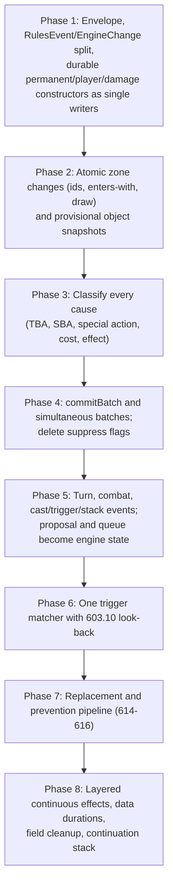

# Plan: Aligning `Mtg.Engine` Events with the *Magic: The Gathering* Comprehensive Rules

> **This document is a plan only.** It changes no engine code. It was written
> against the `history` branch at `47f7225` (merge of PR #561) and the
> *Magic: The Gathering* Comprehensive Rules **effective 25 September 2026**
> (`MagicCompRules 20260925.txt`, the edition named in [`README.md`](README.md)).

## 0. Scope, citation policy, and non-goals

### 0.1 Citation policy

Every rule number in this document was checked against the 25 September 2026
CR text. Many comments in the engine still use **older rule numbers**. They are
stale and must not be copied during implementation; this plan is the citation
layer to use. Examples found on `history`:

| Where | Comment says | 25 September 2026 CR |
| :--- | :--- | :--- |
| `OneShotEffect.tapped` / `.untapped` ([`Event.lean`](Mtg/Engine/Game/Event.lean)) | 701.21 / 701.21b | Tap and untap are 701.26a / 701.26b (701.21 is Sacrifice) |
| `OneShotEffect.looked`, `Action.scry` | scry 701.20, surveil 701.42 | Scry is 701.22, surveil 701.25 (701.20 is Reveal) |
| `OneShotEffect.sacrificed` | 701.17 | Sacrifice is 701.21 (701.17 is Mill) |
| `OneShotEffect.created` | 701.6 | Create is 701.7 (701.6 is Counter) |
| `OneShotEffect.proliferated` | 701.27 | Proliferate is 701.34 (701.27 is Transform) |
| `Status.goaded` ([`Status.lean`](Mtg/Engine/Game/Status.lean)) | 701.38 | Goad is 701.15 (goaded is a designation, 701.15b) |
| Mill comments ([`ResolutionHelpers.lean`](Mtg/Engine/Game/ResolutionHelpers.lean), [`SpellResolution.lean`](Mtg/Engine/Game/SpellResolution.lean)) | 701.13 | Mill is 701.17 |
| Treasure token ([`Tokens.lean`](Mtg/Engine/Game/Tokens.lean)) | 701.42 | Treasure is 111.10a; 701.42 is not Treasure |
| `beginStep .untap` ([`Turns.lean`](Mtg/Engine/Game/Turns.lean)) | untap is 502.2 | 502.2 is the day/night check; untapping is 502.3 |
| `Game.isNight` ([`Core.lean`](Mtg/Engine/Game/Core.lean)) | 702.145 | 702.145 is daybound/nightbound; the day/night designation is 731 |
| `gainLife` / `loseLife` ([`Damage.lean`](Mtg/Engine/Game/Damage.lean)) | 118.2 / 118.3a / 118.9 | Life is CR 119 (118 is Costs) |

Each migration PR should fix the stale comments on the code it touches.

### 0.2 Non-goals (for this plan)

These CR features are not modeled by the engine today. The event types below
leave room for them (so adding them later does not need a new taxonomy), but the
phases do not implement them:

- **Battles as attack targets and defense counters** (508.1b, 120.3h, 704.5v–y).
  Battles exist as a card type and as targets ([`Targeting.lean`](Mtg/Engine/Game/Targeting.lean)),
  but cannot be attacked. `AttackTarget` and `DamageRecipient` include `.battle`
  anyway.
- **Infect and wither** (120.3b, 120.3d), **regeneration** (701.19). Not in the
  engine. The damage-result design in §2.6 and the replacement design in §3.4 cover them.
- **The Initiative** (726), **Attractions** (703.4g, 701.52), **Archenemy
  schemes** (703.4e), **stickers**, **planeswalking** (603.10g).
- **Disguise** (702.168), **manifest**, **cloak** (keyword). Morph (702.37) and
  face-down permanents (708) are modeled and in scope.
- **Day/night transitions** (502.2, 703.4b, 731.2). `Game.isNight` exists and
  daybound cards read it ([`Entering.lean`](Mtg/Engine/Game/Entering.lean)), but
  nothing changes it. The day/night check is listed in the turn-based-action
  order (§3.6) and gets a `TurnEvent` so it slots in when it is implemented.

---

## 1. Diagnosis of the current event architecture

### 1.1 What `GameChange` contains

`GameEvent` ([`Event.lean`](Mtg/Engine/Game/Event.lean)) is `{ turn : Nat, change : GameChange }`.
`Game.change` / `Game.changes` / `Game.record` ([`Core.lean`](Mtg/Engine/Game/Core.lean))
all go through `Game.applyEvent`, which appends the event to `Game.events` and
calls `Game.applyChange`.

`GameChange` has **187 constructors**:

| Group | Count | Constructors | Behavior in `Game.applyChange` |
| :--- | ---: | :--- | :--- |
| Semantic markers | 7 | `.cast`, `.attacked`, `.stepped`, `.activated`, `.spentMana`, `.playedLand`, `.effectApplied` | No-op. `.effectApplied` only bumps `nextEffectId` (and `applyEvent` assigns a fresh `EffectId`). |
| Continuous-effect lifecycle (CR 611) | 3 | `.effectCreated`, `.effectExpired`, `.effectUpdated` | `applyEffectCreated` / `applyEffectExpired` / `applyEffectUpdated`. Creation goes through `installEffect`, which uses `refreshEffectSlot?` for recomputed slots and otherwise mirrors the effect into flags on `Status`, `GameObject`, `Player`, or `Game`. |
| Struct mutators | 20 | `.player`, `.playerChanges`, `.players`, `.setPlayer`, `.object`, `.objectChanges`, `.objects`, `.setObject`, `.removeObject`, `.replaceObject`, `.stack`, `.pushStack`, `.popStack`, `.removeFromStack`, `.setStackEntryAt`, `.stackEntry`, `.stackEntryById`, `.proposedSpell`, `.proposal`, `.proposalChanges` | Overwrite parts of `Game` through `PlayerChange` (64 constructors), `ObjectChange` (54), `StatusChange` (140), `StackEntryChange` (12), and `ProposalChange` (25). |
| `Game` field setters | 157 | `.activePlayer`, `.step`, `.pending`, `.nextObjectId`, `.timestamp`, `.waitingTriggers`, `.lastKnownStatus`, `.movedTo`, … and the continuation registers `.palantirAfterScry`, `.grimaImpulse*`, `.humansTappedThisWay`, `.permanentsDestroyedThisWay`, `.mayOnAccept`, `.unlessPaysInstead`, `.chooseModesRest`, `.suppressOthersDie`, … | One field each. Most are mid-resolution continuation state (the "…ThisWay", "may…", "unlessPays…", "spellOr…", "pending…" families), not game events. |

`OneShotEffect` has 18 constructors and `ContinuousEffect` has 60.

The direction set by PRs #557–#561 is right: every change already goes
through one function, and many "this turn" questions are already answered from
`Game.events` (`loggedDraws`, `loggedEntered`, `loggedCastForImpending`, …).
What is left is that the log contains **two writes for most game actions** and
**no CR classification** of what happened.

### 1.2 Dual recording: the semantic event and the mutation are separate writes

Because the seven semantic markers are no-ops, every game action records a
marker and also emits the mutation that actually changes the state:

- **Tap** — `becomeTapped` ([`Triggers.lean`](Mtg/Engine/Game/Triggers.lean))
  emits `changeStatuses o.id #[.tapped true, .becameTappedThisTurn true]`, then
  records `GameEvent.tapped g.turnNumber (g.object! o.id).asEvent true during`,
  where the last argument is `duringControllersTurn`. Untap in the untap step
  ([`Turns.lean`](Mtg/Engine/Game/Turns.lean)) records `GameEvent.untapped` and
  writes `.tapped false` separately; a stun-counter replacement is recorded as
  `untapped … (replacedByStun := true)`, i.e. an untap that did not happen
  (614.6) is still logged as an untap.
- **Draw** — `drawOneCard` ([`Library.lean`](Mtg/Engine/Game/Library.lean))
  writes `.player p (.library rest)`, then calls `Game.move` (which does the zone
  change and records its own `moved` event with the **new** id), then records
  `GameEvent.drew g.turnNumber p top nth firstOfTheirDrawStep` with the
  **pre-move** id `top`. The constructor field is `firstOfOwnDrawStep`.
  **This is a latent bug:** after `move`, `top` no longer names the card in
  hand, so any query that joins "cards drawn" to the object in hand misses it.
  The `drew` and `moved` events must agree on the post-move id, and the
  `moved` event must also keep the pre-move id.
- **Life** — `gainLife` and `loseLife` ([`Damage.lean`](Mtg/Engine/Game/Damage.lean))
  call `setLife` (the mutator) and record `GameEvent.life` (the marker)
  separately. `dealDamageToPlayer` records `damagedPlayer`, then `setLife`, then
  `afterLifeLost`.
- **Counters** — `addCounters` ([`Pumps.lean`](Mtg/Engine/Game/Pumps.lean)) and
  `addPlusOnePlusOneTo` ([`Entering.lean`](Mtg/Engine/Game/Entering.lean)) write
  the status field and record `GameEvent.counters`. The **enters-with** family
  writes counters with **no** counter event at all: `enterWithLoyalty`,
  `enterWithPlusOnes`, `enterWithIndestructibleCounter`, `enterWithShield`,
  `enterWithXPlusOnes`, and `enterWithHope`, all called from `applyEntersWith`
  **after** the permanent is already on the battlefield. Those counters are
  replacement effects that apply *as* the permanent enters (614.1c, 614.12;
  306.5b for loyalty; 714.3a for a Saga's first lore counter), so today the
  permanent briefly exists on the battlefield with the wrong counters.
- **Planeswalker damage** — `markDamageOn` ([`Damage.lean`](Mtg/Engine/Game/Damage.lean))
  records `GameEvent.damaged` and then writes `.loyaltyCounters` directly, with no
  counter-removal event (120.3c).
- **Zone changes** — `Game.move` ([`Movement.lean`](Mtg/Engine/Game/Movement.lean))
  builds a proposed `moved` event, applies the inline replacements, then:
  `unattachFrom`, `removePreparedCopy`, `.recordLastKnownStatus`,
  `removeFromZoneList`, `allocId` (new `ObjectId`), `.recordMovedTo id newId`,
  `bumpTime`, `.replaceObject id fresh`, and `pushLibrary` / `pushHand` /
  `pushGraveyard`; it queues triggers; and finally records
  `happened.withObjectId newId`. `GameEvent.withObjectId` overwrites the
  `EventObject.id` inside the event, so **the log keeps only the new id** and
  loses the pre-move one. The `(oldId, newId)` association survives only in
  `Game.movedTo`, which keeps the last 64 entries.

### 1.3 `OneShotEffect` conflates six CR categories

A one-shot effect (CR 610) is something a resolving spell or ability does.
Today `OneShotEffect` is used for almost every atomic occurrence, regardless of
why it happened:

1. **One-shot effects** of resolving spells and abilities (610).
2. **Keyword actions** (701): attach 701.3, counter 701.6, create 701.7,
   destroy 701.8, discard 701.9, fight 701.14, goad 701.15, investigate 701.16,
   mill 701.17, regenerate 701.19, reveal 701.20, sacrifice 701.21, scry 701.22,
   search 701.23, shuffle 701.24, surveil 701.25, tap/untap 701.26,
   transform 701.27, proliferate 701.34, amass 701.47, connive 701.50,
   the Ring tempts you 701.54. Goaded is a designation (701.15b).
3. **Turn-based actions** (703.4), in this order:
   - 703.4a phasing (502.1)
   - 703.4b day/night check (502.2, 731.2) — not implemented, see §0.2
   - 703.4c untap (502.3); no priority in the untap step (502.4)
   - 703.4d draw (504.1), skipped on the first turn in two-player games (103.8a)
   - 703.4e Archenemy scheme (non-goal)
   - 703.4f Saga lore counters as the precombat main phase begins (714.3c)
   - 703.4g Attractions (non-goal)
   - 703.4h choose a defending player in some multiplayer games
   - 703.4i declare attackers (508.1)
   - 703.4j declare blockers (509.1)
   - 703.4k combat-damage assignment (510.1)
   - 703.4m combat damage is dealt simultaneously (510.2)
   - 703.4n cleanup discard to maximum hand size (514.1)
   - 703.4p cleanup: remove all marked damage and end "until end of turn" / "this turn" effects, simultaneously (514.2)
   - 703.4q mana pools empty as each step and phase ends (500.5)

   Not 703.4 letters but related: effects that last "until" a step or phase
   expire as it begins (500.4); "until end of step/phase" effects expire as it
   ends, before mana empties (500.5); "until end of combat" expires at the end
   of the combat phase (500.5a); creatures, planeswalkers, and battles are
   removed from combat as the end of combat step ends (511.3).
4. **State-based actions** (704.5): loss by life 704.5a, empty-library draw
   704.5b, poison 704.5c; tokens 704.5d and copies 704.5e cease to exist;
   0 toughness 704.5f; lethal damage 704.5g; deathtouch 704.5h; 0 loyalty
   704.5i; legend rule 704.5j; Aura 704.5m; Equipment/Fortification 704.5n;
   +1/+1 and −1/−1 annihilation 704.5q; Saga 704.5s. All applicable SBAs are
   performed simultaneously, then checked again (704.3).
5. **Special actions** (116): playing a land (116.2a, 305.1); turning a
   face-down permanent face up (116.2b — any face-down permanent, see 708;
   morph's own rule is 702.37e).
6. **Paying costs** (118, 601.2h, 602.2b): tapping, sacrificing, discarding,
   paying life, removing counters, exiling, or beholding *as a cost* is not an
   effect. Some abilities care about the difference.

### 1.4 Other gaps

- **Simultaneous events** (603.2c). "Whenever one or more …" triggers fire once
  per event even when the event has many occurrences. The engine approximates
  this with flags and deduplication: `suppressOthersDie`,
  `suppressCreatureCardsToGy`, `pendingCreatureTokenCreators`, and
  `waitingTriggers.any (…)` checks in `becomeTapped`, `Game.move`,
  `dealDamageToPlayer`, and `addPlusOnePlusOneTo`.
- **Replacement effects** (614–616). `ReplacementWatch`
  ([`Event.lean`](Mtg/Engine/Game/Event.lean)) has 11 cases. `GameEvent.watches`
  tests whether a proposed event is the kind a replacement watches; the
  replacements themselves are inline in `Game.move` (Head of the Hunt, Smite,
  finality counters 122.1h, flashback 702.34a, Bilbo), `drawOneCard`'s caller
  ([`Library.lean`](Mtg/Engine/Game/Library.lean)), `gainLife` and
  `markDamageOn` / `dealDamageFrom` / `dealDamageToPlayer`
  ([`Damage.lean`](Mtg/Engine/Game/Damage.lean)), `createToken`
  ([`Tokens.lean`](Mtg/Engine/Game/Tokens.lean)), `addPlusOnePlusOneTo`
  ([`Entering.lean`](Mtg/Engine/Game/Entering.lean)), `beginStep .untap`
  (stun, 122.1d), and [`Keywords.lean`](Mtg/Engine/Game/Keywords.lean).
- **Trigger matching.** `GameEvent.matchesTrigger` decides *whether* an event
  matches, but the callers still scan `g.battlefield` themselves and build
  `WaitingTrigger`s with `waitingTriggersFor`, passing cause objects and
  last-known power/toughness. `Game.move` alone has more than a dozen of these
  loops.
- **`EventObject`** is `id`, `controller`, `owner`, `token`, `attacking`,
  `changeling`, `supertypes`, `types`, `subtypes`. It is built by
  `GameObject.asEvent`, which does not take a `Game`, so it cannot record
  layer-dependent values (colors, mana value, power, toughness, granted
  abilities). Keywords and static abilities are not snapshotted.
- **Continuous effects.** `ContinuousEffect` has 60 constructors, many
  card-specific (`auraConstruct55`, `ironFistTapUntilEot`, `onlyFoodArtifact`,
  `pendingLokiCopy`, …). `installEffect` / `uninstallEffect` mirror them into
  flags on `Status` (e.g. `pump : Int × Int`, `setBasePT`,
  `untilEotLosesIndestructible`, `notACreature`), `GameObject`
  (`flashbackUntilEot`, `uncounterableThisCast`, `fraEffectUntilTurnOf`),
  `Player` (`cantCastSpellsThisTurn`, `lifeLocked`, `lifeCantChange`, …), and
  `Game` (`creaturesWithoutFlyingCantBlock`, `powerUpsForbidden`). Readers then
  read the flags, not the effects.

---

## 2. Target architecture

### 2.1 Principles

1. **Single writer.** Each piece of game state has exactly one kind of event
   that writes it. A rules event either performs its state transition in
   `applyChange` or is a pure fact with no state of its own (e.g. "this spell
   became cast", "this damage was dealt"). It never does both with a
   separately recorded mutation of the same state.
2. **Two kinds of change, one journal.** Split `GameChange` into
   - `RulesEvent` — CR-level history: zone changes, taps, counters, damage,
     casting milestones, turn structure, continuous-effect lifecycle. Trigger
     matching, conditions, and "this turn" queries read **only** these.
   - `EngineChange` — engine state that is not CR history: the pending prompt,
     the in-progress proposal, the waiting-trigger queue, the priority holder,
     the continuation registers, the log text, the RNG.

   Both are still applied through `applyChange` and journaled in order, so
   replay stays exact; queries simply ignore `EngineChange`.
3. **A mandatory envelope.** Every rules event carries its `cause` and the
   `batch` it belongs to in the `GameEvent` wrapper, not per constructor, so no
   constructor can forget them.
4. **Ids are allocated by the event, advanced by `applyChange`.** The builder of
   an event that creates an object (zone change, token, copy) reads
   `g.nextObjectId` and the next timestamp *without writing them* and puts
   the new `ObjectId` and timestamp into the event. `applyChange` is the only
   writer: it installs the object and sets
   `nextObjectId := max nextObjectId (id + 1)` (and the same for `timestamp`),
   exactly like `applyEvent` already treats `nextEffectId`. Callers stop calling
   `allocId`, `bumpTime`, `replaceObject`, and `push*`. A shuffle event likewise
   carries the resulting library order; `applyChange` writes the library.
   (Resolving randomness, including `--norandom` input, stays outside the event.)
5. **Snapshots are characteristics plus status.** Characteristics are what
   109.3 lists (name, mana cost, color, types, rules text, abilities, power,
   toughness, loyalty, …). Tapped, attacking, controller, and what an Aura is
   attached to are **status**, not characteristics. Last known information for
   a resolving effect is 608.2h and 113.7a.
6. **Continuations are not events.** Mid-resolution state lives in a
   continuation frame stack (`EngineChange`), and the log records the *finished*
   action (e.g. one `scried` with both piles), not the prompt.

### 2.2 The envelope and causes

```lean
/-- One group of simultaneous rules events (603.2c, 608.2f, 704.3, 510.2). -/
structure BatchId where
  raw : Nat
deriving DecidableEq, Repr, Inhabited, BEq

/-- Why a rules event happened. -/
inductive EventCause where
  /-- Game setup (103) or a player leaving the game (800.4a, not an SBA). -/
  | gameRule (rule : GameRuleKind)
  /-- A turn-based action (703.4 / 500.4 / 500.5 / 511.3). -/
  | turnBased (action : TurnBasedAction)
  /-- A state-based action (704.5). -/
  | stateBased (sba : StateBasedAction)
  /-- A special action (116.2). -/
  | specialAction (player : PlayerId) (kind : SpecialActionKind)
  /-- Paying a cost (118 / 601.2h / 602.2b). Costs are not one-shot effects:
  the link is the spell or ability being cast or activated, not an `EffectId`. -/
  | costPayment (player : PlayerId) (forObject : ObjectId) (kind : CostKind)
  /-- A one-shot effect of a resolving spell or ability (610). -/
  | oneShotEffect (effectId : EffectId) (source : Option ObjectId)
      (controller : Option PlayerId)
  /-- The result of a replacement or prevention effect (614 / 615). -/
  | replaced (replacement : ReplacementId) (original : EventCause)
  /-- Migration-only: a call site not yet classified. Excluded from trigger
  matching that depends on cause; must reach zero uses by the end of Phase 3. -/
  | unclassified
deriving Repr, Inhabited, BEq

inductive TurnBasedAction where
  | phasing | dayNight | untap | draw | sagaLore
  | chooseDefendingPlayer | declareAttackers | declareBlockers
  | assignCombatDamage (firstStrike : Bool) | dealCombatDamage (firstStrike : Bool)
  | cleanupDiscard | cleanupDamageAndEffects
  | expireAtStepBegin | expireAtStepEnd | emptyManaPools | removeFromCombat
deriving Repr, Inhabited, BEq

structure GameEvent where
  turn : Nat
  batch : BatchId
  cause : EventCause
  change : GameChange          -- `.rules RulesEvent` or `.engine EngineChange`
deriving Repr, Inhabited, BEq
```

`EngineChange` events carry `cause := .unclassified` permanently; only
`RulesEvent`s are required to be classified.

### 2.3 Object snapshot

```lean
/-- An object as it was when the event happened: characteristics (109.3)
plus status. Layer-dependent values are provisional until Phase 8 (see §4). -/
structure EventObject where
  -- identity (already present today; `none` only for proposed or unattributed events)
  id : Option ObjectId := none
  owner : PlayerId
  controller : Option PlayerId
  token : Bool
  changeling : Bool
  supertypes : Array Supertype
  types : Array CardType
  subtypes : Array CardSubtype
  keywords : Keywords
  toxic : Nat := 0
  -- characteristics to add
  name : String
  colors : ColorSet
  manaValue : Nat
  power : Option Int
  toughness : Option Int
  loyalty : Option Nat
  staticAbilities : Array StaticAbility
  -- status to add (not characteristics, 109.3)
  zone : Zone
  tapped : Bool
  attacking : Bool          -- already present today
  blocking : Bool
  phasedOut : Bool
  faceDown : Bool
  transformed : Bool
  attachedTo : Option ObjectId
  counters : CounterBag
  isCopy : Bool
  summoningSick : Bool
  attackingWhom : Option PlayerId   -- becomes `attackingTarget : Option AttackTarget` in Phase 5 (folding `Status.attackingWhom` and `Status.attackingPlaneswalker`)
  printed : Option CardDef          -- preserves full printed card definition across `moved`/`created`
  chosenX : Option Nat := none      -- stays on stack `GameObject` (107.3a) and `EventObject` (`after.chosenX.orElse existing.chosenX`); off-stack readers use `CastEvent.announced` in Phase 8
  -- copy-only stack fields carried in Phase 2 so `.created` stack copies round-trip through `applyZoneEvent`
  -- (`applyZoneEvent` writes `adventurerCard` only in the `.created` branch; `Movement.buildArrival` does not copy it on `moved`);
  -- removed from `EventObject` in Phase 5 when `StackObjectEvent.copied` copies them from `original` onto the new `GameObject`
  -- (`adventurerCard`, `abilityEffect`, `triggeredAbility`, `sourceId` stay on `GameObject` per §3.8; the 5 cast-choice fields stay on `GameObject` until Phase 8):
  kicked : Bool := false
  teamworkPaid : Bool := false
  sneakPaid : Bool := false
  sneakAttackWhom : Option PlayerId := none
  giftPromisedTo : Option PlayerId := none
  adventurerCard : Option CardDef := none
  abilityEffect : Option Effect := none
  triggeredAbility : Option TriggeredAbility := none
  sourceId : Option ObjectId := none
  -- effect-mirror, 400.7d cast-metadata, and LKI fields carried in Phase 2 so `applyZoneEvent` materializes `GameObject`
  -- without a follow-up `EngineChange.setObject`; retired from `EventObject` alongside their `GameObject`/`Status` fields in Phase 8 step 4:
  returnedAsArtifact : Bool := false
  onlyFoodArtifact : Bool := false
  wasCast : Bool := false           -- 400.7d cast metadata (`applyZoneEvent` reads `after.wasCast` when `printed` is set)
  lastKnownPower : Option Int := none
  lastKnownToughness : Option Int := none
deriving Repr, Inhabited, BEq
```

`owner`, `controller`, `keywords`, and `toxic` already exist, and `id` is `Option ObjectId` (`GameObject.asEvent` populates `some o.id` and `Game.damageSourceEvent` extends it for damage sources, while `none` is used for proposed objects that do not have an id yet—`Game.entersTapped`, `Game.createToken`—and the `default` `EventObject` when damage has no source). In Phase 2 step 4, the builder becomes
`Game.snapshot (g : Game) (o : GameObject) : EventObject` (folding `Game.damageSourceEvent` into it), because power,
toughness, colors, and granted abilities depend on the game. To uphold the single-writer invariant (`applyZoneEvent` installing the exact arrival or created `GameObject` without a follow-up `EngineChange.setObject`), Phase 2 also carries the arrival, card, stack-copy, cast, effect-mirror, and LKI fields above on `EventObject`:
- `summoningSick`, `attackingWhom` (replaced by `attackingTarget : Option AttackTarget` in Phase 5), `printed`, and `chosenX` stay on `EventObject` (`chosenX` stays on the stack `GameObject` per 107.3a and is carried across `moved.after` via `after.chosenX.orElse existing.chosenX`, while `StackObjectEvent.copied` copies `chosenX` directly from `original`).
- The 9 copy-only stack fields (`kicked`, `teamworkPaid`, `sneakPaid`, `sneakAttackWhom`, `giftPromisedTo`, `adventurerCard`, `abilityEffect`, `triggeredAbility`, `sourceId`—where `adventurerCard` is only written by `applyZoneEvent` in the `.created` branch for stack copies, not on `moved`) leave `EventObject` in Phase 5 when stack copies migrate from `ZoneEvent.created` to `StackObjectEvent.copied` and the copy applier copies them (together with `chosenX` and, for ability copies until Phase 8, `lastKnownPower` and `lastKnownToughness`) from `original` onto the new `GameObject` (`adventurerCard`, `abilityEffect`, `triggeredAbility`, and `sourceId` remain on `GameObject` per §3.8, and the 5 cast-choice fields remain on `GameObject` until their readers use `CastEvent` in Phase 8).
- The 5 remaining transitional fields (`returnedAsArtifact`, `onlyFoodArtifact`, `wasCast` as 400.7d cast metadata, `lastKnownPower`, and `lastKnownToughness`) are deleted from `EventObject` together with their `GameObject`/`Status` counterparts in Phase 8 step 4.

### 2.4 Zone changes

```lean
/-- The verb that moved the object. Every zone change in the CR has one. -/
inductive ZoneVerb where
  | cast                            -- 601.2a
  | draw (nth : Nat) (firstOfOwnDrawStep : Bool)   -- 121.1
  | discard                         -- 701.9
  | mill                            -- 701.17
  | sacrifice                       -- 701.21
  | destroy                         -- 701.8
  | exile                           -- 406
  | counter                         -- 701.6 (spell leaves the stack)
  | resolve                         -- 608.2n / 608.3 (leaves the stack on resolution)
  | put                             -- "put … into/onto …" (incl. SBA graveyard moves, 704.5f/i/j/m/s)
  | returnToHand
  | shuffleIntoLibrary
  | playLand                        -- 116.2a
deriving Repr, Inhabited, BEq

inductive ZoneEvent where
  /-- 400.7: `before` is the old object (old id, LKI); `after` is the new
  object in `toZone` with its new id, timestamp, and every enters-with
  modification already applied (614.1c / 614.12). `applyChange` performs the
  whole transition. `entersWith` is the counters it entered with; 122.6 counts
  them as "put on" it, and they are already on `after`. -/
  | moved (before after : EventObject) (fromZone toZone : Zone)
      (verb : ZoneVerb) (actor : Option PlayerId)
      (entersWith : Array (CounterKind × Nat) := #[])
      (libraryPosition : Option LibraryPosition := none)
  /-- 111.1 / 701.7 / 707: a token or copy created directly in a zone. -/
  | created (object : EventObject) (controller : PlayerId)
  /-- 704.5d / 704.5e: a token or copy ceases to exist. It does not arrive in
  any zone, so this is not a `moved`. -/
  | ceasedToExist (object : EventObject)
```

- There is no `normalMove` bucket and no `destroy (byRegenerationReplaced)`
  flag. A destroy that regeneration replaces (701.19a) never happens (614.6);
  the replacement produces a different batch (remove damage, tap, remove from
  combat). The existing `untapped (replacedByStun := true)` pattern is retired
  the same way: a stun replacement is recorded as a counter removal, not as an
  untap.
- **Enters-with counters have one writer: the `moved` event.** "Whenever you put
  one or more counters …" queries read a projection that yields both standalone
  counter events and `moved.entersWith`, so nothing is applied twice and no
  second event is needed.
- **Spell → permanent link (400.7d).** An ability of a permanent can refer to
  how the spell that became it was cast. The query is
  `moved.before.id` (the spell, keyed by its cast events) → `moved.after.id`
  (the permanent). This replaces `Game.movedTo` and the copying of cast
  metadata onto the new object (`chosenX`, `wasCast`, …). 400.7c is a
  different exception (prevention effects on the spell's damage).

### 2.5 Permanents, counters, and attachments

```lean
inductive PermanentEvent where
  | tapped (object : EventObject)               -- 701.26a
  | untapped (object : EventObject)             -- 701.26b
  | phasedOut (object : EventObject) (indirectly : Bool)   -- 702.26
  | phasedIn (object : EventObject) (indirectly : Bool)    -- 702.26c; cause is usually .turnBased .phasing
  | transformed (object : EventObject)          -- 701.27
  | turnedFaceUp (object : EventObject)         -- 116.2b / 708.8 (special action or effect, by cause)
  | turnedFaceDown (object : EventObject)       -- 708.2a
  | counters (target : CounterTarget) (kind : CounterKind) (delta : CounterDelta)
      (actor : Option PlayerId)                 -- 122; delta is `put n` or `removed n`
  | attached (attachment : EventObject) (host : ObjectId) (previous : Option ObjectId)  -- 701.3a
  | unattached (attachment : EventObject) (fromHost : ObjectId)                        -- 701.3b
  | controlChanged (object : EventObject) (fromPlayer toPlayer : PlayerId)
  | designation (object : EventObject) (d : PermanentDesignation) (gained : Bool)       -- goaded 701.15b, ring-bearer, …
```

`CounterTarget` is an object or a player, so poison counters (122.1f, stored on
`Player.poison`) and any non-poison `CounterKind` on a player (stored in
`Player.counters`) are counter events too. The +1/+1 / −1/−1 annihilation SBA (704.5q) is two
`counters … (removed n)` events with `cause := .stateBased .counterAnnihilation`.
`PermanentDesignation.goaded` carries `(byPlayer : PlayerId) (untilNextTurn : Bool := true)`,
covering both standard CR 701.15a goad and indefinite goad (e.g. Dack Fayden).

**Counter storage.** The 23 counter fields on `Status` (`plusOnePlusOne`,
`minusOneMinusOne`, `loyaltyCounters`, `shield`, `finality`, `stun`, `hope`,
`charge`, `hone`, `shadow`, `plan`, `lore`, `story`, `time`, `influence`,
`burden`, `quest`, `invasion`, `poison`, `indestructibleCounters`,
`lifelinkCounters`, `trampleCounters`, `keywordCounters`) become one
`CounterBag` written only by counter events and `moved` (Phase 2 introduced
`CounterBag` on `EventObject.counters` and `ZoneEvent.moved.entersWith` with
`Status.toCounterBag` / `Status.withCounterBag` bridges that round-trip all 23
fields including `Status.poison`; Phase 8 step 4 replaces the 23 stored `Status`
fields with `counters : CounterBag` plus computed projection helpers
`Status.plusOnePlusOne`, `Status.loyaltyCounters`, etc., while player poison
stays on `Player.poison`). Keyword counters (122.1b) stay in the bag; layer 6
reads them as an input (613.1f). They are not a continuous-effect spec.

### 2.6 Damage and life

```lean
inductive DamageRecipient where
  | permanent (object : EventObject)
  | player (player : PlayerId)
  | battle (object : EventObject)     -- non-goal today, type ready (120.3h)

structure DamagePacket where
  source : EventObject      -- keywords (lifelink, deathtouch, infect, wither, toxic) are read from here
  recipient : DamageRecipient
  amount : Nat
  combat : Bool

inductive DamageEvent where
  /-- The fact that damage was dealt (120.2). Writes nothing itself. -/
  | dealt (packets : Array DamagePacket)
  /-- 120.3e: damage marked on a creature. -/
  | marked (object : ObjectId) (amount : Nat)
  /-- 514.2 / 703.4p. -/
  | markedCleared (objects : Array ObjectId)
  | prevented (source : EventObject) (recipient : DamageRecipient) (amount : Nat)   -- 615

inductive LifeEvent where
  | gained (player : PlayerId) (amount : Nat)                     -- 119.3; lifelink 120.3f / 702.15b
  | lost (player : PlayerId) (amount : Nat) (fromDamage : Bool)   -- 119.3 / 120.3a
```

One deal-damage instruction commits **one batch**: a `dealt` fact plus one
sibling event per result, each the only writer of its state:

| Result | Rule | Sibling event |
| :--- | :--- | :--- |
| Life loss | 120.3a | `LifeEvent.lost (fromDamage := true)` |
| Poison (infect) | 120.3b | `counters (player) poison (put n)` |
| Loyalty loss | 120.3c | `counters (planeswalker) loyalty (removed n)` |
| −1/−1 counters (infect/wither) | 120.3d | `counters (creature) minusOne (put n)` |
| Marked damage | 120.3e | `DamageEvent.marked` |
| Lifelink | 120.3f | `LifeEvent.gained` |
| Toxic | 120.3g | `counters (player) poison (put n)` |
| Defense loss (battle) | 120.3h | `counters (battle) defense (removed n)` |

There are no `hasLifelink` / `hasDeathtouch` / `hasToxic` flags on the packet or
on `DamageEvent.marked`; they would duplicate the source snapshot and could
disagree with it. Under 704.5h, a creature is destroyed when its toughness is
greater than 0 and a `DamageEvent.dealt` packet committed since the last SBA
batch has that creature as `recipient` (`.permanent c`),
`source.keywords.deathtouch == true`, and `amount > 0` (120.8: 0 damage is not
dealt; packets aimed at a player, a battle, or another permanent do not count).
Reading from `dealt` rather than `DamageEvent.marked` also covers wither and
infect, which deal damage in the form of −1/−1 counters (120.3d) without
marking damage; keeping the `toughness > 0` guard on the SBA ensures that at
toughness 0 or less, 704.5f puts the creature into its owner's graveyard (which
regeneration cannot replace) instead of 704.5h destroying it.

### 2.7 Mana, keyword actions, and players

```lean
/-- Mana that was added or spent, not a whole pool. Each unit keeps where it
came from and how it may be spent (106.6), so "treasure mana was spent" or
"mana from an Elf ability" is read from the units, not from parallel flags. -/
structure ManaUnit where
  mana : ManaType
  source : Option ObjectId
  restriction : Option ManaRestriction

inductive PlayerEvent where
  | manaAdded (player : PlayerId) (units : Array ManaUnit)                    -- 106.4
  | manaSpent (player : PlayerId) (units : Array ManaUnit) (forObject : ObjectId)
  | manaEmptied (player : PlayerId) (units : Array ManaUnit)                  -- 500.5 / 703.4q
  | scried (player : PlayerId) (top bottom : Array ObjectId)                  -- 701.22, recorded when finished
  | surveilled (player : PlayerId) (top graveyard : Array ObjectId)           -- 701.25, recorded when finished
  | lookedAt (player : PlayerId) (cards : Array ObjectId)                     -- only for "look at", not scry/surveil
  | revealed (player : PlayerId) (cards : Array ObjectId)                     -- 701.20
  | searched (player : PlayerId) (libraryOwner : PlayerId) (found : Array ObjectId)  -- 701.23
  | shuffled (libraryOwner : PlayerId) (newOrder : Array ObjectId)            -- 701.24
  | proliferated (player : PlayerId) (permanents : Array ObjectId) (players : Array PlayerId)  -- 701.34
  | ringTempted (player : PlayerId) (bearer : Option ObjectId) (stage : Nat)  -- 701.54
  | beheld (player : PlayerId) (quality : CardSubtype)
  | becameMonarch (player : PlayerId) (previous : Option PlayerId)            -- 725
  | gainedDesignation (player : PlayerId) (d : PlayerDesignation)             -- city's blessing 702.131, …
  | lost (player : PlayerId) (reason : LossReason)                            -- 104 / 704.5a–c
  | leftGame (player : PlayerId)                                              -- 800.4a, cause .gameRule
  | gameEnded (result : GameResult)
```

The individual scry/surveil choices stay in the continuation stack until the
player orders the piles; the log gets one `scried` / `surveilled`, so "whenever
you scry" matches once.

### 2.8 Turn structure

```lean
inductive TurnEvent where
  | turnBegan (player : PlayerId) (extra : Bool)
  | phaseBegan (phase : Phase)
  | stepBegan (step : Step)
  | stepEnded (step : Step)
  | phaseEnded (phase : Phase)
  | turnEnded (player : PlayerId)
  | dayNightChanged (night : Bool)                                -- 731.2 (non-goal today)
  | extraTurnAdded (player : PlayerId) (after : TurnRef)           -- 500.7
  | extraPhaseAdded (phase : Phase) (afterPhase : PhaseRef)         -- 500.8 (extra combat is an extra phase after a phase)
  | extraStepAdded (step : Step) (anchor : StepAnchor)              -- 500.9
```

Mana emptying is `PlayerEvent.manaEmptied` with
`cause := .turnBased .emptyManaPools` at the end of each step and phase
(500.5 / 703.4q), after "until end of step/phase" effects expire.

### 2.9 Casting, activating, triggering, and the stack

Three different things, so three types:

```lean
/-- Milestones of one cast or activation (601.2 / 602.2), keyed by the
object on the stack. The in-progress proposal itself is engine state. -/
inductive CastEvent where
  | proposed (obj : ObjectId) (player : PlayerId) (fromZone : Zone) (way : CastWay)  -- 601.2a
  | announced (obj : ObjectId) (modes : Array Nat) (x : Option Nat)
      (costs : Array AdditionalCostChoice)                                         -- 601.2b
  | targeted (obj : ObjectId) (targets : Array Target) (division : Array Nat)      -- 601.2c–d
  | spellCast (spell : EventObject) (player : PlayerId) (fromZone : Zone)          -- 601.2i
  | abilityActivated (ability : ObjectId) (source : EventObject) (player : PlayerId)
      (kind : ActivationKind)                                                       -- 602.2b; mana abilities 605.3b

/-- 603.2 / 603.3: an ability triggered; later, it is put on the stack. -/
inductive TriggerQueueEvent where
  | triggered (source : EventObject) (controller : PlayerId) (ability : TriggeredAbility)
      (origin : BatchId)                                                            -- 603.2
  | putOnStack (stackObj : ObjectId) (source : EventObject) (controller : PlayerId) -- 603.3

/-- Things that happen to an object already on the stack. -/
inductive StackObjectEvent where
  | copied (original : ObjectId) (copy : EventObject) (controller : PlayerId)       -- 707.10
  | resolved (obj : EventObject)                                                    -- 608.2
  | removedOnResolution (obj : EventObject)                                         -- 608.2b, all targets illegal
```

Countering is a `ZoneEvent.moved` with `verb := .counter` (701.6). The proposal
under construction (`ProposedSpell`), the waiting-trigger queue
(`Game.waitingTriggers`), and the priority holder are **engine state** updated by
`EngineChange`; only the milestones above go into the rules history. Copying a
spell or ability on the stack (`copyStackSpell`, `copyStackAbility`, Way of the
Cryomancer, Loki, `.copyCauseSpell`) temporarily emits `ZoneEvent.created` in
`.stack` during Phase 2; Phase 5 migrates stack copies to
`StackObjectEvent.copied`, whose applier copies stack metadata—both the
`StackEntry` decisions (`targets`, `targetsAnnounced`, `chosenMode`,
`extraModes`, and `dividedDamage`) and the `GameObject` stack/cast/adventure
fields (`chosenX`, `kicked`, `teamworkPaid`, `sneakPaid`, `sneakAttackWhom`,
`giftPromisedTo`, `adventurerCard`, `abilityEffect`, `triggeredAbility`,
`sourceId`) plus `lastKnownPower` / `lastKnownToughness` for ability copies
until Phase 8—directly from `original : ObjectId` per 707.10 (`chosenX` is
copied by all five stack copiers today—spell copies per 707.10 and ruling 845
for Way of the Cryomancer, and ability copies per MSH ruling 401—and must be
copied by `applyStackObjectEvent` since `StackObjectEvent.copied` does not go
through `applyZoneEvent`'s `moved.after` path). Because only `copyStackSpell`
copies all five cast-choice fields (`kicked`, `giftPromisedTo`, `teamworkPaid`,
`sneakPaid`, `sneakAttackWhom`), `adventurerCard`, and `extraModes` today—while
Loki (`Entering.lean`) omits `StackEntry` decisions, `adventurerCard`, and the
five cast-choice fields (copying `chosenX` only), Way of the Cryomancer
(`Entering.lean`, which already copies `adventurerCard`, `kicked`,
`giftPromisedTo`, `teamworkPaid`, and `chosenX` on the object and `targets`,
`dividedDamage`, `chosenMode`, and `targetsAnnounced` on the stack entry) omits
`extraModes`, `sneakPaid`, and `sneakAttackWhom`, `.copyCauseSpell`
(`FraResolve.lean`) omits `extraModes` and the five cast-choice fields (copying
`adventurerCard` and `chosenX` only on the `GameObject`), and
`copyStackAbility` leaves `targetsAnnounced` false—this migration is a 707.10
behavior change across both `StackEntry` decisions and `GameObject`
cast/adventure fields, not only a new event constructor. Card copies created in
`.exile`—both the 707.12 cast-during-resolution copies (Saruman, Baron Zemo,
Uldaros) and `createPreparedCopy` (`Movement.lean`, which leaves the copy in
`.exile` with a play permission while the permanent stays prepared per ruling
742, not 707.12)—remain `ZoneEvent.created`.

### 2.10 Combat

```lean
inductive AttackTarget where
  | player (p : PlayerId)
  | planeswalker (pw : ObjectId)
  | battle (b : ObjectId)            -- non-goal today (508.1b)

inductive CombatEvent where
  /-- 508.1 / 703.4i: attackers declared. Only this matches "whenever … attacks" (508.3a). -/
  | attackersDeclared (player : PlayerId) (decls : Array (EventObject × AttackTarget))
  /-- 508.4: put onto the battlefield attacking, or made attacking by an effect.
  The creature is attacking but did not "attack". -/
  | becameAttacking (creature : EventObject) (target : AttackTarget)
  | blockersDeclared (player : PlayerId) (decls : Array (EventObject × ObjectId))  -- 509.1 / 703.4j
  | becameBlocked (attacker : EventObject) (blockers : Array ObjectId)             -- 509.1h
  | remainedUnblocked (attacker : EventObject)                                     -- 509.1h
  | damageAssigned (firstStrike : Bool) (assignments : Array CreatureCombatAssignment)  -- 510.1 / 703.4k
  | removedFromCombat (object : EventObject)                                       -- 506.4 / 511.3
```

`CombatEvent.becameAttacking` is the combat milestone for both halves of 508.4:
permanents put onto the battlefield attacking and permanents made attacking on
the battlefield by an effect. In Phase 2, the enter-attacking paths in this
tree—Andúril's Spirit tokens (`createKindTokens` with `attacking`), Sneak
(`putOntoBattlefield` with `attacking` / `attackingWhom`), and graveyard returns
through `enterModsAttacking` / `returnFromGyTappedAttackingFinality` (Grim
Reaper)—set `attacking := true` and `attackingWhom := some …` on the zone
event's arrival object (`ZoneEvent.moved.after` / `ZoneEvent.created.object`),
which keeps them from matching *"whenever … attacks"*
(`CombatEvent.attackersDeclared`, 508.3a) without replacing the 508.4 combat
milestone. Phase 5 adds `CombatEvent.becameAttacking` for all 508.4 transitions
and folds `Status.attackingWhom : Option PlayerId`,
`Status.attackingPlaneswalker : Option ObjectId`, and
`EventObject.attackingWhom` into `attackingTarget : Option AttackTarget` so
enter-attacking paths and `becameAttacking` can target a player, planeswalker,
or battle (e.g. Andúril ruling 181, whereas Phase 2's enter-attacking paths only
store a `PlayerId`).

First-strike and regular combat damage are separate combat damage steps
(510.4 / 702.7b), so they are separate `damageAssigned` events and separate
damage batches (`cause := .turnBased (.dealCombatDamage firstStrike)`). In the
first combat damage step, only attacking and blocking creatures with first
strike or double strike assign combat damage; in the second step, the remaining
attacking and blocking creatures that had neither first strike nor double
strike as the first combat damage step began, together with those that currently
have double strike, assign combat damage (510.4, 702.7b).

### 2.11 Continuous effects

```lean
inductive ContinuousEffectEvent where
  | created (id : EffectId) (spec : ContinuousEffectSpec)
  | expired (id : EffectId)
```

`effectUpdated` disappears once durations are data (§3.3). The spec itself is
described in §3.3.

---

## 3. Alignment by subsystem

### 3.1 Zone changes and object identity (400.7, 614.12)

1. `Game.move` computes the proposed event, applies replacements (§3.4), then
   builds the final `ZoneEvent.moved` with `before := g.snapshot old` and
   `after` = the new object (new id read from `g.nextObjectId`, new timestamp,
   counters/choices/controller from enters-with replacements) and commits it.
   `applyChange` removes `before.id` from `fromZone`, installs `after`, inserts
   it into `toZone` (at `libraryPosition` for libraries), and advances
   `nextObjectId` / `timestamp`.
2. `drawOneCard` stops writing `.player p (.library rest)` itself and records
   the draw as the zone event's verb (`.draw nth firstOfOwnDrawStep`), so the
   draw and the move are one event with both ids.
3. `applyEntersWith` stops writing counters after entry; its computations move
   into the builder of `after`. `afterPermanentEnters` then sees the correct
   state.
4. `Game.lastKnownStatus` (32 entries) and `Game.movedTo` (64 entries) are
   replaced by queries over `moved.before` / `moved.after`, which are never
   truncated.

### 3.2 One-shot effects and simultaneous batches (603.2c, 608.2f)

The commit API takes **data**, not a callback, so a nested call cannot open a
second batch by accident:

```lean
/-- Apply `events` as one simultaneous batch under a single `BatchId` and
evaluate batch-level ("whenever one or more …") triggers for the batch while
keeping the existing per-event queues for individual triggers (Phase 4);
Phase 6 replaces those individual queues with `matchTriggers pre post batch`
(§3.5). -/
def Game.commitBatch (g : Game) (cause : EventCause) (events : Array RulesEvent) : Game
```

- In Phase 4, `commitBatch` applies `events` under one `BatchId` and runs a
  batch-level pass for the "whenever one or more …" triggers while keeping the
  existing per-event trigger queues for individual triggers; Phase 6 replaces
  those individual per-event queues with the unified `matchTriggers pre post batch`
  pass (§3.5).
- An instruction such as "destroy all creatures", "create N tokens",
  "mill N", or "each player discards" builds all its events, then commits once.
- Combat damage is **two** commits when there is a first-strike step
  (510.4 / 702.7b): one per combat damage step.
- SBAs (704.3) are a **loop of commits**: each pass performs every applicable
  SBA as one batch, then checks again.
- "Whenever one or more …" triggers evaluate once per batch; "whenever a …"
  triggers evaluate once per matching event in the batch (603.2c). The flags
  `suppressOthersDie`, `suppressCreatureCardsToGy`, and
  `pendingCreatureTokenCreators`, and the `waitingTriggers.any` deduplication,
  are then deleted.

### 3.3 Continuous effects and layers (611, 613)

**Duration is data the expiry pass evaluates, with no counter to decrement:**

```lean
inductive EffectDuration where
  | untilEndOfTurn                        -- ends at 514.2 / 703.4p
  | untilEndOfCombat                      -- ends at end of combat phase (500.5a)
  | untilEndOfStepOrPhase (s : StepOrPhase) -- 500.5
  | untilStepOrPhase (s : StepOrPhase)    -- expires as it begins (500.4)
  | untilNextTurnOf (p : PlayerId)        -- expires as p's next turn begins (611.2a)
  | untilEndOfNextTurnOf (p : PlayerId)   -- ends in cleanup of p's first turn that began after creation
  | whileSourceOnBattlefield (src : ObjectId)  -- 611.2b
  | whileSourceHasCounter (src : ObjectId) (k : CounterKind)
  | whileInZone (obj : ObjectId) (z : Zone)    -- e.g. play permissions while exiled
  | indefinite
```

"First turn of `p` that began after creation" is answered from the log
(`TurnEvent.turnBegan` after the `created` event). That replaces
`ContinuousEffect.control … (turnEndsLeft)`, `Status.controlTurnEndsLeft`, and
`PlayPermission.turnEndsRemaining`, and removes the need for `effectUpdated` as a
second writer. (Loki's last-known power is recorded on the expiry/creation of a
new effect instead.)

**Scope is closed data, not a function**, because `GameEvent` derives `Repr`
and `BEq`:

```lean
inductive ObjectScope where
  | objects (ids : Array ObjectId)                 -- locked in at creation (611.2c)
  | creaturesControlledBy (p : PlayerId)           -- static-ability style (611.3)
  | creaturesWithout (k : Keyword)
  | permanentsOfSubtype (p : PlayerId) (s : CardSubtype)
  -- … extended like `StaticAbility`, never with a predicate
deriving Repr, Inhabited, BEq
```

**Every layer is represented:**

```lean
inductive LayerEffect where
  | copy (values : CardDef)                                            -- 1, 613.1a / 707
  | control (p : PlayerId)                                             -- 2, 613.1b
  | text (change : TextChange)                                         -- 3, 613.1c / 612
  | types (mode : SetOrAdd) (types : Array CardType)
      (subtypes : Array CardSubtype) (supertypes : Array Supertype)    -- 4, 613.1d
  | colors (mode : SetOrAdd) (colors : ColorSet)                       -- 5, 613.1e
  | abilities (add : AbilitySet) (remove : AbilityRemoval)             -- 6, 613.1f
  | ptCda (cda : PtCda)                                                -- 7a, 613.4a
  | ptSet (power toughness : Int)                                      -- 7b, 613.4b
  | ptModify (power toughness : Int)                                   -- 7c, 613.4c (counters are read from the bag)
  | ptSwitch                                                           -- 7d, 613.4d

inductive ContinuousEffectSpec where
  | layered (scope : ObjectScope) (e : LayerEffect) (d : EffectDuration)
  | playerRule (p : PlayerId) (r : PlayerRule) (d : EffectDuration)    -- 611.2c: can't cast, life can't change, cost reduction, …
  | gameRule (r : GameRule) (d : EffectDuration)                       -- creatures without flying can't block, …
  | replacement (r : ReplacementSpec) (d : EffectDuration)             -- 614 (e.g. exile if it would die)
  | prevention (r : PreventionSpec) (d : EffectDuration)               -- 615
  | permission (p : PlayerId) (r : PlayPermissionSpec) (d : EffectDuration)
```

Timestamp order is 613.7, dependency order 613.8. **Goad is a designation**
(701.15b) with an "until your next turn" end, recorded as
`PermanentEvent.designation`, not a layer effect. **Keyword counters** are owned
by the counter bag and read by layer 6 (613.1f).

`installEffect` / `uninstallEffect` then only add/remove entries in
`Game.activeEffects`; characteristic getters (`GameObject.types`,
`subtypes`, `power`, …, and `Game.power` / `Game.toughness`) evaluate the
layers instead of reading mirrored flags.

### 3.4 Replacement and prevention (614–616)

Algorithm for one proposed event (not a fixed-point iteration):

1. Collect the replacement/prevention effects that apply to the event and have
   **not** already applied to it or to any event that replaced it (614.5).
2. If none, commit the event.
3. Otherwise the affected object's controller (or owner), or the affected
   player, chooses one (616.1), restricted in this order:
   616.1a self-replacement effects (614.15); then 616.1b effects that modify
   under whose control it enters; then 616.1c effects that make it enter as a
   copy; then 616.1d effects that make a card enter back face up; then
   616.1e any applicable effect. If several players must choose, APNAP.
4. Apply it, mark it as used for this event chain, and repeat from step 1 with
   only the effects that are *now* applicable (616.1f). Effects on an event
   contained in the first event are handled by 616.1g.
5. The replaced event never happens (614.6) and is not recorded; the modified
   event is committed with `cause := .replaced id original`.

`616.1d` is in scope because the catalog has double-faced cards (daybound,
modal DFCs) and preparation cards (722).

### 3.5 Triggered abilities and look-back-in-time (603)

`commitBatch` runs one matcher:

```lean
def matchTriggers (pre : GameSnapshot) (post : Game) (batch : Array GameEvent) :
    Array WaitingTrigger
```

- Look-back triggers read `pre` (603.10): the four zone-change categories in
  603.10a — (1) leaves-the-battlefield abilities (including dies, 603.6c /
  700.4), (2) abilities that trigger when a player sacrifices a permanent,
  (3) abilities that trigger when a card leaves a graveyard, and (4) abilities
  that trigger when an object that all players can see is put into a hand or
  library — plus phasing out 603.10b, becoming unattached 603.10c, losing
  control / an opponent gaining control 603.10d, a spell being countered
  603.10e, and a player losing the game 603.10f (planeswalking 603.10g is a
  non-goal).
- Everything else reads `post` (603.10), including enters-the-battlefield
  (603.6a) and **discard / cycling**: 603.10a does not include cards leaving a
  hand. When a card is discarded (701.9) or cycled (702.29a), it moves from a
  hidden zone to a destination zone (typically the graveyard), and trigger
  matching reads `post` and `moved.after` (the revealed characteristics in the
  destination zone; per 702.29c, *"When you cycle this card"* triggers from
  whatever zone the card winds up in after it is cycled, and per 702.29d,
  *"whenever a player cycles or discards"* triggers once when cycled).
- The matcher must produce the same `WaitingTrigger` data the hand-written
  loops pass to `waitingTriggersFor` today: `causeId`, the cause object
  (`cause := some old`), and last-known power/toughness (e.g.
  `g.snapshotPower old` for dies triggers, the accumulated amount for
  `sourceDealtDamage`). These come from `moved.before` and the damage packets.
- Each trigger that fires is recorded as `TriggerQueueEvent.triggered`, so
  "once each turn" is a log query.

### 3.6 Turn structure, TBAs, and SBAs (500–514, 703, 704)

`beginStep` and `advanceStep` ([`Turns.lean`](Mtg/Engine/Game/Turns.lean))
become: `stepEnded` → expire "until end of step/phase" effects → empty mana
pools (500.5 / 703.4q) → `stepBegan` → expire "until this step/phase" effects
(500.4) → the turn-based actions for that step in 703.4 order (§1.3, each a
commit with `cause := .turnBased …`) → "at the beginning of" triggers (500.6) →
SBA loop and priority (117.3a, 704.3). Cleanup grants priority only per 514.3a.

### 3.7 Casting, activating, and costs (118, 400.7d, 601, 602)

- Cost payments are committed with `cause := .costPayment player spellOrAbilityId kind`.
  Teamwork and convoke taps are ordinary `tapped` events with that cause; the
  `tappedForTeamwork` trigger (fired from [`CastExtras.lean`](Mtg/Engine/Game/CastExtras.lean))
  becomes a query on the cause. There is no tap flag to delete.
- Cast metadata (`castFromGraveyard`, `castFromHand`, `kicked`, `teamworkPaid`,
  `sneakPaid`, `giftPromisedTo`, `treasureManaSpent`, `chosenX`, …) is read from
  the `CastEvent`s keyed by the spell id, and joined to the permanent through
  `moved.before.id → moved.after.id` (400.7d). Several are already log queries
  (`GameEvent.castFromGraveyard`, `giftPromised`, `teamwork`, `castForImpending`).
- Impending (702.176) is already read from the log: `Game.loggedCastForImpending`,
  plus `Status.time` and the `.notACreature` effect created on the permanent in
  `Game.move`. There is no `Status.impendingPaid`.

### 3.8 Field inventory (rebuilt from the structs on `history`)

Each field is put in exactly one category. "Log" means a query over
`Game.events`; "layers" means `Game.activeEffects` evaluated per §3.3.

#### `Status` ([`Status.lean`](Mtg/Engine/Game/Status.lean))

| Category | Fields (type) | Target |
| :--- | :--- | :--- |
| **Game state — stays** | `tapped : Bool`, `damage : Int`, `summoningSick : Bool`, `attacking : Bool`, `attackingWhom : Option PlayerId` + `attackingPlaneswalker : Option ObjectId` (folded into `attackingTarget : Option AttackTarget` in Phase 5), `blocking : Array ObjectId`, `blocked : Bool`, `phasedOut : Bool`, `phasedWith : Option ObjectId`, `transformed : Bool`, `faceDown : Bool`, `prepared : Bool`, `harnessed : Bool`, `isCommander : Bool`, `ringBearer : Bool` (duplicates `Player.ringBearerId`; keep one) | Written by the single event that changes it (`tapped`/`untapped`, `DamageEvent.marked`/`markedCleared`, `CombatEvent`, `phasedIn`/`phasedOut`, `transformed`, …). |
| **Counters — stay, consolidated** | `plusOnePlusOne`, `minusOneMinusOne`, `loyaltyCounters`, `shield`, `finality`, `stun`, `hope`, `charge`, `hone`, `shadow`, `plan`, `lore`, `story`, `time`, `influence`, `burden`, `quest`, `invasion`, `poison`, `indestructibleCounters`, `lifelinkCounters`, `trampleCounters` (all `Nat`), `keywordCounters : KeywordCounters` | One `CounterBag`, written by counter events and `moved.entersWith` (§2.5; player poison stays on `Player.poison`). |
| **As-enters choices — stay** | `chosenOdd : Option Bool`, `chosenCreatureType : Option CardSubtype`, `chosenColor : Option Color`, `chosenName : Option String`, `chosenCardType : Option CardType`, `windcragMardu : Bool` | Set on `moved.after` (614.12). `windcragMardu` should become a general choice value. |
| **SBA bookkeeping** | `dealtDeathtouch : Bool` | Derived in Phase 1 per creature via `Game.deathtouchDealtSinceLastSba` from `DamageEvent.dealt` packets committed since the last `EngineChange.sbaChecked` marker where `recipient` is that creature (`.permanent c`), `source.keywords.deathtouch` is true, and `amount > 0` (120.8; includes wither/infect 120.3d). 704.5h checks this predicate together with `toughness > 0` (at toughness ≤ 0, 704.5f applies instead). Delete the remaining `Status.dealtDeathtouch` field and cleanup/test references in Phase 8. |
| **History → log** | `activationsThisTurn : Nat`, `abilitiesActivatedThisTurn : Array Nat`, `loyaltyActivatedThisTurn : Bool`, `boastUsedThisTurn : Bool`, `powerUpUsed : Bool`, `powerUpActivations : Nat`, `exhaustUsed : Bool` | `CastEvent.abilityActivated` for this source (this turn, or ever for exhaust). `abilitiesActivatedThisTurn` needs the ability index on the event. |
| | `firedOnceEachTurn : Bool` | `TriggerQueueEvent.triggered` for this source this turn. It is per object today; the query must key on the ability once an object has more than one once-each-turn ability. It is not the same thing as once-each-turn *activated* abilities. |
| | `optionalOnceUsed : Bool` | A rules event for "chose the optional action" of a "do this only once each turn" trigger (MSH 69), queried this turn. |
| | `declaredAsAttackerThisTurn : Bool` | `CombatEvent.attackersDeclared` this turn (not `becameAttacking`, 508.3a). |
| | `becameTappedThisTurn : Bool`, `gotPlusOneThisTurn : Bool`, `dealtDamageThisTurn : Bool`, `dealtCombatDamage : Bool`, `combatDamageToPlayers : Array PlayerId` | `tapped`, `counters … plusOne (put _)` (incl. `entersWith`), and `DamageEvent.dealt` this turn. |
| | `allianceModesChosen : Array Nat`, `modesChosenThisTurn : Array Nat`, `chosenModes : Array Nat` | `CastEvent.announced` / trigger mode choices for this source (this turn or lifetime). |
| | `manaSpentToCast : Nat` | `PlayerEvent.manaSpent` for the spell, joined through `moved` (400.7d). `GameEvent.manaSpentOn` already exists. |
| **Continuous-effect mirrors → layers** | `pump : Int × Int`, `untilTurnOfPump : Array (PlayerId × Int × Int)`, `pumpPerArtifactUntilEot : Bool`, `setBasePT : Option (Int × Int)`, `cardsInHandPowerUntilEot : Bool`, `untilEotKeywords : Keywords`, `firstStrikeOnYourTurn : Bool`, `untilEotLosesIndestructible : Bool`, `additionalCreature : Bool`, `additionalCreatureUntilEot : Bool`, `additionalArtifactUntilEot : Bool`, `additionalSubtypes : Array CardSubtype`, `replacedCreatureTypesUntilEot : Option (Array CardSubtype)`, `onlyFoodArtifact : Bool`, `returnedAsArtifact : Bool`, `notACreature : Bool`, `animatedConstruct55 : Bool`, `grantedStaticAbilities : Array StaticAbility`, `grantedTriggeredAbilities : Array TriggeredAbility`, `grantedTriggersUntilEot : Array TriggeredAbility`, `ironFistTapGrants : Nat`, `combatDamageCreatesTreasure : Bool`, `losesAbilitiesUntilEot : Bool`, `losesAbilitiesGrantedBy : Array ObjectId`, `hexproofGrantedBy : Array ObjectId`, `cantBeBlockedByPlayer : Option PlayerId`, `cantBeBlockedExceptByHasteUntilEot : Bool`, `cantBlockUntilEot : Bool`, `controlUntilEot : Bool`, `controlTurnEndsLeft : Nat` | `ContinuousEffectSpec.layered` / `.gameRule`. |
| **Replacement/prevention mirrors** | `untilEotExileIfDies : Bool`, `preventDamageGrantedBy : Array ObjectId`, `cantUntapGrantedBy : Array ObjectId`, `cantTransform : Bool` | `ContinuousEffectSpec.replacement` / `.prevention` (or a rule spec for "can't"). |
| **Permission mirrors** | `freeCastFromGraveyard : Bool`, `colorlessGrantUntilCast : Array ObjectId` | `ContinuousEffectSpec.permission`. |
| **Designation** | `goaded : Bool`, `goadedBy : Array PlayerId`, `goadedUntilNextTurnOf : Array PlayerId` | `PermanentEvent.designation (.goaded byPlayer untilNextTurn)` (701.15b); until-next-turn goads expire via `Game.expireGoadedFor` as the goading player's next turn begins, while `untilNextTurn := false` goads persist for the rest of the game. |

#### `GameObject` ([`Object.lean`](Mtg/Engine/Game/Object.lean))

| Category | Fields | Target |
| :--- | :--- | :--- |
| **Cast metadata → log (400.7d)** | `castFromGraveyard : Bool`, `castFromHand : Bool`, `wasCast : Bool`, `kicked : Bool`, `teamworkPaid : Bool`, `sneakPaid : Bool`, `sneakAttackWhom : Option PlayerId`, `giftPromisedTo : Option PlayerId`, `isPreparedSpell : Bool`, `treasureManaSpent : Bool`, `boastExiled : Array ObjectId`; `chosenX : Option Nat` once it leaves the stack | `CastEvent`s keyed by spell id, joined via `moved`. `chosenX` stays while on the stack (107.3a). |
| **Effect mirrors → layers / specs** | `copyRestore : Option CardDef`, `copyUntilEot : Bool`, `copyUntilNextTurn : Bool`, `copyUntilSourceLeaves : Option ObjectId` (layer 1); `controlChanged : Bool`, `controlUntilSourceLeaves : Option ObjectId` (layer 2); `playPermission : Option PlayPermission`, `flashbackUntilEot : Bool` (permission); `exileInstantSorceryInstead : Bool` (replacement); `uncounterableThisCast : Bool` (rule); `fraEffectUntilTurnOf : Option PlayerId` (duration of an emblem) | §3.3 |
| **LKI → `moved.before`** | `lastKnownPower : Option Int`, `lastKnownToughness : Option Int`, `lastController : Option PlayerId` | §3.1 |
| **Stays** | `id : ObjectId`, `printed : CardDef`, `owner : PlayerId`, `controller : Option PlayerId`, `defaultController : Option PlayerId`, `zone : Zone`, `status : Status`, `timestamp : Nat`, `attachedTo : Option ObjectId`, `adventurerCard : Option CardDef`, `isCopy : Bool`, `linkedExile : Array ObjectId`, `returnToZone : Option Zone`, `leaveTriggerExile : Array ObjectId`, `exiledBy : Option ObjectId` (linked abilities, 607), stack data (`abilityEffect : Option Effect`, `triggeredAbility : Option TriggeredAbility`, `reflexiveResolution : Option TriggeredAbility.TriggerResolution`, `sourceId : Option ObjectId`, `fraCauseId : Option ObjectId`, `fraCauseController : Option PlayerId`, `fraCausePower : Option Int`, `fraCauseStatus : Option Status`) | — |
| **Engine bookkeeping** | `enterProcessed : Bool` | Becomes unnecessary once enters triggers come from `commitBatch`. |

#### `Player` ([`Player.lean`](Mtg/Engine/Game/Player.lean))

| Category | Fields (type) | Target |
| :--- | :--- | :--- |
| **Setup / seat metadata — stays** | `id : PlayerId`, `name : String`, `startingLife : Int`, `startingHandSize : Nat`, `sideboard : Array CardDef` (400.11b), `hasCommander : Bool`, `commanderColorIdentity : ColorSet` (903.4), `commanderCreatureTypes : Array CardSubtype`, `teammate : Option PlayerId` | Initialized from `StartConfig` / `Seat`. |
| **Game state — stays** | `life : Int`, `maxHandSize : Nat` (base 7, 514.1; hand-size modifiers evaluate via `ContinuousEffectSpec.playerRule`), `manaPool : ManaPool`, `poison : Nat` (written by `PermanentEvent.counters (.player p) .poison`), `lost : Bool`, `leftTheGame : Bool`, `mulligansTaken : Nat`, `keptOpeningHand : Bool`, `library : Array ObjectId`, `hand : Array ObjectId`, `graveyard : Array ObjectId`, `isMonarch : Bool` (written by `becameMonarch`, 725), `citysBlessing : Bool` (702.131), `enduringStory : Bool`, `theRingAbilities : Nat`, `ringBearerId : Option ObjectId` (701.54) | Single-writer events. |
| **Delayed triggers → delayed-trigger table (603.7)** | `eaglesBirdsNextUpkeep : Nat` (upkeep delayed trigger from *The Eagles Are Coming!*), `attackPumpPerPlainsThisTurn : Nat` (*"whenever you attack this turn"* delayed trigger from *Roads Go Ever, Ever On*) | Delayed-trigger entries created on resolution and fired by `matchTriggers` (Phase 8). |
| **Player effect mirrors → layers / specs** | `additionalLandsThisTurn : Nat` (305.2b), `protectionFromEverything : Bool`, `lifeCantChange : Bool` (until the player's next turn), `lifeLocked : Bool` (Platinum Emperion; a separate flag), `cantCastSpellsThisTurn : Bool`, `typeSpellCostLessThisTurn : Array (CardType × Nat)`, `supertypeSpellCostLessThisTurn : Array (Supertype × Nat)`, `jaceLoyaltyAtInstantSpeed : Bool`, `legendRuleOffThisTurn : Bool`, `copyNextInstantSorceryThisTurn : Nat`, `mountainExtraRedThisTurn : Nat`, `nextSpellCantBeCountered : Bool`, `cantAttackJaces : Bool` | `ContinuousEffectSpec.playerRule` (611.2c). |
| **Player history → log** | `beheldQualities : Array CardSubtype` | `PlayerEvent.beheld` (already recorded as `OneShotEffect.beheld`). |
| **Player SBA bookkeeping** | `drewFromEmpty : Bool` | Derive from a failed-draw event since the last SBA batch (704.5b). |

#### `Game` ([`Core.lean`](Mtg/Engine/Game/Core.lean))

| Category | Fields (type) | Target |
| :--- | :--- | :--- |
| **Core & turn/combat state — stays** | `players : Array Player`, `objects : Array GameObject`, `stack : Array StackEntry`, `activePlayer : PlayerId`, `priority : PlayerId`, `step : Step`, `turnNumber : Nat`, `startingPlayer : PlayerId`, `isFirstTurn : Bool`, `nextObjectId : Nat`, `nextEffectId : Nat`, `activeEffects : Array (EffectId × ContinuousEffect)` (`ContinuousEffectSpec` in Phase 8), `timestamp : Nat`, `result : Option GameResult`, `log : Array String`, `format : Format`, `brawl : Bool`, `consecutivePasses : Nat`, `cleanupGivesPriority : Bool`, `isNight : Bool`, `extraTurns : Array PlayerId`, `additionalCombatPhases : Nat`, `assignedCombatDamage : Array CreatureCombatAssignment`, `firstStrikeDamageDone : Bool`, `pendingRegularCombatDamage : Bool`, `firstStrikeAssignedThisCombat : Array ObjectId`, `events : Array GameEvent` (plus `nextBatchId : Nat` in Phase 4) | Written by `RulesEvent`s (`TurnEvent`, `CombatEvent`, `ContinuousEffectEvent`, …) or `EngineChange` (`priority`, `consecutivePasses`, `cleanupGivesPriority`, `log`). |
| **Engine prompt / queue state — stays (`EngineChange`)** | `pending : Pending`, `afterRandom : AfterRandom`, `proposedSpell : Option ProposedSpell`, `awaitingOpeningBegin : Bool`, `mulliganToDeclare : Array PlayerId`, `willMulligan : Array PlayerId`, `mulliganToBottom : Array PlayerId`, `blockersQueue : Array PlayerId`, `waitingTriggers : Array WaitingTrigger`, `wardQueue : Array WardObligation`, `castingFromTop : Bool`, `resolvingSpell : Option ObjectId`, `resolvingAbility : Option ObjectId`, `resolvingDivision : Array Nat`, `ancestryLandsTapped : Array ObjectId` | Updated by `EngineChange` while choices, casts, or abilities are in progress. |
| **Delayed triggers → delayed-trigger table (603.7)** | `delayedEndStepReturns : Array ObjectId`, `delayedEndStepExiles : Array ObjectId`, `delayedEndStepSacrifices : Array ObjectId`, `delayedGraveReturns : Array (ObjectId × PlayerId)`, `delayedSynthetic : Array (PlayerId × Nat)` | Delayed-trigger entries created on resolution and fired by `matchTriggers` (603.2; later put on the stack via `TriggerQueueEvent.putOnStack` per 603.3, Phase 8). |
| **Queue-time note — deleted in Phase 8** | `enrageGrantsAdditionalCombat : Nat` | Queue-time counter written in `Damage.lean` for `.enrageGrantsCombat` ("If he's attacking, untap him and there is an additional combat phase after this phase"); not an intervening-if (603.4), so delete the counter and check at resolution whether the source is currently attacking on the battlefield, matching the untap instruction's live check. |
| **Game effect mirrors → specs** | `creaturesWithoutFlyingCantBlock : Bool`, `powerUpsForbidden : Bool`, `playerControl : Option (PlayerId × PlayerId)`, `controlOnNextTakenTurn : Bool`, `pendingLokiCopy : Option (PlayerId × Option ObjectId × Int)`, `assignCombatDamageEqualToughness : Option PlayerId`, `pendingFreeRGCreature : Option PlayerId` | `ContinuousEffectSpec.gameRule` / `.playerRule`. |
| **Game LKI / identity — deleted in Phase 2** | `lastKnownStatus : Array (ObjectId × Status)`, `movedTo : Array (ObjectId × ObjectId)` | `moved.before` / `moved.after`. |
| **Batch / trigger suppression — deleted in Phase 4 / 6 / 7** | `suppressOthersDie : Bool`, `suppressCreatureCardsToGy : Bool`, `pendingCreatureTokenCreators : Array PlayerId` (deleted in Phase 4); `pendingTokenEnters : Array ObjectId` (deleted in Phase 6); `lockedDeathReplacements : Option (Array GameObject)` (deleted in Phase 7) | Replaced by `commitBatch`, `matchTriggers pre post batch`, and the 616.1 replacement pipeline. |
| **Continuation registers — moved to continuation stack in Phase 8** | `pendingDrawAfterScry : Option (PlayerId × Nat)`, `discardedCardThisWay : Option (PlayerId × ObjectId)`, `palantirAfterScry : Option (PlayerId × PlayerId × ObjectId)`, `recentTokenIds : Array ObjectId`, `fraAfterLook : Option (PlayerId × Option ObjectId × FraNext)`, `pendingFreeCopies : Option (PlayerId × Array ObjectId × Nat × Nat)`, `pendingMayCastFromExile : Option (PlayerId × Array ObjectId × Nat)`, `mayPayAlsoPlusOneOn : Option ObjectId`, `humansTappedThisWay : Nat`, `permanentsDestroyedThisWay : Nat`, `removedHopeThisWay : Bool`, `permanentDealtDamageThisWay : Option ObjectId`, `returnedPermanentThisWay : Bool`, `nthResolveThisWay : Option Nat`, `skipTriggerSequenceRest : Bool`, `excessDamageThisWay : Nat`, `destroyedForAmassThisWay : Bool`, `amassControllerThisWay : Option PlayerId`, `amassAmountThisWay : Nat`, `amassYouControlledThisWay : Bool`, `milledIdsThisWay : Array ObjectId`, `revealedIdsThisWay : Array ObjectId`, `opponentsMilledThisWay : Bool`, `palantirChoiceReady : Option (PlayerId × PlayerId × ObjectId)`, `grimaImpulseReady : Bool`, `grimaImpulseVictim : Option PlayerId`, `grimaImpulseFound : Option ObjectId`, `grimaImpulseOthers : Array ObjectId`, `planWasSacrificed : Bool`, `sourceWasSacrificed : Bool`, `exiledIdsThisWay : Array ObjectId`, `notedCopyObject : Option GameObject`, `notedHostId : Option ObjectId`, `handDiscardedThisWay : Option Nat`, `notedSourceThisWay : Option ObjectId`, `equipmentAttachedHost : Option ObjectId`, `notedCountThisWay : Nat`, `createdTokenThisWay : Option ObjectId`, `putArtifactThisWay : Option (ObjectId × ObjectId)`, `playExiledThisWay : Option ObjectId`, `armSurveilReturn : Bool`, `triggerSequenceRest : Option TriggerSequenceRest`, `mayThenDrop : Nat`, `mayThenSkip : Nat`, `mayThenConditional : Option TriggeredAbility.TriggerResolution`, `mayOnAccept : Option TriggeredAbility.TriggerResolution`, `mayOnDecline : Option TriggeredAbility.TriggerResolution`, `mayContext : Option TriggerSequenceRest`, `sacrificedPowerThisWay : Option Nat`, `mayThenResume : Bool`, `triggerOr : Option TriggerOrRest`, `chooseModesRest : Option ChooseModesRest`, `unlessPaysInstead : Option Effect`, `unlessPaysController : PlayerId`, `unlessPaysTargets : Array Target`, `unlessPaysDue : Bool`, `mayEffect : Option Effect`, `mayController : PlayerId`, `mayTargets : Array Target`, `spellOr : Array Effect`, `spellOrController : PlayerId`, `spellOrTargets : Array Target`, `spellOrLibrary : Bool`, `surveilReturnMvAtMost : Option Nat`, `surveilReturnNoncreatureNonland : Bool`, `conniveSource : Option ObjectId`, `plusOneAfterDiscards : Option ObjectId`, `plusOneAfterSearch : Option ObjectId`, `thirstDiscardsLeft : Nat`, `thirstDiscardType : CardType`, `pendingDiscardsLeft : Nat`, `untapSearchedIfLands : Option Nat` | Continuation frame stack (`EngineChange`). |

---

## 4. Phased roadmap

Every phase keeps `lake build` and the `#guard` tests in
[`Mtg/Engine/Tests/`](Mtg/Engine/Tests) green, and adds isolation tests to
[`Tests/Events.lean`](Mtg/Engine/Tests/Events.lean) of the form "applying this one
event to this game yields exactly this game".



### Phase 1 — Envelope and durable single-writer constructors

1. Add `batch` and `cause` to `GameEvent` (cause defaults to `.unclassified`
   only through a migration helper, never in new code).
2. Split `GameChange` into `.rules RulesEvent` and `.engine EngineChange`; move
   the 157 field setters and 20 struct mutators under `EngineChange` unchanged.
3. Introduce the **durable** constructors from §2.5–2.7 for tap/untap,
   counters (one constructor with `CounterDelta`), life, poison (as counters on
   a player), damage facts and results (§2.6), attach/unattach, and control
   change. Make each one the only writer of its state:
   - `becomeTapped` ([`Triggers.lean`](Mtg/Engine/Game/Triggers.lean)) and the
     untap step ([`Turns.lean`](Mtg/Engine/Game/Turns.lean)) stop writing
     `.tapped` separately. The stun replacement records `counters stun (removed 1)`
     and no untap.
   - `gainLife` / `loseLife` / `dealDamageToPlayer` ([`Damage.lean`](Mtg/Engine/Game/Damage.lean))
     stop calling `setLife` alongside the record.
   - `addCounters` ([`Pumps.lean`](Mtg/Engine/Game/Pumps.lean)),
     `addPlusOnePlusOneTo` ([`Entering.lean`](Mtg/Engine/Game/Entering.lean)), and
     the shield/loyalty writes in `markDamageOn` stop writing status fields.
     Planeswalker damage commits `DamageEvent.marked` (if applicable) plus
     `counters loyalty (removed n)` (120.3c).
   - **Do not touch the enters-with family here.** It moves onto the zone
     event in Phase 2; routing it through a post-entry counter event would keep
     the wrong intermediate state.
4. Remove the migrated constructors (`.life`, `.damaged`, `.damagedPlayer`,
   `.tapped`, `.untapped`, `.counters`, `.control`, `.attached`, `.poisoned`) from
   `OneShotEffect`, leaving `OneShotEffect` only for the unmigrated variants.
   Inventory the remaining raw setters with a grep for `.tapped (`, `.setLife`,
   `.loyaltyCounters (`, `.lore (`, `.poison (` in `Mtg/Engine/Game/` before and
   after the PR.

Tests: `Tests/Tap.lean`, `Untap.lean`, `GainLife.lean`, `LoseLife.lean`,
`PutCounters.lean`, `RemoveCounters.lean`, `Damage.lean`, `Attach.lean`, `Events.lean`.

### Phase 2 — Atomic zone changes and provisional snapshots

1. Add `ZoneEvent.moved` / `created` / `ceasedToExist` (§2.4) with the id
   allocation rule from §2.1 (builder reads, `applyChange` writes). Remove the
   `allocId` / `bumpTime` / `replaceObject` / `push*` / `removeFromZoneList`
   calls from `Game.move`, `createToken`, and the copy paths, and remove
   `.moved`, `.sacrificed`, and `.created` from `OneShotEffect`.
2. Move enters-with counters, enters-tapped status writes (`Movement.lean` via
   `putOntoBattlefield` and its callers in `LandsAndMana.lean`,
   `SpellResolution.lean`, `LibrarySearch.lean`, `CastExtras.lean`,
   `ResolutionEffects.lean`, `EffectResolution.lean`, `FraHelpers.lean`,
   `FraResolve.lean`, and `TriggeredAbilities.lean`; direct post-entry `.tapped`
   writes in `EffectResolution.lean`, `FraChoices.lean` (including the
   pay-life-or-enter-tapped decline arm opened by `Entering.lean`),
   `ModeledTriggers.lean`, and `TriggeredAbilities.lean`; and token construction
   in `Tokens.lean`), and
   as-enters choices (`enterWithLoyalty`, `enterWithPlusOnes`,
   `enterWithIndestructibleCounter`, `enterWithShield`, `enterWithXPlusOnes`,
   `enterWithHope`, prepared, impending time counters) into the construction of
   `moved.after` / `created.object` and `entersWith` (614.1c / 614.12 / 306.5b /
   714.3a). Add the "counters put" projection that includes `entersWith` (122.6).
3. Make the draw a `moved` with `verb := .draw nth firstOfOwnDrawStep`; drop
   `OneShotEffect.drew` with the pre-move id. Re-point `GameEvent.draws`,
   `drewFirstOfDrawStep`, and the draw triggers at the new verb.
4. Extend `EventObject` (§2.3) and add `Game.snapshot` (unifying
   `Game.damageSourceEvent` into `Game.snapshot`). **Snapshot today's
   cached values** (`Game.power`, `GameObject.types`, `Status` flags) and mark the
   layer-dependent fields provisional in their doc comments; Phase 8 switches
   the source to the layer system without changing the event shape, so the
   tests written now do not encode the flag cache as a rule.
5. Replace `Game.lastKnownStatus` and `Game.movedTo` readers with queries
   over `moved`, then delete both fields and their `GameChange` constructors.

Tests: `Draw.lean`, `Death.lean`, `Leaving.lean`, `Exile.lean`, `ReturnToHand.lean`,
`PutOnLibrary.lean`, `Mill.lean`, `Discard.lean`, `Chapter.lean` (Saga entry),
`Events.lean` (isolation test for one `moved`).

### Phase 3 — Classify every cause

Thread `EventCause` through every call site so `.unclassified` reaches zero for
rules events:

- `.turnBased` — phasing, untap, draw, Saga lore, attacker/blocker declaration,
  damage assignment and dealing (with `firstStrike`), cleanup discard, cleanup
  damage/effects, step-boundary expiry, mana emptying, removal from combat
  ([`Turns.lean`](Mtg/Engine/Game/Turns.lean), [`Phasing.lean`](Mtg/Engine/Game/Phasing.lean),
  [`Combat.lean`](Mtg/Engine/Game/Combat.lean)).
- `.stateBased` — every 704.5 action in
  [`StateBasedActions.lean`](Mtg/Engine/Game/StateBasedActions.lean).
- `.specialAction` — playing a land ([`LandsAndMana.lean`](Mtg/Engine/Game/LandsAndMana.lean))
  and turning a face-down permanent face up (116.2b). Turning something face up
  because a spell or ability says so is `.oneShotEffect`.
- `.costPayment player spellOrAbilityId kind` — mana, taps (including convoke
  and teamwork), sacrifice, discard, life, counter removal, exile, behold
  ([`Casting.lean`](Mtg/Engine/Game/Casting.lean),
  [`ActivationCosts.lean`](Mtg/Engine/Game/ActivationCosts.lean),
  [`ManaAbilities.lean`](Mtg/Engine/Game/ManaAbilities.lean),
  [`CastExtras.lean`](Mtg/Engine/Game/CastExtras.lean)).
- `.oneShotEffect effectId source controller` — resolution
  ([`EffectResolution.lean`](Mtg/Engine/Game/EffectResolution.lean),
  [`ResolutionEffects.lean`](Mtg/Engine/Game/ResolutionEffects.lean),
  [`TriggeredAbilities.lean`](Mtg/Engine/Game/TriggeredAbilities.lean)).
- `.gameRule` — setup, mulligans, and leaving the game (800.4a).

Add a `#guard` that no rules event in a full demo game has `.unclassified`.
Migrate the remaining `OneShotEffect` constructors (`.looked`, `.resolved`,
`.beheld`, `.proliferated`, `.sheHulkDealtDamage`) to `PlayerEvent` /
`StackObjectEvent` and delete `OneShotEffect`.

### Phase 4 — Simultaneous batches

1. Add `Game.commitBatch` (§3.2) and `nextBatchId`. In Phase 4, `commitBatch`
   applies the batch under one `BatchId` and runs a batch-level pass for the
   "one or more" triggers below while keeping the existing per-event queues for
   individual triggers; Phase 6 replaces those per-event queues with
   `matchTriggers pre post batch`.
2. Convert multi-object instructions (including bulk counter operations
   `.withoutCounters`, `.proliferatedExceptPlusOne`, and
   `.addCountersExceptPlusOne`, deleting those `StatusChange` constructors), the
   combat damage steps (two batches with first strike, per 510.4 / 702.7b in
   §2.10), and the SBA loop (one batch per pass).
3. Move "one or more" triggers to per-batch evaluation:
   `oneOrMoreOtherCreaturesDie`, `creatureCardsPutIntoYourGy`,
   `youCreateCreatureTokens`, `creaturesYouControlBecomeTapped`,
   `combatDamageToYou`, `opponentsDealtCombatDamageYourTurn`,
   `.fra .opponentsDealtNoncombatDamage`, `.fra .playerDiscards`,
   `youPutCountersOnGoblinOrcArmy`, `.fra .youPutLoyaltyCounters`, and the
   Invisible Woman once-per-batch case in `addPlusOnePlusOneTo`.
4. Delete `suppressOthersDie`, `suppressCreatureCardsToGy`,
   `pendingCreatureTokenCreators`, and the `waitingTriggers.any` deduplication.

Tests: `Destroy.lean`, `Death.lean`, `Combat.lean`, `Mill.lean`, `Discard.lean`,
`Marvel.lean`, `RealityFracture.lean`, `Events.lean` (batch multiplicity).

### Phase 5 — Turn, combat, and stack events

1. Replace `.stepped` with `TurnEvent` (§2.8). `turnNumber`, `activePlayer`,
   `step`, and `extraTurns` / `additionalCombatPhases` become state written by
   `TurnEvent`s; extra combat is an extra phase after a phase (500.8).
2. Replace `.attacked` and the raw combat status writes with `CombatEvent`
   (§2.10), including `becameAttacking` for both halves of 508.4 (permanents
   put onto the battlefield attacking and permanents made attacking by an
   effect; the zone-event arrival flags keep enter-attacking off
   `attackersDeclared` per 508.3a), and `AttackTarget` instead of a bare
   `PlayerId` (folding `Status.attackingWhom : Option PlayerId`,
   `Status.attackingPlaneswalker : Option ObjectId`, and
   `EventObject.attackingWhom` into `attackingTarget : Option AttackTarget` so
   enter-attacking paths and `becameAttacking` can target a player,
   planeswalker, or battle, e.g. Andúril ruling 181).
3. Replace `.cast` / `.activated` with `CastEvent`, add `TriggerQueueEvent` and
   `StackObjectEvent` (§2.9). Migrate stack spell/ability copies (`copyStackSpell`,
   `copyStackAbility`, Way of the Cryomancer, Loki, `.copyCauseSpell`) from
   `ZoneEvent.created` to `StackObjectEvent.copied` (707.10; card copies in
   `.exile`—both the 707.12 cast-during-resolution copies for Saruman, Baron
   Zemo, and Uldaros, and `createPreparedCopy` per ruling 742—stay
   `ZoneEvent.created`). Have `applyStackObjectEvent` copy the `StackEntry`
   decisions (`targets`, `targetsAnnounced`, `chosenMode`, `extraModes`, and
   `dividedDamage`), `GameObject` stack/cast/adventure fields (`chosenX`,
   `kicked`, `teamworkPaid`, `sneakPaid`, `sneakAttackWhom`, `giftPromisedTo`,
   `adventurerCard`, `abilityEffect`, `triggeredAbility`, `sourceId`), and
   `lastKnownPower` / `lastKnownToughness` (which `copyStackAbility` in
   `ResolutionEffects.lean` copies today, until those LKI fields are retired in
   Phase 8) directly from `original` onto the new copy `StackEntry` and
   `GameObject` (preserving `chosenX` across all five copiers—spell copies per
   707.10 and ruling 845 for Way of the Cryomancer, and ability copies per MSH
   ruling 401—since `StackObjectEvent.copied` does not run `applyZoneEvent`'s
   `moved.after` path, and fixing Loki's copy to include `StackEntry`
   decisions, `adventurerCard`, and the 5 cast-choice fields, Way of the
   Cryomancer to include `extraModes`, `sneakPaid`, and `sneakAttackWhom`,
   `.copyCauseSpell` to include `extraModes` and the 5 cast-choice fields, and
   `copyStackAbility` to copy `targetsAnnounced` per 707.10), and retire the 9
   copy-only stack fields from `EventObject` (`kicked`, `teamworkPaid`,
   `sneakPaid`, `sneakAttackWhom`, `giftPromisedTo`, `adventurerCard`,
   `abilityEffect`, `triggeredAbility`, `sourceId`; note that `chosenX` stays
   on the stack `GameObject` per 107.3a and on `EventObject` for `moved.after`,
   `adventurerCard` and the stack ability fields
   `abilityEffect`/`triggeredAbility`/`sourceId` stay on `GameObject` per §3.8,
   and the 5 cast-choice fields stay on `GameObject` until their readers use
   `CastEvent` in Phase 8). **Only these milestones are rules events.**
   `ProposedSpell` and `ProposalChange`, `Game.waitingTriggers` and its queue
   operations, `.pushStack` / `.popStack` bookkeeping, and `.priority` stay
   `EngineChange`, so the log does not carry the scratchpad.

Tests: `Turns.lean`, `Step.lean`, `Combat.lean`, `AttackTriggers.lean`,
`ThisAttack.lean`, `YouAttack.lean`, `Casting.lean`, `CastTriggers.lean`,
`Activation.lean`, `Modes.lean`, `Targets.lean`.

### Phase 6 — One trigger matcher

1. Implement `matchTriggers pre post batch` (§3.5), producing the same
   `WaitingTrigger` fields (`causeId`, `cause`, last-known power/toughness) the
   current loops pass to `waitingTriggersFor`.
2. Cover the whole of 603.10a–f for look-back.
3. Record `TriggerQueueEvent.triggered`; replace `Status.firedOnceEachTurn`
   reads with log queries.
4. Delete the hand-written trigger loops in `Game.move`
   ([`Movement.lean`](Mtg/Engine/Game/Movement.lean)),
   [`Entering.lean`](Mtg/Engine/Game/Entering.lean),
   [`Leaving.lean`](Mtg/Engine/Game/Leaving.lean),
   [`Combat.lean`](Mtg/Engine/Game/Combat.lean),
   [`Damage.lean`](Mtg/Engine/Game/Damage.lean),
   [`Triggers.lean`](Mtg/Engine/Game/Triggers.lean), and
   [`Library.lean`](Mtg/Engine/Game/Library.lean).

Tests (Hobbit, Reality Fracture, Reality Fracture Commander, and Marvel triggers):
`Death.lean`, `Leaving.lean`, `Damage.lean`, `Watch.lean`, `Elves.lean`,
`EnterOrAttack.lean`, `Reflexive.lean`, `Marvel.lean`, `RealityFracture.lean`,
`RealityFractureCommander.lean`, `RulingFixtures.lean`, `CatalogSmoke.lean`,
plus new look-back tests for simultaneous deaths and phasing out.

### Phase 7 — Replacement and prevention pipeline

1. Represent each replacement/prevention as a `ReplacementSpec` (from static
   abilities, `ContinuousEffectSpec.replacement` / `.prevention`, counters such as
   stun 122.1d / shield 122.1c / finality 122.1h, enters-with 614.1c, commander
   903.9b, flashback 702.34a).
2. Implement the 616.1 loop from §3.4 with per-chain `applied` sets (614.5) and
   APNAP choice prompts.
3. Remove the inline replacement branches listed in §1.4.

Tests: `Exile.lean`, `Draw.lean`, `GainLife.lean`, `Damage.lean`, `PutCounters.lean`,
`Untap.lean`, `RulingFixtures.lean`, plus new tests for 614.5 termination, 614.6
non-occurrence, and the 616.1a–e order.

### Phase 8 — Layers, data durations, delayed triggers, field cleanup, continuations

1. Replace the 60 `ContinuousEffect` constructors with `ContinuousEffectSpec`
   (§3.3) and `EffectDuration`; delete `effectUpdated` and the turn counters.
2. Evaluate characteristics through layers 1–7d with timestamps (613.7) and
   dependencies (613.8); switch `Game.snapshot` to the layer results.
3. Replace the ad-hoc 603.7 delayed-trigger fields (`Player.eaglesBirdsNextUpkeep`,
   `Player.attackPumpPerPlainsThisTurn` together with its
   `ContinuousEffect.attackPumpPerPlainsThisTurn` constructor,
   `Game.delayedEndStepReturns`, `Game.delayedEndStepExiles`,
   `Game.delayedEndStepSacrifices`, `Game.delayedGraveReturns`, and
   `Game.delayedSynthetic`) with a delayed-trigger table whose entries are
   created on resolution and matched by `matchTriggers` (603.2; then put on the
   stack via `TriggerQueueEvent.putOnStack` when a player would next receive
   priority per 603.3) instead of polled directly in `Turns.lean`,
   `TriggeredAbilities.lean`, and `FrcResolve.lean`. Delete
   `Game.enrageGrantsAdditionalCombat` and have `.enrageGrantsCombat` use the
   same live resolution-time attacking check (`source` on the battlefield and
   `status.attacking`) as the untap instruction.
4. Delete every field in §3.8 marked as a mirror, history, cast metadata
   (400.7d on `GameObject`: `castFromGraveyard`, `castFromHand`, `wasCast`,
   `kicked`, `teamworkPaid`, `sneakPaid`, `sneakAttackWhom`, `giftPromisedTo`,
   `isPreparedSpell`, `treasureManaSpent`, `boastExiled`, and off-stack
   `chosenX` reads), LKI (`GameObject.lastKnownPower`, `lastKnownToughness`,
   `lastController`), delayed trigger, or queue-time counter (alongside the
   remaining transitional mirror, 400.7d cast-metadata, and LKI fields on
   `EventObject`: `returnedAsArtifact`, `onlyFoodArtifact`, `wasCast`,
   `lastKnownPower`, and `lastKnownToughness`), consolidate the 23 stored
   counter fields on `Status` (including `Status.poison`; player poison stays on
   `Player.poison`) into `counters : CounterBag` (with computed projection
   helpers `Status.plusOnePlusOne`, `Status.loyaltyCounters`, etc.), and delete
   their `StatusChange` / `ObjectChange` / `PlayerChange` / `GameChange`
   constructors after their readers use the log, the layers, or the
   delayed-trigger table.
5. Move the continuation registers into a continuation frame stack.

Final check: `lake build`, `lake exe mtg-demo`, `lake exe oracle-roundtrip`, and
`RulesEvent` contains only the families in §2 (zone, permanent, damage, life,
player, turn, combat, cast, trigger queue, stack object, continuous effect).
