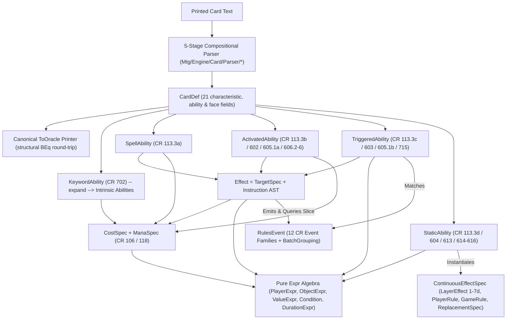

# `Mtg.Engine` Architecture Overview

`Mtg.Engine` is a card-agnostic *Magic: The Gathering* rules engine written in Lean 4 and anchored to the Comprehensive Rules **effective 6 November 2026** (`MagicCompRules 20261106.txt`, pinned in [`Rules.lean`](../Mtg/Engine/Rules.lean#L16) and [`README.md`](../README.md)).

All printed cards in the catalog are parsed from their printed Oracle text into a single CR-aligned representation (`Mtg.Engine.Card`), canonically printable back to Oracle text with zero raw-text escape hatches, and evaluated uniformly by the runtime engine (`Mtg.Engine.Game`).

## Documentation Map

| Document | Scope |
| :--- | :--- |
| **System Overview** *(this document)* | End-to-end architecture, Comprehensive Rules mapping, Lake plugin hierarchy, Lean 4 build/CI invariants, verification gates, and non-goals. |
| [`card-and-ability-model.md`](./card-and-ability-model.md) | The five-layer `Mtg.Engine.Card` AST: shared CR primitives, pure `Expr` algebra, `TargetSpec` / `CostSpec` / `ManaSpec` / `TokenSpec`, unified `Instruction` & `Effect`, CR 113.3 four-category abilities, `KeywordAbility` expansion, and the 21-field `CardDef`. |
| [`oracle-parser.md`](./oracle-parser.md) | The 9-module, 5-stage compositional Oracle parser under `Mtg/Engine/Card/Parser/`, recursive quoted-ability parsing, discourse/anaphora binding, canonical `ToOracle` rendering, and 1,292-card structural `BEq CardDef` round-trip verification. |
| [`game-evaluation.md`](./game-evaluation.md) | Runtime evaluation in `Mtg.Engine.Game`, `Agent`, and `Demo`: pure `EvalExpr` & LKI snapshots, CR 613 Layers 1–7d, targeting legality, the resumable `Instruction` interpreter & `stepEnv`, pattern-driven two-pass trigger matching, and unified mana/cost/replacement pipelines. |

## End-to-End Architecture



### Core Design Principles

1. **Card-Agnostic Card AST & Interpreter, Text-Authored Catalog**: All **1,292** cards in [`supportedCatalogCards`](../Mtg/Engine/Catalog/Supported.lean#L21-L30) (`13` core + `193` Hobbit + `117` Hobbit Eternal + `286` Marvel Super Heroes + `285` Reality Fracture + `87` Reality Fracture Commander + `311` Star Trek) are authored from official Gatherer Oracle text via `fromOracle` with `modellingError? == none` (when Scryfall does not match Gatherer, Gatherer is authoritative). Both the `Mtg.Engine.Card` AST and the unified `Instruction` interpreter are card-agnostic (zero card- or set-named AST constructors); interactive mid-resolution prompts in [`ResolutionChoice`](../Mtg/Engine/Game/Pending.lean#L325-L624) (dispatched in [`answerResolutionChoice`](../Mtg/Engine/Game/ResolutionChoices.lean#L274)) still retain card-specific prompt constructors.
2. **Bidirectional `ToOracle` With Zero Raw-Text Escape Hatches**: No AST type in `Mtg/Engine/Card/` caches printed Oracle strings (no `.printed : String`, `Effect.phrase`, or `TargetFilter.noun`). [`CardDef.renderFullOracle`](../Mtg/Engine/Card/CardDef.lean#L849) reconstructs printed Oracle text purely from `ToOracle` instances, and `parseOracleCard (renderFullOracle c) == .ok c` holds structurally via `BEq CardDef` across all 1,292 catalog cards.
3. **Pure Queries, Unified Effects, and `RulesEvent`-Backed History**: Queries (`Expr.lean`) are side-effect-free functions over `(Game, EvalEnv)`. All one-shot effects across spells, activated abilities, triggered abilities, and Saga chapters share a single 18-constructor [`Instruction`](../Mtg/Engine/Card/Ability.lean#L1323-L1344) AST executed by one resumable interpreter ([`Game/Interpreter.lean`](../Mtg/Engine/Game/Interpreter.lean)), reading post-replacement outcomes from `Game.events` (`RulesEvent`) slices per CR 614.6.
4. **Universal Layer Participation**: Every ability on a permanent or spell—`keywords`, `activatedAbilities`, `triggeredAbilities`, `staticAbilities`, `spellEffect`, and `SpellAbility.additionalCosts`—transforms functorially under Layer 3 text changes (`HasTextChange`), obeys Layer 4 CR 305.6/305.7 basic-land subtype rules, and respects Layer 6 grants and removals.

## Comprehensive Rules Mapping (6 November 2026)

Every type, parser production, and runtime rule follows the **6 November 2026** Comprehensive Rules (`Rules.effectiveDate = "2026-11-06"`):

| Domain | 6 November 2026 CR Sections | Architectural Representation |
| :--- | :--- | :--- |
| Object characteristics & card faces | **100.2a**, **109.3**, **111.1**, **113.3**, **201–212** (incl. **202.2**, **204**, **205**, **207** (incl. **207.2a,c**, **207.4**), **208.1–3**, **209.1**, **210.1**, **211.1**, **212.1**), **702**, **712**, **716**, **723** | Exact 21-field [`CardDef`](../Mtg/Engine/Card/CardDef.lean#L106-L158) (12 CR 201–212 printed characteristics + `keywords` CR 702 + 4 CR 113.3a–d ability containers + 4 token/face/deck-limit fields: `isToken`, `otherFace`, `subFaces`, `deckLimitOverride`); separates rules text (**207**) from structured abilities (**113**). |
| Ability taxonomy & zones | **113.1a**, **113.2c**, **113.3a–d**, **113.6**, **113.7a** | Partition into [`SpellAbility`](../Mtg/Engine/Card/Ability.lean#L1731-L1734) (113.3a), [`ActivatedAbility`](../Mtg/Engine/Card/Ability.lean#L1357-L1366) (113.3b), [`TriggeredAbility`](../Mtg/Engine/Card/Ability.lean#L1370-L1377) (113.3c), and [`StaticAbility`](../Mtg/Engine/Card/Ability.lean#L1401-L1407) (113.3d); active-zone defaults and exceptions (113.6b–p). |
| Mana, costs, life, damage, draw, counters | **106**, **107.3–4**, **118**, **119**, **120**, **121**, **122** | [`ManaSpec`](../Mtg/Engine/Card/ManaSpec.lean#L77-L88) / [`ManaProductionSpec`](../Mtg/Engine/Card/ManaSpec.lean#L226-L238) / [`ManaSpendRestriction`](../Mtg/Engine/Card/ManaTypes.lean#L373-L385) (106.6), compositional [`CostSpec`](../Mtg/Engine/Card/Cost.lean#L198-L200) (118.3, 118.7–9, 118.12 / 118.12a), [`CounterKind`](../Mtg/Engine/Card/Counter.lean#L17-L53) / [`CounterBag`](../Mtg/Engine/Card/Counter.lean#L171) (122.1, 122.1b, 122.6). |
| Targets & modes | **105.2c**, **115** (incl. **115.1**, **115.3–5**, **115.7a,d**), **201.2a**, **303.4a**, **601.2c–d**, **603.3d**, **608.2b**, **700.2**, **707.10c** | Compositional [`TargetSpec`](../Mtg/Engine/Card/Targeting.lean#L211-L214) / [`TargetSlot`](../Mtg/Engine/Card/Targeting.lean#L151-L163) (per-`"target"`-word arity, divisions, group/cross-slot constraints, CR 115.5 stack self-exclusion, `forEach?` expansion) and unified [`ModalSpec`](../Mtg/Engine/Card/Ability.lean#L1302-L1310). |
| Intrinsic basic-land mana & subtype setting | **305.6**, **305.7**, **613.1d**, **613.1f** | Synthesizes `{T}: Add {M}` from Layer 4 basic land subtypes (**305.6**), strips printed rules text on land-subtype setting (**305.7** in **613.1d**), and applies Layer 6 (**613.1f**) grants/removals afterward. |
| Zone-change identity, owner zones & LKI | **400.3**, **400.7**, **400.7a–m**, **608.2h** | Enforces owner-zone moves (**400.3**) and connects `ObjectExpr` / `ValueExpr` look-back queries to [`EventObject`](../Mtg/Engine/Game/Object.lean#L472) snapshots and **400.7d** `CastEvent` history. |
| Casting, activating, special actions, mana & loyalty | **116.2b**, **601**, **602**, **605.1a–b**, **606.2–6**, **734.1** | Unifies `SpellAbility`, `ActivatedAbility` (all four **605.1a** mana-ability criteria and **606.2–6** loyalty rules), **116.2b** Morph special actions, **601.2f** total-cost calculation, and **601.3** cast permissions/restrictions. |
| Triggered abilities | **511.2**, **603.1**, **603.2c/e/g**, **603.3b**, **603.4**, **603.6a**, **603.7**, **603.10a–f**, **603.12**, **605.1b**, **700.1** | Aligns [`TriggerPattern`](../Mtg/Engine/Card/TriggerPattern.lean#L253-L327) with [`RulesEvent`](../Mtg/Engine/Game/Event.lean#L918-L943), [`BatchGrouping`](../Mtg/Engine/Card/TriggerPattern.lean#L89-L101) (**603.2c** vs. **700.1**), intervening `"if"`, structural **603.10a–f** [`usesLookBack`](../Mtg/Engine/Card/TriggerPattern.lean#L346-L360), delayed/reflexive triggers, and triggered mana abilities. |
| Static abilities, layers, text, combat, replacement & prevention | **506.2**, **506.3a–b**, **506.5**, **508.4**, **509.1b**, **509.1h**, **604.1–3**, **611.2–3**, **612**, **613.1–8**, **614**, **615**, **616**, **805.10a** | Maps `StaticAbility` directly to CDAs (**604.3**), [`LayerEffect`](../Mtg/Engine/Game/Event.lean#L283-L299) (Layers 1–7d), [`PlayerRule`](../Mtg/Engine/Game/Event.lean#L302-L323), [`GameRule`](../Mtg/Engine/Game/Event.lean#L326-L335), [`ReplacementSpec`](../Mtg/Engine/Game/Event.lean#L148-L155), and [`PreventionSpec`](../Mtg/Engine/Game/Event.lean#L174-L180). |
| Resolution & one-shot effects | **608** (incl. **608.2g**), **609**, **610.1–3**, **701** (incl. **701.44a,c**) | Compositional [`Instruction`](../Mtg/Engine/Card/Ability.lean#L1323-L1344) AST with lexical [`VarId`](../Mtg/Engine/Card/Expr.lean#L31-L33) bindings backed by post-replacement `RulesEvent` slices (**614.6**) and single-effect banishing (**610.3**). |
| Keywords, tokens, copies, faces, Sagas, Adventures | **108.2**, **110.4a**, **111.5–6**, **111.10a–x**, **111.11–12**, **112.1**, **304.4**, **307.4**, **702**, **707**, **708**, **712**, **715.2b/d**, **715.4**, **716**, **723** | Parameterized [`KeywordAbility`](../Mtg/Engine/Card/Keywords.lean#L340-L377) with pure [`KeywordAbility.expand`](../Mtg/Engine/Card/KeywordExpand.lean#L227-L387) (**702.1**); CR **111.10a–x** predefined tokens, CR **111.11** custom tokens, CR **707.9** copy tokens; unified [`SubFace`](../Mtg/Engine/Card/CardDef.lean#L90-L101) (Adventure **716** / Prepare **723**); Saga chapters (**715.2b/d**) as `TriggeredAbility`s. |

## Lake Plugin Hierarchy & Build Architecture

[`lakefile.toml`](../lakefile.toml#L14-L70) organizes the repository into strictly acyclic Lake libraries and shared plugins so `#guard` elaboration executes compiled native code while keeping incremental and CI build times fast:

| Library / Executable | Precompiled (`precompileModules`) | `leanc` Optimization | Contents & Role |
| :--- | :---: | :--- | :--- |
| `Mtg.Engine.Card` | `true` | `-O1 -mllvm -regalloc=fast` *(package default)* | `Card.lean`, `Card/*` (32 files, 34,979 lines incl. 9-module `Card/Parser/`), `Color`, `Mana`, `Turn`, `TypeLine`, `Zone`. Strictly acyclic below `Game` and `Catalog`; never imports `Game`, `Catalog`, or `Tests`. |
| `Mtg.Engine.Catalog` | `false` *(interpreted)* | — | 8 catalog modules (`Catalog.lean` + 6 set catalogs + `Supported.lean`). Kept un-precompiled so downstream `lake` jobs do not reload a shared initializer that re-parses all 1,292 cards; `parseOracleCard!` itself executes at native `-O1` speed via the `Mtg.Engine.Card` plugin. |
| `Mtg.Engine.Game` | `true` | `-O0` *(library override)* | `Game.lean`, `Game/*` (54 files, 81,884 lines), `Deck`, `Rng`, `Rules`. Overridden to `-O0` ([`lakefile.toml#L37-L44`](../lakefile.toml#L37-L44)) because `Mtg.Engine.Game` emits tens of megabytes of generated C (`Core.c`, `Event.c`, `Decisions.c`, `ResolutionChoices.c`) on the serial critical path, cutting C compilation ~10× (~4 min saved on CI) while keeping `Mtg.Engine.Card` at `-O1`. |
| `Mtg.Engine.Fixture` | `true` | `-O1 -mllvm -regalloc=fast` | Reusable opening hands and prebuilt test game states, loaded once by downstream `#guard` suites. |
| `Mtg.Engine` | `false` | — | Top-level library tying together `Agent`, `OracleData`, `OracleRulings`, `Tests.lean`, `Tests/*` (115 files, including `Tests/Builders/`, `Tests/CardGuards.lean`, `Tests/CatalogHobbitGuards.lean`, and `Tests/StarTrek.lean`), and oracle ruling test modules. Neither `Card/`, `Game/`, nor `Catalog/` imports `Tests/`. |
| `MtgDemo` / `mtg-demo` | `false` | — | Console demo, text renderer (`Mtg/Demo/Render.lean`), Welcome Decks, deck-list parser, and 534 render `#guard`s (`Mtg/Demo/RenderTests.lean`). |
| `oracle-roundtrip` | — | — | [`Mtg/OracleRoundtrip.lean`](../Mtg/OracleRoundtrip.lean) executable verifying smoke parses and structural `BEq CardDef` round-trips across all 1,292 catalog cards. |

## Lean 4 Engineering Invariants

1. **C-Runtime Constructor Tag Headroom (`LeanMaxCtorTag = 243`)**:
   - Lean 4's C runtime stores an allocated constructor's 0-indexed ordinal (`ctorIdx`) in an 8-bit `m_tag` capped at `243` (`244..255` are reserved for runtime tags such as closures and arrays).
   - Every `inductive` in `Mtg/Engine/Card/` (**135 total**: 133 AST inductives including closed vocabulary enum `CounterKind` at 35 constructors, plus 2 parser helpers `MechanicLabel` at 9 and `NounQuantifier` at 7) stays **`< 40` constructors** (`< 17%` of `243`). The largest `Card/` inductive is `ObjectPred` (39 constructors); every inductive in [`Ability.lean`](../Mtg/Engine/Card/Ability.lean) is `≤ 24` constructors (`StaticReplacementSpec` 24, `Instruction` 18, `ContinuousModification` 17, `PlayerOp` 17, `StaticCombatRule` 17, `StaticPlayerRule` 17, `StaticAbility` 6); [`TriggerPattern.lean`](../Mtg/Engine/Card/TriggerPattern.lean) stays `≤ 27`.
2. **Mutual `BEq` / `Repr` Single-Tuple Projection & Nested Recursion Discipline**:
   - Large mutual AST blocks (`PlayerFilter`..`ValueExpr` in [`Expr.lean`](../Mtg/Engine/Card/Expr.lean#L712-L736), `CostItem`..`CostSpec` in [`Cost.lean`](../Mtg/Engine/Card/Cost.lean#L208-L211), `GrantedAbility`..`StaticAbility` in [`Ability.lean`](../Mtg/Engine/Card/Ability.lean#L1442-L1474), and `PendingReplacement`..`GameEvent` in [`Game/Event.lean`](../Mtg/Engine/Game/Event.lean#L1994-L2000)) derive `BEq`/`Repr` **once** for the mutual tuple and project per-type instances rather than duplicating generated C code per type.
   - Structural recursion over nested containers (`Array Instruction`, `Array ObjectPred`, `Array Condition`, `Option CardDef`) uses explicit `mutual` blocks or `Array.attach` / `List.attach`, avoiding implicit well-founded splitters over wide enums.
   - [`CardDef`](../Mtg/Engine/Card/CardDef.lean#L161-L187) defines an explicit structural `BEq CardDef` recursing over `otherFace : Option CardDef` without `maxRecDepth` overrides.
3. **Parser Throughput Barriers**:
   - Parser entry points (`parseOracleCard` / `parseOracleCard!` in [`ParseOracle.lean`](../Mtg/Engine/Card/ParseOracle.lean#L94-L101)) and [`supportedCatalogCards`](../Mtg/Engine/Catalog/Supported.lean#L21) are marked `@[irreducible, noinline]`.
   - Text normalization in [`OracleNorm.lean`](../Mtg/Engine/Card/OracleNorm.lean#L291-L318) operates linearly over `Array Char`, and Stage 3–4 parsing uses deterministic leading-word/prefix dispatch so all 1,292 catalog round-trips execute in under 3 seconds.

## Verification Gates

Every change is verified against three gates:

1. **Zero-Warning, Zero-Panic Build & Compile-Time Test Suite**:
   ```sh
   LEAN_ABORT_ON_PANIC=1 bash scripts/ci-lake-build.sh --wfail
   ```
   [`scripts/ci-lake-build.sh`](../scripts/ci-lake-build.sh) fails on any warning (`--wfail`) and aborts or rejects any runtime `PANIC at` diagnostic—including cached replays—covering all start-of-line `#guard` assertions across `Mtg/`:
   - `Mtg/Engine/Tests/*` (115 files, incl. `StarTrek.lean`)
   - Top-level test modules imported via the [`OracleRulings.lean`](../Mtg/Engine/OracleRulings.lean) facade (21 test modules)—comprising the ruling suites (`OracleRulingTests.lean`, `MshOracleTests*.lean`, `FraOracleTests*.lean`, `FrcOracleTests.lean`, checking the **1,057**-entry [`uniqueOracleRulingCount`](../Mtg/Engine/OracleData.lean#L3229) table in `OracleData.lean`) alongside the card and model test modules (`FraCardTests*.lean`, `CatalogModelTests.lean`)
   - `Mtg/Demo/Check0.lean`–`Check9.lean`
   - `Mtg/Demo/RenderTests.lean`
   - In-module `#guard`s across `Mtg/Engine/Card/` and remaining engine/demo modules (`TypeLine.lean`, `Catalog.lean`, `Catalog/StarTrek.lean`, `Mana.lean`, `OracleData.lean`, `Demo/DeckList.lean`, `Demo/WelcomeDecks.lean`, etc.)
2. **Full-Catalog Structural Round-Trip Verification**:
   ```sh
   lake exe oracle-roundtrip
   ```
   Verifies smoke parses and structural `parseOracleCard (renderFullOracle c) == .ok c` across all **1,292** catalog cards (`catalog 1292 roundtrip_fails 0 fails 0`).
3. **Demo Session Replay Checks**:
   ```sh
   for f in examples/*.txt; do lake exe mtg-demo -- --check --input "$f"; done
   ```
   Replays all **9** scripted game sessions under `examples/*.txt`.

## Non-Goals (Unmodeled CR Subsystems)

Consistent with [`EVENT_ALIGNMENT_PLAN.md`](../EVENT_ALIGNMENT_PLAN.md#L33-L52), the following CR subsystems are intentionally left unmodeled as gameplay rules today, though the AST and event model preserve algebraic slots for future additions:

- Battles as attack targets and defense-counter combat loss (CR 508.1b, 120.3h, 704.5v–y; battles exist as card types and valid targets)
- Infect and wither (CR 120.3b/d) and regeneration (CR 701.19)
- The Initiative (CR 727), Attractions (CR 701.52 / 703.4g), Archenemy schemes (CR 703.4e), stickers, and planeswalking (CR 603.10g)
- Disguise (CR 702.168), manifest, and cloak (Morph CR 702.37 and face-down permanents CR 708 are modeled)
- Active day/night transitions (CR 502.2 / 703.4b / 732.2; `Game.isNight` exists and daybound cards inspect it)
