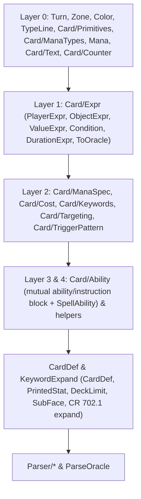

# Card, Expression, and Ability Model (`Mtg.Engine.Card`)

The `Mtg.Engine.Card` precompiled plugin (modules under `Mtg/Engine/Card/` plus shared value modules `Color`, `Mana`, `Turn`, `TypeLine`, and `Zone`) defines the card-agnostic, CR-aligned AST shared by the compositional Oracle parser, the canonical `ToOracle` printer, and the runtime rules engine.

See [`architecture.md`](./architecture.md) for the overall system map, [`oracle-parser.md`](./oracle-parser.md) for how printed Oracle text parses into these types, and [`game-evaluation.md`](./game-evaluation.md) for how `Mtg.Engine.Game` evaluates them.

## Module Stratification

Imports inside `Mtg.Engine.Card` are strictly layered so runtime mana pools (`Mtg/Engine/Mana.lean`) stay independent of the expression and ability ASTs while higher layers compose freely:



- **Layer-0 mana split**: Evaluated runtime mana types ([`ManaTypes.lean`](../Mtg/Engine/Card/ManaTypes.lean)) sit strictly **below** [`Mtg/Engine/Mana.lean`](../Mtg/Engine/Mana.lean), keeping `ManaPool.canPay` / `ManaPool.pay?` pure and acyclic. Symbolic mana production specs ([`ManaSpec.lean`](../Mtg/Engine/Card/ManaSpec.lean)) sit **above** [`Expr.lean`](../Mtg/Engine/Card/Expr.lean).
- **Constructor budget**: Every `inductive` type under `Mtg/Engine/Card/` stays under a `< 40`-constructor budget (well below Lean 4's `LeanMaxCtorTag = 243`), keeping large domains stratified into focused sub-enums in [`Ability.lean`](../Mtg/Engine/Card/Ability.lean) and [`TriggerPattern.lean`](../Mtg/Engine/Card/TriggerPattern.lean).

---

## Layer 0: Shared CR Primitives

- **Turn & Zone primitives**: [`Turn.lean`](../Mtg/Engine/Turn.lean) defines `Step`, `Phase`, `StepOrPhase`, `TurnRef`, `PhaseRef`, and `StepAnchor`; [`Zone.lean`](../Mtg/Engine/Zone.lean) defines player-instantiated `Zone`.
- **Shared CR value enums ([`Primitives.lean`](../Mtg/Engine/Card/Primitives.lean))**:
  - [`ZoneKind`](../Mtg/Engine/Card/Primitives.lean) (owner-parametric counterpart of `Zone`: `.library`, `.hand`, `.battlefield`, `.graveyard`, `.stack`, `.exile`, `.command`, `.ante`, `.outside`) and [`ZoneVerb`](../Mtg/Engine/Card/Primitives.lean) (`.cast`, `.draw`, `.discard`, `.mill`, `.sacrifice`, `.destroy`, `.exile`, `.counter`, `.resolve`, `.put`, `.returnToHand`, `.shuffleIntoLibrary`, `.playLand`).
  - [`LibraryPosition`](../Mtg/Engine/Card/Primitives.lean) (concrete `.top`, `.bottom`, `.fromTop`, `.shuffledIn`), [`PermanentDesignationTag`](../Mtg/Engine/Card/Primitives.lean) / [`PermanentDesignation`](../Mtg/Engine/Card/Primitives.lean) (`.ringBearer`, `.goaded`, `.prepared`, `.harnessed`), and [`PlayerDesignation`](../Mtg/Engine/Card/Primitives.lean) (`.citysBlessing`, `.enduringStory`).
  - [`CostKind`](../Mtg/Engine/Card/Primitives.lean) (cost-payment cause tags), [`ReplacementTier`](../Mtg/Engine/Card/Primitives.lean), [`SetOrAdd`](../Mtg/Engine/Card/Primitives.lean), basic-land helpers [`CardSubtype.basicLandManaColor?`](../Mtg/Engine/Card/Primitives.lean) / [`CardSubtype.isBasicLandType`](../Mtg/Engine/Card/Primitives.lean) (CR 305.6–7), and compositional Layer 4/5 modifiers [`TypeSetMod`](../Mtg/Engine/Card/Primitives.lean) (implementing CR 305.7 / 205.3m land-only subtype replacement in `TypeSetMod.apply`) and [`ColorSetMod`](../Mtg/Engine/Card/Primitives.lean).
- **Functorial Layer 3 text changes**: [`TextChange`](../Mtg/Engine/Card/Primitives.lean) and the [`HasTextChange`](../Mtg/Engine/Card/Primitives.lean) typeclass (`applyTextChanges : Array TextChange → α → α`) thread uniformly through Layer 0 primitives, `ManaTypes`, `ManaSpec`, `Expr`, `Targeting`, `Cost`, `Keywords`, `KeywordExpand`, `TriggerPattern`, every type in the `GrantedAbility`–`StaticAbility` mutual block in [`Ability.lean`](../Mtg/Engine/Card/Ability.lean), and [`SpellAbility`](../Mtg/Engine/Card/Ability.lean).
- **Counters ([`Counter.lean`](../Mtg/Engine/Card/Counter.lean))**: [`CounterKind`](../Mtg/Engine/Card/Counter.lean) (covering all CR 122.1b keyword counters alongside `+1/+1`, `-1/-1`, loyalty, lore, stun, shield, time, defense, peace, promotion, etc.) and [`CounterBag`](../Mtg/Engine/Card/Counter.lean) (`Array (CounterKind × Nat)`).
- **Evaluated mana types ([`ManaTypes.lean`](../Mtg/Engine/Card/ManaTypes.lean))**: [`ManaType`](../Mtg/Engine/Card/ManaTypes.lean), [`ManaOutput`](../Mtg/Engine/Card/ManaTypes.lean), [`SpellRiderSpec`](../Mtg/Engine/Card/ManaTypes.lean) (`.cantBeCountered`, `.gainsHaste`, `.entersWithPlusOneCounters`), [`ManaObjectPred`](../Mtg/Engine/Card/ManaTypes.lean), [`ManaAbilityPred`](../Mtg/Engine/Card/ManaTypes.lean), [`ManaSpend`](../Mtg/Engine/Card/ManaTypes.lean), and [`ManaSpendRestriction`](../Mtg/Engine/Card/ManaTypes.lean) (`onlyForSpells`, `onlyForAbilities`, `onlyForSpellsOrAbilities`, `cantSpendOnSpells`, `notFromZone`), stored directly on [`ManaUnit`](../Mtg/Engine/Mana.lean) (`restriction` and `riders`).

---

## Layer 1: Pure Expression Algebra (`Card/Expr.lean`)

[`Expr.lean`](../Mtg/Engine/Card/Expr.lean) defines a pure, side-effect-free query language shared across targeting, costs, static abilities, trigger patterns, conditions, and one-shot instructions.

- **Lexical slots & scalar operators**: [`VarId`](../Mtg/Engine/Card/Expr.lean) identifies an earlier bound step's post-replacement outcome (CR 608.2c / 614.6); `CmpOp` (`eq`, `ne`, `lt`, `le`, `gt`, `ge`), `ArithOp` (`add`, `sub`, `mul`, `divFloor`, `max`, `min`), and `AggOp` (`count`, `sum`, `max`, `min`, `countDistinct`) compose numeric queries.
- **Mutual expression core (`PlayerFilter`–`ValueExpr` in [`Expr.lean`](../Mtg/Engine/Card/Expr.lean))** with single-tuple `BEq`/`Repr` projections derived from `PlayerFilter`:
  - **[`PlayerFilter`](../Mtg/Engine/Card/Expr.lean), [`PlayerPred`](../Mtg/Engine/Card/Expr.lean), & [`PlayerExpr`](../Mtg/Engine/Card/Expr.lean)**: `.you`, `.activePlayer`, `.defendingPlayer`, `.monarch` (CR 726), `.target`, `.controllerOf`, `.ownerOf`, `.triggerPlayer` (roles including `giftOpponent`), `.stepPlayers`, `.matching` (relation × `PlayerPred`, including `.isSeat` for expanded `forEach?` slots, `.thatPlayer` for anaphoric references, and `.matchesExpr`), and `.chosenBy`.
  - **[`ObjectPred`](../Mtg/Engine/Card/Expr.lean), [`ObjectFilter`](../Mtg/Engine/Card/Expr.lean), & [`ObjectExpr`](../Mtg/Engine/Card/Expr.lean)**:
    - *Characteristics (CR 109.3 / 613)*: `.all`, `.any`, `.not`, `.hasType`, `.hasSupertype`, `.hasSubtype` (literal, `.chosenOnSource`, `.fromStep`), `.hasColor` (literal, `.chosenOnSource`, `.commanderIdentity`), `.colorCount`, `.named`, `.hasKeyword` ([`KeywordTag`](../Mtg/Engine/Card/Expr.lean) with parameterized keywords grouped under [`ParamKeywordTag`](../Mtg/Engine/Card/Expr.lean)), `.stat`, `.statParity`.
    - *Status & identity*: `.isToken`, `.isFaceDown`, `.isCopy`, `.isCommander`, `.isKind` ([`ObjectCategory`](../Mtg/Engine/Card/Expr.lean): `.card` CR 108.2/111.6, `.permanentCard` CR 110.4a/111.6, `.spell` CR 112.1), `.tapped`, `.phasedOut`, `.combatRole`, `.hasDesignation`, `.counterCount`, `.chosenAnchorIs`.
    - *Relations & event/cast history*: `.sameAs`, `.otherThan`, `.controlledBy`, `.ownedBy`, `.attachedTo`, `.hasAttachment`, `.targets`, `.shares`, `.wasCast`, `.castFrom`, `.enteredThisTurn`, `.attackedThisTurn`, `.dealtDamageThisTurn` (with `thisTurnOnly` and [`RecipientFilter`](../Mtg/Engine/Card/Expr.lean)), `.wasDealtDamageThisTurn`, `.receivedCounterThisTurn`, `.putIntoGraveyardFromBattlefieldThisTurn`.
    - *`ObjectExpr` sets*: `.this`, `.target`, `.allTargets`, `.attachedHost`, `.triggerSubject`, `.targetsOf`, `.stepObjects`, `.linkedExile`, `.costPaidObjects`, `.inZones`, `.topOfLibrary`, `.extremum`, `.filter`, `.union`, `.diff`.
  - **[`ValueExpr`](../Mtg/Engine/Card/Expr.lean)**: `.const`, `.chosenX`, `.eventAmount`, `.objectStat`, `.counterCount`, `.aggregate` (incl. `countDistinct`), `.basicLandTypeCount` (Domain), `.cardTypeCount` (Delirium), `.subtypeCount`, `.colorCountAmong`, `.playerMetric` ([`PlayerMetric`](../Mtg/Engine/Card/Expr.lean)), `.maxControlled`, `.manaSymbols`, `.manaSpent`, `.stepMetric` (`movedCount`, `createdCount`, `damageDealt`, `excessDamage`, `lifeChanged`, `countersChanged`, `sumPower`, `chosenNumber`), `.chosenNumberOnSource`, `.binary`.
- **Symbolic library positions, conditions, and durations**:
  - [`LibraryPosSpec`](../Mtg/Engine/Card/Expr.lean) (`.top`, `.bottom`, `.bottomRandom`, `.fromTop ValueExpr`, `.shuffledIn`).
  - [`Condition`](../Mtg/Engine/Card/Expr.lean) (`.cmp`, `.exists`, `.forAll`, `.allShare`, `.playerPred`, `.castPred` over [`CastContextPred`](../Mtg/Engine/Card/Expr.lean), `.turnHistory` over [`EventHistoryPred`](../Mtg/Engine/Card/Expr.lean) + [`EventPattern`](../Mtg/Engine/Card/Expr.lean), `.stepSucceeded`, `.duringStep`, `.duringPhase`, `.isYourTurn`, `.isNight`, `.all`, `.any`, `.not`).
  - [`DurationExpr`](../Mtg/Engine/Card/Expr.lean) (1-to-1 with runtime [`EffectDuration`](../Mtg/Engine/Game/Event.lean): `.untilEndOfTurn`, `.untilEndOfCombat`, `.untilEndOfStepOrPhase`, `.untilStepOrPhase`, `.untilNextTurnOf`, `.untilEndOfNextTurnOf`, `.whileOnBattlefield`, `.untilLeavesBattlefield`, `.whileHasCounter`, `.whileInZone`, `.whileTapped`, `.indefinite`).
- **Canonical printing**: [`PrintCtx`](../Mtg/Engine/Card/Expr.lean) and [`ToOracle`](../Mtg/Engine/Card/Expr.lean) provide context-aware Oracle rendering across every AST layer.

---

## Layer 2: Targeting, Costs, Mana, and Tokens

### Targeting (`Card/Targeting.lean`)

Every instance of the word `"target"` in Oracle text corresponds to one [`TargetSlot`](../Mtg/Engine/Card/Targeting.lean) (CR 115.1):

```lean
inductive DivisionKind where
  | damage | counters (kind : CounterKind)

inductive GroupTargetConstraint where
  | totalManaValueAtMost (cap : ValueExpr)
  | shareCharacteristic (char : SharedCharacteristic)
  | distinctControllers | distinctNames | distinctCardTypes

inductive TargetDomain where
  | object (zones : ZoneSetSpec) (pred : ObjectPred)
  | player (filter : PlayerFilter)
  | anyTarget (pred : RecipientPred := .any) -- CR 115.4
  | stackAbility (controller : PlayerFilter := .you) (sourcePred : ObjectPred := .anyObject) -- CR 115.5
  | anyOf (domains : Array TargetDomain)

structure TargetSlot where
  domain : TargetDomain
  count : CountRange := .exact 1
  division? : Option (DivisionKind × ValueExpr) := none        -- CR 601.2d
  groupConstraint? : Option GroupTargetConstraint := none      -- CR 115.3 / 601.2c / 608.2b
  forEach? : Option PlayerFilter := none                       -- per-seat expansion
  altDomainIf? : Option (Condition × TargetDomain) := none     -- e.g. Teamwork / Kicker override

structure TargetSpec where
  slots : Array TargetSlot := #[]
  crossSlotConstraints : Array CrossSlotConstraint := #[]      -- .distinct or .group across slots
```

Oracle wording renders canonically via [`TargetSlot.renderOracle`](../Mtg/Engine/Card/Targeting.lean), `ToOracle TargetSpec`, and [`TargetSpec.announcedPosNoun`](../Mtg/Engine/Card/Targeting.lean) (zero stored noun strings).

### Costs (`Card/Cost.lean`)

[`CostSpec`](../Mtg/Engine/Card/Cost.lean) (`items : Array CostItem`, `bindVar? : Option VarId`) unifies activation, ward, additional, alternative, and resolution-time optional/`unlessPays` costs (CR 118). Its [`CostItem`](../Mtg/Engine/Card/Cost.lean) syntax maps onto [`CostKind`](../Mtg/Engine/Card/Primitives.lean) event-cause tags via [`CostItem.costKind?`](../Mtg/Engine/Card/Cost.lean):

| `CostItem` Constructor | `CostKind` Emission | Notes |
| :--- | :--- | :--- |
| `.mana ManaCost` | `.mana` | Standard mana cost |
| `.loyalty LoyaltySymbol` | `.loyalty` | [`LoyaltySymbol`](../Mtg/Engine/Card/Cost.lean); [`CostSpec.netLoyaltyDelta`](../Mtg/Engine/Card/Cost.lean) combines multi-loyalty costs per CR 606.5 |
| `.tapSelf` / `.untapSelf` | `.tap` / `.untap` | CR 701.26 |
| `.tapObjects count filter` | `.tap` | Covers `.count`, `.anyNumber`, `.totalPowerAtLeast` (Crew CR 702.122, Teamwork CR 702.194) |
| `.payLife ValueExpr` | `.life` | CR 119.4 |
| `.sacrifice count what` | `.sacrifice` | CR 701.21 (`SelfOrFilter`) |
| `.discard count what` | `.discard` | CR 701.9 (`DiscardCostTarget`: `.self`, `.hand`, `.random`, `.matching`) |
| `.exile count zones what isCollectEvidence` | `.collectEvidence` / `.exile` | Supports `totalManaValueAtLeast` (CR 701.59) and `totalManaSymbolsAtLeast` |
| `.removeCounters count kind? fromObj` | `.removeCounters` | Any or specific `CounterKind` |
| `.putCounters count kind target` | `.putCounters` | `CounterCostTarget` (`.self`, `.filter`, `.payer`) |
| `.returnToHand count what` | `.returnToHand` | Returns to owner's hand (e.g. Sneak CR 702.190a, Beam me up CR 702.196a) |
| `.putOnLibrary count zones what pos` | `.putOnLibrary` | Puts a card/permanent on library (e.g. bottom of owner's library) |
| `.behold CardSubtype` | `.behold` | CR 701.4 |
| `.waterbend ValueExpr` | `.waterbend` | CR 701.67 |
| `.or choices` | *(chosen branch)* | CR 118.8 / 601.2b disjunctive cost choice (`costKind? = none`) |

Keyword-specific `CostKind` tags (`convoke`, `ward`, `teamwork`, `cycle`) are emitted by their respective keyword payment pipelines, while additional tags (`delve`, `emerge`, `casualty`, `bargain`) are reserved in `Primitives.lean`. [`AdditionalCostSpec`](../Mtg/Engine/Card/Cost.lean) and [`AlternativeCostSpec`](../Mtg/Engine/Card/Cost.lean) wrap `CostSpec` for spell casting and keyword expansion.

### Symbolic Mana Production (`Card/ManaSpec.lean`)

[`ManaSpec.lean`](../Mtg/Engine/Card/ManaSpec.lean) models printed mana-producing abilities above `Expr.lean`:

- [`ManaPoolPalette`](../Mtg/Engine/Card/ManaSpec.lean): `.explicit`, `.anyColor`, `.chosenColorOnSource`, `.commanderColorIdentity`, `.colorsAmong`, `.typesLandsCouldProduce` (CR 106.7).
- [`ManaSpec`](../Mtg/Engine/Card/ManaSpec.lean): `.sequence`, `.oneOf`, `.combination`, `.colorAmong (palette) (includeColorless : Bool := false)` (distinguishing *"any color"* from *"any type"*).
- [`ManaProductionSpec`](../Mtg/Engine/Card/ManaSpec.lean) bundles `spec`, `restriction : Option ManaSpendRestriction`, `riders : Array SpellRiderSpec`, `damageYou`, `chooseColorPrefix`, and `filterPairFormat`, with canonical Oracle printing in [`toOracleSentence`](../Mtg/Engine/Card/ManaSpec.lean).

### Tokens (`Card/Ability.lean` & `Card/Token.lean`)

[`TokenSpec`](../Mtg/Engine/Card/Ability.lean) unifies all token creation across spells, activated abilities, triggered abilities, and Saga chapters (with helper constructors and `ToOracle` in [`Token.lean`](../Mtg/Engine/Card/Token.lean)):

- `.predefined` [`PredefinedToken`](../Mtg/Engine/Card/Ability.lean): CR 111.10a–x predefined tokens (`.treasure`, `.food`, `.clue`, `.incubator` with back face *"Phyrexian Token"*, `.map`, `.junk`, `.lander`, `.mutagen`, `.vibranium`, `.heartwood`).
- `.custom` [`CustomTokenSpec`](../Mtg/Engine/Card/Ability.lean): dynamic `ValueExpr` power/toughness, `Array KeywordAbility`, `Array GrantedAbility`, and `useCardNameShorthand` for CR 111.11 card-named tokens.
- `.copyOf (ref : ObjectExpr) (mods : Array CopyModification)`: [`CopyModification`](../Mtg/Engine/Card/Ability.lean) covers CR 707.9 overrides (including P/T override stripping P/T-setting CDAs per CR 707.9d, added supertypes/types/subtypes/colors/keywords/abilities, creature-subtype replacement, and removed supertypes).

---

## Layer 3: Unified One-Shot `Instruction` AST & `Effect`

[`Instruction`](../Mtg/Engine/Card/Ability.lean) pairs action wrappers aligned with the [`RulesEvent`](../Mtg/Engine/Game/Event.lean) families with compositional control-flow combinators:

| `RulesEvent` Family | `Instruction` Constructor & Sub-Family | Coverage |
| :--- | :--- | :--- |
| `ZoneEvent.moved` | `.moveZone objs dest verb mods` | Destroy, exile (incl. CR 610.3 `.exileUntilLeaves`), sacrifice, bounce, reanimate, put onto battlefield (tapped/attacking/attached/with counters), library placement, discard, mill. |
| `ZoneEvent.created` | `.create op` (`CreateOp`: `.tokens`, `.emblem`) | Token batches and command-zone emblems (`ZoneEvent.ceasedToExist` is SBA-only, CR 704.5d–e). |
| `PermanentEvent` | `.permanent op` (`PermanentOp`: `.setTapped`, `.modifyCounters`, `.attach`, `.transform`, `.turnFaceUp`, `.phaseOut`, `.setDesignation`, `.assimilate`) | Tap/untap, counter modification (incl. `copyMissingKeywords`, `distribute`, `putAnotherOfChosen`), attachment, transform, face-up, phase out, designations, and Assimilate (CR 701.72). |
| `DamageEvent` | `.damage op` (`DamageOp`: `.deal`, `.fight`) | Targeted, mass, divided, excess-tracked, and scaled damage; two-way fight and one-way bite. |
| `LifeEvent` | `.life op` (`LifeOp`: `.gain`, `.lose`, `.set`) | Life gain, life loss, drain, and life-total setting. |
| `PlayerEvent` | `.player op` ([`PlayerOp`](../Mtg/Engine/Card/Ability.lean): `.drawCards`, `.scry`, `.surveil`, `.inspectLibrary`, `.searchLibrary`, `.reveal`, `.shuffle`, `.addMana`, `.proliferate`, `.temptWithRing`, `.explore`, `.amass`, `.connive`, `.empowerPlaneswalker`, `.discover`, `.setStatus`, `.choose`) | Declarative library inspection/partitioning, tutors, mana production, keyword actions (CR 701.44 Explore, 701.34 Proliferate, 701.57 Discover, etc.), Monarch (CR 726), and win/lose-game (CR 104.2). |
| `TurnEvent` | `.turn op` (`TurnOp`: `.extraTurn`, `.extraPhase`, `.extraStep`) | Extra turns, extra combat phases, extra steps. |
| `StackObjectEvent` / `CastEvent` | `.stack op` (`StackOp`: `.counterStack`, `.copyStackObject`, `.chooseNewTargets`, `.mayCastOrPlay`) | Counterspells (incl. exile/free-cast follow-ups), stack copies, retargeting, and mid-resolution/impulse casts (`GrantPlayPermSpec`). |
| `ContinuousEffectEvent` / `DelayedTriggerEvent` | `.installEffect op` (`InstallEffectOp`: `.applyContinuous`, `.applyRule`, `.applyReplacement`, `.createDelayedTrigger`) | Timed/indefinite continuous effects, player/game rules (incl. turn control CR 724), temporary replacements/preventions, and delayed triggers (CR 603.7). |
| `TriggerQueueEvent` | `.queueReflexiveTrigger whenDone` | `"When you do"` reflexive triggers (CR 603.12). |
| **Combinators** | `.noop`, `.seq`, `.bind var step cont`, `.ifCond`, `.optional who cost? onYes onNo maxTimes`, `.unlessPays`, `.chooseModes spec`, `.forEach iter var body` | Sequencing, CR 608.2c/614.6 lexical binding over post-replacement `RulesEvent` slices, branching, CR 118.12/118.12a resolution-time costs, unified [`ModalSpec`](../Mtg/Engine/Card/Ability.lean) modes (incl. `altCountIf?` and `unusedEver`), and APNAP iteration. |

*(Turn-based `CombatEvent` has no standalone `Instruction` wrapper; one-shot `"put onto the battlefield attacking"` lives on `MoveMods` and fight/bite lives on `DamageOp.fight`.)*

[`Effect`](../Mtg/Engine/Card/Ability.lean) pairs `targets : TargetSpec` with `body : Instruction`. All derived queries in [`Effect.lean`](../Mtg/Engine/Card/Effect.lean) are computed purely from those fields:
- [`Effect.targetPreference`](../Mtg/Engine/Card/Effect.lean) & [`Effect.isPreferredDefaultMode`](../Mtg/Engine/Card/Effect.lean)
- [`Effect.classifyForAgent`](../Mtg/Engine/Card/Effect.lean) (`SpellCastKind` in [`SpellResolution.lean`](../Mtg/Engine/Card/SpellResolution.lean)) & [`Effect.classifyAbilityForAgent`](../Mtg/Engine/Card/Effect.lean)
- [`Effect.doesNothingAsTrigger`](../Mtg/Engine/Card/Effect.lean), [`Effect.usesCostPaidObjects`](../Mtg/Engine/Card/Effect.lean), and canonical [`Effect.toOracle`](../Mtg/Engine/Card/Effect.lean)

---

## Layer 4: CR 113.3 Four-Category Abilities, Keywords, and `CardDef`

To support granted abilities (`"Creatures you control have '{T}: ...'"`), token abilities, emblems, and reflexive triggers without well-founded recursion blowup, [`Ability.lean`](../Mtg/Engine/Card/Ability.lean) groups its mutually recursive ability and instruction types (`GrantedAbility`, `CustomTokenSpec`, `CopyModification`, `TokenSpec`, `StaticReplacementSpec`, `EmblemSpec`, `CreateOp`, `DelayedTriggerSpec`, `ModalSpec`, `InstallEffectOp`, `Instruction`, `Effect`, `ActivatedAbility`, `TriggeredAbility`, `ContinuousModification`, `StaticAbility`) into one `mutual` block with single-tuple `BEq`/`Repr` projections derived from `GrantedAbility` and mutual `HasTextChange` instances (`applyTcGranted`–`applyTcStatic`).

### 1. `SpellAbility` (CR 113.3a)

[`SpellAbility`](../Mtg/Engine/Card/Ability.lean) combines the resolving `effect` with spell-level `additionalCosts`:

```lean
structure SpellAbility where
  effect : Effect := {}
  additionalCosts : Array AdditionalCostSpec := #[]
deriving Repr, Inhabited, BEq
```

Spell-casting restrictions and cost modifiers live canonically on `StaticAbility` (`.ruleModifying` / `.costModifier`, CR 113.3d / 604.2), while keyword alternative costs expand through `KeywordAbility.expand`.

### 2. `ActivatedAbility` (CR 113.3b / 602 / 605.1a / 606.2–6)

[`ActivatedAbility`](../Mtg/Engine/Card/Ability.lean) unifies stack activated abilities, CR 605.1a mana abilities (`PlayerOp.addMana` inside `effect.body`), CR 606.2 loyalty abilities, and CR 305.6 intrinsic basic-land mana abilities with fields `cost`, `effect`, `timing` ([`ActivationTiming`](../Mtg/Engine/Card/Ability.lean)), `activeZones`, `turnLimit?`, `lifetimeLimit?`, `condition?`, `costReductions` ([`ActivationCostReduction`](../Mtg/Engine/Card/Ability.lean)), and `tag?` ([`ActivationMechanicTag`](../Mtg/Engine/Card/Ability.lean)).

Key predicates and helpers in [`ActivatedAbility.lean`](../Mtg/Engine/Card/ActivatedAbility.lean):
- [`isLoyaltyAbility`](../Mtg/Engine/Card/ActivatedAbility.lean): detects CR 606.2 loyalty symbols in `cost`.
- [`isCycling`](../Mtg/Engine/Card/ActivatedAbility.lean): identifies cycling/typecycling abilities expanded from `KeywordAbility.cycling`.
- [`isManaAbility`](../Mtg/Engine/Card/ActivatedAbility.lean): enforces all **four CR 605.1a criteria** across every mode of `effect` (not a loyalty ability, no targets, could add mana, and neither cost nor effect moves cards to/from a library).
- [`intrinsicBasicLandMana`](../Mtg/Engine/Card/ActivatedAbility.lean): synthesizes `{T}: Add {M}` for CR 305.6 basic land subtypes.
- [`toOracle`](../Mtg/Engine/Card/ActivatedAbility.lean): canonical Oracle rendering.

### 3. `TriggeredAbility` & `TriggerPattern` (CR 113.3c / 603 / 605.1b / 715)

[`TriggeredAbility`](../Mtg/Engine/Card/Ability.lean) combines `word`, `pattern`, `grouping`, `interveningIf? : Option Condition` (CR 603.4), `activeZones`, `limit`, and `effect : Effect` (carrying modal branches inside `Instruction.chooseModes`, accessed via [`TriggeredAbility.modalSpec?`](../Mtg/Engine/Card/Trigger.lean) / [`modeEffects`](../Mtg/Engine/Card/Trigger.lean)).

[`TriggerPattern.lean`](../Mtg/Engine/Card/TriggerPattern.lean) defines:
- [`TriggerPattern`](../Mtg/Engine/Card/TriggerPattern.lean) aligned with `RulesEvent`, plus [`BatchGrouping`](../Mtg/Engine/Card/TriggerPattern.lean) (`.perOccurrence` CR 603.2c, `.oncePerBatch` / `.perPlayerInBatch` / `.perSourceInBatch` CR 700.1, and `.counterThreshold` for CR 715.2b Saga chapters), [`TriggerLimit`](../Mtg/Engine/Card/TriggerPattern.lean), and [`PlayerActionTrigger`](../Mtg/Engine/Card/TriggerPattern.lean).
- [`usesLookBack`](../Mtg/Engine/Card/TriggerPattern.lean): structural CR 603.10a–f look-back predicate.
- [`flattenDisjuncts`](../Mtg/Engine/Card/TriggerPattern.lean): distributes outer CR 603.2 `.whenCond` clauses across `.or` disjuncts so each disjunct independently chooses `pre` vs. `post`.
- [`TriggeredAbility.isManaAbility`](../Mtg/Engine/Card/Trigger.lean) (CR 605.1b) and [`TriggeredAbility.chapterNumbers?`](../Mtg/Engine/Card/Trigger.lean) (CR 715.2b/d).

### 4. Stratified `StaticAbility` (CR 113.3d / 604 / 613 / 614–616)

[`StaticAbility`](../Mtg/Engine/Card/Ability.lean) stratifies static abilities by CR domain, backed by domain-scoped supporting enums:

```lean
inductive StaticAbility where
  | characteristicDefining (cda : CdaSpec)
  | continuous (cond? : Option Condition) (scope : ObjectFilter) (mod : ContinuousModification)
  | ruleModifying (cond? : Option Condition) (rule : RuleModification)
  | costModifier (cond? : Option Condition) (appliesTo : CostTargetSpec) (mod : CostModification)
  | replacement (cond? : Option Condition) (spec : StaticReplacementSpec)
  | enchantRestriction (filter : TargetSlot)
```

Supporting types in [`Ability.lean`](../Mtg/Engine/Card/Ability.lean) include `CdaSpec`, [`ContinuousModification`](../Mtg/Engine/Card/Ability.lean), `RuleModification` (over `StaticPlayerRule`, `StaticPlayRule`, `StaticCombatRule`, `StaticTriggerRule`, and `StaticGameRule`), `CostTargetSpec` / `CostModification`, and [`StaticReplacementSpec`](../Mtg/Engine/Card/Ability.lean), with smart constructors and canonical `ToOracle` in [`StaticAbility.lean`](../Mtg/Engine/Card/StaticAbility.lean).

### 5. Parameterized `KeywordAbility` & Pure Expansion (CR 702)

[`Keywords.lean`](../Mtg/Engine/Card/Keywords.lean) models CR 702 keywords as `Array KeywordAbility` (preserving multiplicity for cumulative keywords like Sunburst, Prowess, Cascade, Exalted, Ward, Toxic, and Affinity):
- [`SimpleKeyword`](../Mtg/Engine/Card/Keywords.lean) (unit keyword constructors, including `station` CR 702.184 and `sunburst` CR 702.44) and [`KeywordAbility`](../Mtg/Engine/Card/Keywords.lean) (`.simple` plus parameterized constructors: `hexproof`, `ward`, `protection`, `landwalk`, `toxic`, `affinity`, `equip`, `cycling`, `kicker`, `gift`, `flashback`, `morph`, `impending`, `sneak`, `crew`, `teamwork`, `beamMeUp` CR 702.196).
- [`CounterKind.grantedKeyword?`](../Mtg/Engine/Card/Keywords.lean) maps all CR 122.1b keyword counters to their corresponding `KeywordAbility`.
- Pure [`KeywordAbility.expand`](../Mtg/Engine/Card/KeywordExpand.lean) (CR 702.1) lowers any keyword directly into [`ExpandedKeyword`](../Mtg/Engine/Card/KeywordExpand.lean): `activatedAbilities`, `triggeredAbilities`, `staticAbilities`, `specialActions` ([`SpecialActionSpec`](../Mtg/Engine/Card/KeywordExpand.lean) for CR 116.2b Morph), `additionalCosts`, `alternativeCosts`, and `spellInstructions`.

### 6. `CardDef`, `PrintedStat`, `DeckLimit`, and `SubFace`

[`CardDef.lean`](../Mtg/Engine/Card/CardDef.lean) defines the printed card representation from CR 201–212 printed characteristics, `keywords` (CR 702), the four CR 113.3a–d ability containers, and token/face/deck-limit fields:

```lean
inductive PrintedStat where
  | fixed (n : Int)
  | star (addend : Int := 0) -- CR 208.1 / 208.2a

inductive DeckLimit where
  | unlimited
  | maxCopies (n : Nat)      -- CR 100.2a

inductive SubFaceKind where
  | adventure                -- CR 716
  | prepare                  -- CR 723 prepare spell sub-face

structure SubFace where
  kind : SubFaceKind
  name : String
  manaCost : ManaCost := ManaCost.empty
  colorIndicator : Option ColorSet := none
  supertypes : Array Supertype := #[]
  types : Array CardType := #[.sorcery]
  subtypes : Array Subtype := #[]
  keywords : Array KeywordAbility := #[]
  spellAbility : Option SpellAbility := none
  staticAbilities : Array StaticAbility := #[]

structure CardDef where
  name : String
  manaCost : ManaCost := ManaCost.empty
  colorIndicator : Option ColorSet := none
  supertypes : Array Supertype := #[]
  types : Array CardType := #[]
  subtypes : Array Subtype := #[]
  isToken : Bool := false
  power : Option PrintedStat := none
  toughness : Option PrintedStat := none
  loyalty : Option Int := none
  defense : Option Nat := none
  handModifier : Option Int := none
  lifeModifier : Option Int := none
  keywords : Array KeywordAbility := #[]
  spellAbility : Option SpellAbility := none
  activatedAbilities : Array ActivatedAbility := #[]
  triggeredAbilities : Array TriggeredAbility := #[]
  staticAbilities : Array StaticAbility := #[]
  otherFace : Option CardDef := none
  subFaces : Array SubFace := #[]
  deckLimitOverride : Option DeckLimit := none
```

[`CardDef.faceModellingError?`](../Mtg/Engine/Card/CardDef.lean) validates parsed card faces (including triggered-ability active zones, modal arity, and non-trivial trigger effects via `Effect.doesNothingAsTrigger`), [`CardDef.allActivatedAbilities`](../Mtg/Engine/Card/CardDef.lean) combines printed and keyword-expanded activated abilities (such as `Equip` and `Cycling`), and [`beqCardDef`](../Mtg/Engine/Card/CardDef.lean) provides structural `BEq CardDef`.
