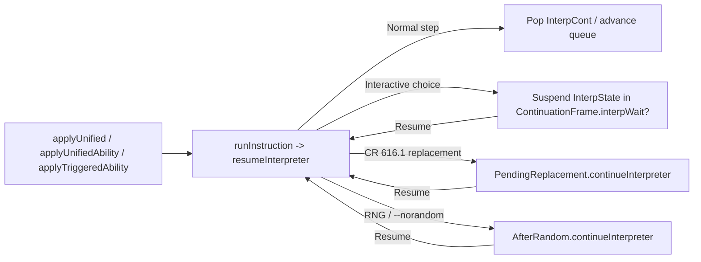

# Runtime Evaluation, Layers, Triggers, and `Instruction` Interpreter (`Mtg.Engine.Game`)

`Mtg.Engine.Game` (54 modules under `Mtg/Engine/Game/`, compiled as a precompiled Lake plugin at `-O0`) executes the card-agnostic ASTs from `Mtg.Engine.Card` against live game state, last-known-information snapshots, and the append-only `RulesEvent` log.

See [`architecture.md`](./architecture.md) for the overall system map, [`card-and-ability-model.md`](./card-and-ability-model.md) for the AST definitions, and [`oracle-parser.md`](./oracle-parser.md) for how printed Oracle text parses into them.

## Pure Expression Evaluation (`Game/EvalExpr.lean`)

[`EvalExpr.lean`](../Mtg/Engine/Game/EvalExpr.lean) evaluates Layer 1 expressions (`PlayerFilter`/`PlayerExpr`, `ObjectPred`/`ObjectFilter`/`ObjectExpr`, `ValueExpr`, `Condition`, `DurationExpr`, `LibraryPosSpec`) and Layer 2 mana/activation queries without mutating `Game`.

- **Live + Snapshot Environments**: [`EvalEnvOf`](../Mtg/Engine/Game/Pending.lean#L18-L52) is parameterized over the snapshot type—instantiated as [`EvalEnv := EvalEnvOf GameSnapshot`](../Mtg/Engine/Game/EvalExpr.lean#L24) for live evaluation (including [`ofInterpCtx`](../Mtg/Engine/Game/EvalExpr.lean#L30) inside the interpreter) and as [`StoredEvalEnv := EvalEnvOf Unit`](../Mtg/Engine/Game/Pending.lean#L56) when suspended inside `Pending` continuations.
- **CR 113.7a / 608.2h Live-Before-LKI Resolution**: [`resolveObjectView?`](../Mtg/Engine/Game/EvalExpr.lean#L111) checks live `st.findLiveSourceObject?` first and falls back to `env.lkiOf?` / `lastKnownBefore?` ([`EventObject`](../Mtg/Engine/Game/Object.lean#L456)) only when the object has left `boardState`.
- **CR 208.3 Creature-Only P/T & Exact Keyword Queries**: [`viewStat?`](../Mtg/Engine/Game/EvalExpr.lean#L305) restricts `.power` and `.toughness` strictly to creatures. [`viewHasKeyword`](../Mtg/Engine/Game/EvalExpr.lean#L335-L361) checks `KeywordAbility.hasTag (st.currentKeywords o) kw` directly (so Double Strike does not match `.firstStrike`, CR 702.4b / 702.7b), with fallbacks for dynamic ward costs and `Equip`.
- **CR 506.5 / 509.1h Multi-Combat LKI Reconstruction**: [`lkiCombatWindow`](../Mtg/Engine/Game/Core.lean#L6574) computes `(windowTurn, combatStartIdx, atkEndIdx, blockEndIdx)` with separate exclusive bounds for [`lkiAttackingAlone`](../Mtg/Engine/Game/Core.lean#L6725) (scanning `[combatStartIdx, batchStart)` so simultaneous co-attacker deaths remain in the attacker set) and [`lkiWasBlocked`](../Mtg/Engine/Game/Core.lean#L6790) (stopping at the departure or `removedFromCombat` index and honoring later `removedFromCombat` clears). When `EvalEnvOf.eventIdx?` (populated by [`evalEventPatternOnTurn`](../Mtg/Engine/Game/EvalExpr.lean#L1312)) points to a combat/departure/creation anchor, that index bounds the window directly; otherwise `lkiCombatWindow` falls back to the object's last attacking departure, last combat event, or current combat phase.
- **Player, Cast, Mana, and Activation Evaluators**:
  - [`evalPlayerPred`](../Mtg/Engine/Game/EvalExpr.lean#L508-L559) & [`matchesPlayerFilter`](../Mtg/Engine/Game/EvalExpr.lean#L562-L566) resolve living players, attacker-specific `.isDefendingPlayer` (with 2HG / CR 102.2 / 508.4c / 810.7 guards), concrete per-seat `.isSeat`, and anaphoric `.thatPlayer`.
  - [`evalCastPred`](../Mtg/Engine/Game/EvalExpr.lean#L1262-L1309) inspects `CastEvent` history (CR 400.7d) and consults `st.proposedSpell` for `.wasKicked`, `.giftPromised`, and `.teamworkPaid` so conditional `TargetSlot.altDomainIf?` domains evaluate accurately during CR 601.2c announcement.
  - [`evalManaPalette`](../Mtg/Engine/Game/EvalExpr.lean#L1548) / [`evalManaSpec`](../Mtg/Engine/Game/EvalExpr.lean#L1573) lower symbolic `ManaSpec` to `ManaOutput` (wrapped by [`ManaAbilities.evalManaPalette`](../Mtg/Engine/Game/ManaAbilities.lean#L291) / [`evalManaSpec`](../Mtg/Engine/Game/ManaAbilities.lean#L296) with [`Game.landsCouldProduce`](../Mtg/Engine/Game/ManaAbilities.lean#L286) for CR 106.7).
  - [`evalActivationCondition`](../Mtg/Engine/Game/EvalExpr.lean#L1590) & [`evalActivationCostReductions`](../Mtg/Engine/Game/EvalExpr.lean#L1601) evaluate declarative `ActivatedAbility.condition?` and `costReductions`.

---

## CR 613 Layer System (`Game/Core.lean`)

Continuous characteristic-modifying effects ([`LayerEffect`](../Mtg/Engine/Game/Event.lean#L271-L287) inside [`ContinuousEffectSpec`](../Mtg/Engine/Game/Event.lean#L330)) and stratified `StaticAbility`s evaluate in CR 613 layer order inside [`Core.lean`](../Mtg/Engine/Game/Core.lean):

- **Layer 3 — Text-Changing Effects (CR 612 / 613.1c)**:
  - [`evalLayer3`](../Mtg/Engine/Game/Core.lean#L4975) collects active `TextChange`s in CR 613.7 timestamp and CR 613.8 dependency order; downstream Layer 3 readers apply `HasTextChange.applyTextChanges` functorially across `keywords`, `activatedAbilities`, `triggeredAbilities`, `staticAbilities`, `spellEffect`, and `SpellAbility.additionalCosts`.
  - Spell additional-cost readers across casting, priority, decisions, resolution choices, the interpreter, the agent, and the demo read Layer-3-transformed costs uniformly through [`Core.additionalCostsFor`](../Mtg/Engine/Game/Core.lean#L5050), [`mandatorySacrificeFilterFor?`](../Mtg/Engine/Game/Core.lean#L5066), [`mandatorySacrificeFilterForId?`](../Mtg/Engine/Game/Core.lean#L5075), [`additionalChoiceCostFor?`](../Mtg/Engine/Game/Core.lean#L5085), and [`spellSacrificeCostPredFor?`](../Mtg/Engine/Game/Core.lean#L5096).
- **Layer 4 — Type-Changing Effects & CR 305.6–7 Basic Lands (CR 613.1d)**:
  - [`evalLayer4Full`](../Mtg/Engine/Game/Core.lean#L5147) / [`evalLayer4`](../Mtg/Engine/Game/Core.lean#L5352) evaluates type/subtype/supertype modifications (`TypeSetMod.apply`) in timestamp order and records `Layer4Result.strippedRulesTextByBasicLandSet` whenever a basic-land subtype-setting effect overwrites a land's subtypes (CR 305.7).
- **Layer 6 — Ability Adding/Removing & Dynamic Sagas (CR 613.1f)**:
  - [`evalLayer6`](../Mtg/Engine/Game/Core.lean#L9386) / [`evalLayer6Aux`](../Mtg/Engine/Game/Core.lean#L8890) starts from retained copiable/rules-text abilities (honoring `strippedRulesTextByBasicLandSet`), synthesizes CR 305.6 basic-land mana abilities (`ActivatedAbility.intrinsicBasicLandMana`), expands `keywords` via `KeywordAbility.expand` and all **15** CR 122.1b keyword counters via `CounterKind.grantedKeyword?`, and applies `StaticAbility.continuous` / `LayerEffect.abilities` grants and removals in CR 613.7 timestamp / CR 613.8 dependency order.
  - Dynamic Layer-6 chapter grants and removals drive CR 714.2d / 714.4 Saga behavior via [`Game.finalChapterNumber`](../Mtg/Engine/Game/Core.lean#L10856) and [`Game.sagaChapterPending`](../Mtg/Engine/Game/Core.lean#L13906).
- **Layer 7a–7d — Cycle-Guarded Two-Pass Power/Toughness (CR 613.4)**:
  - [`cdaBasePT`](../Mtg/Engine/Game/Core.lean#L12191) (Layer 7a printed CDAs), [`evalLayer7b`](../Mtg/Engine/Game/Core.lean#L12200) (Layer 7b base-P/T setters and Layer-6-granted P/T CDAs), [`characteristicBasePT`](../Mtg/Engine/Game/Core.lean#L12220), and cycle-guarded [`snapshotPTAux`](../Mtg/Engine/Game/Core.lean#L12165) evaluate Layer 7c continuous P/T bonuses in two passes: **Pass 1** accumulates P/T-independent statics, and **Pass 2** resolves P/T-dependent statics in CR 613.8 dependency + CR 613.7 timestamp order while tracking `visited` object snapshots to prevent cycles.
  - Post-Layer-7 static rule and replacement callers evaluate via [`evalStaticCondFull`](../Mtg/Engine/Game/Core.lean#L12279) and [`matchesStaticScopeFull`](../Mtg/Engine/Game/Core.lean#L12284).
- **ObjectScope Alignment**: Static continuous effects (CR 611.3a) re-evaluate `ObjectFilter` dynamically on each layer pass, whereas resolving timed or `untilSourceLeaves` continuous effects (CR 611.2c, checked via [`EffectDuration.isTimedResolvingDuration`](../Mtg/Engine/Game/Event.lean#L230)) lock characteristic-modifying targets onto [`ObjectScope`](../Mtg/Engine/Game/Event.lean#L237-L246)`.objects` at resolution time.

---

## Targeting Legality & Announcement (`Game/Targeting.lean`, `Game/SpellTargets.lean`, `Game/SpellResolution.lean`)

- **CR 115.5 Stack Self-Exclusion**: [`legalTargetsForDomain`](../Mtg/Engine/Game/Targeting.lean#L126), [`legalTargetsForSlot`](../Mtg/Engine/Game/Targeting.lean#L247), [`legalTargetsForSpec`](../Mtg/Engine/Game/Targeting.lean#L456), [`effectHasEnoughTargets`](../Mtg/Engine/Game/Targeting.lean#L501), and [`targetsAllIllegalForSpec`](../Mtg/Engine/Game/SpellResolution.lean#L17) thread an explicit `stackSelfId : Option ObjectId` separate from `sourceId`, ensuring spells, stack abilities, and copies cannot target themselves (CR 115.5) while preserving `sourceId` for `"another"` and protection (CR 702.16b).
- **Group & Cross-Slot Constraints**: [`satisfiesGroupConstraint`](../Mtg/Engine/Game/Targeting.lean#L267) enforces all five `GroupTargetConstraint`s—including CR 105.2c colorless exclusion for `.shareCharacteristic .color`, CR 201.2a face-down namelessness for `.distinctNames`, and bipartite matching for `.distinctCardTypes`. Backtracking [`findValidAssignment`](../Mtg/Engine/Game/Targeting.lean#L333) and [`findValidTargetsForCount`](../Mtg/Engine/Game/Targeting.lean#L371) power legal announcement checks, single-slot lookahead in [`legalProposedTargets`](../Mtg/Engine/Game/SpellTargets.lean#L398), CR 115.7d [`validTargetArrayForEntry`](../Mtg/Engine/Game/SpellTargets.lean#L627), and CR 608.2b resolution rechecks in [`targetsAllIllegalForSpec`](../Mtg/Engine/Game/SpellResolution.lean#L17).
- **Per-Seat `forEach?` Expansion**: [`expandForEachSpec`](../Mtg/Engine/Game/Targeting.lean#L398) / [`expandEachOpponentEffect`](../Mtg/Engine/Game/Targeting.lean#L491) expand `"for each opponent"` / `"for each player"` slots into concrete per-seat `TargetSlot`s via [`TargetDomain.substituteForEach`](../Mtg/Engine/Card/Targeting.lean#L293) (preserving players present at announcement across mid-stack departures, stored on `ProposedSpell.targetSpecOverride`).

---

## Resumable `Instruction` Interpreter & `stepEnv` (`Game/Interpreter.lean`, `Game/ResolutionChoices.lean`)

All one-shot effects—spells, activated abilities, triggered abilities (via [`TriggeredAbilities.applyTriggeredAbility`](../Mtg/Engine/Game/TriggeredAbilities.lean#L190)), and Saga chapters—execute through one resumable continuation-stack interpreter in [`Interpreter.lean`](../Mtg/Engine/Game/Interpreter.lean):

- **State & Continuation Representation**:
  - [`InterpState`](../Mtg/Engine/Game/Event.lean#L1344-L1348) holds `(ctx : InterpCtx, queue : Array Instruction, stack : Array InterpCont)` with 30-constructor [`InterpCont`](../Mtg/Engine/Game/Event.lean#L1258-L1341).
  - [`ContinuationFrame`](../Mtg/Engine/Game/Event.lean#L1716-L1782) (27 fields) stores [`stepEnv`](../Mtg/Engine/Game/Event.lean#L1778) (`Array (VarId × StepOutcome)`) and suspended [`interpWait?`](../Mtg/Engine/Game/Event.lean#L1781) (`Option InterpState`).
  - Core entry points: [`resumeInterpreter`](../Mtg/Engine/Game/Interpreter.lean#L3240), [`runInstruction`](../Mtg/Engine/Game/Interpreter.lean#L4828), [`applyUnified`](../Mtg/Engine/Game/Interpreter.lean#L4870), and [`applyUnifiedAbility`](../Mtg/Engine/Game/Interpreter.lean#L5030).
  - Pauses on CR 616.1 replacement choices resume via [`PendingReplacement.continueInterpreter`](../Mtg/Engine/Game/Event.lean#L1707); pauses on randomness (`--norandom` or RNG) resume via `AfterRandom.continueInterpreter` ([`Pending.lean#L115`](../Mtg/Engine/Game/Pending.lean#L115)).
- **CR 614.6 Post-Replacement `RulesEvent` Slices (`stepEnv`)**:
  - Before executing `.bind v step cont`, the interpreter records the step's `EffectId` and `startIdx := g.events.size`.
  - When `step` finishes (even across nested `Pending.chooseReplacement` or interactive pauses), the interpreter filters `g.events[startIdx..]` to events whose [`EventCause.oneShotEffectId?`](../Mtg/Engine/Game/Object.lean#L363) (unwrapping `.replaced _ orig`) matches that step's `EffectId`, summarizing post-replacement reality into a 14-field [`StepOutcome`](../Mtg/Engine/Game/Object.lean#L23-L38) stored in `ContinuationFrame.stepEnv`.
  - Cost-paid bindings (`CostSpec.bindVar?`) populate `stepEnv` on optional-cost resume ([`Interpreter.lean#L3325-L3327`](../Mtg/Engine/Game/Interpreter.lean#L3325-L3327)) and activation/spell entry ([`Interpreter.lean#L4992-L5018`](../Mtg/Engine/Game/Interpreter.lean#L4992-L5018)), paired with last-known power recording in [`ActivationCosts.lean#L498-L515`](../Mtg/Engine/Game/ActivationCosts.lean#L498-L515).
- **Interactive Resolution Choices & Edge Rules**:
  - 94-constructor [`ResolutionChoice`](../Mtg/Engine/Game/Pending.lean#L325-L622) models interactive prompts during resolution, answered via 5-constructor [`ChoiceAnswer`](../Mtg/Engine/Game/ResolutionChoices.lean#L17-L23) in [`answerResolutionChoice`](../Mtg/Engine/Game/ResolutionChoices.lean#L245).
  - Token creation evaluates [`resolveTokenPrinted?`](../Mtg/Engine/Game/Tokens.lean#L996) and [`resolveCopyTokenCandidates`](../Mtg/Engine/Game/Tokens.lean#L952), enforcing CR 111.5 / 304.4 / 307.4 (no instant/sorcery tokens), CR 111.12 (nonexistent/LKI copy rules), CR 707.2 / 707.9 tie-choice pausing (`chooseTokenCopyObject`), and CR 506.2 / 506.3b / 508.4 / 805.10a active-team combat guards ([`legalEnteringAttackTargets`](../Mtg/Engine/Game/Core.lean#L11728)).
  - Player departure cleanup (CR 800.4) in [`Leaving.lean`](../Mtg/Engine/Game/Leaving.lean) handles leaving-player decline branches, `.unlessPays` cleanup, and expiring player-control effects ([`expireDepartedControlsPlayers`](../Mtg/Engine/Game/Leaving.lean#L775), CR 723 / 800.4a).

---

## Pattern-Driven Two-Pass Trigger Matching (`Game/Core.lean`, `Game/ResolutionEffects.lean`)

When an atomic action batch finishes, [`Core.closeBatch`](../Mtg/Engine/Game/Core.lean#L15930) invokes [`Core.matchTriggers`](../Mtg/Engine/Game/Core.lean#L15768) with `(pre : GameSnapshot, post : Game)`:

1. **$O(1)$ Batch Pre-Filtering**: [`BatchEventMask`](../Mtg/Engine/Game/Core.lean#L14278) ([`BatchEventMask.ofBatch`](../Mtg/Engine/Game/Core.lean#L14308)) summarizes which event families occurred in the batch so non-matching triggers are skipped without scanning `batch`.
2. **Two-Pass Look-Back Split (CR 603.10a–f)**: Each ability's pattern is flattened into atomic disjuncts via [`TriggerPattern.flattenDisjuncts`](../Mtg/Engine/Card/TriggerPattern.lean#L396-L400) and matched via [`matchesTriggerPattern`](../Mtg/Engine/Game/Event.lean#L3364):
   - **Pass A (look-back)**: Evaluates disjuncts with `pat.usesLookBack == true` against `pre` (`GameSnapshot`).
   - **Pass B (current state)**: Evaluates non-look-back disjuncts against `post` (`Game`).
3. **Batch Grouping & Deduplication**: All 5 `BatchGrouping` modes (`perOccurrence` CR 603.2c, `oncePerBatch` / `perPlayerInBatch` / `perSourceInBatch` CR 700.1, `counterThreshold` CR 714.2b) share a [`TriggerDedupState`](../Mtg/Engine/Game/Core.lean#L15757) across Pass A and Pass B so compound `.or` triggers never double-fire on a single event.
4. **CR 603.2 vs. CR 603.4 Conditions**: Both outer `.whenCond` clauses and `interveningIf?` are checked at trigger time via [`Core.triggerConditionHolds`](../Mtg/Engine/Game/Core.lean#L14264); at resolution time, [`ResolutionEffects.triggerInterveningHolds`](../Mtg/Engine/Game/ResolutionEffects.lean#L1110) rechecks *only* `interveningIf?` via [`Core.evalTriggerCond`](../Mtg/Engine/Game/Core.lean#L12304).

---

## Unified Mana, Cost, Replacement, Renderer & Agent Integration

- **Mana & Activation Pipelines**:
  - [`ManaAbilities.manaAbilityDefs`](../Mtg/Engine/Game/ManaAbilities.lean#L381) and [`manaAbilityDefOfActivated`](../Mtg/Engine/Game/ManaAbilities.lean#L316) read exclusively from Layer-6 `ActivatedAbility`s satisfying `ab.isManaAbility` (CR 605.1a, delegated by [`Timing.isManaActivation`](../Mtg/Engine/Game/Timing.lean#L97)).
  - [`Activation.lean#L131-L144`](../Mtg/Engine/Game/Activation.lean#L131-L144) validates loyalty activations (CR 606.3 once-per-turn and sorcery-speed timing, plus CR 606.6 negative-net counter sufficiency via CR 606.5 `CostSpec.netLoyaltyDelta`), while [`ActivationCosts.payLoyaltyDelta`](../Mtg/Engine/Game/ActivationCosts.lean#L561) pays the combined net loyalty delta as a single counter event (`putCountersDeferredLog` when `k > 0`, `recordRemoveCounters` when `k < 0`, CR 606.4 / 606.5). Per-ability limits (`turnLimit?` / `lifetimeLimit?`) track `(object, abilityIdx)` via `abilityActivationsThisTurn` / `abilityActivationsSinceEntered`.
  - [`Pending.costPicksOf`](../Mtg/Engine/Game/Pending.lean#L269), `Pending.payWard` ([`Pending.lean#L698-L699`](../Mtg/Engine/Game/Pending.lean#L698-L699)), `Casting.lean`, `Decisions.lean`, and `SacrificeDiscard.lean` pay `CostSpec` uniformly across mana, life, counters, sacrifice, discard, exile, tap, behold, and `.or` choices.
- **Total-Cost & Replacement Pipelines**:
  - [`Costs.lean`](../Mtg/Engine/Game/Costs.lean) (`evalSpellCostMods` [`#L92`](../Mtg/Engine/Game/Costs.lean#L92), `applyCastCostReductions` [`#L152`](../Mtg/Engine/Game/Costs.lean#L152), `playManaCost` [`#L175`](../Mtg/Engine/Game/Costs.lean#L175)) computes CR 601.2f total costs from `StaticAbility.costModifier`, active player rules, and Layer 3 additional costs.
  - [`Casting.lean`](../Mtg/Engine/Game/Casting.lean), [`Movement.lean`](../Mtg/Engine/Game/Movement.lean), [`Damage.lean`](../Mtg/Engine/Game/Damage.lean), [`Tokens.lean`](../Mtg/Engine/Game/Tokens.lean), and [`Core.lean`](../Mtg/Engine/Game/Core.lean) evaluate `StaticAbility.replacement` + active `ContinuousEffectSpec.replacement` / prevention effects uniformly.
- **Performance Indexes**: Hot event-log and continuous-effect paths avoid quadratic re-scans of `Game.events` using [`InitialMaterializeIndex`](../Mtg/Engine/Game/Core.lean#L2928) and `Std.HashMap`-backed [`HistGlobalState`](../Mtg/Engine/Game/Core.lean#L9664).
- **Renderer & Heuristic Agent**:
  - [`Mtg/Demo/Render.lean`](../Mtg/Demo/Render.lean) formats cards, stacked abilities (`Effect.toOracle { capitalize := true }`), and multi-slot target prompts ([`announcedPosNoun`](../Mtg/Demo/Render.lean#L655)) directly via `ToOracle`, verified by 534 `#guard`s in [`RenderTests.lean`](../Mtg/Demo/RenderTests.lean).
  - [`Mtg/Demo.lean`](../Mtg/Demo.lean)'s exact mana-payment uniqueness solver evaluates `ManaOutput.allChoices`, `ManaSpendRestriction`, and all 3 `SpellRiderSpec` riders directly.
  - [`Mtg/Engine/Agent.lean`](../Mtg/Engine/Agent.lean) selects constrained multi-target assignments via `findValidTargetsForCount` ([`#L825`](../Mtg/Engine/Agent.lean#L825)), searches cost picks via `costPicksOf` ([`#L252`](../Mtg/Engine/Agent.lean#L252)), classifies spells/abilities purely via `Effect.classifyForAgent` / `classifyAbilityForAgent` / `targetPreference` / `isPreferredDefaultMode`, and inspects Layer 3 additional costs via `Core.additionalChoiceCostFor?` / `spellSacrificeCostPredFor?`.
