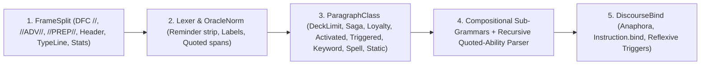

# Compositional Oracle Parser & Canonical `ToOracle` Printer

`Mtg.Engine.Card` parses official *Magic: The Gathering* Oracle card text through a five-stage compositional pipeline under `Mtg/Engine/Card/Parser/` (9 modules, 15,406 lines) and formats any `CardDef` back into canonical Oracle text purely via `ToOracle` instances—with zero stored raw-text strings and 100% structural `BEq CardDef` round-trip verification across all 1,292 catalog cards. Catalog Oracle text follows official Gatherer Oracle text; when Scryfall does not match Gatherer, Gatherer is authoritative.

See [`architecture.md`](./architecture.md) for the overall system map, [`card-and-ability-model.md`](./card-and-ability-model.md) for the AST types produced, and [`game-evaluation.md`](./game-evaluation.md) for how the runtime engine evaluates parsed abilities.

## Five-Stage Pipeline

Instead of template or prototype enumeration, the parser uses **deterministic leading-word/prefix dispatch** over quote-aware normalized clauses. Compositional sub-grammars allow $M$ triggers, $K$ conditions, and $N$ instructions to compose in $O(M + K + N)$ grammar rules, including unseen cross-product combinations outside the 1,292-card catalog.

## Module Map

| Module | Lines | Stage / Responsibility |
| :--- | ---: | :--- |
| [`OracleNorm.lean`](../Mtg/Engine/Card/OracleNorm.lean) | 642 | Linear `Array Char` text normalization (`replaceWord`, reminder-text and `{CHAOS}` stripping, flavor ability-word stripping, self-reference folding). |
| [`Parser/FrameSplit.lean`](../Mtg/Engine/Card/Parser/FrameSplit.lean) | 742 | **Stage 1**: Face splitting (`//`, `//ADV//`, `//PREP//`), name/mana header, `TypeLine`, P/T `PrintedStat`, color indicator, loyalty, defense, Vanguard modifiers, chapter & loyalty headers. |
| [`Parser/Lexer.lean`](../Mtg/Engine/Card/Parser/Lexer.lean) | 541 | **Stage 2**: Mechanic-label extraction (`MechanicLabel`), quote-aware span extraction (`extractQuotedSpans`), and top-level splitting (`splitTopLevelColon`, `splitTopLevelSentences`). |
| [`Parser/ParagraphClass.lean`](../Mtg/Engine/Card/Parser/ParagraphClass.lean) | 304 | **Stage 3**: Top-level [`parseOracleCardCompositional`](../Mtg/Engine/Card/Parser/ParagraphClass.lean#L291) deterministic paragraph classification and face assembly. |
| [`Parser/SubGrammars.lean`](../Mtg/Engine/Card/Parser/SubGrammars.lean) | 5,613 | **Stage 4**: Shared clause parsers for noun phrases, `TargetSpec`, `ValueExpr`, `Condition`, `DurationExpr`, `CostSpec`, `KeywordAbility`, `ManaSpec`/`ManaProductionSpec`, static abilities, and trigger headers. |
| [`Parser/TokenEmblemGrammar.lean`](../Mtg/Engine/Card/Parser/TokenEmblemGrammar.lean) | 844 | **Stage 4**: Compositional parsers for `TokenSpec` (predefined, custom, copy + `CopyModification` + quoted `GrantedAbility`), `EnterMods`, and `EmblemSpec`. |
| [`Parser/InspectSearchGrammar.lean`](../Mtg/Engine/Card/Parser/InspectSearchGrammar.lean) | 1,770 | **Stage 4**: Compositional parsers for `InspectLibrarySpec`, `SearchLibrarySpec`, `GrantPlayPermSpec`, `MoveMods`, and `.targetsOf` / `.filter` object phrases. |
| [`Parser/InstructionGrammar.lean`](../Mtg/Engine/Card/Parser/InstructionGrammar.lean) | 3,824 | **Stage 4**: Verb-dispatched parser for atomic instructions, multi-sentence sequencing, `ModalSpec` headers, conditional branches, optional/reflexive folding, and `StackOp.counterStack` follow-ups. |
| [`Parser/AbilityGrammar.lean`](../Mtg/Engine/Card/Parser/AbilityGrammar.lean) | 922 | **Stage 4**: Recursive quoted `"..."` ability tie-in (`mkQuotedParsers`) and top-level static, activated, triggered, and effect parsers. |
| [`Parser/DiscourseBind.lean`](../Mtg/Engine/Card/Parser/DiscourseBind.lean) | 846 | **Stage 5**: `DiscourseCtx`, anaphora resolution (`"it"`, `"that player"`, `"exiled this way"`, `"where X is"`), automatic `Instruction.bind` wrapping, and `VarId` normalization. |
| [`ParseOracle.lean`](../Mtg/Engine/Card/ParseOracle.lean) | 156 | Public `@[irreducible, noinline]` entry points (`parseOracleCard`, `parseOracleCard!`), `renderFullOracle`, and structural `oracleRoundtripDiff`. |

---

## Stage-by-Stage Architecture

### Stage 1 — Frame Splitting ([`FrameSplit.lean`](../Mtg/Engine/Card/Parser/FrameSplit.lean))

[`splitCardFrame`](../Mtg/Engine/Card/Parser/FrameSplit.lean#L729) divides raw printed text into structured face frames before rules-text parsing:

- **Multi-face markers**: Splits `//` back faces (CR 712) via [`splitBackFace`](../Mtg/Engine/Card/Parser/FrameSplit.lean#L288) and `//ADV//` / `//PREP//` sub-faces (CR 716 Adventure / CR 723 Prepare) via [`splitAdventure`](../Mtg/Engine/Card/Parser/FrameSplit.lean#L310) and [`splitPrepare`](../Mtg/Engine/Card/Parser/FrameSplit.lean#L314).
- **Headers & printed stats**: Parses name + [`parseManaCost`](../Mtg/Engine/Card/Parser/FrameSplit.lean#L63) (`{W}`, `{2/W}`, `{W/U}`, `{X}`, `{C}`), [`parseTypeLine`](../Mtg/Engine/Card/Parser/FrameSplit.lean#L102) (5 supertypes, 15 card types, and 596 `CardSubtype`s via [`TypeLine.lean`](../Mtg/Engine/TypeLine.lean)), [`parseColorIndicator`](../Mtg/Engine/Card/Parser/FrameSplit.lean#L273), `"Token"`, [`parsePT`](../Mtg/Engine/Card/Parser/FrameSplit.lean#L255) (`2/2`, `*/*`, `1+*`, `*+1` into `PrintedStat`), [`parseLoyaltyLabel`](../Mtg/Engine/Card/Parser/FrameSplit.lean#L337), [`parseDefenseLabel`](../Mtg/Engine/Card/Parser/FrameSplit.lean#L388), and Vanguard modifiers ([`parseHandLifeLine`](../Mtg/Engine/Card/Parser/FrameSplit.lean#L173), [`parseBareModifierPair`](../Mtg/Engine/Card/Parser/FrameSplit.lean#L186)).
- **Chapter & loyalty headers**: Recognizes Roman chapter prefixes (`I, II — ...` via [`parseChapterHeader`](../Mtg/Engine/Card/Parser/FrameSplit.lean#L321)) and loyalty activation headers (`[+1]:`, `[0]:`, `[-2]:`, `[-X]:` via [`parseLoyaltyAbilityLine`](../Mtg/Engine/Card/Parser/FrameSplit.lean#L574)).

### Stage 2 — Normalization & Quote-Aware Lexing ([`Lexer.lean`](../Mtg/Engine/Card/Parser/Lexer.lean) & [`OracleNorm.lean`](../Mtg/Engine/Card/OracleNorm.lean))

- **Linear text normalization**: [`OracleNorm.lean`](../Mtg/Engine/Card/OracleNorm.lean) strips balanced reminder text `(...)` (CR 207.2a) and `{CHAOS}` headers (CR 207.4), performs linear `Array Char` word replacement ([`replaceWord`](../Mtg/Engine/Card/OracleNorm.lean#L291-L318)), and folds self-references (`<FullCardName>`, legend short names, `"this <type>"`) outside quoted strings.
- **Mechanic labels vs. flavor ability words**: [`extractLeadingLabel`](../Mtg/Engine/Card/Parser/Lexer.lean#L179) extracts mechanic-carrying labels ([`MechanicLabel`](../Mtg/Engine/Card/Parser/Lexer.lean#L28) — `Power-up —`, `Exhaust —`, `Boast —`, `Eminence —`, `Infinity —`, modal anchors, etc.) *before* stripping flavor-only CR 207.2c ability words (such as `Landfall —`).
- **Quote-aware delimiters**: [`extractQuotedSpans`](../Mtg/Engine/Card/Parser/Lexer.lean#L311), [`splitTopLevelColon`](../Mtg/Engine/Card/Parser/Lexer.lean#L223), and [`splitTopLevelSentences`](../Mtg/Engine/Card/Parser/Lexer.lean#L243) ignore `:` and `.` inside `"..."` spans so granted abilities (`Other artifacts you control have "{T}: Add {C}."`, planeswalker emblem text, and token abilities) stay intact for recursive Stage 3–5 parsing.

### Stage 3 — Paragraph Classification ([`ParagraphClass.lean`](../Mtg/Engine/Card/Parser/ParagraphClass.lean))

[`parseOracleCardCompositional`](../Mtg/Engine/Card/Parser/ParagraphClass.lean#L291) dispatches each rules paragraph deterministically in order:

1. **Deck-limit rules** (`"A deck can have any number / up to N cards named ..."` → `CardDef.deckLimitOverride : Option DeckLimit`).
2. **Saga chapters** (`I, II — <effect>` → `TriggeredAbility` with `BatchGrouping.counterThreshold .lore`).
3. **Loyalty abilities** (`[+N]:` / `[0]:` / `[-N]:` / `[-X]:` → `ActivatedAbility` with `CostItem.loyalty`).
4. **Activated abilities** (unquoted top-level `:` → `parseActivatedAbilityComp`, including all `{T}: Add ...` mana abilities; redundant basic-land reminder lines like `({T}: Add {R}.)` are omitted because CR 305.6 synthesizes them from Layer 4 basic land subtypes).
5. **Triggered abilities** (leading `When` / `Whenever` / `At`, or `If <cond>, when/whenever ...` → `parseTriggeredAbilityComp`).
6. **Keyword lines** (comma/semicolon keyword lists and standalone parameterized keywords, including `Equip` and `Cycling`/`Typecycling` stored directly on `CardDef.keywords` and expanded uniformly via `KeywordAbility.expand`).
7. **Spell abilities** (instant/sorcery/`SubFace` paragraphs → `SpellAbility`, detaching `"As an additional cost..."` into `SpellAbility.additionalCosts`, `"This spell costs..."` into `StaticAbility.costModifier`, `"This spell can't be countered"` into `StaticAbility.ruleModifying`, and modal `•` bullets into `Instruction.chooseModes`).
8. **Static abilities** (remaining permanent paragraphs → `StaticAbility`: `Enchant ...`, CDAs, `"As this enters..."`, `"This enters tapped..."`, `"If ... would ..., ... instead"`, CR 722.2 Station threshold striations `N+ | [P/T] ...`, and continuous characteristic/rule/cost modifiers).

### Stage 4 — Compositional Sub-Grammars & Recursive Quoted Abilities

- **Shared sub-grammars ([`SubGrammars.lean`](../Mtg/Engine/Card/Parser/SubGrammars.lean))**:
  - Expressions & targets: [`parseNounPhrase`](../Mtg/Engine/Card/Parser/SubGrammars.lean#L683), [`parseTargetSlot`](../Mtg/Engine/Card/Parser/SubGrammars.lean#L2223), [`parseTargetSpec`](../Mtg/Engine/Card/Parser/SubGrammars.lean#L2333), [`parseTargetSpecPrefix`](../Mtg/Engine/Card/Parser/SubGrammars.lean#L2368), [`parseValueExpr`](../Mtg/Engine/Card/Parser/SubGrammars.lean#L1325), [`parseCondition`](../Mtg/Engine/Card/Parser/SubGrammars.lean#L1697), [`parseDuration`](../Mtg/Engine/Card/Parser/SubGrammars.lean#L2018).
  - Costs, keywords, & mana: [`parseCostItem`](../Mtg/Engine/Card/Parser/SubGrammars.lean#L2667), [`parseCostSpec`](../Mtg/Engine/Card/Parser/SubGrammars.lean#L2867), [`parseAdditionalCostSpec`](../Mtg/Engine/Card/Parser/SubGrammars.lean#L2931), [`parseKeywordAbility`](../Mtg/Engine/Card/Parser/SubGrammars.lean#L2973), [`parseKeywordLine`](../Mtg/Engine/Card/Parser/SubGrammars.lean#L3153), [`parseManaSpec`](../Mtg/Engine/Card/Parser/SubGrammars.lean#L3390), [`parseManaProductionSpec`](../Mtg/Engine/Card/Parser/SubGrammars.lean#L3446), [`parseManaAbilityLine`](../Mtg/Engine/Card/Parser/SubGrammars.lean#L3531).
  - Static & trigger headers: [`parseStaticAbilityLine`](../Mtg/Engine/Card/Parser/SubGrammars.lean#L3763), [`parseTriggerClauses`](../Mtg/Engine/Card/Parser/SubGrammars.lean#L4939), [`parseTriggerClause`](../Mtg/Engine/Card/Parser/SubGrammars.lean#L5119) (including folding printable `ManaSpentPred` intervening-`"if"` clauses onto `TriggerPattern.castSpell.manaSpent?`).
- **Tokens & emblems ([`TokenEmblemGrammar.lean`](../Mtg/Engine/Card/Parser/TokenEmblemGrammar.lean))**: [`parseTokenDesc?`](../Mtg/Engine/Card/Parser/TokenEmblemGrammar.lean#L626) and [`parseEmblemSpec?`](../Mtg/Engine/Card/Parser/TokenEmblemGrammar.lean#L815) parse predefined/custom/copy tokens, `EnterMods`, `CopyModification`s, and command-zone emblems, delegating quoted `"..."` abilities through `QuotedAbilityParsers`.
- **Library inspection, search & play permissions ([`InspectSearchGrammar.lean`](../Mtg/Engine/Card/Parser/InspectSearchGrammar.lean))**: [`parseInspectLibrarySeq?`](../Mtg/Engine/Card/Parser/InspectSearchGrammar.lean#L1012), [`parseSearchLibrarySeq?`](../Mtg/Engine/Card/Parser/InspectSearchGrammar.lean#L813), and [`parseGrantPlayPermClause?`](../Mtg/Engine/Card/Parser/InspectSearchGrammar.lean#L583) (distinguishing immediate CR 608.2g `castNow := true` from timed impulse permissions).
- **Instructions ([`InstructionGrammar.lean`](../Mtg/Engine/Card/Parser/InstructionGrammar.lean))**: [`parseAtomicInstr`](../Mtg/Engine/Card/Parser/InstructionGrammar.lean#L452), [`parseSingleClause`](../Mtg/Engine/Card/Parser/InstructionGrammar.lean#L2127), and [`parseCompositionalEffect`](../Mtg/Engine/Card/Parser/InstructionGrammar.lean#L2585) dispatch on leading verbs, handle CR 611.2a indefinite vs. timed durations, fold `ModalSpec` bullets, and detect `StackOp.counterStack` follow-ups (exile / free cast).
- **Ability assembly & recursive quotes ([`AbilityGrammar.lean`](../Mtg/Engine/Card/Parser/AbilityGrammar.lean))**: [`mkQuotedParsers`](../Mtg/Engine/Card/Parser/AbilityGrammar.lean#L276) ties [`parseStaticAbilityComp`](../Mtg/Engine/Card/Parser/AbilityGrammar.lean#L286), [`parseActivatedAbilityComp`](../Mtg/Engine/Card/Parser/AbilityGrammar.lean#L681), [`parseTriggeredAbilityComp`](../Mtg/Engine/Card/Parser/AbilityGrammar.lean#L794), and [`parseEffectComp`](../Mtg/Engine/Card/Parser/AbilityGrammar.lean#L917) together so arbitrarily nested quoted abilities become real AST values. `parseActivatedAbilityComp` also sets `CostSpec.bindVar?` automatically whenever `Effect.usesCostPaidObjects eff.body` is true, and `parseTriggeredAbilityComp` binds cast-target anaphors to `.filter (.targetsOf .triggerSubject)`.

### Stage 5 — Discourse & Anaphora Binding ([`DiscourseBind.lean`](../Mtg/Engine/Card/Parser/DiscourseBind.lean))

[`DiscourseCtx`](../Mtg/Engine/Card/Parser/DiscourseBind.lean#L31) tracks accumulated target slots, cross-slot constraints, recent subjects/players, and lexical `VarId` bindings across clauses and sentences:

- [`resolveObjectAnaphor?`](../Mtg/Engine/Card/Parser/DiscourseBind.lean#L106) resolves `"it"`, `"that creature"`, `"those creatures"`, and `"[cards/creatures/tokens] [exiled/milled/destroyed/created/sacrificed/discarded] this way"` into `.target slot`, `.stepObjects var`, or `.triggerSubject`.
- [`resolvePlayerAnaphor?`](../Mtg/Engine/Card/Parser/DiscourseBind.lean#L167) resolves `"its controller"`, `"its owner"`, and `"that player"` into `.controllerOf ...`, `.ownerOf ...`, or `.target slot`.
- [`resolveStepMetric?`](../Mtg/Engine/Card/Parser/DiscourseBind.lean#L205) resolves `"excess damage dealt this way"` and `"where X is ..."` counts into `.stepMetric ... var` (with [`substValueX`](../Mtg/Engine/Card/Parser/DiscourseBind.lean#L489) / [`substInstrX`](../Mtg/Engine/Card/Parser/DiscourseBind.lean#L511) substituting `X`).
- [`assembleBoundSteps`](../Mtg/Engine/Card/Parser/DiscourseBind.lean#L429) wraps antecedent steps in `Instruction.bind var step cont`, [`mkReflexiveWhenYouDo`](../Mtg/Engine/Card/Parser/DiscourseBind.lean#L552) folds `"You may <action>. When you do, <reflexive>."` into `Instruction.optional` + `Instruction.queueReflexiveTrigger` (CR 603.12), and [`normalizeBoundVars`](../Mtg/Engine/Card/Parser/DiscourseBind.lean#L843) canonicalizes lexical `VarId` indices so structurally identical effects have identical ASTs.

---

## Entry Points, Canonical `ToOracle`, and Round-Trip Verification

- **Public parser API ([`ParseOracle.lean`](../Mtg/Engine/Card/ParseOracle.lean))**:
  - [`parseOracleCard`](../Mtg/Engine/Card/ParseOracle.lean#L94-L95) (`@[irreducible, noinline]`): delegates directly to `Parser.parseOracleCardCompositional`.
  - [`parseOracleCard!`](../Mtg/Engine/Card/ParseOracle.lean#L98-L101) (`@[irreducible, noinline]`): panics with the unrecognized line on failure; used by `Catalog.fromOracle` across all 1,292 catalog cards.
- **Canonical `ToOracle` rendering**:
  - Every AST type implements `ToOracle` (`PrintCtx → α → String`), and [`CardDef.renderFullOracle`](../Mtg/Engine/Card/CardDef.lean#L849) (re-exported as [`ParseOracle.renderFullOracle`](../Mtg/Engine/Card/ParseOracle.lean#L136-L137)) reconstructs the complete printed card—header, type line, stats, color indicator, keywords, spell/activated/triggered/static abilities, deck-limit override, `//` back face, and `//ADV//` / `//PREP//` sub-faces—purely from structured fields.
- **Structural `BEq CardDef` round-trip verification**:
  - [`oracleRoundtripDiff`](../Mtg/Engine/Card/ParseOracle.lean#L152-L154) compares `source == parsed` using structural `BEq CardDef`.
  - [`Mtg/OracleRoundtrip.lean`](../Mtg/OracleRoundtrip.lean) (`lake exe oracle-roundtrip`) checks smoke parses and verifies `parseOracleCard (renderFullOracle c) == .ok c` for all **1,292** cards in `supportedCatalogCards` in under 3 seconds.
  - [`Mtg/Engine/Tests/ParseOracle.lean`](../Mtg/Engine/Tests/ParseOracle.lean#L1154-L1352) enforces the full 1,292-card catalog round-trip at compile time alongside **17** unseen cross-product compositional cards, Stage 1–3 unit `#guard`s, and 10 semantic AST checks covering tricky Stage 4–5 bindings.
